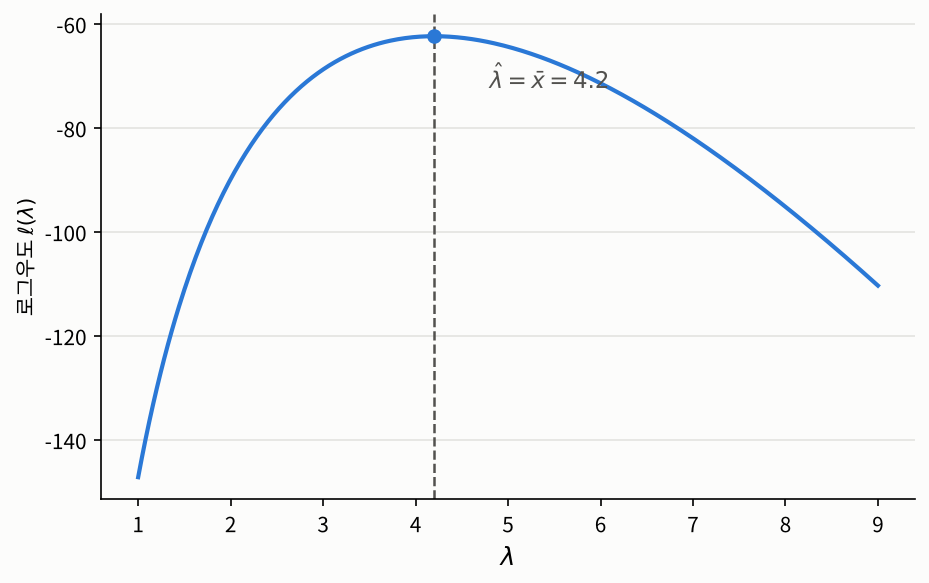

## 들어가며

[1장 소개 글](index.qmd)에서 이번 장이 답하려는 첫 번째 질문으로, 데이터로부터 모수를 정하는 **원리**를 이야기했습니다. 관측된 데이터를 가장 그럴듯하게 만드는 모수를 고른다는 최대우도의 아이디어였습니다. 이번 글에서는 이 아이디어를 수학적으로 정확하게 정의하고, 두 가지 예제로 실제로 추정값을 구해 보겠습니다.

1. 하루 사고 건수 데이터로 **포아송 분포의 모수**를 추정하는 문제
2. 키 데이터로 **정규분포의 평균과 분산**을 동시에 추정하는 문제

## 모수 통계(Parametric Statistics)

통계학에는 주어진 표본을 어떻게 바라보고 무엇을 가정하느냐에 따라 여러 갈래의 방법론이 있습니다. 이 과목에서는 그중에서도 **모수 통계**(parametric statistics)라고 불리는 갈래를 다룹니다.

모수 통계는 우리에게 주어진 표본을 **몇 개의 숫자로 결정되는 확률분포에서 생성된 결과물**로 보는 관점에서 출발합니다. 예를 들어 어느 고객센터에 걸려 오는 전화 사이의 대기 시간을 기록했다고 해 봅시다. 모수 통계에서는 이 데이터가 지수분포 $\mathrm{Exp}(\lambda)$, 즉 밀도함수가 $f(x) = \lambda e^{-\lambda x}$ $(x \ge 0)$인 분포에서 나왔다는 것을 일단 사실로 받아들이고 시작합니다. 분포의 **모양**은 이미 알고 있고, 모르는 것은 오직 $\lambda$가 구체적으로 어떤 값인가 하나뿐인 상황을 가정하는 것입니다. 그러면 표본을 분석하는 일은 데이터에 맞는 적절한 $\lambda$를 고르는 데서부터 시작하게 됩니다.

이때 $\lambda$처럼 같은 모양의 분포들 가운데 특정한 분포 하나를 콕 집어 정해 주는 열쇠가 되는 숫자를 **모수**(parameter)라고 부릅니다. $\lambda$의 값을 알면 대기 시간의 분포를 완전히 알게 되므로, 우리의 맥락에서 모수는 곧 **표본을 토대로 추정해야 할 미지수**입니다. 정규분포 $N(\mu, \sigma^2)$의 $\mu$와 $\sigma^2$, 베르누이 분포 $B(1, p)$의 성공 확률 $p$도 모두 모수입니다.

다만 "분포를 결정하는 열쇠"로서의 모수는 모수 통계에 들어서기 위한 출발점일 뿐입니다. 더 일반적으로는, 분포를 통째로 결정하지 않더라도 **모집단의 분포에 대해 우리가 알고 싶은 수치**라면 무엇이든 모수라고 부릅니다. 지수분포의 평균 대기 시간 $1/\lambda$, 모집단의 중앙값, 두 변수 사이의 상관계수 같은 값들이 그 예입니다. 이 값들은 모두 표본이 아니라 모집단, 즉 분포에 딸린 값이라는 점에서 모수입니다.

여기서 "데이터가 특정 분포에서 왔다는 것을 무슨 근거로 가정하느냐"는 의문이 드는 것은 자연스럽고, 실제로 일리 있는 지적입니다. 현실의 데이터가 정확히 지수분포를 따를 리는 없습니다. 통계학자들도 이 점을 잘 알고 있어서, 가정한 분포가 데이터와 잘 맞는지를 검사하는 **적합도 검정**(goodness-of-fit test)이나, 후보가 되는 여러 분포 가운데 어느 쪽이 더 나은지를 비교하는 방법들도 따로 발전해 왔습니다. 통계학자 박스(G. E. P. Box)가 남긴 "모든 모형은 틀렸지만, 그중 일부는 쓸모가 있다"는 말이 이 태도를 잘 요약합니다.[^box] 모형이 정확히 맞는지가 아니라, 문제를 푸는 데 충분히 쓸모 있는 근사인지가 중요하다는 것입니다. 모형을 검사하고 고르는 방법은 이 과목에서는 다루지 않고, 다른 글에서 따로 다룰 예정입니다.

모수 통계와 짝을 이루는 것이 **비모수 통계**(nonparametric statistics)입니다. 비모수 통계는 특정한 분포의 모양을 전제하지 않고, 그보다 훨씬 약한 가정, 예를 들어 표본이 i.i.d.라거나 분포가 연속이라는 정도의 가정에서 출발해 표본을 분석합니다. 가정이 약한 만큼 모형이 틀릴 위험은 줄어들지만, 대신 같은 양의 데이터로 끌어낼 수 있는 결론이 덜 날카로운 경우가 많습니다. 비모수 통계 역시 다른 글에서 따로 다룹니다.

이번 1장은 이 과목에서 다루는 모수 통계적인 아이디어들의 출발선이라고 할 수 있습니다. 모수가 무엇인지 알았으니, 이제 데이터로부터 그 모수를 어떻게 정할지를 이야기할 차례입니다. 이번 포스팅에서는 이러한 모수 통계 자체를 정확히 수학적으로 표현하는거부터 출발하게 됩니다.

### 덧붙여: 모수에 대한 흔한 오해 두 가지

개인적인 경험일 뿐이지만 이상하게도 모수와 모수 통계에 대해서는 꽤나 오해를 하고 있는 모습을 종종 볼 수 있었는데요, 이 오해를 짧게 조금만 바로잡고 출발하도록 하겠습니다.

첫째로, 과거에 저는 "모수 통계는 정규분포를 따르는 데이터를 분석하는 방법이므로, 정규분포를 따르지 않는 데이터에는 비모수 통계를 써야 한다"는 주장을 본 적이 있습니다. 이는 사실이 아닙니다. 앞에서 설명했듯이 모수 통계가 전제하는 것은 데이터가 **구체적인 값이 알려지지 않은 모수로 결정되는 어떤 분포**에서 왔다는 것뿐이고, 그 분포는 정규분포든 지수분포든 베르누이 분포든 상관없습니다. 하루 사고 건수를 포아송 분포로, 합격 여부를 베르누이 분포로 모형화하는 것도 모두 모수 통계입니다.

이런 오해가 생긴 데에는 나름의 이유가 있어보이긴 합니다. t-검정이나 분산분석처럼 널리 쓰이는 고전적인 모수적 방법들이 정규분포를 가정하고, 교과서에서도 비모수적 방법을 "정규성을 가정할 수 없을 때의 대안"으로 소개하는 경우가 많기 때문입니다. 또 1.5절에서 보겠지만, 적절한 정칙 조건(regularity condition) 아래에서는 어떤 분포에서 출발하든 최대우도 추정량이 근사적으로 정규분포를 따르게 됩니다. 즉 모수 통계에서 정규분포가 자주 등장하는 것은 사실이지만, 그것은 데이터에 대한 **전제**가 아니라 많은 경우 이론이 도달하는 **결론**입니다.

둘째, 표본의 크기를 모수라고 부르는 경우가 있습니다. "모수가 커질수록 표본평균이 기대값에 가까워진다"라거나, 설문조사 기사에서 "응답자 모수가 작다"라고 하는 식입니다. 아마 모수(母數)라는 한자어가 '전체의 수'처럼 읽히기 때문에 생긴 혼동으로 보이는데, 통계학 용어로서의 모수는 앞에서 설명한 parameter만을 뜻합니다. 표본에 들어 있는 관측값의 개수 $n$은 **표본 크기**(sample size), 모집단에 속한 대상의 수는 **모집단 크기**(population size)라고 부릅니다.

[^box]: G. E. P. Box, "Robustness in the Strategy of Scientific Model Building", in R. L. Launer & G. N. Wilkinson (eds.), *Robustness in Statistics*, Academic Press, 1979, pp. 201–236. 원문은 "All models are wrong but some are useful."입니다.

그럼 이제 본격적으로 이번 포스팅의 이야기를 시작해보도록 하겠습니다.

## 문제 1: 하루 사고 건수의 평균

### 문제 상황

어느 도시에서 30일 동안 하루에 일어난 교통사고 건수를 기록했더니 다음과 같았다고 합시다.

```
[3 6 3 5 2 3 6 4 2 2 4 1 2 7 5 4 2 7 3 4 8 7 3 5 4 4 6 3 3 6]
```

이런 "정해진 시간 동안 드물게 일어나는 사건의 횟수"는 흔히 **포아송 분포**(Poisson distribution)로 모델링됩니다. 모수가 $\lambda > 0$인 포아송 분포를 따르는 확률변수 $X$는

$$\mathbb{P}(X = k) = e^{-\lambda} \frac{\lambda^k}{k!}, \qquad k = 0, 1, 2, \ldots$$

를 만족하고, 그 기대값은 $\mathbb{E}[X] = \lambda$입니다. 즉 $\lambda$는 "하루 평균 사고 건수"입니다. 그렇다면 위 데이터로부터 $\lambda$를 어떻게 정해야 할까요?

대부분의 사람은 바로 "평균을 내면 된다"고 답할 것입니다. 맞는 직관입니다. 하지만 이 직관은 $\lambda$가 마침 기대값이라는 사실에 기대고 있습니다. 모수가 기대값과 직접 연결되지 않는 모형이라면, 혹은 모수가 여러 개 얽혀 있는 모형이라면 무엇을 평균 내야 할지조차 분명하지 않습니다. 우리에게 필요한 것은 이 예에서는 표본평균이라는 익숙한 답을 다시 내놓으면서도, **다른 모형에도 그대로 적용할 수 있는 원리**입니다.

### 접근 아이디어: 데이터를 가장 그럴듯하게 만드는 모수

아주 단순한 상황부터 생각해 보겠습니다. 상자가 두 개 있고, 각 상자에는 $0$, $1$, $2$가 적힌 공이 서로 다른 비율로 들어 있습니다.

| | 공 $0$ | 공 $1$ | 공 $2$ |
|:--|:--:|:--:|:--:|
| 상자 $\theta_0$ | $0.8$ | $0.1$ | $0.1$ |
| 상자 $\theta_1$ | $0.2$ | $0.3$ | $0.5$ |

누군가 두 상자 중 하나를 몰래 골라 공을 하나 꺼냈더니 $0$이 나왔습니다. 어느 상자였을까요? 상자 $\theta_0$에서라면 $0$이 나올 확률이 $0.8$이고, 상자 $\theta_1$에서라면 $0.2$입니다. 그러니 상자 $\theta_0$이라고 추측하는 것이 자연스럽습니다. 같은 이유로 $1$이나 $2$가 나왔다면 상자 $\theta_1$이라고 추측할 것입니다.

표로 말하면, 관측한 값의 **열**을 보고 그 열에서 확률이 가장 큰 **행**을 고르는 셈입니다. 이것이 최대우도 추정의 아이디어 전부입니다. **관측된 데이터가 나올 확률을 가장 크게 만드는 모수를 추정값으로 고릅니다.**

포아송 문제에도 똑같이 적용할 수 있습니다. 다만 이번에는 후보가 두 개가 아니라 $\lambda \in (0, \infty)$ 전체이고, 관측값도 하나가 아니라 30개입니다. 30일의 사고 건수가 서로 독립이라면, 모수가 $\lambda$일 때 정확히 이 데이터가 관측될 확률은

$$\mathbb{P}_\lambda(X_1 = x_1, \ldots, X_{30} = x_{30}) = \prod_{i=1}^{30} e^{-\lambda} \frac{\lambda^{x_i}}{x_i!}$$

입니다. 이것을 $\lambda$의 함수로 보고, 이 값을 가장 크게 만드는 $\lambda$를 찾으면 됩니다.

이 아이디어를 정확하게 만들려면 몇 가지를 분명히 해야 합니다. "데이터"와 "데이터로 계산한 값"은 수학적으로 무엇일까요? "후보 분포들의 모임"은 어떻게 표현할까요? 그리고 키처럼 연속적인 값을 관측할 때는 특정한 값이 나올 확률 자체가 $0$인데, 이때 "관측된 데이터가 나올 확률"은 무엇으로 바꿔야 할까요? 차례대로 정의해 보겠습니다.

### 필요한 개념들

먼저 우리는 "데이터"를 수학과 확률의 언어로 정확하게 표현할 필요가 있습니다. 
본격적인 정의에 앞서, 통계학에서 "표본"이라는 말이 서로 다른 두 수준에서 쓰인다는 점을 먼저 짚고 넘어가겠습니다. 이 구분을 놓치면 뒤에서 나오는 많은 이야기가 헷갈리기 쉽습니다.

**표본 레벨의 분석**은 이미 손에 쥔 데이터를 다룹니다. 문제 1의 사고 건수 $4, 6, 5, 4, \ldots$처럼, 관측이 끝난 데이터는 그저 고정된 숫자들입니다. 이 숫자들로 무엇을 계산하든 결과도 하나의 숫자이고, 예를 들어 표본평균은 $\bar{x} = 4.2$입니다. 숫자에는 더 이상 우연이 끼어들 여지가 없으므로, "$\bar{x}$의 기대값"이나 "$\bar{x}$의 분산" 같은 말은 의미가 없습니다. 우리가 손에 쥔 표본은 더이상 확률에 의해 결정되는 대상이 아니며, 이미 결정된 상태로 주어진 결과물이니까요.

**모집단 레벨의 분석**은 관측하기 **전**의 데이터를 다룹니다. 30일 동안의 사고 건수를 아직 기록하기 전이라면, 각 날의 사고 건수는 모집단 분포 $\mathrm{Poi}(\lambda)$를 따라 앞으로 정해질 확률변수 $X_1, \ldots, X_{30}$입니다. 이 확률변수들로 만든 표본평균 $\bar{X} = \frac{1}{30}\sum_{i=1}^{30} X_i$ 역시 확률변수이므로, 그 분포와 기대값, 분산을 이야기할 수 있습니다. 실제로 $\mathbb{E}[\bar{X}] = \lambda$이고 $\mathrm{Var}(\bar{X}) = \lambda/30$입니다.

두 레벨은 **실현**(realization)이라는 개념으로 이어집니다. 확률변수는 확률공간 $(\Omega, \mathcal{F}, \mathbb{P})$ 위의 함수이고, 우리가 실제로 관측한 데이터는 세상이 어떤 결과 $\omega \in \Omega$를 내놓았을 때 이 함수들이 취한 값, 즉 $x_i = X_i(\omega)$입니다. 주사위에 비유하면, 던지기 전의 눈은 $1$부터 $6$까지가 각각 확률 $1/6$로 나오는 확률변수이고, 던진 뒤 바닥에 놓인 $4$는 그 실현값입니다. 이 구분을 표기로도 드러내기 위해, 앞으로 확률변수는 대문자($X_i$, $\bar{X}$)로, 관측값은 소문자($x_i$, $\bar{x}$)로 씁니다.

| | 모집단 레벨 | 표본 레벨 |
|:--|:--|:--|
| 다루는 대상 | 관측 전의 확률변수 $X_1, \ldots, X_n$ | 관측된 숫자 $x_1, \ldots, x_n$ |
| 표본평균 | 확률변수 $\bar{X}$ | 숫자 $\bar{x}$ |
| 던질 수 있는 질문 | 기대값과 분산은 얼마인가? $n$이 커지면 어디로 수렴하는가? | 이 데이터에서 값은 얼마인가? |

그렇다면 왜 굳이 두 레벨을 구분해야 할까요? 실제 계산은 언제나 표본 레벨에서 일어납니다. 우리에게 있는 것은 단 하나의 데이터뿐이기 때문입니다. 하지만 그 계산 결과를 **얼마나 믿을 수 있는지**는 표본 레벨에서는 답할 수 없습니다. $\bar{x} = 4.2$라는 숫자 하나만 들여다봐서는 이것이 참값에 가까운지 알 길이 없습니다. 대신 모집단 레벨로 올라가면, "이 계산 절차를 데이터가 새로 나올 때마다 반복하면 결과가 어떻게 흩어지는가"를 물을 수 있습니다. [과목 소개 글](../index.qmd)에서 표본을 다섯 번 새로 뽑아 기울기가 흔들리는 것을 본 것이 바로 이 관점이었습니다. 정리하면, **계산은 표본 레벨에서 하고, 그 계산 방법이 좋은지 나쁜지는 모집단 레벨에서 따집니다.**

통계에서는 이 모집단 레벨의 분석과 표본 레벨의 분석이 자주 왔다갔다합니다. 근데 이걸 그 때 그 때 이건 모집단 레벨 분석이고, 저건 표본 레벨 분석이라고 명시하고 넘어가는 게 사실상 너무나 번거롭다보니, 이게 막 엄청 엄격하게 구분되지 않고 다뤄지는 경우도 많습니다. 하지만 지금 하는 게 어떤 레벨의 분석인지를 잘 고민하면서 공부하시면 보다 확실히 지금 이야기가 어떤 맥락인지를 파악하기 용이할겁니다.

마찬가지로 이 구분은 이 과목에서도 내내 등장합니다. 구체적으로 예를 들어 아래에서 정의할 우도함수는 관측된 데이터로 만드는 표본 레벨의 함수이지만, 1.3절에서는 같은 식에 확률변수 $\mathbf{X}$를 넣어, 표본에 따라 모양이 달라지는 무작위 함수로 다루게 됩니다. 이제 이 두 레벨을 정확한 언어로 옮겨 보겠습니다.

::: {.callout-note icon=false .callout-definition}
### 정의 1.1.1 (표본)
확률공간 $(\Omega, \mathcal{F}, \mathbb{P})$ 위의 확률변수 $X_1, \ldots, X_n:(\Omega, \mathcal{F})\to (\mathcal{X}, \mathcal{B}_{\mathcal{X}})$를 모은 확률벡터
$$\mathbf{X} := (X_1, \ldots, X_n) : (\Omega, \mathcal{F}) \to \big(\mathcal{X}^n, \mathcal{B}_{\mathcal{X}}^{\otimes n}\big)$$
를 **크기 $n$인 표본**(sample of size $n$)이라고 합니다. 표본 $\mathbf{X}$의 분포, 즉 $\mathcal{X}^n$ 위의 확률측도 $\mathbb{P} \circ \mathbf{X}^{-1}$가 $P$일 때 이를 $\mathbf{X} \sim P$로 씁니다.

특히 $X_1, \ldots, X_n$이 $\mathcal{X}$ 위의 같은 분포 $Q$를 따르는 i.i.d.이면, $\mathbf{X}$를 분포가 $Q$인 모집단에서 뽑은 **확률표본**(random sample)이라고 하고, 이를 다음과 같이 표현하기도 합니다.
$$X_1,\ldots,X_n \overset{\text{i.i.d.}}{\sim} Q \qquad \text{혹은} \qquad \mathbf{X} \sim Q^{\otimes n} \qquad \text{혹은} \qquad \mathbf{X} \sim Q^n$$
여기서 $Q^{\otimes n}$은 $Q$의 $n$차원 곱측도입니다. 즉 확률표본의 분포는 관측값 하나의 분포 $Q$만으로 완전히 정해집니다.

이제 표본 레벨로 넘어가서, 관측된 값 $\mathbf{x} = (x_1, \ldots, x_n)$을 **관측된 표본**(observed sample)이라고 합니다. 관측된 표본은 위의 모집단 레벨의 표본 $\mathbf{X}$의 실현값입니다. 수학적으로는 어떤 $\omega \in \Omega$를 함수 $\mathbf{X}$에 넣은 값 $\mathbf{X}(\omega) = \big(X_1(\omega), \ldots, X_n(\omega)\big)$에 $(x_1, \ldots, x_n)$이라는 이름을 붙여 부르는겁니다.

각 표본의 $j\in\{1,...,n\}$번째 점인 $x_j$는 표본의 $j$번째 데이터 포인트라고 합니다.
:::
간단한 이야긴데 뭔가 복잡해진 느낌이 있네요. 그냥 우리가 이미 알고 있던, 또 위에서 설명한 모집단과 표본의 관계를 좀 더 정확하게 수학적으로 추상화한 결과 정도로 받아들이시면 됩니다.

가끔 관측된 표본을 $(x_1, \ldots, x_n) = \big(X_1(\omega), \ldots, X_n(\omega)\big)$로 정의하는 것을 보고, 이런 의문을 가지는 분들이 있습니다. 

>$X_1, \ldots, X_n$이 모두 같은 분포를 따른다면 $X_1(\omega) = X_2(\omega) = \cdots = X_n(\omega)$가 되어서, 표본의 모든 데이터 포인트가 $x_1 = x_2 = \cdots = x_n$으로 똑같아지는 것 아닌가? 이건 말이 안되는데, 저 정의가 잘못된게 아니냐?

그렇지 않습니다. **동일 분포**라는 것은 각 확률변수가 만들어 내는 확률분포 $\mathbb{P} \circ X_j^{-1}$가 모두 같다는 뜻이지, 확률변수 $X_1, \ldots, X_n$이 **함수로서** 모두 같다는 뜻이 아니기 때문입니다. 분포가 같다는 것은 "각 값이 나올 확률이 같다"는 말일 뿐, "같은 $\omega$에서 같은 값을 낸다"는 말이 아닙니다.

간단한 예로 공정한 동전을 두 번 던지는 실험을 생각해 보겠습니다. 표본공간은 $\Omega = \{\mathrm{HH}, \mathrm{HT}, \mathrm{TH}, \mathrm{TT}\}$이고, 각 결과의 확률은 $1/4$입니다. 여기서 $X_1$은 첫 번째 던지기가 앞면이면 $1$, 아니면 $0$인 확률변수로, $X_2$는 두 번째 던지기가 앞면이면 $1$, 아니면 $0$인 확률변수로 둡니다.

| $\omega$ | $\mathrm{HH}$ | $\mathrm{HT}$ | $\mathrm{TH}$ | $\mathrm{TT}$ |
|:--|:--:|:--:|:--:|:--:|
| $X_1(\omega)$ | $1$ | $1$ | $0$ | $0$ |
| $X_2(\omega)$ | $1$ | $0$ | $1$ | $0$ |

두 확률변수 모두 $\mathbb{P}(X_j = 1) = \mathbb{P}(X_j = 0) = 1/2$이므로 같은 분포 $B(1, 1/2)$를 따르고, 서로 독립이기도 합니다. 즉 $X_1, X_2 \overset{\text{i.i.d.}}{\sim} B(1, 1/2)$입니다. 하지만 함수로서는 전혀 다릅니다. 예를 들어 실제로 일어난 결과가 $\omega = \mathrm{HT}$라면 관측된 표본은 $(x_1, x_2) = (X_1(\mathrm{HT}), X_2(\mathrm{HT})) = (1, 0)$이고, 두 값은 다릅니다.
분포가 동일함과 함수로서 동일함은 다른 의미이고, 이를 헷갈리시면 안됩니다.

우리는 표본을 통해서 우선 수치를 얻기를 원하는데요, 이를 위해 다음을 정의합니다.

::: {.callout-note icon=false .callout-definition}
### 정의 1.1.2 (통계량)
$\mathbf{X} : (\Omega, \mathcal{F}) \to \big(\mathcal{X}^n, \mathcal{B}_{\mathcal{X}}^{\otimes n}\big)$를 크기 $n$인 표본이라 하고, $(\mathcal{T}, \mathcal{B}_{\mathcal{T}})$를 가측공간이라고 합시다. 표본의 분포에 의존하지 않고 미리 정해진 가측함수
$$T : \big(\mathcal{X}^n, \mathcal{B}_{\mathcal{X}}^{\otimes n}\big) \to (\mathcal{T}, \mathcal{B}_{\mathcal{T}})$$
가 주어졌을 때, 합성함수
$$T(\mathbf{X}) := T \circ \mathbf{X} : (\Omega, \mathcal{F}) \to (\mathcal{T}, \mathcal{B}_{\mathcal{T}})$$
를 **통계량**(statistic)이라고 합니다. 가측함수의 합성은 가측함수이므로 $T(\mathbf{X})$는 $(\mathcal{T}, \mathcal{B}_{\mathcal{T}})$에 값을 가지는 확률변수입니다.

표본 레벨에서는, 관측된 표본 $\mathbf{x} = \mathbf{X}(\omega) \in \mathcal{X}^n$을 $T$에 넣은 값
$$t := T(\mathbf{x}) = T\big(\mathbf{X}(\omega)\big) \in \mathcal{T}$$
를 통계량 $T(\mathbf{X})$의 **관측값**(observed value)이라고 합니다.
:::

기호들이 많이 등장해서 복잡해 보이지만 간단합니다. 예를 들어 $\mathcal{X} = \mathbb{R}$일 때, 함수
$$T : \big(\mathbb{R}^n, \mathcal{B}(\mathbb{R}^n)\big) \to \big(\mathbb{R}, \mathcal{B}(\mathbb{R})\big), \qquad T(x_1, \ldots, x_n) := \frac{1}{n}\sum_{i=1}^n x_i$$
는 연속함수이므로 보렐 가측입니다. 따라서 **표본평균** $\bar{X} := T(\mathbf{X}) = \frac{1}{n}\sum_{i=1}^n X_i$는 통계량이고, 그 관측값이 우리가 데이터로 계산하는 $\bar{x} = T(\mathbf{x})$입니다. 통계량의 값이 꼭 실수 하나일 필요는 없습니다. 예를 들어 $\mathcal{T} = \mathbb{R}^2$로 두면 표본평균과 표본분산의 쌍 $(\bar{X}, S^2)$도 하나의 통계량입니다.

이 정의에서 핵심은 $T$가 표본의 확률공간과 별개인 **표본공간 $\mathcal{X}^n$ 위에서** 정의된 함수라는 점입니다. 통계량의 값은 오직 $\mathbf{X}(\omega)$, 즉 관측된 데이터를 통해서만 결정됩니다. 그래서 데이터만 손에 쥐면 그 값을 계산할 수 있습니다. 위 정의에서 이를 명시적으로 표현하는 것이 "함수 $T$가 미리 정해져 있다"는 조건입니다. 통계량은 **데이터만 있으면 계산할 수 있어야** 한다는 이야기에요. 예를 들어 모집단의 평균 $\mu$를 모르는 상황에서 $\bar{X} - \mu$는 통계량이 아닙니다. 데이터를 다 가지고 있어도 $\mu$를 모르니 값을 계산할 수 없기 때문입니다.

다음으로 "후보 분포들의 모임"을 정의합니다. 상자 예에서는 후보가 상자 $\theta_0$과 $\theta_1$ 두 개였고, 포아송 예에서는 $\lambda > 0$ 하나하나가 후보입니다. 이처럼 후보 분포들을 유한 개의 실수, 즉 **모수**(parameter)로 이름 붙여 나열한 것을 모수적 모형이라고 합니다.

::: {.callout-note icon=false .callout-definition}
### 정의 1.1.3 (모수적 모형과 식별가능성)
집합 $\Theta \subset \mathbb{R}^d$에 대해, 표본 $\mathbf{X}$가 가질 수 있는 분포, 즉 $\big(\mathcal{X}^n, \mathcal{B}_{\mathcal{X}}^{\otimes n}\big)$ 위의 확률측도들의 모임
$$\mathcal{P} = \{P_\theta : \theta \in \Theta\}$$
를 **모수적 분포족**(parametric family)이라고 하고, $\Theta$를 **모수공간**(parameter space)이라고 합니다. 표본 $\mathbf{X}$의 분포가 어떤 $\theta \in \Theta$에 대해 $P_\theta$라고 가정하는 것, 즉 $\mathbf{X} \sim P_\theta$를 가정하는 것을 **모수적 통계 모형**(parametric statistical model)이라고 합니다. 여기서 우리는 $\theta$의 값이 알려지면 분포 $P_\theta$가 유일하게 결정됨을 암시적으로 전제합니다.

또한 $\theta_1 \neq \theta_2$이면 항상 $P_{\theta_1} \neq P_{\theta_2}$일 때, 이 모형은 **식별가능하다**(identifiable)고 합니다.
:::

확률표본의 경우 $P_\theta$는 관측값 하나의 분포 $Q_\theta$를 $n$번 곱한 곱측도 $Q_\theta^{\otimes n}$으로 완전히 정해지므로, 보통 관측값 하나의 분포만 적어 모형을 부릅니다. 예를 들어 포아송 예에서는 $\Theta = (0, \infty)$이고, $X_1, \ldots, X_{30} \overset{\text{i.i.d.}}{\sim} \mathrm{Poi}(\lambda)$, 즉 $P_\lambda = \mathrm{Poi}(\lambda)^{\otimes 30}$인 모형입니다. 이를 간단히 "포아송 모형"이라고 부르는 식입니다.

식별가능성은 당연해 보이지만 중요한 조건입니다. 데이터가 우리에게 알려 줄 수 있는 것은 기껏해야 **분포**뿐입니다. 서로 다른 두 모수가 정확히 같은 분포를 준다면, 데이터를 아무리 많이 모아도 둘 중 어느 쪽이 참인지 구별할 수 없습니다. 예를 들어 $\theta = (\mu_1, \mu_2)$이고 $P_\theta$가 정규분포 $N(\mu_1 + \mu_2, 1)$이라면, $\theta = (1, 2)$와 $\theta'=(0, 3)$는 모두 같은 분포 $N(3,1)$를 주므로 이 모형은 식별가능하지 않습니다. 이런 모형에서 "참된 $\theta$를 추정한다"는 질문은 처음부터 답이 없습니다. 아무리 많은 표본을 긁어와도 그걸로 추정한 모수의 확률분포가 같다면, 이는 애초에 통계적인 분석이 들어갈 여지조차 없어져버리는거니까요. 그래서 우리는 항상 식별가능성을 전제하고 이야기를 진행합니다.

이 조건은 뒤의 장에서 선형 회귀의 계획행렬이 꽉 찬 계수(full rank)를 가져야 한다는 조건 등으로 모습을 바꿔 계속 등장합니다.

이제 "관측된 데이터가 나올 확률"을 정확히 정의할 차례입니다. 포아송처럼 정수 값을 갖는 분포에서는 확률질량함수를, 정규분포처럼 연속적인 분포에서는 확률밀도함수를 쓰면 됩니다. 측도론의 언어를 쓰면 이 두 경우를 하나로 묶을 수 있습니다. 확률질량함수는 **세는 측도**(counting measure)에 대한 밀도이고, 확률밀도함수는 **르베그 측도**(Lebesgue measure)에 대한 밀도이기 때문입니다.

::: {.callout-note icon=false .callout-definition}
### 정의 1.1.4 (우도함수와 최대우도 추정값)
모수적 통계 모형 $\{P_\theta : \theta \in \Theta\}$에서, 모든 $P_\theta$가 $\theta$에 의존하지 않는 하나의 $\sigma$-유한 측도 $\nu$ (단, $\nu$는 $\big(\mathcal{X}^n, \mathcal{B}_{\mathcal{X}}^{\otimes n}\big)$ 위의 측도)에 대한 결합밀도 $p(\cdot, \theta)$를 가진다고 합시다. 관측된 표본 $\mathbf{x} \in \mathcal{X}^n$에 대해 다음과 같이 정의합니다.

1. 관측된 표본 $\mathbf{x}$를 고정하고 결합밀도를 $\theta$의 함수로 본 것
$$L(\theta) := p(\mathbf{x}, \theta)$$
를 **우도함수**(likelihood function)라고 합니다.
2. $\ell(\theta) := \log L(\theta)$를 **로그우도함수**(log-likelihood function)라고 합니다. 단, $\log 0 := -\infty$로 약속합니다.
3. $L(\hat{\theta}) = \max_{\theta \in \Theta} L(\theta)$를 만족하는 $\hat{\theta} \in \Theta$를 $\theta$의 **최대우도 추정값**(maximum likelihood estimate)이라고 합니다.

특히 $\mathbf{X}$가 확률표본이고, 관측값 하나의 분포 $Q_\theta$가 $(\mathcal{X}, \mathcal{B}_{\mathcal{X}})$ 위의 $\sigma$-유한 측도 $\mu$에 대한 밀도 $f(\cdot, \theta)$를 가지면, 독립성에 의해 결합밀도는 곱측도 $\nu = \mu^{\otimes n}$에 대해 $p(\mathbf{x}, \theta) = \prod_{i=1}^n f(x_i, \theta)$입니다. 따라서
$$L(\theta) = \prod_{i=1}^n f(x_i, \theta), \qquad \ell(\theta) = \sum_{i=1}^n \log f(x_i, \theta)$$
입니다.
:::

정리하면, 우리의 아이디어는 관측된 표본을 가장 그럴듯하게 설명하는 $\theta$, 즉 우도를 가장 크게 만드는 $\theta$를 골라 모수의 추정값으로 쓰자는 것입니다. 그 주인공이 바로 최대우도 추정값입니다. 이 정의에 대해 두 가지를 짚고 넘어가겠습니다.

첫째, 우도함수는 $\theta$에 대한 확률분포가 **아닙니다**. 결합밀도 $p(\mathbf{x}, \theta)$는 $\theta$를 고정했을 때 $\mathbf{x}$에 대한 분포이지만, 우도는 거꾸로 $\mathbf{x}$를 고정하고 $\theta$를 움직입니다. 그래서 $L(\theta)$를 $\theta$에 대해 적분해도 $1$이 될 이유가 없습니다. 우도는 "이 $\theta$ 아래에서 지금의 데이터가 얼마나 그럴듯한가"를 재는 점수일 뿐이므로, 이를 $\theta$가 참값일 확률처럼 해석해서는 안 됩니다.

둘째, 정의에서 우도함수에 로그를 취한 로그우도함수를 따로 정의한 이유입니다. $\log$는 순증가함수이므로 $L$을 최대화하는 $\theta$와 $\ell$을 최대화하는 $\theta$는 같습니다. 그런데 확률표본에서 $L$은 곱이고 $\ell$은 **합**입니다. 합은 미분하기 훨씬 쉽고, 작은 확률을 수십 번 곱해서 컴퓨터가 $0$으로 처리해 버리는 문제도 피할 수 있습니다. 더 나아가 합에는 큰 수의 법칙과 중심극한정리를 쓸 수 있는데, 이것이 1.5절에서 최대우도 추정량의 성질을 증명하는 열쇠가 됩니다.

그런데 지금까지 정의한 최대우도 추정값은 관측된 표본 하나로 계산한 **숫자**, 즉 표본 레벨의 대상입니다. [과목 소개 글](../index.qmd)에서 표본을 새로 뽑을 때마다 기울기가 달라지는 것을 보았듯이, 추정 방법이 얼마나 믿을 만한지를 따지려면 모집단 레벨로 올라가 "표본에 따라 달라지는 추정값"을 하나의 확률변수로 다뤄야 합니다. 이를 정확히 한 것이 다음의 **최대우도 추정량**입니다.

::: {.callout-note icon=false}
### 참고 1.1.5 (최대우도 추정량)
우도함수는 관측된 표본에 따라 달라지므로, 이를 $L(\theta; \mathbf{x})$로 쓰고 각 $\mathbf{x} \in \mathcal{X}^n$에 대한 최대우도 추정값들의 집합을
$$M(\mathbf{x}) := \Big\{\hat{\theta} \in \Theta : L(\hat{\theta}; \mathbf{x}) = \max_{\theta \in \Theta} L(\theta; \mathbf{x})\Big\}$$
로 둡시다. 각 관측된 표본에 최대우도 추정값 하나를 대응시키는 함수
$$T : \big(\mathcal{X}^n, \mathcal{B}_{\mathcal{X}}^{\otimes n}\big) \to \big(\Theta, \mathcal{B}(\Theta)\big), \qquad T(\mathbf{x}) \in M(\mathbf{x}) \quad (\nu\text{-거의 모든 } \mathbf{x} \in \mathcal{X}^n)$$
가 가측이면, 정의 1.1.2에 의해 $\hat{\theta}_{\mathrm{ML}} := T(\mathbf{X})$는 통계량입니다. 이 통계량을 $\theta$의 **최대우도 추정량**(maximum likelihood estimator, MLE)이라고 합니다.
:::

한국어 용어가 마침 잘 구분해 주듯이, **추정값**(estimate)은 관측된 표본 $\mathbf{x}$로 계산한 숫자 $T(\mathbf{x})$이고, **추정량**(estimator)은 표본 $\mathbf{X}$의 함수인 확률변수 $T(\mathbf{X})$입니다. 앞에서 본 두 레벨의 구분이 그대로 용어에 담겨 있는 셈입니다. 이 정의에는 두 가지 조건이 숨어 있습니다.

먼저 $T(\mathbf{x})$를 $M(\mathbf{x})$에서 **하나 고른다**는 점입니다. 정의 1.1.4는 최대우도 추정값이 존재한다고도, 유일하다고도 말하지 않습니다. 실제로 1.2절에서 보겠지만 $M(\mathbf{x})$는 비어 있을 수도 있고, 원소가 여러 개일 수도 있습니다. 원소가 여러 개면 그중 하나를 고르는 규칙을 정해야 합니다. 비어 있는 $\mathbf{x}$가 있더라도 그런 $\mathbf{x}$들의 집합이 $\nu$-측도 $0$이면 괜찮습니다. 모든 $P_\theta$가 $\nu$에 대한 밀도를 가지므로, 그런 표본은 어떤 $\theta$ 아래에서도 확률 $0$으로만 관측되기 때문입니다.

다음으로 $T$가 **가측**이어야 한다는 점입니다. $T$가 가측이 아니면 $\mathbb{P}(\hat{\theta}_{\mathrm{ML}} \in B)$ 같은 확률조차 정의되지 않아서, 추정량의 분포나 기대값, 분산을 이야기할 수 없습니다. 가측성은 결국 최대우도 추정량을 확률변수로 다루기 위한 조건입니다.

이제 실제로 최대우도 추정값을 찾을 차례입니다. 그러려면 $\ell$의 최댓값을 구해야 하는데, $\ell$이 미분가능하다면 미적분학에서 익숙한 방법을 쓸 수 있습니다.

::: {.callout-important icon=false .callout-satz}
### 정리 1.1.6 (내부 최댓값의 필요조건)
$\hat{\theta}$가 모수공간 $\Theta \subset \mathbb{R}^d$의 내부점이고 $\ell$이 $\hat{\theta}$에서 미분가능하다고 합시다. $\hat{\theta}$에서 $\ell$이 최댓값을 가지면 다음이 성립합니다.
$$\frac{\partial \ell}{\partial \theta}(\hat{\theta}) = 0$$
:::

::: {.callout-tip collapse="false" icon=false .callout-beweis}
### 증명
[해석학](../../../math/analysis/index.qmd)의 다변수 함수의 극값 부분을 참고하시기 바랍니다.
:::

이 방정식 $\frac{\partial\ell}{\partial\theta} = 0$을 **점수 방정식**(score equation)이라고 부르고, 그 좌변 $U_n:=\frac{\partial\ell}{\partial\theta}$를 **점수 함수**(score function)라고 부릅니다. 점수 함수는 1.3절에서 본격적으로 다룹니다.

정리 1.1.6은 **필요조건**일 뿐이라는 점에 주의해야 합니다. 점수 방정식의 해는 최댓값일 수도 있지만 최솟값이나 안장점일 수도 있습니다. 또 최댓값이 모수공간의 경계에 있거나, $\ell$이 최댓값에서 미분가능하지 않으면 점수 방정식으로는 아예 찾을 수 없습니다. 그래서 점수 방정식을 푼 뒤에는 그 해가 정말 최댓값인지를 따로 확인해야 합니다.

### 해결

지금까지의 내용을 계산 절차로 정리하면 다음과 같습니다.

::: {.callout-note icon=false}
### 알고리즘 1.1.7 (최대우도 추정값 구하기)
**입력:** 관측된 표본 $\mathbf{x} = (x_1, \ldots, x_n)$, 모수적 통계 모형 $\{P_\theta : \theta \in \Theta\}$<br>
**출력:** 최대우도 추정값 $\hat{\theta}$

1. 로그우도 $\ell(\theta) = \log p(\mathbf{x}, \theta)$를 씁니다. 확률표본(i.i.d.)이라면 $\ell(\theta) = \sum_{i=1}^n \log f(x_i, \theta)$입니다.
2. 점수 방정식 $\partial \ell(\theta) / \partial \theta = 0$을 풀어 $\Theta$의 내부에 있는 후보를 찾습니다.
3. 후보가 정말 $\Theta$ 전체에서의 최댓값인지 확인합니다. 모수공간의 경계와 $\ell$이 미분가능하지 않은 점도 함께 살펴봅니다.
:::

포아송 문제에 적용해 보겠습니다. 30일의 사고 건수를 확률표본 $X_1, \ldots, X_{30} \overset{\text{i.i.d.}}{\sim} \mathrm{Poi}(\lambda)$로 보면, 우도는 관측값 하나의 밀도의 곱입니다. 포아송 분포는 $\{0, 1, 2, \ldots\}$ 위의 세는 측도에 대한 밀도 $f(k, \lambda) = e^{-\lambda}\lambda^k / k!$를 가지므로, $\bar{x} := \frac{1}{n}\sum_{i=1}^n x_i$로 쓰면 우도함수는

$$L(\lambda) = \prod_{i=1}^n e^{-\lambda}\frac{\lambda^{x_i}}{x_i!} = \frac{e^{-n\lambda}\,\lambda^{n\bar{x}}}{\prod_{i=1}^n x_i!}$$

입니다. 분모는 $\lambda$와 무관한 양의 상수입니다. 이제 표본에 사고가 한 번이라도 있었는지, 즉 $\bar{x} > 0$인지 $\bar{x} = 0$인지에 따라 경우를 나눠야 합니다.

**$\bar{x} > 0$인 경우.** 모수공간 $\Theta = (0, \infty)$에서 알고리즘 1.1.7을 그대로 따라갑니다.

- **로그우도 (정의 1.1.4):** 양변에 로그를 취하면
$$\ell(\lambda) = -n\lambda + n\bar{x}\log\lambda - \sum_{i=1}^n \log x_i!$$
입니다. 마지막 항은 $\lambda$와 무관한 상수입니다.
- **점수 방정식 (정리 1.1.6):** $\Theta = (0, \infty)$는 열린집합이므로 모든 점이 내부점입니다. 미분하면
$$\frac{\partial \ell}{\partial \lambda}(\lambda) = -n + \frac{n\bar{x}}{\lambda} = 0 \quad\Longleftrightarrow\quad \lambda = \bar{x}$$
이므로 후보는 $\hat{\lambda} = \bar{x}$ 하나뿐입니다.
- **최댓값 확인:** 점수 함수 $-n + n\bar{x}/\lambda$는 $\lambda < \bar{x}$에서 양수, $\lambda > \bar{x}$에서 음수입니다. 즉 $\ell$은 $\bar{x}$까지 증가하다가 그 뒤로 감소하므로, $\hat{\lambda} = \bar{x}$는 $(0, \infty)$ 전체에서의 최댓값입니다.

**$\bar{x} = 0$인 경우.** 30일 내내 사고가 한 건도 없었다면 모든 $x_i = 0$이므로 우도함수는 $L(\lambda) = e^{-n\lambda}$입니다. 이 함수는 $(0, \infty)$에서 순감소하므로, $\lambda$를 $0$에 가까이 가져갈수록 커져서 상한 $1$에 다가가지만 $(0, \infty)$ 안의 어떤 점에서도 그 값에 도달하지 않습니다. 실제로 점수 방정식은 $\partial \ell / \partial \lambda = -n = 0$이 되어 해가 없습니다. 즉 모수공간을 $(0, \infty)$로 두면 **이 표본에서는 최대우도 추정값이 존재하지 않습니다.**

이 문제는 모수공간에 경계점 $\lambda = 0$을 포함시켜 $\Theta = [0, \infty)$로 넓히면 해결됩니다. $0^0 := 1$로 약속하면 $f(k, 0) = \mathbf{1}\{k = 0\}$이 되어, $\lambda = 0$은 "사고가 절대 일어나지 않는" 분포, 즉 $\mathbb{P}(X = 0) = 1$인 퇴화된 분포를 뜻하게 됩니다. 이렇게 넓힌 모수공간에서는 $L(0) = 1 > e^{-n\lambda} = L(\lambda)$가 모든 $\lambda > 0$에 대해 성립하므로, 최대우도 추정값은 **경계점** $\hat{\lambda} = 0 = \bar{x}$입니다. 정리 1.1.6이 경고한 대로, 최댓값이 모수공간의 경계에 있어서 점수 방정식으로는 찾을 수 없었던 경우입니다.

모수공간을 넓혀도 $\bar{x} > 0$인 경우의 답은 바뀌지 않습니다. 이때는 $n\bar{x} \ge 1$이므로 $L(0) = 0$이고, 새로 추가된 점 $\lambda = 0$은 최댓값이 될 수 없기 때문입니다. 정리하면, 모수공간을 $\Theta = [0, \infty)$로 두면 **모든 표본에 대해** 최대우도 추정값이 존재하고, 그 값은

$$\hat{\lambda} = \bar{x}$$

입니다. 결국 최대우도 추정값은 **표본평균**입니다. "평균을 내면 된다"는 직관이 최대우도라는 원리로부터 다시 유도된 것입니다.

참고로 $\bar{x} = 0$이 될 확률은 $\mathbb{P}_\lambda(X_1 = \cdots = X_n = 0) = e^{-n\lambda}$입니다. $\lambda = 4$, $n = 30$이면 $e^{-120}$으로 사실상 일어나지 않지만, 하루 평균 사고가 $0.05$건 정도인 드문 사건이라면 $e^{-1.5} \approx 0.22$로 결코 무시할 수 없는 확률입니다. 추정 방법은 이런 경우까지 빠짐없이 답을 줘야 합니다.

이제 앞의 데이터로 계산해 보겠습니다. 이 데이터는 사실 $\lambda = 4$인 포아송 분포에서 직접 생성한 것입니다.

```python
import numpy as np

np.random.seed(1557)
x = np.random.poisson(lam=4, size=30)   # 30일 동안의 하루 사고 건수
print(x)
print(x.mean())
```

```
[4 6 5 4 4 2 7 6 3 3 3 3 6 2 6 3 5 6 5 0 7 3 2 7 2 7 5 4 5 1]
4.2
```

아래 그림은 이 데이터의 로그우도 $\ell(\lambda)$를 그린 것입니다. 곡선이 $\hat{\lambda} = \bar{x} = 4.2$에서 가장 높아지는 것을 볼 수 있습니다.

{fig-alt="가로축이 λ, 세로축이 로그우도인 그래프. 곡선은 λ가 1일 때 약 -147에서 시작해 빠르게 올라가 λ가 4.2일 때 최댓값 약 -62에 도달한 뒤 완만하게 내려간다. 최댓값 위치에 회색 점선이 그어져 있다." width=70%}

참값 $4$와 정확히 같지는 않지만, 30일치 데이터만으로 꽤 가까운 값을 얻었습니다. 이 오차가 얼마나 될지, 그리고 데이터가 늘어나면 정말 참값으로 다가가는지는 1.5절의 주제입니다.

## 문제 2: 키의 평균과 분산

### 문제 상황

이번에는 어느 집단에서 무작위로 뽑은 20명의 키를 재어, 키가 정규분포 $N(\mu, \sigma^2)$를 따른다고 가정하고 평균 $\mu$와 분산 $\sigma^2$를 함께 추정하려고 합니다. 문제 1과 비교하면 두 가지가 다릅니다. 관측값이 **연속적**이어서 특정한 키가 정확히 나올 확률이 $0$이고, 모수가 $\theta = (\mu, \sigma^2)$로 **두 개**입니다.

### 접근 아이디어

문제 1과 똑같습니다. 데이터를 가장 그럴듯하게 만드는 $(\mu, \sigma^2)$를 고릅니다. 다만 연속인 관측값에서는 "그 값이 나올 확률" 대신 "그 값 근처의 밀도"로 그럴듯함을 잽니다. 정의 1.1.4에서 관측값 하나의 기준 측도 $\mu$를 르베그 측도로 두면 이것이 바로 정규분포의 확률밀도함수로 만든 우도함수입니다. 즉 새로운 개념은 필요하지 않고, 같은 정의와 같은 알고리즘을 그대로 쓰면 됩니다. 달라지는 것은 점수 방정식이 모수의 개수만큼의 연립방정식이 된다는 점뿐입니다.

### 해결

알고리즘 1.1.7을 그대로 따라가 보겠습니다. 모수공간은 $\Theta = \mathbb{R} \times (0, \infty)$이고, 열린집합입니다.

- **로그우도 (정의 1.1.4):** 20명을 무작위로 뽑았으므로 키를 확률표본 $X_1, \ldots, X_{20} \overset{\text{i.i.d.}}{\sim} N(\mu, \sigma^2)$로 봅니다. 정규분포의 밀도는 $f(x, \mu, \sigma^2) = (2\pi\sigma^2)^{-1/2} \exp\{-(x-\mu)^2 / (2\sigma^2)\}$이므로
$$\ell(\mu, \sigma^2) = -\frac{n}{2}\log(2\pi\sigma^2) - \frac{1}{2\sigma^2}\sum_{i=1}^n (x_i - \mu)^2$$
입니다.
- **점수 방정식 (정리 1.1.6):** 두 모수로 각각 편미분하면
$$\frac{\partial \ell}{\partial \mu} = \frac{1}{\sigma^2}\sum_{i=1}^n (x_i - \mu) = 0, \qquad \frac{\partial \ell}{\partial \sigma^2} = -\frac{n}{2\sigma^2} + \frac{1}{2\sigma^4}\sum_{i=1}^n (x_i - \mu)^2 = 0$$
입니다. 첫 식에서 $\mu = \bar{x}$를 얻고, 이를 둘째 식에 넣으면 후보
$$\hat{\mu} = \bar{x}, \qquad \hat{\sigma}^2 = \frac{1}{n}\sum_{i=1}^n (x_i - \bar{x})^2$$
을 얻습니다. 관측값이 모두 같은 경우(확률 $0$)만 아니면 $\hat{\sigma}^2 > 0$이므로 이 후보는 $\Theta$ 안에 있습니다.
- **최댓값 확인:** 두 단계로 확인합니다. 먼저 항등식
$$\sum_{i=1}^n (x_i - \mu)^2 = \sum_{i=1}^n (x_i - \bar{x})^2 + n(\bar{x} - \mu)^2 \;\ge\; n\hat{\sigma}^2$$
때문에, $\sigma^2$를 어떤 값으로 고정하든 $\ell(\mu, \sigma^2) \le \ell(\bar{x}, \sigma^2)$입니다. 다음으로 $g(s) := \ell(\bar{x}, s) = -\frac{n}{2}\log(2\pi s) - \frac{n\hat{\sigma}^2}{2s}$를 미분하면
$$g'(s) = \frac{n}{2s^2}\left(\hat{\sigma}^2 - s\right)$$
이므로 $g$는 $s = \hat{\sigma}^2$까지 증가하다가 그 뒤로 감소합니다. 두 사실을 합치면 모든 $(\mu, \sigma^2) \in \Theta$에 대해 $\ell(\mu, \sigma^2) \le \ell(\bar{x}, \sigma^2) \le \ell(\bar{x}, \hat{\sigma}^2)$이고, 따라서 $(\hat{\mu}, \hat{\sigma}^2)$가 최대우도 추정값입니다.

평균의 추정값은 이번에도 표본평균입니다. 그런데 분산의 추정값은 조금 낯설 수 있습니다. 기초 통계학에서는 보통 표본분산을 $n$이 아니라 $n-1$로 나눈
$$s^2 := \frac{1}{n-1}\sum_{i=1}^n (x_i - \bar{x})^2$$
으로 배우기 때문입니다. 최대우도 추정값 $\hat{\sigma}^2$는 $n$으로 나눕니다. 실제 데이터로 비교해 보겠습니다. 이번 데이터는 $\mu = 170$, $\sigma = 6$, 즉 $\sigma^2 = 36$인 정규분포에서 생성했습니다.

```python
np.random.seed(1557)
y = np.random.normal(loc=170, scale=6, size=20)   # 키 20개 (단위: cm)
mu_hat = y.mean()
sigma2_hat = np.mean((y - mu_hat) ** 2)           # 1/n로 나눈 값
print(f"mu_hat     = {mu_hat:.3f}")
print(f"sigma2_hat = {sigma2_hat:.3f}")
print(f"s^2        = {y.var(ddof=1):.3f}")        # 1/(n-1)로 나눈 값
```

```
mu_hat     = 168.624
sigma2_hat = 25.775
s^2        = 27.131
```

왜 두 가지 버전이 있을까요? 둘 중 어느 것이 더 좋을까요? 이 질문에 답하려면 숫자 하나가 아니라 **추정량**, 즉 표본을 바꿀 때마다 달라지는 확률변수로서의 $\hat{\sigma}^2$를 봐야 합니다. 표본 $\mathbf{X}$에 대해 항등식 $\sum_i (X_i - \bar{X})^2 = \sum_i (X_i - \mu)^2 - n(\bar{X} - \mu)^2$의 양변에 기대값을 취하면, $\mathbb{E}[(X_i - \mu)^2] = \sigma^2$이고 $\mathbb{E}[(\bar{X} - \mu)^2] = \sigma^2/n$이므로

$$\mathbb{E}\left[\sum_{i=1}^n (X_i - \bar{X})^2\right] = n\sigma^2 - n \cdot \frac{\sigma^2}{n} = (n-1)\sigma^2, \qquad \text{즉} \qquad \mathbb{E}[\hat{\sigma}^2] = \frac{n-1}{n}\sigma^2$$

입니다. 최대우도 추정량 $\hat{\sigma}^2$는 평균적으로 참값보다 조금 **작게** 나오고, $n-1$로 나눈 $s^2$는 이 치우침을 바로잡은 것입니다. 표본 크기를 $n = 5$로 작게 잡고 표본을 10만 번 새로 뽑아 확인해 보겠습니다.

```python
n, reps = 5, 100_000
samples = np.random.normal(loc=170, scale=6, size=(reps, n))
sigma2_ml = samples.var(axis=1)                   # 표본마다 1/n로 나눈 값
print(f"sigma2_hat의 평균  = {sigma2_ml.mean():.3f}")
print(f"(n-1)/n * sigma^2 = {(n - 1) / n * 36:.3f}")
```

```
sigma2_hat의 평균  = 28.760
(n-1)/n * sigma^2 = 28.800
```

참값 $36$이 아니라 이론값 $28.8$ 근처에 모이는 것을 볼 수 있습니다. 최대우도 추정량이라고 해서 언제나 "평균적으로 맞는 답"을 주는 것은 아닙니다. 다만 치우침의 비율 $(n-1)/n$은 $n$이 커질수록 $1$에 가까워지므로, 데이터가 많아지면 이 차이는 사라집니다.

## 정리: 두 예제가 공유하는 구조

두 문제를 나란히 놓으면 다음과 같습니다.

| | 모형 | 관측값 하나의 기준 측도 | 모수 | 최대우도 추정값 |
|:--|:--|:--|:--|:--|
| 문제 1 | 포아송 분포 | 세는 측도 | $\lambda$ | $\bar{x}$ |
| 문제 2 | 정규분포 | 르베그 측도 | $(\mu, \sigma^2)$ | $\left(\bar{x}, \tfrac{1}{n}\sum_i (x_i - \bar{x})^2\right)$ |

모형이 이산이든 연속이든, 모수가 하나든 둘이든 절차는 똑같았습니다. **모형을 정하고, 로그우도를 쓰고, 점수 방정식을 풀고, 그 해가 정말 최댓값인지 확인합니다.** 이처럼 모형만 주어지면 기계적으로 추정 방법이 정해진다는 것이 최대우도 추정의 가장 큰 장점입니다. [과목 소개 글](../index.qmd)에서 회귀의 제곱 오차 최소화가 정규분포 가정 아래의 최대우도 추정과 같다고 했는데, 이것도 3장에서 바로 이 절차로 확인하게 됩니다.

한편 이번 글은 몇 가지 질문을 남깁니다.

- **최대우도 추정값은 항상 존재하고 유일한가?** 문제 1에서 30일 내내 사고가 한 건도 없었다면 $\bar{x} = 0$이 되어, 점수 방정식의 해가 모수공간 $(0, \infty)$ 안에 없습니다. 이럴 때는 어떻게 해야 할까요? 또 점수 방정식으로는 찾을 수 없는 최댓값이나, 최댓값을 주는 점이 무수히 많은 경우도 있습니다.
- **점수 방정식을 손으로 풀 수 없다면?** 두 예제는 운 좋게도 점수 방정식이 깔끔하게 풀렸습니다. 하지만 4장의 로지스틱 회귀처럼 대부분의 모형에서는 해를 식으로 쓸 수 없어서 수치적으로 찾아야 합니다.
- **추정값을 얼마나 믿을 수 있는가?** 문제 1의 $4.2$는 참값 $4$에서 얼마나 벗어날 수 있을까요? 문제 2에서는 최대우도 추정량이 치우칠 수 있다는 것도 보았습니다. 데이터가 늘어나면 최대우도 추정량은 정말 참값으로 다가갈까요? 다가간다면 그 오차는 어떤 분포를 따를까요?

이 질문들은 [1장 소개 글](index.qmd)에서 예고한 대로 이어지는 절들에서 차례로 다룹니다. 존재와 유일성은 1.2절, 점수 방정식의 수치적 풀이는 1.3절과 1.4절, 추정량의 성질은 1.5절의 주제입니다.

---

### 연결되는 개념
* $\leftarrow$ **이전 개념:** [1 최대우도 추정](index.qmd)
* $\rightarrow$ **다음 개념:** [1.2 점수 방정식이 통하지 않을 때](02-score-failures.qmd)
