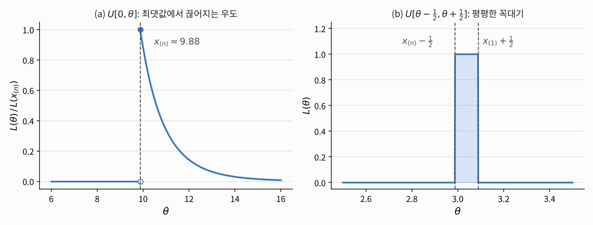

## 들어가며

[1.1절](01-likelihood.qmd)에서는 점수 방정식 $\partial \ell / \partial \theta = 0$을 풀어 최대우도 추정값을 구했습니다. 이 방법은 정리 1.1.6에 기대고 있는데, 그 정리가 말해 주는 것은 생각보다 적습니다. 최댓값이 **모수공간의 내부**에 있고, 그 점에서 $\ell$이 **미분가능**하다면, 그 점은 점수 방정식의 해라는 것뿐입니다. 거꾸로 말하면 다음 세 가지 경우에는 점수 방정식만으로 답을 얻을 수 없습니다.

1. 최댓값이 모수공간의 **경계**에 있거나, 경계로 다가가기만 하고 도달하지 않는 경우
2. 최댓값에서 우도가 **미분가능하지 않은** 경우
3. 최댓값을 주는 점이 **여러 개**인 경우

1.1절의 포아송 예에서 $\bar{x} = 0$인 표본이 첫 번째 경우였습니다. 이번 글에서는 세 경우를 각각 대표하는 예를 하나씩 살펴봅니다. 세 예는 모두 짧지만, 우도함수 전체를 들여다보지 않고 점수 방정식만 기계적으로 풀면 어디서 틀리는지를 분명하게 보여 줍니다.

## 문제 1: 동전 던지기와 경계에 있는 최댓값

### 문제 상황

앞면이 나올 확률이 $p$인 동전을 $n$번 던져서, 앞면이면 $1$, 뒷면이면 $0$으로 기록했다고 합시다. 각 결과를 $X_1, \ldots, X_n \overset{\text{i.i.d.}}{\sim} B(1, p)$로 모형화하고, 모수공간은 $\Theta = (0, 1)$로 둡니다. 베르누이 분포는 $\{0, 1\}$ 위의 세는 측도에 대한 밀도 $f(x, p) = p^x (1-p)^{1-x}$를 가지므로, $\bar{x} := \frac{1}{n}\sum_{i=1}^n x_i$로 쓰면 우도함수는

$$L(p) = \prod_{i=1}^n p^{x_i}(1-p)^{1-x_i} = p^{n\bar{x}}(1-p)^{n(1-\bar{x})}$$

입니다.

### 해결

$0 < \bar{x} < 1$이면, 즉 앞면과 뒷면이 모두 한 번 이상 나왔다면 1.1절과 같은 방법이 그대로 통합니다. 점수 방정식

$$\frac{\partial \ell}{\partial p}(p) = \frac{n\bar{x}}{p} - \frac{n(1-\bar{x})}{1-p} = 0$$

의 해는 $p = \bar{x}$ 하나뿐이고, 점수 함수가 $p < \bar{x}$에서 양수, $p > \bar{x}$에서 음수이므로 $\hat{p} = \bar{x}$가 최댓값입니다.

문제는 $\bar{x} = 0$, 즉 $n$번 모두 뒷면이 나온 경우입니다. 이때 $L(p) = (1-p)^n$은 $(0, 1)$에서 순감소하므로, $p$를 $0$에 가까이 가져갈수록 상한 $1$에 다가가지만 $(0, 1)$ 안의 어떤 점에서도 그 값에 도달하지 않습니다. 따라서 **최대우도 추정값이 존재하지 않습니다.** 모두 앞면이 나온 $\bar{x} = 1$인 경우도 마찬가지입니다.

해결 방법은 1.1절의 포아송 예와 같습니다. 모수공간을 그 폐포 $\bar{\Theta} = [0, 1]$로 넓히면 됩니다. $0^0 := 1$로 약속하면 $p = 0$과 $p = 1$은 각각 항상 뒷면, 항상 앞면만 나오는 퇴화된 분포를 뜻하고, 이렇게 넓힌 모수공간에서는 $\bar{x} = 0$일 때 $L(0) = 1$이 최댓값이 됩니다. 결국 모든 표본에 대해 최대우도 추정값 $\hat{p} = \bar{x}$가 존재하고, $\bar{x} \in \{0, 1\}$인 경우에는 그 값이 **경계점**입니다.

그렇다면 원래의 모수공간 $(0, 1)$에서 추정값이 존재하지 않는 일은 얼마나 자주 일어날까요? 그 확률은

$$\mathbb{P}_p(\bar{X} = 0 \text{ 또는 } \bar{X} = 1) = (1-p)^n + p^n$$

이고, $p \in (0, 1)$이 고정되어 있으면 $n \to \infty$일 때 $0$으로 갑니다. 하지만 $n$이 고정된 상황에서 $p$가 $0$이나 $1$에 가까우면 이야기가 다릅니다. $n = 20$으로 두고 확인해 보겠습니다.

```python
import numpy as np

np.random.seed(2026)
n, reps = 20, 100_000
for p in [0.5, 0.2, 0.05]:
    x = np.random.binomial(1, p, size=(reps, n))
    xbar = x.mean(axis=1)
    no_mle = np.mean((xbar == 0) | (xbar == 1))   # (0,1) 안에 추정값이 없는 비율
    print(f"p = {p:.2f}: 시뮬레이션 {no_mle:.4f},  이론값 {(1-p)**n + p**n:.4f}")
```

```
p = 0.50: 시뮬레이션 0.0000,  이론값 0.0000
p = 0.20: 시뮬레이션 0.0115,  이론값 0.0115
p = 0.05: 시뮬레이션 0.3583,  이론값 0.3585
```

앞면 확률이 $5\%$인 동전이라면 20번 던져도 세 번에 한 번꼴로 앞면이 한 번도 나오지 않고, 그때마다 원래의 모수공간에서는 추정값이 없습니다. 드문 사건을 다룰 때 이 문제가 결코 이론 속의 이야기만은 아니라는 뜻입니다.

이 현상은 4장에서 다른 모습으로 다시 등장합니다. 로지스틱 회귀에서 데이터가 두 집단으로 완벽하게 갈리면 우도가 계속 커지기만 하고 최댓값에 도달하지 않아서, 최대우도 추정값이 존재하지 않습니다. 이를 **분리**(separation) 현상이라고 하는데, 절편만 있는 로지스틱 회귀에서 모든 관측값이 $0$인 경우가 바로 지금 본 $\bar{x} = 0$인 베르누이 표본입니다.

## 문제 2: 버스 대기 시간과 미분할 수 없는 최댓값

### 문제 상황

어느 정류장의 버스는 정해진 간격 $\theta$분마다 오는데, 그 간격을 모른다고 합시다. 아무 때나 정류장에 도착한 사람이 기다리는 시간은 $[0, \theta]$ 위의 균등분포를 따릅니다. 서로 다른 날 기다린 시간 $n$개를 기록해 $X_1, \ldots, X_n \overset{\text{i.i.d.}}{\sim} U[0, \theta]$로 모형화하고, 모수공간은 $\Theta = (0, \infty)$로 둡니다. 배차 간격 $\theta$를 어떻게 추정해야 할까요?

### 필요한 개념

이 모형의 우도는 관측값 중 **가장 큰 값**에 의해 결정됩니다. 이처럼 관측값을 크기순으로 늘어놓았을 때의 값을 따로 부르는 이름이 있습니다.

::: {.callout-note icon=false .callout-definition}
### 정의 1.2.1 (순서통계량)
$\mathbf{x} = (x_1, \ldots, x_n) \in \mathbb{R}^n$의 성분을 작은 것부터 크기순으로 늘어놓은 것을
$$x_{(1)} \le x_{(2)} \le \cdots \le x_{(n)}$$
로 씁니다. 즉 $x_{(1)} = \min_i x_i$이고 $x_{(n)} = \max_i x_i$입니다. 각 $k \in \{1, \ldots, n\}$에 대해 함수
$$T_k : \big(\mathbb{R}^n, \mathcal{B}(\mathbb{R}^n)\big) \to \big(\mathbb{R}, \mathcal{B}(\mathbb{R})\big), \qquad T_k(\mathbf{x}) := x_{(k)}$$
는 연속함수이므로 보렐 가측입니다. 따라서 표본 $\mathbf{X}$에 대해 $X_{(k)} := T_k(\mathbf{X})$는 통계량이고, 이를 **$k$번째 순서통계량**(order statistic)이라고 합니다.
:::

### 해결

$U[0, \theta]$의 밀도는 르베그 측도에 대해 $f(x, \theta) = \theta^{-1}\mathbf{1}\{0 \le x \le \theta\}$입니다. 관측값은 모두 $0$ 이상이므로 우도함수는

$$L(\theta) = \prod_{i=1}^n \frac{1}{\theta}\mathbf{1}\{0 \le x_i \le \theta\} = \theta^{-n}\,\mathbf{1}\{x_{(n)} \le \theta\}$$

입니다. 관측값이 **모두** $\theta$ 이하여야 우도가 $0$이 아니고, 이는 가장 큰 관측값 $x_{(n)}$이 $\theta$ 이하라는 것과 같기 때문입니다.

이 함수의 모양을 보면 답이 바로 나옵니다. $\theta < x_{(n)}$이면 우도는 $0$입니다. 배차 간격이 실제로 기다린 시간보다 짧을 수는 없으니 당연합니다. $\theta \ge x_{(n)}$이면 우도는 $\theta^{-n}$으로 순감소합니다. 따라서 우도는 $\theta = x_{(n)}$에서 최대가 되고, 최대우도 추정값은

$$\hat{\theta} = x_{(n)}$$

입니다. $x_{(n)} = 0$인 경우는 확률 $0$으로만 일어나므로 무시해도 됩니다.

{fig-alt="두 개의 그래프. 왼쪽 (a)는 U[0,θ] 모형에서 θ=10인 분포로부터 뽑은 표본 10개의 상대 우도로, θ가 약 9.88보다 작으면 0이고 그 점에서 1로 뛰어오른 뒤 θ가 커질수록 완만하게 감소한다. 오른쪽 (b)는 U[θ-1/2, θ+1/2] 모형의 우도로, θ가 약 2.99에서 3.09 사이일 때만 1이고 나머지에서는 0인 직사각형 모양이다."}

위 그림 (a)는 $\theta = 10$인 분포에서 뽑은 표본 10개로 그린 우도입니다. 우도가 $x_{(n)}$에서 $0$에서 최댓값으로 뛰어오르므로, 최댓값에서 **미분가능하지 않습니다**. 그렇다면 점수 방정식은 어떨까요? $\theta > x_{(n)}$에서 로그우도 $\ell(\theta) = -n\log\theta$의 도함수는 $-n/\theta$인데, 이는 결코 $0$이 되지 않습니다. 즉 점수 방정식을 기계적으로 풀었다면 해가 없다는 결론만 얻고 끝났을 것입니다. 우도함수의 모양 전체를 직접 들여다봐야 하는 이유입니다.

이 추정값에는 눈에 띄는 성질이 하나 있습니다. 관측값은 모두 $\theta$ 이하이므로 $X_{(n)} \le \theta$이고, 연속분포이므로 등호는 확률 $0$으로만 성립합니다. 즉 최대우도 추정량은 **언제나 참값보다 작게** 나옵니다. 1.1절에서 정규분포의 분산 추정량이 평균적으로 작게 나왔던 것보다 훨씬 강한 치우침입니다. 계산해 보면 $\mathbb{E}_\theta[X_{(n)}] = \frac{n}{n+1}\theta$입니다. 시뮬레이션으로 확인해 보겠습니다.

```python
np.random.seed(2026)
theta, n, reps = 10, 10, 100_000
x = np.random.uniform(0, theta, size=(reps, n))
theta_hat = x.max(axis=1)                    # 표본마다 계산한 x_(n)
print(f"theta_hat의 평균 = {theta_hat.mean():.3f}")
print(f"n/(n+1) * theta  = {n / (n + 1) * theta:.3f}")
print(f"theta_hat < theta인 비율 = {np.mean(theta_hat < theta)}")
```

```
theta_hat의 평균 = 9.090
n/(n+1) * theta  = 9.091
theta_hat < theta인 비율 = 1.0
```

10만 개의 표본 모두에서 추정값이 참값보다 작게 나왔습니다.

이 모형은 지금까지 본 모형들과 한 가지가 근본적으로 다릅니다. 포아송, 베르누이, 정규분포에서는 $\theta$가 바뀌어도 관측값이 나올 수 있는 범위, 즉 **받침**(support)이 그대로였습니다. 반면 $U[0, \theta]$는 $\theta$에 따라 받침 $[0, \theta]$ 자체가 움직입니다. 이 차이 때문에 $U[0, \theta]$는 1.5절에서 다룰 최대우도 추정량의 점근 정규성이 성립하지 않는 대표적인 예가 되고, 그때 다시 돌아오게 됩니다.

::: {.callout-note icon=false}
### 참고 1.2.2 (밀도의 선택과 최대우도 추정값의 존재)
밀도는 기준 측도에 대해 거의 어디서나만 유일하게 정해집니다. 예를 들어 $U[0, \theta]$의 밀도로 $\theta^{-1}\mathbf{1}\{0 \le x \le \theta\}$ 대신 $\theta^{-1}\mathbf{1}\{0 \le x < \theta\}$를 써도 두 함수는 한 점에서만 다르므로 같은 분포를 나타냅니다. 그런데 후자를 쓰면 우도는 $L(\theta) = \theta^{-n}\,\mathbf{1}\{x_{(n)} < \theta\}$가 되어, $\theta$를 $x_{(n)}$에 위에서 다가가게 할수록 커지지만 $x_{(n)}$에서는 $0$이므로 **최댓값이 존재하지 않습니다**. 같은 모형인데도 밀도를 어떻게 고르느냐에 따라 최대우도 추정값의 존재 여부가 달라지는 것입니다. 그래서 이런 모형에서는 보통 받침을 닫힌집합으로 잡는 쪽의 밀도를 씁니다.
:::

## 문제 3: 측정 오차와 유일하지 않은 최댓값

### 문제 상황

어떤 물체의 참된 길이 $\theta$를 측정하는데, 측정 장비의 눈금 때문에 측정값에 $-\frac{1}{2}$에서 $\frac{1}{2}$ 사이의 오차가 고르게 섞인다고 합시다. 측정을 $n$번 반복한 결과를 $X_1, \ldots, X_n \overset{\text{i.i.d.}}{\sim} U[\theta - \frac{1}{2}, \theta + \frac{1}{2}]$로 모형화하고, 모수공간은 $\Theta = \mathbb{R}$로 둡니다.

### 해결

밀도는 르베그 측도에 대해 $f(x, \theta) = \mathbf{1}\{\theta - \frac{1}{2} \le x \le \theta + \frac{1}{2}\}$이므로, 우도함수는

$$L(\theta) = \prod_{i=1}^n \mathbf{1}\Big\{\theta - \frac{1}{2} \le x_i \le \theta + \frac{1}{2}\Big\} = \mathbf{1}\Big\{x_{(n)} - \frac{1}{2} \le \theta \le x_{(1)} + \frac{1}{2}\Big\}$$

입니다. 모든 관측값이 구간 $[\theta - \frac{1}{2}, \theta + \frac{1}{2}]$ 안에 들어와야 하고, 이는 가장 작은 값과 가장 큰 값이 그 안에 들어오는 것과 같기 때문입니다. 모든 관측값은 길이 $1$인 구간 안에 있으므로 $x_{(n)} - x_{(1)} \le 1$이고, 따라서 이 구간은 비어 있지 않습니다.

위 그림 (b)에서 보듯이 우도는 구간 $[x_{(n)} - \frac{1}{2},\, x_{(1)} + \frac{1}{2}]$ 위에서 $1$이고 나머지에서는 $0$입니다. 꼭대기가 뾰족한 점이 아니라 **평평한 구간**이므로, 이 구간의 모든 점이 최대우도 추정값입니다. 즉 참고 1.1.5의 집합 $M(\mathbf{x})$가 구간 전체이고, **최대우도 추정값이 유일하지 않습니다.** 점수 방정식으로 보면 구간 안에서는 $\ell$이 상수라서 도함수가 모든 점에서 $0$이고, 점수 방정식은 최댓값이 어디 있는지 전혀 가려내지 못합니다.

$\theta = 3$, $n = 10$으로 직접 계산해 보면 다음과 같습니다.

```python
np.random.seed(2026)
theta, n = 3, 10
x = theta + np.random.uniform(-0.5, 0.5, size=n)
lo, hi = x.max() - 0.5, x.min() + 0.5
print(f"최대우도 추정값의 집합: [{lo:.4f}, {hi:.4f}]")
```

```
최대우도 추정값의 집합: [2.9876, 3.0889]
```

이 경우 최대우도 추정량을 만들려면, 참고 1.1.5에서 말한 대로 각 표본마다 이 구간에서 값 **하나를 고르는 규칙** $T$를 정해야 합니다. 예를 들어 다음 두 규칙은 모두 연속함수이므로 가측이고, 언제나 구간 안의 값을 고르므로 둘 다 최대우도 추정량입니다.

$$T_1(\mathbf{X}) := \frac{X_{(1)} + X_{(n)}}{2} \quad (\text{구간의 가운데}), \qquad T_2(\mathbf{X}) := X_{(n)} - \frac{1}{2} \quad (\text{구간의 왼쪽 끝})$$

둘 다 최대우도 추정량이지만, 추정량으로서의 성능은 같지 않습니다. 표본을 10만 번 새로 뽑아 각 추정량의 평균과 **평균제곱오차**(mean squared error), 즉 $\mathbb{E}[(T - \theta)^2]$를 비교해 보겠습니다. 비교를 위해 표본평균도 함께 계산합니다.

```python
reps = 100_000
x = theta + np.random.uniform(-0.5, 0.5, size=(reps, n))
mid = (x.min(axis=1) + x.max(axis=1)) / 2   # T1: 구간의 가운데
low = x.max(axis=1) - 0.5                   # T2: 구간의 왼쪽 끝
avg = x.mean(axis=1)                        # 비교용: 표본평균
for name, t in [("T1 (가운데)  ", mid), ("T2 (왼쪽 끝) ", low), ("표본평균     ", avg)]:
    print(f"{name}: 평균 {t.mean():.4f}, 평균제곱오차 {np.mean((t - theta)**2):.5f}")
inside = (avg >= x.max(axis=1) - 0.5) & (avg <= x.min(axis=1) + 0.5)
print(f"표본평균이 최대우도 추정값인 비율: {inside.mean():.4f}")
```

```
T1 (가운데)  : 평균 2.9999, 평균제곱오차 0.00382
T2 (왼쪽 끝) : 평균 2.9090, 평균제곱오차 0.01520
표본평균     : 평균 3.0001, 평균제곱오차 0.00837
표본평균이 최대우도 추정값인 비율: 0.6939
```

구간의 가운데를 고른 $T_1$은 평균적으로 참값 $3$을 맞히고 오차도 가장 작습니다. 반면 구간의 왼쪽 끝을 고른 $T_2$는 평균적으로 작게 나오고 오차도 네 배 가까이 큽니다. 같은 최대우도 원리에서 나왔는데도 **어떤 값을 고르느냐에 따라** 추정량의 성능이 크게 달라지는 것입니다. 최대우도 원리만으로는 둘 중 무엇을 골라야 할지 정해지지 않으므로, 대칭성 같은 다른 기준을 끌어와야 합니다.

덧붙여 표본평균은 이 모형에서 평균적으로 참값을 맞히지만, 평균제곱오차가 $T_1$의 두 배가 넘습니다. 게다가 표본의 약 $30\%$에서는 우도가 $0$인 값, 즉 데이터와 모순되는 값을 내놓습니다. 그런 $\theta$라면 관측된 측정값 중 일부가 나올 수 없었을 것이라는 뜻입니다. 1.1절의 두 예에서는 표본평균이 곧 최대우도 추정값이었지만, 모형이 바뀌면 "평균을 내면 된다"는 직관이 더 이상 최선이 아닐 수 있다는 좋은 예입니다.

## 정리: 우도함수 전체를 봐야 하는 이유

세 문제를 나란히 놓으면 다음과 같습니다.

| | 모형 | 무엇이 문제인가 | 최대우도 추정값 |
|:--|:--|:--|:--|
| 문제 1 | $B(1, p)$ | $\bar{x} \in \{0, 1\}$이면 최댓값이 경계로 달아남 | 모수공간을 $[0, 1]$로 넓혀 $\hat{p} = \bar{x}$ |
| 문제 2 | $U[0, \theta]$ | 최댓값에서 우도가 끊어져 미분 불가능 | $\hat{\theta} = x_{(n)}$ |
| 문제 3 | $U[\theta - \frac{1}{2}, \theta + \frac{1}{2}]$ | 꼭대기가 평평해 최댓값이 무수히 많음 | 구간 $[x_{(n)} - \frac{1}{2}, x_{(1)} + \frac{1}{2}]$의 모든 점 |

세 경우 모두 점수 방정식을 기계적으로 풀었다면 틀린 답을 얻거나 아무 답도 얻지 못했을 것입니다. 1.1절의 알고리즘 1.1.7에서 마지막 단계로 "후보가 정말 $\Theta$ 전체에서의 최댓값인지 확인하고, 모수공간의 경계와 미분가능하지 않은 점도 함께 살펴본다"를 둔 것이 바로 이 때문입니다. 점수 방정식은 최댓값을 찾는 편리한 도구일 뿐이고, 최대우도 추정값의 정의는 어디까지나 **우도함수 전체에서의 최댓값**입니다.

한편 이 예들은 거꾸로 점수 방정식이 잘 통하는 조건이 무엇인지도 알려 줍니다. 모수공간이 열린집합이고, 받침이 모수에 의존하지 않으며, 로그우도가 매끄럽고 꼭대기가 하나뿐인 뾰족한 모양이면 됩니다. 다행히 실제로 쓰이는 많은 모형이 이 조건을 만족하고, 다음 절부터는 주로 이런 모형을 다룹니다. 1.3절에서는 로그우도의 기울기와 곡률, 즉 **점수 함수**와 **피셔 정보**를 정확하게 정의하고, 이 "뾰족한 정도"가 무엇을 알려 주는지 살펴봅니다.

---

### 연결되는 개념
* $\leftarrow$ **이전 개념:** [1.1 우도와 최대우도 추정](01-likelihood.qmd)
* $\rightarrow$ **다음 개념:** [1.3 점수 함수와 피셔 정보](03-score-fisher.qmd)
