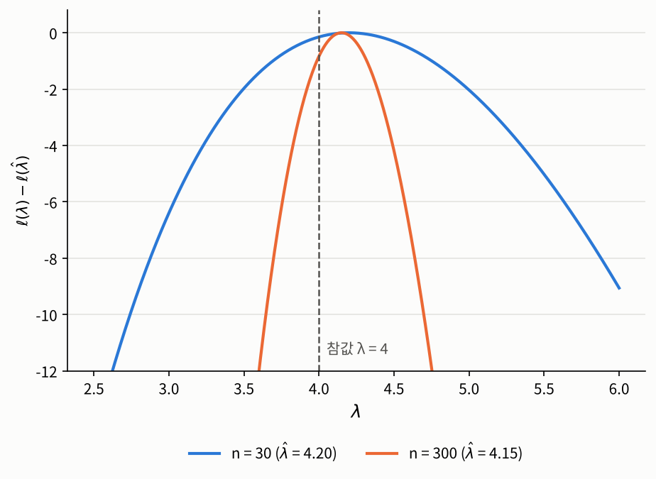

## 들어가며

[1.1절](01-likelihood.qmd)과 [1.2절](02-score-failures.qmd)에서 우리가 관심을 가진 것은 로그우도 곡선의 **꼭대기가 어디 있는가**였습니다. 그 위치가 최대우도 추정값입니다. 이번 글에서는 꼭대기의 위치가 아니라 **곡선의 모양**에 주목합니다. 꼭대기 근처에서 곡선이 얼마나 가파르게 올라가는지, 그리고 꼭대기가 얼마나 뾰족한지가 그것입니다.

[1장 소개 글](index.qmd)에서 예고했듯이, 이 두 가지는 이번 장의 남은 두 질문에 모두 쓰입니다. 1.4절에서는 기울기와 곡률을 이용해 꼭대기를 수치적으로 찾아가고, 1.5절에서는 꼭대기의 뾰족한 정도로 추정값이 얼마나 정확한지를 잽니다. 이번 글은 그 준비 단계로, 기울기와 곡률을 정확하게 정의하고 그 성질을 살펴봅니다.

## 문제 1: 데이터는 모수에 대해 얼마나 알려 주는가

### 문제 상황

1.1절의 교통사고 예로 돌아가 보겠습니다. 하루 사고 건수를 $\mathrm{Poi}(\lambda)$로 모형화하고 30일 동안의 기록으로 $\hat{\lambda} = \bar{x} = 4.2$를 얻었습니다. 그런데 같은 도시에서 300일 동안 기록을 모았다면 어땠을까요? 추정값은 역시 $4$ 근처로 나오겠지만, 우리는 직관적으로 300일치 데이터로 얻은 추정값을 훨씬 더 믿을 것입니다.

그렇다면 이 직관을 숫자로 나타낼 수 있을까요? 즉 **데이터가 모수에 대해 얼마나 많은 것을 알려 주는지**를 하나의 양으로 잴 수 있을까요? 더 나아가, 데이터를 모으기 **전에** 그 양을 계산할 수 있다면 "원하는 정확도를 얻으려면 며칠치 기록이 필요한가" 같은 질문에도 답할 수 있을 것입니다.

### 접근 아이디어: 꼭대기의 뾰족함

아래 그림은 $\lambda = 4$인 포아송 분포에서 뽑은 30일치와 300일치 데이터의 로그우도를 그린 것입니다. 두 곡선의 높이를 비교하기 쉽도록 각각 꼭대기의 값이 $0$이 되게 옮겨서 $\ell(\lambda) - \ell(\hat{\lambda})$를 그렸습니다.

{fig-alt="가로축이 λ, 세로축이 로그우도에서 최댓값을 뺀 값인 그래프. 파란 곡선(n=30)은 λ가 4.2에서 꼭대기에 이르는 완만한 포물선 모양으로, λ가 2.5에서 6 사이 대부분에서 -12보다 위에 있다. 주황 곡선(n=300)은 λ가 약 4.15에서 꼭대기에 이르는 훨씬 좁고 뾰족한 포물선으로, λ가 약 3.6보다 작거나 4.75보다 크면 -12 아래로 떨어진다. λ=4 위치에 회색 점선이 그어져 있다." width=70%}

두 곡선 모두 꼭대기는 참값 $4$ 근처에 있지만, 모양이 크게 다릅니다. 30일치 데이터의 곡선은 완만해서 꼭대기에서 조금 벗어난 $\lambda = 3.5$나 $\lambda = 5$도 우도가 크게 떨어지지 않습니다. 이런 값들도 "데이터를 꽤 그럴듯하게 설명한다"는 뜻입니다. 반면 300일치 데이터의 곡선은 뾰족해서, 꼭대기에서 조금만 벗어나도 우도가 급격히 떨어집니다. 데이터와 잘 맞는 $\lambda$의 범위가 훨씬 좁은 것입니다.

즉 **꼭대기가 뾰족할수록 데이터가 모수를 분명하게 정해 줍니다.** 그리고 곡선이 얼마나 뾰족한지는 이계도함수, 즉 **곡률**로 잴 수 있습니다. 꼭대기에서 로그우도는 위로 볼록하므로 이계도함수가 음수이고, 그 절댓값이 클수록 뾰족합니다.

다만 문제가 하나 있습니다. 그림의 곡선은 **하나의 관측된 표본**으로 그린 것이라, 표본이 바뀌면 곡률도 달라집니다. 데이터를 모으기 전에 "이 실험이 담게 될 정보의 양"을 말하려면, 표본 하나의 곡률이 아니라 표본을 바꿔 가며 얻은 곡률의 **평균**을 봐야 할 것입니다. 이것을 정확하게 만들려면 [1.1절](01-likelihood.qmd)에서 구분한 두 레벨이 다시 필요합니다.

### 필요한 개념들

1.1절에서는 관측된 표본 $\mathbf{x}$로 만든 로그우도 $\ell(\theta; \mathbf{x})$를 다뤘습니다. 이것은 표본 레벨의 대상으로, $\theta$를 넣으면 숫자가 나오는 평범한 함수입니다. 이제 같은 식에 관측된 표본 $\mathbf{x}$ 대신 확률변수인 표본 $\mathbf{X}$를 넣은
$$\ell(\theta; \mathbf{X}) = \log p(\mathbf{X}, \theta)$$
를 생각합니다. 각 $\theta$마다 이 값은 확률변수이므로, $\ell(\cdot\,; \mathbf{X})$는 표본에 따라 모양이 달라지는 **무작위 함수**입니다. 위 그림의 곡선은 이 무작위 함수가 한 번 실현된 모습인 셈입니다. 이 절에서는 모수공간 $\Theta \subset \mathbb{R}^d$가 열린집합이고, 모든 $\mathbf{x}$에 대해 $\theta \mapsto \ell(\theta; \mathbf{x})$가 두 번 미분가능하다고 가정합니다.

먼저 기울기부터 정의합니다.

::: {.callout-note icon=false .callout-definition}
### 정의 1.3.1 (점수 함수)
관측된 표본 $\mathbf{x}$에 대해, 로그우도의 그레이디언트
$$u(\theta; \mathbf{x}) := \frac{\partial \ell(\theta; \mathbf{x})}{\partial \theta} = \left(\frac{\partial \ell(\theta; \mathbf{x})}{\partial \theta_1}, \ldots, \frac{\partial \ell(\theta; \mathbf{x})}{\partial \theta_d}\right)^\top \in \mathbb{R}^d$$
를 **점수 함수**(score function)라고 합니다. 모집단 레벨에서는 표본 $\mathbf{X}$를 넣은
$$U_n(\theta) := u(\theta; \mathbf{X})$$
를 생각하고, 이를 $\theta$에서의 **점수**(score)라고 합니다. 각 $\theta$에 대해 $U_n(\theta)$는 $\mathbb{R}^d$에 값을 가지는 확률벡터입니다.
:::

1.1절의 점수 방정식은 관측된 표본의 점수 함수가 $0$이 되는 점, 즉 $u(\hat{\theta}; \mathbf{x}) = 0$인 $\hat{\theta}$를 찾는 것이었습니다. 점수 함수는 "$\theta$를 어느 방향으로 움직이면 우도가 커지는가"를 알려 주는 화살표라고 생각할 수 있습니다.

다음으로 곡률을 정의합니다.

::: {.callout-note icon=false .callout-definition}
### 정의 1.3.2 (관측 정보)
로그우도의 헤세 행렬에 음의 부호를 붙인 $d \times d$ 행렬
$$J_n(\theta) := -\frac{\partial^2 \ell(\theta; \mathbf{X})}{\partial \theta\, \partial \theta^\top}, \qquad \big(J_n(\theta)\big)_{jk} = -\frac{\partial^2 \ell(\theta; \mathbf{X})}{\partial \theta_j\, \partial \theta_k}$$
를 $\theta$에서의 **관측 정보**(observed information)라고 합니다. 관측된 표본 $\mathbf{x}$를 넣은 값 $j(\theta; \mathbf{x}) := -\partial^2 \ell(\theta; \mathbf{x}) / \partial \theta\, \partial \theta^\top$는 그 관측값입니다.
:::

음의 부호를 붙이는 이유는 꼭대기 근처에서 헤세 행렬이 음의 정부호이기 때문입니다. 부호를 뒤집어 두면 "관측 정보가 클수록 꼭대기가 뾰족하다"고 자연스럽게 읽을 수 있습니다.

관측 정보는 표본에 따라 달라지는 확률행렬입니다. 앞에서 말한 대로 데이터를 모으기 전에 계산할 수 있는 양을 얻으려면 평균을 내야 합니다. 그런데 피셔는 곡률의 평균이 아니라 **기울기의 흔들림**으로 정보를 정의했습니다.

::: {.callout-note icon=false .callout-definition}
### 정의 1.3.3 (피셔 정보)
모든 성분이 유한할 때, $d \times d$ 행렬
$$I_n(\theta) := \mathbb{E}_\theta\!\left[\,U_n(\theta)\, U_n(\theta)^\top\right]$$
를 $\theta$에서의 **피셔 정보 행렬**(Fisher information matrix)이라고 합니다. 여기서 $\mathbb{E}_\theta$는 $\mathbf{X} \sim P_\theta$일 때의 기대값입니다.
:::

정의에서 $\theta$가 두 번 등장한다는 점에 주의해야 합니다. 점수를 계산하는 지점도 $\theta$이고, 표본이 나오는 분포도 $P_\theta$입니다. 즉 피셔 정보는 **참값이 $\theta$일 때, 바로 그 참값에서 계산한 점수**가 어떻게 흔들리는지를 봅니다.

곡률의 평균과 기울기의 흔들림은 언뜻 전혀 다른 양처럼 보입니다. 그런데 적당한 조건 아래에서는 이 둘이 정확히 같고, 이것이 피셔 정보를 "정보"라고 부를 수 있는 근거입니다.

::: {.callout-important icon=false .callout-satz}
### 정리 1.3.4 (점수의 평균과 정보 등식)
다음 조건을 가정합니다.

1. 우도가 양수인 영역 $\{\mathbf{x} : p(\mathbf{x}, \theta) > 0\}$이 $\theta$에 의존하지 않습니다.
2. 이 영역 위의 각 $\mathbf{x}$에 대해 $\theta \mapsto p(\mathbf{x}, \theta)$가 두 번 연속미분가능합니다.
3. $\int p(\mathbf{x}, \theta)\, \nu(d\mathbf{x})$를 $\theta$에 대해 두 번 미분할 때, 미분과 적분의 순서를 바꿀 수 있습니다.

그러면 모든 $\theta \in \Theta$에 대해 다음이 성립합니다.

(a) $\mathbb{E}_\theta[U_n(\theta)] = 0$. 따라서 $I_n(\theta) = \mathrm{Cov}_\theta\big(U_n(\theta)\big)$입니다.

(b) $I_n(\theta) = \mathbb{E}_\theta[J_n(\theta)]$.
:::

::: {.callout-tip collapse="false" icon=false .callout-beweis}
### 증명
조건 1의 영역을 $\mathcal{S}$라 하고, 아래의 적분은 모두 $\mathcal{S}$ 위에서 $\nu$에 대해 계산합니다. 편의상 $p = p(\mathbf{x}, \theta)$로 줄여 쓰고, $\partial$는 $\theta$에 대한 미분을 뜻합니다.

**(a)** 밀도이므로 모든 $\theta$에 대해 $\int p \, d\nu = 1$입니다. 양변을 $\theta$로 미분하고 조건 3으로 미분과 적분의 순서를 바꾸면 $\int \partial p \, d\nu = 0$입니다. 그런데 $\mathcal{S}$ 위에서 $p > 0$이므로 $\partial p = (\partial \log p)\, p$이고, 따라서
$$0 = \int \frac{\partial \log p}{\partial \theta}\, p \, d\nu = \mathbb{E}_\theta\big[u(\theta; \mathbf{X})\big] = \mathbb{E}_\theta[U_n(\theta)]$$
입니다. 평균이 $0$이므로 $\mathbb{E}_\theta[U_n U_n^\top] = \mathrm{Cov}_\theta(U_n)$입니다.

**(b)** (a)에서 얻은 $\int (\partial \log p)\, p \, d\nu = 0$을 한 번 더 미분하고 조건 3을 다시 쓰면, 곱의 미분법에 의해
$$0 = \int \left[\frac{\partial^2 \log p}{\partial \theta\, \partial \theta^\top}\, p + \frac{\partial \log p}{\partial \theta} \left(\frac{\partial p}{\partial \theta}\right)^{\!\top}\right] d\nu = \int \left[\frac{\partial^2 \log p}{\partial \theta\, \partial \theta^\top} + \frac{\partial \log p}{\partial \theta} \left(\frac{\partial \log p}{\partial \theta}\right)^{\!\top}\right] p \, d\nu$$
입니다. 두 번째 등호에서 다시 $\partial p = (\partial \log p)\, p$를 썼습니다. 오른쪽은 $\mathbb{E}_\theta[-J_n(\theta)] + \mathbb{E}_\theta[U_n(\theta) U_n(\theta)^\top]$이므로 $I_n(\theta) = \mathbb{E}_\theta[J_n(\theta)]$를 얻습니다. $\square$
:::

증명의 핵심은 "밀도를 적분하면 언제나 $1$"이라는 당연한 사실을 $\theta$로 미분한 것뿐입니다. 이 정리가 말해 주는 내용을 풀어 보면 다음과 같습니다.

- **(a) 참값에서 점수는 평균적으로 $0$입니다.** 참값에서 계산한 점수는 표본에 따라 이쪽저쪽을 가리키며 흔들리지만, 어느 한쪽으로 치우치지는 않습니다. 참값에서는 "우도를 키우려면 이쪽으로 가라"는 체계적인 방향이 없다는 뜻입니다.
- **(b) 기울기의 흔들림과 곡률의 평균은 같습니다.** 점수가 크게 흔들린다는 것은 데이터가 조금만 달라져도 우도가 민감하게 반응한다는 뜻이고, 이는 곧 로그우도 곡선이 평균적으로 뾰족하다는 것과 같은 이야기입니다. 그래서 피셔 정보는 "데이터가 모수에 대해 담고 있는 정보의 양"으로 읽을 수 있습니다.

관측값이 서로 독립이면 정보는 관측값의 개수만큼 쌓입니다.

::: {.callout-important icon=false .callout-satz}
### 따름정리 1.3.5 (확률표본의 피셔 정보)
$\mathbf{X}$가 확률표본이고 관측값 하나의 밀도가 $f(\cdot, \theta)$이며, $f$에 대해 정리 1.3.4의 조건이 성립한다고 합시다.
$$i(\theta) := \mathbb{E}_\theta\!\left[\frac{\partial \log f(X_1, \theta)}{\partial \theta} \left(\frac{\partial \log f(X_1, \theta)}{\partial \theta}\right)^{\!\top}\right] = -\mathbb{E}_\theta\!\left[\frac{\partial^2 \log f(X_1, \theta)}{\partial \theta\, \partial \theta^\top}\right]$$
를 **관측값 하나의 피셔 정보**라고 하면 다음이 성립합니다.
$$I_n(\theta) = n\, i(\theta)$$
:::

::: {.callout-tip collapse="false" icon=false .callout-beweis}
### 증명
확률표본에서는 $\ell(\theta; \mathbf{X}) = \sum_{i=1}^n \log f(X_i, \theta)$이므로 $U_n(\theta) = \sum_{i=1}^n \partial \log f(X_i, \theta) / \partial \theta$입니다. 정리 1.3.4 (a)를 $n = 1$인 경우에 적용하면 각 항의 평균은 $0$이고, 각 항의 공분산 행렬은 $i(\theta)$입니다. 각 항은 서로 독립이므로 합의 공분산 행렬은 공분산 행렬들의 합이 되어 $I_n(\theta) = \mathrm{Cov}_\theta(U_n(\theta)) = n\, i(\theta)$입니다. $i(\theta)$의 두 번째 표현은 정리 1.3.4 (b)를 $n = 1$인 경우에 적용한 것입니다. $\square$
:::

### 해결

포아송 모형에서 지금까지의 양을 직접 계산해 보겠습니다. 1.1절에서 구한 로그우도 $\ell(\lambda; \mathbf{X}) = -n\lambda + n\bar{X}\log\lambda - \sum_i \log X_i!$를 미분하면 다음을 얻습니다.

$$U_n(\lambda) = -n + \frac{n\bar{X}}{\lambda}, \qquad J_n(\lambda) = \frac{n\bar{X}}{\lambda^2}$$

포아송 분포의 받침 $\{0, 1, 2, \ldots\}$은 $\lambda > 0$에 의존하지 않고 나머지 조건도 성립하므로 정리 1.3.4를 쓸 수 있습니다. $\mathbb{E}_\lambda[\bar{X}] = \lambda$를 이용하면

- **(a) 점수의 평균:** $\mathbb{E}_\lambda[U_n(\lambda)] = -n + n\lambda/\lambda = 0$
- **(b) 피셔 정보:** $I_n(\lambda) = \mathbb{E}_\lambda[J_n(\lambda)] = n\lambda/\lambda^2 = n/\lambda$

입니다. 점수의 분산으로 직접 계산해도 $\mathrm{Var}_\lambda(U_n(\lambda)) = (n/\lambda)^2\, \mathrm{Var}_\lambda(\bar{X}) = (n/\lambda)^2 (\lambda/n) = n/\lambda$로 같은 값이 나옵니다. 관측값 하나의 피셔 정보는 $i(\lambda) = 1/\lambda$이고, 따름정리 1.3.5대로 $I_n(\lambda) = n\, i(\lambda)$입니다.

이제 처음의 질문에 답할 수 있습니다. 참값이 $\lambda = 4$라면 30일치 데이터의 피셔 정보는 $30/4 = 7.5$이고, 300일치 데이터는 $75$로 정확히 열 배입니다. 그림에서 300일치 곡선이 훨씬 뾰족했던 것이 바로 이 차이입니다. 그리고 이 값들은 데이터를 한 번도 보지 않고 계산한 것입니다.

1.1절의 실제 데이터로 관측 정보를 계산하고, 표본을 10만 번 새로 뽑아 정리 1.3.4를 확인해 보겠습니다.

```python
import numpy as np

np.random.seed(1557)
x = np.random.poisson(lam=4, size=30)        # 1.1절과 같은 데이터
n, xbar = len(x), x.mean()
print(f"lambda_hat = {xbar:.4f},  J_n(lambda_hat) = {n / xbar:.4f}")

lam, reps = 4, 100_000
X = np.random.poisson(lam=lam, size=(reps, n))
U = -n + X.sum(axis=1) / lam                 # 참값에서의 점수 U_n(4)
J = X.sum(axis=1) / lam**2                   # 참값에서의 관측 정보 J_n(4)
print(f"U_n(4)의 평균 = {U.mean():.4f}")
print(f"U_n(4)의 분산 = {U.var():.4f}")
print(f"J_n(4)의 평균 = {J.mean():.4f}")
print(f"I_n(4) = n/lambda = {n / lam:.4f}")
```

```
lambda_hat = 4.2000,  J_n(lambda_hat) = 7.1429
U_n(4)의 평균 = -0.0104
U_n(4)의 분산 = 7.5383
J_n(4)의 평균 = 7.4974
I_n(4) = n/lambda = 7.5000
```

관측된 표본에서 꼭대기의 곡률은 $j(\hat{\lambda}; \mathbf{x}) = n/\bar{x} \approx 7.14$입니다. 참값에서의 점수는 평균이 거의 $0$이고, 그 분산과 관측 정보의 평균은 모두 이론값 $7.5$에 가깝습니다. 참고로 포아송 모형에서는 $j(\hat{\lambda}; \mathbf{x}) = n\bar{x}/\bar{x}^2 = n/\bar{x} = I_n(\hat{\lambda})$가 되어, 꼭대기에서의 관측 정보와 피셔 정보가 우연히 같습니다. 일반적인 모형에서는 두 값이 다릅니다.

마지막으로 한 가지를 짚어 두겠습니다. $\mathrm{Var}_\lambda(\bar{X}) = \lambda/n$은 정확히 $I_n(\lambda)^{-1}$입니다. 최대우도 추정량의 분산이 피셔 정보의 역수와 같은 것입니다. 이것이 포아송 모형만의 우연이 아니라 훨씬 일반적인 현상이라는 것이 1.5절의 주제입니다.

## 문제 2: 모수가 여러 개일 때

### 문제 상황

1.1절의 키 데이터처럼 정규분포 $N(\mu, \sigma^2)$에서 평균과 분산을 함께 추정할 때는 모수가 $\theta = (\mu, \sigma^2)$로 두 개입니다. 이때 피셔 정보는 $2 \times 2$ 행렬이 되는데, 대각선 바깥의 성분은 무엇을 뜻할까요?

### 해결

따름정리 1.3.5를 쓰기 위해 관측값 하나의 로그밀도
$$\log f(x; \mu, \sigma^2) = -\frac{1}{2}\log(2\pi\sigma^2) - \frac{(x - \mu)^2}{2\sigma^2}$$
를 두 번 미분합니다. 일계도함수는
$$\frac{\partial \log f}{\partial \mu} = \frac{x - \mu}{\sigma^2}, \qquad \frac{\partial \log f}{\partial \sigma^2} = -\frac{1}{2\sigma^2} + \frac{(x - \mu)^2}{2\sigma^4}$$
이고, 이계도함수는
$$\frac{\partial^2 \log f}{\partial \mu^2} = -\frac{1}{\sigma^2}, \qquad \frac{\partial^2 \log f}{\partial \mu\, \partial \sigma^2} = -\frac{x - \mu}{\sigma^4}, \qquad \frac{\partial^2 \log f}{\partial (\sigma^2)^2} = \frac{1}{2\sigma^4} - \frac{(x - \mu)^2}{\sigma^6}$$
입니다. $X_1 \sim N(\mu, \sigma^2)$이면 $\mathbb{E}[X_1 - \mu] = 0$이고 $\mathbb{E}[(X_1 - \mu)^2] = \sigma^2$이므로, 음의 부호를 붙여 기대값을 취하면

$$i(\mu, \sigma^2) = \begin{pmatrix} \dfrac{1}{\sigma^2} & 0 \\[2mm] 0 & \dfrac{1}{2\sigma^4} \end{pmatrix}, \qquad I_n(\mu, \sigma^2) = \begin{pmatrix} \dfrac{n}{\sigma^2} & 0 \\[2mm] 0 & \dfrac{n}{2\sigma^4} \end{pmatrix}$$

입니다. 1.1절과 같은 $\mu = 170$, $\sigma^2 = 36$, $n = 20$으로 점수 벡터를 10만 번 뽑아 확인해 보겠습니다.

```python
np.random.seed(1557)
mu, s2, n, reps = 170, 36, 20, 100_000
Y = np.random.normal(loc=mu, scale=np.sqrt(s2), size=(reps, n))
U_mu = (Y - mu).sum(axis=1) / s2                                  # 첫째 성분: mu로 미분
U_s2 = -n / (2 * s2) + ((Y - mu) ** 2).sum(axis=1) / (2 * s2**2)  # 둘째 성분: sigma^2으로 미분
C = np.cov(U_mu, U_s2)
print(f"점수 벡터의 평균: ({U_mu.mean():.4f}, {U_s2.mean():.4f})")
print(f"공분산 행렬: [[{C[0,0]:.4f}, {C[0,1]:.4f}], [{C[1,0]:.4f}, {C[1,1]:.4f}]]")
print(f"이론값 I_n: [[{n/s2:.4f}, 0], [0, {n/(2*s2**2):.4f}]]")
```

```
점수 벡터의 평균: (-0.0028, -0.0002)
공분산 행렬: [[0.5526, -0.0002], [-0.0002, 0.0077]]
이론값 I_n: [[0.5556, 0], [0, 0.0077]]
```

점수 벡터의 평균은 $(0, 0)$에 가깝고, 공분산 행렬은 이론값과 잘 맞습니다.

대각선 바깥 성분이 $0$이라는 것은 점수의 두 성분, 즉 "$\mu$를 어느 쪽으로 움직여야 하는가"와 "$\sigma^2$을 어느 쪽으로 움직여야 하는가"가 서로 상관이 없다는 뜻입니다. 대략적으로 말하면, 정규분포에서는 데이터가 평균에 대해 알려 주는 정보와 분산에 대해 알려 주는 정보가 서로 얽혀 있지 않습니다. 모든 모형이 이렇지는 않습니다. 3장의 회귀 모형처럼 모수가 여러 개인 모형에서는 대각선 바깥 성분이 $0$이 아닌 경우가 흔하고, 그때는 한 모수에 대한 불확실성이 다른 모수의 추정에도 영향을 줍니다.

또 이 행렬의 역행렬은 $\mathrm{diag}(\sigma^2/n,\ 2\sigma^4/n)$인데, 그 첫 성분 $\sigma^2/n$은 정확히 표본평균의 분산 $\mathrm{Var}(\bar{X})$입니다. 포아송에서 본 것과 같은 현상이 여기서도 나타납니다.

## 정리: 세 가지 양과 그 쓰임

이번 글에서 정의한 세 양을 정리하면 다음과 같습니다.

| | 정의 | 의미 | 표본에 의존하는가 |
|:--|:--|:--|:--|
| 점수 $U_n(\theta)$ | $\partial \ell / \partial \theta$ | 로그우도의 기울기. 참값에서는 평균 $0$ | 예 (확률벡터) |
| 관측 정보 $J_n(\theta)$ | $-\partial^2 \ell / \partial \theta\, \partial \theta^\top$ | 로그우도의 곡률 | 예 (확률행렬) |
| 피셔 정보 $I_n(\theta)$ | $\mathbb{E}_\theta[U_n U_n^\top] = \mathbb{E}_\theta[J_n]$ | 점수의 분산이자 곡률의 평균 | 아니요 (상수 행렬) |

이 세 양은 이번 장의 남은 두 절에서 각각 다른 역할을 맡습니다.

- **계산 (1.4절):** 최댓값을 식으로 구할 수 없을 때, 현재 위치에서의 기울기 $U_n$과 곡률 $J_n$을 이용해 꼭대기를 향해 한 걸음씩 다가갑니다. 이것이 뉴턴-랩슨 방법이고, $J_n$ 대신 $I_n$을 쓰면 피셔 스코어링이 됩니다.
- **불확실성 (1.5절):** 포아송과 정규분포에서 본 것처럼, 최대우도 추정량의 분산은 피셔 정보의 역수 $I_n(\theta)^{-1}$로 근사됩니다. 정보가 많을수록 추정이 정확해진다는 직관이 정확한 식이 되는 것입니다.

끝으로, 정리 1.3.4의 조건이 단지 형식적인 것이 아니라는 점을 짚어 두겠습니다. [1.2절](02-score-failures.qmd)의 $U[0, \theta]$ 모형을 다시 보면, 참값 $\theta$에서는 거의 확실하게 $X_{(n)} < \theta$이므로 $\theta$ 근처에서 로그우도는 $-n\log\theta$이고, 점수는
$$U_n(\theta) = -\frac{n}{\theta}$$
입니다. 이 값은 표본과 상관없는 상수인데 $0$이 아니므로, 정리 1.3.4 (a)가 성립하지 않습니다. 받침 $[0, \theta]$가 $\theta$에 따라 움직여서 조건 1이 깨졌기 때문입니다. 1.2절에서 이 모형이 1.5절의 결과가 성립하지 않는 대표적인 예라고 한 이유가 여기에 있습니다.

---

### 연결되는 개념
* $\leftarrow$ **이전 개념:** [1.2 점수 방정식이 통하지 않을 때](02-score-failures.qmd)
* $\rightarrow$ **다음 개념:** [1.4 뉴턴-랩슨 방법과 피셔 스코어링](04-newton-raphson.qmd)
