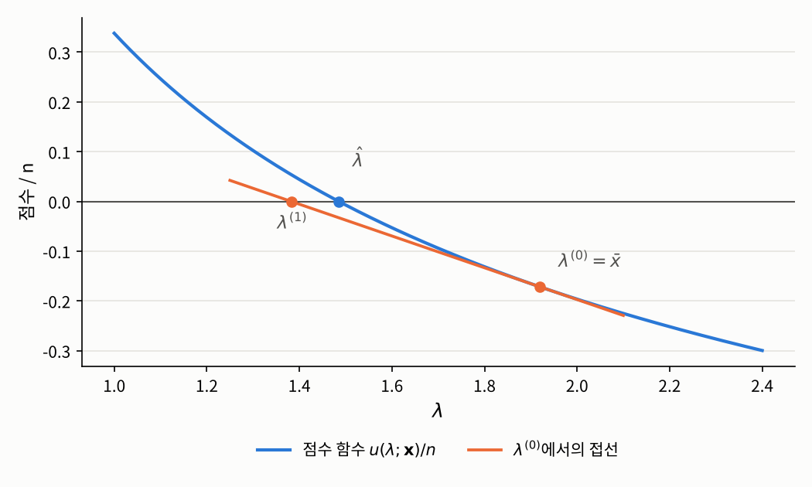
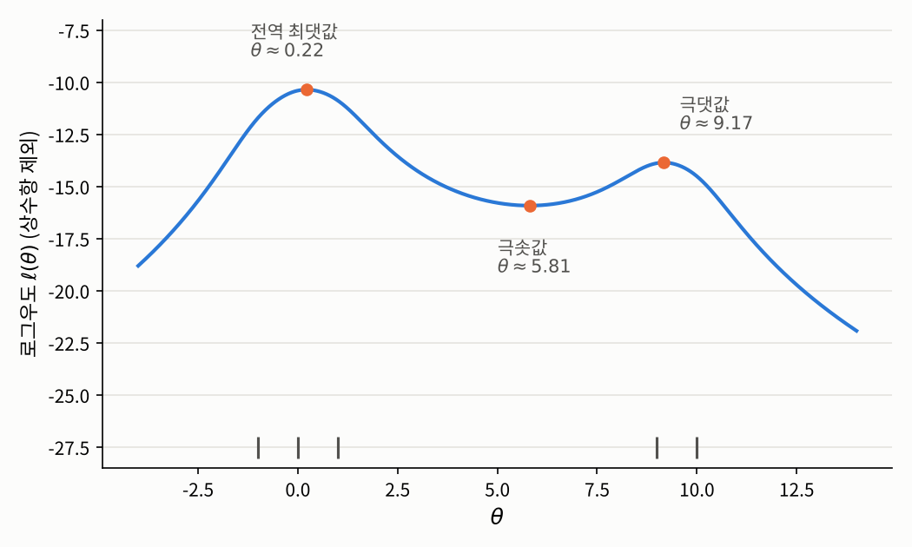

## 들어가며

[1.1절](01-likelihood.qmd)의 포아송 분포와 정규분포에서는 점수 방정식을 손으로 풀어 최대우도 추정값을 식으로 쓸 수 있었습니다. 하지만 이는 운이 좋은 경우입니다. 4장의 로지스틱 회귀를 비롯해 실제로 쓰이는 대부분의 모형에서는 점수 방정식의 해를 식으로 쓸 수 없고, 컴퓨터로 해에 한 걸음씩 다가가야 합니다.

이때 쓰는 도구가 [1.3절](03-score-fisher.qmd)에서 정의한 로그우도의 기울기와 곡률입니다. 지금 서 있는 위치에서 기울기는 어느 쪽으로 가야 하는지를, 곡률은 얼마나 가야 하는지를 알려 줍니다. 이번 글에서는 이 아이디어를 정확히 한 **뉴턴-랩슨 방법**(Newton–Raphson method)과 그 변형인 **피셔 스코어링**(Fisher scoring)을 다루고, 이 방법들이 언제 잘 작동하고 언제 실패하는지를 살펴봅니다.

## 문제 1: 사고가 난 날만 기록된 장부

### 문제 상황

1.1절의 교통사고 예를 조금 바꿔 보겠습니다. 이번에는 사고 일지에 **사고가 한 건 이상 난 날만** 기록되어 있다고 합시다. 사고가 없던 날은 아예 장부에 남지 않으니, 관측값은 언제나 $1$ 이상입니다. 이런 데이터는 생각보다 흔합니다. 병원 기록에는 한 번 이상 방문한 환자만 남고, 보험사 청구 기록에는 한 번 이상 청구한 가입자만 남습니다.

하루 사고 건수가 원래 $\mathrm{Poi}(\lambda)$를 따르는데 $0$인 날이 빠졌다면, 기록된 값 하나의 분포는 $\mathbb{P}(X \ge 1) = 1 - e^{-\lambda}$로 나눈

$$f(k, \lambda) = \frac{e^{-\lambda}\lambda^k}{k!\,(1 - e^{-\lambda})}, \qquad k = 1, 2, \ldots$$

입니다. 이를 **영절단 포아송 분포**(zero-truncated Poisson distribution)라고 합니다. 사고가 난 날 50일의 기록이 다음과 같다고 해 봅시다. 이 데이터는 $\lambda = 1.5$인 포아송 분포에서 뽑은 값 중 $0$을 버리고 앞의 50개를 남겨 만든 것입니다.

```python
import numpy as np

np.random.seed(2026)
raw = np.random.poisson(lam=1.5, size=200)
x = raw[raw > 0][:50]                 # 사고가 난 날 50일만 기록된 장부
n, xbar = len(x), x.mean()
print(x)
print(f"n = {n}, xbar = {xbar:.4f}")
```

```
[2 2 3 1 1 2 2 1 2 3 2 2 2 1 3 1 1 3 3 2 1 1 1 1 1 2 3 1 1 3 5 3 1 3 3 1 1
 4 3 1 1 3 2 1 1 1 3 1 1 3]
n = 50, xbar = 1.9200
```

1.1절처럼 표본평균을 그대로 쓰면 $\hat{\lambda} = 1.92$가 되지만, 이는 사고가 없던 날을 빼고 평균을 낸 것이라 참값보다 크게 나옵니다. 1.1절의 방법으로 최대우도 추정값을 구해 보겠습니다. 로그우도와 점수 함수는

$$\ell(\lambda) = -n\lambda + n\bar{x}\log\lambda - n\log(1 - e^{-\lambda}) - \sum_{i=1}^n \log x_i!, \qquad u(\lambda; \mathbf{x}) = n\left(\frac{\bar{x}}{\lambda} - \frac{1}{1 - e^{-\lambda}}\right)$$

이므로, 점수 방정식은

$$\bar{x} = \frac{\lambda}{1 - e^{-\lambda}}$$

입니다. 우변은 영절단 포아송 분포의 기대값이므로 "표본평균과 기대값을 맞춘다"는 자연스러운 식이지만, 이 방정식은 다항식, 지수, 로그 같은 익숙한 함수들로는 풀 수 없습니다.[^lambertw]

### 접근 아이디어: 접선으로 근사하기

점수 함수의 그래프를 그려 놓고 생각해 보겠습니다. 우리가 찾는 것은 이 곡선이 가로축과 만나는 점입니다. 곡선은 다루기 어렵지만 **직선**과 가로축의 교점은 쉽게 구할 수 있습니다. 그렇다면 지금 서 있는 점에서 곡선에 **접선**을 그어, 그 접선이 가로축과 만나는 점으로 옮겨 가 보면 어떨까요? 접선은 그 점 근처에서 곡선을 잘 근사하므로, 새 점은 원래 점보다 해에 가까워질 것입니다. 이것을 반복하면 됩니다.

{fig-alt="가로축이 λ, 세로축이 점수를 n으로 나눈 값인 그래프. 파란 점수 곡선은 λ가 1일 때 약 0.34에서 시작해 단조 감소하며 λ가 약 1.485일 때 가로축과 만난다. λ가 1.92인 출발점에서 그은 주황색 접선은 λ가 약 1.38인 점에서 가로축과 만나며, 이 점이 다음 위치가 된다." width=70%}

위 그림은 영절단 포아송 데이터의 점수 함수입니다. 출발점 $\lambda^{(0)} = \bar{x} = 1.92$에서 그은 접선이 가로축과 만나는 $\lambda^{(1)}$은 출발점보다 해 $\hat{\lambda}$에 훨씬 가깝습니다.

### 필요한 개념들

이 아이디어를 식으로 옮겨 보겠습니다. 모수가 $d$차원이어도 똑같이 성립하도록 일반적으로 쓰겠습니다. 현재 위치 $\theta^{(i)}$ 근처에서 점수 함수를 일차 테일러 전개하면, 1.3절의 관측 정보 $j(\theta; \mathbf{x}) = -\partial u(\theta; \mathbf{x}) / \partial \theta^\top$를 이용해

$$u(\theta; \mathbf{x}) \approx u(\theta^{(i)}; \mathbf{x}) - j(\theta^{(i)}; \mathbf{x})\,(\theta - \theta^{(i)})$$

입니다. 이것이 "접선"이고, 이 근사식이 $0$이 되는 $\theta$를 다음 위치로 삼으면

$$\theta^{(i+1)} = \theta^{(i)} + j(\theta^{(i)}; \mathbf{x})^{-1}\, u(\theta^{(i)}; \mathbf{x})$$

를 얻습니다. 같은 식을 다른 방향에서 읽을 수도 있습니다. 로그우도를 현재 위치에서 이차 함수로 근사한 뒤, 그 이차 함수의 꼭대기로 옮겨 가는 것입니다. 곡률 $j$가 클수록, 즉 꼭대기가 뾰족할수록 기울기가 같아도 조금만 움직이는 이유가 여기에 있습니다.

::: {.callout-note icon=false}
### 알고리즘 1.4.1 (뉴턴-랩슨 방법)
**입력:** 관측된 표본 $\mathbf{x}$, 출발점 $\theta^{(0)} \in \Theta$, 허용 오차 $\varepsilon > 0$<br>
**출력:** 점수 방정식의 해의 근삿값

$i = 0, 1, 2, \ldots$에 대해 다음을 반복합니다.

1. 점수 $u(\theta^{(i)}; \mathbf{x})$와 관측 정보 $j(\theta^{(i)}; \mathbf{x})$를 계산합니다.
2. 연립일차방정식 $j(\theta^{(i)}; \mathbf{x})\,\delta = u(\theta^{(i)}; \mathbf{x})$를 풀어 $\delta$를 구합니다.
3. $\theta^{(i+1)} := \theta^{(i)} + \delta$로 둡니다.
4. $\lVert \delta \rVert < \varepsilon$이면 $\theta^{(i+1)}$을 반환하고 멈춥니다.
:::

이미 수치해석학을 공부하신 적이 있다면 대충 느낌이 오실겁니다. 우리가 하는건 결국, 최대우도 추정치의 지점을 찾기 위해서 점수 함수의 영점을 뉴턴 방법으로 수치적으로 계산하는거에요.

근데 보면 원래 계산식에서는 역행렬을 구하는 부분이 있는데요, 위 알고리즘에서는 역행렬을 직접 구하지 않고, 저 부분을 $\delta$라 잡은 뒤, 이 델타를 구하는 선형방정식을 푸는 방식이 소개됩니다. 이는 역행렬을 구하지 않고 저렇게 접근하는 게 계산량도 적고 수치적으로도 안정적이기 때문입니다. 물론 이 과정이 성립하려면 매 단계에서 $j(\theta^{(i)}; \mathbf{x})$가 가역이어야 합니다.

뉴턴-랩슨 방법이 사랑받는 이유는 해에 충분히 가까이 가면 놀랄 만큼 빠르게 수렴하기 때문입니다.

::: {.callout-important icon=false .callout-satz}
### 정리 1.4.2 (뉴턴-랩슨 방법의 국소 이차 수렴)
$\theta^* \in \Theta$가 $u(\theta^*; \mathbf{x}) = 0$을 만족하고, $\theta^*$ 근처에서 $\ell(\cdot\,; \mathbf{x})$가 두 번 연속미분가능하며 그 헤세 행렬이 립시츠 연속이라고 합시다. $j(\theta^*; \mathbf{x})$가 가역이면, 어떤 $\delta > 0$과 $C > 0$이 있어서 $\lVert \theta^{(0)} - \theta^* \rVert < \delta$인 모든 출발점에 대해 뉴턴-랩슨 반복이 잘 정의되고 $\theta^*$로 수렴하며,
$$\lVert \theta^{(i+1)} - \theta^* \rVert \le C\, \lVert \theta^{(i)} - \theta^* \rVert^2 \qquad (i = 0, 1, 2, \ldots)$$
가 성립합니다.
:::

::: {.callout-tip collapse="false" icon=false .callout-beweis}
### 증명
[수치해석](../../../math/numerical-methods/index.qmd)의 뉴턴 방법 부분을 참고하시기 바랍니다.
:::

오차가 매번 **제곱**으로 줄어든다는 것은, 대략 말해 맞는 자릿수가 한 단계마다 두 배로 늘어난다는 뜻입니다. 오차가 $10^{-2}$이면 다음 단계에서 $10^{-4}$, 그다음에는 $10^{-8}$ 정도가 되는 식입니다. 다만 이 정리에는 중요한 단서가 두 개 붙어 있습니다. 출발점이 해에 **충분히 가까울 때만** 보장된다는 것, 그리고 $\theta^*$가 최댓값이라는 말은 어디에도 없다는 것입니다. 이 두 단서가 문제 2와 문제 3의 주제입니다.

한편 1.3절에서 본 대로, 관측 정보 $j$ 대신 그 기대값인 피셔 정보를 쓸 수도 있습니다.

::: {.callout-note icon=false}
### 알고리즘 1.4.3 (피셔 스코어링)
알고리즘 1.4.1의 1–2단계에서 관측 정보 $j(\theta^{(i)}; \mathbf{x})$ 대신 피셔 정보 $I_n(\theta^{(i)})$를 씁니다. 즉
$$\theta^{(i+1)} = \theta^{(i)} + I_n(\theta^{(i)})^{-1}\, u(\theta^{(i)}; \mathbf{x})$$
로 갱신합니다.
:::

피셔 스코어링에는 몇 가지 장점이 있습니다. 피셔 정보는 데이터에 의존하지 않아서 식이 간단한 경우가 많고, 점수의 공분산 행렬이므로 언제나 양의 준정부호입니다. 양의 정부호이기만 하면 갱신 방향이 로그우도가 커지는 방향과 같은 쪽을 향하므로, 관측 정보가 음수가 되어 엉뚱한 방향으로 가는 일이 생기지 않습니다. 대신 일반적으로는 이차 수렴이 보장되지 않습니다. 4장에서 다룰 로지스틱 회귀처럼 관측 정보가 데이터에 의존하지 않는 모형에서는 $j = I_n$이 되어 두 방법이 정확히 같아집니다.

### 해결

영절단 포아송 데이터에 두 방법을 적용해 보겠습니다. 로그우도를 한 번 더 미분하면 관측 정보와 피셔 정보는

$$j(\lambda; \mathbf{x}) = n\left(\frac{\bar{x}}{\lambda^2} - \frac{e^{-\lambda}}{(1 - e^{-\lambda})^2}\right), \qquad I_n(\lambda) = n\left(\frac{1}{\lambda(1 - e^{-\lambda})} - \frac{e^{-\lambda}}{(1 - e^{-\lambda})^2}\right)$$

입니다. 피셔 정보는 $\mathbb{E}_\lambda[\bar{X}] = \lambda/(1 - e^{-\lambda})$를 이용해 $j$의 기대값으로 구했습니다(정리 1.3.4). 출발점은 $0$을 무시한 추정값 $\bar{x}$로 둡니다.

```python
def score(lam):                       # u(lambda; x)
    return n * (xbar / lam - 1 / (1 - np.exp(-lam)))

def obs_info(lam):                    # j(lambda; x)
    q = np.exp(-lam)
    return n * (xbar / lam**2 - q / (1 - q)**2)

def fisher_info(lam):                 # I_n(lambda)
    q = np.exp(-lam)
    return n * (1 / (lam * (1 - q)) - q / (1 - q)**2)

for name, info in [("뉴턴-랩슨", obs_info), ("피셔 스코어링", fisher_info)]:
    lam = xbar                        # 출발점: 0을 무시한 포아송 추정값
    print(f"[{name}]")
    for i in range(6):
        print(f"  {i}: lambda = {lam:.10f}, score = {score(lam): .2e}")
        lam = lam + score(lam) / info(lam)
```

```
[뉴턴-랩슨]
  0: lambda = 1.9200000000, score = -8.59e+00
  1: lambda = 1.3823529274, score =  2.69e+00
  2: lambda = 1.4789563015, score =  1.54e-01
  3: lambda = 1.4851816577, score =  5.59e-04
  4: lambda = 1.4852043771, score =  7.38e-09
  5: lambda = 1.4852043774, score =  0.00e+00
[피셔 스코어링]
  0: lambda = 1.9200000000, score = -8.59e+00
  1: lambda = 1.4999712697, score = -3.60e-01
  2: lambda = 1.4852243035, score = -4.90e-04
  3: lambda = 1.4852043774, score = -8.97e-10
  4: lambda = 1.4852043774, score =  0.00e+00
  5: lambda = 1.4852043774, score =  0.00e+00
```

두 방법 모두 몇 단계 만에 $\hat{\lambda} \approx 1.4852$에 도달합니다. 참값 $1.5$에 가깝고, $0$을 무시한 추정값 $1.92$보다 훨씬 정확합니다. 이 해가 유일한 최댓값이라는 것도 확인할 수 있습니다. 모든 $\lambda > 0$에서
$$\frac{\lambda^2 e^{-\lambda}}{(1 - e^{-\lambda})^2} = \left(\frac{\lambda/2}{\sinh(\lambda/2)}\right)^2 < 1$$
이므로, $\bar{x} > 1$이면 $j(\lambda; \mathbf{x}) > 0$이 모든 $\lambda$에서 성립합니다. 즉 로그우도가 모수공간 전체에서 순오목하고, 점수 함수가 순감소하므로 점수 방정식의 해는 하나뿐이고 그것이 최댓값입니다.

뉴턴-랩슨의 오차 $|\lambda^{(i)} - \hat{\lambda}|$를 계산해 보면 $0.43,\ 0.10,\ 0.0062,\ 2.3 \times 10^{-5},\ 3 \times 10^{-10}$으로, 매 단계 대략 직전 오차의 제곱에 $0.6$ 정도를 곱한 크기로 줄어듭니다. 정리 1.4.2의 이차 수렴이 그대로 나타난 것입니다. 이 예에서는 피셔 스코어링도 매우 빠르게 수렴하는데, 해 근처에서 $j$와 $I_n$의 값이 비슷하기 때문입니다.

두 방법의 차이는 데이터가 적을 때 드러납니다. 표본 크기를 $n = 20$으로 줄여 표본 2만 개를 만들고, 두 방법을 똑같이 표본평균에서 출발시켜 보겠습니다.

```python
def ztp_sample(lam, size):
    """0이 나온 자리는 0이 아닌 값이 나올 때까지 다시 뽑아 영절단 포아송 표본을 만듦"""
    x = np.random.poisson(lam=lam, size=size)
    while (x == 0).any():
        x[x == 0] = np.random.poisson(lam=lam, size=(x == 0).sum())
    return x

def fit(x, method, iters=30):
    n, xbar = x.shape[1], x.mean(axis=1)
    lam = xbar.copy()                                   # 출발점: 표본평균
    with np.errstate(all="ignore"):
        for _ in range(iters):
            q = np.exp(-lam)
            u = n * (xbar / lam - 1 / (1 - q))
            if method == "NR":
                info = n * (xbar / lam**2 - q / (1 - q)**2)          # 관측 정보
            else:
                info = n * (1 / (lam * (1 - q)) - q / (1 - q)**2)    # 피셔 정보
            lam = lam + u / info
    return lam

np.random.seed(2026)
x = ztp_sample(1.5, (20_000, 20))                       # n = 20인 표본 2만 개
for method in ["NR", "FS"]:
    lam = fit(x, method)
    print(f"{method}: 수렴에 실패한 표본 {np.sum(~np.isfinite(lam) | (lam <= 0))}개")
```

```
NR: 수렴에 실패한 표본 32개
FS: 수렴에 실패한 표본 0개
```

뉴턴-랩슨이 실패한 표본은 모두 표본평균이 $1.1$에서 $1.3$ 사이로 작은 경우였습니다. 예를 들어 $\bar{x} = 1.2$이면 최대우도 추정값은 약 $0.38$로 출발점 $1.2$에서 꽤 멀고, 출발점에서의 관측 정보 $j \approx 4.33$이 피셔 정보 $I_n \approx 11.51$보다 훨씬 작습니다. 곡률을 작게 보면 그만큼 크게 움직이게 되어, 첫 단계에서 $\lambda^{(1)} \approx -0.79$로 모수공간 밖으로 튀어 나가 버립니다. 같은 표본에서 피셔 스코어링은 보폭이 더 작아서 안전하게 해에 도달합니다.

## 문제 2: 출발점을 잘못 고르면

### 문제 상황

정리 1.4.2는 출발점이 해에 "충분히 가까우면" 수렴한다고 말할 뿐, 얼마나 가까워야 하는지는 알려 주지 않습니다. 이 범위를 정확히 계산할 수 있는 예가 있을까요?

### 해결

놀랍게도 1.1절의 포아송 모형에서는 뉴턴-랩슨 반복을 완전히 풀 수 있습니다. 1.3절에서 구한 $u(\lambda; \mathbf{x}) = -n + n\bar{x}/\lambda$와 $j(\lambda; \mathbf{x}) = n\bar{x}/\lambda^2$를 갱신식에 넣으면

$$\lambda^{(i+1)} = \lambda^{(i)} + \frac{-n + n\bar{x}/\lambda^{(i)}}{n\bar{x}/(\lambda^{(i)})^2} = 2\lambda^{(i)} - \frac{(\lambda^{(i)})^2}{\bar{x}}$$

입니다($\bar{x} > 0$이라고 합시다). 여기서 상대오차 $e_i := 1 - \lambda^{(i)}/\bar{x}$를 정의하고 양변을 $\bar{x}$로 나누면

$$1 - \frac{\lambda^{(i+1)}}{\bar{x}} = 1 - 2\frac{\lambda^{(i)}}{\bar{x}} + \left(\frac{\lambda^{(i)}}{\bar{x}}\right)^2 = \left(1 - \frac{\lambda^{(i)}}{\bar{x}}\right)^2, \qquad \text{즉} \qquad e_{i+1} = e_i^2$$

입니다. 따라서 $e_i = e_0^{2^i}$이고, 다음과 같이 정리됩니다.

- $|e_0| < 1$, 즉 $0 < \lambda^{(0)} < 2\bar{x}$이면 $e_i \to 0$이므로 $\lambda^{(i)} \to \bar{x}$입니다. 오차가 매번 정확히 제곱이 되는, 이차 수렴의 가장 깨끗한 예입니다.
- $\lambda^{(0)} = 2\bar{x}$이면 $e_1 = 1$, 즉 $\lambda^{(1)} = 0$이 되어 경계에 닿고, 그 점에서는 $j$를 계산할 수 없어 멈춥니다.
- $\lambda^{(0)} > 2\bar{x}$이면 $e_1 > 1$, 즉 $\lambda^{(1)} < 0$이 되어 모수공간 밖으로 나갑니다.

즉 수렴하는 출발점의 범위는 정확히 $(0, 2\bar{x})$입니다. 1.1절의 데이터 $\bar{x} \approx 4.13$으로 확인해 보겠습니다.

```python
xbar = 4.1333333333   # 1.1절 데이터의 표본평균
for lam0 in [1.0, 8.0, 9.0]:
    lam, path = lam0, [lam0]
    for i in range(6):
        lam = 2 * lam - lam**2 / xbar          # 포아송의 뉴턴-랩슨 갱신식
        path.append(lam)
        if lam <= 0:
            break
    print(f"출발점 {lam0}: " + ", ".join(f"{v:.4f}" for v in path))
```

```
출발점 1.0: 1.0000, 1.7581, 2.7684, 3.6826, 4.0842, 4.1327, 4.1333
출발점 8.0: 8.0000, 0.5161, 0.9678, 1.7090, 2.7114, 3.6442, 4.0754
출발점 9.0: 9.0000, -1.5968
```

출발점 $8$은 경계 $2\bar{x} \approx 8.27$의 바로 안쪽이라 수렴은 하지만, 첫 단계에서 $0.52$까지 크게 튕겨 나갔다가 천천히 돌아옵니다. 출발점 $9$는 경계를 넘어서 한 단계 만에 모수공간 밖으로 나갑니다.

참고로 피셔 스코어링은 이 모형에서 $I_n(\lambda) = n/\lambda$이므로

$$\lambda^{(i+1)} = \lambda^{(i)} + \frac{-n + n\bar{x}/\lambda^{(i)}}{n/\lambda^{(i)}} = \bar{x}$$

가 되어, **어떤 출발점에서든 한 번에** 최대우도 추정값에 도달합니다.

## 문제 3: 점수 방정식의 해가 여러 개일 때

### 문제 상황

정리 1.4.2의 두 번째 단서를 살펴보겠습니다. 측정값에 가끔 아주 큰 오차가 섞이는 상황을 모형화할 때, 꼬리가 두꺼운 **코시 분포**(Cauchy distribution)를 씁니다. 위치 모수가 $\theta$인 코시 분포의 밀도는

$$f(x, \theta) = \frac{1}{\pi\,\{1 + (x - \theta)^2\}}$$

입니다. 설명을 위해 직접 고른 다섯 개의 측정값 $\mathbf{x} = (-1, 0, 1, 9, 10)$이 있다고 합시다. 세 값은 $0$ 근처에, 두 값은 $10$ 근처에 모여 있습니다.

### 해결

로그우도, 점수 함수, 관측 정보는

$$\ell(\theta) = -n\log\pi - \sum_{i=1}^n \log\{1 + (x_i - \theta)^2\}, \quad u(\theta; \mathbf{x}) = \sum_{i=1}^n \frac{2(x_i - \theta)}{1 + (x_i - \theta)^2}, \quad j(\theta; \mathbf{x}) = -\sum_{i=1}^n \frac{2\{(x_i - \theta)^2 - 1\}}{\{1 + (x_i - \theta)^2\}^2}$$

입니다. 로그우도를 그려 보면 꼭대기가 두 개입니다.

{fig-alt="가로축이 θ, 세로축이 상수항을 뺀 로그우도인 그래프. 곡선은 θ가 약 0.22일 때 가장 높은 꼭대기(약 -10.4)에 이르고, θ가 약 5.81일 때 골짜기(약 -15.9)로 내려갔다가, θ가 약 9.17일 때 낮은 두 번째 꼭대기(약 -13.9)에 이른 뒤 다시 내려간다. 아래쪽에 다섯 개의 측정값 -1, 0, 1, 9, 10의 위치가 짧은 세로선으로 표시되어 있다." width=70%}

점수 방정식의 해는 세 개입니다. 진짜 최댓값($\theta \approx 0.22$), 두 꼭대기 사이의 골짜기인 극솟값($\theta \approx 5.81$), 그리고 낮은 꼭대기인 극댓값($\theta \approx 9.17$)입니다. 뉴턴-랩슨 방법을 여러 출발점에서 돌려 보겠습니다.

```python
x = np.array([-1.0, 0.0, 1.0, 9.0, 10.0])   # 다섯 번의 측정값

def score(t):
    d = x - t
    return np.sum(2 * d / (1 + d**2))

def obs_info(t):
    d = x - t
    return -np.sum(2 * (d**2 - 1) / (1 + d**2)**2)

def loglik(t):
    return -np.sum(np.log(1 + (x - t)**2))   # 상수항 제외

for t0 in [0.5, 4.0, 6.5, 9.5]:
    t = t0
    for i in range(50):
        t = t + score(t) / obs_info(t)
    print(f"출발점 {t0:>4}: 도착점 {t:8.4f}, 로그우도 {loglik(t):8.4f}, 곡률 j = {obs_info(t): .4f}")
```

```
출발점  0.5: 도착점   0.2183, 로그우도 -10.3631, 곡률 j =  1.8329
출발점  4.0: 도착점   5.8050, 로그우도 -15.9248, 곡률 j = -0.4135
출발점  6.5: 도착점   5.8050, 로그우도 -15.9248, 곡률 j = -0.4135
출발점  9.5: 도착점   9.1705, 로그우도 -13.8606, 곡률 j =  1.9823
```

네 번 모두 반복은 깔끔하게 "수렴"했지만, 진짜 최대우도 추정값에 도달한 것은 첫 번째뿐입니다. 출발점 $4$와 $6.5$에서는 로그우도가 오히려 **가장 낮은** 골짜기로 수렴했고, 출발점 $9.5$에서는 낮은 꼭대기에 갇혔습니다. 뉴턴-랩슨 방법은 점수가 $0$인 점을 찾을 뿐, 그 점이 꼭대기인지 골짜기인지는 가리지 않습니다. 실제로 출발점 $4.0$에서는 곡률이 음수라서, 접선을 따라 오히려 로그우도가 낮아지는 쪽으로 움직입니다.

그래서 뉴턴-랩슨 방법이 멈춘 뒤에는 반드시 1.1절의 알고리즘 1.1.7 마지막 단계처럼 결과를 확인해야 합니다. 도착점에서 관측 정보가 양의 정부호인지 확인하면 적어도 극댓값인지는 알 수 있고, 여러 출발점에서 돌려 로그우도 값을 비교하면 더 높은 꼭대기를 놓칠 위험을 줄일 수 있습니다. 이 예에서는 이상치에 덜 민감한 표본 중앙값 $0$을 출발점으로 쓰면 바로 진짜 최댓값으로 갑니다. 좋은 출발점을 고르는 것도 방법의 일부입니다.

## 정리: 두 방법의 비교

두 방법을 나란히 놓으면 다음과 같습니다.

| | 뉴턴-랩슨 방법 | 피셔 스코어링 |
|:--|:--|:--|
| 곡률로 쓰는 것 | 관측 정보 $j(\theta; \mathbf{x})$ | 피셔 정보 $I_n(\theta)$ |
| 해 근처의 수렴 속도 | 이차 수렴 (정리 1.4.2) | 일반적으로 선형 수렴 |
| 해에서 먼 출발점 | 곡률이 작거나 음수면 크게 튀거나 엉뚱한 방향으로 감 | 곡률이 항상 양의 준정부호라 비교적 안정적 |
| 계산 | 이계도함수가 필요 | 피셔 정보의 식이 필요하지만 대개 더 간단 |

실제로는 두 방법의 장점을 섞어 쓰는 경우가 많습니다. 처음 몇 단계는 피셔 스코어링으로 해 근처까지 안전하게 간 뒤 뉴턴-랩슨으로 빠르게 마무리하거나, 한 단계 움직였을 때 로그우도가 줄어들면 보폭을 절반으로 줄이는 식입니다. 어떤 방법을 쓰든 공통으로 지켜야 할 것은 세 가지입니다.

1. **좋은 출발점을 고릅니다.** 표본평균이나 표본 중앙값처럼 간단히 계산할 수 있는 추정값이 좋은 후보입니다.
2. **수렴했는지 확인합니다.** 점수가 충분히 $0$에 가까워졌는지, 반복이 모수공간 밖으로 나가지 않았는지 봅니다.
3. **도착점이 최댓값인지 확인합니다.** 관측 정보가 양의 정부호인지 보고, 필요하면 여러 출발점의 결과를 비교합니다.

4장에서는 로지스틱 회귀의 최대우도 추정값을 바로 이 뉴턴-랩슨 방법으로 계산합니다. 그 모형에서는 관측 정보와 피셔 정보가 같아서 두 방법이 일치하고, 로그우도가 오목하여 꼭대기가 하나뿐이라 문제 3 같은 일도 생기지 않습니다.

이제 이번 장에 남은 질문은 하나입니다. 이렇게 구한 최대우도 추정값을 **얼마나 믿을 수 있는가**입니다. 1.5절에서는 데이터가 많아질 때 최대우도 추정량이 참값으로 다가가고, 그 오차가 1.3절의 피셔 정보로 정해지는 정규분포를 따른다는 것을 살펴봅니다.

---

### 연결되는 개념
* $\leftarrow$ **이전 개념:** [1.3 점수 함수와 피셔 정보](03-score-fisher.qmd)
* $\rightarrow$ **다음 개념:** [1.5 일치성과 점근 정규성](05-asymptotics.qmd)

[^lambertw]: 정확히는 람베르트 W 함수(Lambert W function)라는 특수함수를 쓰면 $\hat{\lambda} = \bar{x} + W(-\bar{x}e^{-\bar{x}})$로 쓸 수 있습니다. 하지만 이 함수의 값 자체도 수치적으로 계산해야 하므로, 사정은 크게 다르지 않습니다. 실제로 이 식으로 계산한 값은 아래에서 뉴턴-랩슨 방법으로 구한 $1.4852043774$와 일치합니다.
