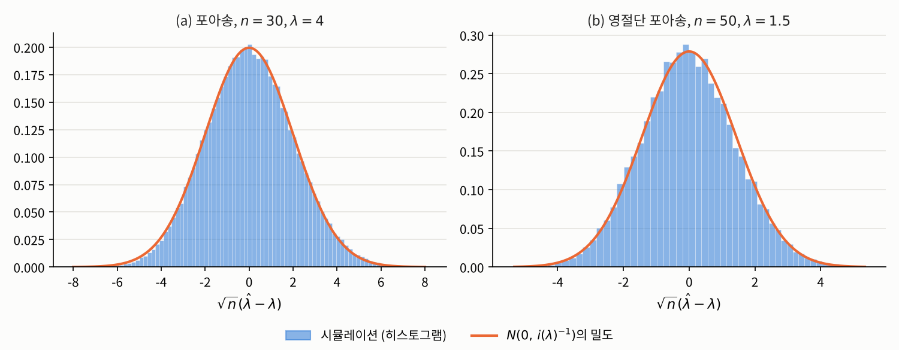
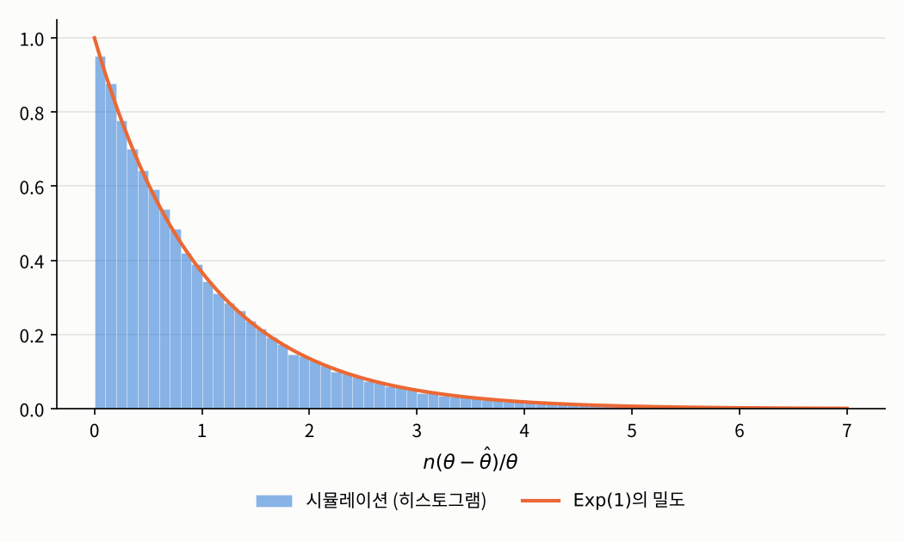

## 들어가며

[1장 소개 글](index.qmd)에서 이번 장이 답할 세 가지 질문으로 원리, 계산, 불확실성을 꼽았습니다. 앞의 네 절에서 앞의 두 질문에 답했으니, 이제 마지막 질문이 남았습니다. 그렇게 구한 최대우도 추정값을 **얼마나 믿을 수 있을까요?**

[1.1절](01-likelihood.qmd)에서 강조했듯이, 이 질문은 숫자 하나인 추정값만 들여다봐서는 답할 수 없습니다. 모집단 레벨로 올라가 추정량 $\hat{\theta}_n = T(\mathbf{X})$를 확률변수로 보고, 그 분포를 따져야 합니다. 그런데 최대우도 추정량은 1.4절의 예처럼 식으로 쓸 수조차 없는 경우가 많으니, 그 분포를 정확히 구하는 것은 대개 불가능합니다. 이번 글에서는 대신 **표본이 커질 때** 그 분포가 어떤 모양에 가까워지는지를 살펴봅니다. 놀랍게도 답은 모형과 거의 상관없이 하나로 정해지고, 그 답에 [1.3절](03-score-fisher.qmd)의 피셔 정보가 등장합니다.

## 문제 1: 표본이 커지면 최대우도 추정량은 어떻게 움직이는가

### 문제 상황

1.1절의 포아송 모형에서 최대우도 추정량은 $\hat{\lambda}_n = \bar{X}$였습니다. 하루 사고 건수를 30일, 300일, 3000일 동안 모으면, 표본마다 달라지는 $\hat{\lambda}_n$은 어떻게 행동할까요? 참값에 가까워질까요? 가까워진다면 얼마나 빨리, 어떤 모양으로 흩어지면서 가까워질까요? 그리고 1.4절의 영절단 포아송 모형처럼 추정량을 식으로 쓸 수 없는 경우에도 같은 이야기를 할 수 있을까요?

### 접근 아이디어

포아송 모형에서는 추정량이 표본평균이므로 확률론의 두 정리를 바로 쓸 수 있습니다. 큰 수의 법칙은 $\bar{X}$가 $\lambda$에 가까워진다고 말해 주고, 중심극한정리는 $\sqrt{n}(\bar{X} - \lambda)$가 정규분포 $N(0, \lambda)$에 가까워진다고 말해 줍니다. 여기서 분산 $\lambda$는 1.3절에서 구한 관측값 하나의 피셔 정보 $i(\lambda) = 1/\lambda$의 역수입니다.

추정량을 식으로 쓸 수 없는 경우에는 어떻게 할까요? 핵심은 1.3절에서 본 점수입니다. 최대우도 추정값은 점수가 $0$인 점이고, 점수는 확률표본에서 **독립인 항들의 합**입니다. 합에는 큰 수의 법칙과 중심극한정리를 쓸 수 있습니다. 즉 추정량 자체는 식으로 쓸 수 없어도, 추정량을 정하는 방정식은 합으로 쓸 수 있으니, 그 방정식을 통해 추정량의 행동을 알아낼 수 있다는 것입니다. 이 아이디어를 정확하게 만들려면 먼저 "가까워진다"의 뜻을 분명히 해야 합니다.

### 필요한 개념들

확률변수가 무언가에 "가까워진다"는 말에는 여러 의미가 있습니다. 이번 글에서는 두 가지를 씁니다.

::: {.callout-note icon=false .callout-definition}
### 정의 1.5.1 (확률수렴과 분포수렴)
$Y_1, Y_2, \ldots$와 $Y$를 $\mathbb{R}^d$에 값을 가지는 확률벡터라고 합시다.

1. 모든 $\varepsilon > 0$에 대해
$$\mathbb{P}\big(\lVert Y_n - Y \rVert > \varepsilon\big) \xrightarrow[n \to \infty]{} 0$$
이면 $Y_n$이 $Y$로 **확률수렴**(convergence in probability)한다고 하고, $Y_n \xrightarrow{\ P\ } Y$로 씁니다.
2. 모든 유계 연속함수 $g : \mathbb{R}^d \to \mathbb{R}$에 대해
$$\mathbb{E}[g(Y_n)] \xrightarrow[n \to \infty]{} \mathbb{E}[g(Y)]$$
이면 $Y_n$이 $Y$로 **분포수렴**(convergence in distribution)한다고 하고, $Y_n \xrightarrow{\ D\ } Y$로 씁니다.
:::

확률수렴은 "$Y_n$이 $Y$에서 조금이라도 벗어날 확률이 점점 $0$이 된다"는 뜻이고, 분포수렴은 "$Y_n$의 분포 모양이 $Y$의 분포 모양에 가까워진다"는 뜻입니다. 분포수렴은 $Y_n$과 $Y$의 값이 가까워진다는 말이 아니라 **분포**만 가까워진다는 말이라서 더 약한 개념입니다. 중심극한정리가 바로 분포수렴에 대한 정리입니다.

추정량에 대해 우리가 바라는 가장 기본적인 성질은, 데이터가 많아지면 참값으로 다가가는 것입니다.

::: {.callout-note icon=false .callout-definition}
### 정의 1.5.2 (일치성)
각 표본 크기 $n$마다 정해진 추정량 $\hat{\theta}_n = T_n(X_1, \ldots, X_n)$의 수열이 모든 $\theta \in \Theta$에 대해, $\mathbf{X}$가 $P_\theta$를 따를 때
$$\hat{\theta}_n \xrightarrow{\ P\ } \theta \qquad (n \to \infty)$$
를 만족하면, 이 추정량을 **일치추정량**(consistent estimator)이라고 합니다.
:::

"모든 $\theta$에 대해"라는 조건이 중요합니다. 참값이 무엇이든 데이터만 충분하면 그 값을 찾아내야 한다는 뜻입니다. 참값이 $4$일 때만 잘 맞히는 추정량은 일치추정량이 아닙니다.

최대우도 추정량은 적절한 조건 아래에서 일치추정량입니다.

::: {.callout-important icon=false .callout-satz}
### 정리 1.5.3 (최대우도 추정량의 일치성)
$X_1, \ldots, X_n \overset{\text{i.i.d.}}{\sim} P_{\theta_0}$이고 모형이 식별가능하다고 합시다. 우도함수의 연속성, 모수공간의 콤팩트성(또는 로그우도의 오목성), 그리고 로그밀도가 적분가능한 함수로 고르게 눌린다는 조건 등의 적절한 정칙 조건 아래에서, 최대우도 추정량 $\hat{\theta}_n$은 $\theta_0$의 일치추정량입니다.
:::

::: {.callout-tip collapse="false" icon=false .callout-beweis}
### 증명
정확한 조건과 증명은 반 데르 바르트의 교재를 참고하시기 바랍니다.[^vdv] 아래에서 핵심 아이디어만 설명합니다.
:::

핵심 아이디어는 다음과 같습니다. 로그우도를 $n$으로 나누면 독립인 항들의 평균이므로, 큰 수의 법칙에 의해 각 $\theta$에서
$$\frac{1}{n}\ell(\theta; \mathbf{X}) = \frac{1}{n}\sum_{i=1}^n \log f(X_i, \theta) \xrightarrow{\ P\ } \mathbb{E}_{\theta_0}[\log f(X_1, \theta)] =: M(\theta)$$
입니다. 그런데 이 극한 $M$은 정확히 참값 $\theta_0$에서 가장 큽니다. 실제로 $\log$가 오목하므로 옌센 부등식에 의해
$$M(\theta) - M(\theta_0) = \mathbb{E}_{\theta_0}\!\left[\log \frac{f(X_1, \theta)}{f(X_1, \theta_0)}\right] \le \log \mathbb{E}_{\theta_0}\!\left[\frac{f(X_1, \theta)}{f(X_1, \theta_0)}\right] \le \log 1 = 0$$
이고, 식별가능성 덕분에 $\theta \neq \theta_0$이면 등호가 성립하지 않습니다.[^kl] 즉 **데이터가 무한히 많다면 로그우도의 꼭대기는 정확히 참값에 놓입니다.** 최대우도 추정값은 유한한 데이터로 만든 로그우도의 꼭대기이므로, 데이터가 많아질수록 참값 근처로 모입니다. 증명에서 까다로운 부분은 "각 $\theta$에서의 수렴"을 "꼭대기 위치의 수렴"으로 바꾸는 단계이고, 정리의 정칙 조건들이 바로 이 단계를 위한 것입니다.

일치성은 추정량이 참값으로 **간다**는 것만 말해 줍니다. 얼마나 빨리, 어떤 모양으로 흩어지면서 가는지를 알려면 분포수렴이 필요합니다. 그 증명에서는 확률론의 다음 정리를 씁니다.

::: {.callout-important icon=false .callout-satz}
### 정리 1.5.4 (슬러츠키 정리)
$\mathbb{R}^d$ 값 확률벡터 $Y_n$과 $d \times d$ 확률행렬 $A_n$에 대해 $Y_n \xrightarrow{\ D\ } Y$이고 $A_n \xrightarrow{\ P\ } A$ ($A$는 상수 행렬)이면 $A_n Y_n \xrightarrow{\ D\ } AY$입니다.
:::

::: {.callout-tip collapse="false" icon=false .callout-beweis}
### 증명
[측도론적 확률론](../../../stats/measure-prob/index.qmd)의 분포수렴 부분을 참고하시기 바랍니다.
:::

이제 이번 장의 가장 중요한 결과를 말할 수 있습니다.

::: {.callout-important icon=false .callout-satz}
### 정리 1.5.5 (최대우도 추정량의 점근 정규성)
$X_1, \ldots, X_n \overset{\text{i.i.d.}}{\sim} P_{\theta_0}$이고, 다음과 같은 정칙 조건을 가정합니다.

1. $\theta_0$는 모수공간 $\Theta \subset \mathbb{R}^d$의 내부점이고, 모형은 식별가능합니다.
2. 관측값 하나의 밀도 $f$가 정리 1.3.4의 조건을 만족하고, $\theta_0$ 근처에서 세 번 연속미분가능하며 그 삼계도함수들이 적분가능한 함수로 눌립니다.
3. 피셔 정보 $i(\theta_0)$가 유한하고 양의 정부호입니다.

그러면 점수 방정식의 해인 일치추정량 $\hat{\theta}_n$에 대해 다음이 성립합니다.
$$\sqrt{n}\,(\hat{\theta}_n - \theta_0) \xrightarrow{\ D\ } N_d\big(0,\ i(\theta_0)^{-1}\big)$$
:::

::: {.callout-tip collapse="false" icon=false .callout-beweis}
### 증명 (스케치)
$\hat{\theta}_n$은 점수 방정식의 해이므로 $U_n(\hat{\theta}_n) = 0$입니다. 점수를 참값 $\theta_0$ 근처에서 일차 테일러 전개하면, 1.4절의 뉴턴-랩슨 방법을 유도할 때와 같은 식
$$0 = U_n(\hat{\theta}_n) \approx U_n(\theta_0) - J_n(\theta_0)\,(\hat{\theta}_n - \theta_0)$$
을 얻습니다. 이를 정리하고 $\sqrt{n}$을 적절히 나눠 곱하면
$$\sqrt{n}\,(\hat{\theta}_n - \theta_0) \approx \left(\frac{1}{n}J_n(\theta_0)\right)^{-1} \frac{1}{\sqrt{n}}\,U_n(\theta_0)$$
입니다. 오른쪽의 두 부분을 차례로 봅니다.

- **점수 (중심극한정리):** $U_n(\theta_0) = \sum_{i=1}^n \partial \log f(X_i, \theta_0)/\partial\theta$는 독립인 항들의 합이고, 정리 1.3.4와 따름정리 1.3.5에 의해 각 항은 평균이 $0$, 공분산 행렬이 $i(\theta_0)$입니다. 따라서 다변량 중심극한정리에 의해 $U_n(\theta_0)/\sqrt{n} \xrightarrow{\ D\ } N_d(0, i(\theta_0))$입니다.
- **관측 정보 (큰 수의 법칙):** $J_n(\theta_0)/n$은 독립인 항 $-\partial^2 \log f(X_i, \theta_0)/\partial\theta\,\partial\theta^\top$의 평균이므로, 큰 수의 법칙과 정리 1.3.4 (b)에 의해 $J_n(\theta_0)/n \xrightarrow{\ P\ } i(\theta_0)$입니다.

슬러츠키 정리(정리 1.5.4)로 두 결과를 합치면, $Z \sim N_d(0, i(\theta_0))$에 대해
$$\sqrt{n}\,(\hat{\theta}_n - \theta_0) \xrightarrow{\ D\ } i(\theta_0)^{-1} Z \sim N_d\big(0,\ i(\theta_0)^{-1}\, i(\theta_0)\, i(\theta_0)^{-1}\big) = N_d\big(0,\ i(\theta_0)^{-1}\big)$$
입니다. 엄밀한 증명에서는 테일러 전개의 나머지 항이 $0$으로 확률수렴한다는 것을 보여야 하는데, 조건 2의 삼계도함수에 대한 가정이 그 역할을 합니다. 자세한 내용은 반 데르 바르트의 교재를 참고하시기 바랍니다.[^vdv]
:::

이 정리는 다음과 같이 읽을 수 있습니다. 표본이 충분히 크면 최대우도 추정량은 근사적으로

$$\hat{\theta}_n \;\overset{\text{근사}}{\sim}\; N_d\big(\theta_0,\ I_n(\theta_0)^{-1}\big), \qquad I_n(\theta_0) = n\, i(\theta_0)$$

를 따릅니다. 즉 **최대우도 추정량은 참값을 중심으로, 피셔 정보의 역수만큼 흩어집니다.** 1.3절에서 "꼭대기가 뾰족할수록 데이터가 모수를 분명하게 정한다"고 한 직관이 정확한 식이 된 것입니다. 또 분산이 $1/n$에 비례하므로, 오차의 크기인 표준편차는 $1/\sqrt{n}$에 비례해서 줄어듭니다. 정확도를 두 배로 높이려면 데이터가 네 배 필요하다는 뜻입니다.

증명 스케치에서 하나 더 눈여겨볼 점이 있습니다. 최대우도 추정량의 무작위성은 결국 **점수의 무작위성을 정보로 나눈 것**입니다. 1.3절에서 점수와 피셔 정보를 따로 정의한 이유가 이 한 줄에 담겨 있습니다.

실제로 쓰려면 한 가지 문제가 남습니다. 분산 $I_n(\theta_0)^{-1}$에는 우리가 모르는 참값 $\theta_0$가 들어 있습니다. 그래서 실제로는 참값 자리에 추정값을 넣습니다.

::: {.callout-note icon=false}
### 참고 1.5.6 (표준오차)
최대우도 추정값 $\hat{\theta}$에 대해 $I_n(\hat{\theta})^{-1}$ 또는 $j(\hat{\theta}; \mathbf{x})^{-1}$을 추정량의 공분산 행렬의 추정값으로 쓰고, 그 대각성분의 제곱근
$$\widehat{\mathrm{se}}(\hat{\theta}_k) := \sqrt{\big[I_n(\hat{\theta})^{-1}\big]_{kk}} \quad \text{또는} \quad \sqrt{\big[j(\hat{\theta}; \mathbf{x})^{-1}\big]_{kk}}$$
를 $k$번째 성분의 **표준오차**(standard error)라고 합니다. 앞의 것을 기대 정보를 쓴 표준오차, 뒤의 것을 관측 정보를 쓴 표준오차라고 부릅니다.
:::

### 해결

먼저 포아송 모형에서 정리 1.5.5가 말하는 내용을 확인해 보겠습니다. $i(\lambda) = 1/\lambda$이므로 정리는 $\sqrt{n}(\hat{\lambda}_n - \lambda) \xrightarrow{D} N(0, \lambda)$라고 말하는데, $\hat{\lambda}_n = \bar{X}$이므로 이는 중심극한정리 그 자체입니다. $\lambda = 4$로 두고 표본 크기를 바꿔 가며 10만 번씩 시뮬레이션해 보겠습니다.

```python
import numpy as np

np.random.seed(2026)
lam, reps = 4, 100_000
for n in [10, 30, 300]:
    lam_hat = np.random.poisson(lam=lam, size=(reps, n)).mean(axis=1)   # 표본마다 계산한 MLE
    Z = np.sqrt(n) * (lam_hat - lam)
    print(f"n = {n:>3}: lam_hat의 표준편차 = {lam_hat.std():.4f}, "
          f"sqrt(n)(lam_hat - lam)의 분산 = {Z.var():.4f}")
print(f"이론값 1/i(lam) = lam = {lam}")
```

```
n =  10: lam_hat의 표준편차 = 0.6339, sqrt(n)(lam_hat - lam)의 분산 = 4.0181
n =  30: lam_hat의 표준편차 = 0.3653, sqrt(n)(lam_hat - lam)의 분산 = 4.0026
n = 300: lam_hat의 표준편차 = 0.1155, sqrt(n)(lam_hat - lam)의 분산 = 4.0008
```

추정량의 표준편차는 $n$이 커질수록 $0$으로 줄어들고(일치성), $\sqrt{n}$을 곱해 확대한 오차의 분산은 언제나 이론값 $4$ 근처에 머뭅니다($1/\sqrt{n}$ 속도). $n = 30$에서 10배인 $n = 300$으로 늘리면 표준편차는 $\sqrt{10} \approx 3.16$배 줄어드는데, 실제로 $0.3653 / 0.1155 \approx 3.16$입니다.

다음은 추정량을 식으로 쓸 수 없는 영절단 포아송 모형입니다. 1.4절에서 구한 피셔 정보로부터 관측값 하나의 피셔 정보는
$$i(\lambda) = \frac{1}{\lambda(1 - e^{-\lambda})} - \frac{e^{-\lambda}}{(1 - e^{-\lambda})^2}$$
이고, 정리 1.5.5에 따르면 추정량의 표준편차는 약 $\sqrt{1/(n\,i(\lambda))}$여야 합니다. 표본마다 피셔 스코어링으로 최대우도 추정값을 구해 확인해 보겠습니다. 1.4절에서 보았듯이 표본이 작을 때는 피셔 스코어링이 더 안정적입니다.

```python
def ztp_mle(x, iters=30):
    """영절단 포아송 모형의 최대우도 추정값 (표본마다 피셔 스코어링)"""
    n, xbar = x.shape[1], x.mean(axis=1)
    lam = xbar.copy()
    for _ in range(iters):
        q = np.exp(-lam)
        u = n * (xbar / lam - 1 / (1 - q))
        I = n * (1 / (lam * (1 - q)) - q / (1 - q)**2)
        lam = lam + u / I
    return lam

def ztp_sample(lam, size):
    """0이 나온 자리는 0이 아닌 값이 나올 때까지 다시 뽑아 영절단 포아송 표본을 만듦"""
    x = np.random.poisson(lam=lam, size=size)
    while (x == 0).any():
        x[x == 0] = np.random.poisson(lam=lam, size=(x == 0).sum())
    return x

np.random.seed(2026)
lam, reps = 1.5, 20_000
q = np.exp(-lam)
i_lam = 1 / (lam * (1 - q)) - q / (1 - q)**2     # 관측값 하나의 피셔 정보
for n in [20, 50, 500]:
    lam_hat = ztp_mle(ztp_sample(lam, (reps, n)))
    print(f"n = {n:>3}: 평균 = {lam_hat.mean():.4f}, 표준편차 = {lam_hat.std():.4f}, "
          f"이론값 sqrt(1/(n i)) = {np.sqrt(1 / (n * i_lam)):.4f}")
```

```
n =  20: 평균 = 1.4926, 표준편차 = 0.3205, 이론값 sqrt(1/(n i)) = 0.3199
n =  50: 평균 = 1.4952, 표준편차 = 0.2028, 이론값 sqrt(1/(n i)) = 0.2024
n = 500: 평균 = 1.4993, 표준편차 = 0.0638, 이론값 sqrt(1/(n i)) = 0.0640
```

추정량을 식으로 쓸 수 없는데도, 그 표준편차가 피셔 정보만으로 계산한 값과 거의 정확히 일치합니다. 평균은 참값 $1.5$보다 조금 작지만 $n$이 커질수록 그 차이도 줄어듭니다. 아래 그림은 두 모형에서 $\sqrt{n}(\hat{\lambda} - \lambda)$의 분포를 정리 1.5.5의 정규분포와 겹쳐 그린 것입니다.

{fig-alt="두 개의 히스토그램. 왼쪽 (a)는 포아송 모형(n=30, λ=4)에서 시뮬레이션한 √n(λ̂-λ)의 히스토그램으로, -6에서 6 사이에 종 모양으로 분포하며 주황색 정규분포 N(0,4)의 밀도 곡선과 거의 겹친다. 오른쪽 (b)는 영절단 포아송 모형(n=50, λ=1.5)의 히스토그램으로, -4에서 4 사이의 종 모양이며 분산이 약 2.05인 주황색 정규분포 밀도 곡선과 잘 맞는다."}

마지막으로 실제 데이터에서 표준오차(참고 1.5.6)를 계산해 보겠습니다. 1.1절의 포아송 데이터에서는 $I_n(\hat{\lambda}) = n/\bar{x}$이므로 $\widehat{\mathrm{se}}(\hat{\lambda}) = \sqrt{\bar{x}/n} = \sqrt{4.1333/30} \approx 0.371$입니다. 1.4절의 영절단 포아송 데이터에서는 다음과 같습니다.

```python
n, lam_hat = 50, 1.4852043774          # 1.4절에서 구한 최대우도 추정값
q = np.exp(-lam_hat)
I_hat = n * (1 / (lam_hat * (1 - q)) - q / (1 - q)**2)
print(f"I_n(lam_hat) = {I_hat:.4f}, 표준오차 = {1 / np.sqrt(I_hat):.4f}")
```

```
I_n(lam_hat) = 24.5983, 표준오차 = 0.2016
```

즉 1.4절의 추정값 $1.485$는 대략 $\pm 0.2$ 정도의 오차를 안고 있는 셈입니다. 5장에서는 이 표준오차로 신뢰구간과 가설검정을 만듭니다.

## 문제 2: 이보다 더 정확할 수는 없는가

### 문제 상황

최대우도 추정량의 분산이 근사적으로 $I_n(\theta)^{-1}$이라는 것을 알았습니다. 그렇다면 다른 추정 방법을 쓰면 이보다 분산을 더 줄일 수 있을까요?

### 해결

적어도 **평균적으로 참값을 맞히는** 추정량 가운데에서는, 피셔 정보의 역수보다 분산을 줄일 수 없습니다. 모수가 하나인 경우로 정리하면 다음과 같습니다.

::: {.callout-important icon=false .callout-satz}
### 정리 1.5.7 (크라메르-라오 하한)
$\Theta \subset \mathbb{R}$이고 정리 1.3.4의 조건이 성립한다고 합시다. 통계량 $T(\mathbf{X})$가 모든 $\theta$에 대해 $\mathbb{E}_\theta[T(\mathbf{X})^2] < \infty$와 $\mathbb{E}_\theta[T(\mathbf{X})] = \theta$를 만족하고, $\int T(\mathbf{x})\,p(\mathbf{x}, \theta)\,\nu(d\mathbf{x})$를 $\theta$로 미분할 때 미분과 적분의 순서를 바꿀 수 있으면, 모든 $\theta$에 대해 다음이 성립합니다.
$$\mathrm{Var}_\theta\big(T(\mathbf{X})\big) \ge \frac{1}{I_n(\theta)}$$
:::

::: {.callout-tip collapse="false" icon=false .callout-beweis}
### 증명
$\mathbb{E}_\theta[T] = \int T\,p\,d\nu = \theta$의 양변을 $\theta$로 미분하고 미분과 적분의 순서를 바꾸면, 1.3절 정리 1.3.4의 증명에서처럼 $\partial p = (\partial \log p)\,p$이므로
$$1 = \int T\,\frac{\partial \log p}{\partial \theta}\,p\,d\nu = \mathbb{E}_\theta\big[T\,U_n(\theta)\big] = \mathrm{Cov}_\theta\big(T,\ U_n(\theta)\big)$$
입니다. 마지막 등호에는 $\mathbb{E}_\theta[U_n(\theta)] = 0$을 썼습니다. 코시-슈바르츠 부등식에 의해
$$1 = \mathrm{Cov}_\theta(T, U_n)^2 \le \mathrm{Var}_\theta(T)\,\mathrm{Var}_\theta(U_n) = \mathrm{Var}_\theta(T)\, I_n(\theta)$$
이므로 결론을 얻습니다. $\square$
:::

이 정리에 의해 $I_n(\theta)^{-1}$은 불편추정량의 분산이 내려갈 수 있는 **바닥**입니다. 모수가 여러 개일 때도 같은 방식으로, $k$번째 성분의 불편추정량의 분산은 $\big[I_n(\theta)^{-1}\big]_{kk}$보다 작아질 수 없다는 것을 보일 수 있습니다. 그런데 정리 1.5.5에 따르면 최대우도 추정량의 분산은 표본이 커질 때 정확히 이 바닥에 다가갑니다. 이런 의미에서 최대우도 추정량을 **점근적으로 효율적**(asymptotically efficient)이라고 합니다. 최대우도 추정이 통계학의 표준적인 방법이 된 가장 큰 이유입니다.

두 예로 확인해 보겠습니다.

- **포아송:** $\mathrm{Var}_\lambda(\bar{X}) = \lambda/n = I_n(\lambda)^{-1}$이므로, 최대우도 추정량 $\bar{X}$는 모든 $n$에서 이 바닥에 **정확히** 도달합니다.
- **정규분포의 분산:** 평균과 분산을 모두 모를 때, 1.3절에서 구한 피셔 정보 행렬의 역행렬은 $\mathrm{diag}(\sigma^2/n,\ 2\sigma^4/n)$이므로 $\sigma^2$의 불편추정량의 분산의 바닥은 $2\sigma^4/n$입니다. 1.1절에서 본 불편추정량 $s^2$의 분산은 $2\sigma^4/(n-1)$로 이 바닥보다 조금 큽니다.

```python
np.random.seed(2026)
mu, s2, reps = 170, 36, 100_000
for n in [5, 20, 100]:
    Y = np.random.normal(loc=mu, scale=np.sqrt(s2), size=(reps, n))
    s2_hat = Y.var(axis=1, ddof=1)               # 불편추정량 s^2
    print(f"n = {n:>3}: Var(s^2) = {s2_hat.var():8.3f},  "
          f"이론값 2 sigma^4/(n-1) = {2 * s2**2 / (n - 1):8.3f},  하한 2 sigma^4/n = {2 * s2**2 / n:8.3f}")
```

```
n =   5: Var(s^2) =  642.783,  이론값 2 sigma^4/(n-1) =  648.000,  하한 2 sigma^4/n =  518.400
n =  20: Var(s^2) =  136.348,  이론값 2 sigma^4/(n-1) =  136.421,  하한 2 sigma^4/n =  129.600
n = 100: Var(s^2) =   26.282,  이론값 2 sigma^4/(n-1) =   26.182,  하한 2 sigma^4/n =   25.920
```

표본이 작을 때는 하한과 차이가 꽤 나지만, $n$이 커질수록 그 비율 $n/(n-1)$은 $1$에 가까워집니다. 사실 $s^2$는 $\sigma^2$의 불편추정량 가운데 분산이 가장 작다고 알려져 있으므로, 이 모형에서는 하한에 정확히 도달하는 불편추정량이 아예 없습니다. 크라메르-라오 하한은 언제나 도달할 수 있는 값이 아니라 넘을 수 없는 바닥이라는 뜻입니다. 그래도 표본이 크면 그 차이는 사라집니다.

## 문제 3: 정칙 조건이 깨지면

### 문제 상황

정리 1.5.5에는 꽤 많은 정칙 조건이 붙어 있었습니다. 이 조건들이 깨지면 어떻게 될까요? [1.2절](02-score-failures.qmd)과 1.3절에서 여러 번 예고한 $U[0, \theta]$ 모형을 살펴보겠습니다. 이 모형은 받침이 $\theta$에 따라 움직여서 정리 1.3.4의 조건 1이 깨지고, 따라서 정리 1.5.5의 조건 2도 성립하지 않습니다.

### 해결

1.2절에서 구한 최대우도 추정량은 $\hat{\theta}_n = X_{(n)}$입니다. 이 경우에는 분포를 직접 계산할 수 있습니다. $t \in [0, n]$에 대해
$$\mathbb{P}_\theta\!\left(\frac{n(\theta - X_{(n)})}{\theta} > t\right) = \mathbb{P}_\theta\!\left(X_{(n)} < \theta\Big(1 - \frac{t}{n}\Big)\right) = \Big(1 - \frac{t}{n}\Big)^n \xrightarrow[n \to \infty]{} e^{-t}$$
입니다. 첫 번째 등호는 식을 정리한 것이고, 두 번째 등호는 $n$개의 관측값이 **모두** $\theta(1 - t/n)$보다 작을 확률이 각각의 확률 $1 - t/n$의 곱이기 때문입니다. 즉
$$\frac{n\,(\theta - \hat{\theta}_n)}{\theta} \xrightarrow{\ D\ } \mathrm{Exp}(1)$$
입니다. 정리 1.5.5와 두 가지가 다릅니다.

- **수렴 속도가 $\sqrt{n}$이 아니라 $n$입니다.** 오차가 $1/\sqrt{n}$이 아니라 $1/n$ 속도로 줄어들어, 정칙 모형보다 **훨씬 빠르게** 참값에 다가갑니다.
- **극한분포가 정규분포가 아닙니다.** 추정량이 항상 참값보다 작으므로 오차는 한쪽으로만 생기고, 그 분포는 지수분포입니다.

```python
np.random.seed(2026)
theta, reps = 10, 100_000
for n in [10, 100, 1000]:
    theta_hat = np.random.uniform(0, theta, size=(reps, n)).max(axis=1)
    W = n * (theta - theta_hat) / theta
    print(f"n = {n:>4}: theta_hat의 표준편차 = {theta_hat.std():.5f}, "
          f"n(theta - theta_hat)/theta의 평균 = {W.mean():.4f}, 분산 = {W.var():.4f}")
```

```
n =   10: theta_hat의 표준편차 = 0.83237, n(theta - theta_hat)/theta의 평균 = 0.9095, 분산 = 0.6928
n =  100: theta_hat의 표준편차 = 0.09862, n(theta - theta_hat)/theta의 평균 = 0.9881, 분산 = 0.9726
n = 1000: theta_hat의 표준편차 = 0.00996, n(theta - theta_hat)/theta의 평균 = 0.9972, 분산 = 0.9913
```

$n$이 10배가 될 때마다 표준편차가 $\sqrt{10}$배가 아니라 거의 정확히 10배씩 줄어들고, $n(\theta - \hat{\theta}_n)/\theta$의 평균과 분산은 $\mathrm{Exp}(1)$의 평균과 분산인 $1$에 다가갑니다.

{fig-alt="n=100일 때 n(θ-θ̂)/θ의 시뮬레이션 히스토그램. 0에서 가장 높고 오른쪽으로 갈수록 빠르게 줄어드는 모양이며, 주황색 지수분포 Exp(1)의 밀도 곡선 e^(-t)와 거의 겹친다." width=70%}

같은 이유로 크라메르-라오 하한도 이 모형에서는 의미를 잃습니다. 예를 들어 치우침을 바로잡은 $\frac{n+1}{n}X_{(n)}$은 불편추정량인데, 그 분산은 $\theta^2/\{n(n+2)\}$로 $1/n^2$에 비례해 줄어듭니다. 정칙 모형에서는 불편추정량의 분산이 $1/n$보다 빨리 줄어들 수 없다는 것과 대조적입니다. 정칙 조건은 단지 증명을 편하게 하려는 기술적인 조건이 아니라, 결론 자체를 바꾸는 조건이라는 것을 알 수 있습니다.

반대로, 정칙 조건은 정리 1.5.5가 성립하기 위한 **충분조건**일 뿐 필요조건은 아닙니다. 예를 들어 밀도가 $f(x, \theta) = \frac{1}{2}e^{-|x - \theta|}$인 라플라스 분포(Laplace distribution)의 위치 모수 모형에서는 로그우도 $\ell(\theta; \mathbf{x}) = -\sum_{i=1}^n |x_i - \theta| - n\log 2$가 관측값마다 꺾여서 미분가능하지 않고, 최대우도 추정량은 표본 중앙값이 됩니다. 이 모형은 정리 1.5.5의 조건 2를 만족하지 않지만, 그래도
$$\sqrt{n}\,(\hat{\theta}_n - \theta) \xrightarrow{\ D\ } N(0, 1)$$
이 성립합니다. 이 분산 $1$은 이 모형의 관측값 하나의 피셔 정보 $i(\theta) = \mathbb{E}_\theta\big[\mathrm{sign}(X_1 - \theta)^2\big] = 1$의 역수와 같습니다. 정칙 조건이 깨졌다고 해서 결론이 반드시 깨지는 것은 아닌 셈입니다. 정칙 조건은 결론이 성립함을 **보장하는** 조건이고, 조건이 깨진 모형은 $U[0, \theta]$처럼 결론이 달라질 수도, 라플라스 분포처럼 그대로 성립할 수도 있으니 따로 따져 봐야 합니다.

## 정리: 1장을 마치며

이번 글의 결과를 한 줄로 요약하면 다음과 같습니다. 정칙 조건 아래에서 최대우도 추정량은

$$\hat{\theta}_n \;\overset{\text{근사}}{\sim}\; N_d\big(\theta_0,\ I_n(\theta_0)^{-1}\big)$$

를 따르고, 이 분산은 불편추정량이 도달할 수 있는 바닥과 같습니다.

이로써 [1장 소개 글](index.qmd)에서 던진 세 질문에 모두 답했습니다.

| 질문 | 답 | 절 |
|:--|:--|:--|
| **원리:** 모수를 어떻게 정하는가? | 우도를 최대화하는 모수를 고른다. 존재·유일성은 모형과 모수공간에 따라 확인이 필요하다. | 1.1, 1.2 |
| **계산:** 식으로 풀 수 없으면? | 점수와 정보를 이용한 뉴턴-랩슨 방법, 피셔 스코어링 | 1.3, 1.4 |
| **불확실성:** 얼마나 믿을 수 있는가? | 근사적으로 $N(\theta_0, I_n(\theta_0)^{-1})$을 따르며, 표준오차로 그 크기를 잰다. | 1.3, 1.5 |

세 답 모두에서 로그우도의 모양, 즉 꼭대기의 위치와 기울기와 곡률이 중심에 있었습니다. 이 이야기는 뒤의 장들에서 계속 쓰입니다. 3장과 4장에서는 선형 회귀와 로지스틱 회귀의 모수를 최대우도로 추정하고, 5장에서는 이번 글의 점근 정규성과 표준오차로 신뢰구간과 가설검정을 만듭니다.

---

### 연결되는 개념
* $\leftarrow$ **이전 개념:** [1.4 뉴턴-랩슨 방법과 피셔 스코어링](04-newton-raphson.qmd)
* $\rightarrow$ **다음 개념:** [2 변수 사이의 의존성 측정](../02-dependence/index.qmd)

[^vdv]: A. W. van der Vaart, *Asymptotic Statistics*, Cambridge University Press, 1998, 5장. 일치성과 점근 정규성의 정확한 조건과 증명이 정리되어 있습니다.

[^kl]: 이 차이에 음의 부호를 붙인 양 $\mathbb{E}_{\theta_0}[\log\{f(X_1, \theta_0)/f(X_1, \theta)\}]$를 **쿨백-라이블러 발산**(Kullback–Leibler divergence)이라고 하며, 두 분포가 얼마나 다른지를 재는 대표적인 양입니다. 등호 조건은 옌센 부등식에서 $f(X_1, \theta)/f(X_1, \theta_0)$가 거의 확실하게 상수일 때이고, 두 함수가 모두 밀도이므로 그 상수는 $1$, 즉 $P_\theta = P_{\theta_0}$일 때뿐입니다.
