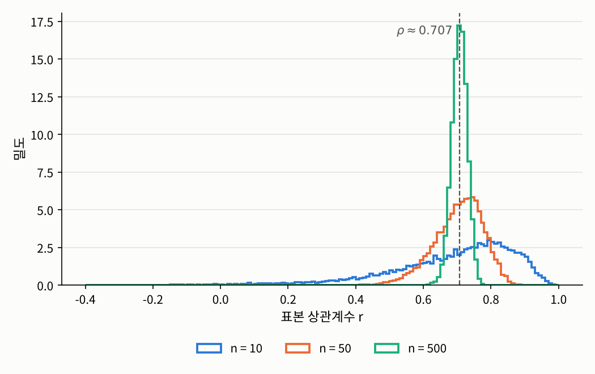
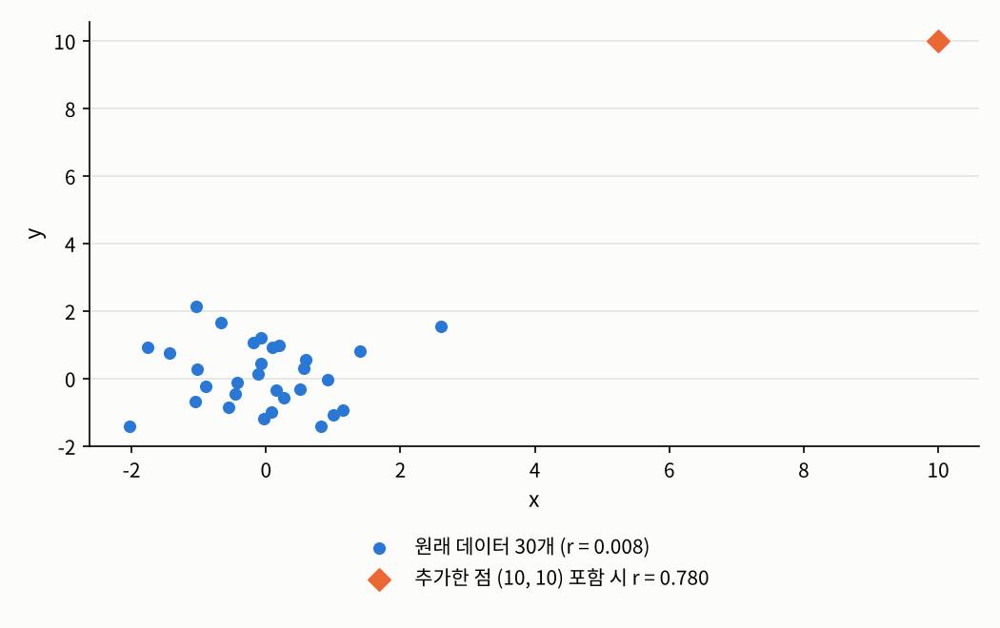

## 들어가며

[데이터 사이언스 개론](../../ds-intro/02-data-exploration/03-correlation.qmd)에서 상관계수를 처음 만났을 때, 그것은 산점도의 점들이 직선 주위에 얼마나 몰려 있는지를 나타내는 **데이터의 요약값**이었습니다. 이번 글에서는 [2장 소개 글](index.qmd)에서 예고한 대로 같은 상관계수를 모집단 레벨에서 다시 봅니다. 데이터 뒤에 있는 결합분포에는 어떤 "참된 상관계수"가 딸려 있고, 우리가 데이터로 계산하는 상관계수는 그 값을 추정하는 추정량이라는 관점입니다.

이 관점에서 세 가지를 차례로 살펴보겠습니다. 모집단의 상관계수가 결합분포의 무엇을 재는지, 표본 상관계수가 그 값을 얼마나 잘 맞히는지, 그리고 표본 상관계수가 어떤 상황에서 크게 틀릴 수 있는지입니다.

## 문제 1: 직선 관계의 강도는 무엇으로 정해지는가

### 문제 상황

두 변수 사이에 다음과 같은 관계가 있다고 해 봅시다.

$$Y = 2X + \sigma\varepsilon, \qquad X, \varepsilon \overset{\text{i.i.d.}}{\sim} N(0, 1)$$

$Y$는 $X$의 두 배에 잡음 $\sigma\varepsilon$이 더해진 값입니다. 잡음의 크기 $\sigma$가 작으면 점들이 직선 $y = 2x$ 주위에 좁게 모일 것이고, $\sigma$가 크면 넓게 퍼질 것입니다. 즉 직선 관계의 "강도"는 데이터를 뽑기 전부터 이 모형에 의해 이미 정해져 있습니다. 그렇다면 그 강도를 모형으로부터 직접 계산할 수 있을까요?

### 접근 아이디어

개론에서 배운 표본 상관계수는 평균에서 벗어난 정도의 곱을 **표본 평균**한 공분산을, 각 변수의 흩어진 정도로 나눈 값이었습니다. 데이터 대신 분포를 다룰 때는 표본 평균 자리에 **기대값**을 쓰면 됩니다. 1장에서 본 것처럼 표본 레벨의 평균은 모집단 레벨의 기대값에 대응하기 때문입니다.

### 필요한 개념들

::: {.callout-note icon=false .callout-definition}
### 정의 2.1.1 (공분산과 피어슨 상관계수)
$(X, Y)$가 $\mathbb{E}[X^2] < \infty$, $\mathbb{E}[Y^2] < \infty$인 $\mathbb{R}^2$ 값 확률벡터일 때,
$$\mathrm{Cov}(X, Y) := \mathbb{E}\big[(X - \mathbb{E}X)(Y - \mathbb{E}Y)\big] = \mathbb{E}[XY] - \mathbb{E}X\,\mathbb{E}Y$$
를 $X$와 $Y$의 **공분산**(covariance)이라고 합니다. 또 $\mathrm{Var}(X) > 0$, $\mathrm{Var}(Y) > 0$이면
$$\rho(X, Y) := \frac{\mathrm{Cov}(X, Y)}{\sqrt{\mathrm{Var}(X)\,\mathrm{Var}(Y)}}$$
를 $X$와 $Y$의 **피어슨 상관계수**(Pearson correlation coefficient)라고 합니다.
:::

공분산은 $X$가 평균보다 클 때 $Y$도 평균보다 큰 경향이 있으면 양수, 작은 경향이 있으면 음수가 됩니다. 다만 공분산은 단위에 따라 값이 바뀝니다. 키를 센티미터 대신 밀리미터로 재면 공분산이 10배가 되는 식입니다. 상관계수는 이 단위의 영향을 표준편차로 나눠 없앤 것입니다. 실제로 $a, c > 0$이면 $\rho(aX + b, cY + d) = \rho(X, Y)$가 정의에서 바로 나옵니다.

상관계수가 $-1$과 $1$ 사이에 있다는 것은 개론에서도 보았습니다. 모집단 레벨에서는 등호가 언제 성립하는지까지 정확히 말할 수 있습니다.

::: {.callout-important icon=false .callout-satz}
### 정리 2.1.2 (상관계수의 범위와 등호 조건)
정의 2.1.1의 조건 아래에서 $-1 \le \rho(X, Y) \le 1$입니다. 또한 $\rho(X, Y) = 1$인 것은 어떤 $a > 0$과 $b \in \mathbb{R}$에 대해 거의 확실하게 $Y = aX + b$인 것과 동치이고, $\rho(X, Y) = -1$인 것은 같은 식이 $a < 0$으로 성립하는 것과 동치입니다.
:::

::: {.callout-tip collapse="false" icon=false .callout-beweis}
### 증명
$U := X - \mathbb{E}X$, $V := Y - \mathbb{E}Y$로 두면 코시-슈바르츠 부등식에 의해
$$|\mathrm{Cov}(X, Y)| = |\mathbb{E}[UV]| \le \sqrt{\mathbb{E}[U^2]\,\mathbb{E}[V^2]} = \sqrt{\mathrm{Var}(X)\,\mathrm{Var}(Y)}$$
이므로 $|\rho| \le 1$입니다.

등호 조건을 보기 위해 $a := \mathrm{Cov}(X, Y)/\mathrm{Var}(X)$로 두고 계산하면
$$\mathbb{E}\big[(V - aU)^2\big] = \mathrm{Var}(Y) - 2a\,\mathrm{Cov}(X, Y) + a^2\,\mathrm{Var}(X) = \mathrm{Var}(Y)\,\big(1 - \rho(X, Y)^2\big)$$
입니다. 따라서 $|\rho| = 1$이면 $\mathbb{E}[(V - aU)^2] = 0$이므로 거의 확실하게 $V = aU$, 즉 $Y = aX + (\mathbb{E}Y - a\,\mathbb{E}X)$입니다. 이때 $a$의 부호는 $\mathrm{Cov}(X, Y)$, 즉 $\rho$의 부호와 같습니다. 거꾸로 $Y = aX + b$이면 $\mathrm{Cov}(X, Y) = a\,\mathrm{Var}(X)$이고 $\mathrm{Var}(Y) = a^2\,\mathrm{Var}(X)$이므로 $\rho = a/|a| = \pm 1$입니다. $\square$
:::

증명 속의 식 $\mathbb{E}[(V - aU)^2] = \mathrm{Var}(Y)(1 - \rho^2)$에는 상관계수의 의미가 담겨 있습니다. 왼쪽은 $Y$를 $X$의 일차식 $aX + b$로 가장 잘 근사했을 때 남는 오차의 크기입니다. 따라서 $1 - \rho^2$는 **$X$의 일차식으로 설명되지 않고 남는 $Y$의 분산의 비율**이고, $\rho^2$는 일차식으로 설명되는 비율입니다. 상관계수가 "직선 관계의 강도"를 잰다는 말의 정확한 뜻이 바로 이것입니다. 이 해석은 2.4절과 3장에서 회귀의 결정계수 $R^2$로 다시 만나게 됩니다.

한편 상관계수가 직선 관계**만** 잰다는 것은, 상관계수가 $0$이어도 두 변수가 강하게 관련될 수 있다는 뜻이기도 합니다.

::: {.callout-note icon=false}
### 참고 2.1.3 (상관이 없는 것과 독립인 것)
$\rho(X, Y) = 0$일 때 $X$와 $Y$는 **상관이 없다**(uncorrelated)고 합니다. $X$와 $Y$가 독립이면 $\mathbb{E}[XY] = \mathbb{E}X\,\mathbb{E}Y$이므로 상관이 없지만, 그 역은 성립하지 않습니다. 예를 들어 $X$의 분포가 $0$에 대해 대칭이고 $\mathbb{E}|X|^3 < \infty$이면, $Y := X^2$에 대해
$$\mathrm{Cov}(X, Y) = \mathbb{E}[X^3] - \mathbb{E}[X]\,\mathbb{E}[X^2] = 0 - 0 = 0$$
이지만, $Y$는 $X$에 의해 완전히 결정됩니다.
:::

### 해결

모형 $Y = 2X + \sigma\varepsilon$에서 공분산과 분산을 계산하면, $X$와 $\varepsilon$이 독립이고 분산이 모두 $1$이므로

$$\mathrm{Cov}(X, Y) = 2\,\mathrm{Var}(X) = 2, \qquad \mathrm{Var}(Y) = 4\,\mathrm{Var}(X) + \sigma^2\,\mathrm{Var}(\varepsilon) = 4 + \sigma^2$$

입니다. 따라서 모집단 상관계수는

$$\rho(X, Y) = \frac{2}{\sqrt{1 \cdot (4 + \sigma^2)}} = \frac{2}{\sqrt{4 + \sigma^2}}$$

입니다. 잡음이 없으면($\sigma = 0$) $\rho = 1$이고, 잡음이 커질수록 $0$에 가까워집니다. 예를 들어 $\sigma = 0.5, 1, 2, 4$이면 $\rho \approx 0.970,\ 0.894,\ 0.707,\ 0.447$입니다. 앞에서 본 해석으로 읽으면, $\sigma = 2$일 때 $\rho^2 = 0.5$이므로 $Y$의 분산 $8$ 가운데 절반인 $4$가 $X$의 일차식으로 설명되고, 나머지 절반은 잡음입니다.

참고 2.1.3의 예도 데이터로 확인해 보겠습니다. 데이터로 계산한 상관계수에는 표본에 따른 오차가 섞이므로, 그 오차가 충분히 작아지도록 표본을 크게 잡았습니다.

```python
import numpy as np

np.random.seed(1557)
X = np.random.normal(size=100_000)
Y = X**2                                   # Y는 X에 의해 완전히 결정됨
print(f"r(X, X^2)     = {np.corrcoef(X, Y)[0, 1]:.4f}")
print(f"r(|X|, X^2)   = {np.corrcoef(np.abs(X), Y)[0, 1]:.4f}")
```

```
r(X, X^2)     = 0.0064
r(|X|, X^2)   = 0.9362
```

$Y = X^2$는 $X$의 함수인데도 상관계수는 거의 $0$입니다. 반면 같은 $Y$를 $|X|$와 비교하면 상관계수가 $0.94$로 큽니다. $|X|$가 커지면 $X^2$도 커지는 **단조** 관계라서 직선에 꽤 가깝기 때문입니다. 관계의 모양이 같아도 어떤 변수와 비교하느냐에 따라 상관계수가 전혀 다르게 나올 수 있다는 뜻입니다.

## 문제 2: 표본 상관계수는 참값을 얼마나 잘 맞히는가

### 문제 상황

현실에서는 결합분포를 모르므로 $\rho$를 직접 계산할 수 없고, 데이터로 계산한 표본 상관계수를 대신 씁니다. 그렇다면 표본 상관계수는 $\rho$를 얼마나 잘 맞힐까요? 표본이 작을 때와 클 때, 잡음이 작을 때와 클 때 어떻게 달라질까요? 그리고 1장의 언어로 말하면, 표본 상관계수는 좋은 추정량일까요?

### 필요한 개념들

먼저 표본 상관계수를 1장의 표본 레벨과 모집단 레벨의 구분에 맞춰 다시 정의해 두겠습니다.

::: {.callout-note icon=false .callout-definition}
### 정의 2.1.4 (표본 공분산과 표본 상관계수)
$(X_1, Y_1), \ldots, (X_n, Y_n)$이 $(X, Y)$와 같은 분포를 따르는 확률표본이고 $\bar{X} := \frac{1}{n}\sum_i X_i$, $\bar{Y} := \frac{1}{n}\sum_i Y_i$일 때,
$$\widehat{\mathrm{Cov}}(X, Y) := \frac{1}{n-1}\sum_{i=1}^n (X_i - \bar{X})(Y_i - \bar{Y}), \qquad r := \frac{\sum_{i=1}^n (X_i - \bar{X})(Y_i - \bar{Y})}{\sqrt{\sum_{i=1}^n (X_i - \bar{X})^2}\,\sqrt{\sum_{i=1}^n (Y_i - \bar{Y})^2}}$$
를 각각 **표본 공분산**(sample covariance)과 **표본 상관계수**(sample correlation coefficient)라고 합니다. $r$은 분모가 $0$이 아닐 때, 즉 $X_i$들과 $Y_i$들이 각각 모두 같은 값은 아닐 때 정의됩니다.
:::

$r$의 식에서는 분자와 분모의 $\frac{1}{n-1}$이 약분되어 사라지므로, 표본 공분산과 표본분산을 $n$으로 나누든 $n-1$로 나누든 $r$은 같습니다. 이 사실은 뒤의 정리 2.1.7에서 쓰입니다.

데이터가 많아지면 $r$은 정말 $\rho$에 다가갈까요? 1.5절의 일치성으로 답할 수 있습니다.

::: {.callout-important icon=false .callout-satz}
### 정리 2.1.5 (표본 상관계수의 일치성)
$(X_i, Y_i)$들이 i.i.d.이고, $\mathbb{E}[X^2] < \infty$, $\mathbb{E}[Y^2] < \infty$, $\mathrm{Var}(X) > 0$, $\mathrm{Var}(Y) > 0$이면 다음이 성립합니다.
$$r \xrightarrow[n \to \infty]{\ P\ } \rho(X, Y)$$
:::

::: {.callout-tip collapse="false" icon=false .callout-beweis}
### 증명
분자와 분모를 $n$으로 나누고 전개하면
$$r = \frac{\overline{XY} - \bar{X}\,\bar{Y}}{\sqrt{\overline{X^2} - \bar{X}^2}\,\sqrt{\overline{Y^2} - \bar{Y}^2}}, \qquad \overline{XY} := \frac{1}{n}\sum_{i=1}^n X_i Y_i,\ \ \overline{X^2} := \frac{1}{n}\sum_{i=1}^n X_i^2,\ \ \overline{Y^2} := \frac{1}{n}\sum_{i=1}^n Y_i^2$$
입니다. 즉 $r$은 다섯 개의 표본 평균 $(\bar{X}, \bar{Y}, \overline{X^2}, \overline{Y^2}, \overline{XY})$의 함수 $g$로 쓸 수 있습니다. 가정에 의해 이 다섯 양의 기대값이 모두 유한하므로($|XY| \le (X^2 + Y^2)/2$), 큰 수의 법칙에 의해 각 표본 평균은 대응하는 기대값 $(\mathbb{E}X, \mathbb{E}Y, \mathbb{E}X^2, \mathbb{E}Y^2, \mathbb{E}XY)$로 확률수렴합니다. 함수 $g$는 분모가 양수인 점, 특히 이 기대값들의 점에서 연속이고, 그 점에서의 값은 정확히 $\rho(X, Y)$입니다. 따라서 연속사상 정리에 의해 $r \xrightarrow{P} \rho(X, Y)$입니다. 큰 수의 법칙과 연속사상 정리는 [측도론적 확률론](../../../stats/measure-prob/index.qmd)을 참고하시기 바랍니다. $\square$
:::

증명의 구조를 기억해 둘 만합니다. 모집단의 양이 **기대값들의 연속함수**로 쓰이면, 그 기대값들을 표본 평균으로 바꾼 추정량은 자동으로 일치추정량이 됩니다. 이런 추정량을 **플러그인 추정량**(plug-in estimator)이라고 하는데, 2장에서 다루는 측도들의 표본 버전은 대부분 이런 식으로 만들어집니다.

일치성과 함께, 표본 상관계수는 특정한 모형 아래에서 1장의 최대우도 추정량이기도 합니다. 이를 보이려면 최대우도 추정량의 편리한 성질 하나가 필요합니다.

::: {.callout-important icon=false .callout-satz}
### 정리 2.1.6 (최대우도 추정량의 불변성)
$h : \Theta \to H$가 전단사함수이고 $\eta := h(\theta)$로 모수를 바꿔 쓴다고 합시다. $\hat{\theta}$가 $\theta$의 최대우도 추정값이면, $h(\hat{\theta})$는 $\eta$의 최대우도 추정값입니다.
:::

::: {.callout-tip collapse="false" icon=false .callout-beweis}
### 증명
새 모수로 쓴 우도함수는 $\tilde{L}(\eta) := L(h^{-1}(\eta))$입니다. 임의의 $\eta \in H$에 대해 $\theta := h^{-1}(\eta)$로 두면
$$\tilde{L}\big(h(\hat{\theta})\big) = L(\hat{\theta}) \ge L(\theta) = \tilde{L}(\eta)$$
이므로 $h(\hat{\theta})$에서 $\tilde{L}$이 최대입니다. $\square$
:::

모수를 어떤 이름으로 부르든 같은 분포를 가리키는 한, "데이터를 가장 그럴듯하게 만드는 분포"는 하나뿐이니 당연한 결과입니다.

::: {.callout-important icon=false .callout-satz}
### 정리 2.1.7 (이변량 정규분포에서의 표본 상관계수)
$(X_i, Y_i)$들이 평균이 $\mu \in \mathbb{R}^2$이고 공분산 행렬이 양의 정부호인 $\Sigma$인 이변량 정규분포를 따르는 확률표본이라고 합시다. 그러면 표본 상관계수 $r$은 모집단 상관계수 $\rho = \Sigma_{12}/\sqrt{\Sigma_{11}\Sigma_{22}}$의 최대우도 추정량입니다.
:::

::: {.callout-tip collapse="false" icon=false .callout-beweis}
### 증명
다변량 정규분포에서 $(\mu, \Sigma)$의 최대우도 추정량은
$$\hat{\mu} = (\bar{X}, \bar{Y}), \qquad \hat{\Sigma} = \frac{1}{n}\sum_{i=1}^n \begin{pmatrix} X_i - \bar{X} \\ Y_i - \bar{Y} \end{pmatrix}\begin{pmatrix} X_i - \bar{X} \\ Y_i - \bar{Y} \end{pmatrix}^{\!\top}$$
라는 것이 알려져 있습니다.[^anderson] 한편 $(\mu, \Sigma)$와 $(\mu_1, \mu_2, \Sigma_{11}, \Sigma_{22}, \rho)$ 사이의 대응은, $\Sigma$가 양의 정부호인 것과 $\Sigma_{11}, \Sigma_{22} > 0$, $|\rho| < 1$인 것이 동치이므로 전단사입니다. 따라서 정리 2.1.6에 의해 $\rho$의 최대우도 추정량은
$$\hat{\rho} = \frac{\hat{\Sigma}_{12}}{\sqrt{\hat{\Sigma}_{11}\hat{\Sigma}_{22}}}$$
이고, 정의 2.1.4 뒤에서 말한 대로 $\frac{1}{n}$이 약분되므로 이는 $r$과 같습니다. $\square$
:::

### 해결

모형 $Y = 2X + \sigma\varepsilon$에서 잡음의 크기 $\sigma$와 표본 크기 $n$을 바꿔 가며, 표본을 1만 번씩 새로 뽑아 $r$의 평균과 표준편차를 계산해 보겠습니다.

```python
np.random.seed(1557)
reps = 10_000
for sigma in [0.5, 1, 2, 4]:
    rho = 2 / np.sqrt(4 + sigma**2)                  # 모집단 상관계수
    line = f"sigma = {sigma:<3}: rho = {rho:.4f} | "
    for n in [10, 50, 500]:
        X = np.random.normal(size=(reps, n))
        Y = 2 * X + sigma * np.random.normal(size=(reps, n))
        Xc, Yc = X - X.mean(1, keepdims=True), Y - Y.mean(1, keepdims=True)
        r = (Xc * Yc).sum(1) / np.sqrt((Xc**2).sum(1) * (Yc**2).sum(1))
        line += f"n={n}: {r.mean():.3f} ± {r.std():.3f}  "
    print(line)
```

```
sigma = 0.5: rho = 0.9701 | n=10: 0.966 ± 0.028  n=50: 0.970 ± 0.009  n=500: 0.970 ± 0.003
sigma = 1  : rho = 0.8944 | n=10: 0.881 ± 0.086  n=50: 0.893 ± 0.029  n=500: 0.894 ± 0.009
sigma = 2  : rho = 0.7071 | n=10: 0.687 ± 0.188  n=50: 0.704 ± 0.074  n=500: 0.707 ± 0.023
sigma = 4  : rho = 0.4472 | n=10: 0.430 ± 0.278  n=50: 0.445 ± 0.116  n=500: 0.447 ± 0.036
```

표에서 세 가지를 읽을 수 있습니다.

- **표본이 커질수록** $r$의 표준편차가 줄어들고 평균은 $\rho$에 다가갑니다. 정리 2.1.5의 일치성입니다. 표준편차는 대략 $1/\sqrt{n}$ 속도로 줄어드는데, 이는 1.5절의 점근 정규성과 같은 이야기입니다.
- **잡음이 클수록**, 즉 $\rho$가 $0$에 가까울수록 같은 $n$에서도 $r$이 훨씬 크게 흔들립니다. $\sigma = 4$, $n = 10$이면 표준편차가 $0.28$이나 되어, 참값이 $0.45$인데도 표본에 따라 $r$이 $0$ 근처나 음수로 나올 수도 있습니다. 반대로 $|\rho|$가 $1$에 가까우면 $r$이 $1$을 넘을 수 없으니 흔들림의 폭이 좁아집니다.
- **표본이 작으면** $r$의 평균이 $\rho$보다 조금 작습니다. 표본 상관계수는 불편추정량이 아니라는 뜻입니다. 다만 이 치우침은 $n$이 커지면 사라집니다.

아래 그림은 $\sigma = 2$($\rho \approx 0.707$)일 때 $r$의 분포를 표본 크기별로 그린 것입니다. $n = 10$에서는 분포가 왼쪽으로 길게 늘어진 비대칭 모양이고, $n$이 커질수록 $\rho$ 주위로 좁고 대칭에 가까워집니다.

{fig-alt="세 개의 계단형 히스토그램. 가로축은 표본 상관계수 r, 회색 점선은 ρ≈0.707 위치. n=10(파랑)은 -0.4부터 1 근처까지 넓게 퍼져 있고 0.8 근처에서 가장 높으며 왼쪽 꼬리가 길다. n=50(주황)은 0.45에서 0.9 사이에 모여 0.71 근처에서 가장 높다. n=500(청록)은 0.63에서 0.78 사이의 아주 좁고 뾰족한 모양으로 0.707 근처에 집중되어 있다." width=70%}

## 문제 3: 점 하나가 상관계수를 얼마나 바꿀 수 있는가

### 문제 상황

표본 상관계수는 일치추정량이고 정규분포 아래에서는 최대우도 추정량이기도 하니, 좋은 성질을 두루 갖춘 것처럼 보입니다. 그런데 데이터에 다른 점들과 동떨어진 **이상치**(outlier)가 하나 섞이면 어떻게 될까요?

### 해결

서로 독립인 $x$와 $y$로 점 30개를 만들고, 여기에 점 $(10, 10)$ 하나를 더해 보겠습니다.

```python
np.random.seed(1557)
x = np.random.normal(size=30)
y = np.random.normal(size=30)              # x와 독립인 30개의 점
print(f"이상치 없음: r = {np.corrcoef(x, y)[0, 1]:.4f}")
x_out, y_out = np.append(x, 10), np.append(y, 10)   # 점 하나를 (10, 10)에 추가
print(f"이상치 추가: r = {np.corrcoef(x_out, y_out)[0, 1]:.4f}")
```

```
이상치 없음: r = 0.0080
이상치 추가: r = 0.7796
```

{fig-alt="산점도. 파란 점 30개는 x가 -2에서 2.6, y가 -1.4에서 2.1 사이에 둥글게 흩어져 있고 뚜렷한 경향이 없다. 오른쪽 위 멀리 (10, 10) 위치에 주황색 마름모 점 하나가 떨어져 있다. 범례에는 원래 데이터의 r이 0.008, 추가한 점을 포함하면 r이 0.780이라고 적혀 있다." width=70%}

관계가 전혀 없던 데이터가, 점 **하나**를 더하자 상관계수 $0.78$의 강한 양의 관계로 바뀌었습니다. 표본 상관계수는 각 점이 평균에서 떨어진 거리를 그대로 곱해서 더하기 때문에, 평균에서 아주 멀리 떨어진 점 하나가 분자와 분모를 모두 좌지우지하게 됩니다. 그림에서 보듯이 나머지 30개의 점에는 아무런 경향이 없는데도 말입니다.

이것은 이상치가 섞일 가능성이 있는 데이터에서 표본 상관계수를 그대로 믿으면 안 된다는 뜻이고, 동시에 2장 소개 글에서 강조한 대로 **숫자는 반드시 그림과 함께 읽어야 한다**는 이유이기도 합니다. 정리 2.1.5의 일치성은 $n \to \infty$일 때의 이야기일 뿐, 눈앞의 유한한 데이터에서 이상치 하나가 만드는 왜곡을 막아 주지는 못합니다.

## 정리: 피어슨 상관계수가 재는 것과 재지 못하는 것

이번 글의 내용을 정리하면 다음과 같습니다.

- 모집단 상관계수 $\rho$는 결합분포의 **직선 관계의 강도**를 잽니다. $\rho^2$는 $Y$의 분산 중 $X$의 일차식으로 설명되는 비율이고, $|\rho| = 1$은 정확히 직선 관계일 때뿐입니다.
- $\rho = 0$은 직선 관계가 없다는 뜻일 뿐, 독립이라는 뜻이 아닙니다.
- 표본 상관계수 $r$은 $\rho$의 일치추정량이고, 이변량 정규분포 아래에서는 최대우도 추정량입니다. 다만 표본이 작거나 $\rho$가 작으면 크게 흔들리고, 작은 표본에서는 조금 치우칩니다.
- $r$은 값 자체를 쓰기 때문에 이상치에 매우 민감합니다.

마지막으로, 데이터 사이언스 개론의 [상관관계](../../ds-intro/02-data-exploration/03-correlation.qmd) 글에서 강조했듯이 $|\rho|$가 크다는 것은 결합분포의 한 가지 특징을 묘사할 뿐, 인과관계의 증거가 아닙니다.

그렇다면 피어슨 상관계수의 두 약점, 즉 **직선 관계만 잰다는 점**과 **값에 끌려가 이상치에 약하다는 점**을 함께 해결할 수는 없을까요? 2.2절에서는 값 대신 **순위**를 비교하는 상관계수를 다룹니다.

---

### 연결되는 개념
* $\leftarrow$ **이전 개념:** [2 변수 사이의 의존성 측정](index.qmd)
* $\rightarrow$ **다음 개념:** [2.2 순위 상관계수: 스피어만과 켄달](02-rank.qmd)

[^anderson]: T. W. Anderson, *An Introduction to Multivariate Statistical Analysis*, 3rd ed., Wiley, 2003, 3.2절.
