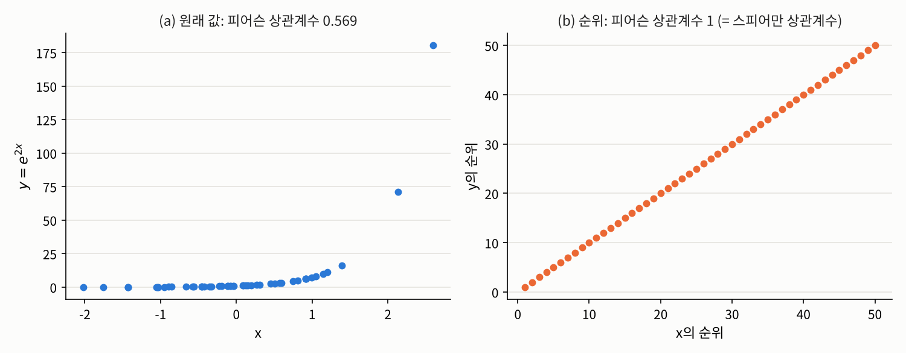

## 들어가며

[2.1절](01-pearson.qmd)의 끝에서 피어슨 상관계수의 두 가지 약점을 보았습니다. 하나는 **직선 관계만** 잰다는 것이고, 다른 하나는 값 자체를 쓰기 때문에 **이상치 하나에 크게 끌려간다**는 것입니다. 게다가 [2장 소개 글](index.qmd)에서 말했듯이, 변수가 "매우 불만족, 불만족, 보통, 만족, 매우 만족"처럼 순서만 의미 있는 스케일이라면 값 사이의 간격을 쓰는 피어슨 상관계수는 애초에 맞지 않습니다.

이번 글에서는 이 문제들을 한꺼번에 해결하는 간단한 아이디어, 즉 **값 대신 순위를 비교하자**는 아이디어에서 출발하는 두 상관계수를 다룹니다.

## 문제 1: 직선이 아닌 관계와 이상치

### 문제 상황

두 가지 상황을 생각해 보겠습니다.

첫째, $y = e^{2x}$처럼 $x$가 커지면 $y$도 반드시 커지지만 직선은 아닌 관계입니다. $x$를 알면 $y$가 정확히 정해지고, 커지는 방향도 언제나 같습니다. 이런 관계를 **단조 관계**(monotone relationship)라고 합니다. 단조 관계로서는 이보다 더 강할 수가 없는데, 피어슨 상관계수는 $1$보다 한참 작게 나옵니다.

둘째, 2.1절의 문제 3처럼 아무 관계가 없는 점 30개에 이상치 하나가 더해진 데이터입니다. 피어슨 상관계수는 $0.008$에서 $0.780$으로 뛰어올랐습니다.

두 경우 모두 피어슨 상관계수는 우리가 "관계의 강도"라고 직관적으로 느끼는 것과 다른 값을 내놓습니다. 어떻게 하면 좋을까요?

### 접근 아이디어: 값을 순위로 바꾸기

두 경우의 공통된 원인은 피어슨 상관계수가 **값의 크기**를 그대로 쓴다는 데 있습니다. $y = e^{2x}$에서는 $x$가 클 때 $y$가 기하급수적으로 커져서 직선에서 멀어지고, 이상치는 다른 점들보다 압도적으로 큰 값 때문에 계산을 좌지우지합니다.

그렇다면 값 대신 **몇 번째로 큰지**, 즉 순위만 보면 어떨까요? 순위로 바꾸면 $y = e^{2x}$에서 $x$가 $k$번째로 큰 점은 $y$도 정확히 $k$번째로 큽니다. 순위끼리는 완벽한 직선 관계가 됩니다. 또 이상치가 아무리 멀리 있어도 순위로는 그냥 "가장 큰 값", 즉 $n$번째일 뿐이라서 혼자서 결과를 좌우하지 못합니다.

순위를 비교하는 방법은 크게 두 가지입니다. 순위들에 피어슨 상관계수를 그대로 적용하는 방법과, 점들을 두 개씩 짝지어 순서가 같은 방향인지 반대 방향인지를 세는 방법입니다. 앞의 것이 **스피어만 상관계수**, 뒤의 것이 **켄달의 타우**입니다.

### 필요한 개념들

먼저 순위를 정확히 정의합니다. 같은 값이 여러 번 나오는 경우까지 다룰 수 있도록 정의해 두겠습니다.

::: {.callout-note icon=false .callout-definition}
### 정의 2.2.1 (순위와 동점)
관측값 $x_1, \ldots, x_n$에 대해
$$s_i := \#\{k : x_k < x_i\}, \qquad m_i := \#\{k : x_k = x_i\}$$
로 둡니다. $m_i \ge 2$이면 $x_i$는 다른 관측값과 **동점**(tie)이라고 합니다. 이때
$$R_i := s_i + \frac{m_i + 1}{2}$$
를 $x_i$의 **순위**(rank)라고 합니다.
:::

동점이 없으면 $m_i = 1$이므로 $R_i = s_i + 1$, 즉 "나보다 작은 값의 개수에 $1$을 더한 것"이 순위입니다. 동점이 있으면 같은 값들이 차지하는 자리 $s_i + 1, \ldots, s_i + m_i$의 평균을 모두에게 똑같이 줍니다. 예를 들어 $(3, 5, 5, 8)$의 순위는 $(1, 2.5, 2.5, 4)$입니다. 이를 **평균 순위**(mid-rank)라고 합니다. 

참고로 데이터의 스케일을 배울 때, 순서형 데이터 자체는 값 사이의 간격에 수치적 의미가 없다는 부분을 언급했었는데요, 여기서 다루는 평균 순위는 의미가 충분히 많습니다. 평균 순위를 사용하는 본질적인 이유는 동점이 있더라도 전체 순위의 총합을 원본 데이터와 똑같이 일정하게 유지하여, 이를 이용하여 통계량을 계산할 때 수학적 왜곡을 방지하기 위함입니다. 동점 처리로 인해 발생하는 순위의 손실을 가장 공정하고 일관되게 보정하는 표준적인 방법으로 이해하실 수 있습니다.

이제 첫 번째 방법입니다. 모집단 레벨에서 "순위"에 해당하는 것은 분포함수의 값입니다. $F_X(x) = \mathbb{P}(X \le x)$는 "전체 중에서 $x$ 이하인 비율", 즉 $0$과 $1$ 사이로 정규화한 순위이기 때문입니다.

::: {.callout-note icon=false .callout-definition}
### 정의 2.2.2 (스피어만 상관계수)
$X$와 $Y$의 분포함수 $F_X$, $F_Y$가 연속일 때,
$$\rho_S(X, Y) := \rho\big(F_X(X),\ F_Y(Y)\big)$$
를 **스피어만 상관계수**(Spearman correlation coefficient)라고 합니다. 표본 레벨에서는 확률표본 $(X_i, Y_i)$의 순위를 각각 $R_i$, $S_i$라 할 때, 순위들의 표본 상관계수
$$r_S := \frac{\sum_{i=1}^n (R_i - \bar{R})(S_i - \bar{S})}{\sqrt{\sum_{i=1}^n (R_i - \bar{R})^2}\,\sqrt{\sum_{i=1}^n (S_i - \bar{S})^2}}$$
를 **표본 스피어만 상관계수**라고 합니다.
:::

$F_X$가 연속이면 $F_X(X)$는 $\mathrm{Unif}[0, 1]$을 따릅니다([측도론적 확률론](../../../stats/prob-theory/index.qmd)참고). 즉 스피어만 상관계수는 **두 변수를 각각 균등분포로 바꾼 뒤의 피어슨 상관계수**입니다.

모집단과 표본의 정의는 1장 이래의 플러그인 원리로 이어져 있습니다. 경험분포함수 $\hat{F}_X(x) := \frac{1}{n}\#\{k : X_k \le x\}$를 쓰면 동점이 없을 때 $\hat{F}_X(X_i) = R_i / n$이고, 피어슨 상관계수는 양수배를 해도 변하지 않으므로 $r_S$는 정의의 $F_X$, $F_Y$ 자리에 $\hat{F}_X$, $\hat{F}_Y$를 넣은 플러그인 추정량입니다. 연속분포에서 얻은 확률표본이면 $r_S$는 $\rho_S$의 일치추정량입니다.

참고로 동점이 없으면 $d_i := R_i - S_i$에 대해 $r_S = 1 - \frac{6\sum_i d_i^2}{n(n^2 - 1)}$이라는 간단한 식이 성립해서, 손으로 계산할 때 자주 쓰입니다.

두 번째 방법은 점들을 쌍으로 비교합니다.

::: {.callout-note icon=false .callout-definition}
### 정의 2.2.3 (켄달의 타우)
$(X_1, Y_1)$, $(X_2, Y_2)$가 $(X, Y)$와 같은 분포를 따르는 독립인 두 복사본일 때, $(X_1 - X_2)(Y_1 - Y_2) > 0$이면 두 점이 **일치**(concordant)한다고 하고, $< 0$이면 **불일치**(discordant)한다고 합니다. 이때
$$\tau(X, Y) := \mathbb{P}\big((X_1 - X_2)(Y_1 - Y_2) > 0\big) - \mathbb{P}\big((X_1 - X_2)(Y_1 - Y_2) < 0\big)$$
를 **켄달의 타우**(Kendall's tau)라고 합니다. 표본 레벨에서는 모든 쌍을 비교한
$$\hat{\tau} := \frac{2}{n(n-1)}\sum_{1 \le i < j \le n} \mathrm{sign}\big((X_i - X_j)(Y_i - Y_j)\big)$$
를 표본 켄달의 타우로 씁니다.
:::

두 점이 일치한다는 것은 $x$로 줄을 세운 순서와 $y$로 줄을 세운 순서가 같다는 뜻입니다. 따라서 켄달의 타우는 "아무 두 관측값을 골랐을 때, 두 변수가 같은 방향으로 움직일 확률이 반대 방향으로 움직일 확률보다 얼마나 큰가"라는 아주 직접적인 해석을 가집니다. 연속분포라면 동점이 생길 확률이 $0$이므로 일치할 확률은 $(1 + \tau)/2$입니다.

표본 켄달의 타우는 모집단의 타우를 평균적으로 정확히 맞힙니다.

::: {.callout-important icon=false .callout-satz}
### 정리 2.2.4 (표본 켄달의 타우의 불편성)
$(X_i, Y_i)$들이 확률표본이면 $\mathbb{E}[\hat{\tau}] = \tau(X, Y)$입니다.
:::

::: {.callout-tip collapse="false" icon=false .callout-beweis}
### 증명
$i \neq j$이면 $(X_i, Y_i)$와 $(X_j, Y_j)$는 $(X, Y)$의 독립인 두 복사본이므로, 부호함수의 기대값을 그 값이 $1$, $-1$, $0$일 확률로 나눠 계산하면
$$\mathbb{E}\big[\mathrm{sign}\big((X_i - X_j)(Y_i - Y_j)\big)\big] = \mathbb{P}(\text{일치}) - \mathbb{P}(\text{불일치}) = \tau(X, Y)$$
입니다. $\hat{\tau}$는 이 값들을 $\binom{n}{2}$개의 쌍에 대해 평균 낸 것이므로 기대값도 $\tau(X, Y)$입니다. $\square$
:::

이처럼 "모든 쌍(또는 모든 부분집합)에 대해 어떤 함수를 계산해 평균 낸" 통계량을 **U-통계량**(U-statistic)이라고 합니다. U-통계량은 불편추정량이고, i.i.d. 관측값에서 일치추정량이라는 것이 알려져 있습니다.

마지막으로, 두 순위 상관계수가 공통으로 갖는 가장 중요한 성질입니다.

::: {.callout-important icon=false .callout-satz}
### 정리 2.2.5 (순증가 변환에 대한 불변성)
$F_X$, $F_Y$가 연속이고 $g, h : \mathbb{R} \to \mathbb{R}$가 순증가함수이면
$$\rho_S\big(g(X), h(Y)\big) = \rho_S(X, Y), \qquad \tau\big(g(X), h(Y)\big) = \tau(X, Y)$$
입니다. $g$와 $h$ 중 하나만 순감소함수이면 두 값 모두 부호만 바뀝니다. 표본 버전 $r_S$와 $\hat{\tau}$도 같은 성질을 가집니다.
:::

::: {.callout-tip collapse="false" icon=false .callout-beweis}
### 증명
$g$가 순증가이면 $g(X) \le g(x) \iff X \le x$이므로 $F_{g(X)}(g(x)) = F_X(x)$이고, 따라서 $F_{g(X)}(g(X)) = F_X(X)$입니다. 즉 균등분포로 바꾼 값이 변하지 않으므로 $\rho_S$도 변하지 않습니다. 켄달의 타우는 $\mathrm{sign}(g(X_1) - g(X_2)) = \mathrm{sign}(X_1 - X_2)$이므로 일치와 불일치가 그대로 유지됩니다. 순감소 변환은 부호를 뒤집습니다. 표본 버전은 순증가 변환이 관측값들의 순서와 동점 관계를 바꾸지 않으므로 순위가 그대로라서 성립합니다. $\square$
:::

이 정리가 순위 상관계수의 핵심입니다. 순위 상관계수는 값의 크기가 아니라 **순서**에만 의존하므로, 순서를 보존하는 어떤 변환을 해도 변하지 않습니다. 그래서 순서만 의미 있는 순서 스케일 데이터에 적합하고, 직선이든 곡선이든 **단조 관계**의 강도를 잽니다.

### 해결

두 상황에 세 상관계수를 모두 적용해 보겠습니다. 정의를 그대로 따라 순위와 표본 켄달의 타우를 계산하는 함수를 직접 만들었습니다.

```python
import numpy as np

def midrank(x):
    """동점이면 그 값들이 차지하는 위치의 평균을 순위로 줌: R_i = s_i + (m_i + 1)/2"""
    x = np.asarray(x)
    s = (x[None, :] < x[:, None]).sum(axis=1)     # x_i보다 작은 값의 개수
    m = (x[None, :] == x[:, None]).sum(axis=1)    # x_i와 같은 값의 개수 (자기 자신 포함)
    return s + (m + 1) / 2

def spearman(x, y):
    return np.corrcoef(midrank(x), midrank(y))[0, 1]

def kendall_hat(x, y):
    """모든 쌍의 부호를 평균 낸 표본 켄달의 타우 (동점 쌍은 0으로 셈)"""
    n = len(x)
    S = np.sign(x[:, None] - x[None, :]) * np.sign(y[:, None] - y[None, :])
    return S[np.triu_indices(n, k=1)].mean()

np.random.seed(1557)
x = np.random.normal(size=50)
y = np.exp(2 * x)                          # 완벽한 단조 관계, 하지만 직선은 아님
print(f"[단조 관계] 피어슨 {np.corrcoef(x, y)[0, 1]:.4f}, 스피어만 {spearman(x, y):.4f}, 켄달 {kendall_hat(x, y):.4f}")

np.random.seed(1557)
x = np.random.normal(size=30); y = np.random.normal(size=30)   # 2.1절의 데이터
xo, yo = np.append(x, 10), np.append(y, 10)
for name, a, b in [("이상치 없음", x, y), ("이상치 추가", xo, yo)]:
    print(f"[{name}] 피어슨 {np.corrcoef(a, b)[0, 1]:.4f}, 스피어만 {spearman(a, b):.4f}, 켄달 {kendall_hat(a, b):.4f}")
```

```
[단조 관계] 피어슨 0.5689, 스피어만 1.0000, 켄달 1.0000
[이상치 없음] 피어슨 0.0080, 스피어만 -0.0852, 켄달 -0.0529
[이상치 추가] 피어슨 0.7796, 스피어만 0.0165, 켄달 0.0151
```

단조 관계에서 피어슨 상관계수는 $0.57$에 그치지만, 두 순위 상관계수는 정확히 $1$입니다. 아래 그림처럼 순위로 바꾸면 곡선이 완벽한 직선이 되기 때문입니다.

{fig-alt="두 개의 산점도. 왼쪽 (a)는 x가 약 -2에서 2.6, y=e^(2x)가 0에서 약 180까지인 점 50개로, 대부분의 점이 바닥 근처에 몰려 있다가 x가 2를 넘으면서 급격히 위로 치솟는 곡선 모양이다. 제목은 원래 값의 피어슨 상관계수 0.569. 오른쪽 (b)는 같은 점들의 순위끼리 그린 것으로 50개의 점이 (1,1)부터 (50,50)까지 완벽한 대각선 위에 놓여 있다."}

이상치가 있는 데이터에서는, 이상치를 더해도 두 순위 상관계수가 거의 변하지 않고 $0$ 근처에 머뭅니다. 점 $(10, 10)$은 순위로는 그저 "$x$도 $y$도 31번째"인 점 하나일 뿐이기 때문입니다.

## 문제 2: 같은 값이 많을 때

### 문제 상황

설문조사의 5점 척도 문항처럼 값이 몇 개뿐인 순서 스케일 데이터에서는 동점이 아주 많이 생깁니다. 두 문항 A, B에 40명이 응답한 데이터를 만들어 보겠습니다. 상관관계가 있는 두 연속변수를 1점부터 5점까지 다섯 구간으로 잘라 만든 데이터입니다. 이런 데이터에서도 순위 상관계수를 그대로 쓸 수 있을까요?

### 해결

정의 2.2.1의 평균 순위를 쓰면 스피어만 상관계수는 그대로 계산할 수 있습니다. 문제는 켄달의 타우입니다. 동점인 쌍은 부호가 $0$이라 분자에는 아무것도 더하지 않지만, 분모인 쌍의 개수 $\binom{n}{2}$에는 그대로 들어갑니다. 그래서 동점이 많을수록 $\hat{\tau}$는 $0$ 쪽으로 끌려갑니다.

이를 바로잡기 위해 켄달은 1945년에 동점 쌍을 분모에서 빼는 보정을 제안했습니다.[^kendall] 일치하는 쌍의 개수를 $n_c$, 불일치하는 쌍의 개수를 $n_d$, 전체 쌍의 개수를 $n_0 := \binom{n}{2}$, $X$에서 동점인 쌍의 개수를 $n_1$, $Y$에서 동점인 쌍의 개수를 $n_2$라 하면 $\hat{\tau} = (n_c - n_d)/n_0$이고, 보정한 값은

$$\tau_b := \frac{n_c - n_d}{\sqrt{(n_0 - n_1)(n_0 - n_2)}}$$

입니다. 파이썬의 `scipy.stats.kendalltau`가 기본으로 계산하는 값이 바로 이 $\tau_b$입니다. 따라서 동점이 있는 데이터에서는 위의 `kendall_hat`과 `scipy`의 결과가 다르게 나옵니다.

```python
from scipy import stats

np.random.seed(1557)
n = 40
z = np.random.multivariate_normal([0, 0], [[1, 0.6], [0.6, 1]], size=n)
cuts = [-1.2, -0.4, 0.4, 1.2]
a = np.digitize(z[:, 0], cuts) + 1           # 1~5점 척도 문항 A
b = np.digitize(z[:, 1], cuts) + 1           # 1~5점 척도 문항 B
print("A의 값별 개수:", np.bincount(a)[1:], " B의 값별 개수:", np.bincount(b)[1:])
print(f"스피어만 (평균 순위)     = {spearman(a, b):.4f}  | scipy: {stats.spearmanr(a, b)[0]:.4f}")
print(f"켄달 tau_hat (강의)      = {kendall_hat(a, b):.4f}")
print(f"켄달 tau_b (동점 보정)   = {stats.kendalltau(a, b)[0]:.4f}")

i, j = np.triu_indices(n, k=1)
sx, sy = np.sign(a[i] - a[j]), np.sign(b[i] - b[j])
nc, nd = np.sum(sx * sy > 0), np.sum(sx * sy < 0)
n0, n1, n2 = len(i), np.sum(sx == 0), np.sum(sy == 0)
print(f"n_c = {nc}, n_d = {nd}, n_0 = {n0}, A에서 동점인 쌍 n_1 = {n1}, B에서 동점인 쌍 n_2 = {n2}")
print(f"(n_c - n_d)/n_0 = {(nc - nd) / n0:.4f},  (n_c - n_d)/sqrt((n_0-n_1)(n_0-n_2)) = {(nc - nd) / np.sqrt((n0 - n1) * (n0 - n2)):.4f}")
```

```
A의 값별 개수: [ 3 13 11  6  7]  B의 값별 개수: [10  6 13  8  3]
스피어만 (평균 순위)     = 0.6026  | scipy: 0.6026
켄달 tau_hat (강의)      = 0.3923
켄달 tau_b (동점 보정)   = 0.5021
n_c = 395, n_d = 89, n_0 = 780, A에서 동점인 쌍 n_1 = 172, B에서 동점인 쌍 n_2 = 169
(n_c - n_d)/n_0 = 0.3923,  (n_c - n_d)/sqrt((n_0-n_1)(n_0-n_2)) = 0.5021
```

780개의 쌍 가운데 일치나 불일치로 판정된 것은 $395 + 89 = 484$개뿐이고, 나머지 $296$개는 적어도 한 문항에서 동점입니다. 그래서 보정하지 않은 $\hat{\tau}$는 $0.39$로, 보정한 $\tau_b = 0.50$보다 상당히 작습니다. 어느 쪽이 "맞다"기보다, 동점이 많은 데이터에서는 두 값이 다르다는 것을 알고 **어떤 값을 보고하는지 밝히는 것**이 중요합니다. 같은 이유로, 연속분포를 가정한 정의 2.2.2의 모집단 스피어만 상관계수도 이산적인 데이터에서는 그대로 해석하기 어렵다는 점을 염두에 두어야 합니다.

## 문제 3: 세 상관계수는 서로 어떤 관계인가

### 문제 상황

지금까지 세 가지 상관계수를 보았습니다. 같은 데이터에서도 세 값은 서로 다르게 나오는데, 이들 사이에는 어떤 관계가 있을까요? 그리고 데이터를 변환하면 각각 어떻게 달라질까요?

### 해결

두 변수가 이변량 정규분포를 따르는 특별한 경우에는 세 값 사이에 정확한 관계가 알려져 있습니다. 피어슨 상관계수가 $\rho$이면

$$\tau = \frac{2}{\pi}\arcsin\rho, \qquad \rho_S = \frac{6}{\pi}\arcsin\frac{\rho}{2}$$

입니다. $\rho = 0.7$인 이변량 정규분포에서 표본 10만 개를 뽑아 확인해 보겠습니다. 이어서 두 변수에 각각 순증가 변환 $e^x$와 $y^3$을 적용해, 정리 2.2.5도 확인합니다.

```python
np.random.seed(1557)
rho, n = 0.7, 100_000
z = np.random.multivariate_normal([0, 0], [[1, rho], [rho, 1]], size=n)
x, y = z[:, 0], z[:, 1]
print(f"피어슨   r     = {np.corrcoef(x, y)[0, 1]:.4f}  | 이론값 rho = {rho}")
print(f"스피어만 r_S   = {stats.spearmanr(x, y)[0]:.4f}  | 이론값 (6/pi) arcsin(rho/2) = {6 / np.pi * np.arcsin(rho / 2):.4f}")
print(f"켄달     tau   = {stats.kendalltau(x, y)[0]:.4f}  | 이론값 (2/pi) arcsin(rho)   = {2 / np.pi * np.arcsin(rho):.4f}")

x2, y2 = np.exp(x), y**3                   # 두 변수에 각각 순증가 변환을 적용
print(f"변환 후: 피어슨 {np.corrcoef(x2, y2)[0, 1]:.4f}, 스피어만 {stats.spearmanr(x2, y2)[0]:.4f}, 켄달 {stats.kendalltau(x2, y2)[0]:.4f}")
```

```
피어슨   r     = 0.6979  | 이론값 rho = 0.7
스피어만 r_S   = 0.6804  | 이론값 (6/pi) arcsin(rho/2) = 0.6829
켄달     tau   = 0.4914  | 이론값 (2/pi) arcsin(rho)   = 0.4936
변환 후: 피어슨 0.4809, 스피어만 0.6804, 켄달 0.4914
```

세 값 모두 이론값과 잘 맞습니다. 여기서 몇 가지를 읽을 수 있습니다.

- **스피어만과 켄달은 같은 것을 다른 눈금으로 잽니다.** 둘 다 단조 관계의 강도를 재지만 서로 다른 양이라서 값이 다르고, 보통 $|\tau|$가 $|\rho_S|$보다 작습니다. 그래서 "켄달의 타우가 $0.49$이니 스피어만보다 관계가 약하다"고 비교하면 안 됩니다. 같은 측도끼리만 비교해야 합니다.
- **켄달의 타우는 확률로 읽을 수 있습니다.** $\tau \approx 0.49$이면 아무 두 관측값을 골랐을 때 두 변수가 같은 방향으로 움직일 확률이 $(1 + 0.49)/2 \approx 0.75$라는 뜻입니다.
- **변환하면 피어슨만 바뀝니다.** 두 변수를 각각 $e^x$와 $y^3$으로 바꾸자 피어슨 상관계수는 $0.70$에서 $0.48$로 떨어졌지만, 두 순위 상관계수는 소수점 넷째 자리까지 그대로입니다. 순서를 보존하는 변환은 순위를 바꾸지 않기 때문입니다.

## 정리: 피어슨에서 스피어만, 켄달로

세 상관계수를 나란히 놓으면 다음과 같습니다.

| | 피어슨 $\rho$ | 스피어만 $\rho_S$ | 켄달 $\tau$ |
|:--|:--|:--|:--|
| 재는 것 | 직선 관계 | 단조 관계 | 단조 관계 |
| 정의 | 값의 상관계수 | 균등분포로 바꾼 값(순위)의 상관계수 | 일치할 확률 $-$ 불일치할 확률 |
| 필요한 스케일 | 등간·비율 스케일 | 순서 스케일 이상 | 순서 스케일 이상 |
| 이상치 | 매우 민감 | 둔감 | 둔감 |
| 순증가 변환 | 값이 바뀜 | 불변 | 불변 |

순위 상관계수는 피어슨 상관계수의 약점을 잘 보완하지만, 대가도 있습니다. 순위만 보기 때문에 **원래 단위에서 얼마나 크게 변하는지**는 전혀 알려 주지 않습니다. $y$가 $x$를 따라 조금씩 커지든 엄청나게 커지든, 순서만 같으면 순위 상관계수는 똑같습니다. 변화의 크기까지 알고 싶다면 3장의 회귀 모형이 필요합니다.

지금까지는 두 변수 모두 적어도 순서는 있는 경우였습니다. 하지만 성별, 혈액형, 요일처럼 순서조차 없는 범주형 변수끼리의 관계는 순위로도 잴 수 없습니다. 2.3절에서는 이런 변수들의 관계를 **분할표**로 다룹니다.

---

### 연결되는 개념
* $\leftarrow$ **이전 개념:** [2.1 공분산과 피어슨 상관계수](01-pearson.qmd)
* $\rightarrow$ **다음 개념:** [2.3 범주형 변수의 의존성: 카이제곱 통계량과 크라메르 V](03-categorical.qmd)

[^kendall]: M. G. Kendall, "The Treatment of Ties in Ranking Problems", *Biometrika* 33(3), 1945, pp. 239–251.
