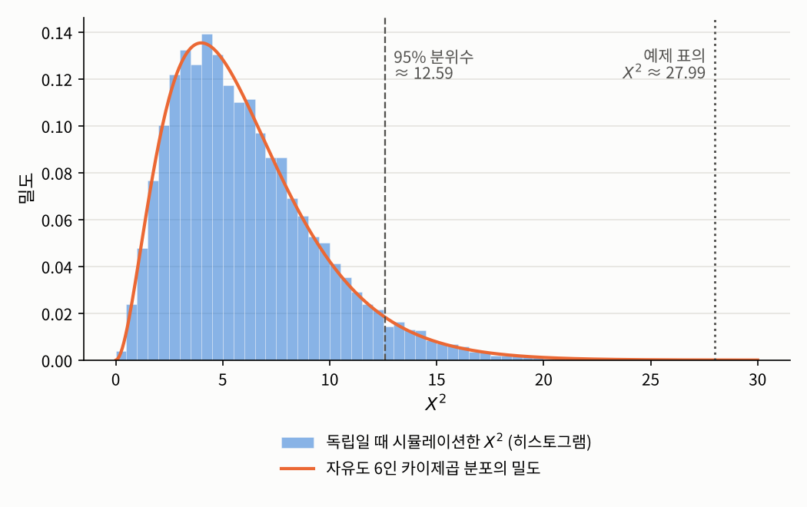

## 들어가며

[2.2절](02-rank.qmd)의 순위 상관계수는 적어도 순서가 있는 변수에만 쓸 수 있습니다. 그런데 전공 계열, 혈액형, 요일처럼 **순서조차 없는** 범주형 변수도 많습니다. 이런 변수에서는 "한쪽이 커지면 다른 쪽도 커진다"는 말 자체가 성립하지 않습니다. 그렇다면 두 범주형 변수가 "관련되어 있다"는 것은 무슨 뜻이고, 그 정도를 어떻게 잴 수 있을까요?

이번 글에서는 두 범주형 변수의 관계를 **분할표**로 정리하고, 1장의 최대우도 추정을 이용해 "독립이라면 기대되는 표"를 만든 뒤, 실제 표가 거기서 얼마나 벗어났는지를 재는 방법을 다룹니다. 그리고 [2장 소개 글](index.qmd)에서 예고한 대로, **관계가 있다는 증거**와 **관계의 강도**가 서로 다른 질문이라는 것을 살펴봅니다.

## 문제 1: 전공에 따라 선호하는 수업 형식이 다른가

### 문제 상황

학생 300명에게 전공 계열(인문, 사회, 자연, 공학)과 가장 선호하는 수업 형식(대면, 비대면, 혼합)을 물었더니 다음과 같았다고 합시다. 이런 표를 **분할표**(contingency table)라고 합니다.

| | 대면 | 비대면 | 혼합 | 합계 |
|:--|--:|--:|--:|--:|
| 인문 | 31 | 30 | 20 | 81 |
| 사회 | 21 | 21 | 32 | 74 |
| 자연 | 44 | 14 | 18 | 76 |
| 공학 | 42 | 10 | 17 | 69 |
| 합계 | 138 | 75 | 87 | 300 |

공학 계열에서는 대면 수업을 고른 학생이 많고, 사회 계열에서는 혼합 수업을 고른 학생이 많아 보입니다. 하지만 이 정도 차이는 우연으로도 생길 수 있지 않을까요? 전공과 선호하는 수업 형식이 정말 관련되어 있다고 말할 수 있을까요? 관련되어 있다면 얼마나 강하게 관련되어 있을까요?

### 접근 아이디어: 독립이라면 어떤 표가 나와야 하는가

두 변수가 **독립**이라면 어떤 표가 나와야 할지 먼저 생각해 보겠습니다. 독립이라는 것은 전공을 알아도 선호하는 수업 형식에 대해 아무것도 알 수 없다는 뜻이므로, 어느 전공이든 대면 수업을 고르는 비율이 전체 비율 $138/300 = 46\%$와 같아야 합니다. 그렇다면 인문 계열 81명 중에서는 $81 \times 0.46 = 37.26$명 정도가 대면 수업을 골랐어야 합니다. 실제로는 31명이었습니다.

이렇게 모든 칸에 대해 "독립이라면 기대되는 개수"를 계산하고, 실제 개수가 그것과 얼마나 다른지를 모아서 하나의 숫자로 만들면 됩니다. 차이가 크면 독립이 아니라는 증거가 됩니다.

이 아이디어를 정확하게 만들려면 몇 가지를 분명히 해야 합니다. "독립이라면 기대되는 개수"는 어떤 원리로 정해지는 것일까요? 차이를 모은 숫자가 얼마나 커야 "우연이 아니다"라고 할 수 있을까요?

### 필요한 개념들

먼저 분할표를 모집단 레벨과 표본 레벨에서 정의합니다.

::: {.callout-note icon=false .callout-definition}
### 정의 2.3.1 (분할표와 셀 확률)
범주형 확률변수 $A \in \{1, \ldots, I\}$와 $B \in \{1, \ldots, J\}$에 대해
$$\pi_{ij} := \mathbb{P}(A = i, B = j), \qquad \pi_{i+} := \sum_{j=1}^J \pi_{ij}, \qquad \pi_{+j} := \sum_{i=1}^I \pi_{ij}$$
를 각각 **셀 확률**(cell probability)과 행·열의 **주변확률**(marginal probability)이라고 합니다. $(A_k, B_k)$, $k = 1, \ldots, n$이 $(A, B)$와 같은 분포를 따르는 확률표본일 때,
$$N_{ij} := \sum_{k=1}^n \mathbf{1}\{A_k = i, B_k = j\}$$
를 **셀 도수**(cell count)라 하고, $N_{ij}$를 $I \times J$ 표로 늘어놓은 것을 **분할표**라고 합니다. 행과 열의 합은 $N_{i+}$, $N_{+j}$로 씁니다.
:::

범주형 확률변수에서 $A$와 $B$가 독립이라는 것은 정의에 의해

$$\pi_{ij} = \pi_{i+}\,\pi_{+j} \qquad \text{(모든 } i, j\text{에 대해)}$$

인 것과 같습니다. 그래서 의존성은 "실제 셀 확률"과 "독립일 때의 셀 확률"을 비교하는 문제가 됩니다. 이를 1장의 언어로 옮기면, 두 개의 모수적 모형을 비교하는 문제입니다.

::: {.callout-note icon=false .callout-definition}
### 정의 2.3.2 (제약 없는 모형과 독립 모형)
1. **제약 없는 모형**(unrestricted model): 셀 확률 $(\pi_{ij})$가 합이 $1$이라는 것 외에는 아무 제약이 없는 모형입니다. 자유롭게 정할 수 있는 모수는 $IJ - 1$개입니다.
2. **독립 모형**(independence model): 어떤 확률벡터 $(\alpha_1, \ldots, \alpha_I)$와 $(\beta_1, \ldots, \beta_J)$에 대해 $\pi_{ij} = \alpha_i \beta_j$인 모형입니다. 이때 $\alpha_i = \pi_{i+}$, $\beta_j = \pi_{+j}$이고, 자유롭게 정할 수 있는 모수는 $(I - 1) + (J - 1)$개입니다.
:::

두 모형에서 최대우도 추정량을 구하면, 접근 아이디어에서 직관으로 계산한 값이 그대로 나옵니다.

::: {.callout-important icon=false .callout-satz}
### 정리 2.3.3 (두 모형의 최대우도 추정량)
1. 제약 없는 모형에서 $\pi_{ij}$의 최대우도 추정량은 $\hat{\pi}_{ij} = N_{ij}/n$입니다.
2. 독립 모형에서 $\pi_{ij}$의 최대우도 추정량은 $\hat{\pi}_{i+}\,\hat{\pi}_{+j} = \dfrac{N_{i+}}{n} \cdot \dfrac{N_{+j}}{n}$입니다.
:::

::: {.callout-tip collapse="false" icon=false .callout-beweis}
### 증명
**1.** 확률표본이므로 우도는 $\prod_{i,j} \pi_{ij}^{N_{ij}}$이고, 로그우도는 $\sum_{i,j} N_{ij}\log\pi_{ij}$입니다. $\hat{p}_{ij} := N_{ij}/n$으로 두고, $N_{ij} > 0$인 칸들에 대해서만 합을 취하면 옌센 부등식에 의해
$$\frac{1}{n}\sum_{i,j} N_{ij}\log\pi_{ij} - \frac{1}{n}\sum_{i,j} N_{ij}\log\hat{p}_{ij} = \sum_{i,j} \hat{p}_{ij}\log\frac{\pi_{ij}}{\hat{p}_{ij}} \le \log\sum_{i,j} \hat{p}_{ij}\frac{\pi_{ij}}{\hat{p}_{ij}} \le \log 1 = 0$$
입니다. 따라서 로그우도는 $\pi_{ij} = \hat{p}_{ij}$일 때 최대입니다. 이는 [1.5절](../01-mle/05-asymptotics.qmd)에서 일치성의 아이디어를 설명할 때 쓴 논증과 같은 것입니다.

**2.** 독립 모형에서 우도는
$$\prod_{i,j} (\alpha_i\beta_j)^{N_{ij}} = \prod_{i=1}^I \alpha_i^{N_{i+}} \cdot \prod_{j=1}^J \beta_j^{N_{+j}}$$
로 $\alpha$에만 의존하는 부분과 $\beta$에만 의존하는 부분의 곱이 됩니다. 각 부분은 1과 같은 꼴이므로 $\hat{\alpha}_i = N_{i+}/n$, $\hat{\beta}_j = N_{+j}/n$에서 각각 최대가 됩니다. $\square$
:::

이제 독립 모형 아래에서 각 칸에 기대되는 개수, 그리고 실제 개수와의 차이를 모은 숫자를 정의할 수 있습니다.

::: {.callout-note icon=false .callout-definition}
### 정의 2.3.4 (기대도수와 피어슨 카이제곱 통계량)
독립 모형으로 적합한 각 칸의 개수
$$E_{ij} := n\,\hat{\pi}_{i+}\,\hat{\pi}_{+j} = \frac{N_{i+}N_{+j}}{n}$$
를 **기대도수**(expected count)라고 하고,
$$X^2 := \sum_{i=1}^I \sum_{j=1}^J \frac{(N_{ij} - E_{ij})^2}{E_{ij}}$$
를 **피어슨 카이제곱 통계량**(Pearson's chi-squared statistic)이라고 합니다.
:::

$X^2$는 실제 표가 독립 모형으로 적합한 표에서 얼마나 멀리 떨어져 있는지를 잽니다. 차이를 제곱해서 더하되, 기대도수로 나눠 주는 이유는 개수가 많은 칸일수록 우연에 의한 흔들림도 크기 때문입니다. 실제로 기대도수가 $E$인 칸의 개수는 대략 분산이 $E$ 정도인 분포를 따르므로, $(N - E)^2/E$는 "흔들림의 크기에 비해 차이가 얼마나 큰가"를 잰 것입니다.

그렇다면 $X^2$가 얼마나 커야 "우연이 아니다"라고 할 수 있을까요? 다음 정리가 그 기준을 줍니다.

::: {.callout-important icon=false .callout-satz}
### 정리 2.3.5 (카이제곱 통계량의 점근분포)
$A$와 $B$가 독립이고 모든 $\pi_{i+}$, $\pi_{+j}$가 양수이면, $n \to \infty$일 때
$$X^2 \xrightarrow{\ D\ } \chi^2_{(I-1)(J-1)}$$
입니다. 여기서 $\chi^2_k$는 자유도가 $k$인 카이제곱 분포입니다.
:::

이 정리의 증명은 5장에서 우도비 검정과 함께 다룹니다. 여기서는 자유도 $(I - 1)(J - 1)$의 의미만 짚어 두겠습니다. 이는 정의 2.3.2의 두 모형의 모수 개수의 차이

$$(IJ - 1) - \big((I - 1) + (J - 1)\big) = (I - 1)(J - 1)$$

와 같습니다. 즉 자유도는 **독립 모형이 제약 없는 모형에 거는 제약의 개수**입니다. 5장에서 보겠지만, 모형에 거는 제약의 개수가 자유도가 된다는 것은 우도비 검정의 일반적인 원리입니다.

실제로 쓸 때는 기대도수가 너무 작은 칸이 많으면 이 근사가 나빠진다는 점에 주의해야 합니다. 흔히 쓰는 경험 규칙은 기대도수가 $5$ 미만인 칸이 많지 않아야 한다는 것이고, 표본이 작은 $2 \times 2$ 표에서는 근사를 쓰지 않고 정확한 확률을 계산하는 **피셔의 정확 검정**(Fisher's exact test)을 흔히 씁니다.

### 해결

예제의 표에 적용해 보겠습니다. 이 표는 실제로 전공과 수업 형식이 약하게 관련된 참 확률표에서 300명을 뽑아 만든 것입니다.

```python
import numpy as np
from scipy import stats

def chi2_and_v(N):
    """분할표 N에 대해 피어슨 카이제곱 통계량, 자유도, p값, 크라메르 V를 계산"""
    N = np.asarray(N, dtype=float)
    n = N.sum()
    E = np.outer(N.sum(axis=1), N.sum(axis=0)) / n          # 기대도수 E_ij
    X2 = np.sum((N - E)**2 / E)
    I, J = N.shape
    df = (I - 1) * (J - 1)
    p = stats.chi2.sf(X2, df)                                # P(chi2_df > X2)
    V = np.sqrt(X2 / (n * min(I - 1, J - 1)))
    return X2, df, p, V

# 전공 계열(행) x 선호하는 수업 형식(열)의 참 확률
pi = np.array([[0.10, 0.08, 0.07],     # 인문
               [0.09, 0.08, 0.08],     # 사회
               [0.12, 0.06, 0.07],     # 자연
               [0.15, 0.04, 0.06]])    # 공학
np.random.seed(1557)
N = np.random.multinomial(300, pi.ravel()).reshape(4, 3)
print(N)
X2, df, p, V = chi2_and_v(N)
print(f"X^2 = {X2:.3f}, 자유도 = {df}, p값 = {p:.4f}, 크라메르 V = {V:.4f}")
```

```
[[31 30 20]
 [21 21 32]
 [44 14 18]
 [42 10 17]]
X^2 = 27.985, 자유도 = 6, p값 = 0.0001, 크라메르 V = 0.2160
```

$X^2 \approx 27.99$입니다. 정리 2.3.5에 따르면 두 변수가 독립일 때 $X^2$는 근사적으로 자유도 $6$인 카이제곱 분포를 따르는데, 그 분포에서 $27.99$ 이상의 값이 나올 확률은 약 $0.0001$입니다. 즉 독립이라면 이런 표는 1만 번에 한 번 꼴로나 나올 법한 표이므로, **전공과 선호하는 수업 형식이 관련되어 있다는 강한 증거**가 됩니다. 이 확률을 **$p$값**($p$-value)이라고 하는데, 5장에서 자세히 다룹니다. 결과에 함께 출력한 크라메르 $V$는 문제 2에서 설명합니다.

정리 2.3.5가 실제로 맞는지도 확인해 보겠습니다. 예제와 주변확률은 같지만 두 변수가 정확히 독립인 확률표에서 300명짜리 표를 2만 번 만들어 $X^2$를 계산했습니다.

```python
pi0 = np.outer(pi.sum(axis=1), pi.sum(axis=0))         # 주변분포는 같고 독립인 표
np.random.seed(1557)
reps, n = 20_000, 300
res = np.array([chi2_and_v(np.random.multinomial(n, pi0.ravel()).reshape(4, 3)) for _ in range(reps)])
X2, V = res[:, 0], res[:, 3]
print(f"독립일 때 X^2: 평균 {X2.mean():.3f} (이론값 6), 분산 {X2.var():.3f} (이론값 12)")
print(f"X^2 > {stats.chi2.ppf(0.95, 6):.3f} (카이제곱 분포의 95% 분위수)인 비율: {np.mean(X2 > stats.chi2.ppf(0.95, 6)):.4f}")
print(f"독립일 때 크라메르 V의 평균: {V.mean():.4f}")
```

```
독립일 때 X^2: 평균 6.057 (이론값 6), 분산 11.952 (이론값 12)
X^2 > 12.592 (카이제곱 분포의 95% 분위수)인 비율: 0.0505
독립일 때 크라메르 V의 평균: 0.0964
```

{fig-alt="가로축이 X²인 그래프. 파란 히스토그램은 두 변수가 독립일 때 시뮬레이션한 X² 2만 개의 분포로, 4에서 5 근처에서 가장 높고 오른쪽으로 긴 꼬리를 가진다. 주황색 곡선은 자유도 6인 카이제곱 분포의 밀도로 히스토그램과 거의 겹친다. 12.59 위치에 95 퍼센트 분위수를 나타내는 회색 점선이, 27.99 위치에 예제 표의 X²를 나타내는 회색 점선이 있으며, 27.99는 분포의 꼬리 끝 바깥쪽에 있다." width=70%}

자유도 $6$인 카이제곱 분포의 평균은 $6$, 분산은 $12$인데, 시뮬레이션 결과가 이와 잘 맞습니다. 그림에서 보듯이 예제의 $X^2 \approx 27.99$는 독립일 때의 분포에서 한참 바깥쪽에 있습니다.

## 문제 2: 증거가 강하면 관계도 강한가

### 문제 상황

문제 1의 $p$값은 $0.0001$로 아주 작았습니다. 그렇다면 전공과 선호하는 수업 형식은 "아주 강하게" 관련되어 있다고 말해도 될까요? 또 서로 다른 조사에서 얻은 두 분할표의 $X^2$를 비교해서, 어느 쪽 관계가 더 강한지 말할 수 있을까요?

### 접근 아이디어

$X^2$를 셀 비율로 다시 써 보면 답이 보입니다. $\hat{\pi}_{ij} = N_{ij}/n$을 쓰면 $N_{ij} - E_{ij} = n(\hat{\pi}_{ij} - \hat{\pi}_{i+}\hat{\pi}_{+j})$이고 $E_{ij} = n\,\hat{\pi}_{i+}\hat{\pi}_{+j}$이므로

$$X^2 = n \sum_{i,j} \frac{(\hat{\pi}_{ij} - \hat{\pi}_{i+}\hat{\pi}_{+j})^2}{\hat{\pi}_{i+}\hat{\pi}_{+j}} =: n\,\hat{\phi}^2$$

입니다. 즉 $X^2$는 **비율로 잰 독립에서의 벗어남 $\hat{\phi}^2$에 표본 크기 $n$을 곱한 것**입니다. 표의 비율이 똑같아도 사람을 두 배로 모으면 $X^2$도 두 배가 됩니다. 그래서 $X^2$는 "관계가 있다는 **증거**가 얼마나 강한가"에는 답하지만, "관계 **자체**가 얼마나 강한가"에는 답하지 못합니다. 표본이 크면 아주 미미한 관계도 큰 $X^2$를 만들기 때문입니다.

관계의 강도를 재려면 $n$을 나눠 없애고, 표의 크기에 따라 달라지는 최댓값으로 나눠 정규화하면 됩니다.

### 필요한 개념들

::: {.callout-note icon=false .callout-definition}
### 정의 2.3.6 (크라메르 V)
$I, J \ge 2$인 분할표에서
$$V := \sqrt{\frac{X^2}{n\,\min(I - 1, J - 1)}}$$
를 **크라메르 $V$**(Cramér's V)라고 합니다.
:::

분모에 $\min(I - 1, J - 1)$이 들어가는 이유는 다음 정리에 있습니다.

::: {.callout-important icon=false .callout-satz}
### 정리 2.3.7 (크라메르 V의 범위)
$X^2/n \le \min(I - 1, J - 1)$이고, 따라서 $0 \le V \le 1$입니다.
:::

::: {.callout-tip collapse="false" icon=false .callout-beweis}
### 증명
$X^2/n$의 식에서 분자의 제곱을 전개하고 $\sum_{i,j}\hat{\pi}_{ij} = \sum_{i,j}\hat{\pi}_{i+}\hat{\pi}_{+j} = 1$을 쓰면
$$\frac{X^2}{n} = \sum_{i,j}\frac{\hat{\pi}_{ij}^2}{\hat{\pi}_{i+}\hat{\pi}_{+j}} - 2\sum_{i,j}\hat{\pi}_{ij} + \sum_{i,j}\hat{\pi}_{i+}\hat{\pi}_{+j} = \sum_{i,j}\frac{\hat{\pi}_{ij}^2}{\hat{\pi}_{i+}\hat{\pi}_{+j}} - 1$$
입니다. 그런데 $\hat{\pi}_{ij} \le \hat{\pi}_{+j}$이므로 $\hat{\pi}_{ij}^2 / (\hat{\pi}_{i+}\hat{\pi}_{+j}) \le \hat{\pi}_{ij}/\hat{\pi}_{i+}$이고, 이를 $j$에 대해 더하면 $1$, 다시 $i$에 대해 더하면 $I$입니다. 따라서 $X^2/n \le I - 1$입니다. $\hat{\pi}_{ij} \le \hat{\pi}_{i+}$를 써서 같은 방식으로 계산하면 $X^2/n \le J - 1$도 얻습니다. $\square$
:::

증명을 보면 등호가 언제 성립하는지도 알 수 있습니다. $X^2/n = I - 1$이 되려면 $\hat{\pi}_{ij} > 0$인 모든 칸에서 $\hat{\pi}_{ij} = \hat{\pi}_{+j}$여야 합니다. 이는 각 열의 관측값이 모두 한 행에만 몰려 있다는 뜻입니다. 예를 들어 표가 대각행렬 꼴이면 $V = 1$입니다. 즉 $V$는 다음과 같이 읽습니다.

- $V \approx 0$: 실제 표가 독립 모형의 표와 거의 같습니다.
- $V \approx 1$: 한 변수를 알면 다른 변수가 거의 결정됩니다.

다만 $V$는 관계의 **방향**, 즉 어떤 범주끼리 함께 나오는지는 알려 주지 않습니다. 그것은 분할표 자체를 들여다보거나, 7장에서 다룰 대응분석 같은 방법으로 봐야 합니다.

### 해결

문제 1의 표에서 $V \approx 0.216$이었습니다. $p$값은 아주 작았지만, $V$로 보면 관계의 강도는 "약한 편"입니다. 두 질문의 답이 다를 수 있다는 것을 더 극단적인 예로 확인해 보겠습니다. 먼저 문제 1의 표에서 비율은 그대로 두고 모든 칸을 10배로 늘려 봅니다.

```python
X2, df, p, V = chi2_and_v(10 * N)        # 비율은 그대로, 표본만 10배
print(f"[10배] X^2 = {X2:.3f}, 자유도 = {df}, p값 = {p:.2e}, 크라메르 V = {V:.4f}")
```

```
[10배] X^2 = 279.849, 자유도 = 6, p값 = 1.69e-57, 크라메르 V = 0.2160
```

$X^2$는 정확히 10배가 되었고 $p$값은 $10^{-57}$ 수준으로 작아졌지만, $V$는 그대로입니다. 표의 비율, 즉 관계의 모양과 강도가 전혀 변하지 않았기 때문입니다.

다음은 관계가 **아주 약한** 경우입니다. 문제 1의 참 확률표를 독립인 표 쪽으로 80% 끌어당겨 관계를 아주 약하게 만들고, 300명과 3만 명을 각각 조사해 보겠습니다. 참 확률표로 계산한 모집단의 $V$도 함께 출력합니다. 모집단의 $V$는 정의 2.3.6의 $\hat{\pi}$ 자리에 참 확률 $\pi$를 넣은 값입니다.

```python
def cramers_v_pop(pi):
    """참 확률표 pi로 계산한 모집단 크라메르 V"""
    pi = np.asarray(pi); r, c = pi.sum(axis=1), pi.sum(axis=0)
    phi2 = np.sum((pi - np.outer(r, c))**2 / np.outer(r, c))
    return np.sqrt(phi2 / (min(pi.shape) - 1))

pi_weak = 0.8 * np.outer(pi.sum(axis=1), pi.sum(axis=0)) + 0.2 * pi   # 관계를 아주 약하게 만든 표
print(f"모집단 V: 원래 표 {cramers_v_pop(pi):.4f}, 약한 표 {cramers_v_pop(pi_weak):.4f}")

np.random.seed(1557)
for n in [300, 30_000]:
    N = np.random.multinomial(n, pi_weak.ravel()).reshape(4, 3)
    X2, df, p, V = chi2_and_v(N)
    print(f"[약한 관계, n = {n:>6}] X^2 = {X2:8.3f}, p값 = {p:.2e}, 크라메르 V = {V:.4f}")
```

```
모집단 V: 원래 표 0.1379, 약한 표 0.0276
[약한 관계, n =    300] X^2 =   12.647, p값 = 4.90e-02, 크라메르 V = 0.1452
[약한 관계, n =  30000] X^2 =   67.474, p값 = 1.35e-12, 크라메르 V = 0.0335
```

3만 명을 조사하면 $V \approx 0.034$로 모집단의 값 $0.028$에 가깝고, 관계가 거의 없다는 것을 보여 줍니다. 그런데도 $p$값은 $10^{-12}$ 수준으로, 관계가 있다는 증거는 압도적입니다. **아주 약한 관계라도 데이터가 충분히 많으면 "확실히 존재한다"고 말할 수 있다**는 뜻입니다. 증거의 강도와 관계의 강도는 이렇게 전혀 다른 이야기입니다.

300명만 조사했을 때의 결과도 눈여겨볼 만합니다. $V \approx 0.145$로 모집단의 값 $0.028$보다 다섯 배나 크게 나왔습니다. 앞의 시뮬레이션에서 두 변수가 **완전히 독립**이어도 300명짜리 표의 $V$는 평균 $0.096$이었다는 것을 떠올리시기 바랍니다. 독립일 때 $X^2$의 평균이 자유도와 같으므로 $V$는 대략 $\sqrt{\text{자유도}/(n \min(I-1, J-1))} = \sqrt{6/600} = 0.1$ 근처의 값을 우연만으로도 가집니다. 즉 **표본이 작으면 $V$는 관계의 강도를 부풀려 보여 주는 경향**이 있습니다. 문제 1의 $V \approx 0.216$이 모집단의 값 $0.138$보다 크게 나온 것도 같은 경향을 보여 줍니다. 그래서 $V$는 표본 크기가 충분할 때 신뢰할 수 있는 기술적인 요약값으로 쓰는 것이 좋습니다.

## 정리: 검정 통계량과 효과 크기

이번 글에서 다룬 두 숫자의 역할을 정리하면 다음과 같습니다.

| | 피어슨 카이제곱 통계량 $X^2$ | 크라메르 $V$ |
|:--|:--|:--|
| 답하는 질문 | 관계가 있다는 **증거**가 있는가? | 관계가 **얼마나 강한가**? |
| 표본 크기 | $n$에 비례해서 커짐 | $n$에 의존하지 않음 (작은 표본에서는 부풀려짐) |
| 범위 | $0$ 이상 | $0$과 $1$ 사이 |
| 함께 쓰는 것 | 카이제곱 분포와 $p$값 | 분할표, 대응분석 |

$X^2$처럼 어떤 가설에 반하는 증거의 강도를 재는 숫자를 **검정 통계량**(test statistic), $V$처럼 현상의 크기를 재는 숫자를 **효과 크기**(effect size)라고 부릅니다. 5장에서 강조하겠지만, $p$값은 효과의 크기를 재지 않습니다. 이 구분은 범주형 변수뿐 아니라 모든 통계적 추론에서 반복해서 등장합니다.

덧붙여, 분할표의 의존성을 이번 글처럼 하나의 숫자로 요약하는 대신 모형의 모수로 표현하는 방법도 있습니다. 각 칸의 기대도수의 로그를 행의 효과와 열의 효과의 합으로 쓰고, 의존성이 있으면 둘의 상호작용 항을 더하는 **로그 선형 모형**(log-linear model)입니다. 로그 선형 모형은 분할표에 대해, 3장의 선형 회귀가 수치형 반응변수에 대해 하는 일을 합니다.

지금까지는 두 변수가 모두 수치형이거나 모두 범주형인 경우를 보았습니다. 2.4절에서는 범주형 변수와 수치형 변수가 섞인 경우를 다룹니다.

---

### 연결되는 개념
* $\leftarrow$ **이전 개념:** [2.2 순위 상관계수: 스피어만과 켄달](02-rank.qmd)
* $\rightarrow$ **다음 개념:** [2.4 범주와 수치가 섞일 때: 집단 평균과 η²](04-mixed.qmd)
