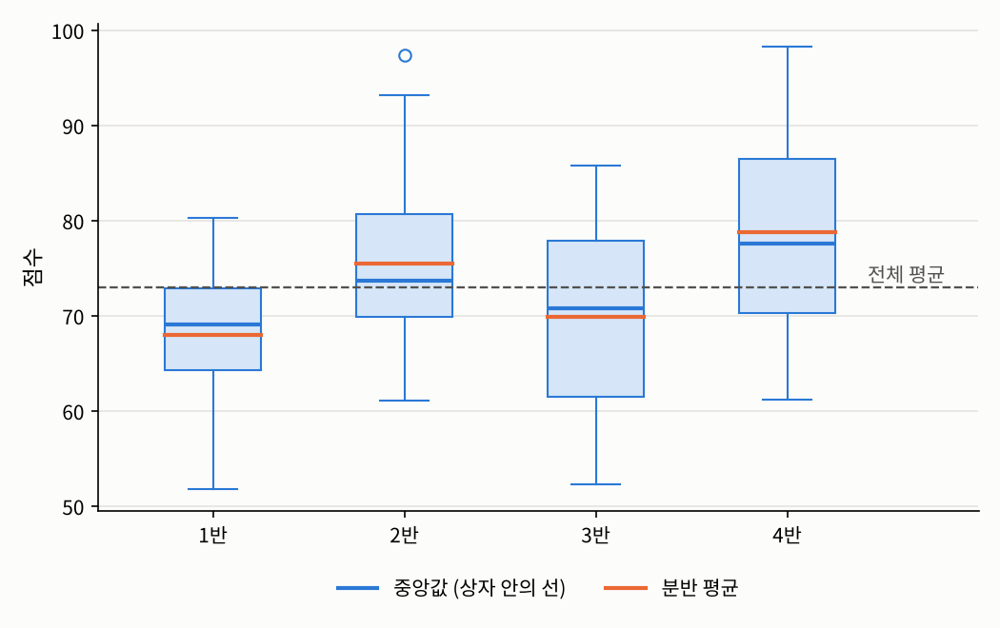

## 들어가며

[2.1절](01-pearson.qmd)과 [2.2절](02-rank.qmd)에서는 두 변수가 모두 수치형이거나 순서형인 경우를, [2.3절](03-categorical.qmd)에서는 두 변수가 모두 범주형인 경우를 다뤘습니다. 남은 것은 두 종류가 **섞인** 경우입니다. 실습 수업에 참여했는지에 따라 기말 점수가 다른지, 분반에 따라 점수가 다른지, 요일에 따라 매출이 다른지처럼, 실제 데이터 분석에서 가장 흔히 만나는 질문들이 여기에 속합니다.

이런 질문의 핵심은 **범주에 따라 수치형 변수의 평균이 달라지는가**입니다. 이번 글에서는 범주가 두 개인 경우와 여러 개인 경우로 나눠 이를 재는 방법을 살펴보고, 2장을 마무리하면서 지금까지의 측도들이 3장의 회귀와 분산분석으로 어떻게 이어지는지 정리합니다.

## 문제 1: 두 집단의 평균은 얼마나 다른가

### 문제 상황

학생 60명 가운데 25명은 선택 과정인 실습 수업에 참여했고 35명은 참여하지 않았습니다. 실습 참여 여부 $A \in \{0, 1\}$에 따라 기말 점수 $Y$가 얼마나 다른지 알고 싶습니다. $A$는 범주가 두 개뿐인 범주형 변수이고 $Y$는 수치형 변수입니다. 이 관계를 어떻게 요약하면 좋을까요?

### 접근 아이디어

가장 직접적인 방법은 두 집단의 평균을 비교하는 것입니다. 모집단 레벨에서는 각 집단의 **조건부 기대값**을, 표본 레벨에서는 각 집단의 표본평균을 비교하면 됩니다.

한편 데이터 사이언스 개론의 [요약 통계량](../../ds-intro/02-data-exploration/02-summary-statistics.qmd) 글에서 더미 변수를 소개하며 본 것처럼, 범주가 두 개인 변수는 $0$과 $1$로 적으면 수치형 변수처럼 다룰 수 있습니다. 그렇다면 $A$를 $0$과 $1$로 적고 $Y$와의 피어슨 상관계수를 계산하는 것도 하나의 방법입니다. 두 방법은 어떤 관계일까요?

### 필요한 개념들

::: {.callout-note icon=false .callout-definition}
### 정의 2.4.1 (집단 평균의 차와 점이연 상관계수)
$A \in \{0, 1\}$이고 $\mathbb{P}(A = 0), \mathbb{P}(A = 1) > 0$, $\mathbb{E}|Y| < \infty$일 때, 두 집단의 **조건부 평균**을
$$\mu_0 := \mathbb{E}[Y \mid A = 0], \qquad \mu_1 := \mathbb{E}[Y \mid A = 1]$$
로 둡니다. 확률표본 $(A_k, Y_k)$에서 $\mu_1 - \mu_0$는 두 집단의 표본평균의 차 $\bar{Y}_1 - \bar{Y}_0$로 추정합니다. 또 $A$를 $0$과 $1$로 적은 값과 $Y$ 사이의 피어슨 상관계수를 **점이연 상관계수**(point-biserial correlation)라고 합니다.
:::

두 집단의 확률이 모두 양수이고 $Y$의 평균이 유한하면, 큰 수의 법칙에 의해 각 집단의 표본평균은 조건부 평균으로 확률수렴하므로 $\bar{Y}_1 - \bar{Y}_0$는 $\mu_1 - \mu_0$의 일치추정량입니다.

점이연 상관계수는 새로운 측도처럼 보이지만, 사실 평균의 차와 같은 정보를 담고 있습니다.

::: {.callout-important icon=false .callout-satz}
### 정리 2.4.2 (점이연 상관계수와 평균의 차)
관측값 $(a_k, y_k)$에서 $a_k = 1$인 비율을 $\hat{p}$, 두 집단의 표본평균을 $\bar{y}_1$, $\bar{y}_0$, $y$의 전체 표준편차를 $\hat{s}_y := \sqrt{\frac{1}{n}\sum_k (y_k - \bar{y})^2}$이라 하면, 표본 점이연 상관계수 $r_{pb}$에 대해 다음이 성립합니다.
$$r_{pb} = \frac{\bar{y}_1 - \bar{y}_0}{\hat{s}_y}\,\sqrt{\hat{p}(1 - \hat{p})}$$
:::

::: {.callout-tip collapse="false" icon=false .callout-beweis}
### 증명
2.1절에서 본 대로 $r$은 공분산과 분산을 $n$으로 나누든 $n - 1$로 나누든 같으므로, $n$으로 나눈 값으로 계산합니다. $a_k$의 평균은 $\hat{p}$이고 분산은 $\frac{1}{n}\sum_k (a_k - \hat{p})^2 = \hat{p}(1 - \hat{p})$입니다. 공분산은
$$\frac{1}{n}\sum_k (a_k - \hat{p})(y_k - \bar{y}) = \frac{1}{n}\sum_k a_k y_k - \hat{p}\,\bar{y} = \hat{p}\,\bar{y}_1 - \hat{p}\big(\hat{p}\,\bar{y}_1 + (1 - \hat{p})\,\bar{y}_0\big) = \hat{p}(1 - \hat{p})(\bar{y}_1 - \bar{y}_0)$$
입니다. 여기서 $\bar{y} = \hat{p}\,\bar{y}_1 + (1 - \hat{p})\,\bar{y}_0$을 썼습니다. 따라서
$$r_{pb} = \frac{\hat{p}(1 - \hat{p})(\bar{y}_1 - \bar{y}_0)}{\sqrt{\hat{p}(1 - \hat{p})}\,\hat{s}_y} = \frac{\bar{y}_1 - \bar{y}_0}{\hat{s}_y}\sqrt{\hat{p}(1 - \hat{p})}$$
입니다. $\square$
:::

즉 점이연 상관계수는 **평균의 차를 $Y$의 표준편차 단위로 잰 뒤, 두 집단의 크기 비율에 따른 인자를 곱한 것**입니다. 평균의 차는 원래 단위(점수)로 효과의 크기를 알려 주고, 점이연 상관계수는 단위가 없는 $-1$과 $1$ 사이의 값으로 관계의 강도를 알려 준다는 차이만 있습니다.

### 해결

실습에 참여하면 평균이 7점 높아지는 모형에서 60명의 점수를 만들어 확인해 보겠습니다.

```python
import numpy as np

np.random.seed(1557)
a = np.array([0] * 35 + [1] * 25)                     # 실습 참여 여부: 0 = 불참 35명, 1 = 참여 25명
y = np.where(a == 1, 75, 68) + 10 * np.random.normal(size=60)   # 기말 점수
diff = y[a == 1].mean() - y[a == 0].mean()
p = a.mean()
r_pb = np.corrcoef(a, y)[0, 1]
print(f"집단 평균: 불참 {y[a == 0].mean():.3f}, 참여 {y[a == 1].mean():.3f}, 차이 {diff:.3f}")
print(f"점이연 상관계수 r_pb = {r_pb:.4f}")
print(f"평균의 차로 계산   = {diff * np.sqrt(p * (1 - p)) / y.std():.4f}")   # y.std()는 n으로 나눈 표준편차
```

```
집단 평균: 불참 68.627, 참여 74.678, 차이 6.051
점이연 상관계수 r_pb = 0.2969
평균의 차로 계산   = 0.2969
```

평균의 차는 약 6점으로 참값 7점에 가깝고, 점이연 상관계수는 정리 2.4.2의 식과 정확히 일치합니다. "실습에 참여한 학생이 평균 6점 정도 높다"와 "참여 여부와 점수의 상관계수가 $0.30$이다"는 같은 데이터를 다른 눈금으로 읽은 것입니다. 실제로 보고할 때는 원래 단위로 해석할 수 있는 평균의 차가 더 직관적인 경우가 많습니다.

다만 평균의 차가 곧 **실습의 효과**라고 말할 수는 없다는 점에 주의해야 합니다. 실습은 선택 과정이므로, 원래 공부를 열심히 하는 학생들이 실습에 더 많이 참여했을 수도 있습니다. 데이터 사이언스 개론의 [상관관계](../../ds-intro/02-data-exploration/03-correlation.qmd) 글에서 본 교란 변수의 문제가 여기서도 그대로 적용됩니다.

## 문제 2: 집단이 여러 개이면

### 문제 상황

이번에는 네 개의 분반에서 같은 시험을 치른 학생 85명의 점수를 비교합니다. 분반에 따라 점수가 얼마나 달라지는지를 하나의 숫자로 요약할 수 있을까요? 집단이 셋 이상이면 "평균의 차"가 여러 개 생기므로, 문제 1의 방법을 그대로 쓸 수 없습니다.

### 접근 아이디어

학생들의 점수가 서로 다른 이유를 두 가지로 나눠 생각해 보겠습니다. 하나는 **어느 분반이냐**에 따라 평균이 다르기 때문이고, 다른 하나는 **같은 분반 안에서도** 학생마다 점수가 다르기 때문입니다. 분반이 점수와 강하게 관련되어 있다면, 점수의 흩어짐 가운데 상당 부분이 분반 평균의 차이로 설명될 것입니다. 반대로 분반이 아무 상관이 없다면, 분반 평균은 모두 비슷하고 흩어짐은 거의 전부 분반 안에서 생길 것입니다.

그러니 **전체 흩어짐 가운데 분반 평균의 차이로 설명되는 비율**을 재면 됩니다. 이 아이디어는 2.1절에서 $\rho^2$를 "$X$의 일차식으로 설명되는 $Y$의 분산의 비율"로 읽은 것과 같은 발상입니다. 다만 이번에는 일차식 대신 **집단별 평균**으로 설명합니다.

### 필요한 개념들

::: {.callout-note icon=false .callout-definition}
### 정의 2.4.3 ($\eta^2$)
범주형 확률변수 $A \in \{1, \ldots, g\}$와 $\mathbb{E}[Y^2] < \infty$, $\mathrm{Var}(Y) > 0$인 $Y$에 대해
$$\eta^2 := \frac{\mathrm{Var}\big(\mathbb{E}[Y \mid A]\big)}{\mathrm{Var}(Y)}$$
로 정의합니다. 표본 레벨에서는 $i$번째 집단의 관측값을 $Y_{i1}, \ldots, Y_{in_i}$, 집단 평균을 $\bar{Y}_i$, 전체 평균을 $\bar{Y}$라 할 때
$$\hat{\eta}^2 := \frac{SS_{\text{between}}}{SS_{\text{total}}}, \qquad SS_{\text{between}} := \sum_{i=1}^g n_i(\bar{Y}_i - \bar{Y})^2, \qquad SS_{\text{total}} := \sum_{i=1}^g\sum_{j=1}^{n_i}(Y_{ij} - \bar{Y})^2$$
로 정의합니다.
:::

$\mathbb{E}[Y \mid A]$는 "$A$의 값에 해당하는 집단의 평균"을 값으로 가지는 확률변수이므로, 분자는 **집단 평균들이 얼마나 흩어져 있는가**를 잽니다. 표본 버전에서 $SS_{\text{between}}$은 **집단 간 제곱합**, $SS_{\text{total}}$은 **전체 제곱합**이라고 부릅니다. $\eta^2$가 접근 아이디어에서 말한 "설명되는 비율"이 되려면, 전체 흩어짐이 두 부분으로 깔끔하게 나뉘어야 합니다.

::: {.callout-important icon=false .callout-satz}
### 정리 2.4.4 (전체 분산의 분해)
1. **(모집단)** $\mathrm{Var}(Y) = \mathbb{E}\big[\mathrm{Var}(Y \mid A)\big] + \mathrm{Var}\big(\mathbb{E}[Y \mid A]\big)$
2. **(표본)** $SS_{\text{within}} := \sum_{i=1}^g\sum_{j=1}^{n_i}(Y_{ij} - \bar{Y}_i)^2$로 두면 $SS_{\text{total}} = SS_{\text{between}} + SS_{\text{within}}$

따라서 $0 \le \eta^2 \le 1$이고 $0 \le \hat{\eta}^2 \le 1$입니다. 또한 $\eta^2 = 0$인 것은 모든 집단의 조건부 평균 $\mathbb{E}[Y \mid A = i]$가 같은 것과 동치이고, $\eta^2 = 1$인 것은 거의 확실하게 $\mathrm{Var}(Y \mid A) = 0$, 즉 $Y$가 $A$에 의해 완전히 결정되는 것과 동치입니다.
:::

::: {.callout-tip collapse="false" icon=false .callout-beweis}
### 증명
1은 전체 분산의 법칙(law of total variance)으로, [측도론적 확률론](../../../stats/measure-prob/index.qmd)의 조건부 기대값 부분을 참고하시기 바랍니다.

2는 $Y_{ij} - \bar{Y} = (Y_{ij} - \bar{Y}_i) + (\bar{Y}_i - \bar{Y})$의 양변을 제곱해 더하면 됩니다. 교차항은
$$2\sum_{i=1}^g (\bar{Y}_i - \bar{Y})\sum_{j=1}^{n_i}(Y_{ij} - \bar{Y}_i) = 0$$
입니다. 각 집단 안에서 집단 평균과의 차이를 모두 더하면 $0$이기 때문입니다.

1과 2에서 두 항이 모두 음이 아니므로 $\eta^2$와 $\hat{\eta}^2$는 $0$과 $1$ 사이에 있습니다. $\eta^2 = 0$이면 $\mathbb{E}[Y \mid A]$의 분산이 $0$, 즉 확률이 양수인 모든 집단의 조건부 평균이 같습니다. $\eta^2 = 1$이면 $\mathbb{E}[\mathrm{Var}(Y \mid A)] = 0$이고, 조건부 분산은 음이 아니므로 거의 확실하게 $0$입니다. $\square$
:::

$\eta^2 = 0$인 상태, 즉 모든 집단의 평균이 같은 상태를 **평균 독립**(mean independence)이라고 부르기도 합니다. 평균 독립은 독립보다 약한 조건입니다. 집단마다 평균은 같지만 흩어진 정도가 다를 수 있기 때문입니다. 2.1절에서 상관계수가 $0$이어도 독립이 아닐 수 있었던 것과 같은 구조입니다. $\eta^2$는 집단에 따른 **평균**의 차이만 잰다는 것을 기억해 두어야 합니다.

### 해결

분반별 평균 점수가 $70, 74, 71, 78$점이고 분반 안에서의 표준편차가 $9$점인 모형에서 점수를 만들어 보겠습니다.

```python
np.random.seed(1557)
mu = {1: 70, 2: 74, 3: 71, 4: 78}                    # 분반별 평균 점수
size = {1: 20, 2: 25, 3: 22, 4: 18}                  # 분반별 학생 수
groups = {g: mu[g] + 9 * np.random.normal(size=size[g]) for g in mu}

y_all = np.concatenate(list(groups.values()))
ybar = y_all.mean()
ss_total = np.sum((y_all - ybar)**2)
ss_between = sum(len(v) * (v.mean() - ybar)**2 for v in groups.values())
ss_within = sum(np.sum((v - v.mean())**2) for v in groups.values())
for g, v in groups.items():
    print(f"{g}반: n = {len(v)}, 평균 = {v.mean():.3f}")
print(f"SS_total = {ss_total:.2f}, SS_between + SS_within = {ss_between:.2f} + {ss_within:.2f} = {ss_between + ss_within:.2f}")
print(f"eta^2 = SS_between / SS_total = {ss_between / ss_total:.4f}")

p = np.array([size[g] for g in mu]) / sum(size.values())    # 분반의 비율
m = np.array([mu[g] for g in mu])
var_between = np.sum(p * (m - np.sum(p * m))**2)            # Var(E[Y | A])
print(f"모집단 eta^2 = {var_between:.3f} / ({var_between:.3f} + {9**2}) = {var_between / (var_between + 81):.4f}")
```

```
1반: n = 20, 평균 = 67.936
2반: n = 25, 평균 = 75.510
3반: n = 22, 평균 = 69.877
4반: n = 18, 평균 = 78.813
SS_total = 8426.29, SS_between + SS_within = 1493.17 + 6933.12 = 8426.29
eta^2 = SS_between / SS_total = 0.1772
모집단 eta^2 = 8.724 / (8.724 + 81) = 0.0972
```

정리 2.4.4의 분해가 정확히 성립하고, $\hat{\eta}^2 \approx 0.18$입니다. 즉 이 데이터에서 점수의 흩어짐 가운데 약 18%가 분반 평균의 차이로 설명되고, 나머지 82%는 같은 분반 안에서의 개인차입니다.

모집단의 $\eta^2$는 분반의 비율을 학생 수에 맞춰 계산하면 약 $0.097$로, 표본 값보다 상당히 작습니다. 2.3절의 크라메르 $V$에서 본 것과 같은 현상입니다. 표본의 집단 평균에는 우연에 의한 흔들림이 섞여 있어서 실제보다 더 흩어져 보이기 때문에, 표본이 작으면 $\hat{\eta}^2$는 관계의 강도를 부풀려 보여 주는 경향이 있습니다. 이를 보정한 지표들도 있지만, 여기서는 이런 경향이 있다는 것만 기억해 두면 충분합니다.

{fig-alt="네 분반의 점수를 나타낸 박스 플롯. 1반은 평균 약 67.9점으로 상자가 64점에서 73점 사이, 2반은 평균 약 75.5점으로 70점에서 81점 사이이고 97점 근처에 이상치 하나가 있다. 3반은 평균 약 69.9점으로 62점에서 78점 사이, 4반은 평균 약 78.8점으로 70점에서 87점 사이다. 각 상자에는 파란 중앙값 선과 주황색 평균 선이 그려져 있고, 약 73점 위치에 전체 평균을 나타내는 회색 점선이 있다." width=70%}

2장 소개 글에서 강조한 대로 숫자는 그림과 함께 읽어야 합니다. 박스 플롯을 보면 분반 평균의 차이가 있기는 하지만, 각 분반 안에서의 흩어짐이 그보다 훨씬 크다는 것이 한눈에 보입니다. $\hat{\eta}^2 \approx 0.18$이 말해 주는 것이 바로 이것입니다.

참고로 범주가 두 개일 때 $\hat{\eta}^2$는 문제 1의 점이연 상관계수의 제곱과 정확히 같습니다. 문제 1의 데이터로 계산해 보면 다음과 같습니다.

```python
ss_total = np.sum((y - y.mean())**2)
ss_between = sum(np.sum(a == k) * (y[a == k].mean() - y.mean())**2 for k in [0, 1])
print(f"eta^2 = {ss_between / ss_total:.4f},  r_pb^2 = {r_pb**2:.4f}")
```

```
eta^2 = 0.0881,  r_pb^2 = 0.0881
```

$\eta^2$는 점이연 상관계수를 집단이 여러 개인 경우로 일반화한 것이라고 볼 수 있습니다.

## 순서형 변수와 수치형 변수가 만나면

마지막으로 2.2절과 이번 글 사이에 걸쳐 있는 경우를 짚어 두겠습니다. 만족도 5점 척도 같은 **순서형** 변수와 수치형 변수의 관계는 어떻게 잴까요? 세 가지 선택지가 있고, 순서형 변수의 숫자에 어떤 의미를 부여할 수 있느냐에 따라 고르면 됩니다.

1. **순서만 의미가 있다면** 두 변수를 모두 순위로 바꿔 2.2절의 스피어만 상관계수나 켄달의 타우를 씁니다.
2. **각 단계에 붙인 숫자에 의미 있는 해석이 있다면**, 예를 들어 "1점 오를 때마다 같은 만큼 좋아진다"고 볼 근거가 있다면, 그 숫자를 수치형 변수처럼 3장의 회귀에 설명변수로 넣을 수 있습니다. 이때는 간격이 같다고 본 근거를 설명할 수 있어야 합니다.
3. **간격을 정당화하기 어렵다면** 순서형 변수를 그냥 범주형 변수로 두고, 이번 글처럼 집단 평균을 비교하는 것이 가장 안전합니다.

## 정리: 2장을 마치며

### 회귀와의 연결

2.1절에서 $\rho^2$를 "$X$의 일차식으로 설명되는 분산의 비율"로, 이번 글에서 $\eta^2$를 "집단 평균으로 설명되는 분산의 비율"로 읽었습니다. 두 해석은 3장에서 하나로 합쳐집니다. 그 연결을 보여 주는 결과 하나를 미리 보겠습니다.

::: {.callout-important icon=false .callout-satz}
### 정리 2.4.5 (단순 선형 회귀에서의 결정계수)
관측값 $(x_i, y_i)$에 최소제곱 직선 $\hat{y}_i = \hat{\beta}_0 + \hat{\beta}_1 x_i$를 적합하면 $\hat{\beta}_1 = r\,s_y/s_x$이고($s_x$, $s_y$는 표본 표준편차),
$$R^2 := \frac{\sum_i (\hat{y}_i - \bar{y})^2}{\sum_i (y_i - \bar{y})^2} = r^2$$
입니다.
:::

::: {.callout-tip collapse="false" icon=false .callout-beweis}
### 증명
$\hat{\beta}_1 = r\,s_y/s_x$와 $\hat{\beta}_0 = \bar{y} - \hat{\beta}_1\bar{x}$는 3장에서 유도합니다. 이를 받아들이면 $\hat{y}_i - \bar{y} = \hat{\beta}_1(x_i - \bar{x})$이므로
$$\sum_i (\hat{y}_i - \bar{y})^2 = \hat{\beta}_1^2\sum_i (x_i - \bar{x})^2 = r^2\frac{s_y^2}{s_x^2}(n - 1)s_x^2 = r^2(n - 1)s_y^2 = r^2\sum_i (y_i - \bar{y})^2$$
입니다. $\square$
:::

$R^2$는 회귀 직선이 설명하는 변동의 비율로, **결정계수**(coefficient of determination)라고 부릅니다. 2.1절의 모형($\sigma = 2$)에서 점 100개를 뽑아 확인해 보겠습니다.

```python
np.random.seed(1557)
x = np.random.normal(size=100)
y = 2 * x + 2 * np.random.normal(size=100)          # 2.1절의 모형 (sigma = 2)
b1, b0 = np.polyfit(x, y, 1)                        # 최소제곱 직선
y_fit = b0 + b1 * x
R2 = np.sum((y_fit - y.mean())**2) / np.sum((y - y.mean())**2)
r = np.corrcoef(x, y)[0, 1]
print(f"기울기 = {b1:.4f}, r * s_y / s_x = {r * y.std() / x.std():.4f}")
print(f"R^2 = {R2:.4f}, r^2 = {r**2:.4f}")
```

```
기울기 = 1.8858, r * s_y / s_x = 1.8858
R^2 = 0.4521, r^2 = 0.4521
```

같은 방식으로, 이번 글의 $\hat{\eta}^2 = SS_{\text{between}}/SS_{\text{total}}$은 3장에서 다룰 **일원 분산분석**(one-way ANOVA)의 결정계수와 정확히 같은 양입니다. 일원 분산분석은 범주형 설명변수가 하나인 선형 회귀이기 때문입니다. 상관계수가 회귀 직선과 예측 규칙까지 알려 주지는 않듯이, 2장의 측도들은 관계의 강도를 요약할 뿐입니다. 관계를 **모형으로** 표현하고 예측에 쓰려면 3장의 회귀가 필요합니다.

### 한눈에 보기

2장에서 다룬 측도를 모두 정리하면 다음과 같습니다.

| 측도 | 두 변수의 스케일 | 재는 것 | 주의할 점 | 절 |
|:--|:--|:--|:--|:--|
| $\rho$, $r$ | 수치형–수치형 | 직선 관계의 강도, $[-1, 1]$ | 이상치·비선형 관계에 민감, 인과관계가 아님 | 2.1 |
| $\rho_S$, $r_S$ | 순서형 이상 | 단조 관계의 강도 (순위의 상관계수) | 동점이 많으면 해석에 주의 | 2.2 |
| $\tau$, $\hat{\tau}$, $\tau_b$ | 순서형 이상 | 일치할 확률 $-$ 불일치할 확률 | 동점이 $\hat{\tau}$를 $0$ 쪽으로 끌어당김 | 2.2 |
| $X^2$ | 범주형–범주형 | 독립에서 벗어났다는 증거 | $n$에 비례, 카이제곱 근사의 조건 | 2.3 |
| $V$ | 범주형–범주형 | 관계의 강도, $[0, 1]$ | 방향은 알려 주지 않음, 작은 표본에서 부풀려짐 | 2.3 |
| $\mu_1 - \mu_0$, $r_{pb}$ | 이진형–수치형 | 두 집단의 평균 차이 | 인과 효과가 아님 | 2.4 |
| $\eta^2$, $\hat{\eta}^2$ | 범주형–수치형 | 집단 평균이 설명하는 분산의 비율 | 평균의 차이만 잼, 작은 표본에서 부풀려짐 | 2.4 |

2장 전체를 관통한 두 원칙을 다시 적으면, **변수의 스케일에 맞는 측도를 쓸 것**, 그리고 **숫자는 언제나 그림과 함께 읽을 것**입니다. 여기에 이 과목의 관점에서 하나를 더하면, **표본에서 계산한 숫자가 모집단의 어떤 양을 추정하는지, 그리고 그 추정이 얼마나 흔들리는지를 함께 생각할 것**입니다.

---

### 연결되는 개념
* $\leftarrow$ **이전 개념:** [2.3 범주형 변수의 의존성: 카이제곱 통계량과 크라메르 V](03-categorical.qmd)
* $\rightarrow$ **다음 개념:** 추후 작성 예정
