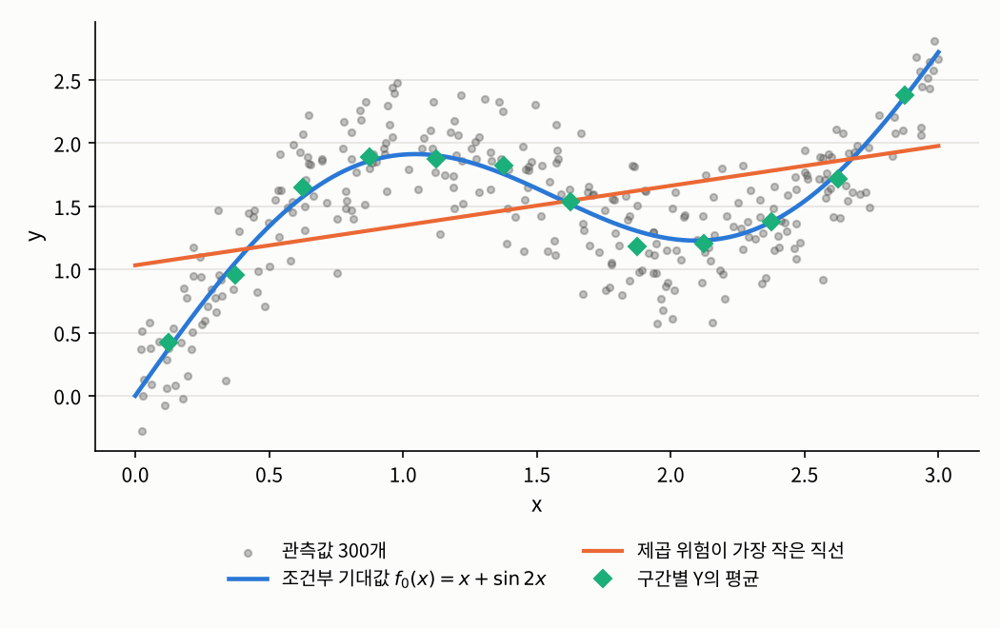
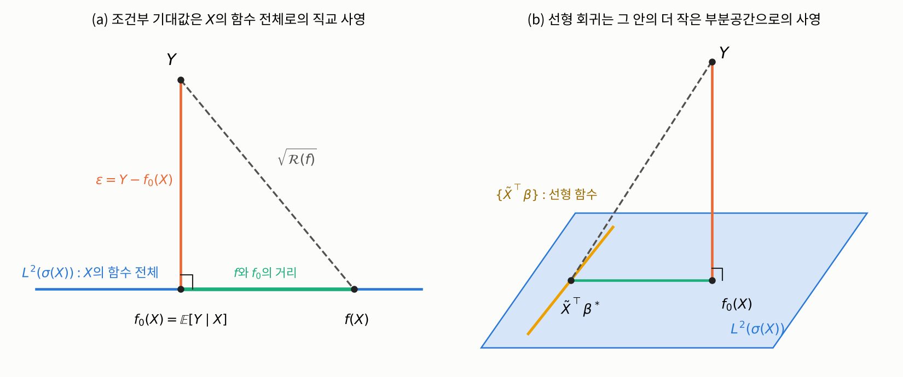

## 들어가며

[데이터 사이언스 개론](../../ds-intro/01-foundations/03-analysis-process.qmd)에서 직선을 맞출 때, 우리는 점들 사이를 지나는 직선 $y = \beta_0 + \beta_1 x$를 찾았습니다. 데이터를 만들 때 잡음을 섞기는 했지만, 관심은 어디까지나 "점들에 가장 잘 맞는 곡선 $y = f(x)$"였고, 잡음은 점들이 곡선 위에 정확히 놓이지 못하게 하는 방해물 정도로만 다뤘습니다. 다시 말해 $x$와 $y$ 사이에 **결정론적인**(deterministic) 관계 $y = f(x)$가 있다고 보고, 그 관계를 데이터로 근사하는 **휴리스틱**(heuristic)이었습니다. 실용적으로는 훌륭한 방법이지만, 엄밀히 말하면 통계학에서 말하는 회귀라기보다는 **곡선 맞추기**(curve fitting)에 가깝습니다.

수리통계학에서 회귀는 출발점이 다릅니다. 관측값 $(x_i, y_i)$를 확률변수 $(X, Y)$의 실현값으로 보고, 같은 $x$에서도 $y$가 매번 달라지는 **무작위성 자체를 모형의 일부로** 받아들입니다. 그러면 질문도 바뀝니다. "점들을 지나는 곡선은 무엇인가"가 아니라 "$X = x$라는 것을 알 때, $Y$는 어떻게 행동하는가"를 묻게 됩니다.

이번 글에서는 이 질문을 조건부 기대값으로 정확하게 표현하고, 그로부터 회귀 모형, 오차, 선형 회귀 모형, 그리고 최소제곱법이 차례로 나온다는 것을 보입니다. 그 과정에서 회귀가 사실은 $L^2$ 공간에서의 **직교 사영**이라는 것도 보게 됩니다.

## 문제: 같은 $x$에서 여러 개의 $y$가 나올 때

### 문제 상황

아래 그림의 회색 점들은 어떤 두 변수 $(X, Y)$에서 뽑은 관측값 300개입니다. $x = 1$ 근처만 보더라도 $y$는 $1.5$에서 $2.4$ 사이에 흩어져 있습니다. $x$와 $y$ 사이에 결정론적인 관계 $y = f(x)$가 있다면 모든 점이 하나의 곡선 위에 놓여야 하는데, 실제 데이터는 그렇지 않습니다. 함수는 $x$ 하나에 값을 하나만 줄 수 있으니, $X$의 값 하나에 $Y$의 값이 여러 개 나오는 상황은 $y = f(x)$라는 틀에 처음부터 들어맞지 않습니다.

그래도 새로운 관측값의 $x$가 주어졌을 때 $y$를 하나의 값으로 예측해야 한다면, 어떤 함수 $f$를 써서 $f(x)$로 예측하는 것이 가장 좋을까요? 그리고 그렇게 고른 $f$는 데이터의 무작위성과 어떤 관계에 있을까요?

{fig-alt="가로축 x가 0에서 3, 세로축 y인 산점도. 회색 점 300개가 파란 곡선 f0(x) = x + sin 2x 주위에 흩어져 있다. 곡선은 0에서 출발해 x가 약 1일 때 1.9 근처까지 오른 뒤 x가 약 2.1일 때 1.2 근처까지 내려갔다가 x가 3일 때 2.7 근처까지 다시 오른다. 주황색 직선은 약 1.03에서 2.0까지 완만하게 오르는 직선으로, 곡선을 따라가지 못한다. 청록색 마름모 12개는 x를 12개 구간으로 나눠 구한 y의 평균으로, 파란 곡선 위에 거의 정확히 놓여 있다." width=70%}

### 접근 아이디어

우리가 정말 알고 싶은 것은 "$X = x$일 때 $Y$가 어떻게 분포하는가"입니다. 그래서 "$X$가 주어졌을 때의 $Y$"라는 뜻으로 $Y \mid X$라는 확률변수를 생각하고 싶어집니다. 그런데 확률론에는 **$Y \mid X$라는 확률변수가 없습니다.** 조건부 확률 $\mathbb{P}(A \mid B)$를 떠올려 보면 이유를 알 수 있습니다. $\mathbb{P}(A \mid B)$는 "$A \mid B$라는 사건"의 확률이 아닙니다. 그런 사건은 없습니다. $\mathbb{P}(A \mid B)$는 $B$가 일어났다는 정보를 반영해 확률을 새로 매긴 것, 즉 같은 사건 $A$에 대한 **새로운 확률측도** $\mathbb{P}(\,\cdot \mid B)$의 값입니다. 마찬가지로 $X = x$라는 정보가 바꾸는 것은 확률변수 $Y$ 자체가 아니라 $Y$의 **분포**입니다. 그래서 존재하는 것은 $x$마다 정해지는 분포 $\mathbb{P}(Y \in \cdot \mid X = x)$, 곧 $X = x$일 때 $Y$의 **조건부 분포**(conditional distribution)입니다.

분포 전체는 다루기에 너무 큰 대상이므로, 각 $x$마다 조건부 분포를 숫자 하나로 요약하기로 하겠습니다. 어떤 숫자가 좋을까요? "좋다"를 정하려면 예측이 얼마나 틀렸는지를 재는 기준이 필요합니다. 가장 흔한 기준은 틀린 정도를 제곱해서 평균 내는 것, 즉 **제곱 오차의 기대값**입니다. 제곱을 쓰면 크게 틀린 예측일수록 훨씬 큰 벌을 받습니다.

먼저 가장 단순한 경우를 생각해 보겠습니다. $X$를 전혀 모른 채로 $Y$를 상수 $c$ 하나로 예측해야 한다면, $\mathbb{E}[(Y - c)^2]$를 가장 작게 만드는 $c$는 무엇일까요? 전개하면

$$\mathbb{E}[(Y - c)^2] = \mathrm{Var}(Y) + (\mathbb{E}Y - c)^2$$

이므로 답은 평균 $c = \mathbb{E}Y$입니다. 그렇다면 $X = x$라는 정보가 주어졌을 때는, 같은 논리를 "$X = x$인 경우들만 모아서" 적용하면 될 것입니다. 즉 조건부 분포의 평균, **조건부 기대값** $\mathbb{E}[Y \mid X = x]$가 답일 것이라고 짐작할 수 있습니다. 그림의 청록색 마름모는 $x$를 작은 구간으로 나눠 각 구간 안에서 $y$의 평균을 낸 것인데, 실제로 파란 곡선 위에 거의 정확히 놓여 있습니다.

다만 여기에는 한 가지 걸림돌이 있습니다. $X$가 연속형이면 $\mathbb{P}(X = x) = 0$이므로, $\mathbb{P}(A \mid B) = \mathbb{P}(A \cap B) / \mathbb{P}(B)$라는 초등적인 정의로는 "$X = x$인 경우들만 모은다"를 쓸 수 없습니다. 이 문제를 해결하는 것이 측도론적 확률론의 조건부 기대값입니다.

### 필요한 개념들

이 짐작을 정확하게 만들어 보겠습니다. 이 글 전체에서 $(X, Y)$는 확률공간 $(\Omega, \mathcal{F}, \mathbb{P})$ 위에서 정의되고, 설명변수 $X = (X_1, \ldots, X_{d-1})^\top$가 $\mathbb{R}^{d-1}$에 값을 가지고 $Y$가 실수값이며 $\mathbb{E}[Y^2] < \infty$인 확률벡터입니다.

**조건부 기대값.** $\mathbb{E}|Y| < \infty$이면, 다음 두 조건을 만족하는 확률변수 $Z$가 존재하고 거의 확실하게 유일합니다.

1. $Z$는 $\sigma(X)$-가측입니다. 직관적으로는 "$X$의 값을 알면 $Z$의 값이 정해진다"는 뜻입니다.
2. 모든 보렐 집합 $B \subseteq \mathbb{R}^{d-1}$에 대해 $\mathbb{E}\big[Z\,\mathbf{1}\{X \in B\}\big] = \mathbb{E}\big[Y\,\mathbf{1}\{X \in B\}\big]$입니다. 즉 $X$에 대한 어떤 사건 위에서 평균을 내든 $Z$는 $Y$와 같은 평균을 줍니다.

이 $Z$를 $\mathbb{E}[Y \mid X]$로 쓰고 $X$에 대한 $Y$의 **조건부 기대값**(conditional expectation)이라고 합니다. $\mathbb{P}(X = x) = 0$이어도 아무 문제가 없도록, "점 $x$에서의 값" 대신 "$X$에 대한 사건 위에서의 평균"으로 정의한 것입니다. 존재성과 유일성의 증명, 그리고 여러 성질은 [측도론적 확률론](../../../stats/measure-prob/index.qmd)을 참고하시기 바랍니다.

이렇게 정의한 $\mathbb{E}[Y \mid X]$는 $\Omega$ 위의 확률변수이지, 아직 $x$의 함수는 아닙니다. 그런데 우리가 예측에 쓰고 싶은 것은 $x$를 넣으면 값이 나오는 함수입니다. 이 둘을 이어 주는 것이 다음 보조정리입니다.

::: {.callout-important icon=false .callout-satz}
### 보조정리 3.1.1 (둡-딘킨 보조정리, Doob–Dynkin lemma)
$X : \Omega \to \mathbb{R}^{d-1}$와 $Z : \Omega \to \mathbb{R}$가 확률변수일 때, $Z$가 $\sigma(X)$-가측인 것과 어떤 보렐 가측함수 $g : \mathbb{R}^{d-1} \to \mathbb{R}$가 존재해서 $Z = g(X)$인 것은 서로 동치입니다.
:::

$\mathbb{E}[Y \mid X]$는 정의에 의해 $\sigma(X)$-가측이므로, 보조정리 3.1.1에 의해 어떤 보렐 가측함수 $f_0 : \mathbb{R}^{d-1} \to \mathbb{R}$가 존재해서

$$\mathbb{E}[Y \mid X] = f_0(X) \quad \text{거의 확실하게}$$

입니다. 이 $f_0(x)$를 $\mathbb{E}[Y \mid X = x]$로 씁니다. 이런 $f_0$는 $X$의 분포 $P_X$에 대해 거의 어디서나 유일합니다. 두 함수 $f_0, f_1$이 모두 조건을 만족하면 $f_0(X) = f_1(X)$가 거의 확실하게 성립하고, 이는 $P_X(\{f_0 \neq f_1\}) = 0$과 같은 말이기 때문입니다. 따라서 $X$가 나올 수 없는 곳에서의 $f_0$의 값은 아무 의미가 없습니다. 존재하기 위해 필요한 조건은 $\mathbb{E}|Y| < \infty$ 하나뿐입니다. 이 글에서 $\mathbb{E}[Y^2] < \infty$를 가정하는 것은 존재 때문이 아니라 아래의 제곱 위험이 유한하도록 하기 위해서입니다.

이제 $X$를 알 때 $Y$의 예측값으로 $\hat{Y} := f_0(X)$를 쓰자는 것이 자연스러운 제안이 됩니다. 이것이 정말 "가장 좋은" 예측인지 확인하려면 기준을 정확히 적어야 합니다.

::: {.callout-note icon=false .callout-definition}
### 정의 3.1.2 (제곱 위험)
가측함수 $f : \mathbb{R}^{d-1} \to \mathbb{R}$로 $Y$를 $f(X)$로 예측할 때,
$$\mathcal{R}(f) := \mathbb{E}\big[(f(X) - Y)^2\big]$$
를 $f$의 **제곱 위험**(squared risk, $L^2$ risk)이라고 합니다.
:::

::: {.callout-important icon=false .callout-satz}
### 정리 3.1.3 (조건부 기대값의 최적성)
$f_0(x) := \mathbb{E}[Y \mid X = x]$라고 하면, $\mathcal{R}(f) < \infty$인 모든 가측함수 $f$에 대해
$$\mathcal{R}(f) = \mathbb{E}\big[(f(X) - f_0(X))^2\big] + \mathcal{R}(f_0)$$
가 성립합니다. 따라서 $f_0$는 제곱 위험을 최소로 하는 함수이고, 최소화하는 함수는 $P_X$에 대해 거의 어디서나 $f_0$뿐입니다.
:::

::: {.callout-tip collapse="false" icon=false .callout-beweis}
### 증명
$f(X) - Y = \big(f(X) - f_0(X)\big) + \big(f_0(X) - Y\big)$의 양변을 제곱하고 기대값을 취하면
$$\mathcal{R}(f) = \mathbb{E}\big[(f(X) - f_0(X))^2\big] + \mathcal{R}(f_0) + 2\,\mathbb{E}\big[(f(X) - f_0(X))(f_0(X) - Y)\big]$$
입니다. 마지막 항에서 $X$로 조건부 기대값을 먼저 취하면, $f(X) - f_0(X)$는 $X$의 함수이므로 밖으로 나오고
$$\mathbb{E}\big[(f(X) - f_0(X))(f_0(X) - Y)\big] = \mathbb{E}\Big[(f(X) - f_0(X))\,\mathbb{E}\big[f_0(X) - Y \mid X\big]\Big] = 0$$
입니다. $\mathbb{E}[f_0(X) - Y \mid X] = f_0(X) - \mathbb{E}[Y \mid X] = 0$이기 때문입니다. 첫째 항은 음이 아니고, $0$인 것은 거의 확실하게 $f(X) = f_0(X)$일 때, 즉 $P_X$에 대해 거의 어디서나 $f = f_0$일 때뿐입니다. $\square$
:::

이 증명은 피타고라스 정리와 같은 구조를 가지고 있는데, 사실은 피타고라스 정리 그 자체입니다. 제곱 적분 가능한 확률변수 전체 $L^2 = L^2(\Omega, \mathcal{F}, \mathbb{P})$는 내적 $\langle U, V \rangle := \mathbb{E}[UV]$를 가진 힐베르트 공간이고, 확률변수 사이의 거리는 $\|U - V\| = \sqrt{\mathbb{E}[(U - V)^2]}$입니다. 이 공간에서 제곱 위험은 거리의 제곱 $\mathcal{R}(f) = \|Y - f(X)\|^2$입니다. 한편 $X$의 함수로 쓸 수 있는 확률변수 전체

$$L^2(\sigma(X)) := \big\{ g(X) : g \text{는 보렐 가측}, \ \mathbb{E}[g(X)^2] < \infty \big\}$$

는 $L^2$의 닫힌 부분공간입니다. 그러면 정리 3.1.3은 "$Y$에 가장 가까운 $L^2(\sigma(X))$의 원소는 $f_0(X)$"라는 말, 곧 **$\mathbb{E}[Y \mid X]$는 $Y$를 $L^2(\sigma(X))$로 직교 사영한 것**이라는 말이 됩니다. 증명에서 교차항이 사라진 이유도 $Y - f_0(X)$가 $X$의 모든 함수와 **직교**하기 때문입니다.

{fig-alt="두 개의 도식. 왼쪽 (a)에서는 가로로 그은 파란 직선이 X의 함수 전체인 부분공간 L2(sigma(X))를 나타낸다. 그 위쪽의 점 Y에서 직선으로 수직선을 내린 발이 f0(X) = E[Y|X]이고, 이 수직선이 오차 epsilon = Y - f0(X)이다. 직선 위의 다른 점 f(X)와 Y를 잇는 점선은 제곱근 R(f)이고, f0(X)와 f(X) 사이의 청록색 선분이 f와 f0의 거리이다. 세 선분이 직각삼각형을 이룬다. 오른쪽 (b)에서는 파란 평행사변형이 L2(sigma(X))를 나타내고, 그 안의 노란 직선이 선형 함수 전체를 나타낸다. Y에서 평면으로 수직선을 내린 발이 f0(X)이고, f0(X)에서 노란 직선으로 다시 수직선을 내린 발이 X tilde transpose beta star이다. Y에서 X tilde transpose beta star로 곧바로 가는 점선도 같은 점에 닿는다." width=100%}

그림 (a)가 정리 3.1.3을 그대로 그린 것입니다. $Y$에서 부분공간으로 내린 수선의 발이 $f_0(X)$이고, 부분공간 위의 다른 점 $f(X)$까지의 거리의 제곱 $\mathcal{R}(f)$는 빗변의 제곱이므로 두 직각변의 제곱의 합, 곧 "$f$와 $f_0$의 거리의 제곱"과 "수선의 길이의 제곱 $\mathcal{R}(f_0)$"의 합이 됩니다. 수선의 길이의 제곱 $\mathcal{R}(f_0) = \mathbb{E}[\mathrm{Var}(Y \mid X)]$는 $X$를 아무리 잘 이용해도 줄일 수 없는 예측 오차입니다. 조건부 기대값을 "$L^2$ 오차를 최소화하는 $X$의 함수"라고 하든 "$L^2(\sigma(X))$로의 사영"이라고 하든 같은 말입니다. 다만 사영으로 보려면 $\mathbb{E}[Y^2] < \infty$가 필요하므로, 앞의 정의는 $\mathbb{E}|Y| < \infty$인 경우까지 사영을 확장한 것이라고 볼 수도 있습니다.

이제 회귀 분석이 무엇을 대상으로 하는지 정의할 수 있습니다.

::: {.callout-note icon=false .callout-definition}
### 정의 3.1.4 (회귀함수와 회귀 모형)
$f_0(x) := \mathbb{E}[Y \mid X = x]$를 $X$에 대한 $Y$의 **회귀함수**(regression function)라고 합니다. 회귀함수로 예측하고 남은 부분을
$$\varepsilon := Y - f_0(X)$$
로 두면 $Y = f_0(X) + \varepsilon$이 되는데, 이렇게 쓴 것을 **회귀 모형**(regression model)이라고 하고 $\varepsilon$을 **오차**(error) 또는 **잡음**(noise)이라고 합니다.
:::

이 정의에서 꼭 짚어 둘 점이 있습니다. 조건부 기대값을 취하면

$$\mathbb{E}[\varepsilon \mid X] = \mathbb{E}[Y \mid X] - f_0(X) = 0$$

이 **정의에 의해 자동으로** 성립합니다. 기대값이 $0$인 잡음을 먼저 정해 두고 $Y$에 더한 것이 아니라, 잡음을 $Y$와 회귀함수의 차이로 정의했더니 그 기대값이 저절로 $0$이 된 것입니다. 데이터 사이언스 개론에서는 순서가 반대였습니다. 정해진 직선 위에 잡음을 섞어 데이터를 만들었으니까요. 그래서 "$Y$는 회귀함수와 평균이 $0$인 오차의 합이다"라는 분해 자체는 아무것도 가정하지 않은 것이고, 모든 $(X, Y)$는 이렇게 쓸 수 있습니다.

$\mathbb{E}[\varepsilon \mid X] = 0$으로부터 따라 나오는 것은 두 가지입니다. 양변의 기대값을 취하면 $\mathbb{E}\varepsilon = 0$이고, $\mathbb{E}[g(X)^2] < \infty$인 모든 $g$에 대해 $\mathbb{E}[\varepsilon\, g(X)] = \mathbb{E}\big[g(X)\,\mathbb{E}[\varepsilon \mid X]\big] = 0$입니다. 뒤의 것이 그림 (a)의 직각이고, 오차가 $X$의 **어떤 함수와도 상관이 없다**는 뜻입니다. 하지만 여기서 따라 나오지 **않는** 것도 분명히 해 두어야 합니다. 오차가 $X$와 독립이라는 것, 오차의 분산이 $x$에 상관없이 일정하다는 것(등분산성, homoscedasticity), 오차가 정규분포를 따른다는 것은 모두 $\mathbb{E}[\varepsilon \mid X] = 0$과 별개의 이야기입니다. 예를 들어 $X \sim \mathrm{Unif}[1, 3]$이고 $Z \sim \mathcal{N}(0, 1)$이 $X$와 독립일 때 $Y := XZ$로 두면, $\mathbb{E}[Y \mid X] = X\,\mathbb{E}Z = 0$이므로 회귀함수는 $f_0 = 0$이고 오차는 $\varepsilon = Y$입니다.

```python
import numpy as np

np.random.seed(88848)
n = 1_000_000
X = np.random.uniform(1, 3, size=n)
Y = X * np.random.normal(size=n)               # E[Y | X] = 0이므로 f0 = 0, 오차는 ε = Y
eps = Y - 0

for name, g in {"g(x) = x": X, "g(x) = x^2": X**2, "g(x) = sin x": np.sin(X)}.items():
    print(f"E[ε g(X)] ≈ {np.mean(eps * g):+.4f}   ({name})")
for lo, hi in [(1.0, 1.2), (2.8, 3.0)]:
    mask = (X >= lo) & (X < hi)
    print(f"{lo} ≤ X < {hi}: ε의 평균 = {eps[mask].mean():+.4f}, ε의 분산 = {eps[mask].var():.4f}")
```

```
E[ε g(X)] ≈ +0.0015   (g(x) = x)
E[ε g(X)] ≈ +0.0066   (g(x) = x^2)
E[ε g(X)] ≈ -0.0008   (g(x) = sin x)
1.0 ≤ X < 1.2: ε의 평균 = -0.0027, ε의 분산 = 1.2139
2.8 ≤ X < 3.0: ε의 평균 = +0.0042, ε의 분산 = 8.3233
```

오차는 $X$의 어떤 함수와도 상관이 없고 어느 구간에서나 평균이 $0$ 근처이지만, 분산은 $\mathrm{Var}(\varepsilon \mid X = x) = x^2$이라서 $X$가 1 근처일 때와 3 근처일 때 7배 가까이 차이가 납니다. 오차의 크기가 $X$에 의존하므로 오차와 $X$는 독립도 아닙니다. 이런 성질들은 3.2절 이후에서 필요할 때 따로 덧붙이는 **가정**입니다.

같은 맥락에서 하나 더 짚어 둘 것이 있습니다. "$Y = f(X) + \varepsilon$을 만족하는 함수 $f$가 존재한다"는 말은 그 자체로는 아무 내용이 없습니다. 아무 $f$나 잡고 $\varepsilon := Y - f(X)$로 두면 언제나 성립하기 때문입니다. 이 분해가 의미를 가지는 것은 오차에 $\mathbb{E}[\varepsilon \mid X] = 0$을 요구할 때이고, 그 순간 $f$는 하나로 정해집니다.

::: {.callout-important icon=false .callout-satz}
### 정리 3.1.5 (회귀 분해의 유일성)
가측함수 $f : \mathbb{R}^{d-1} \to \mathbb{R}$와 확률변수 $\eta$가 $\mathbb{E}|f(X)| < \infty$, $Y = f(X) + \eta$, $\mathbb{E}[\eta \mid X] = 0$을 만족하면, $P_X$에 대해 거의 어디서나 $f = f_0$이고 $\eta = \varepsilon$입니다.
:::

::: {.callout-tip collapse="false" icon=false .callout-beweis}
### 증명
$f(X)$는 $\sigma(X)$-가측이므로 $\mathbb{E}[f(X) \mid X] = f(X)$이고, 따라서
$$f_0(X) = \mathbb{E}[Y \mid X] = f(X) + \mathbb{E}[\eta \mid X] = f(X)$$
가 거의 확실하게 성립합니다. 앞에서 본 대로 이는 $P_X$에 대해 거의 어디서나 $f = f_0$라는 뜻이고, $\eta = Y - f(X) = Y - f_0(X) = \varepsilon$입니다. $\square$
:::

즉 "$X$의 함수 + 조건부 평균이 $0$인 잡음"으로 쓰는 방법은 정확히 한 가지이고, 그때의 함수가 회귀함수입니다. 회귀함수는 언제나 존재하고 본질적으로 유일합니다.

문제는 우리가 $f_0$를 **모른다**는 것입니다. $f_0(x) = \mathbb{E}[Y \mid X = x]$는 $(X, Y)$의 결합분포로부터 정해지는데, 결합분포는 바로 우리가 데이터로부터 알아내려는 대상입니다. 결합밀도 $p(x, y)$를 안다면 $f_0(x) = \int y\, p(x, y)\,dy \,/ \int p(x, y)\,dy$로 계산할 수 있겠지만, 그것을 모르는 상태에서 아무 모양이나 가질 수 있는 함수 $f_0$를 유한한 데이터로 추정하는 것은 상당히 까다로운 일입니다. $X$가 연속형이면 똑같은 $x$ 값이 데이터에 두 번 나오는 일조차 거의 없으니, 그림의 청록색 마름모처럼 "$X = x$인 경우들만 모아 평균 내기"를 그대로 할 수도 없습니다. 그래서 회귀 분석에서는 보통 $f_0$의 **모양에 대한 가정**을 세웁니다. 그러면 함수 전체 대신 유한 개의 숫자만 추정하면 되고, 1장에서 본 모수적 추정의 틀을 그대로 쓸 수 있습니다. 회귀 분석에서 가정이 들어가는 곳은 바로 이 회귀함수의 모양, 그리고 앞에서 본 오차의 분산이나 분포에 대한 조건입니다.

데이터가 어떻게 주어지는지에 따라 두 가지 관점이 있습니다. 관측값 $(x_i, y_i)$를 i.i.d. 확률벡터 $(X_i, Y_i)$의 실현값으로 보면 **확률 설계**(random design)이고, 각 관측값의 설명변수 값 $x_i = (x_{i,1}, \ldots, x_{i,d-1})^\top$은 실험자가 정한 상수로 두고 $Y_i$만 확률변수로 보면 **고정 설계**(fixed design)입니다. 실험에서 비료의 양을 미리 정해 두고 수확량을 재는 상황은 고정 설계에 가깝고, 사람들을 무작위로 뽑아 키와 몸무게를 함께 재는 상황은 확률 설계에 가깝습니다. 확률 설계에서도 $X$의 값을 알고 나서 조건부로 분석하면 고정 설계처럼 다룰 수 있으므로, 3.2절부터는 주로 고정 설계를 씁니다.

회귀함수의 모양에 대한 가장 대표적인 가정은 그것이 **선형**이라는 것입니다.

::: {.callout-note icon=false .callout-definition}
### 정의 3.1.6 (선형 회귀 모형)
어떤 $\beta = (\beta_0, \beta_1, \ldots, \beta_{d-1})^\top \in \mathbb{R}^d$에 대해 회귀함수가
$$f_0(x) = \beta_0 + \beta_1 x_1 + \cdots + \beta_{d-1} x_{d-1} = \tilde{x}^\top\beta, \qquad \tilde{x} := (1, x_1, \ldots, x_{d-1})^\top$$
의 꼴이라고 가정한 회귀 모형을 **선형 회귀 모형**(linear regression model)이라고 하고, $\beta$를 **회귀계수**(regression coefficient), $\beta_0$를 **절편**(intercept)이라고 합니다.
:::

$\tilde{x}$는 설명변수 앞에 상수 $1$을 붙인 벡터로, 절편까지 한꺼번에 내적 하나로 쓰기 위한 표기입니다. 이 장에서는 언제나 이렇게 **절편이 있는 모형**을 다룹니다. 절편이 있으면 상수 함수가 모형 안에 들어 있으므로, 적합한 모형이 "평균 하나로 예측하기"보다 나빠질 수 없고, 3.3절과 3.4절에서 볼 잔차의 합이 $0$이라는 성질과 제곱합의 분해도 이 덕분에 성립합니다. 여기서 "선형"은 **$\beta$에 대해** 선형이라는 뜻이지, $x$에 대해 선형이라는 뜻이 아니라는 점이 중요합니다. 예를 들어 $f_0(x) = \beta_0 + \beta_1 x + \beta_2 x^2$나 $f_0(x) = \beta_0 + \beta_1 \log x$도 설명변수를 $(x, x^2)$나 $\log x$로 두면 선형 회귀 모형입니다. 그래서 선형 회귀 모형은 생각보다 훨씬 다양한 곡선을 표현할 수 있습니다.

사영의 그림으로 보면 이 가정의 의미가 분명해집니다. $\mathbb{E}\|X\|^2 < \infty$일 때 선형 함수 전체 $\{\tilde{X}^\top\beta : \beta \in \mathbb{R}^d\}$는 $L^2(\sigma(X))$ 안의 (많아야) $d$차원 부분공간이고, 절편 덕분에 상수들을 포함합니다. 선형 회귀 모형은 "$Y$의 사영 $f_0(X)$가 마침 이 작은 부분공간 안에 들어 있다"는 가정이고, 그러면 무한차원의 부분공간 전체를 뒤질 필요 없이 $d$개의 숫자 $\beta_0, \ldots, \beta_{d-1}$만 찾으면 됩니다.

마지막으로, 회귀계수를 데이터로부터 어떻게 정할까요? 정리 3.1.3에 따르면 회귀함수는 제곱 위험을 최소로 하는 함수였습니다. 그렇다면 선형 함수들 가운데에서 제곱 위험을 최소로 하는 것을 고르되, 모르는 기대값 자리에 표본 평균을 넣으면 됩니다. 2장에서 여러 번 쓴 **플러그인 원리**입니다.

::: {.callout-note icon=false .callout-definition}
### 정의 3.1.7 (최소제곱 추정량)
관측값 $(X_i, Y_i)$, $i = 1, \ldots, n$에 대해($X_i = (X_{i,1}, \ldots, X_{i,d-1})^\top$)
$$\hat{\beta} := \operatorname*{arg\,min}_{\beta \in \mathbb{R}^d} \frac{1}{n}\sum_{i=1}^n \big(Y_i - \beta_0 - \beta_1 X_{i,1} - \cdots - \beta_{d-1} X_{i,d-1}\big)^2 = \operatorname*{arg\,min}_{\beta \in \mathbb{R}^d} \frac{1}{n}\sum_{i=1}^n \big(Y_i - \tilde{X}_i^\top\beta\big)^2$$
를 $\beta$의 **최소제곱 추정량**(ordinary least squares estimator, OLS)이라고 합니다.
:::

[과목 소개 글](../index.qmd)에서 "세로 거리의 제곱합이 가장 작은 직선"으로 설명했던 최소제곱법이, 이렇게 "$L^2$ 오차를 최소화한다", 곧 "사영한다"는 원리의 표본 버전으로 다시 나타납니다. 데이터 사이언스 개론에서 쓴 계산과 똑같은 계산이지만, 이제는 그 직선이 무엇을 추정하고 있는지, 곧 조건부 기대값을 추정하고 있다는 것을 압니다.

### 해결

그림의 데이터는 실제로 $f_0(x) = x + \sin 2x$, $X \sim \mathrm{Unif}[0, 3]$, 오차의 표준편차가 $0.3$인 모형에서 뽑은 것입니다. 이 모형에서 세 가지 예측 함수의 제곱 위험을 비교해 보겠습니다. 기대값은 표본 100만 개의 평균으로 근사합니다.

```python
import numpy as np

def f0(x):
    return x + np.sin(2 * x)                   # 참된 회귀함수 E[Y | X = x]

np.random.seed(1557)
n = 1_000_000
X = np.random.uniform(0, 3, size=n)
Y = f0(X) + 0.3 * np.random.normal(size=n)     # 오차의 표준편차 0.3

b1, b0 = np.polyfit(X, Y, 1)                   # 가장 좋은 직선 (최소제곱)
print(f"가장 좋은 직선: {b0:.3f} + {b1:.3f} x")
predictors = {"조건부 기대값": f0(X), "가장 좋은 직선": b0 + b1 * X, "상수 (Y의 평균)": np.full(n, Y.mean())}
for name, pred in predictors.items():
    risk = np.mean((pred - Y)**2)              # E|f(X) - Y|^2의 근삿값
    dist = np.mean((pred - f0(X))**2)          # E|f(X) - f0(X)|^2의 근삿값
    print(f"[{name}] 위험 = {risk:.4f}, f0와의 거리 = {dist:.4f}, 거리 + 0.3^2 = {dist + 0.09:.4f}")
```

```
가장 좋은 직선: 1.033 + 0.315 x
[조건부 기대값] 위험 = 0.0899, f0와의 거리 = 0.0000, 거리 + 0.3^2 = 0.0900
[가장 좋은 직선] 위험 = 0.2618, f0와의 거리 = 0.1713, 거리 + 0.3^2 = 0.2613
[상수 (Y의 평균)] 위험 = 0.3365, f0와의 거리 = 0.2463, 거리 + 0.3^2 = 0.3363
```

조건부 기대값의 위험은 피할 수 없는 오차의 분산 $0.3^2 = 0.09$와 같고, 다른 함수의 위험은 모두 이보다 큽니다. 또 각 함수의 위험이 "$f_0$와의 거리 $+ 0.09$"와 거의 정확히 같아서, 정리 3.1.3의 분해, 곧 그림 (a)의 피타고라스 정리가 그대로 확인됩니다.

여기서 눈여겨볼 것은 주황색 직선입니다. 이 데이터의 참된 회귀함수는 직선이 아니므로, 선형 회귀 모형은 **틀린 모형**입니다. 그런데도 최소제곱법은 아무 문제 없이 직선 하나를 내놓습니다. 그 직선은 무엇을 추정하고 있는 것일까요? 표본이 커지면 최소제곱 직선은 직선들 가운데 제곱 위험이 가장 작은 직선, 즉

$$\beta^* := \operatorname*{arg\,min}_{\beta \in \mathbb{R}^d}\ \mathbb{E}\big[(Y - \tilde{X}^\top\beta)^2\big]$$

로 다가갑니다. $\tilde{X}^\top\beta^*$는 $Y$를 선형 함수 전체의 부분공간으로 사영한 것입니다. 그런데 $Y - f_0(X)$는 $L^2(\sigma(X))$ 전체와 직교하므로, 그 안에 들어 있는 선형 함수들과도 직교합니다. 따라서 $Y$를 곧바로 선형 함수 쪽으로 사영하든, 먼저 $f_0(X)$로 사영한 뒤 다시 선형 함수 쪽으로 사영하든 같은 점에 닿습니다. 그림 (b)가 이 상황입니다. 식으로 쓰면 정리 3.1.3의 분해에 의해

$$\mathbb{E}\big[(Y - \tilde{X}^\top\beta)^2\big] = \mathbb{E}\big[(f_0(X) - \tilde{X}^\top\beta)^2\big] + \mathcal{R}(f_0)$$

이고 오른쪽 둘째 항은 $\beta$와 무관하므로, $\tilde{X}^\top\beta^*$는 $f_0$에 가장 가까운 직선이기도 합니다. 다시 말해 모형이 틀려도 최소제곱법은 **"참된 회귀함수에 가장 가까운 직선"을 추정**합니다. 다만 그 직선은 그림에서 보듯 데이터의 구조를 크게 놓칠 수 있고, 이때 남는 오차 $0.2613 - 0.09 \approx 0.17$, 곧 그림 (b)의 청록색 선분의 길이의 제곱은 아무리 데이터를 모아도 줄어들지 않습니다. 모형이 맞다면 $f_0(X)$가 처음부터 노란 직선 위에 있으므로 이 선분의 길이는 $0$입니다. 모형이 맞는지 확인하는 방법은 3.3절의 잔차 분석에서 다룹니다.

## 정리: 무엇이 정의이고 무엇이 가정인가

이번 글의 내용을 정리하면 다음과 같습니다.

| | 내용 | 정의인가 가정인가 |
|:--|:--|:--|
| 조건부 기대값 | $\mathbb{E}[Y \mid X] = f_0(X)$인 $f_0$가 존재하고 거의 어디서나 유일 | 정리 (둡-딘킨 보조정리, $\mathbb{E}\lvert Y\rvert < \infty$만 필요) |
| 회귀함수 | $f_0(x) = \mathbb{E}[Y \mid X = x]$, 제곱 위험의 최소화 함수, $L^2(\sigma(X))$로의 사영 | 정의 |
| 오차 | $\varepsilon = Y - f_0(X)$, $\mathbb{E}[\varepsilon \mid X] = 0$ | 정의 (자동으로 성립) |
| 오차의 독립성, 등분산성, 정규성 | $\mathbb{E}[\varepsilon \mid X] = 0$에서 따라 나오지 않음 | **가정** (필요할 때 덧붙임) |
| 선형 회귀 모형 | $f_0(x) = \beta_0 + \beta_1 x_1 + \cdots + \beta_{d-1} x_{d-1}$ | **가정** |
| 최소제곱법 | 제곱 위험의 표본 버전을 최소화 | 추정 방법 (플러그인 원리) |

데이터 사이언스 개론의 곡선 맞추기와 지금의 회귀는 계산은 같아도 출발점이 다릅니다. 곡선 맞추기는 결정론적인 관계 $y = f(x)$를 먼저 상정하지만, 회귀는 무작위적인 $(X, Y)$에서 출발해 $Y$를 $X$의 함수 쪽으로 사영한 것을 $f_0$라고 부릅니다. 그리고 회귀 분석에서 가정은 "그 $f_0$가 어떤 모양인가"와 "남은 오차가 어떻게 생겼는가"에 들어간다는 것을 기억해 두면, 뒤에서 모형을 점검할 때 무엇을 의심해야 하는지가 분명해집니다.

이제 선형 회귀 모형이 맞다고 가정했을 때, 최소제곱 추정량을 실제로 구하고 그 성질을 따져 볼 차례입니다. 3.2절에서는 최소제곱 추정량의 식을 유도하고, 그것이 어떤 의미에서 "가장 좋은" 추정량인지를 살펴봅니다. 이번 글에서 본 사영의 그림은 3.3절에서 확률변수의 공간 $L^2$ 대신 데이터 벡터의 공간 $\mathbb{R}^n$에서 다시 나타납니다.

---

### 연결되는 개념
* $\leftarrow$ **이전 개념:** [3 선형 회귀와 분산분석](index.qmd)
* $\rightarrow$ **다음 개념:** [3.2 최소제곱 추정량과 가우스-마르코프 정리](02-least-squares.qmd)
