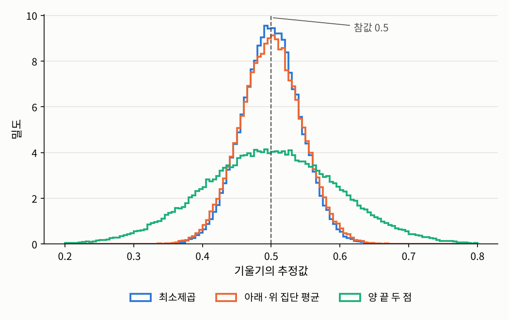

## 들어가며

[3.1절](01-regression-function.qmd)에서 최소제곱법은 "제곱 위험을 최소로 하는 함수를 찾는다"는 원리의 표본 버전으로 자연스럽게 나왔습니다. 이번 글에서는 선형 회귀 모형이 맞다고 가정하고, 최소제곱 추정량을 실제로 계산한 뒤 그 성질을 1장의 관점에서 따져 봅니다. 평균적으로 참값을 맞히는지, 얼마나 흔들리는지, 그리고 다른 추정 방법보다 나은지입니다.

마지막으로 [1장 소개 글](../01-mle/index.qmd)에서 던진 질문, "왜 하필 최소제곱법인가"에 대한 두 가지 답을 정리합니다.

## 문제 1: 최소제곱 추정량을 어떻게 계산하는가

### 문제 상황

학생 50명에 대해 두 설명변수 $x_1$(예를 들어 공부 시간)과 $x_2$(예를 들어 수면 시간)를 기록하고, 반응변수 $y$를 측정했다고 합시다. 모형은

$$Y_i = \beta_0 + \beta_1 x_{i,1} + \beta_2 x_{i,2} + \varepsilon_i, \qquad i = 1, \ldots, 50$$

입니다. 설명변수가 하나뿐이면 손으로도 최소제곱 직선을 구할 수 있지만, 설명변수가 여러 개면 식이 금방 복잡해집니다. 일반적인 공식이 있을까요?

### 접근 아이디어

$n$개의 식을 하나하나 쓰는 대신 **행렬**로 한꺼번에 쓰면 됩니다. 그러면 제곱합은 벡터의 길이의 제곱이 되고, 최소화는 다변수 함수의 미분 문제가 됩니다.

### 필요한 개념들

::: {.callout-note icon=false .callout-definition}
### 정의 3.2.1 (선형 모형의 행렬 표현)
설명변수가 $d - 1$개인 고정 설계의 선형 회귀 모형에서, $i$번째 관측값은
$$Y_i = \beta_0 + \beta_1 x_{i,1} + \beta_2 x_{i,2} + \cdots + \beta_{d-1} x_{i,d-1} + \varepsilon_i, \qquad i = 1, \ldots, n$$
을 만족합니다. 여기서 $x_{i,j}$는 $i$번째 관측값의 $j$번째 설명변수 값입니다. 설명변수 값들을 관측값 순서대로 한 행씩, 맨 앞에 $1$을 붙여 쌓은 행렬
$$X := \begin{pmatrix}
1 & x_{1,1} & x_{1,2} & \cdots & x_{1,d-1} \\
1 & x_{2,1} & x_{2,2} & \cdots & x_{2,d-1} \\
\vdots & \vdots & \vdots & \ddots & \vdots \\
1 & x_{n,1} & x_{n,2} & \cdots & x_{n,d-1}
\end{pmatrix} \in \mathbb{R}^{n \times d}$$
를 **계획행렬**(design matrix)이라고 합니다. $i$번째 행은 $i$번째 관측값 하나에 대한 정보이고, 첫 열은 절편 $\beta_0$에 곱해지는, 모든 성분이 $1$인 벡터 $\mathbf{1}_n$이며, $(j+1)$번째 열은 $j$번째 설명변수를 $n$번 관측한 값들입니다. 그러면 $n$개의 식을 한꺼번에
$$\underbrace{\begin{pmatrix} Y_1 \\ Y_2 \\ \vdots \\ Y_n \end{pmatrix}}_{Y}
= \underbrace{\begin{pmatrix}
1 & x_{1,1} & \cdots & x_{1,d-1} \\
1 & x_{2,1} & \cdots & x_{2,d-1} \\
\vdots & \vdots & \ddots & \vdots \\
1 & x_{n,1} & \cdots & x_{n,d-1}
\end{pmatrix}}_{X}
\underbrace{\begin{pmatrix} \beta_0 \\ \beta_1 \\ \vdots \\ \beta_{d-1} \end{pmatrix}}_{\beta}
+ \underbrace{\begin{pmatrix} \varepsilon_1 \\ \varepsilon_2 \\ \vdots \\ \varepsilon_n \end{pmatrix}}_{\varepsilon},
\qquad \text{즉} \qquad Y = X\beta + \varepsilon$$
로 쓸 수 있습니다. 행렬곱 $X\beta$의 $i$번째 성분이 정확히 $\beta_0 + \beta_1 x_{i,1} + \cdots + \beta_{d-1} x_{i,d-1}$이기 때문입니다. 이 장에서는 별다른 말이 없으면 다음을 가정합니다.
$$\mathbb{E}[\varepsilon] = 0_n, \qquad \mathrm{Cov}(\varepsilon) = \sigma^2 I_n, \qquad \mathrm{rank}(X) = d \le n$$
:::

공분산에 대한 가정은 세 가지를 한꺼번에 말합니다. 모든 오차의 분산이 $\sigma^2$로 **같고**, 서로 다른 오차끼리는 **상관이 없다**는 것입니다. 정규분포는 가정하지 않았다는 점에 주의하시기 바랍니다.

이 표기로 쓰면 최소제곱법은 $Q(\beta) := \lVert Y - X\beta \rVert^2$를 최소화하는 문제가 됩니다.

::: {.callout-important icon=false .callout-satz}
### 정리 3.2.2 (정규방정식과 최소제곱 추정량)
$\mathrm{rank}(X) = d$이면 $X^\top X$는 가역이고, $Q(\beta)$를 최소로 하는 $\beta$는
$$\hat{\beta} = (X^\top X)^{-1}X^\top Y$$
하나뿐입니다. 이는 **정규방정식**(normal equation) $X^\top X\beta = X^\top Y$의 유일한 해입니다.
:::

::: {.callout-tip collapse="false" icon=false .callout-beweis}
### 증명
먼저 $X^\top X$가 가역임을 보입니다. $X^\top Xv = 0$이면 $\lVert Xv \rVert^2 = v^\top X^\top Xv = 0$이므로 $Xv = 0$이고, $X$의 열들이 일차독립이므로 $v = 0$입니다.

$Q(\beta) = Y^\top Y - 2\beta^\top X^\top Y + \beta^\top X^\top X\beta$를 미분하면
$$\frac{\partial Q}{\partial \beta} = -2X^\top Y + 2X^\top X\beta, \qquad \frac{\partial^2 Q}{\partial \beta\,\partial \beta^\top} = 2X^\top X$$
입니다. 일계도함수가 $0$인 점은 정규방정식의 해 $\hat{\beta}$ 하나뿐이고, 헤세 행렬 $2X^\top X$는 위에서 본 대로 $v \neq 0$이면 $v^\top X^\top Xv = \lVert Xv \rVert^2 > 0$이므로 양의 정부호입니다. 따라서 $Q$는 순볼록함수이고, $\hat{\beta}$는 유일한 전역 최솟값입니다. $\square$
:::

증명에서 $\mathrm{rank}(X) = d$라는 조건이 핵심적인 역할을 했습니다. 이 조건은 사실 [1.1절](../01-mle/01-likelihood.qmd)의 **식별가능성**과 같은 조건입니다.

::: {.callout-important icon=false .callout-satz}
### 정리 3.2.3 (계수 조건과 식별가능성)
다음은 모두 동치입니다.

1. $\mathrm{rank}(X) = d$
2. $X^\top X$가 가역
3. $\beta \neq \beta'$이면 $X\beta \neq X\beta'$, 즉 서로 다른 회귀계수는 서로 다른 평균 벡터 $\mathbb{E}[Y]$를 줍니다.
:::

::: {.callout-tip collapse="false" icon=false .callout-beweis}
### 증명
1 ⇒ 2는 정리 3.2.2의 증명에서 보였습니다. 2 ⇒ 3: $X\beta = X\beta'$이면 $X^\top X(\beta - \beta') = 0$이므로 $\beta = \beta'$입니다. 3 ⇒ 1: $\mathrm{rank}(X) < d$이면 $Xv = 0$인 $v \neq 0$이 있고, 그러면 $\beta \neq \beta + v$인데 $X\beta = X(\beta + v)$이므로 3에 모순입니다. $\square$
:::

$\mathrm{rank}(X) < d$이면 서로 다른 $\beta$와 $\beta + v$가 데이터의 평균을 똑같이 설명하므로, 데이터를 아무리 모아도 둘을 구별할 수 없습니다. 이때는 최소제곱 해도 무수히 많아집니다. 이런 일은 한 설명변수가 다른 설명변수들의 일차결합인 경우, 예를 들어 같은 키를 센티미터와 인치로 두 번 넣거나, 3.5절에서 볼 것처럼 범주형 변수의 지시변수를 모두 넣는 경우에 생깁니다.

설명변수가 하나뿐인 경우에는 정규방정식을 손으로 풀어 익숙한 공식을 얻을 수 있습니다.

::: {.callout-important icon=false .callout-satz}
### 따름정리 3.2.4 (단순 선형 회귀)
$d = 2$인 모형 $Y_i = \beta_0 + \beta_1 x_i + \varepsilon_i$에서 $x_i$들이 모두 같지는 않으면, 최소제곱 추정량은
$$\hat{\beta}_1 = \frac{\sum_{i=1}^n (x_i - \bar{x})(Y_i - \bar{Y})}{\sum_{i=1}^n (x_i - \bar{x})^2} = r\,\frac{s_Y}{s_x}, \qquad \hat{\beta}_0 = \bar{Y} - \hat{\beta}_1\bar{x}$$
입니다. 여기서 $r$은 표본 상관계수, $s_x$와 $s_Y$는 표본 표준편차입니다.
:::

::: {.callout-tip collapse="false" icon=false .callout-beweis}
### 증명
정규방정식 $X^\top(Y - X\beta) = 0$을 성분별로 쓰면 $\sum_i (Y_i - \beta_0 - \beta_1 x_i) = 0$과 $\sum_i x_i(Y_i - \beta_0 - \beta_1 x_i) = 0$입니다. 첫 식에서 $\beta_0 = \bar{Y} - \beta_1\bar{x}$이고, 이를 둘째 식에 넣고 첫 식에 $\bar{x}$를 곱한 것을 빼면
$$\sum_i (x_i - \bar{x})\big((Y_i - \bar{Y}) - \beta_1(x_i - \bar{x})\big) = 0$$
이 되어 $\hat{\beta}_1$의 식을 얻습니다. 분자와 분모를 $n - 1$로 나누면 표본 공분산을 $s_x^2$로 나눈 것이 되고, 이는 [2.1절](../02-dependence/01-pearson.qmd)의 정의에 의해 $r\,s_Y/s_x$입니다. $\square$
:::

[2.4절](../02-dependence/04-mixed.qmd)에서 "3장에서 유도한다"고 미뤄 두었던 식이 바로 이것입니다. 기울기는 상관계수에 두 변수의 표준편차 비율을 곱한 것이므로, 상관계수가 $0$이면 기울기도 $0$이고, 두 변수를 표준화하면 기울기가 곧 상관계수가 됩니다.

### 해결

참된 회귀계수가 $(\beta_0, \beta_1, \beta_2) = (1, 2, -0.5)$이고 오차의 표준편차가 $3$인 모형에서 데이터를 만들어 정규방정식을 풀어 보겠습니다. 비교를 위해 NumPy의 최소제곱 함수 `lstsq`의 결과도 함께 출력하고, 계획행렬의 계수도 확인합니다.

```python
import numpy as np

np.random.seed(1557)
n = 50
x1 = np.random.uniform(0, 10, size=n)
x2 = np.random.normal(5, 2, size=n)
X = np.column_stack([np.ones(n), x1, x2])            # 계획행렬: 첫 열은 절편
beta = np.array([1.0, 2.0, -0.5])                    # 참된 회귀계수
y = X @ beta + 3 * np.random.normal(size=n)          # 오차의 표준편차 3

print("rank(X) =", np.linalg.matrix_rank(X))
beta_hat = np.linalg.solve(X.T @ X, X.T @ y)         # 정규방정식 X^T X b = X^T y
print("정규방정식의 해:", np.round(beta_hat, 4))
print("lstsq의 해:     ", np.round(np.linalg.lstsq(X, y, rcond=None)[0], 4))

X_bad = np.column_stack([X, x1 + x2])                # 넷째 열 = 둘째 열 + 셋째 열
print("열을 하나 더한 rank =", np.linalg.matrix_rank(X_bad), "(열의 개수 4)")
```

```
rank(X) = 3
정규방정식의 해: [ 1.437   2.0039 -0.4457]
lstsq의 해:      [ 1.437   2.0039 -0.4457]
열을 하나 더한 rank = 3 (열의 개수 4)
```

두 방법의 결과가 같고, 기울기 추정값 $2.004$와 $-0.446$은 참값 $2$와 $-0.5$에 가깝습니다. 절편 $1.437$은 참값 $1$에서 조금 더 벗어나 있는데, 그 이유는 문제 2에서 보겠습니다. 마지막 줄은 $x_1 + x_2$를 넷째 열로 더하면 열이 4개인데 계수(rank)는 3이 되어, 정리 3.2.3에 의해 회귀계수를 식별할 수 없다는 것을 보여 줍니다. 실제로 데이터를 분석할 때는 이렇게 계획행렬의 계수를 먼저 확인하는 것이 좋습니다.

## 문제 2: 최소제곱 추정량은 얼마나 정확한가

### 문제 상황

[과목 소개 글](../index.qmd)에서 보았듯이, 데이터를 새로 뽑으면 최소제곱 추정값도 달라집니다. 즉 $\hat{\beta}$는 확률벡터입니다. 그 평균과 공분산 행렬은 무엇일까요?

### 해결

$\hat{\beta} = (X^\top X)^{-1}X^\top Y$는 $Y$의 **선형** 함수이므로, 평균과 공분산을 바로 계산할 수 있습니다.

::: {.callout-important icon=false .callout-satz}
### 정리 3.2.5 (최소제곱 추정량의 평균과 공분산)
정의 3.2.1의 가정 아래에서
$$\mathbb{E}[\hat{\beta}] = \beta, \qquad \mathrm{Cov}(\hat{\beta}) = \sigma^2(X^\top X)^{-1}$$
입니다.
:::

::: {.callout-tip collapse="false" icon=false .callout-beweis}
### 증명
$Y = X\beta + \varepsilon$을 넣으면
$$\hat{\beta} = (X^\top X)^{-1}X^\top(X\beta + \varepsilon) = \beta + (X^\top X)^{-1}X^\top\varepsilon$$
입니다. $\mathbb{E}[\varepsilon] = 0$이므로 $\mathbb{E}[\hat{\beta}] = \beta$입니다. 상수 행렬 $A$에 대해 $\mathrm{Cov}(A\varepsilon) = A\,\mathrm{Cov}(\varepsilon)A^\top$이므로, $A = (X^\top X)^{-1}X^\top$으로 두면
$$\mathrm{Cov}(\hat{\beta}) = A\,\sigma^2 I_n\,A^\top = \sigma^2(X^\top X)^{-1}X^\top X(X^\top X)^{-1} = \sigma^2(X^\top X)^{-1}$$
입니다. $\square$
:::

즉 최소제곱 추정량은 **불편추정량**이고, 그 흔들림은 오차의 분산 $\sigma^2$와 설계 $X$로 정해집니다. 증명 첫 줄의 식 $\hat{\beta} - \beta = (X^\top X)^{-1}X^\top\varepsilon$은 기억해 둘 만합니다. 추정 오차는 오차 벡터 $\varepsilon$을 선형변환한 것입니다.

단순 선형 회귀에서는 따름정리 3.2.4에서 $\mathrm{Var}(\hat{\beta}_1) = \sigma^2 / \sum_i (x_i - \bar{x})^2$이 됩니다. 분모는 $x$값들이 흩어진 정도이므로, **설명변수의 값을 넓게 퍼뜨려 실험할수록 기울기를 정확하게 추정할 수 있습니다.** 손잡이가 긴 지렛대일수록 기울기를 정밀하게 읽을 수 있는 것과 같습니다. 문제 1에서 절편이 기울기보다 크게 벗어났던 것도 같은 이유입니다. 절편은 $x_1 = x_2 = 0$일 때의 값인데, 관측값들은 $x_2 \approx 5$ 근처에 모여 있어서 $0$까지 멀리 외삽해야 하므로 불확실성이 큽니다.

문제 1과 같은 계획행렬 $X$를 그대로 두고 오차만 새로 뽑아 2만 번 추정해 보겠습니다. 고정 설계에서 표본을 새로 뽑는다는 것이 바로 이런 뜻입니다.

```python
reps = 20_000
E = 3 * np.random.normal(size=(reps, n))             # 같은 X에서 오차만 새로 뽑음 (고정 설계)
B = np.linalg.solve(X.T @ X, X.T @ (X @ beta + E).T).T   # 각 행이 하나의 beta_hat
print("beta_hat의 평균:     ", np.round(B.mean(axis=0), 4))
print("beta_hat의 표준편차: ", np.round(B.std(axis=0), 4))
print("이론값 sqrt(diag(sigma^2 (X^T X)^{-1})):", np.round(np.sqrt(np.diag(9 * np.linalg.inv(X.T @ X))), 4))
```

```
beta_hat의 평균:      [ 1.0164  1.9983 -0.5019]
beta_hat의 표준편차:  [1.4182 0.1513 0.2086]
이론값 sqrt(diag(sigma^2 (X^T X)^{-1})): [1.4203 0.1507 0.2081]
```

평균은 참값 $(1, 2, -0.5)$와 거의 같고, 표준편차는 정리 3.2.5의 이론값과 잘 맞습니다. 절편의 표준편차가 $1.42$로 기울기들보다 훨씬 큰 것도 위에서 설명한 대로입니다.

## 문제 3: 다른 추정 방법보다 나은가

### 문제 상황

최소제곱 추정량이 불편추정량이라는 것은 알았습니다. 그런데 불편추정량은 그것 말고도 많습니다. 예를 들어 설명변수가 $x = 1, 2, \ldots, 30$으로 고정된 단순 선형 회귀에서, 기울기를 다음 세 가지 방법으로 추정할 수 있습니다.

1. 최소제곱 추정량 $\hat{\beta}_1$
2. 양 끝 두 점만 이은 기울기 $(Y_{30} - Y_1)/29$
3. $x$가 작은 10개와 큰 10개의 평균을 각각 구해 이은 기울기

세 추정량 모두 $Y$의 선형 함수이고, $\mathbb{E}[Y_i] = \beta_0 + \beta_1 x_i$를 넣어 보면 모두 평균적으로 $\beta_1$을 맞힙니다. 이 중 어느 것이 가장 좋을까요?

### 필요한 개념들

추정량의 공분산 "행렬"을 비교하려면 행렬 사이의 크기 비교가 필요합니다.

::: {.callout-note icon=false .callout-definition}
### 정의 3.2.6 (선형 불편추정량과 뢰브너 순서)
1. 어떤 상수 행렬 $A \in \mathbb{R}^{d \times n}$에 대해 $\tilde{\beta} = AY$로 쓸 수 있고, 모든 $\beta$에 대해 $\mathbb{E}[\tilde{\beta}] = \beta$인 추정량을 $\beta$의 **선형 불편추정량**(linear unbiased estimator)이라고 합니다.
2. 대칭행렬 $M_1$, $M_2$에 대해 $M_2 - M_1$이 양의 준정부호이면 $M_1 \le M_2$로 씁니다. 이를 **뢰브너 순서**(Löwner order)라고 합니다.
:::

$M_1 \le M_2$는 모든 벡터 $c$에 대해 $c^\top M_1 c \le c^\top M_2 c$라는 뜻입니다. 공분산 행렬에 적용하면, $\mathrm{Cov}(\hat{\beta}) \le \mathrm{Cov}(\tilde{\beta})$는 **회귀계수의 어떤 일차결합 $c^\top\beta$를 추정하든** $c^\top\hat{\beta}$의 분산이 $c^\top\tilde{\beta}$의 분산보다 작거나 같다는 뜻입니다. 각 계수 하나하나는 물론이고, 새로운 설명변수 값 $x = (x_1, \ldots, x_{d-1})$에서의 예측값 $\beta_0 + \beta_1 x_1 + \cdots + \beta_{d-1} x_{d-1}$에 대해서도 마찬가지입니다.

::: {.callout-important icon=false .callout-satz}
### 정리 3.2.7 (가우스-마르코프 정리)
정의 3.2.1의 가정 아래에서, 최소제곱 추정량 $\hat{\beta}$는 모든 선형 불편추정량 $\tilde{\beta}$에 대해
$$\mathrm{Cov}(\hat{\beta}) \le \mathrm{Cov}(\tilde{\beta})$$
를 만족합니다. 즉 $\hat{\beta}$는 **최량 선형 불편추정량**(best linear unbiased estimator, BLUE)입니다.
:::

::: {.callout-tip collapse="false" icon=false .callout-beweis}
### 증명
$\tilde{\beta} = AY$가 모든 $\beta$에 대해 불편이면 $\mathbb{E}[AY] = AX\beta = \beta$가 모든 $\beta$에 대해 성립하므로 $AX = I_d$입니다. $A = (X^\top X)^{-1}X^\top + D$로 쓰면, $AX = I_d$에서 $DX = 0$을 얻습니다. 따라서
$$\mathrm{Cov}(\tilde{\beta}) = \sigma^2 AA^\top = \sigma^2\Big[(X^\top X)^{-1} + (X^\top X)^{-1}X^\top D^\top + DX(X^\top X)^{-1} + DD^\top\Big] = \sigma^2(X^\top X)^{-1} + \sigma^2 DD^\top$$
입니다. 교차항은 $DX = 0$이므로 사라집니다. $DD^\top$은 양의 준정부호이므로 결론을 얻습니다. $\square$
:::

증명을 보면 어떤 선형 불편추정량이든 "최소제곱 추정량 $+$ 쓸데없는 잡음 $D\varepsilon$"으로 쓸 수 있고, 그 잡음이 분산을 늘리기만 한다는 것을 알 수 있습니다. 이 정리에는 두 가지를 덧붙여 두어야 합니다.

- **정규분포는 필요하지 않습니다.** 오차의 평균이 $0$이고, 분산이 같고, 서로 상관이 없다는 것만 썼습니다.
- **비교 대상은 "선형"이고 "불편"인 추정량뿐입니다.** 치우침을 조금 허용하는 추정량, 예를 들어 머신러닝에서 많이 쓰는 릿지 회귀(ridge regression)는 분산을 크게 줄여서 평균제곱오차로는 최소제곱 추정량보다 나을 수 있습니다. 가우스-마르코프 정리는 그런 추정량에 대해서는 아무것도 말하지 않습니다.

### 해결

세 기울기 추정량을 10만 번씩 계산해 비교해 보겠습니다. 참된 기울기는 $0.5$, 오차의 표준편차는 $2$입니다.

```python
np.random.seed(1557)
x = np.arange(1, 31, dtype=float)                    # 고정된 설명변수 1, 2, ..., 30
reps = 100_000
Y = 2 + 0.5 * x + 2 * np.random.normal(size=(reps, 30))   # 참된 기울기 0.5, 오차의 표준편차 2

xc = x - x.mean()
slope_ols = (Y - Y.mean(axis=1, keepdims=True)) @ xc / np.sum(xc**2)
slope_ends = (Y[:, -1] - Y[:, 0]) / (x[-1] - x[0])                          # 양 끝 두 점만 사용
lo, hi = x <= 10, x >= 21
slope_groups = (Y[:, hi].mean(1) - Y[:, lo].mean(1)) / (x[hi].mean() - x[lo].mean())   # 아래·위 10개씩의 평균
for name, s in [("최소제곱", slope_ols), ("양 끝 두 점", slope_ends), ("아래·위 집단 평균", slope_groups)]:
    print(f"{name:<10}: 평균 = {s.mean():.4f}, 분산 = {s.var():.6f}")
print(f"최소제곱의 이론 분산 sigma^2 / sum (x - xbar)^2 = {4 / np.sum(xc**2):.6f}")
```

```
최소제곱      : 평균 = 0.5000, 분산 = 0.001778
양 끝 두 점   : 평균 = 0.4996, 분산 = 0.009492
아래·위 집단 평균: 평균 = 0.5001, 분산 = 0.002000
최소제곱의 이론 분산 sigma^2 / sum (x - xbar)^2 = 0.001780
```

{fig-alt="세 기울기 추정량의 분포를 나타낸 계단형 히스토그램. 가로축은 기울기의 추정값으로 0.2에서 0.8까지이고, 참값 0.5에 회색 점선이 있다. 최소제곱(파랑)과 아래·위 집단 평균(주황)은 0.4에서 0.6 사이에 좁게 모인 거의 겹치는 종 모양으로 높이가 약 9.5와 9이다. 양 끝 두 점(청록)은 0.2에서 0.8까지 넓게 퍼진 낮은 종 모양으로 높이가 약 4이다." width=70%}

세 추정량 모두 평균은 $0.5$이지만, 분산은 최소제곱이 가장 작습니다. 양 끝 두 점만 쓴 추정량은 나머지 28개의 관측값을 버렸으니 분산이 다섯 배 이상 크고, 아래·위 집단 평균을 쓴 추정량은 꽤 선전하지만 가운데 10개의 정보를 버린 만큼 조금 더 큽니다. 가우스-마르코프 정리가 말해 주는 것은, 이 두 방법뿐 아니라 **어떤 선형 불편추정량을 고안하더라도** 최소제곱 추정량보다 분산을 줄일 수 없다는 것입니다.

## 문제 4: 왜 하필 최소제곱법인가

### 문제 상황

1장 소개 글에서 이런 질문을 남겼습니다. 세로 거리의 제곱 대신 절댓값을 더해서 최소화할 수도 있는데, 왜 하필 최소제곱법을 쓸까요? 가우스-마르코프 정리가 하나의 답이었습니다. 여기서는 1장의 최대우도 원리로 또 하나의 답을 줍니다.

### 해결

::: {.callout-important icon=false .callout-satz}
### 정리 3.2.8 (정규 오차에서의 최대우도 추정량)
$\varepsilon \sim N_n(0, \sigma^2 I_n)$이고 $\mathrm{rank}(X) = d$이면, $(\beta, \sigma^2)$의 최대우도 추정량은
$$\hat{\beta}_{\mathrm{ML}} = (X^\top X)^{-1}X^\top Y, \qquad \hat{\sigma}^2_{\mathrm{ML}} = \frac{1}{n}\lVert Y - X\hat{\beta} \rVert^2$$
입니다. 즉 회귀계수의 최대우도 추정량은 최소제곱 추정량과 같습니다.
:::

::: {.callout-tip collapse="false" icon=false .callout-beweis}
### 증명
$Y_i$들은 독립이고 $Y_i \sim N\big((X\beta)_i, \sigma^2\big)$이므로, 로그우도는
$$\ell(\beta, \sigma^2) = -\frac{n}{2}\log(2\pi\sigma^2) - \frac{1}{2\sigma^2}\lVert Y - X\beta \rVert^2$$
입니다. $\sigma^2$를 어떤 값으로 고정하든, $\ell$을 $\beta$에 대해 최대화하는 것은 $\lVert Y - X\beta \rVert^2$를 최소화하는 것과 같으므로 정리 3.2.2에 의해 $\hat{\beta}_{\mathrm{ML}} = \hat{\beta}$입니다. 이를 넣은 $\ell(\hat{\beta}, \sigma^2)$를 $\sigma^2$에 대해 최대화하는 것은 [1.1절](../01-mle/01-likelihood.qmd)의 정규분포 예제와 같은 계산이고, $\hat{\sigma}^2_{\mathrm{ML}} = \lVert Y - X\hat{\beta} \rVert^2/n$을 얻습니다. $\square$
:::

즉 **오차가 정규분포를 따른다고 믿는다면, 최소제곱법은 최대우도 원리가 내놓는 답 그 자체**입니다. 정규분포의 밀도에 $(y - \mu)^2$가 들어 있으므로, 로그를 취하면 제곱합이 나오는 것입니다. 이 관점은 다른 손실함수의 의미도 알려 줍니다. 예를 들어 오차가 [1.5절](../01-mle/05-asymptotics.qmd)의 라플라스 분포를 따른다고 가정하면 로그우도에 $|y - \mu|$가 들어가서, 최대우도 추정량은 절댓값의 합을 최소화하는 **최소절대편차 회귀**(least absolute deviations regression)가 됩니다. 어떤 손실함수를 고르느냐는 결국 오차의 분포에 대해 무엇을 가정하느냐와 같은 이야기입니다.

덧붙여 두 가지를 짚어 두겠습니다.

- 정규 오차를 가정하면 최소제곱 추정량은 선형이라는 제한 없이 **모든** 불편추정량 가운데 분산이 가장 작다는 것이 알려져 있습니다. 가우스-마르코프 정리보다 강한 결론이지만, 그 대신 정규분포라는 더 강한 가정이 필요합니다.
- 분산의 최대우도 추정량은 [1.1절](../01-mle/01-likelihood.qmd)에서처럼 $n$으로 나누므로 치우쳐 있습니다. 회귀에서는 $n - 1$이 아니라 $n - d$로 나눠야 불편추정량이 되는데, 그 이유는 3.3절에서 보겠습니다.

## 정리: 최소제곱법을 정당화하는 두 가지 방법

이번 글의 결과를 정리하면 다음과 같습니다.

| 결과 | 가정 | 결론 |
|:--|:--|:--|
| 정리 3.2.2, 3.2.3 | $\mathrm{rank}(X) = d$ (식별가능성) | 최소제곱 추정량 $(X^\top X)^{-1}X^\top Y$가 유일하게 존재 |
| 정리 3.2.5 | 오차의 평균 $0$, 공분산 $\sigma^2 I_n$ | 불편, 공분산 $\sigma^2(X^\top X)^{-1}$ |
| 정리 3.2.7 (가우스-마르코프) | 위와 같음 (정규분포 불필요) | 선형 불편추정량 가운데 최선 |
| 정리 3.2.8 | 정규 오차 | 최대우도 추정량과 같음 |

즉 최소제곱법은 **분포를 가정하지 않아도**(가우스-마르코프) 좋은 성질을 가지고, **정규분포를 가정하면**(최대우도) 1장의 원리가 내놓는 답과 일치합니다. 두 방향에서 모두 정당화되는 방법이라서 회귀 분석의 표준이 된 것입니다.

그런데 지금까지는 회귀계수 $\hat{\beta}$만 보았고, 적합값과 잔차, 그리고 오차의 분산 $\sigma^2$를 어떻게 추정하는지는 다루지 않았습니다. 3.3절에서는 최소제곱법을 **사영**으로 다시 보면서 이 질문들에 답합니다.

---

### 연결되는 개념
* $\leftarrow$ **이전 개념:** [3.1 회귀함수와 선형 모형](01-regression-function.qmd)
* $\rightarrow$ **다음 개념:** [3.3 사영으로 보는 회귀: 햇 행렬과 잔차](03-projection.qmd)
