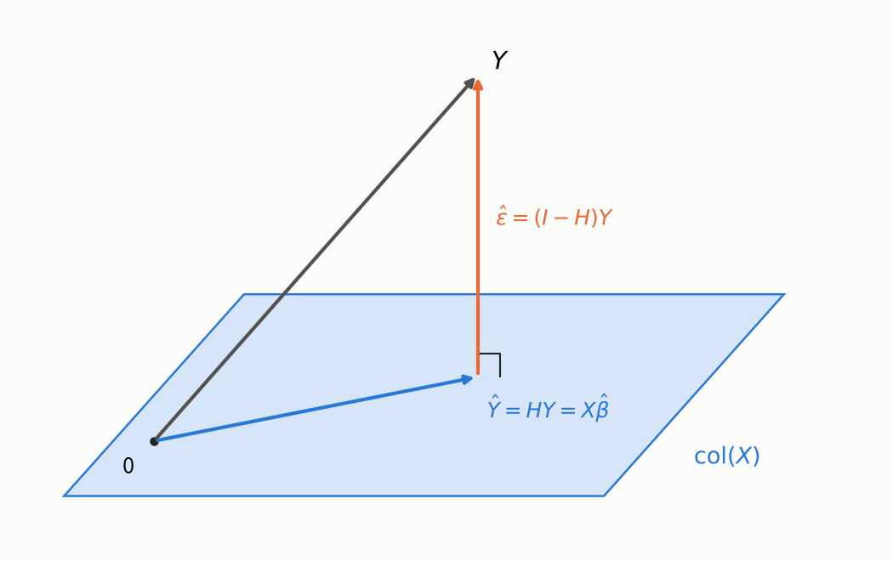
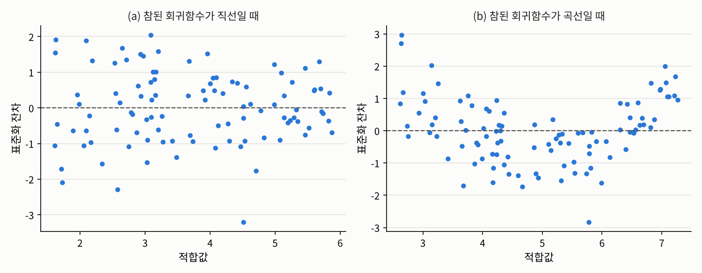

## 들어가며

[3.2절](02-least-squares.qmd)에서는 최소제곱 추정량 $\hat{\beta} = (X^\top X)^{-1}X^\top Y$를 미분으로 구하고 그 성질을 따졌습니다. 이번 글에서는 같은 결과를 [3장 소개 글](index.qmd)에서 예고한 **기하학**의 눈으로 다시 봅니다. 관측값 $n$개를 모은 $Y$를 $\mathbb{R}^n$의 한 점으로 보면, 최소제곱법은 그 점에서 어떤 평면까지 가장 가까운 점을 찾는 문제가 됩니다.

이 관점에서 세 가지 질문에 답하겠습니다. 적합값과 잔차는 기하학적으로 무엇인지, 오차의 분산 $\sigma^2$는 어떻게 추정하며 왜 $n - d$로 나누는지, 그리고 잔차를 이용해 모형이 맞는지 어떻게 점검하는지입니다.

## 문제 1: 적합값은 기하학적으로 무엇인가

### 문제 상황

최소제곱 추정량으로 계산한 $\hat{Y} := X\hat{\beta}$를 **적합값**(fitted value)이라고 합니다. 적합값은 $\mathbb{R}^n$의 벡터인데, 이 벡터는 관측값 $Y$와 어떤 관계에 있을까요?

### 접근 아이디어

계획행렬 $X$의 열들을 $X_{\cdot 1}, \ldots, X_{\cdot d}$라 하면, 어떤 $\beta$에 대해서든 $X\beta = \beta_1 X_{\cdot 1} + \cdots + \beta_d X_{\cdot d}$는 열들의 일차결합입니다. 따라서 $\beta$를 바꿔 가며 만들 수 있는 모든 "평균 벡터"의 모임은 $X$의 **열공간**

$$\mathrm{col}(X) := \{X\beta : \beta \in \mathbb{R}^d\} \subset \mathbb{R}^n$$

이고, $\mathrm{rank}(X) = d$이면 이는 $d$차원 부분공간입니다. 최소제곱법은 $\lVert Y - X\beta \rVert$를 최소화하므로, **열공간 위의 점들 가운데 $Y$에 가장 가까운 점**을 찾는 것입니다. 3차원 공간의 점에서 바닥 평면까지 가장 가까운 점은 점에서 바닥으로 수직으로 내린 발이듯이, 그 점은 $Y$를 열공간에 **직교사영**한 점일 것입니다.

{fig-alt="최소제곱법의 기하학을 나타낸 그림. 비스듬한 평면이 col(X)를 나타내고, 평면 위쪽의 점 Y에서 평면으로 수직선이 내려와 평면 위의 점 Ŷ = Xβ̂에 닿는다. Ŷ에서 Y로 향하는 수직선은 잔차 ε̂ = (I - H)Y이고, 원점에서 Ŷ까지의 화살표는 평면 안에 있다. 잔차와 평면이 만나는 곳에 직각 표시가 있다." width=70%}

### 필요한 개념들

::: {.callout-note icon=false .callout-definition}
### 정의 3.3.1 (햇 행렬과 잔차)
$\mathrm{rank}(X) = d$일 때
$$H := X(X^\top X)^{-1}X^\top \in \mathbb{R}^{n \times n}$$
를 **햇 행렬**(hat matrix)이라고 합니다. 적합값은 $\hat{Y} = X\hat{\beta} = HY$이고,
$$\hat{\varepsilon} := Y - \hat{Y} = (I_n - H)Y$$
를 **잔차**(residual)라고 합니다.
:::

$Y$에 곱하면 "모자를 씌운" $\hat{Y}$가 나온다고 해서 햇 행렬이라는 이름이 붙었습니다. 햇 행렬은 접근 아이디어에서 짐작한 직교사영 그 자체입니다.

::: {.callout-important icon=false .callout-satz}
### 정리 3.3.2 (햇 행렬은 직교사영)
햇 행렬에 대해 다음이 성립합니다.

1. $H^\top = H$이고 $H^2 = H$입니다. 즉 $H$는 대칭이고 멱등입니다.
2. $HX = X$이고, $H$의 치역은 $\mathrm{col}(X)$입니다.
3. $\mathrm{tr}(H) = d$입니다.
4. $X^\top\hat{\varepsilon} = 0$입니다. 즉 잔차는 $X$의 모든 열과 직교합니다.

따라서 $H$는 $\mathrm{col}(X)$로의 직교사영이고, $I_n - H$는 그 직교여공간으로의 직교사영입니다.
:::

::: {.callout-tip collapse="false" icon=false .callout-beweis}
### 증명
1. $(X^\top X)^{-1}$이 대칭이므로 $H^\top = H$입니다. 또 $H^2 = X(X^\top X)^{-1}X^\top X(X^\top X)^{-1}X^\top = X(X^\top X)^{-1}X^\top = H$입니다.
2. $HX = X(X^\top X)^{-1}X^\top X = X$이므로 $\mathrm{col}(X) \subset \mathrm{range}(H)$이고, $H = X\big((X^\top X)^{-1}X^\top\big)$이므로 $\mathrm{range}(H) \subset \mathrm{col}(X)$입니다.
3. 대각합의 순환성 $\mathrm{tr}(AB) = \mathrm{tr}(BA)$에 의해 $\mathrm{tr}(H) = \mathrm{tr}\big((X^\top X)^{-1}X^\top X\big) = \mathrm{tr}(I_d) = d$입니다.
4. $X^\top(I_n - H) = X^\top - (HX)^\top = X^\top - X^\top = 0$이므로 $X^\top\hat{\varepsilon} = X^\top(I_n - H)Y = 0$입니다.

대칭이고 멱등인 행렬은 자신의 치역으로의 직교사영이므로([선형대수학](../../../math/linear-algebra/index.qmd)의 사영 부분 참고), 1과 2에서 결론을 얻습니다. $\square$
:::

성질 4는 사실 3.2절의 정규방정식 $X^\top(Y - X\hat{\beta}) = 0$을 다시 쓴 것입니다. 정규방정식이 말하는 것은 결국 **"잔차는 열공간에 수직이다"**라는 기하학적 사실이었습니다. 또 이 사실 하나로 3.2절의 정리 3.2.2를 미분 없이 다시 증명할 수도 있습니다. 임의의 $\beta$에 대해 $Y - X\beta = \hat{\varepsilon} + X(\hat{\beta} - \beta)$이고 두 항이 직교하므로, 피타고라스 정리에 의해

$$\lVert Y - X\beta \rVert^2 = \lVert \hat{\varepsilon} \rVert^2 + \lVert X(\hat{\beta} - \beta) \rVert^2 \ge \lVert \hat{\varepsilon} \rVert^2$$

이고, 등호는 $X(\hat{\beta} - \beta) = 0$, 즉 $\beta = \hat{\beta}$일 때만 성립합니다.

### 해결

3.2절 문제 1의 데이터로 정리 3.3.2를 확인해 보겠습니다.

```python
import numpy as np

np.random.seed(1557)
n = 50
x1 = np.random.uniform(0, 10, size=n)
x2 = np.random.normal(5, 2, size=n)
X = np.column_stack([np.ones(n), x1, x2])            # 3.2절과 같은 계획행렬
beta = np.array([1.0, 2.0, -0.5])
y = X @ beta + 3 * np.random.normal(size=n)

H = X @ np.linalg.solve(X.T @ X, X.T)                # 햇 행렬 X (X^T X)^{-1} X^T
res = y - H @ y                                      # 잔차
print("H가 대칭인가:", np.allclose(H, H.T), " H^2 = H인가:", np.allclose(H @ H, H), " tr(H) =", round(np.trace(H), 10))
print(f"|잔차의 합| = {abs(res.sum()):.1e},  X^T(잔차)의 성분 중 절댓값의 최대 = {np.max(np.abs(X.T @ res)):.1e}")
```

```
H가 대칭인가: True  H^2 = H인가: True  tr(H) = 3.0
|잔차의 합| = 2.3e-13,  X^T(잔차)의 성분 중 절댓값의 최대 = 9.2e-13
```

잔차의 합과 $X^\top\hat{\varepsilon}$은 컴퓨터의 반올림 오차 수준에서 $0$입니다. 잔차의 합이 $0$인 것은 절편 열 $\mathbf{1}_n$이 $X$에 들어 있어서 $\mathbf{1}_n^\top\hat{\varepsilon} = 0$이기 때문입니다.

## 문제 2: 오차의 분산은 어떻게 추정하는가

### 문제 상황

3.2절의 정리 3.2.5에서 최소제곱 추정량의 공분산은 $\sigma^2(X^\top X)^{-1}$이었습니다. 실제로 이 값을 계산하려면 모르는 오차의 분산 $\sigma^2$를 추정해야 합니다. 오차 $\varepsilon$은 관측할 수 없지만 잔차 $\hat{\varepsilon}$은 계산할 수 있으니, 잔차의 제곱 평균을 쓰면 될까요? 3.2절에서 본 최대우도 추정량 $\lVert \hat{\varepsilon} \rVert^2/n$은 치우쳐 있다고 했는데, 무엇으로 나눠야 할까요?

### 필요한 개념들

잔차는 오차와 비슷해 보이지만 같지 않습니다. 그 차이를 정확히 계산해 보겠습니다. 잔차제곱합을 $\mathrm{RSS} := \sum_{i=1}^n \hat{\varepsilon}_i^2 = \lVert \hat{\varepsilon} \rVert^2$으로 씁니다.

::: {.callout-important icon=false .callout-satz}
### 정리 3.3.3 (잔차의 성질)
3.2절 정의 3.2.1의 가정 아래에서 다음이 성립합니다.

1. $\hat{\varepsilon} = (I_n - H)\varepsilon$이고, $\mathbb{E}[\hat{\varepsilon}] = 0_n$입니다.
2. $\mathrm{Cov}(\hat{\varepsilon}) = \sigma^2(I_n - H)$입니다.
3. $\mathrm{RSS} = Y^\top(I_n - H)Y = \varepsilon^\top(I_n - H)\varepsilon$입니다.
4. $\mathbb{E}[\mathrm{RSS}] = \sigma^2(n - d)$입니다.
5. $X$에 절편 열이 있으면 $\sum_{i=1}^n \hat{\varepsilon}_i = 0$이고, 따라서 적합값의 평균은 $\bar{Y}$와 같습니다.
:::

::: {.callout-tip collapse="false" icon=false .callout-beweis}
### 증명
1. $(I_n - H)X = 0$이므로 $\hat{\varepsilon} = (I_n - H)(X\beta + \varepsilon) = (I_n - H)\varepsilon$이고, 기대값은 $0$입니다.
2. $\mathrm{Cov}(\hat{\varepsilon}) = (I_n - H)\,\sigma^2 I_n\,(I_n - H)^\top = \sigma^2(I_n - H)$입니다. $I_n - H$가 대칭이고 멱등이기 때문입니다.
3. $\lVert (I_n - H)Y \rVert^2 = Y^\top(I_n - H)^\top(I_n - H)Y = Y^\top(I_n - H)Y$이고, 1에 의해 $Y$ 자리에 $\varepsilon$을 넣어도 같습니다.
4. 실수는 자기 자신의 대각합이므로
$$\mathbb{E}[\varepsilon^\top(I_n - H)\varepsilon] = \mathbb{E}\big[\mathrm{tr}\big((I_n - H)\varepsilon\varepsilon^\top\big)\big] = \mathrm{tr}\big((I_n - H)\,\sigma^2 I_n\big) = \sigma^2(n - d)$$
입니다. 마지막 등호에는 정리 3.3.2의 $\mathrm{tr}(H) = d$를 썼습니다.
5. 절편 열이 있으면 $\mathbf{1}_n \in \mathrm{col}(X)$이고, 정리 3.3.2의 4에 의해 $\mathbf{1}_n^\top\hat{\varepsilon} = 0$입니다. 그러면 $\sum_i \hat{Y}_i = \sum_i Y_i - \sum_i \hat{\varepsilon}_i = \sum_i Y_i$입니다. $\square$
:::

성질 4로부터 오차 분산의 불편추정량을 바로 얻습니다.

$$\hat{\sigma}^2 := \frac{\mathrm{RSS}}{n - d}, \qquad \mathbb{E}[\hat{\sigma}^2] = \sigma^2$$

왜 $n$이 아니라 $n - d$일까요? 기하학적으로 보면 답이 분명합니다. 오차 $\varepsilon$은 $\mathbb{R}^n$의 $n$개 방향으로 모두 흩어질 수 있지만, 잔차 $\hat{\varepsilon} = (I_n - H)\varepsilon$은 열공간의 직교여공간, 즉 $(n - d)$차원 부분공간에 **갇혀** 있습니다. 오차 가운데 열공간 방향의 $d$개 성분은 적합값 $\hat{Y}$가 "흡수"해 버려서 잔차에 남지 않습니다. 그래서 잔차의 제곱합은 오차의 제곱합보다 평균적으로 작고, 남은 방향의 개수 $n - d$로 나눠야 공정한 평균이 됩니다. 이 $n - d$를 잔차의 **자유도**(degrees of freedom)라고 합니다. [1.1절](../01-mle/01-likelihood.qmd)에서 표본분산을 $n - 1$로 나누던 것은 절편 하나뿐인 모형($d = 1$)의 특수한 경우입니다.

### 해결

같은 계획행렬에서 오차만 새로 뽑아 2만 번 반복해 보겠습니다. 참된 분산은 $\sigma^2 = 9$이고, $n = 50$, $d = 3$입니다.

```python
reps = 20_000
E = 3 * np.random.normal(size=(reps, n))             # 오차만 새로 뽑음
R = E - E @ H                                        # 잔차 = (I - H) 오차 (H는 대칭)
rss = np.sum(R**2, axis=1)
print(f"RSS의 평균 = {rss.mean():.2f},  이론값 sigma^2 (n - d) = {9 * (n - 3)}")
print(f"RSS/(n-d)의 평균 = {np.mean(rss / (n - 3)):.4f},  RSS/n의 평균 = {np.mean(rss / n):.4f},  sigma^2 = 9")
```

```
RSS의 평균 = 422.74,  이론값 sigma^2 (n - d) = 423
RSS/(n-d)의 평균 = 8.9946,  RSS/n의 평균 = 8.4549,  sigma^2 = 9
```

$n - d$로 나눈 추정량은 평균적으로 참값 $9$를 맞히고, $n$으로 나눈 최대우도 추정량은 평균적으로 $9 \times 47/50 = 8.46$으로 작게 나옵니다.

## 문제 3: 잔차로 모형을 점검하기

### 문제 상황

[3.1절](01-regression-function.qmd)에서 회귀 분석의 가정은 회귀함수의 모양에 들어간다고 했습니다. 그렇다면 선형 회귀 모형이라는 가정이 맞는지는 어떻게 확인할 수 있을까요? 자연스러운 생각은 오차를 들여다보는 것입니다. 모형이 맞다면 오차에는 아무 패턴이 없어야 하니까요. 그런데 우리가 볼 수 있는 것은 오차가 아니라 잔차입니다.

### 필요한 개념들

정리 3.3.3의 2에서 $\mathrm{Var}(\hat{\varepsilon}_i) = \sigma^2(1 - H_{ii})$입니다. 즉 오차들은 분산이 모두 $\sigma^2$로 같고 서로 상관이 없지만, **잔차들은 분산이 서로 다르고 서로 상관되어 있습니다**. 잔차를 오차처럼 읽으려면 이 차이를 보정해야 합니다.

::: {.callout-note icon=false .callout-definition}
### 정의 3.3.4 (레버리지와 표준화 잔차)
햇 행렬의 대각성분 $H_{ii}$를 $i$번째 관측값의 **레버리지**(leverage)라고 하고,
$$e_i := \frac{\hat{\varepsilon}_i}{\hat{\sigma}\sqrt{1 - H_{ii}}}$$
를 $i$번째 **표준화 잔차**(standardized residual)라고 합니다.
:::

$\hat{Y}_i = \sum_j H_{ij}Y_j$이므로 $H_{ii}$는 $i$번째 관측값 $Y_i$가 **자기 자신의 적합값에 얼마나 큰 비중으로 들어가는지**를 나타냅니다. 레버리지가 크면 그 관측값은 회귀 직선을 자기 쪽으로 강하게 끌어당깁니다.

::: {.callout-important icon=false .callout-satz}
### 정리 3.3.5 (레버리지의 범위)
$0 \le H_{ii} \le 1$이고 $\sum_{i=1}^n H_{ii} = d$입니다. 특히 $X$의 어떤 열이 $i$번째 관측값에서만 $1$이고 나머지에서 $0$인 지시변수이면 $H_{ii} = 1$이고 $\hat{\varepsilon}_i = 0$입니다.
:::

::: {.callout-tip collapse="false" icon=false .callout-beweis}
### 증명
$H$가 대칭이고 멱등이므로 $H_{ii} = (H^2)_{ii} = \sum_j H_{ij}H_{ji} = \sum_j H_{ij}^2 \ge H_{ii}^2$이고, 따라서 $0 \le H_{ii} \le 1$입니다. 합은 $\mathrm{tr}(H) = d$입니다.

$i$번째 표준기저벡터 $\mathbf{e}_i$가 $X$의 열이면 $\mathbf{e}_i \in \mathrm{col}(X)$이므로 $H\mathbf{e}_i = \mathbf{e}_i$이고, $H$가 대칭이므로 $H$의 $i$번째 행도 $\mathbf{e}_i^\top$입니다. 따라서 $H_{ii} = 1$이고 $\hat{Y}_i = \mathbf{e}_i^\top Y = Y_i$이므로 $\hat{\varepsilon}_i = 0$입니다. $\square$
:::

레버리지의 합이 $d$로 고정되어 있으므로 평균 레버리지는 $d/n$입니다. 그보다 훨씬 큰 레버리지를 가진 관측값은 특별히 주의해서 봐야 합니다. 지시변수의 경우는 극단적인 예입니다. 어떤 관측값 하나만을 위한 열이 있으면, 그 열의 계수가 그 관측값을 완벽하게 맞추는 데 쓰여서 잔차가 $0$이 되고, 그 관측값은 나머지 계수의 추정에 아무 정보도 주지 않습니다.

이제 표준화 잔차의 의미를 정리할 수 있습니다. 오차가 정규분포 $N_n(0, \sigma^2 I_n)$을 따르고 모형이 맞다면, $\hat{\varepsilon}_i/\sqrt{1 - H_{ii}}$는 정확히 $N(0, \sigma^2)$을 따르므로 $e_i$는 근사적으로 표준정규분포를 따릅니다. 따라서 표준화 잔차를 그려 보면 모형을 점검할 수 있습니다.

- **적합값에 대해 그린 잔차 그림**(residual plot)에 곡선 모양 같은 패턴이 보이면, 회귀함수의 모양이 틀렸다는 신호입니다.
- 적합값이 커질수록 잔차가 넓게 퍼지는 깔때기 모양이 보이면, 오차의 분산이 같다는 가정이 틀렸다는 신호입니다.
- 표준화 잔차의 분위수를 정규분포의 분위수와 비교하는 **Q-Q 그림**(Q-Q plot)이 직선에서 크게 벗어나면, 정규 오차 가정을 의심해야 합니다.

### 해결

먼저 레버리지를 확인해 보겠습니다. 설명변수가 $1, 2, \ldots, 20$인 관측값 20개에, 멀리 떨어진 $x = 60$인 관측값 하나를 더합니다.

```python
np.random.seed(1557)
x = np.append(np.arange(1, 21, dtype=float), 60)     # 1~20과 멀리 떨어진 x = 60
X = np.column_stack([np.ones(21), x])
H = X @ np.linalg.solve(X.T @ X, X.T)
lev = np.diag(H)
print("레버리지: x = 1 ->", round(lev[0], 4), ", x = 10 ->", round(lev[9], 4), ", x = 60 ->", round(lev[20], 4))
print("레버리지의 합 =", round(lev.sum(), 10))

y = 2 + 0.5 * x + 2 * np.random.normal(size=21)
for shift in [0, -20]:
    y2 = y.copy(); y2[20] += shift                   # x = 60인 점의 y만 옮김
    b = np.linalg.solve(X.T @ X, X.T @ y2)
    print(f"x = 60인 점의 y를 {shift:+d}만큼 옮겼을 때: 기울기 = {b[1]:.4f}")

e21 = np.zeros(21); e21[20] = 1                      # 21번째 관측값에만 1인 지시변수 열
X3 = np.column_stack([X, e21])
H3 = X3 @ np.linalg.solve(X3.T @ X3, X3.T)
print("지시변수 열을 더한 뒤 21번째 레버리지 =", round(H3[20, 20], 10), ", 21번째 잔차 =", round(abs(y[20] - H3[20] @ y), 10))
```

```
레버리지: x = 1 -> 0.0945 , x = 10 -> 0.0503 , x = 60 -> 0.7888
레버리지의 합 = 2.0
x = 60인 점의 y를 +0만큼 옮겼을 때: 기울기 = 0.5457
x = 60인 점의 y를 -20만큼 옮겼을 때: 기울기 = 0.2312
지시변수 열을 더한 뒤 21번째 레버리지 = 1.0 , 21번째 잔차 = 0.0
```

평균 레버리지는 $d/n = 2/21 \approx 0.095$인데, 멀리 떨어진 관측값의 레버리지는 $0.79$나 됩니다. 이 점 하나의 $y$값만 바꿔도 기울기가 $0.55$에서 $0.23$으로 절반 이하로 떨어집니다. 21개 관측값 가운데 하나가 회귀 직선을 사실상 좌우하는 셈입니다. [2.1절](../02-dependence/01-pearson.qmd)에서 이상치 하나가 상관계수를 바꿔 놓았던 것과 같은 현상을, 레버리지가 정확한 숫자로 보여 줍니다. 마지막 줄은 정리 3.3.5의 지시변수 경우를 확인한 것입니다.

다음은 잔차 그림입니다. 아래 그림은 같은 설명변수에서 두 가지 반응변수를 만들어 직선을 적합한 뒤, 표준화 잔차를 적합값에 대해 그린 것입니다. (a)는 참된 회귀함수가 직선인 경우이고, (b)는 참된 회귀함수에 이차항 $0.15(x - 5)^2$가 섞인 경우입니다.

{fig-alt="두 개의 잔차 그림. 가로축은 적합값, 세로축은 표준화 잔차이고, 0에 회색 점선이 있다. 왼쪽 (a) 참된 회귀함수가 직선일 때는 점 100개가 -3에서 2 사이에 뚜렷한 패턴 없이 고르게 흩어져 있다. 오른쪽 (b) 참된 회귀함수가 곡선일 때는 적합값이 작은 왼쪽과 큰 오른쪽에서 잔차가 대부분 양수이고 가운데에서 대부분 음수여서, 전체적으로 U자 모양을 그린다."}

(a)에서는 잔차가 $0$을 중심으로 아무 패턴 없이 흩어져 있습니다. (b)에서는 양 끝에서 잔차가 양수, 가운데에서 음수인 U자 모양이 뚜렷합니다. 직선이 곡선을 따라가지 못해서 생긴 체계적인 오차입니다. 3.1절에서 "모형이 틀려도 최소제곱법은 아무 문제 없이 직선을 내놓는다"고 했는데, 그 틀림을 드러내는 도구가 바로 잔차 그림입니다. 이런 패턴이 보이면 $x^2$ 같은 항을 설명변수에 추가하는 것을 고려할 수 있습니다.

## 정리: 그림자로 보는 최소제곱법

이번 글의 내용을 기하학의 언어로 정리하면 다음과 같습니다.

| 대수 | 기하 |
|:--|:--|
| 적합값 $\hat{Y} = HY$ | $Y$의 열공간으로의 그림자 |
| 정규방정식 $X^\top\hat{\varepsilon} = 0$ | 잔차는 열공간에 수직 |
| $\mathrm{tr}(H) = d$ | 열공간의 차원 |
| $\hat{\sigma}^2 = \mathrm{RSS}/(n - d)$ | 잔차가 갇힌 공간의 차원 $n - d$로 나눔 |
| 레버리지 $H_{ii}$ | $i$번째 관측값이 자기 그림자를 끌어당기는 힘 |

이 그림에는 아직 쓰지 않은 피타고라스 정리가 하나 더 숨어 있습니다. $Y$에서 평균을 뺀 벡터를 "설명된 부분"과 "남은 부분"으로 직교분해하면, 길이의 제곱이 그대로 나뉩니다. 3.4절에서는 이 분해로 결정계수 $R^2$를 정의하고, 그 의미와 한계를 살펴봅니다.

---

### 연결되는 개념
* $\leftarrow$ **이전 개념:** [3.2 최소제곱 추정량과 가우스-마르코프 정리](02-least-squares.qmd)
* $\rightarrow$ **다음 개념:** [3.4 결정계수와 모형의 설명력](04-r-squared.qmd)
