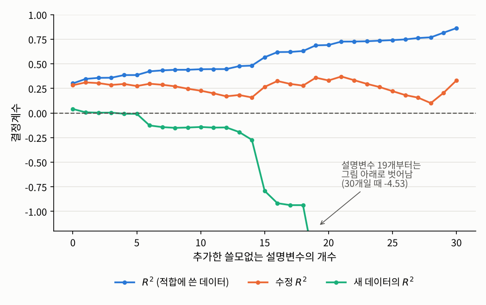

## 들어가며

[3.3절](03-projection.qmd)에서 최소제곱 적합은 관측값 $Y$를 계획행렬의 열공간에 직교사영한 것이었습니다. 이번 글에서는 이 그림에 숨어 있던 또 하나의 피타고라스 정리를 꺼내, 회귀 모형이 데이터의 변동을 **얼마나 설명하는지**를 재는 결정계수 $R^2$를 정의합니다.

$R^2$는 회귀 분석 결과에서 가장 먼저 눈에 띄는 숫자이지만, 동시에 가장 많이 오해되는 숫자이기도 합니다. 그래서 정의만큼이나 **$R^2$가 무엇을 재지 않는지**를 분명히 하는 데 이 글의 절반을 씁니다.

## 문제 1: 모형은 데이터의 변동을 얼마나 설명하는가

### 문제 상황

[3.2절](02-least-squares.qmd)의 학생 50명 데이터에서 두 설명변수로 반응변수를 회귀했습니다. 반응변수의 값은 학생마다 다른데, 그 차이 가운데 얼마만큼이 두 설명변수로 설명되고 얼마만큼이 설명되지 않고 남았을까요?

### 접근 아이디어

비교의 기준이 필요합니다. 가장 단순한 예측은 설명변수를 전혀 쓰지 않고 모든 학생의 $y$를 평균 $\bar{y}$ 하나로 예측하는 것입니다. 이 예측이 틀린 정도, 즉 $\sum_i (y_i - \bar{y})^2$가 "설명해야 할 전체 변동"입니다. 회귀 모형을 쓰면 틀린 정도가 잔차제곱합 $\sum_i (y_i - \hat{y}_i)^2$로 줄어듭니다. 그렇다면 줄어든 만큼이 회귀 모형이 "설명한 변동"일 것입니다.

[2.4절](../02-dependence/04-mixed.qmd)에서 $\eta^2$를 정의할 때 썼던 것과 같은 발상입니다. 그때는 전체 흩어짐을 "집단 평균의 차이"와 "집단 안의 개인차"로 나눴는데, 이번에는 "회귀로 설명된 부분"과 "잔차"로 나눕니다.

### 필요한 개념들

::: {.callout-note icon=false .callout-definition}
### 정의 3.4.1 (세 가지 제곱합)
적합값을 $\hat{Y}_i$, 잔차를 $\hat{\varepsilon}_i = Y_i - \hat{Y}_i$라 할 때
$$\mathrm{SST} := \sum_{i=1}^n (Y_i - \bar{Y})^2, \qquad \mathrm{RSS} := \sum_{i=1}^n \hat{\varepsilon}_i^2, \qquad \mathrm{ESS} := \sum_{i=1}^n (\hat{Y}_i - \bar{Y})^2$$
를 각각 **총제곱합**(total sum of squares), **잔차제곱합**(residual sum of squares), **설명제곱합**(explained sum of squares)이라고 합니다.
:::

이 세 이름은 교재마다 약어가 달라서 주의가 필요합니다. 어떤 책은 설명제곱합을 SSR(regression)이나 SSE(explained)로 쓰고, 다른 책은 잔차제곱합을 SSE(error)로 쓰기도 합니다. 그래서 같은 SSE가 책에 따라 정반대의 뜻이 되기도 합니다. 이 글에서는 혼동을 피하기 위해 RSS와 ESS로 씁니다.

::: {.callout-important icon=false .callout-satz}
### 정리 3.4.2 (제곱합의 분해)
계획행렬 $X$에 절편 열 $\mathbf{1}_n$이 있으면
$$\mathrm{SST} = \mathrm{RSS} + \mathrm{ESS}$$
가 성립합니다.
:::

::: {.callout-tip collapse="false" icon=false .callout-beweis}
### 증명
$Y - \bar{Y}\mathbf{1}_n = \hat{\varepsilon} + (\hat{Y} - \bar{Y}\mathbf{1}_n)$으로 나눕니다. 3.3절의 정리 3.3.2에 의해 잔차 $\hat{\varepsilon}$은 열공간 $\mathrm{col}(X)$에 수직입니다. 그런데 $\hat{Y} \in \mathrm{col}(X)$이고, 절편 열이 있으므로 $\bar{Y}\mathbf{1}_n \in \mathrm{col}(X)$이어서 $\hat{Y} - \bar{Y}\mathbf{1}_n \in \mathrm{col}(X)$입니다. 따라서 두 항은 직교하고, 피타고라스 정리에 의해
$$\lVert Y - \bar{Y}\mathbf{1}_n \rVert^2 = \lVert \hat{\varepsilon} \rVert^2 + \lVert \hat{Y} - \bar{Y}\mathbf{1}_n \rVert^2$$
입니다. 이것이 $\mathrm{SST} = \mathrm{RSS} + \mathrm{ESS}$입니다. $\square$
:::

절편이 없는 모형에서는 $\bar{Y}\mathbf{1}_n$이 열공간에 있다는 보장이 없어서 이 분해가 성립하지 않습니다. 이 글에서는 언제나 절편이 있는 모형을 다룹니다.

::: {.callout-note icon=false .callout-definition}
### 정의 3.4.3 (결정계수와 수정 결정계수)
절편이 있는 선형 모형에서
$$R^2 := \frac{\mathrm{ESS}}{\mathrm{SST}} = 1 - \frac{\mathrm{RSS}}{\mathrm{SST}}, \qquad R_a^2 := 1 - \frac{\mathrm{RSS}/(n - d)}{\mathrm{SST}/(n - 1)} = 1 - \frac{n - 1}{n - d}(1 - R^2)$$
를 각각 **결정계수**(coefficient of determination)와 **수정 결정계수**(adjusted coefficient of determination)라고 합니다.
:::

정리 3.4.2에 의해 $0 \le R^2 \le 1$입니다. $R^2 = 0.7$은 "이 표본에서, 평균 하나로 예측할 때의 변동 가운데 70%가 회귀 모형으로 설명된다"는 뜻입니다. 다른 말로 하면, $R^2$는 평균 하나로 예측하는 가장 단순한 모형에 비해 **잔차제곱합을 몇 퍼센트나 줄였는가**입니다.

결정계수는 2장의 상관계수와도 깔끔하게 연결됩니다.

::: {.callout-important icon=false .callout-satz}
### 정리 3.4.4 (결정계수와 상관계수)
절편이 있는 선형 모형에서 $R^2$는 관측값 $Y$와 적합값 $\hat{Y}$ 사이의 표본 상관계수의 제곱과 같습니다. 특히 설명변수가 하나인 단순 선형 회귀에서는 $R^2 = r(x, Y)^2$입니다.
:::

::: {.callout-tip collapse="false" icon=false .callout-beweis}
### 증명
정리 3.3.3에 의해 $\hat{Y}$의 평균은 $\bar{Y}$이므로, 중심화한 벡터 $a := \hat{Y} - \bar{Y}\mathbf{1}_n$과 $b := Y - \bar{Y}\mathbf{1}_n = \hat{\varepsilon} + a$로 상관계수를 계산할 수 있습니다. 정리 3.4.2의 증명에서 $\hat{\varepsilon} \perp a$이므로 $a^\top b = \lVert a \rVert^2 = \mathrm{ESS}$이고, 따라서
$$r(Y, \hat{Y})^2 = \frac{(a^\top b)^2}{\lVert a \rVert^2 \lVert b \rVert^2} = \frac{\mathrm{ESS}^2}{\mathrm{ESS}\cdot\mathrm{SST}} = R^2$$
입니다. 단순 선형 회귀에서는 $\hat{Y}_i = \hat{\beta}_0 + \hat{\beta}_1 x_i$가 $x_i$의 일차식이므로, $\hat{\beta}_1 \neq 0$이면 [2.1절](../02-dependence/01-pearson.qmd)에서 본 대로 $|r(Y, \hat{Y})| = |r(Y, x)|$이고, $\hat{\beta}_1 = 0$이면 두 값이 모두 $0$입니다. $\square$
:::

[2.4절](../02-dependence/04-mixed.qmd)의 정리 2.4.5에서 미리 본 $R^2 = r^2$가 바로 이 정리의 특수한 경우입니다. 설명변수가 여러 개일 때는 "관측값과 적합값의 상관계수"로 일반화됩니다.

### 해결

3.2절의 데이터로 분해와 결정계수를 계산해 보겠습니다.

```python
import numpy as np

np.random.seed(1557)
n = 50
x1 = np.random.uniform(0, 10, size=n)
x2 = np.random.normal(5, 2, size=n)
X = np.column_stack([np.ones(n), x1, x2])            # 3.2절과 같은 데이터
y = X @ np.array([1.0, 2.0, -0.5]) + 3 * np.random.normal(size=n)

y_hat = X @ np.linalg.solve(X.T @ X, X.T @ y)
sst = np.sum((y - y.mean())**2)
rss = np.sum((y - y_hat)**2)
ess = np.sum((y_hat - y.mean())**2)
d = X.shape[1]
print(f"SST = {sst:.2f},  RSS + ESS = {rss:.2f} + {ess:.2f} = {rss + ess:.2f}")
print(f"R^2 = {1 - rss / sst:.4f},  수정 R^2 = {1 - (n - 1) / (n - d) * rss / sst:.4f}")
```

```
SST = 2382.00,  RSS + ESS = 628.93 + 1753.07 = 2382.00
R^2 = 0.7360,  수정 R^2 = 0.7247
```

분해가 정확히 성립하고, 반응변수의 변동 가운데 약 74%가 두 설명변수로 설명됩니다.

## 문제 2: 설명변수를 늘리면 모형이 좋아지는가

### 문제 상황

$R^2$가 높을수록 좋은 모형이라면, 설명변수를 하나라도 더 넣는 것이 언제나 이득일까요? 극단적인 실험을 해 보겠습니다. 반응변수와 아무 관계가 없는 **순수한 잡음**을 설명변수로 하나씩 추가하면 $R^2$는 어떻게 될까요?

### 필요한 개념들

답은 놀랍게도 "언제나 커지거나 그대로"입니다.

::: {.callout-important icon=false .callout-satz}
### 정리 3.4.5 (결정계수의 단조성)
계획행렬 $X$에 열을 추가해 $\tilde{X} = [X \;\; Z]$로 만들면, 추가한 열이 무엇이든 $\mathrm{RSS}(\tilde{X}) \le \mathrm{RSS}(X)$이고 따라서 $R^2(\tilde{X}) \ge R^2(X)$입니다.
:::

::: {.callout-tip collapse="false" icon=false .callout-beweis}
### 증명
$\mathrm{col}(X) \subset \mathrm{col}(\tilde{X})$입니다. 잔차제곱합은 $Y$에서 열공간까지의 거리의 제곱, 즉 $\min_{v \in \mathrm{col}(X)} \lVert Y - v \rVert^2$인데, 더 큰 집합에서 최솟값을 찾으면 최솟값은 작아지거나 그대로입니다. 총제곱합 $\mathrm{SST}$는 설명변수와 무관하므로 $R^2 = 1 - \mathrm{RSS}/\mathrm{SST}$는 커지거나 그대로입니다. $\square$
:::

그림자의 비유로 말하면, 바닥을 넓힐수록 물체에서 바닥까지의 거리는 짧아질 수밖에 없습니다. 추가한 열이 순수한 잡음이어도, 그 잡음이 우연히 $Y$의 잔차와 조금이라도 비슷한 방향을 가리키면 잔차가 줄어듭니다. 그래서 $R^2$로는 **설명변수의 개수가 다른 모형을 공정하게 비교할 수 없습니다.**

수정 결정계수 $R_a^2$는 이 문제를 일부 보정합니다. 정의 3.4.3에서 보듯이 $R_a^2$는 $\mathrm{RSS}$와 $\mathrm{SST}$를 각각의 자유도로 나눈 값, 즉 3.3절에서 본 오차 분산의 불편추정량과 전체 분산의 불편추정량의 비를 씁니다. 설명변수를 하나 추가하면 $\mathrm{RSS}$는 줄지만 자유도 $n - d$도 하나 줄어들기 때문에, 잔차가 충분히 줄지 않으면 $R_a^2$는 오히려 작아집니다. $R_a^2$는 음수가 될 수도 있습니다.

하지만 모형을 평가하는 가장 정직한 방법은 따로 있습니다. **적합에 쓰지 않은 새 데이터**에서 예측이 얼마나 맞는지를 보는 것입니다. 새 데이터 $(x_j^{\text{new}}, y_j^{\text{new}})$에서 같은 식을 계산한

$$R^2_{\text{pred}} := 1 - \frac{\sum_j \big(y_j^{\text{new}} - x_j^{\text{new}\top}\hat{\beta}\big)^2}{\sum_j \big(y_j^{\text{new}} - \bar{y}^{\text{new}}\big)^2}$$

를 **예측 결정계수**라고 하겠습니다. 정리 3.4.2의 분해는 적합에 쓴 데이터에서만 성립하므로, $R^2_{\text{pred}}$는 $0$보다 작아질 수 있습니다. 음수라는 것은 모형으로 예측하는 것이 **평균 하나로 예측하는 것보다 못하다**는 뜻입니다.

### 해결

참된 모형이 $Y = 1 + 0.5x + \varepsilon$($\sigma = 3$)인 데이터 40개에, 순수한 잡음인 설명변수를 0개부터 30개까지 늘려 가며 추가해 보겠습니다. 같은 모형에서 뽑은 새 데이터 1만 개로 예측 결정계수도 함께 계산합니다.

```python
def r2_scores(X, y, X_test, y_test):
    n, d = X.shape
    b = np.linalg.lstsq(X, y, rcond=None)[0]
    rss = np.sum((y - X @ b)**2); sst = np.sum((y - y.mean())**2)
    r2 = 1 - rss / sst
    r2_adj = 1 - (n - 1) / (n - d) * rss / sst
    r2_pred = 1 - np.sum((y_test - X_test @ b)**2) / np.sum((y_test - y_test.mean())**2)
    return r2, r2_adj, r2_pred

np.random.seed(1557)
n, n_test, k_max = 40, 10_000, 30
x = np.random.uniform(0, 10, size=n); x_t = np.random.uniform(0, 10, size=n_test)
y = 1 + 0.5 * x + 3 * np.random.normal(size=n)                 # 참된 모형: 설명변수는 x 하나
y_t = 1 + 0.5 * x_t + 3 * np.random.normal(size=n_test)        # 같은 모형에서 뽑은 새 데이터
Z = np.random.normal(size=(n, k_max)); Z_t = np.random.normal(size=(n_test, k_max))   # 쓸모없는 설명변수
for k in [0, 5, 10, 20, 30]:
    X = np.column_stack([np.ones(n), x, Z[:, :k]])
    X_t = np.column_stack([np.ones(n_test), x_t, Z_t[:, :k]])
    r2, r2_adj, r2_pred = r2_scores(X, y, X_t, y_t)
    print(f"쓸모없는 변수 {k:>2}개: R^2 = {r2:.3f}, 수정 R^2 = {r2_adj:.3f}, 새 데이터의 R^2 = {r2_pred:.3f}")
```

```
쓸모없는 변수  0개: R^2 = 0.301, 수정 R^2 = 0.283, 새 데이터의 R^2 = 0.041
쓸모없는 변수  5개: R^2 = 0.386, 수정 R^2 = 0.274, 새 데이터의 R^2 = -0.008
쓸모없는 변수 10개: R^2 = 0.445, 수정 R^2 = 0.227, 새 데이터의 R^2 = -0.142
쓸모없는 변수 20개: R^2 = 0.691, 수정 R^2 = 0.331, 새 데이터의 R^2 = -1.615
쓸모없는 변수 30개: R^2 = 0.863, 수정 R^2 = 0.331, 새 데이터의 R^2 = -4.535
```

{fig-alt="가로축은 추가한 쓸모없는 설명변수의 개수(0에서 30), 세로축은 결정계수인 그래프. 파란 선 R²는 0.30에서 시작해 거의 꾸준히 올라가 30개일 때 0.86에 이른다. 주황 선 수정 R²는 0.28 근처에서 시작해 0.10에서 0.37 사이를 오르내린다. 청록 선 새 데이터의 R²는 0.04에서 시작해 점점 떨어지다가 14개를 넘으면서 급격히 떨어져 19개부터는 -1.2 아래로 벗어나며, 30개일 때는 -4.53이다." width=70%}

결과는 세 가지를 보여 줍니다.

- **$R^2$는 잡음만 넣어도 계속 올라갑니다.** 아무 의미 없는 변수 30개를 넣자 $R^2$가 $0.30$에서 $0.86$이 되었습니다. 설명변수가 32개, 데이터가 40개이니 모형이 데이터의 우연한 흔들림까지 외워 버린 것입니다. 이를 **과적합**(overfitting)이라고 합니다.
- **수정 결정계수는 부풀림을 상당 부분 막지만 완벽하지는 않습니다.** $R_a^2$는 $0.1$에서 $0.37$ 사이를 오르내릴 뿐 $R^2$처럼 치솟지는 않습니다. 하지만 잡음 변수가 많을 때 오히려 처음보다 커지기도 해서, 쓸모없는 변수를 확실히 걸러 주지는 못합니다.
- **새 데이터에서는 진실이 드러납니다.** 예측 결정계수는 잡음 변수를 넣을수록 떨어져서 결국 $-4.5$가 됩니다. 적합에 쓴 데이터에서는 86%를 설명하던 모형이, 새 데이터에서는 평균 하나로 예측하는 것보다 훨씬 못한 셈입니다.

이것이 데이터 사이언스에서 데이터를 **학습용과 평가용으로 나누는** 이유입니다. 모형을 고르는 일은 적합에 쓴 데이터의 $R^2$가 아니라, 새 데이터에서의 성능으로 판단해야 합니다. 설명변수를 고르는 체계적인 방법은 5장의 $F$-검정에서 다시 다룹니다.

## 문제 3: $R^2$가 작으면 모형이 틀린 것인가

### 문제 상황

거꾸로, $R^2$가 낮게 나오면 모형이 잘못되었다는 뜻일까요? 그리고 $R^2$가 높으면 모형이 맞다는 뜻일까요?

### 해결

두 질문의 답은 모두 "아니요"입니다.

**$R^2$가 작아도 모형은 맞을 수 있습니다.** 문제 2에서 잡음 변수를 하나도 넣지 않은 경우를 다시 보겠습니다. 이때 적합한 모형은 참된 모형과 정확히 같은 꼴인데도 $R^2 = 0.30$에 불과했습니다. 사실 이 모형의 모집단 결정계수는 $X \sim \mathrm{Unif}[0, 10]$에서 $\mathrm{Var}(0.5X) = 0.25 \times 100/12 \approx 2.08$이고 오차의 분산이 $9$이므로

$$\frac{\mathrm{Var}(0.5X)}{\mathrm{Var}(0.5X) + \sigma^2} \approx \frac{2.08}{2.08 + 9} \approx 0.19$$

밖에 되지 않습니다. 오차가 크면 아무리 올바른 모형이라도 $R^2$는 작습니다. $R^2$가 작다는 것은 "이 설명변수들만으로는 $Y$를 정확히 예측할 수 없다"는 뜻일 뿐, "모형이 틀렸다"는 뜻이 아닙니다. 기울기 $0.5$ 자체는 여전히 의미 있는 정보일 수 있습니다.

**$R^2$가 커도 모형은 틀릴 수 있습니다.** [3.3절](03-projection.qmd)의 잔차 그림 (b)를 떠올리시기 바랍니다. 곡선 관계에 직선을 적합해도 $R^2$는 꽤 높게 나올 수 있지만, 잔차에는 뚜렷한 U자 패턴이 남습니다. $R^2$는 모형의 **모양**이 맞는지를 재지 않습니다. 그것을 확인하는 것은 잔차 그림의 몫입니다.

## 정리: 결정계수를 읽는 법

이번 글의 내용을 정리하면 다음과 같습니다.

| | 뜻 | 주의할 점 |
|:--|:--|:--|
| $R^2$ | 평균 하나로 예측할 때에 비해 줄어든 잔차제곱합의 비율 | 설명변수를 늘리면 절대 줄지 않음. 개수가 다른 모형을 비교하는 데 쓰면 안 됨 |
| $R_a^2$ | 자유도로 보정한 $R^2$ | 쓸모없는 변수에 대한 벌점이 있지만 완벽하지 않음, 음수 가능 |
| $R^2_{\text{pred}}$ | 새 데이터에서의 같은 비율 | 과적합을 드러냄, 음수 가능 |

그리고 세 숫자 모두 **모형이 맞는지**는 재지 않습니다. $R^2$는 "얼마나 예측할 수 있는가"를 재는 숫자이고, "모형이 옳은가"는 잔차 그림으로, "계수가 정말 $0$이 아닌가"는 5장의 검정으로 따로 확인해야 합니다.

지금까지는 설명변수가 모두 수치형이었습니다. 3.5절에서는 범주형 설명변수를 계획행렬에 넣는 방법을 다루고, 그것이 2.4절의 $\eta^2$와 분산분석으로 이어진다는 것을 봅니다.

---

### 연결되는 개념
* $\leftarrow$ **이전 개념:** [3.3 사영으로 보는 회귀: 햇 행렬과 잔차](03-projection.qmd)
* $\rightarrow$ **다음 개념:** [3.5 범주형 설명변수와 분산분석](05-anova.qmd)
