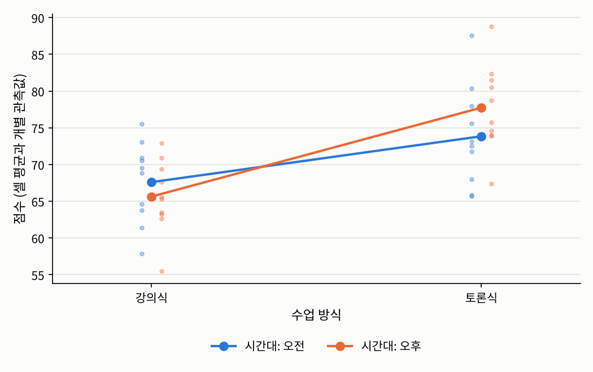

## 들어가며

[2.4절](../02-dependence/04-mixed.qmd)에서는 네 분반의 시험 점수를 비교하면서, 분반 평균의 차이가 점수의 변동을 얼마나 설명하는지를 $\eta^2$로 쟀습니다. 이번 글에서는 같은 문제를 3장의 선형 모형으로 다시 봅니다. 분반처럼 범주형인 설명변수도 적절한 열로 바꾸면 계획행렬에 넣을 수 있고, 그러면 지금까지의 모든 결과, 즉 최소제곱 추정량, 사영, 결정계수를 그대로 쓸 수 있습니다.

범주형 설명변수를 쓰는 선형 모형을 **분산분석**(analysis of variance, ANOVA)이라고 부릅니다. 이름 때문에 별개의 방법처럼 느껴지지만, 이번 글에서 보겠지만 분산분석은 선형 회귀의 특별한 경우일 뿐입니다. 분산분석에서는 범주형 설명변수를 **요인**(factor), 그 값을 **수준**(level)이라고 부릅니다.

## 문제 1: 분반을 계획행렬에 어떻게 넣는가

### 문제 상황

2.4절의 데이터를 다시 쓰겠습니다. 네 분반(1반부터 4반)에서 모두 85명이 같은 시험을 쳤고, 분반별 평균 점수는 $67.9$, $75.5$, $69.9$, $78.8$점이었습니다. 분반을 설명변수로 하는 선형 모형을 세우려면, "1반", "2반" 같은 범주를 계획행렬의 숫자로 바꿔야 합니다. 어떻게 바꾸면 될까요? 분반 번호 $1, 2, 3, 4$를 그대로 숫자로 넣으면 될까요?

### 접근 아이디어

분반 번호를 그대로 넣으면 "분반 번호가 1 늘 때마다 점수가 일정하게 변한다"는 모형이 되는데, 분반 번호는 이름표일 뿐 크기나 간격이 없는 명목 스케일입니다. [2장 소개 글](../02-dependence/index.qmd)에서 요일을 $1$부터 $4$로 적고 상관계수를 계산하면 안 된다고 했던 것과 같은 이유입니다.

대신 데이터 사이언스 개론의 [요약 통계량](../../ds-intro/02-data-exploration/02-summary-statistics.qmd) 글에서 본 **더미 변수**를 쓰면 됩니다. 각 분반마다 "이 분반이면 $1$, 아니면 $0$"인 열을 만드는 것입니다. 그러면 분반마다 서로 다른 평균을 가질 수 있는 모형이 됩니다. 문제는 이 열들을 절편과 함께 어떻게 조합하느냐인데, 여기서 1장의 식별가능성이 다시 등장합니다.

### 필요한 개념들

::: {.callout-note icon=false .callout-definition}
### 정의 3.5.1 (일원 분산분석 모형)
수준이 $g$개인 요인에 대해, $i$번째 수준의 $j$번째 관측값을 $Y_{ij}$라 할 때
$$Y_{ij} = \mu + \alpha_i + \varepsilon_{ij}, \qquad i = 1, \ldots, g, \quad j = 1, \ldots, n_i$$
를 **일원 분산분석 모형**(one-way ANOVA model)이라고 합니다. $\mu$는 전체 수준, $\alpha_i$는 $i$번째 수준의 **효과**(effect)이고, 오차 $\varepsilon_{ij}$에 대해서는 3.2절의 가정을 둡니다. 수준 $i$의 평균은 $\mu_i := \mu + \alpha_i$입니다.
:::

이 모형에는 모수가 $g + 1$개 있지만, 데이터가 알려 줄 수 있는 것은 수준별 평균 $\mu_1, \ldots, \mu_g$, 즉 $g$개뿐입니다.

::: {.callout-important icon=false .callout-satz}
### 정리 3.5.2 (일원 분산분석 모형의 식별가능성)
정의 3.5.1의 모형에서 $(\mu, \alpha_1, \ldots, \alpha_g)$는 식별가능하지 않습니다. 하지만 제약 $\sum_{i=1}^g \alpha_i = 0$을 걸면 식별가능하고, 이때
$$\mu = \frac{1}{g}\sum_{i=1}^g \mu_i, \qquad \alpha_i = \mu_i - \mu$$
입니다.
:::

::: {.callout-tip collapse="false" icon=false .callout-beweis}
### 증명
임의의 $c$에 대해 $(\mu - c, \alpha_1 + c, \ldots, \alpha_g + c)$는 모든 수준 평균 $\mu_i$를 똑같이 주므로 같은 분포를 줍니다. 따라서 식별가능하지 않습니다. 제약 $\sum_i \alpha_i = 0$ 아래에서는 $\sum_i \mu_i = g\mu$이므로 $\mu$가 수준 평균들로 유일하게 정해지고, 그러면 $\alpha_i = \mu_i - \mu$도 유일하게 정해집니다. $\square$
:::

즉 제약 아래에서 $\mu$는 수준 평균들의 **가중치 없는** 평균이고, $\alpha_i$는 거기서 벗어난 정도입니다. 이 모형의 최소제곱 추정량은 직관대로입니다.

::: {.callout-important icon=false .callout-satz}
### 정리 3.5.3 (일원 분산분석의 최소제곱 추정량)
수준 평균 $\mu_i$의 최소제곱 추정량은 그 수준의 표본평균 $\hat{\mu}_i = \bar{Y}_i := \frac{1}{n_i}\sum_{j=1}^{n_i} Y_{ij}$입니다. 따라서 수준 $i$에 속한 모든 관측값의 적합값은 $\bar{Y}_i$입니다.
:::

::: {.callout-tip collapse="false" icon=false .callout-beweis}
### 증명
잔차제곱합이 수준별로 나뉩니다.
$$\sum_{i=1}^g \sum_{j=1}^{n_i} (Y_{ij} - \mu_i)^2$$
에서 각 $\mu_i$는 자기 수준의 항에만 나타나므로 따로따로 최소화할 수 있고, $\sum_j (Y_{ij} - \mu_i)^2$는 [3.1절](01-regression-function.qmd)의 접근 아이디어에서 본 대로 $\mu_i = \bar{Y}_i$일 때 최소입니다. $\square$
:::

이제 이 모형을 계획행렬로 쓰는 방법들입니다. 같은 모형을 여러 좌표계로 쓸 수 있습니다.

::: {.callout-note icon=false .callout-definition}
### 정의 3.5.4 (범주형 설명변수의 코딩)
수준 $i$의 지시변수를 $D_i := \mathbf{1}\{\text{수준} = i\}$라 합시다.

1. **셀 평균 코딩**(cell-means coding): 절편 열을 따로 두지 않고 $D_1, \ldots, D_g$를 열로 씁니다. 계수는 수준 평균 $\mu_1, \ldots, \mu_g$입니다. 겉보기에는 절편이 없지만 $D_1 + \cdots + D_g = \mathbf{1}_n$이므로 열공간에는 절편이 들어 있습니다.
2. **더미 코딩**(dummy coding): 한 수준을 **기준 수준**(reference level)으로 정하고, 절편과 나머지 수준의 지시변수를 씁니다. 수준 1이 기준이면
$$Y = \beta_0 + \beta_1 D_2 + \cdots + \beta_{g-1} D_g + \varepsilon$$
이고, 절편 $\beta_0 = \mu_1$은 기준 수준의 평균, $\beta_k = \mu_{k+1} - \mu_1$ ($k = 1, \ldots, g - 1$)은 기준 수준과의 차이입니다.
3. **효과 코딩**(effect coding): 절편과 $D_i - D_g$ ($i = 1, \ldots, g - 1$)를 열로 씁니다. 그러면 계수는 정리 3.5.2의 $\mu$와 $\alpha_1, \ldots, \alpha_{g-1}$이고, $\alpha_g = -\sum_{i<g}\alpha_i$입니다.
:::

세 코딩은 계수의 **해석**이 다르지만, 모형 자체는 같습니다.

::: {.callout-important icon=false .callout-satz}
### 정리 3.5.5 (코딩과 무관한 적합값)
정의 3.5.4의 세 계획행렬은 모두 같은 열공간 $\mathrm{span}\{D_1, \ldots, D_g\}$를 가집니다. 따라서 적합값, 잔차, 잔차제곱합, 결정계수는 어떤 코딩을 쓰든 같습니다.
:::

::: {.callout-tip collapse="false" icon=false .callout-beweis}
### 증명
각 관측값은 정확히 한 수준에 속하므로 $\mathbf{1}_n = D_1 + \cdots + D_g$입니다. 따라서 더미 코딩과 효과 코딩의 모든 열은 $D_1, \ldots, D_g$의 일차결합이고, 거꾸로 $D_1 = \mathbf{1}_n - D_2 - \cdots - D_g$이며, 효과 코딩에서는 $D_g = \frac{1}{g}\big(\mathbf{1}_n - \sum_{i<g}(D_i - D_g)\big)$이고 $D_i = (D_i - D_g) + D_g$이므로 각 $D_i$도 그 열들의 일차결합입니다. 세 행렬의 열공간이 같으므로 [3.3절](03-projection.qmd)의 햇 행렬, 즉 그 공간으로의 직교사영이 같고, 적합값과 잔차도 같습니다. $\square$
:::

[3.3절](03-projection.qmd)의 그림으로 말하면, 코딩은 같은 평면 위에 그은 서로 다른 좌표축입니다. 그림자는 평면이 정하지, 좌표축이 정하지 않습니다.

여기서 흔히 저지르는 실수가 하나 있습니다. 절편과 지시변수 $g$개를 **모두** 넣으면 $D_1 + \cdots + D_g = \mathbf{1}_n$ 때문에 열들이 일차종속이 되어 열이 $g + 1$개인데 $\mathrm{rank}(X) = g$가 됩니다. 이를 **더미 변수 함정**(dummy variable trap)이라고 합니다. 3.2절의 정리 3.2.3에 의해 회귀계수를 식별할 수 없고 최소제곱 해도 유일하지 않습니다. 이는 정리 3.5.2의 식별 불가능성이 계획행렬에서 드러난 모습입니다. 더미 코딩은 수준 하나를 빼서, 효과 코딩은 제약을 걸어서 이 문제를 해결합니다.

마지막으로, 분산분석의 결정계수는 2.4절의 $\eta^2$와 같습니다.

::: {.callout-important icon=false .callout-satz}
### 정리 3.5.6 (일원 분산분석의 결정계수)
일원 분산분석 모형에서 $\mathrm{ESS} = SS_{\text{between}}$, $\mathrm{RSS} = SS_{\text{within}}$이고, 따라서
$$R^2 = \frac{SS_{\text{between}}}{SS_{\text{total}}} = \hat{\eta}^2$$
입니다.
:::

::: {.callout-tip collapse="false" icon=false .callout-beweis}
### 증명
정리 3.5.3에 의해 수준 $i$의 적합값은 $\bar{Y}_i$이므로 $\mathrm{RSS} = \sum_{i,j}(Y_{ij} - \bar{Y}_i)^2 = SS_{\text{within}}$이고 $\mathrm{ESS} = \sum_{i,j}(\bar{Y}_i - \bar{Y})^2 = \sum_i n_i(\bar{Y}_i - \bar{Y})^2 = SS_{\text{between}}$입니다. 3.4절의 정의에 넣으면 결론을 얻습니다. $\square$
:::

2.4절의 정리 2.4.4에서 증명한 $SS_{\text{total}} = SS_{\text{between}} + SS_{\text{within}}$은, 3.4절의 $\mathrm{SST} = \mathrm{RSS} + \mathrm{ESS}$를 분산분석 모형에 적용한 것이었습니다.

### 해결

2.4절과 같은 데이터에 세 가지 코딩을 적용해 보겠습니다. 더미 코딩은 1반을, 효과 코딩은 4반을 마지막 수준으로 둡니다.

```python
import numpy as np

np.random.seed(1557)                                  # 2.4절과 같은 데이터
mu = {1: 70, 2: 74, 3: 71, 4: 78}
size = {1: 20, 2: 25, 3: 22, 4: 18}
groups = {g: mu[g] + 9 * np.random.normal(size=size[g]) for g in mu}
y = np.concatenate(list(groups.values()))
a = np.concatenate([[g] * size[g] for g in mu])      # 각 학생의 분반 번호
n = len(y)

ind = np.column_stack([(a == g).astype(float) for g in [1, 2, 3, 4]])   # 분반별 지시변수 4개
designs = {
    "셀 평균 코딩": ind,                                             # 절편 없이 지시변수 4개
    "더미 코딩":   np.column_stack([np.ones(n), ind[:, 1:]]),        # 절편 + 2, 3, 4반 지시변수
    "효과 코딩":   np.column_stack([np.ones(n), ind[:, :3] - ind[:, [3]]]),   # 4반이 -1을 받는 대비
}
fits = {}
for name, X in designs.items():
    b = np.linalg.lstsq(X, y, rcond=None)[0]
    fits[name] = X @ b
    print(f"{name}: rank = {np.linalg.matrix_rank(X)}, 계수 = {np.round(b, 3)}")
print("세 코딩의 적합값이 같은가:", np.allclose(fits["셀 평균 코딩"], fits["더미 코딩"]) and np.allclose(fits["셀 평균 코딩"], fits["효과 코딩"]))

r2 = 1 - np.sum((y - fits["더미 코딩"])**2) / np.sum((y - y.mean())**2)
print(f"R^2 = {r2:.4f}  (2.4절의 eta^2 = 0.1772)")

X_trap = np.column_stack([np.ones(n), ind])          # 절편 + 지시변수 4개 모두
print(f"더미 변수 함정: 열 {X_trap.shape[1]}개, rank = {np.linalg.matrix_rank(X_trap)}")
```

```
셀 평균 코딩: rank = 4, 계수 = [67.936 75.51  69.877 78.813]
더미 코딩: rank = 4, 계수 = [67.936  7.575  1.941 10.877]
효과 코딩: rank = 4, 계수 = [73.034 -5.098  2.477 -3.157]
세 코딩의 적합값이 같은가: True
R^2 = 0.1772  (2.4절의 eta^2 = 0.1772)
더미 변수 함정: 열 5개, rank = 4
```

세 코딩의 계수는 전혀 달라 보이지만, 모두 같은 정보를 다른 방식으로 담고 있습니다.

- **셀 평균 코딩**의 계수는 분반 평균 그 자체입니다.
- **더미 코딩**의 절편 $67.94$는 기준인 1반의 평균이고, 나머지는 "1반보다 몇 점 높은가"입니다. 예를 들어 4반은 $67.94 + 10.88 = 78.81$점입니다.
- **효과 코딩**의 절편 $73.03$은 네 분반 평균의 가중치 없는 평균이고, 나머지는 "그 평균보다 몇 점 높은가"입니다. 4반의 효과는 $-(-5.10 + 2.48 - 3.16) = 5.78$입니다.

세 경우 모두 적합값이 같고, $R^2$는 2.4절의 $\hat{\eta}^2 = 0.1772$와 정확히 같습니다. 절편과 지시변수 4개를 모두 넣으면 열이 5개인데 계수는 4라서 더미 변수 함정에 빠집니다.

실제로 보고할 때는 질문에 맞는 코딩을 고르면 됩니다. 기준이 되는 집단이 자연스럽게 있으면(예를 들어 "기존 교수법"과 비교하는 새 교수법들) 더미 코딩이 편하고, 특별한 기준 없이 전체 평균과 비교하고 싶으면 효과 코딩이 편합니다. 다만 더미 코딩에서 기준 수준을 바꾸면 계수의 값과 해석이 모두 바뀌므로, 어떤 수준을 기준으로 했는지 반드시 밝혀야 합니다.

## 문제 2: 요인이 두 개이면

### 문제 상황

이번에는 학생 40명을 수업 방식(강의식, 토론식)과 수업 시간대(오전, 오후)에 따라 네 집단으로 나눠 가르치고 시험을 봤다고 합시다. 요인이 두 개이므로 질문도 늘어납니다. 수업 방식에 따라 점수가 다른가? 시간대에 따라 다른가? 그리고 **수업 방식의 효과가 시간대에 따라 달라지는가?**

### 필요한 개념들

::: {.callout-note icon=false .callout-definition}
### 정의 3.5.7 (이원 분산분석 모형과 교호작용)
요인 A의 수준 $i = 1, \ldots, a$와 요인 B의 수준 $j = 1, \ldots, b$의 조합인 셀 $(i, j)$의 $k$번째 관측값을 $Y_{ijk}$라 할 때
$$Y_{ijk} = \mu + \alpha_i + \gamma_j + (\alpha\gamma)_{ij} + \varepsilon_{ijk}$$
를 **이원 분산분석 모형**(two-way ANOVA model)이라고 합니다. $\alpha_i$와 $\gamma_j$를 **주효과**(main effect), $(\alpha\gamma)_{ij}$를 **교호작용 효과**(interaction effect)라고 하며, 식별가능성을 위해 $\sum_i \alpha_i = \sum_j \gamma_j = 0$과 모든 $i$, $j$에 대해 $\sum_i (\alpha\gamma)_{ij} = \sum_j (\alpha\gamma)_{ij} = 0$ 같은 제약을 겁니다. 교호작용 항이 없는 모형 $Y_{ijk} = \mu + \alpha_i + \gamma_j + \varepsilon_{ijk}$를 **가법 모형**(additive model)이라고 합니다.
:::

가법 모형은 "요인 A의 수준 사이의 차이 $\alpha_i - \alpha_{i'}$가 요인 B의 모든 수준에서 같다"고 가정합니다. 예를 들어 토론식이 강의식보다 오전에 5점 높으면 오후에도 5점 높다는 것입니다. 교호작용은 이 가정에서 벗어나는 정도입니다.

교호작용이 있는지는 **교호작용 그림**(interaction plot)으로 쉽게 볼 수 있습니다. 한 요인의 수준을 가로축에 두고, 다른 요인의 수준마다 셀 평균을 선으로 이은 그림입니다. 교호작용이 없으면 선들이 평행하고, 평행에서 멀어질수록 교호작용이 큽니다. 선이 **교차**하면 한 요인의 효과의 **방향**이 다른 요인의 수준에 따라 바뀐다는 뜻입니다.

요인이 두 개가 되면, 각 요인이 설명하는 변동을 어떻게 나눌지가 문제가 됩니다. 3.4절의 $R^2$와 같은 발상으로, 모형에 항을 하나씩 추가할 때 잔차제곱합이 얼마나 줄어드는지를 재면 됩니다.

::: {.callout-note icon=false .callout-definition}
### 정의 3.5.8 (순차 제곱합)
모형에 항 B를 추가했을 때 잔차제곱합이 줄어든 양
$$SS(B \mid A) := \mathrm{RSS}(\text{절편} + A) - \mathrm{RSS}(\text{절편} + A + B)$$
를 A가 이미 있을 때 B의 **순차 제곱합**(sequential sum of squares)이라고 합니다. $SS(A) := \mathrm{RSS}(\text{절편}) - \mathrm{RSS}(\text{절편} + A)$입니다.
:::

여기서 중요한 질문이 생깁니다. A를 먼저 넣고 B를 넣을 때와, B를 먼저 넣고 A를 넣을 때 각 요인의 제곱합이 같을까요? 답은 설계에 달려 있습니다.

::: {.callout-important icon=false .callout-satz}
### 정리 3.5.9 (균형 설계에서의 직교 분해)
두 요인의 수준이 각각 두 개이고, 네 셀의 관측값 개수가 모두 같은 **균형 설계**(balanced design)라고 합시다. 각 요인을 $+1$과 $-1$로 효과 코딩한 열 $c_A$, $c_B$와 그 곱 $c_A c_B$, 그리고 절편 열 $\mathbf{1}_n$은 서로 직교합니다. 따라서 순차 제곱합은 항을 넣는 순서와 무관하고
$$\mathrm{SST} = SS(A) + SS(B) + SS(AB \mid A, B) + \mathrm{RSS}$$
가 성립합니다.
:::

::: {.callout-tip collapse="false" icon=false .callout-beweis}
### 증명
각 셀의 관측값 개수를 $m$이라 하면, $(c_A, c_B)$의 네 조합 $(\pm 1, \pm 1)$이 각각 정확히 $m$번 나타납니다. 따라서
$$\mathbf{1}^\top c_A = \mathbf{1}^\top c_B = \mathbf{1}^\top (c_A c_B) = c_A^\top c_B = 0$$
이고, $c_A^\top (c_A c_B) = \mathbf{1}^\top c_B = 0$, $c_B^\top (c_A c_B) = \mathbf{1}^\top c_A = 0$입니다. 서로 직교하는 열들로 이루어진 공간으로의 사영은 각 열로의 사영의 합이므로, 각 항이 잔차제곱합을 줄이는 양은 그 열 $c$로의 사영의 길이의 제곱 $(c^\top Y)^2/\lVert c \rVert^2$로, 다른 항이 모형에 있는지와 무관합니다. 이 양들을 모두 더하면 피타고라스 정리에 의해 위의 분해를 얻습니다. $\square$
:::

**불균형 설계**(unbalanced design)에서는 이 직교성이 깨져서, 한 요인의 제곱합이 다른 요인을 먼저 넣었는지에 따라 달라집니다. 두 요인이 서로 얽혀 있어서, 어느 요인이 "설명한" 변동인지가 넣는 순서에 따라 다르게 매겨지는 것입니다.

### 해결

참된 셀 평균이 강의식·오전 $70$, 강의식·오후 $66$, 토론식·오전 $72$, 토론식·오후 $76$점인 모형에서 데이터를 만들어 보겠습니다. 토론식이 강의식보다 오전에는 2점, 오후에는 10점 높으니 교호작용이 있는 모형입니다. 먼저 모든 셀에 10명씩인 균형 설계, 다음으로 셀마다 인원이 다른 불균형 설계입니다.

```python
def rss(X, y):
    b = np.linalg.lstsq(X, y, rcond=None)[0]
    return np.sum((y - X @ b)**2)

def two_way(A, B, y):
    """수업 방식 A(0/1)와 시간대 B(0/1)에 대한 제곱합을 계산"""
    one = np.ones(len(y)); cA = 2 * A - 1; cB = 2 * B - 1     # 효과 코딩 (+1/-1)
    r0, rA, rB = rss(one[:, None], y), rss(np.column_stack([one, cA]), y), rss(np.column_stack([one, cB]), y)
    rAB = rss(np.column_stack([one, cA, cB]), y)
    rFull = rss(np.column_stack([one, cA, cB, cA * cB]), y)
    print(f"  A 먼저: SS(A) = {r0 - rA:7.2f}, SS(B | A) = {rA - rAB:7.2f}")
    print(f"  B 먼저: SS(B) = {r0 - rB:7.2f}, SS(A | B) = {rB - rAB:7.2f}")
    print(f"  SS(AB | A, B) = {rAB - rFull:.2f}, RSS = {rFull:.2f}, SST = {r0:.2f}")
    print(f"  SS(A) + SS(B) + SS(AB | A, B) + RSS = {(r0 - rA) + (r0 - rB) + (rAB - rFull) + rFull:.2f}")

method = {0: "강의식", 1: "토론식"}; time = {0: "오전", 1: "오후"}
np.random.seed(1557)
cell_mean = {(0, 0): 70, (0, 1): 66, (1, 0): 72, (1, 1): 76}  # (수업 방식, 시간대) -> 참된 셀 평균
for name, sizes in [("균형 설계 (모든 셀 10명)", {(0, 0): 10, (0, 1): 10, (1, 0): 10, (1, 1): 10}),
                    ("불균형 설계", {(0, 0): 16, (0, 1): 4, (1, 0): 6, (1, 1): 14})]:
    A, B, y = [], [], []
    for (i, j), m in sizes.items():
        A += [i] * m; B += [j] * m
        y += list(cell_mean[(i, j)] + 6 * np.random.normal(size=m))
    A, B, y = np.array(A), np.array(B), np.array(y)
    print(name)
    for (i, j), m in sizes.items():
        print(f"  {method[i]}·{time[j]} ({m}명): 평균 = {y[(A == i) & (B == j)].mean():.2f}")
    two_way(A, B, y)
```

```
균형 설계 (모든 셀 10명)
  강의식·오전 (10명): 평균 = 67.61
  강의식·오후 (10명): 평균 = 65.64
  토론식·오전 (10명): 평균 = 73.85
  토론식·오후 (10명): 평균 = 77.74
  A 먼저: SS(A) =  841.29, SS(B | A) =    9.29
  B 먼저: SS(B) =    9.29, SS(A | B) =  841.29
  SS(AB | A, B) = 85.88, RSS = 1232.16, SST = 2168.62
  SS(A) + SS(B) + SS(AB | A, B) + RSS = 2168.62
불균형 설계
  강의식·오전 (16명): 평균 = 69.21
  강의식·오후 (4명): 평균 = 69.13
  토론식·오전 (6명): 평균 = 68.57
  토론식·오후 (14명): 평균 = 75.54
  A 먼저: SS(A) =  180.72, SS(B | A) =  113.83
  B 먼저: SS(B) =  255.35, SS(A | B) =   39.20
  SS(AB | A, B) = 90.31, RSS = 1443.07, SST = 1827.93
  SS(A) + SS(B) + SS(AB | A, B) + RSS = 1969.45
```

{fig-alt="균형 설계 데이터의 교호작용 그림. 가로축은 수업 방식(강의식, 토론식), 세로축은 점수. 파란 선(오전)은 강의식 67.6점에서 토론식 73.8점으로 완만하게 오르고, 주황 선(오후)은 강의식 65.6점에서 토론식 77.7점으로 가파르게 올라 두 선이 가운데에서 교차한다. 각 셀의 개별 관측값 10개가 옅은 점으로 함께 그려져 있으며 55점에서 89점 사이에 흩어져 있다." width=70%}

균형 설계에서는 정리 3.5.9대로 넣는 순서와 무관하게 $SS(A) = 841.29$, $SS(B) = 9.29$이고, 네 제곱합의 합이 정확히 $\mathrm{SST}$입니다. 교호작용 그림에서 두 선은 평행하지 않고 교차합니다. 오전에는 토론식이 6점 정도 높지만 오후에는 12점 정도 높고, 강의식에서는 오전이 높지만 토론식에서는 오후가 높습니다. 시간대의 효과는 수업 방식에 따라 **방향**까지 바뀌는 셈입니다. 시간대의 주효과 $SS(B) = 9.29$가 아주 작게 나온 것도 이 때문입니다. 두 수업 방식에서의 시간대 효과가 서로 반대 방향이라 평균을 내면 상쇄되는 것입니다. 이처럼 교호작용이 있을 때는 주효과만 보고 "시간대는 상관없다"고 결론 내리면 안 됩니다.

불균형 설계에서는 사정이 다릅니다. 수업 방식의 제곱합이 먼저 넣으면 $180.72$, 시간대 다음에 넣으면 $39.20$으로 네 배 이상 차이가 납니다. 이 데이터에서는 토론식 학생이 주로 오후에, 강의식 학생이 주로 오전에 몰려 있어서 두 요인이 얽혀 있기 때문입니다. "수업 방식이 점수의 변동을 얼마나 설명하는가"라는 질문 자체가 **어떤 모형과 비교하느냐**에 따라 답이 달라지는 것입니다. 또 네 제곱합의 합도 더 이상 $\mathrm{SST}$와 같지 않습니다.

그래서 분산분석은 "변동을 요인별로 나누는 방법"이라기보다 **"서로 포함 관계에 있는 선형 모형들을 비교하는 방법"**으로 이해하는 것이 정확합니다. 예를 들어 교호작용이 필요한지는 "가법 모형"과 "교호작용이 있는 모형"을 비교하는 문제이고, 그 차이가 우연으로 볼 수 있는 수준인지는 5장의 $F$-검정으로 판단합니다. 불균형 설계에서 분산분석 결과를 보고할 때는 어떤 모형끼리 비교했는지를 반드시 밝혀야 합니다.

## 정리: 3장을 마치며

분산분석은 범주형 설명변수를 지시변수로 바꾼 선형 회귀이고, 따라서 3장의 모든 결과가 그대로 적용됩니다. 3장 전체를 정리하면 다음과 같습니다.

| 대상 | 핵심 | 절 |
|:--|:--|:--|
| 회귀함수 $f_0(x) = \mathbb{E}[Y \mid X = x]$ | 제곱 위험의 최소화 함수이자 $L^2(\sigma(X))$로의 사영. 최소제곱법은 그 플러그인 버전 | 3.1 |
| $\hat{\beta} = (X^\top X)^{-1}X^\top Y$ | $\mathrm{rank}(X) = d$가 필요(식별가능성). 불편, 공분산 $\sigma^2(X^\top X)^{-1}$, BLUE, 정규 오차에서 최대우도 추정량 | 3.2 |
| 햇 행렬 $H$, 잔차 $\hat{\varepsilon} = (I - H)\varepsilon$ | 열공간으로의 직교사영. $\mathrm{Cov}(\hat{\varepsilon}) = \sigma^2(I - H)$, 레버리지 $H_{ii}$ | 3.3 |
| $\hat{\sigma}^2 = \mathrm{RSS}/(n - d)$ | 불편추정량. 잔차는 $(n - d)$차원 공간에 갇혀 있음 | 3.3 |
| $R^2$, $R_a^2$ | 평균 하나로 예측할 때에 비해 설명한 비율. $R^2$는 설명변수를 늘리면 줄지 않음 | 3.4 |
| 더미·효과·셀 평균 코딩 | 같은 열공간, 다른 좌표계. 더미 변수 함정은 식별가능성 문제 | 3.5 |
| $SS_{\text{between}}/SS_{\text{total}}$ | 분산분석의 $R^2$이자 2.4절의 $\hat{\eta}^2$ | 3.5 |

3장에서는 반응변수가 수치형이고 오차가 평균 $0$, 같은 분산을 가진다고 가정했습니다. 그런데 "합격했는가", "구매했는가"처럼 반응변수가 $0$ 또는 $1$이면 이 가정이 성립하지 않습니다. 4장에서는 이런 경우를 위해 선형 모형을 확장한 **로지스틱 회귀**를 다루고, 그 계수를 1장의 최대우도 추정과 뉴턴-랩슨 방법으로 구합니다. 또 이번 장에서 미뤄 둔 질문, 즉 "이 계수가 정말 $0$이 아닌가", "교호작용이 정말 필요한가"는 5장의 검정과 신뢰구간에서 다룹니다.

---

### 연결되는 개념
* $\leftarrow$ **이전 개념:** [3.4 결정계수와 모형의 설명력](04-r-squared.qmd)
* $\rightarrow$ **다음 개념:** 추후 작성 예정
