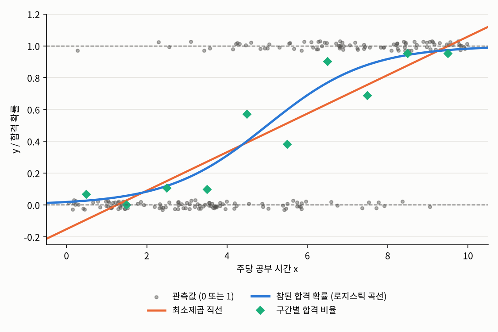

## 들어가며

[지난 글](index.qmd)에서 본 것처럼, 반응변수 $Y$가 $0$ 또는 $1$이면 조건부 기대값 $\mathbb{E}[Y \mid X = x]$는 곧 조건부 확률 $\mathbb{P}(Y = 1 \mid X = x)$입니다. 그러니 [3.1절](../03-linear-models/01-regression-function.qmd)의 관점에서 보면, 이번에도 회귀함수를 모형화한다는 목표는 그대로입니다. 달라지는 것은 회귀함수가 확률이라는 점, 그래서 $0$과 $1$ 사이에 갇혀 있어야 한다는 점입니다.

이번 글에서는 두 가지 질문을 다룹니다. 먼저 3장의 선형 모형을 $0$과 $1$에 그대로 적용하면 무엇이 잘못되는지 확인하고, 그 문제를 해결하는 로지스틱 회귀 모형을 정의합니다. 다음으로 그렇게 정의한 모형의 계수 $\beta_j$를 어떻게 읽어야 하는지 살펴봅니다.

## 문제 1: 0과 1에 직선을 맞추면

### 문제 상황

학생 200명의 주당 공부 시간 $x$와 시험 합격 여부 $y$(합격이면 $1$, 불합격이면 $0$)를 조사했다고 하겠습니다. 데이터는 합격 확률이 $\pi(x) = 1/(1 + e^{-(-4 + 0.8x)})$인 모형에서 뽑았습니다. 3장에서 배운 대로 $y$를 $x$에 대해 최소제곱으로 적합해 보겠습니다. 이렇게 $0$과 $1$에 직선을 그대로 맞춘 모형을 **선형 확률 모형**(linear probability model)이라고 부릅니다.

```python
import numpy as np

np.random.seed(1557)
n = 200
x = np.random.uniform(0, 10, size=n)                 # 주당 공부 시간
pi = 1 / (1 + np.exp(-(-4 + 0.8 * x)))               # 참된 합격 확률
y = np.random.binomial(1, pi)                        # 합격이면 1, 불합격이면 0

X = np.column_stack([np.ones(n), x])
b = np.linalg.solve(X.T @ X, X.T @ y)                # 0/1을 그대로 최소제곱으로 적합
fitted = X @ b
print(f"최소제곱 직선: {b[0]:.3f} + {b[1]:.3f} x")
print(f"적합값의 범위: {fitted.min():.3f} ~ {fitted.max():.3f}")
print(f"0보다 작거나 1보다 큰 적합값: {np.sum((fitted < 0) | (fitted > 1))}개 / {n}개")
for lo, hi in [(0, 2), (4, 6), (8, 10)]:
    m = (x >= lo) & (x < hi)
    print(f"{lo} ≤ x < {hi}: 합격 비율 = {y[m].mean():.3f}, Y의 분산 = {y[m].var():.3f}")
```

```
최소제곱 직선: -0.153 + 0.121 x
적합값의 범위: -0.146 ~ 1.056
0보다 작거나 1보다 큰 적합값: 33개 / 200개
0 ≤ x < 2: 합격 비율 = 0.027, Y의 분산 = 0.026
4 ≤ x < 6: 합격 비율 = 0.457, Y의 분산 = 0.248
8 ≤ x < 10: 합격 비율 = 0.952, Y의 분산 = 0.045
```

{fig-alt="가로축은 주당 공부 시간 x(0에서 10), 세로축은 y 또는 합격 확률. 회색 점 200개가 y = 0과 y = 1 두 줄에 흩어져 있다. 주황색 최소제곱 직선은 x = 0에서 약 -0.15로 0보다 아래에서 출발해 x = 10에서 약 1.06으로 1을 넘는다. 파란 로지스틱 곡선은 0 근처에서 출발해 x = 5에서 0.5를 지나 1 근처로 다가가는 S자 모양이다. 청록색 마름모는 x를 1 단위 구간 10개로 나눈 구간별 합격 비율로, 직선보다 S자 곡선 쪽에 더 가깝게 놓여 있다." width=75%}

두 가지 문제가 보입니다.

1. **확률이 범위를 벗어납니다.** 적합값 200개 가운데 33개가 $0$보다 작거나 $1$보다 큽니다. 공부를 거의 안 한 학생의 합격 확률이 $-0.146$이라는 것은 말이 되지 않습니다. 직선은 양쪽으로 끝없이 뻗어 나가므로, 데이터 범위를 조금만 벗어나도 이런 일은 반드시 일어납니다.
2. **분산이 일정하지 않습니다.** 합격 비율이 $0.5$ 근처인 구간에서는 $Y$의 분산이 $0.248$인데, 합격 비율이 $0$이나 $1$에 가까운 구간에서는 $0.026$, $0.045$로 훨씬 작습니다. $Y \in \{0, 1\}$이면 $\mathrm{Var}(Y \mid X = x) = \pi(x)\{1 - \pi(x)\}$이므로 이는 우연이 아니라 필연입니다. 3장의 가우스-마르코프 정리가 기대고 있던 등분산 가정이 처음부터 성립하지 않는 것입니다.

게다가 그림을 보면 구간별 합격 비율은 직선보다 S자 곡선을 더 잘 따라갑니다. 공부 시간이 아주 적거나 아주 많은 쪽에서는 한 시간을 더 공부해도 합격 확률이 별로 바뀌지 않고, 중간쯤에서 크게 바뀝니다. 이런 모양을 직선 하나로 담을 수는 없습니다.

### 접근 아이디어

선형 예측자 $\eta = \beta_0 + \beta_1 x$는 실수 전체에서 값을 가집니다. 반면 확률 $\pi$는 $(0, 1)$에 갇혀 있습니다. 문제는 이 둘을 $\pi = \eta$로 곧바로 같게 놓았다는 데 있습니다. 그렇다면 $(0, 1)$을 실수 전체로 늘려 주는 변환 $g$를 하나 찾아서 $g(\pi) = \eta$로 놓으면 어떨까요? 그러면 $\eta$가 어떤 값이든 $\pi = g^{-1}(\eta)$는 언제나 $(0, 1)$ 안에 있습니다.

그런 변환은 두 단계로 만들 수 있습니다. 먼저 $\pi$를 $\pi / (1 - \pi)$로 바꾸면 $(0, 1)$이 $(0, \infty)$로 늘어나고, 여기에 로그를 씌우면 $(0, \infty)$가 $(-\infty, \infty)$로 늘어납니다. 앞의 것이 도박이나 역학에서 흔히 쓰는 **오즈**이고, 뒤의 것이 **로그오즈**입니다. 이제 이 아이디어를 정확하게 적어 보겠습니다.

### 필요한 개념들

::: {.callout-note icon=false .callout-definition}
### 정의 4.1.1 (오즈와 로짓)
확률 $\pi \in (0, 1)$에 대해 $\dfrac{\pi}{1 - \pi}$를 $\pi$의 **오즈**(odds)라고 하고,
$$\mathrm{logit}(\pi) := \log\frac{\pi}{1 - \pi}$$
를 **로짓**(logit) 또는 **로그오즈**(log-odds)라고 합니다. 로짓의 역함수
$$\sigma(\eta) := \frac{e^\eta}{1 + e^\eta} = \frac{1}{1 + e^{-\eta}}, \qquad \eta \in \mathbb{R}$$
를 **로지스틱 함수**(logistic function) 또는 **시그모이드 함수**(sigmoid function)라고 합니다.
:::

오즈가 $1$이면 성공과 실패의 가능성이 같고($\pi = 1/2$), 오즈가 $3$이면 성공할 가능성이 실패할 가능성의 세 배입니다($\pi = 3/4$). 로짓은 $\pi = 1/2$일 때 $0$이고, $\pi$가 $1$에 다가가면 $+\infty$로, $0$에 다가가면 $-\infty$로 갑니다. 로지스틱 함수는 이 과정을 거꾸로 되돌리는 S자 곡선입니다. 다음 성질들은 이 장 전체에서 계속 씁니다.

::: {.callout-important icon=false .callout-satz}
### 정리 4.1.2 (로지스틱 함수의 성질)
1. $\sigma : \mathbb{R} \to (0, 1)$은 순증가하는 전단사 함수이고, 역함수는 $\mathrm{logit}$입니다.
2. $1 - \sigma(\eta) = \sigma(-\eta)$입니다.
3. $\sigma'(\eta) = \sigma(\eta)\{1 - \sigma(\eta)\}$입니다.
:::

::: {.callout-tip collapse="false" icon=false .callout-beweis}
### 증명
2: $1 - \dfrac{1}{1 + e^{-\eta}} = \dfrac{e^{-\eta}}{1 + e^{-\eta}} = \dfrac{1}{e^{\eta} + 1} = \sigma(-\eta)$입니다.

3: $\sigma'(\eta) = \dfrac{e^{-\eta}}{(1 + e^{-\eta})^2} = \dfrac{1}{1 + e^{-\eta}} \cdot \dfrac{e^{-\eta}}{1 + e^{-\eta}} = \sigma(\eta)\{1 - \sigma(\eta)\}$이고, 2에 의해 마지막 식이 성립합니다.

1: 3에서 $\sigma' > 0$이므로 순증가하고, $\eta \to \pm\infty$일 때 $\sigma(\eta) \to 1, 0$이므로 상은 $(0, 1)$ 전체입니다. $\pi = \sigma(\eta)$를 $\eta$에 대해 풀면 $e^\eta = \pi / (1 - \pi)$, 곧 $\eta = \mathrm{logit}(\pi)$입니다. $\square$
:::

3번 성질은 로지스틱 곡선의 기울기가 $\pi(1 - \pi)$라는 뜻입니다. 이 값은 $\pi = 1/2$에서 최댓값 $1/4$를 가지고 $\pi$가 $0$이나 $1$에 가까울수록 $0$에 가까워집니다. 그림에서 본 "중간에서 가파르고 양 끝에서 평평한" 모양이 바로 이것입니다. 또 이 $\pi(1 - \pi)$는 $0$ 또는 $1$인 변수의 분산과 같은 식이라는 점도 기억해 두면 좋습니다. 4.2절에서 이 우연처럼 보이는 일치가 계산을 크게 단순하게 만들어 줍니다.

이제 모형을 정의하겠습니다. [3.1절](../03-linear-models/01-regression-function.qmd)에서처럼 관측값은 반응변수와 설명변수의 쌍 $(Y_i, X_i)$이고, 설명변수 $X_i = (X_{i,1}, \ldots, X_{i,d-1})^\top$는 $\mathbb{R}^{d-1}$에 값을 가지는 확률벡터입니다. 반응변수 $Y_i$는 $0$ 또는 $1$인 경우뿐 아니라, 같은 조건에서 $m_i$번 시행했을 때의 성공 횟수인 경우까지 한꺼번에 다룹니다.

여기서 모형화하는 대상이 무엇인지 분명히 해 두어야 합니다. 우리가 정하려는 것은 $Y_i$ 자체의 분포가 아니라, **$X_i = x_i$라는 결과를 보았을 때 $Y_i$가 어떻게 분포하는가**입니다. 공부 시간이 $3$시간인 학생과 $8$시간인 학생은 합격 확률이 다르므로, 합격 여부의 분포는 공부 시간을 알고 난 뒤에야 하나로 정해집니다. 이것을
$$Y_i \mid X_i = x_i \ \sim\ B(m_i, \pi_i)$$
로 쓰고, "설명변수의 값이 $x_i$로 관측되었다는 것을 알고 나면, $Y_i$는 $B(m_i, \pi_i)$를 따르는 것처럼 행동한다"고 읽습니다. 3.1절에서 말했듯이 $Y_i \mid X_i$라는 확률변수가 따로 있는 것이 아니라, 값 $x_i$마다 $Y_i$의 분포가 하나씩 정해진다는 뜻입니다. 이에 비해 $X_i$를 모르는 상태에서 본 $Y_i$의 분포는 여러 $x_i$에서의 분포를 $X_i$의 분포로 섞은 것이라서, 일반적으로 이항분포가 아닙니다.

$X_i$가 이산형이면 이 분포는 초등적인 조건부 확률 $\mathbb{P}(Y_i = y \mid X_i = x_i) = \mathbb{P}(Y_i = y,\ X_i = x_i)/\mathbb{P}(X_i = x_i)$ 그대로입니다. $X_i$가 연속형이면 $\mathbb{P}(X_i = x_i) = 0$이라서 이 식을 쓸 수 없고, 정확하게는 $x_i$마다 확률분포를 하나씩 대응시키는 **확률핵**(probability kernel)으로 정의합니다. 이 정의는 [수리통계학](../../../stats/math-stats/index.qmd)에서 다루고, 여기서는 위의 직관만으로 충분합니다.

::: {.callout-note icon=false .callout-definition}
### 정의 4.1.3 (로지스틱 회귀 모형)
관측값의 쌍 $(Y_1, X_1), \ldots, (Y_n, X_n)$이 서로 독립이고, $Y_i$는 $0$ 이상의 정수값을 가지는 횟수, $X_i$는 $\mathbb{R}^{d-1}$에 값을 가지는 설명변수 벡터라고 하겠습니다. 다음 세 조건이 성립할 때 **로지스틱 회귀 모형**(logistic regression model)이라고 합니다.

1. **확률 성분**(random component): 알려진 자연수 $m_i \ge 1$에 대해, 설명변수의 값이 주어졌을 때 관측값들은 서로 독립이고
$$Y_i \mid X_i = x_i \ \sim\ B(m_i, \pi_i), \qquad i = 1, \ldots, n$$
입니다. 곧 조건부 확률질량함수는
$$f_{\pi_i}(y_i \mid x_i) = \binom{m_i}{y_i}\pi_i^{y_i}(1 - \pi_i)^{m_i - y_i}, \qquad y_i = 0, 1, \ldots, m_i$$
입니다.
2. **체계적 성분**(systematic component): $x_i = (x_{i,1}, \ldots, x_{i,d-1})^\top$와 회귀계수 $\beta = (\beta_0, \beta_1, \ldots, \beta_{d-1})^\top \in \mathbb{R}^d$에 대해
$$\eta_i := \beta_0 + \beta_1 x_{i,1} + \cdots + \beta_{d-1} x_{i,d-1}$$
입니다. $\eta_i$를 **선형 예측자**(linear predictor)라고 합니다.
3. **연결 함수**(link function): $\mathrm{logit}(\pi_i) = \eta_i$, 곧 $\pi_i = \sigma(\eta_i)$입니다.

$m_i = 1$인 경우, 곧 $Y_i \in \{0, 1\}$인 경우를 **이진 로지스틱 회귀**(binary logistic regression)라고 합니다.
:::

3장의 계획행렬
$$X = \begin{pmatrix}
1 & x_{1,1} & \cdots & x_{1,d-1} \\
\vdots & \vdots & \ddots & \vdots \\
1 & x_{n,1} & \cdots & x_{n,d-1}
\end{pmatrix} \in \mathbb{R}^{n \times d}$$
를 관측된 설명변수 값 $x_1, \ldots, x_n$으로 만들면 선형 예측자를 모은 벡터는 $\eta = X\beta$이고, 이 점은 3장과 똑같습니다. 이항분포의 성질에서 바로

$$\mathbb{E}(Y_i \mid X_i = x_i) = m_i\pi_i =: \mu_i, \qquad \mathrm{Var}(Y_i \mid X_i = x_i) = m_i\pi_i(1 - \pi_i)$$

입니다. 첫째 식은 3.1절의 회귀함수 $\mathbb{E}(Y_i \mid X_i = x_i)$를 $m_i\sigma(\eta_i)$로 모형화했다는 뜻입니다. 조건부 평균이 정해지면 조건부 분산도 함께 정해진다는 것, 그래서 분산이 관측값마다 다르다는 것이 모형 안에 처음부터 들어 있습니다.

이 정의를 3장의 선형 모형과 나란히 놓아 보면, 선형 모형도 같은 세 부분으로 쓸 수 있습니다. 확률 성분은 $Y_i \mid X_i = x_i \sim N(\mu_i, \sigma^2)$, 체계적 성분은 같은 $\eta_i$, 연결 함수는 항등함수 $\mu_i = \eta_i$입니다. 이렇게 확률 성분, 체계적 성분, 연결 함수의 세 부분으로 모형을 정하는 틀을 **일반화 선형 모형**(generalized linear model, GLM)이라고 합니다. 로지스틱 회귀는 확률 성분을 이항분포로, 연결 함수를 로짓으로 고른 일반화 선형 모형입니다.

그런데 $(0, 1)$을 실수 전체로 보내는 함수는 로짓 말고도 많습니다. 예를 들어 표준정규분포의 분포함수의 역함수 $\Phi^{-1}$을 쓰면 **프로빗 모형**(probit model)이 됩니다. 그중에서 로짓을 고르는 데에는 수학적인 이유가 있습니다.

::: {.callout-important icon=false .callout-satz}
### 정리 4.1.4 (이항분포의 지수족 표현)
$Y \sim B(m, \pi)$이고 $\eta := \mathrm{logit}(\pi)$이면, $Y$의 확률질량함수는
$$\binom{m}{y}\pi^y(1 - \pi)^{m - y} = \binom{m}{y}\exp\big\{y\eta - m\log(1 + e^\eta)\big\}, \qquad y = 0, 1, \ldots, m$$
으로 쓸 수 있습니다.
:::

::: {.callout-tip collapse="false" icon=false .callout-beweis}
### 증명
$\pi^y(1 - \pi)^{m - y} = \Big(\dfrac{\pi}{1 - \pi}\Big)^y(1 - \pi)^m$이고, 정리 4.1.2에 의해 $\pi / (1 - \pi) = e^\eta$, $1 - \pi = 1/(1 + e^\eta)$입니다. 따라서 이 값은 $e^{y\eta}(1 + e^\eta)^{-m} = \exp\{y\eta - m\log(1 + e^\eta)\}$입니다. $\square$
:::

이 식에서 $y$와 곱해지는 양 $\eta$를 이항분포의 **자연모수**(natural parameter)라고 합니다. 로짓 연결은 바로 이 자연모수를 선형 예측자와 같게 놓는 연결이고, 이런 연결을 **정준 연결**(canonical link)이라고 합니다. 정준 연결을 쓰면 로그우도에서 $\beta$가 $y_i\eta_i$라는 단순한 꼴로만 $y_i$와 만나기 때문에, 4.2절에서 볼 점수와 정보 행렬이 아주 깔끔해집니다.

### 해결

로지스틱 회귀 모형은 앞의 두 문제를 모두 해결합니다.

1. **확률은 항상 범위 안에 있습니다.** 선형 예측자 $\eta_i$가 어떤 값이든 정리 4.1.2에 의해 $\pi_i = \sigma(\eta_i) \in (0, 1)$입니다. 그림의 파란 곡선처럼, 공부 시간이 아무리 적거나 많아도 합격 확률은 $0$과 $1$ 사이에 머물고 양 끝으로 갈수록 평평해집니다.
2. **분산이 다른 것은 더 이상 문제가 아닙니다.** 선형 확률 모형에서는 분산이 일정하지 않은 것이 모형의 가정을 어기는 일이었지만, 로지스틱 회귀 모형에서는 $\mathrm{Var}(Y_i \mid X_i = x_i) = m_i\pi_i(1 - \pi_i)$가 모형의 일부입니다. 4.2절의 추정 방법은 이 분산 구조를 처음부터 반영합니다.

모형이 생겼으니 그림의 데이터에서 실제로 $\beta_0, \beta_1$을 추정해야 하는데, 최소제곱 추정량처럼 식 하나로 쓸 수 있는 답은 없습니다. 이 문제는 4.2절에서 다루고, 여기서는 먼저 계수가 무엇을 뜻하는지부터 알아보겠습니다.

## 문제 2: 계수를 어떻게 읽을까

### 문제 상황

3장의 선형 모형에서는 계수의 뜻이 분명했습니다. 다른 설명변수를 고정하고 $x_j$를 $1$ 늘리면 $Y$의 조건부 기대값이 $\beta_j$만큼 늘어납니다. 그런데 앞의 예에서 참된 모형은 $\mathrm{logit}\,\pi(x) = -4 + 0.8x$였습니다. 공부 시간이 한 시간 늘면 합격 확률이 $0.8$만큼 늘어날까요? 확률은 $1$을 넘을 수 없으니 그럴 리 없습니다. 그렇다면 $\beta_1 = 0.8$은 무엇을 말하는 걸까요?

### 접근 아이디어

모형에서 선형인 것은 확률이 아니라 로그오즈입니다. 그러니 "$x_j$를 $1$ 늘리면 로그오즈가 $\beta_j$만큼 늘어난다"는 것은 선형 모형과 똑같이 성립합니다. 로그오즈가 $\beta_j$ 늘어난다는 것은 오즈가 $e^{\beta_j}$**배**가 된다는 뜻입니다. 로그의 덧셈이 원래 값의 곱셈이기 때문입니다. 이것을 정확히 하려면 두 오즈의 비를 정의해야 합니다.

### 필요한 개념들

::: {.callout-note icon=false .callout-definition}
### 정의 4.1.5 (오즈비)
두 확률 $\pi, \pi' \in (0, 1)$에 대해
$$\mathrm{OR}(\pi', \pi) := \frac{\pi' / (1 - \pi')}{\pi / (1 - \pi)}$$
를 $\pi$에 대한 $\pi'$의 **오즈비**(odds ratio)라고 합니다.
:::

오즈비가 $1$이면 두 오즈가 같고, 오즈비가 $1$보다 크면 $\pi'$ 쪽의 성공 가능성이 더 큽니다. 확률의 비 $\pi'/\pi$를 **상대위험**(relative risk)이라고 하는데, 오즈비와는 다른 양이라는 점에 주의해야 합니다.

::: {.callout-important icon=false .callout-satz}
### 정리 4.1.6 (계수의 오즈비 해석)
로지스틱 회귀 모형에서 설명변수 값 $x = (x_1, \ldots, x_{d-1})$에서의 성공 확률을 $\pi(x) = \sigma(\beta_0 + \beta_1 x_1 + \cdots + \beta_{d-1}x_{d-1})$라고 하겠습니다. 다른 설명변수를 고정한 채 $x_j$만 $\Delta$만큼 바꾼 값을 $x'$라고 하면
$$\mathrm{OR}\big(\pi(x'), \pi(x)\big) = e^{\Delta\beta_j}$$
입니다. 특히 $x_j$가 $1$ 늘면 오즈는 출발점 $x$와 상관없이 $e^{\beta_j}$배가 됩니다.
:::

::: {.callout-tip collapse="false" icon=false .callout-beweis}
### 증명
정리 4.1.2에 의해 $\pi(x)/(1 - \pi(x)) = \exp(\beta_0 + \beta_1x_1 + \cdots + \beta_{d-1}x_{d-1})$입니다. $x'$와 $x$에서 지수의 차이는 $\beta_j\Delta$뿐이므로 두 오즈의 비는 $e^{\Delta\beta_j}$입니다. $\square$
:::

$x_j$가 두 범주를 나타내는 지시변수라면, $e^{\beta_j}$는 기준 범주에 대한 그 범주의 오즈비입니다. 예를 들어 과제를 모두 냈으면 $1$인 지시변수의 계수가 $\beta_j = 0.7$이면, 공부 시간이 같은 학생끼리 비교할 때 과제를 모두 낸 학생의 합격 오즈가 $e^{0.7} \approx 2$배라는 뜻입니다. 이것은 "다른 설명변수를 고정했을 때"의 **조건부 연관성**에 대한 진술이고, 과제를 내게 하면 합격 오즈가 두 배가 된다는 **인과**에 대한 진술은 아니라는 점에 주의해야 합니다. 인과적으로 해석하려면 무작위 배정 같은 추가적인 근거가 필요합니다.

오즈비는 출발점과 상관없이 일정하지만, 확률의 변화는 그렇지 않습니다.

::: {.callout-important icon=false .callout-satz}
### 정리 4.1.7 (확률에 대한 효과)
$x_j$가 연속형 설명변수이고 교호작용 없이 선형 예측자에 들어가 있으면
$$\frac{\partial \pi(x)}{\partial x_j} = \beta_j\,\pi(x)\{1 - \pi(x)\}$$
입니다. 따라서 $|\partial\pi/\partial x_j| \le |\beta_j|/4$이고, 등호는 $\pi(x) = 1/2$일 때 성립합니다.
:::

::: {.callout-tip collapse="false" icon=false .callout-beweis}
### 증명
연쇄 법칙과 정리 4.1.2의 3에 의해 $\dfrac{\partial}{\partial x_j}\sigma(\eta) = \sigma'(\eta)\dfrac{\partial\eta}{\partial x_j} = \sigma(\eta)\{1 - \sigma(\eta)\}\beta_j$입니다. $\pi(1 - \pi) \le 1/4$이고 등호는 $\pi = 1/2$일 때뿐입니다. $\square$
:::

즉 $x_j$를 조금 늘렸을 때 확률이 얼마나 바뀌는지는 $\beta_j$만으로 정해지지 않고, 지금 확률이 얼마인지에 따라 달라집니다. 확률이 $1/2$ 근처일 때 가장 크게 바뀌고, $0$이나 $1$ 근처에서는 거의 바뀌지 않습니다. 그래서 "계수를 $4$로 나누면 확률 변화의 상한"이라는 어림셈이 자주 쓰입니다.

### 해결

참된 계수 $\beta_0 = -4$, $\beta_1 = 0.8$에서 공부 시간을 한 시간 늘렸을 때 확률과 오즈가 어떻게 바뀌는지, 출발점을 세 군데로 바꿔 가며 계산해 보겠습니다.

```python
import numpy as np

beta0, beta1 = -4, 0.8
def prob(x):
    return 1 / (1 + np.exp(-(beta0 + beta1 * x)))

print(f"한 시간당 오즈비 exp(beta1) = {np.exp(beta1):.3f}")
for x0 in [1, 5, 9]:
    p0, p1 = prob(x0), prob(x0 + 1)
    odds0, odds1 = p0 / (1 - p0), p1 / (1 - p1)
    print(f"x: {x0} → {x0 + 1}  확률 {p0:.3f} → {p1:.3f} (차이 {p1 - p0:+.3f}, 비 {p1 / p0:.2f}),"
          f"  오즈 {odds0:.3f} → {odds1:.3f} (비 {odds1 / odds0:.3f})")
```

```
한 시간당 오즈비 exp(beta1) = 2.226
x: 1 → 2  확률 0.039 → 0.083 (차이 +0.044, 비 2.12),  오즈 0.041 → 0.091 (비 2.226)
x: 5 → 6  확률 0.500 → 0.690 (차이 +0.190, 비 1.38),  오즈 1.000 → 2.226 (비 2.226)
x: 9 → 10  확률 0.961 → 0.982 (차이 +0.021, 비 1.02),  오즈 24.533 → 54.598 (비 2.226)
```

정리 4.1.6대로 오즈비는 어디서 출발하든 $e^{0.8} \approx 2.226$입니다. 반면 확률의 차이는 출발점이 $0.5$일 때 $0.190$으로 가장 크고(정리 4.1.7의 상한 $0.8/4 = 0.2$에 가깝습니다), 양 끝에서는 $0.044$, $0.021$로 작습니다. 확률의 비, 곧 상대위험도 $2.12$, $1.38$, $1.02$로 제각각입니다. 그러니 "$e^{\beta_1} = 2.226$이므로 한 시간 더 공부하면 합격 확률이 $2.2$배가 된다"고 읽으면 틀립니다. $2.226$은 **오즈의 비**이지 **확률의 비**가 아닙니다.

다만 첫째 줄처럼 확률이 아주 작을 때는 $1 - \pi \approx 1$이라서 오즈가 확률과 거의 같고, 오즈비도 상대위험과 비슷해집니다($2.226$과 $2.12$). 드문 질병을 다루는 역학 연구에서 오즈비를 상대위험처럼 읽는 것은 이 근사에 기댄 것이고, 사건이 흔하면 이 근사는 성립하지 않습니다.

계수를 읽을 때는 단위도 신경 써야 합니다. 정리 4.1.6에서 $x_j$가 $\Delta$만큼 바뀌면 오즈는 $e^{\Delta\beta_j}$배가 됩니다. 설명변수의 단위가 데이터의 범위에 비해 너무 크면, 예를 들어 길이를 밀리미터 단위로 재는 변수를 미터 단위로 바꾸면, "$1$단위 증가"에 해당하는 오즈비가 터무니없이 크거나 작아집니다. 이럴 때는 데이터 범위에 맞는 증분 $\Delta$를 골라 $e^{\Delta\beta_j}$를 보고하는 것이 좋습니다.

## 정리

이번 글에서 정의한 로지스틱 회귀 모형을 3장의 선형 모형과 나란히 놓으면 다음과 같습니다.

| | 선형 모형 (3장) | 로지스틱 회귀 모형 |
|:--|:--|:--|
| 확률 성분 | $Y_i \mid X_i = x_i \sim N(\mu_i, \sigma^2)$ | $Y_i \mid X_i = x_i \sim B(m_i, \pi_i)$ |
| 체계적 성분 | $\eta_i = \beta_0 + \beta_1x_{i,1} + \cdots + \beta_{d-1}x_{i,d-1}$ | 같음 |
| 연결 함수 | 항등함수 $\mu_i = \eta_i$ | 로짓 $\mathrm{logit}(\pi_i) = \eta_i$ |
| 조건부 분산 | $\sigma^2$로 일정 | $m_i\pi_i(1 - \pi_i)$로 평균에 따라 달라짐 |
| $x_j$가 $1$ 늘면 | 평균이 $\beta_j$ 늘어남 | 오즈가 $e^{\beta_j}$배가 됨 |

모형은 정했지만, 데이터에서 $\beta$를 어떻게 추정할지는 아직 남아 있습니다. 확률 성분이 정규분포가 아니므로 최소제곱법을 그대로 쓸 근거가 없고, 대신 1장의 최대우도 추정을 쓰게 됩니다. 4.2절에서는 로지스틱 회귀의 우도를 계산하고, 1장의 뉴턴-랩슨 방법이 여기서 어떤 모습이 되는지 살펴봅니다.

---

### 연결되는 개념
* $\leftarrow$ **이전 개념:** [4 로지스틱 회귀](index.qmd)
* $\rightarrow$ **다음 개념:** [4.2 최대우도 추정과 IRLS](02-mle-irls.qmd)
