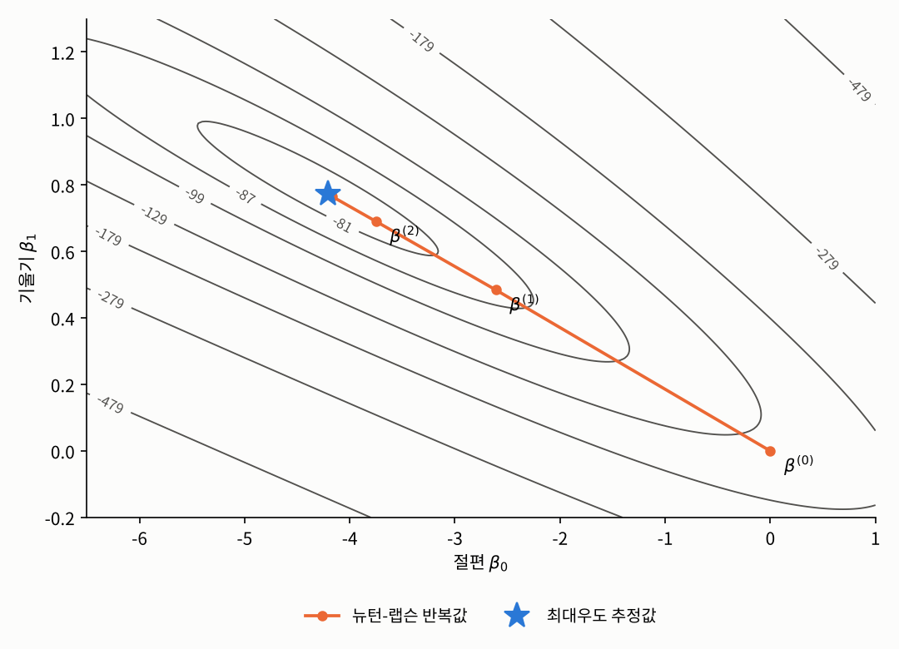

## 들어가며

[4.1절](01-logistic-model.qmd)에서 로지스틱 회귀 모형을 정의했으니, 이제 데이터에서 계수 $\beta$를 추정할 차례입니다. 3장의 선형 모형에서는 최소제곱 추정량이 $\hat{\beta} = (X^\top X)^{-1}X^\top Y$라는 식 하나로 주어졌고, 오차가 정규분포를 따르면 그것이 곧 최대우도 추정량이었습니다. 로지스틱 회귀에서는 반응변수가 이항분포를 따르므로 최소제곱법을 쓸 근거가 없고, 처음부터 [1장](../01-mle/index.qmd)의 최대우도 추정을 씁니다.

그런데 곧 보겠지만 로지스틱 회귀의 점수 방정식은 식으로 풀리지 않습니다. 그래서 [1.4절](../01-mle/04-newton-raphson.qmd)의 뉴턴-랩슨 방법이 필요합니다. 이번 글에서는 로지스틱 회귀의 점수와 정보 행렬을 계산하고, 최대우도 추정값이 있다면 하나뿐이라는 것을 보인 뒤, 뉴턴-랩슨 방법이 3장의 최소제곱법을 가중치만 바꿔 가며 반복하는 것과 같다는 사실을 증명합니다.

## 문제: 식으로 풀리지 않는 점수 방정식

### 문제 상황

4.1절의 학생 데이터에 설명변수를 하나 더 넣어 보겠습니다. 학생 200명의 주당 공부 시간 $x_{i,1}$과 과제를 모두 냈는지 여부 $x_{i,2}$(냈으면 $1$)를 알고, 합격 여부 $Y_i$를 다음 모형으로 설명하려고 합니다.

$$Y_i \mid X_i = x_i \ \sim\ B(1, \pi_i), \qquad \mathrm{logit}(\pi_i) = \beta_0 + \beta_1x_{i,1} + \beta_2x_{i,2}$$

데이터는 참값이 $\beta = (-5, 0.8, 1.5)$인 모형에서 뽑았습니다. 우도를 최대로 하는 $\beta$를 찾으려면 로그우도를 미분해 $0$으로 놓아야 하는데, 곧 보듯이 그 방정식에는 $\beta$가 지수함수 안에 들어 있어서 손으로 풀 수 없습니다.

### 접근 아이디어

1.4절에서 이미 이런 상황을 다뤘습니다. 식으로 풀 수 없는 점수 방정식은 뉴턴-랩슨 방법으로 풉니다. 지금 위치에서 로그우도의 기울기(점수)와 곡률(관측 정보)을 계산하고, 로그우도를 이차함수로 근사해 그 꼭대기로 옮겨 가는 일을 반복하는 것입니다.

그러려면 세 가지를 확인해야 합니다. 첫째, 로지스틱 회귀의 점수와 관측 정보는 구체적으로 어떻게 생겼을까요? 둘째, 1.4절에서는 해가 여러 개라서 출발점에 따라 다른 곳으로 수렴하는 예도 봤습니다. 로지스틱 회귀에서는 그런 걱정을 하지 않아도 될까요? 셋째, 계산 결과를 3장의 최소제곱법과 연결해서 이해할 수 있을까요?

### 필요한 개념들

정의 4.1.3의 모형에서 $\pi_i = \sigma(\eta_i)$, $\eta = X\beta$이고, $\mu_i = m_i\pi_i$를 모은 벡터를 $\mu(\beta) = (m_1\pi_1, \ldots, m_n\pi_n)^\top$로 씁니다. 1장에서처럼 관측된 설명변수 값 $x_1, \ldots, x_n$을 고정된 값으로 보고 **조건부 우도**(conditional likelihood)를 만듭니다. 설명변수의 값이 주어졌을 때 관측값들이 서로 독립이므로, 우도는 조건부 확률질량함수의 곱 $\prod_{i=1}^n f_{\pi_i}(y_i \mid x_i)$입니다. 아래에서 $Y = (Y_1, \ldots, Y_n)^\top$의 분포라고 하면, 언제나 $X_1 = x_1, \ldots, X_n = x_n$이 주어졌을 때의 분포를 뜻합니다.

::: {.callout-important icon=false .callout-satz}
### 정리 4.2.1 (로그우도, 점수, 정보)
로지스틱 회귀 모형에서 $\beta$와 무관한 항을 빼면 로그우도는
$$\ell(\beta) = \sum_{i=1}^n \big\{Y_i\eta_i - m_i\log(1 + e^{\eta_i})\big\}, \qquad \eta_i = \beta_0 + \beta_1x_{i,1} + \cdots + \beta_{d-1}x_{i,d-1}$$
입니다. 점수와 관측 정보는
$$U_n(\beta) = X^\top\big(Y - \mu(\beta)\big), \qquad J_n(\beta) = X^\top W(\beta)X, \qquad W(\beta) := \mathrm{diag}\big(m_1\pi_1(1 - \pi_1), \ldots, m_n\pi_n(1 - \pi_n)\big)$$
이고, $J_n(\beta)$는 $Y$에 의존하지 않으므로 (조건부) 피셔 정보와 같습니다: $I_n(\beta) = J_n(\beta)$.
:::

::: {.callout-tip collapse="false" icon=false .callout-beweis}
### 증명
정리 4.1.4에 의해 조건부 확률질량함수의 로그 $\log f_{\pi_i}(Y_i \mid x_i)$는 $\log\binom{m_i}{Y_i} + Y_i\eta_i - m_i\log(1 + e^{\eta_i})$이고, 첫째 항은 $\beta$와 무관합니다. 조건부 독립이므로 이것을 더하면 $\ell(\beta)$입니다.

$b(\eta) := \log(1 + e^\eta)$라 두면 $b'(\eta) = e^\eta/(1 + e^\eta) = \sigma(\eta)$이고, 정리 4.1.2에 의해 $b''(\eta) = \sigma(\eta)\{1 - \sigma(\eta)\}$입니다. $\partial\eta_i/\partial\beta = \tilde{x}_i := (1, x_{i,1}, \ldots, x_{i,d-1})^\top$, 곧 계획행렬의 $i$번째 행이므로, 연쇄 법칙에 의해
$$U_n(\beta) = \sum_{i=1}^n \big(Y_i - m_i\pi_i\big)\tilde{x}_i = X^\top(Y - \mu), \qquad J_n(\beta) = -\frac{\partial U_n(\beta)}{\partial\beta^\top} = \sum_{i=1}^n m_i\pi_i(1 - \pi_i)\,\tilde{x}_i\tilde{x}_i^\top = X^\top WX$$
입니다. $J_n(\beta)$에는 $Y$가 들어 있지 않으므로 설명변수 값이 주어졌을 때의 기대값을 취해도 그대로 $J_n(\beta)$이고, [1.3절](../01-mle/03-score-fisher.qmd)의 정보 등식에 의해 이는 피셔 정보 $I_n(\beta)$와 같습니다. $\square$
:::

로그우도에서 $Y_i$가 $\eta_i$와 곱해진 꼴로만 들어 있는 것은 4.1절에서 말한 정준 연결 덕분입니다. 그 결과 관측 정보에서 $Y$가 사라지고, 관측 정보와 피셔 정보가 같아집니다. 따라서 1.4절의 **뉴턴-랩슨 방법과 피셔 스코어링이 로지스틱 회귀에서는 똑같은 알고리즘**이 됩니다.

점수 방정식 $X^\top(Y - \hat{\mu}) = 0$은 3장의 정규방정식 $X^\top(Y - X\hat{\beta}) = 0$과 모양이 똑같습니다. "잔차가 계획행렬의 모든 열과 직교한다"는 것입니다. 차이는 적합값 $\hat{\mu}$가 $\beta$의 선형 함수가 아니라 $\hat{\mu}_i = m_i\sigma(\eta_i)$라는 비선형 함수라는 점이고, 이 때문에 식으로 풀리지 않습니다. 계획행렬의 첫 열이 $\mathbf{1}_n$이므로 점수 방정식의 첫 성분은 $\sum_i Y_i = \sum_i \hat{\mu}_i$, 곧 "적합된 성공 횟수의 합이 실제 성공 횟수의 합과 같다"는 뜻이기도 합니다. 3장에서 잔차의 합이 $0$이었던 것과 같은 성질입니다.

다음으로 해가 몇 개인지 살펴보겠습니다.

::: {.callout-important icon=false .callout-satz}
### 정리 4.2.2 (로그우도의 순오목성)
$\mathrm{rank}(X) = d$이면 모든 $\beta \in \mathbb{R}^d$에서 $J_n(\beta)$는 양의 정부호이고, 따라서 $\ell$은 $\mathbb{R}^d$에서 순오목 함수입니다. 그러므로 $\ell$을 최대로 하는 $\beta$는 많아야 하나이고, 점수 방정식 $U_n(\beta) = 0$의 해가 있으면 그것이 유일한 최대우도 추정값입니다.
:::

::: {.callout-tip collapse="false" icon=false .callout-beweis}
### 증명
$v \neq 0$이면 $\mathrm{rank}(X) = d$에 의해 $Xv \neq 0$입니다. 또 모든 $\beta$에서 $0 < \pi_i < 1$이므로 $W$의 대각 성분 $w_i = m_i\pi_i(1 - \pi_i)$는 모두 양수입니다. 따라서
$$v^\top J_n(\beta)\,v = (Xv)^\top W (Xv) = \sum_{i=1}^n w_i\,(Xv)_i^2 > 0$$
입니다. 헤세 행렬 $-J_n(\beta)$가 모든 점에서 음의 정부호이므로 $\ell$은 순오목입니다. 순오목 함수의 최댓점은 많아야 하나이고, 미분가능한 오목 함수에서는 기울기가 $0$인 점이 곧 최댓점입니다. $\square$
:::

1.4절에서 본 코시 분포의 예처럼 로그우도에 봉우리가 여러 개 있으면, 뉴턴-랩슨 방법이 어느 봉우리로 가는지가 출발점에 달려 있었습니다. 로지스틱 회귀에서는 계획행렬이 최대 계수이기만 하면 봉우리가 하나뿐이므로 그런 걱정이 없습니다. 다만 이 정리는 최댓점이 "많아야" 하나라고 말할 뿐, **최댓점이 존재한다고는 말하지 않습니다.** 로그우도가 끝없이 커지기만 하고 꼭대기에 도달하지 않는 경우가 있는데, 이것이 4.3절에서 다룰 분리 현상입니다.

이제 정리 4.2.1을 1.4절의 알고리즘에 넣으면 됩니다.

::: {.callout-note icon=false}
### 알고리즘 4.2.3 (로지스틱 회귀의 뉴턴-랩슨 방법)
**입력:** 계획행렬 $X$, 관측값 $y$, 시행 횟수 $m_1, \ldots, m_n$, 출발점 $\beta^{(0)}$(보통 $0$), 허용 오차 $\varepsilon > 0$<br>
**출력:** 최대우도 추정값의 근삿값

$j = 0, 1, 2, \ldots$에 대해 다음을 반복합니다.

1. $\eta^{(j)} := X\beta^{(j)}$, $\pi_i^{(j)} := \sigma(\eta_i^{(j)})$, $\mu^{(j)} := (m_i\pi_i^{(j)})_i$, $W^{(j)} := \mathrm{diag}\big(m_i\pi_i^{(j)}(1 - \pi_i^{(j)})\big)$를 계산합니다.
2. 연립일차방정식 $X^\top W^{(j)}X\,\delta = X^\top(y - \mu^{(j)})$를 풀어 $\delta$를 구합니다.
3. $\beta^{(j+1)} := \beta^{(j)} + \delta$로 둡니다.
4. $\lVert\delta\rVert < \varepsilon$이면 $\beta^{(j+1)}$을 반환하고 멈춥니다.
:::

이 알고리즘은 다른 모습으로도 쓸 수 있습니다. 2단계의 식을 조금 정리하면, 매 반복이 3장의 최소제곱 문제와 거의 같은 꼴이 됩니다.

::: {.callout-important icon=false .callout-satz}
### 정리 4.2.4 (뉴턴-랩슨 방법은 IRLS)
알고리즘 4.2.3에서 **작업 반응변수**(working response)를
$$z^{(j)} := \eta^{(j)} + \big(W^{(j)}\big)^{-1}\big(y - \mu^{(j)}\big), \qquad \text{곧} \quad z_i^{(j)} = \eta_i^{(j)} + \frac{y_i - m_i\pi_i^{(j)}}{m_i\pi_i^{(j)}(1 - \pi_i^{(j)})}$$
로 정의하면
$$\beta^{(j+1)} = \big(X^\top W^{(j)}X\big)^{-1}X^\top W^{(j)}z^{(j)} = \operatorname*{arg\,min}_{\beta \in \mathbb{R}^d}\ \sum_{i=1}^n w_i^{(j)}\big(z_i^{(j)} - (X\beta)_i\big)^2$$
입니다. 즉 뉴턴-랩슨 방법의 한 단계는 $z^{(j)}$를 $X$에 대해 가중치 $w_i^{(j)}$로 **가중 최소제곱**(weighted least squares) 회귀한 것과 같습니다.
:::

::: {.callout-tip collapse="false" icon=false .callout-beweis}
### 증명
$X^\top W^{(j)}z^{(j)} = X^\top W^{(j)}X\beta^{(j)} + X^\top(y - \mu^{(j)})$이므로
$$\big(X^\top W^{(j)}X\big)^{-1}X^\top W^{(j)}z^{(j)} = \beta^{(j)} + \big(X^\top W^{(j)}X\big)^{-1}X^\top(y - \mu^{(j)})$$
이고, 이는 알고리즘 4.2.3의 $\beta^{(j)} + \delta$와 같습니다. 가중 최소제곱의 목적함수 $\sum_i w_i(z_i - (X\beta)_i)^2 = (z - X\beta)^\top W(z - X\beta)$를 $\beta$로 미분해 $0$으로 놓으면 $X^\top WX\beta = X^\top Wz$이고, 정리 4.2.2의 증명에서 본 대로 $X^\top WX$는 양의 정부호이므로 이것이 유일한 최소점입니다. $\square$
:::

가중치가 매 반복마다 바뀌므로 이 알고리즘을 **반복 재가중 최소제곱**(iteratively reweighted least squares, IRLS)이라고 부릅니다. 모든 가중치가 같다면 3장의 최소제곱 추정량 그 자체입니다.

작업 반응변수가 무엇인지도 직관적으로 이해할 수 있습니다. 관측값 $y_i$는 확률의 척도에 있고, 선형 예측자 $\eta_i$는 로그오즈의 척도에 있습니다. 둘을 비교하려면 $y_i$를 로그오즈의 척도로 옮겨야 하는데, $0$이나 $1$에 로짓을 씌우면 $\pm\infty$가 되어 버립니다. 그래서 지금 위치 $\eta_i^{(j)}$ 근처에서 평균 함수 $\mu_i(\eta) = m_i\sigma(\eta)$를 일차 근사합니다. 그 기울기는 $d\mu_i/d\eta = m_i\pi_i(1 - \pi_i) = w_i$이므로, 확률 척도에서의 차이 $y_i - \mu_i$는 로그오즈 척도에서 대략 $(y_i - \mu_i)/w_i$만큼의 차이에 해당합니다. 이것을 $\eta_i^{(j)}$에 더한 것이 $z_i^{(j)}$입니다. 또 설명변수 값이 주어졌을 때 $z_i$의 분산은 대략 $\mathrm{Var}(Y_i \mid X_i = x_i)/w_i^2 = 1/w_i$이므로, 가중치 $w_i$는 "분산이 작아 믿을 만한 관측값에 더 큰 무게를 주는" 역할을 합니다. 다만 작업 반응변수는 계산을 위한 도구일 뿐, 어떤 새로운 통계 모형의 반응변수가 정규분포를 따른다는 뜻은 아닙니다.

::: {.callout-note icon=false}
### 알고리즘 4.2.5 (IRLS)
**입력:** 알고리즘 4.2.3과 같음<br>
**출력:** 최대우도 추정값의 근삿값

$j = 0, 1, 2, \ldots$에 대해 다음을 반복합니다.

1. $\eta^{(j)}$, $\pi^{(j)}$, $\mu^{(j)}$와 가중치 $w_i^{(j)} := m_i\pi_i^{(j)}(1 - \pi_i^{(j)})$를 계산합니다.
2. 작업 반응변수 $z_i^{(j)} := \eta_i^{(j)} + (y_i - \mu_i^{(j)})/w_i^{(j)}$를 계산합니다.
3. $z^{(j)}$를 $X$에 대해 가중치 $w^{(j)}$로 가중 최소제곱 회귀해 $\beta^{(j+1)}$을 구합니다.
4. $\lVert\beta^{(j+1)} - \beta^{(j)}\rVert < \varepsilon$이면 $\beta^{(j+1)}$을 반환하고 멈춥니다.
:::

마지막으로, 정리 4.2.1의 정보 행렬은 추정값의 **불확실성**도 알려 줍니다. [1.5절](../01-mle/05-asymptotics.qmd)의 점근 정규성에 따르면 최대우도 추정량은 대략 $N_d\big(\beta, I_n(\beta)^{-1}\big)$를 따르므로, $\beta_j$ 추정값의 표준오차를

$$\widehat{\mathrm{se}}(\hat{\beta}_j) := \sqrt{\Big[\big(X^\top W(\hat{\beta})X\big)^{-1}\Big]_{jj}}$$

로 추정합니다. 로그우도가 꼭대기에서 뾰족할수록, 곧 정보가 클수록 표준오차가 작아집니다. 1장에서 본 "곡률이 곧 정보이고, 정보가 곧 불확실성의 역수"라는 이야기가 여기서도 그대로 성립합니다. 이 표준오차로 검정하고 신뢰구간을 만드는 방법은 5장에서 다룹니다.

### 해결

학생 데이터에 알고리즘 4.2.3을 적용해 보겠습니다. 출발점은 $\beta^{(0)} = 0$, 곧 모든 학생의 합격 확률이 $1/2$인 지점입니다.

```python
import numpy as np

np.random.seed(1557)
n = 200
x1 = np.random.uniform(0, 10, size=n)                # 주당 공부 시간
x2 = np.random.binomial(1, 0.6, size=n)              # 과제를 모두 냈으면 1
X = np.column_stack([np.ones(n), x1, x2])            # 계획행렬 (n × 3)
beta_true = np.array([-5.0, 0.8, 1.5])
y = np.random.binomial(1, 1 / (1 + np.exp(-X @ beta_true)))

def loglik(beta):
    eta = X @ beta
    return np.sum(y * eta - np.log1p(np.exp(eta)))

beta = np.zeros(3)                                   # 출발점 beta^(0) = 0
for j in range(10):
    pi = 1 / (1 + np.exp(-X @ beta))
    U = X.T @ (y - pi)                               # 점수 X^T (y - mu)
    J = X.T @ (X * (pi * (1 - pi))[:, None])         # 관측 정보 = 피셔 정보 X^T W X
    print(f"j = {j}: beta = {np.round(beta, 4)}, 로그우도 = {loglik(beta):.6f}, |U| = {np.linalg.norm(U):.2e}")
    if np.linalg.norm(U) < 1e-8:
        break
    beta = beta + np.linalg.solve(J, U)              # 뉴턴-랩슨 갱신
```

```
j = 0: beta = [0. 0. 0.], 로그우도 = -138.629436, |U| = 1.29e+02
j = 1: beta = [-2.631   0.4202  0.634 ], 로그우도 = -94.379283, |U| = 2.17e+01
j = 2: beta = [-3.6284  0.5667  0.9693], 로그우도 = -91.228884, |U| = 3.72e+00
j = 3: beta = [-3.8944  0.6047  1.0699], 로그우도 = -91.092510, |U| = 2.03e-01
j = 4: beta = [-3.9102  0.6069  1.0763], 로그우도 = -91.092093, |U| = 6.93e-04
j = 5: beta = [-3.9103  0.6069  1.0763], 로그우도 = -91.092093, |U| = 7.84e-09
```

로그우도는 매 반복마다 커지고, 점수의 크기는 $10^{-1} \to 10^{-4} \to 10^{-9}$처럼 지수가 대략 두 배씩 줄어듭니다. 1.4절에서 본 뉴턴-랩슨 방법의 이차 수렴입니다. 다섯 번 만에 점수가 사실상 $0$이 되었고, 정리 4.2.2에 의해 이 점이 유일한 최대우도 추정값입니다. 다른 출발점에서 시작했어도 같은 점에 도착했을 것입니다.

아래 그림은 설명변수가 공부 시간 하나뿐인 4.1절의 데이터에서 로그우도의 등고선과 뉴턴-랩슨 반복값을 그린 것입니다. 등고선이 타원 모양의 봉우리 하나로 이루어져 있고, 반복값이 몇 걸음 만에 꼭대기에 도착합니다.

{fig-alt="가로축은 절편 beta0(-6.5에서 1), 세로축은 기울기 beta1(-0.2에서 1.3)인 로그우도의 등고선 그림. 회색 실선 등고선이 왼쪽 위로 기울어진 타원들로 겹겹이 둘러싸여 있고, 숫자는 바깥에서 안쪽으로 -479, -279, -179, -129, -99, -87, -81이다. 주황색 점과 선은 원점 (0, 0)에서 출발한 뉴턴-랩슨 반복값으로, 첫 걸음에 약 (-2.61, 0.48), 둘째 걸음에 약 (-3.75, 0.69)로 이동한 뒤 파란 별로 표시된 최대우도 추정값 약 (-4.21, 0.77)에 도착한다. 이곳의 로그우도는 약 -78.7이다." width=70%}

이번에는 같은 데이터에 IRLS(알고리즘 4.2.5)를 적용해 뉴턴-랩슨 방법과 같은 답을 주는지 확인하고, 표준오차를 계산해 보겠습니다. 또 같은 설계에서 반응변수만 2000번 새로 뽑아 추정값이 실제로 얼마나 흩어지는지와 비교해 보겠습니다.

```python
# IRLS: 작업 반응변수 z에 대한 가중 최소제곱을 반복
def irls(X, y, tol=1e-8, max_iter=50):
    beta = np.zeros(X.shape[1])
    for it in range(1, max_iter + 1):
        eta = X @ beta
        pi = 1 / (1 + np.exp(-eta))
        w = pi * (1 - pi)                            # 가중치 W의 대각 성분
        z = eta + (y - pi) / w                       # 작업 반응변수
        beta_new = np.linalg.solve(X.T @ (X * w[:, None]), X.T @ (w * z))
        if np.max(np.abs(beta_new - beta)) < tol:
            return beta_new, it
        beta = beta_new
    return beta, max_iter

beta_hat, it = irls(X, y)
pi_hat = 1 / (1 + np.exp(-X @ beta_hat))
J = X.T @ (X * (pi_hat * (1 - pi_hat))[:, None])
se = np.sqrt(np.diag(np.linalg.inv(J)))
print(f"IRLS: {it}번 반복, beta_hat = {np.round(beta_hat, 4)}")
print(f"뉴턴-랩슨과의 차이 = {np.max(np.abs(beta_hat - beta)):.1e}")
print(f"표준오차 sqrt(diag(J^-1)) = {np.round(se, 4)}")

# 같은 모형에서 데이터를 2000번 새로 뽑아 추정량의 실제 흩어짐과 비교
estimates = []
for r in range(2000):
    y_new = np.random.binomial(1, 1 / (1 + np.exp(-X @ beta_true)))
    estimates.append(irls(X, y_new)[0])
estimates = np.array(estimates)
print(f"2000번 반복한 추정값의 평균 = {np.round(estimates.mean(axis=0), 4)}")
print(f"2000번 반복한 추정값의 표준편차 = {np.round(estimates.std(axis=0), 4)}")
pi_true = 1 / (1 + np.exp(-X @ beta_true))
J_true = X.T @ (X * (pi_true * (1 - pi_true))[:, None])
print(f"참값에서 계산한 sqrt(diag(I_n^-1)) = {np.round(np.sqrt(np.diag(np.linalg.inv(J_true))), 4)}")
```

```
IRLS: 6번 반복, beta_hat = [-3.9103  0.6069  1.0763]
뉴턴-랩슨과의 차이 = 5.6e-10
표준오차 sqrt(diag(J^-1)) = [0.563  0.0834 0.383 ]
2000번 반복한 추정값의 평균 = [-5.1337  0.8237  1.5315]
2000번 반복한 추정값의 표준편차 = [0.7599 0.1147 0.4762]
참값에서 계산한 sqrt(diag(I_n^-1)) = [0.7067 0.1071 0.4439]
```

결과에서 읽을 수 있는 것은 다음과 같습니다.

- **IRLS와 뉴턴-랩슨 방법은 같은 알고리즘입니다.** 두 방법의 답은 $10^{-10}$ 정도의 반올림 오차만큼만 다릅니다(정리 4.2.4). IRLS의 반복 횟수가 하나 더 많은 것은 멈추는 기준을 점수가 아니라 $\beta$의 변화량으로 잡았기 때문입니다.
- **추정값은 참값과 꽤 다를 수 있습니다.** 이 데이터의 추정값 $(-3.91, 0.61, 1.08)$은 참값 $(-5, 0.8, 1.5)$와 차이가 납니다. 하지만 차이를 표준오차 $(0.56, 0.08, 0.38)$로 나누면 각각 약 $1.9$, $2.3$, $1.1$로, 표본 200개에서 일어날 수 있는 범위 안에 있습니다.
- **정보 행렬은 실제 흩어짐을 대략 맞힙니다.** 데이터를 2000번 새로 뽑았을 때 추정값의 표준편차 $(0.76, 0.11, 0.48)$은 참값에서 계산한 $\sqrt{[I_n(\beta)^{-1}]_{jj}}$ 값 $(0.71, 0.11, 0.44)$에 가깝습니다. 1.5절의 점근 정규성이 이 정도 표본에서도 대략 들어맞는 것입니다. 실제 표준편차가 조금 더 큰 것은 표본이 아주 크지는 않기 때문이고, 추정값의 평균 $(-5.13, 0.82, 1.53)$이 참값보다 절댓값이 약간 큰 것도 같은 이유입니다. 로지스틱 회귀의 최대우도 추정량은 표본이 작을 때 $0$에서 멀어지는 쪽으로 조금 치우치는 경향이 있습니다.
- **추정한 표준오차도 추정값입니다.** 이 데이터에서 계산한 표준오차 $(0.56, 0.08, 0.38)$이 참값에서 계산한 값보다 작은 것은, 표준오차를 참값이 아닌 추정값 $\hat{\beta}$에서 계산했기 때문입니다. $\hat{\beta}$가 참값보다 $0$에 가까워서 적합 확률이 $1/2$ 쪽으로 몰리고, 그만큼 가중치 $\pi(1 - \pi)$가 커진 것입니다. 이런 불확실성까지 고려해 검정하는 방법은 5장에서 다룹니다.

## 정리

로지스틱 회귀의 추정을 3장의 선형 모형과 나란히 놓으면 다음과 같습니다.

| | 선형 모형 (3장) | 로지스틱 회귀 모형 |
|:--|:--|:--|
| 추정 원리 | 최소제곱 (정규 오차이면 최대우도) | 최대우도 |
| 추정 방정식 | $X^\top(Y - X\hat{\beta}) = 0$ | $X^\top(Y - \hat{\mu}) = 0$ |
| 계산 | 닫힌 형태 $(X^\top X)^{-1}X^\top Y$ | 뉴턴-랩슨 = 피셔 스코어링 = IRLS |
| 정보 행렬 | $X^\top X / \sigma^2$ | $X^\top W(\beta)X$ |
| 존재와 유일성 | $\mathrm{rank}(X) = d$이면 존재하고 유일 | $\mathrm{rank}(X) = d$이면 많아야 하나 |

마지막 줄의 차이가 중요합니다. 선형 모형에서는 계획행렬의 계수만 확인하면 추정값이 반드시 존재했지만, 로지스틱 회귀에서는 "많아야 하나"라는 것밖에 보장되지 않습니다. 실제로 추정값이 존재하지 않으면 뉴턴-랩슨 방법은 어떻게 될까요? 그리고 그것을 어떻게 알아챌 수 있을까요? 4.3절에서 이 질문을 다룹니다.

---

### 연결되는 개념
* $\leftarrow$ **이전 개념:** [4.1 로지스틱 회귀 모형](01-logistic-model.qmd)
* $\rightarrow$ **다음 개념:** [4.3 분리: 최대우도 추정값이 없을 때](03-separation.qmd)
