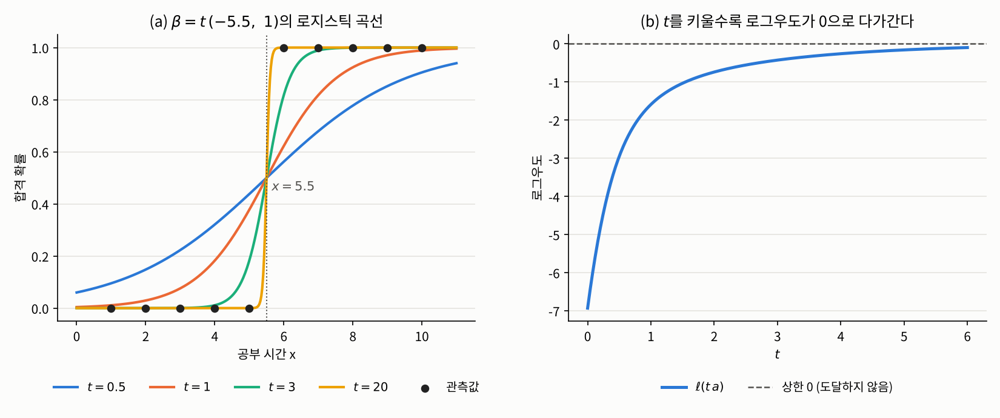

## 들어가며

[4.2절](02-mle-irls.qmd)에서 계획행렬이 최대 계수이면 로지스틱 회귀의 로그우도가 순오목이라서, 최대우도 추정값이 **많아야 하나**라는 것을 보였습니다. 그리고 그 정리가 추정값의 **존재**까지 보장하지는 않는다고 했습니다.

사실 이 현상은 [1.2절](../01-mle/02-score-failures.qmd)에서 이미 가장 단순한 모습으로 만났습니다. 동전을 20번 던져 앞면이 한 번도 나오지 않으면, 앞면이 나올 확률 $p \in (0, 1)$의 우도는 $p$가 $0$에 다가갈수록 계속 커지기만 하고 모수공간 안에서 최댓값에 도달하지 않았습니다. 로지스틱 회귀에서는 이 일이 더 다양한 모습으로, 그리고 생각보다 자주 일어납니다. 이번 글에서는 언제 최대우도 추정값이 존재하지 않는지 정확히 밝히고, 그때 계산 결과가 어떻게 보이는지, 그리고 어떻게 알아챌 수 있는지 살펴봅니다.

## 문제 1: 완벽하게 갈리는 데이터

### 문제 상황

학생 10명의 공부 시간이 $1, 2, \ldots, 10$시간이고, 6시간 이상 공부한 학생은 모두 합격하고 5시간 이하로 공부한 학생은 모두 떨어졌다고 하겠습니다. 공부 시간 하나로 합격 여부가 완벽하게 설명되는, 어찌 보면 가장 이상적인 데이터입니다. 여기에 로지스틱 회귀 $\mathrm{logit}(\pi_i) = \beta_0 + \beta_1x_i$를 적합하기 위해 4.2절의 뉴턴-랩슨 방법을 30번 돌려 보겠습니다.

```python
import numpy as np

x = np.arange(1, 11, dtype=float)                    # 공부 시간 1, 2, ..., 10
y = (x >= 6).astype(float)                           # 6시간 이상 공부한 학생만 모두 합격
X = np.column_stack([np.ones(10), x])

beta = np.zeros(2)
for j in range(31):
    eta = X @ beta
    pi = 1 / (1 + np.exp(-eta))
    loglik = np.sum(y * eta - np.log1p(np.exp(eta)))
    J = X.T @ (X * (pi * (1 - pi))[:, None])
    if j % 5 == 0:
        se = np.sqrt(np.diag(np.linalg.inv(J)))
        print(f"j = {j:2d}: beta = ({beta[0]:8.3f}, {beta[1]:7.3f}), -beta0/beta1 = "
              f"{-beta[0] / beta[1] if beta[1] else float('nan'):.3f}, 로그우도 = {loglik:.2e}, se(beta1) = {se[1]:.1e}")
    beta = beta + np.linalg.solve(J, X.T @ (y - pi))
```

```
j =  0: beta = (   0.000,   0.000), -beta0/beta1 = nan, 로그우도 = -6.93e+00, se(beta1) = 2.2e-01
j =  5: beta = ( -22.043,   4.008), -beta0/beta1 = 5.500, 로그우도 = -2.58e-01, se(beta1) = 4.0e+00
j = 10: beta = ( -77.547,  14.099), -beta0/beta1 = 5.500, 로그우도 = -1.73e-03, se(beta1) = 4.8e+01
j = 15: beta = (-132.562,  24.102), -beta0/beta1 = 5.500, 로그우도 = -1.17e-05, se(beta1) = 5.9e+02
j = 20: beta = (-187.562,  34.102), -beta0/beta1 = 5.500, 로그우도 = -7.87e-08, se(beta1) = 7.1e+03
j = 25: beta = (-242.562,  44.102), -beta0/beta1 = 5.500, 로그우도 = -5.30e-10, se(beta1) = 8.7e+04
j = 30: beta = (-297.562,  54.102), -beta0/beta1 = 5.500, 로그우도 = -3.57e-12, se(beta1) = 1.1e+06
```

4.2절에서는 다섯 번 만에 멈췄던 반복이 이번에는 멈추지 않습니다. 기울기 $\beta_1$은 다섯 번마다 약 $10$씩 계속 커지고, 로그우도는 $0$에 점점 다가가며, 표준오차는 폭발합니다. 그런데 $-\beta_0/\beta_1$, 곧 합격 확률이 $1/2$이 되는 공부 시간은 $5.5$에 딱 고정되어 있습니다.

### 접근 아이디어

무슨 일이 일어나는지는 그림으로 보면 분명합니다. 합격 확률이 $1/2$인 지점을 $x = 5.5$에 고정한 채 곡선을 점점 가파르게 만들면, 5시간 이하인 학생의 적합 확률은 $0$에, 6시간 이상인 학생의 적합 확률은 $1$에 점점 다가갑니다. 그러면 모든 관측값을 점점 더 잘 맞히게 되므로 우도는 계속 커집니다. 하지만 곡선이 진짜 계단 함수가 되는 것은 기울기가 무한대일 때뿐이므로, 유한한 $\beta$로는 끝내 꼭대기에 도달하지 못합니다.

{fig-alt="두 개의 그래프. 왼쪽 (a)는 가로축 공부 시간 x(0에서 11), 세로축 합격 확률. 검은 점 10개 가운데 x = 1에서 5인 점은 0에, x = 6에서 10인 점은 1에 있다. beta = t(-5.5, 1)인 로지스틱 곡선이 t = 0.5(파랑), 1(주황), 3(청록), 20(노랑)에 대해 그려져 있고, 모두 x = 5.5에서 0.5를 지나며 t가 클수록 가팔라져 t = 20에서는 거의 계단 모양이다. 오른쪽 (b)는 가로축 t(0에서 6), 세로축 로그우도. 파란 곡선 ℓ(ta)는 t = 0에서 약 -6.93으로 출발해 빠르게 증가하다가 t = 6에서 약 -0.10까지 올라가며, 회색 점선으로 그린 상한 0에 다가가지만 닿지 않는다." width=100%}

이 아이디어를 일반화하려면 두 가지가 필요합니다. "데이터가 완벽하게 갈린다"는 것을 정확히 정의해야 하고, 그때 정말로 최댓값이 없다는 것을 보여야 합니다.

### 필요한 개념들

이번 글에서는 이진 로지스틱 회귀($m_i = 1$)만 다룹니다. 계획행렬의 $i$번째 행을 $\tilde{x}_i^\top = (1, x_{i,1}, \ldots, x_{i,d-1})$로 쓰고, 부호 $s_i := 2y_i - 1$을 정의하겠습니다. 합격이면 $s_i = 1$, 불합격이면 $s_i = -1$입니다.

::: {.callout-note icon=false .callout-definition}
### 정의 4.3.1 (완전 분리와 준완전 분리)
이진 반응변수 $y_1, \ldots, y_n$과 계획행렬 $X$에 대해, 어떤 $a \in \mathbb{R}^d$가 있어서
$$s_i\,\tilde{x}_i^\top a > 0 \qquad \text{모든 } i = 1, \ldots, n$$
이면 데이터가 **완전 분리**(complete separation)되었다고 합니다. 완전 분리는 아니지만, 어떤 $a \neq 0$이 있어서
$$s_i\,\tilde{x}_i^\top a \ge 0 \qquad \text{모든 } i = 1, \ldots, n$$
이면 **준완전 분리**(quasi-complete separation)되었다고 합니다. 두 경우 모두 아니면 데이터가 **겹친다**(overlap)고 합니다.
:::

$\tilde{x}_i^\top a = 0$은 설명변수의 공간에서 하나의 초평면입니다. 완전 분리는 이 초평면이 $y_i = 1$인 관측값과 $y_i = 0$인 관측값을 **완벽하게** 양쪽으로 가르는 것이고, 준완전 분리는 몇몇 관측값이 초평면 위에 걸쳐 있는 것을 허락하는 것입니다. 앞의 예에서는 $a = (-5.5, 1)$로 두면 $\tilde{x}_i^\top a = x_i - 5.5$의 부호가 $x_i \ge 6$인지에 따라 정해지므로 완전 분리입니다.

::: {.callout-important icon=false .callout-satz}
### 정리 4.3.2 (분리이면 최대우도 추정값이 없다)
이진 로지스틱 회귀에서 $\mathrm{rank}(X) = d$이고 데이터가 완전 분리 또는 준완전 분리되었으면, 로그우도 $\ell$을 최대로 하는 $\beta \in \mathbb{R}^d$는 존재하지 않습니다. 특히 완전 분리이면 정의 4.3.1의 $a$에 대해 $\ell(ta) \to 0 = \sup_\beta \ell(\beta)$ ($t \to \infty$)이지만, 모든 $\beta$에서 $\ell(\beta) < 0$입니다.
:::

::: {.callout-tip collapse="false" icon=false .callout-beweis}
### 증명
정리 4.1.2의 $1 - \sigma(\eta) = \sigma(-\eta)$를 쓰면, 관측값 하나의 로그우도는 $y_i = 1$일 때 $\log\sigma(\eta_i)$, $y_i = 0$일 때 $\log\sigma(-\eta_i)$이므로 어느 쪽이든 $\log\sigma(s_i\eta_i)$입니다. 따라서
$$\ell(\beta) = \sum_{i=1}^n \log\sigma\big(s_i\,\tilde{x}_i^\top\beta\big)$$
이고, $\sigma < 1$이므로 각 항은 음수입니다.

정의 4.3.1의 $a$를 잡고 임의의 $\beta$에 대해 $h(t) := \ell(\beta + ta)$를 생각하겠습니다. $s_i\tilde{x}_i^\top(\beta + ta) = s_i\tilde{x}_i^\top\beta + t\,s_i\tilde{x}_i^\top a$이고 $s_i\tilde{x}_i^\top a \ge 0$이므로, 각 항은 $t$에 대해 감소하지 않습니다. 또 $a \neq 0$이고 $\mathrm{rank}(X) = d$이므로 $Xa \neq 0$, 곧 어떤 $i$에서 $\tilde{x}_i^\top a \neq 0$이고, 그 $i$에서는 $s_i\tilde{x}_i^\top a > 0$입니다. $\log\sigma$는 순증가 함수이므로 그 항은 $t$에 대해 순증가합니다. 따라서 $h$는 순증가 함수이고, $\ell(\beta + a) > \ell(\beta)$입니다. $\beta$는 임의였으므로 어떤 $\beta$도 최댓점이 될 수 없습니다.

완전 분리이면 모든 $i$에서 $s_i\tilde{x}_i^\top a > 0$이므로 $t \to \infty$일 때 $s_i\tilde{x}_i^\top(ta) \to \infty$, $\log\sigma(s_i\tilde{x}_i^\top(ta)) \to 0$이고, 따라서 $\ell(ta) \to 0$입니다. $\ell < 0$이므로 상한은 $0$이고, 도달되지 않습니다. $\square$
:::

증명의 핵심은 분리 방향 $a$로 $\beta$를 밀면 **어떤 관측값의 적합도 나빠지지 않고 적어도 하나는 좋아진다**는 것입니다. 그러니 어디서 멈추든 그 방향으로 한 걸음 더 가면 우도가 커집니다.

1.2절의 동전 예도 이 정리의 특수한 경우입니다. 설명변수 없이 절편만 있는 모형($d = 1$, $\tilde{x}_i = 1$)에서 모든 $y_i = 0$이면 $s_i = -1$이고, $a = -1$로 두면 모든 $i$에서 $s_i\tilde{x}_i^\top a = 1 > 0$입니다. 절편만 있는 모형에서는 "모든 관측값이 한쪽에 몰려 있다"는 것이 곧 완전 분리입니다.

그렇다면 분리가 없으면 최대우도 추정값이 반드시 존재할까요? 그렇습니다. 이 방향의 증명은 이 과목의 범위를 넘으므로 결과만 소개합니다.

::: {.callout-important icon=false .callout-satz}
### 정리 4.3.3 (최대우도 추정값의 존재 조건)
이진 로지스틱 회귀에서 $\mathrm{rank}(X) = d$이면, 최대우도 추정값이 존재할 필요충분조건은 데이터가 겹치는 것, 곧 완전 분리도 준완전 분리도 아닌 것입니다. 이때 최대우도 추정값은 유일합니다.
:::

::: {.callout-tip collapse="false" icon=false .callout-beweis}
### 증명
필요조건은 정리 4.3.2이고, 유일성은 정리 4.2.2입니다. 충분조건은 알버트와 앤더슨의 논문[^albert]을 참고하시기 바랍니다.
:::

### 해결

이제 앞의 반복 결과를 해석할 수 있습니다.

- **분리 방향은 정해지지만 크기는 정해지지 않습니다.** 반복이 진행되면서 $\beta$는 분리 방향 $a = (-5.5, 1)$에 평행하게 무한히 멀어집니다. $-\beta_0/\beta_1 = 5.5$로 고정된 것이 그 증거입니다. 데이터는 "경계가 $5.5$시간 근처"라는 것은 분명히 알려 주지만, 경계 근처에서 확률이 얼마나 가파르게 바뀌는지에 대해서는 아무 정보도 주지 않습니다. 4시간과 6시간 사이에 학생이 없으니 당연합니다.
- **로그우도는 $0$으로, 표준오차는 무한대로 갑니다.** 정리 4.3.2대로 로그우도는 상한 $0$에 다가가기만 하고, 정보 행렬 $X^\top WX$는 가중치 $\pi_i(1 - \pi_i)$가 모두 $0$으로 가면서 사라집니다. 그래서 표준오차가 폭발합니다.
- **"수렴했다"는 메시지를 믿으면 안 됩니다.** 실제 소프트웨어는 보통 로그우도의 변화가 아주 작아지면 멈춥니다. 이 예에서는 $j = 10$에서 이미 로그우도가 $-0.0017$로 상한 $0$과 거의 같아서, 이 근처에서는 한 번의 반복으로 바뀌는 양도 아주 작습니다. 허용 오차를 적당히 잡은 소프트웨어라면 "$\hat{\beta}_1 = 14.1$, 표준오차 $48$"이라는 결과를 내놓고 수렴했다고 보고할 것입니다. 하지만 이 숫자는 최대우도 추정값이 아니라, 반복을 언제 멈췄는지에 따라 달라지는 임의의 값입니다.

## 문제 2: 한 범주에서 모두 실패할 때

### 문제 상황

완전 분리는 설명변수 하나가 반응변수를 완벽하게 설명하는, 비교적 드문 상황처럼 보일 수 있습니다. 그런데 준완전 분리는 범주형 설명변수가 있으면 아주 쉽게 생깁니다. 세 분반에서 20명씩 모두 60명의 공부 시간과 합격 여부를 조사했는데, 3반은 시험이 유난히 어려워서 합격자가 한 명도 없었다고 하겠습니다. 3장의 더미 코딩으로 1반을 기준 범주로 두고 $\mathrm{logit}(\pi_i) = \beta_0 + \beta_1x_{i,1} + \beta_2D_{i,2} + \beta_3D_{i,3}$을 적합해 보겠습니다. 여기서 $x_{i,1}$은 공부 시간, $D_{i,2}, D_{i,3}$은 2반과 3반의 지시변수입니다.

```python
np.random.seed(1557)
group = np.repeat([0, 1, 2], 20)                     # 0: 1반, 1: 2반, 2: 3반 (각 20명)
hours = np.random.uniform(0, 10, size=60)
y = np.random.binomial(1, 1 / (1 + np.exp(-(-4 + 0.8 * hours))))
y[group == 2] = 0                                    # 3반은 아무도 합격하지 못함
print("반별 합격자 수:", [int(y[group == g].sum()) for g in range(3)])

X = np.column_stack([np.ones(60), hours, group == 1, group == 2]).astype(float)   # 더미 코딩, 기준은 1반
beta = np.zeros(4)
for j in range(41):
    eta = X @ beta
    pi = 1 / (1 + np.exp(-eta))
    if j % 10 == 0:
        print(f"j = {j:2d}: beta = {np.round(beta, 3)}, 3반의 최대 적합 확률 = {pi[group == 2].max():.1e}")
    beta = beta + np.linalg.solve(X.T @ (X * (pi * (1 - pi))[:, None]), X.T @ (y - pi))
```

```
반별 합격자 수: [9, 8, 0]
j =  0: beta = [0. 0. 0. 0.], 3반의 최대 적합 확률 = 5.0e-01
j = 10: beta = [ -3.268   0.587   0.111 -11.815], 3반의 최대 적합 확률 = 7.7e-05
j = 20: beta = [ -3.268   0.587   0.111 -21.815], 3반의 최대 적합 확률 = 3.5e-09
j = 30: beta = [ -3.268   0.587   0.111 -31.815], 3반의 최대 적합 확률 = 1.6e-13
j = 40: beta = [ -3.268   0.587   0.111 -41.815], 3반의 최대 적합 확률 = 7.2e-18
```

### 접근 아이디어

3반의 계수 $\beta_3$만 반복마다 정확히 $1$씩 줄어들며 $-\infty$로 달아나고, 나머지 세 계수는 $(-3.268, 0.587, 0.111)$에 일찌감치 자리를 잡았습니다. $\beta_3$를 줄이면 3반 학생들의 적합 확률만 $0$에 가까워지고 1반과 2반 학생들의 적합 확률은 그대로이므로, 3반 학생이 모두 불합격인 이상 우도는 계속 좋아지기만 합니다.

### 필요한 개념들

이것이 준완전 분리입니다. $a = (0, 0, 0, -1)$로 두면 $\tilde{x}_i^\top a = -D_{i,3}$이므로, 3반 학생($s_i = -1$, $D_{i,3} = 1$)은 $s_i\tilde{x}_i^\top a = 1 > 0$이고, 1반과 2반 학생은 $s_i\tilde{x}_i^\top a = 0$입니다. 모든 $i$에서 $0$ 이상이므로 정의 4.3.1의 준완전 분리이고, 정리 4.3.2에 의해 최대우도 추정값이 존재하지 않습니다. 1반과 2반 학생들은 초평면 위에 걸쳐 있어서 이 방향으로 아무리 가도 영향을 받지 않고, 그래서 나머지 계수들은 1반과 2반만으로 정해지는 값에 수렴한 것입니다.

### 해결

이 예에서 배울 점은 다음과 같습니다.

- **분리는 생각보다 흔합니다.** 표본이 작거나, 범주가 많거나, 사건이 드물면 어떤 범주에서 성공이나 실패가 하나도 없는 일이 쉽게 생깁니다. 범주형 설명변수를 넣기 전에 범주별로 성공과 실패의 개수를 세어 보는 것이 가장 간단한 점검입니다.
- **증상으로 알아챌 수 있습니다.** 어떤 계수와 그 표준오차가 비정상적으로 크거나, 반복 횟수를 늘릴수록 계수가 계속 커지거나, 적합 확률이 $10^{-10}$처럼 사실상 $0$이나 $1$인 관측값이 무리를 지어 있으면 분리를 의심해야 합니다. 4.2절에서 본 것처럼 겹치는 데이터에서는 뉴턴-랩슨 방법이 몇 번 만에 멈추므로, 반복이 이상하게 오래 걸리는 것 자체가 신호입니다.
- **분리는 데이터가 틀렸다는 뜻이 아닙니다.** 3반의 합격 확률이 아주 낮다는 것은 데이터가 분명히 말해 주는 사실입니다. 다만 "얼마나 낮은가"를 정할 정보가 이 표본에는 없을 뿐입니다. 대처 방법으로는 범주를 합치거나, 문제가 되는 변수를 빼거나, 계수의 크기에 벌점을 주는 $L^1$, $L^2$ 벌점 추정을 쓰는 방법이 있습니다. 벌점 추정은 언제나 유한한 값을 돌려주지만, 그것은 벌점을 더한 목적함수의 최적점이지 이 글에서 다룬 최대우도 추정값이 아니라는 점에 주의해야 합니다.

## 정리

로지스틱 회귀에서 최대우도 추정값에 대해 알게 된 것을 모으면 다음과 같습니다.

| 상황 | 최대우도 추정값 | 뉴턴-랩슨 방법의 모습 |
|:--|:--|:--|
| $\mathrm{rank}(X) < d$ | 식별 불가능 (3장과 같음) | $X^\top WX$가 가역이 아님 |
| $\mathrm{rank}(X) = d$, 데이터가 겹침 | 존재하고 유일 (정리 4.2.2, 4.3.3) | 몇 번 만에 이차 수렴 |
| $\mathrm{rank}(X) = d$, 완전 분리 | 존재하지 않음 (정리 4.3.2) | 모든 계수가 분리 방향으로 발산 |
| $\mathrm{rank}(X) = d$, 준완전 분리 | 존재하지 않음 (정리 4.3.2) | 일부 계수만 발산 |

따라서 수치 계산이 마지막으로 내놓은 유한한 값을 그대로 최대우도 추정값이라고 믿을 것이 아니라, **수렴했는지와 분리가 없는지를 반드시 따로 확인해야** 합니다. 4.2절의 예처럼 점수가 사실상 $0$이 되는 유한한 점에 도달했다면, 정리 4.2.2에 의해 그 점이 유일한 최대우도 추정값이고 따라서 분리도 없다고 결론 내릴 수 있습니다.

지금까지는 모형을 정하고 계수를 구하는 데 집중했습니다. 하지만 로지스틱 회귀를 실제로 쓰는 많은 경우의 목적은 계수 그 자체보다 **예측**, 특히 새로운 관측값이 $0$인지 $1$인지 가려내는 **분류**입니다. 확률을 내놓는 모형으로 어떻게 분류를 하고, 그 성능을 어떻게 평가할까요? 4.4절에서 이 질문을 다룹니다.

---

### 연결되는 개념
* $\leftarrow$ **이전 개념:** [4.2 최대우도 추정과 IRLS](02-mle-irls.qmd)
* $\rightarrow$ **다음 개념:** [4.4 확률에서 분류로](04-classification.qmd)

[^albert]: A. Albert, J. A. Anderson, "On the existence of maximum likelihood estimates in logistic regression models", *Biometrika* 71(1), 1984, 1–10.
