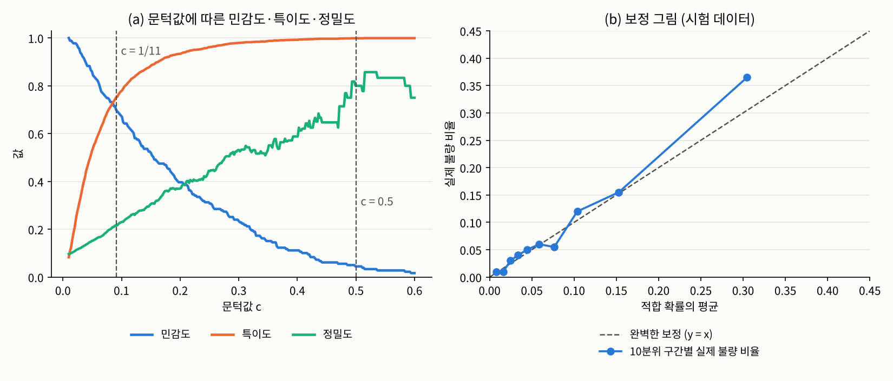

## 들어가며

[4.3절](03-separation.qmd)까지는 로지스틱 회귀의 계수를 구하고 해석하는 데 집중했습니다. 그런데 로지스틱 회귀를 실제로 쓰는 많은 경우, 사람들이 궁금해하는 것은 계수보다 **이 관측값이 $1$인가 $0$인가**입니다. 이 메일은 스팸일까요? 이 부품은 불량일까요? 이런 문제를 **이진 분류**(binary classification)라고 합니다.

여기서 꼭 짚어 둘 점이 있습니다. 로지스틱 회귀가 내놓는 것은 $0$ 또는 $1$이라는 **꼬리표**가 아니라 $\hat{\pi}(x) \in (0, 1)$이라는 **확률**입니다. 확률을 꼬리표로 바꾸는 것은 모형 바깥에서 우리가 따로 내리는 결정입니다. 이번 글에서는 그 결정을 어떻게 내리고, 그 결과를 어떻게 평가하는지 살펴봅니다.

## 문제: 드문 불량품을 가려내기

### 문제 상황

어떤 공장에서 부품마다 생산 당시 기계 온도의 편차(표준화된 값) $x_1$과 야간 생산 여부 $x_2$를 기록하고, 검사 결과 불량이면 $y = 1$, 정상이면 $y = 0$으로 적었습니다. 불량은 열 개 중 하나 정도로 드뭅니다. 부품 2000개로 로지스틱 회귀를 적합한 뒤, 적합에 쓰지 않은 **다른** 부품 2000개에서 불량품을 얼마나 잘 가려내는지 확인하려고 합니다. 데이터는 참값이 $\beta = (-3.2, 1.2, 0.8)$인 로지스틱 회귀 모형에서 뽑았습니다.

가장 흔한 방법은 적합 확률이 $0.5$를 넘으면 불량, 아니면 정상으로 분류하는 것입니다. 그렇게 해서 정확도가 $91\%$가 나왔다면 좋은 분류기일까요?

### 접근 아이디어

$0.5$라는 숫자에는 특별한 근거가 없습니다. "불량일 가능성이 정상일 가능성보다 크면 불량으로 분류한다"는 것은 두 종류의 실수, 곧 정상품을 불량으로 잘못 거르는 것과 불량품을 놓치는 것이 **똑같이 나쁠 때**의 규칙입니다. 불량품 하나를 놓쳐서 고객에게 보내는 비용이 정상품 하나를 다시 검사하는 비용보다 훨씬 크다면, 확률이 $0.5$보다 꽤 낮아도 일단 불량으로 의심하는 편이 낫습니다.

또 정확도 하나만으로는 이런 차이를 볼 수 없습니다. 불량이 $9\%$뿐이라면 **모든 부품을 정상이라고** 해도 정확도가 $91\%$입니다. 그러니 두 종류의 실수를 따로 세는 지표가 필요합니다.

### 필요한 개념들

::: {.callout-note icon=false .callout-definition}
### 정의 4.4.1 (문턱값에 의한 분류 규칙)
적합 확률 $\hat{\pi}(x)$와 **문턱값**(threshold) $c \in (0, 1)$에 대해
$$\hat{y}(x) := \mathbf{1}\{\hat{\pi}(x) > c\}$$
를 문턱값 $c$의 **분류 규칙**(classification rule)이라고 합니다.
:::

분류 규칙을 평가할 때는 관측값을 실제 값과 예측값에 따라 네 칸으로 나눕니다. 이 표를 **혼동 행렬**(confusion matrix)이라고 합니다.

| | 예측 $\hat{y} = 1$ | 예측 $\hat{y} = 0$ |
|:--|:--:|:--:|
| **실제 $y = 1$** | 참 양성 TP (true positive) | 거짓 음성 FN (false negative) |
| **실제 $y = 0$** | 거짓 양성 FP (false positive) | 참 음성 TN (true negative) |

::: {.callout-note icon=false .callout-definition}
### 정의 4.4.2 (혼동 행렬에서 나오는 지표)
$$\text{정확도}(\text{accuracy}) := \frac{TP + TN}{TP + TN + FP + FN}, \qquad \text{민감도}(\text{sensitivity}) := \frac{TP}{TP + FN},$$
$$\text{특이도}(\text{specificity}) := \frac{TN}{TN + FP}, \qquad \text{정밀도}(\text{precision}) := \frac{TP}{TP + FP}$$
로 정의합니다. 민감도는 **재현율**(recall)이라고도 합니다. 분모가 $0$이면 그 지표는 정의되지 않습니다.
:::

각 지표가 묻는 질문은 다릅니다. 민감도는 "실제 불량품 가운데 몇 개를 잡아냈는가", 특이도는 "실제 정상품 가운데 몇 개를 정상으로 통과시켰는가", 정밀도는 "불량이라고 판정한 것 가운데 몇 개가 정말 불량인가"를 묻습니다. 문턱값 $c$를 낮추면 더 많은 부품을 불량으로 판정하므로 민감도는 올라가고 특이도는 내려갑니다. 어느 한 지표만 보고는 분류기를 평가할 수 없는 이유입니다. 문턱값을 $0$에서 $1$까지 움직이며 민감도와 $1 - \text{특이도}$를 함께 그린 곡선을 **ROC 곡선**(receiver operating characteristic curve)이라고 부르는데, 이 또한 같은 맞교환을 한 그림에 담은 것입니다.

그렇다면 문턱값은 어떻게 정해야 할까요? 두 종류의 실수에 드는 비용을 알면 답이 정해집니다.

::: {.callout-important icon=false .callout-satz}
### 정리 4.4.3 (기대 비용을 최소로 하는 문턱값)
설명변수 값이 $x$일 때 $Y = 1$일 확률이 $\pi(x)$이고, 불량품을 놓치는 비용(거짓 음성)이 $C_{FN} > 0$, 정상품을 잘못 거르는 비용(거짓 양성)이 $C_{FP} > 0$, 맞게 분류하는 비용은 $0$이라고 하겠습니다. 그러면 기대 비용을 최소로 하는 결정은
$$\hat{y}(x) = \mathbf{1}\Big\{\pi(x) > \frac{C_{FP}}{C_{FP} + C_{FN}}\Big\}$$
입니다(등호일 때는 어느 쪽을 골라도 같습니다).
:::

::: {.callout-tip collapse="false" icon=false .callout-beweis}
### 증명
$x$에서 $1$로 분류하면 $Y = 0$일 때만 비용 $C_{FP}$가 들므로 기대 비용은 $\{1 - \pi(x)\}C_{FP}$이고, $0$으로 분류하면 $Y = 1$일 때만 비용 $C_{FN}$이 들므로 기대 비용은 $\pi(x)C_{FN}$입니다. $1$로 분류하는 쪽이 더 싼 것은 $\{1 - \pi(x)\}C_{FP} < \pi(x)C_{FN}$, 곧 $\pi(x) > C_{FP}/(C_{FP} + C_{FN})$일 때입니다. 각 $x$에서 더 싼 쪽을 고르면 전체 기대 비용도 최소가 됩니다. $\square$
:::

두 비용이 같으면 문턱값은 $1/2$이 됩니다. 즉 $c = 0.5$는 "두 실수가 똑같이 나쁘다"는 특수한 가정에서 나오는 값이지, 로지스틱 회귀 모형에서 나오는 값이 아닙니다. 불량품을 놓치는 비용이 열 배라면 $c = 1/11 \approx 0.09$입니다.

다만 이 정리는 참된 확률 $\pi(x)$를 안다고 가정합니다. 실제로는 그 자리에 적합 확률 $\hat{\pi}(x)$를 넣어야 하므로, 적합 확률이 **확률로서 믿을 만한지**를 따로 확인해야 합니다.

::: {.callout-note icon=false .callout-definition}
### 정의 4.4.4 (보정)
예측 확률 $\hat{\pi}$가 모든 $p \in (0, 1)$에 대해
$$\mathbb{P}\big(Y = 1 \mid \hat{\pi}(X) = p\big) = p$$
를 만족하면 $\hat{\pi}$가 **잘 보정되었다**(well calibrated)고 합니다.
:::

말로 하면 "$30\%$라고 예측한 관측값들을 모아 보면 실제로 그중 $30\%$ 정도가 $1$이어야 한다"는 것입니다. 일기예보에서 강수 확률이 $30\%$인 날들을 모았을 때 실제로 열흘 중 사흘쯤 비가 와야 그 예보를 믿을 수 있는 것과 같습니다. 이것을 확인하려면 적합 확률이 비슷한 관측값끼리 묶어 실제 비율과 비교하면 됩니다.

마지막으로, 이 모든 지표는 **적합에 쓰지 않은 데이터**에서 계산해야 합니다. 적합에 쓴 데이터에서 성능을 재면 모형이 그 데이터의 우연한 특징까지 외운 만큼 성능이 부풀려지기 때문입니다. [3.4절](../03-linear-models/04-r-squared.qmd)에서 학습 데이터의 $R^2$와 시험 데이터의 $R^2$가 크게 달랐던 것과 같은 이유입니다. 그래서 데이터를 **학습 데이터**(training set)와 **시험 데이터**(test set)로 나눕니다.

### 해결

학습 데이터로 계수를 추정한 뒤, 시험 데이터에서 "모두 정상으로 예측"하는 규칙과 세 가지 문턱값의 성능을 비교해 보겠습니다.

```python
import numpy as np

def irls(X, y, tol=1e-8, max_iter=50):
    beta = np.zeros(X.shape[1])
    for _ in range(max_iter):
        pi = 1 / (1 + np.exp(-X @ beta))
        step = np.linalg.solve(X.T @ (X * (pi * (1 - pi))[:, None]), X.T @ (y - pi))
        beta = beta + step
        if np.max(np.abs(step)) < tol:
            return beta
    raise RuntimeError("수렴하지 않았습니다. 분리 여부를 확인하세요.")

def simulate(n):
    temp = np.random.normal(size=n)                  # 기계 온도의 표준화된 편차
    night = np.random.binomial(1, 0.3, size=n)       # 야간 생산이면 1
    X = np.column_stack([np.ones(n), temp, night])
    y = np.random.binomial(1, 1 / (1 + np.exp(-X @ np.array([-3.2, 1.2, 0.8]))))
    return X, y

np.random.seed(1557)
X_train, y_train = simulate(2000)                    # 적합에 쓰는 데이터
X_test, y_test = simulate(2000)                      # 평가에만 쓰는 데이터
beta_hat = irls(X_train, y_train)
pi_test = 1 / (1 + np.exp(-X_test @ beta_hat))
print(f"beta_hat = {np.round(beta_hat, 3)}")
print(f"불량 비율: 학습 {y_train.mean():.3f}, 시험 {y_test.mean():.3f}")

def report(name, pred, y):
    TP = np.sum((pred == 1) & (y == 1)); TN = np.sum((pred == 0) & (y == 0))
    FP = np.sum((pred == 1) & (y == 0)); FN = np.sum((pred == 0) & (y == 1))
    prec = f"{TP / (TP + FP):.3f}" if TP + FP > 0 else "정의 안 됨"
    print(f"{name}: TP={TP:3d} FP={FP:3d} FN={FN:3d} TN={TN:4d} | 정확도 {(TP + TN) / len(y):.3f}, "
          f"민감도 {TP / (TP + FN):.3f}, 특이도 {TN / (TN + FP):.3f}, 정밀도 {prec}")

report("모두 정상으로 예측", np.zeros(len(y_test), dtype=int), y_test)
for c in [0.5, 0.2, 0.1]:
    report(f"문턱값 c = {c}  ", (pi_test > c).astype(int), y_test)
```

```
beta_hat = [-3.225  1.088  0.965]
불량 비율: 학습 0.085, 시험 0.089
모두 정상으로 예측: TP=  0 FP=  0 FN=179 TN=1821 | 정확도 0.910, 민감도 0.000, 특이도 1.000, 정밀도 정의 안 됨
문턱값 c = 0.5  : TP=  8 FP=  2 FN=171 TN=1819 | 정확도 0.913, 민감도 0.045, 특이도 0.999, 정밀도 0.800
문턱값 c = 0.2  : TP= 71 FP=121 FN=108 TN=1700 | 정확도 0.885, 민감도 0.397, 특이도 0.934, 정밀도 0.370
문턱값 c = 0.1  : TP=121 FP=403 FN= 58 TN=1418 | 정확도 0.769, 민감도 0.676, 특이도 0.779, 정밀도 0.231
```

결과는 앞의 걱정을 그대로 보여 줍니다.

- **정확도는 거의 아무것도 말해 주지 않습니다.** 아무것도 하지 않는 "모두 정상" 규칙의 정확도가 $0.910$이고, $c = 0.5$인 로지스틱 회귀의 정확도는 $0.913$으로 거의 같습니다. 그런데 $c = 0.5$ 규칙은 불량품 179개 가운데 8개만 잡아냈습니다(민감도 $0.045$). 불량이 드물면 적합 확률이 $0.5$를 넘는 부품 자체가 거의 없기 때문입니다.
- **문턱값을 낮추면 맞교환이 일어납니다.** $c = 0.1$로 낮추면 불량품의 $68\%$를 잡아내지만, 그 대가로 정상품 403개를 잘못 거르게 되어 정확도는 오히려 $0.769$로 떨어집니다. 정확도가 가장 높은 규칙이 가장 쓸모 있는 규칙은 아닙니다.
- **"모두 정상" 규칙의 정밀도는 정의되지 않습니다.** 불량이라고 판정한 부품이 하나도 없어서 정밀도의 분모가 $0$이기 때문입니다.

그렇다면 어떤 문턱값을 써야 할까요? 정리 4.4.3을 쓰기 전에 먼저 적합 확률이 잘 보정되었는지 확인하고, 불량품을 놓치는 비용이 정상품을 잘못 거르는 비용의 10배라고 가정하고 문턱값에 따른 시험 데이터의 총비용을 계산해 보겠습니다.

```python
# 보정(calibration): 적합 확률이 비슷한 관측값끼리 묶어 실제 불량 비율과 비교
bins = np.quantile(pi_test, np.linspace(0, 1, 6))    # 적합 확률의 5분위로 나눔
idx = np.clip(np.searchsorted(bins, pi_test, side="right") - 1, 0, 4)
for k in range(5):
    m = idx == k
    print(f"구간 {k + 1}: 적합 확률 평균 {pi_test[m].mean():.3f}, 실제 불량 비율 {y_test[m].mean():.3f} ({m.sum()}개)")

# 불량을 놓치는 비용이 정상을 잘못 거르는 비용의 10배일 때, 문턱값에 따른 총비용
cost_FN, cost_FP = 10, 1
grid = np.round(np.arange(0.02, 0.51, 0.01), 2)
costs = [cost_FN * np.sum((pi_test <= c) & (y_test == 1)) + cost_FP * np.sum((pi_test > c) & (y_test == 0)) for c in grid]
best = int(np.argmin(costs))
print(f"총비용이 가장 작은 문턱값: c = {grid[best]:.2f} (총비용 {costs[best]}), 이론값 1/(1 + 10) = {1 / 11:.3f}")
print(f"c = 0.5일 때 총비용 {costs[list(grid).index(0.5)]}")
```

```
구간 1: 적합 확률 평균 0.012, 실제 불량 비율 0.010 (400개)
구간 2: 적합 확률 평균 0.029, 실제 불량 비율 0.035 (400개)
구간 3: 적합 확률 평균 0.051, 실제 불량 비율 0.055 (400개)
구간 4: 적합 확률 평균 0.090, 실제 불량 비율 0.087 (400개)
구간 5: 적합 확률 평균 0.229, 실제 불량 비율 0.260 (400개)
총비용이 가장 작은 문턱값: c = 0.10 (총비용 983), 이론값 1/(1 + 10) = 0.091
c = 0.5일 때 총비용 1712
```

다섯 구간 모두에서 적합 확률의 평균과 실제 불량 비율이 가깝습니다. 모형이 옳고 표본이 충분하므로 적합 확률이 잘 보정되어 있고, 따라서 정리 4.4.3을 믿고 쓸 수 있습니다. 실제로 시험 데이터에서 총비용이 가장 작은 문턱값은 $c = 0.10$으로, 이론값 $1/11 \approx 0.091$에 가깝습니다. 이때의 총비용 $983$은 $c = 0.5$를 쓸 때의 $1712$보다 40% 넘게 작습니다.

{fig-alt="두 개의 그래프. 왼쪽 (a)는 가로축 문턱값 c(0.01에서 0.6), 세로축 값(0에서 1). 파란 민감도 곡선은 c가 0.01일 때 약 1에서 c가 0.6일 때 약 0.02까지 내려가고, 주황 특이도 곡선은 약 0.08에서 시작해 c가 0.3을 넘으면 거의 1이 된다. 청록 정밀도 곡선은 약 0.1에서 출발해 들쭉날쭉하게 올라가 c가 0.5 근처에서 0.8 안팎이 된다. c = 1/11과 c = 0.5에 회색 점선 세로선이 있다. 오른쪽 (b)는 가로축 적합 확률의 평균, 세로축 실제 불량 비율(둘 다 0에서 0.45)인 보정 그림. 시험 데이터를 적합 확률의 10분위로 나눈 10개의 파란 점이 회색 점선 대각선 y = x 근처에 놓여 있고, 가장 오른쪽 점은 약 (0.31, 0.37)이다." width=100%}

그림 (a)는 문턱값을 움직일 때 민감도와 특이도가 서로 반대로 움직이는 모습을 보여 줍니다. $c = 0.5$는 특이도를 거의 $1$로 지키는 대신 민감도를 거의 포기한 지점이고, $c = 1/11$은 두 지표가 비슷해지는 쪽에 있습니다. 어느 지점이 좋은지는 데이터가 아니라 **두 실수의 비용**이 정합니다. 그림 (b)는 10개 구간으로 더 잘게 나눈 보정 그림으로, 점들이 대각선 근처에 모여 있습니다. 만약 점들이 대각선에서 체계적으로 벗어난다면, 예를 들어 모형에서 중요한 변수나 비선형 효과가 빠졌다면, 적합 확률을 그대로 정리 4.4.3에 넣어서는 안 됩니다.

## 정리

이번 글에서 다룬 내용을 정리하면 다음과 같습니다.

| 질문 | 답 |
|:--|:--|
| 로지스틱 회귀가 내놓는 것 | 꼬리표가 아니라 확률 $\hat{\pi}(x)$ |
| 확률을 꼬리표로 바꾸는 법 | 문턱값 $c$를 정해 $\hat{y} = \mathbf{1}\{\hat{\pi} > c\}$ |
| 문턱값을 정하는 근거 | 두 실수의 비용: $c = C_{FP}/(C_{FP} + C_{FN})$. $c = 0.5$는 두 비용이 같을 때 |
| 성능을 재는 법 | 시험 데이터의 혼동 행렬에서 민감도, 특이도, 정밀도를 함께 봄 |
| 불균형 데이터의 함정 | 정확도는 "모두 다수 범주로 예측"하는 규칙과 구별되지 않을 수 있음 |
| 확률 자체의 점검 | 보정: 적합 확률이 비슷한 관측값끼리 묶어 실제 비율과 비교 |

분류 성능은 모형을 **예측의 도구**로 평가하는 방법입니다. 그런데 3장에서는 잔차제곱합과 $R^2$로 모형이 데이터에 얼마나 잘 맞는지를 재고, 두 모형 가운데 어느 쪽이 나은지를 비교했습니다. 로지스틱 회귀에서는 무엇이 잔차제곱합의 역할을 할까요? 그리고 잔차는 어떻게 정의하고 읽어야 할까요? 4.5절에서 이 질문을 다룹니다.

---

### 연결되는 개념
* $\leftarrow$ **이전 개념:** [4.3 분리: 최대우도 추정값이 없을 때](03-separation.qmd)
* $\rightarrow$ **다음 개념:** [4.5 이탈도와 잔차](05-deviance.qmd)
