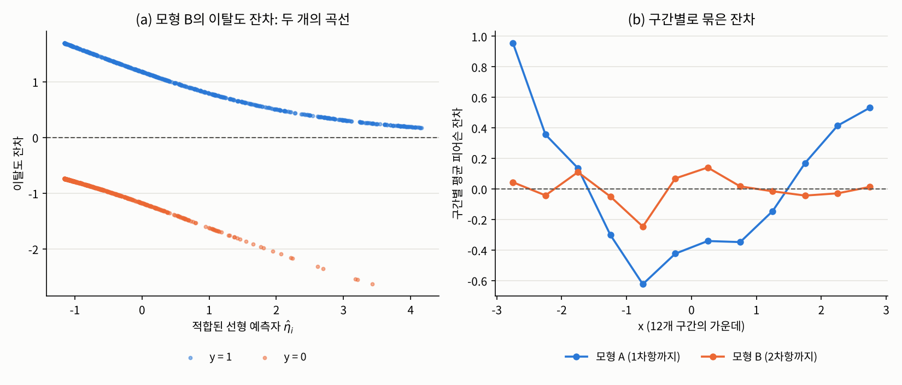

## 들어가며

[3장](../03-linear-models/index.qmd)에서는 잔차제곱합이 여러 가지 일을 했습니다. 모형이 데이터에 얼마나 잘 맞는지를 재고, 두 모형 가운데 어느 쪽이 나은지 비교하고, 잔차를 그려서 모형에서 빠진 것을 찾았습니다. 그런데 로지스틱 회귀는 최소제곱이 아니라 최대우도로 적합하므로, 잔차제곱합을 그대로 쓸 근거가 없습니다.

이번 글에서는 로지스틱 회귀에서 잔차제곱합의 역할을 하는 **이탈도**(deviance)를 정의합니다. 그리고 세 가지 질문을 차례로 다룹니다. 두 모형을 어떻게 비교할까요? 이탈도 하나만 보고 모형이 잘 맞는지 판정할 수 있을까요? 잔차는 어떻게 정의하고 읽어야 할까요?

## 문제 1: 두 모형을 무엇으로 비교할까

### 문제 상황

설명변수 $x \in [-3, 3]$와 이진 반응변수 $y$를 1000개 관측했습니다. 실제로는 로그오즈가 $x$의 이차식 $-1 + 0.5x + 0.4x^2$인 모형에서 뽑은 데이터이지만, 분석하는 사람은 그 사실을 모릅니다. 그래서 세 가지 모형을 적합해 보려고 합니다.

- **영모형:** 절편만 있는 모형 $\mathrm{logit}(\pi_i) = \beta_0$
- **모형 A:** $\mathrm{logit}(\pi_i) = \beta_0 + \beta_1x_i$
- **모형 B:** $\mathrm{logit}(\pi_i) = \beta_0 + \beta_1x_i + \beta_2x_i^2$

3장이라면 각 모형의 잔차제곱합을 비교했을 것입니다. 로지스틱 회귀에서는 무엇을 비교해야 할까요?

### 접근 아이디어

로지스틱 회귀는 우도를 최대로 하도록 적합했으니, 모형이 얼마나 잘 맞는지도 우도로 재는 것이 자연스럽습니다. 다만 로그우도의 값 자체는 기준점이 없어서 해석하기 어렵습니다. 그래서 **데이터를 가장 잘 맞힐 수 있는 모형**의 로그우도를 기준으로 삼고, 거기서 얼마나 떨어져 있는지를 재기로 합니다. 관측값마다 확률을 하나씩 따로 주어 데이터를 그대로 재현하는 모형이 그런 기준입니다.

### 필요한 개념들

::: {.callout-note icon=false .callout-definition}
### 정의 4.5.1 (영모형, 포화모형, 이탈도)
로지스틱 회귀 모형에서 절편만 있어 모든 관측값에 같은 확률을 주는 모형을 **영모형**(null model)이라고 하고, 관측값마다 확률을 하나씩 따로 주어 $\tilde{\pi}_i = y_i / m_i$로 데이터를 그대로 재현하는 모형을 **포화모형**(saturated model)이라고 합니다. 적합된 평균 $\hat{\mu}_i = m_i\hat{\pi}_i$에 대해
$$D(y, \hat{\mu}) := 2\big\{\ell_{\text{sat}} - \ell(\hat{\beta})\big\} = 2\sum_{i=1}^n \Big\{y_i\log\frac{y_i}{\hat{\mu}_i} + (m_i - y_i)\log\frac{m_i - y_i}{m_i - \hat{\mu}_i}\Big\}$$
를 그 모형의 **이탈도**(deviance)라고 합니다. 여기서 $\ell_{\text{sat}}$은 포화모형의 로그우도이고, $0\log 0 = 0$으로 약속합니다. 합의 $i$번째 항을 $d_i$로 쓰면 $D = \sum_i d_i$입니다.
:::

포화모형은 쓸모 있는 모형이 아니라 **비교의 기준**입니다. 모수가 관측값만큼 많으니 아무것도 요약하지 못하지만, 그 대신 이항분포 모형이 데이터에 줄 수 있는 가장 큰 우도를 줍니다. 이탈도는 우리 모형이 그 최고점에서 얼마나 떨어져 있는지를 재는 양이고, 작을수록 데이터에 가깝습니다. 이항분포의 이항계수는 $\ell_{\text{sat}}$과 $\ell(\hat{\beta})$에 똑같이 들어 있어서 차이를 내면 사라집니다.

이진 데이터($m_i = 1$)에서는 포화모형이 모든 관측값을 확률 $1$로 맞히므로 $\ell_{\text{sat}} = 0$이고, 각 항은
$$d_i = \begin{cases} -2\log\hat{\pi}_i, & y_i = 1, \\ -2\log(1 - \hat{\pi}_i), & y_i = 0 \end{cases}$$
입니다. 머신러닝에서 쓰는 **교차 엔트로피 손실**(cross-entropy loss)의 두 배와 같은 양입니다.

이탈도가 잔차제곱합의 일반화라는 것은 정규분포에서 같은 계산을 해 보면 알 수 있습니다.

::: {.callout-important icon=false .callout-satz}
### 정리 4.5.2 (정규 선형 모형의 이탈도)
$Y_i \mid X_i = x_i \sim N(\mu_i, \sigma^2)$이고 $\sigma^2$이 알려져 있을 때, 같은 방식으로 정의한 $2\{\ell_{\text{sat}} - \ell(\hat{\beta})\}$는
$$\frac{1}{\sigma^2}\sum_{i=1}^n (y_i - \hat{\mu}_i)^2 = \frac{\mathrm{RSS}}{\sigma^2}$$
입니다.
:::

::: {.callout-tip collapse="false" icon=false .callout-beweis}
### 증명
관측값 하나의 조건부 로그우도는 $-\frac{1}{2}\log(2\pi\sigma^2) - (y_i - \mu_i)^2/(2\sigma^2)$입니다. 포화모형은 $\tilde{\mu}_i = y_i$로 두어 둘째 항을 $0$으로 만듭니다. 첫째 항은 두 모형에서 같으므로, 차이의 두 배는 $\sum_i (y_i - \hat{\mu}_i)^2/\sigma^2$입니다. $\square$
:::

그러니 이탈도는 "정규분포에서 잔차제곱합이 하던 일을, 다른 분포에서도 할 수 있도록 우도의 언어로 다시 쓴 것"입니다. 잔차제곱합처럼 이탈도도 설명변수를 추가하면 줄어들기만 합니다. 더 큰 모형은 더 작은 모형의 모든 계수 조합을 포함하므로 최대 로그우도가 줄어들 수 없기 때문입니다([3.4절](../03-linear-models/04-r-squared.qmd)의 $R^2$와 같은 이유입니다). 따라서 두 모형을 비교할 때는 이탈도가 **얼마나 많이** 줄었는지를 봐야 합니다.

::: {.callout-important icon=false .callout-satz}
### 정리 4.5.3 (이탈도의 차이로 내포된 모형 비교하기)
계수가 $d$개인 모형 $M_d$와, $M_d$의 계획행렬에서 열 몇 개를 지워 얻은 계수 $q$개($q < d$)의 모형 $M_q$의 이탈도를 각각 $D_d$, $D_q$라고 하겠습니다. 작은 모형 $M_q$가 참이고 통상적인 정칙 조건(두 모형 모두 식별가능하고 최대우도 추정값이 유일하게 존재하는 등)이 성립하면, 관측값의 개수가 커질 때
$$D_q - D_d = 2\big\{\ell(\hat{\beta}_d) - \ell(\hat{\beta}_q)\big\} \xrightarrow[n \to \infty]{} \chi^2_{d - q} \quad \text{(분포수렴)}$$
입니다.
:::

차이를 내면 $\ell_{\text{sat}}$이 사라지므로, 이탈도의 차이는 두 모형의 최대 로그우도의 차이의 두 배입니다. 이것은 5장에서 다룰 **우도비 검정**(likelihood ratio test)의 검정통계량 그 자체이고, 증명도 5장에서 다룹니다. 이렇게 이탈도의 차이로 모형을 비교하는 것을 **이탈도 분석**(analysis of deviance)이라고 하며, 3장의 분산분석에서 제곱합의 차이로 모형을 비교했던 것에 해당합니다. 작은 모형이 참이라면 이탈도의 차이는 대략 자유도 $d - q$인 카이제곱 분포를 따르므로, 그보다 훨씬 크면 추가한 변수가 쓸모 있다고 판단합니다.

### 해결

세 모형을 4.2절의 IRLS로 적합하고 이탈도를 계산해 보겠습니다.

```python
import numpy as np
from scipy import stats

def irls(X, y, m=1, tol=1e-8, max_iter=50):
    beta = np.zeros(X.shape[1])
    for _ in range(max_iter):
        pi = 1 / (1 + np.exp(-X @ beta))
        step = np.linalg.solve(X.T @ (X * (m * pi * (1 - pi))[:, None]), X.T @ (y - m * pi))
        beta = beta + step
        if np.max(np.abs(step)) < tol:
            return beta
    raise RuntimeError("수렴하지 않았습니다.")

def xlogy(a, b):                                      # 0 log 0 = 0 규약
    return np.where(a > 0, a * np.log(np.where(a > 0, a, 1) / b), 0.0)

def deviance(y, mu, m=1):
    return 2 * np.sum(xlogy(y, mu) + xlogy(m - y, m - mu))

np.random.seed(1557)
n = 1000
x = np.random.uniform(-3, 3, size=n)
y = np.random.binomial(1, 1 / (1 + np.exp(-(-1 + 0.5 * x + 0.4 * x**2))))   # 참된 로그오즈는 x의 이차식

X0 = np.ones((n, 1))                                  # 영모형: 절편만
XA = np.column_stack([np.ones(n), x])                 # 모형 A: 1차항까지
XB = np.column_stack([np.ones(n), x, x**2])           # 모형 B: 2차항까지
D = {}
for name, Xm in [("영모형", X0), ("모형 A", XA), ("모형 B", XB)]:
    mu = 1 / (1 + np.exp(-Xm @ irls(Xm, y)))
    D[name] = deviance(y, mu)
    print(f"{name}: 계수 {Xm.shape[1]}개, 이탈도 = {D[name]:.2f}, 잔차 자유도 n - d = {n - Xm.shape[1]}")
diff = D["모형 A"] - D["모형 B"]
print(f"이탈도의 차이 D_A - D_B = {diff:.2f}, 자유도 1인 카이제곱 분포에서 이보다 클 확률 = {stats.chi2.sf(diff, 1):.1e}")
```

```
영모형: 계수 1개, 이탈도 = 1384.85, 잔차 자유도 n - d = 999
모형 A: 계수 2개, 이탈도 = 1300.63, 잔차 자유도 n - d = 998
모형 B: 계수 3개, 이탈도 = 1096.45, 잔차 자유도 n - d = 997
이탈도의 차이 D_A - D_B = 204.18, 자유도 1인 카이제곱 분포에서 이보다 클 확률 = 2.6e-46
```

영모형에서 모형 A로 가면 이탈도가 약 84 줄고, 모형 A에서 모형 B로 가면 약 204가 더 줄어듭니다. 모형 A가 참이라면 $x^2$ 항 하나를 추가해서 줄어드는 이탈도는 대략 자유도 $1$인 카이제곱 분포를 따라야 하는데, 그 분포에서 $204$ 이상이 나올 확률은 $10^{-46}$ 수준입니다. 따라서 $x^2$ 항은 분명히 필요하다고 결론 내립니다. 정확히 어떤 기준으로 "필요하다"고 판단하는지, 곧 유의수준과 $p$값의 의미는 5장에서 다룹니다.

## 문제 2: 이탈도 하나로 적합도를 판정할 수 있을까

### 문제 상황

그런데 위의 출력을 다시 보면 이상한 점이 있습니다. 참된 모형인 모형 B의 이탈도는 $1096.45$로, 잔차 자유도 $n - d = 997$보다 꽤 큽니다. 흔히 "이탈도가 잔차 자유도와 비슷하면 모형이 잘 맞는 것이고, 훨씬 크면 잘 맞지 않는 것"이라는 경험 법칙이 쓰이는데, 이 법칙대로라면 참된 모형이 잘 맞지 않는다는 결론이 나옵니다. 무엇이 잘못된 걸까요?

### 접근 아이디어

정리 4.5.3이 말하는 것은 **두 모형의 이탈도의 차이**가 카이제곱 분포를 따른다는 것이지, 이탈도 하나가 카이제곱 분포를 따른다는 것이 아닙니다. 이탈도 하나는 우리 모형을 포화모형과 비교한 것인데, 포화모형은 모수가 관측값만큼 있어서 $n$이 커져도 모수 하나당 정보가 늘어나지 않습니다. 이런 상황에서는 1장의 점근 이론이 성립하지 않습니다. 사실 이진 데이터의 이탈도에는 더 근본적인 문제가 있습니다.

### 필요한 개념들

::: {.callout-important icon=false .callout-satz}
### 정리 4.5.4 (이진 데이터의 이탈도는 적합 확률만의 함수)
이진 로지스틱 회귀에서 최대우도 추정값 $\hat{\beta}$가 존재하면, 그 이탈도는
$$D = -2\sum_{i=1}^n \big\{\hat{\pi}_i\log\hat{\pi}_i + (1 - \hat{\pi}_i)\log(1 - \hat{\pi}_i)\big\}$$
입니다. 즉 $D$는 반응변수 $y$를 적합 확률 $\hat{\pi}_i$들을 통해서만 반영합니다.
:::

::: {.callout-tip collapse="false" icon=false .callout-beweis}
### 증명
$\ell_{\text{sat}} = 0$이므로 정리 4.2.1에 의해 $D = -2\ell(\hat{\beta}) = -2\sum_i\{y_i\hat{\eta}_i - \log(1 + e^{\hat{\eta}_i})\}$이고, $\hat{\eta} = X\hat{\beta}$입니다. 점수 방정식 $X^\top(y - \hat{\pi}) = 0$의 양변에 $\hat{\beta}^\top$을 곱하면 $\hat{\eta}^\top(y - \hat{\pi}) = 0$, 곧 $\sum_i y_i\hat{\eta}_i = \sum_i \hat{\pi}_i\hat{\eta}_i$입니다. 따라서
$$D = -2\sum_{i=1}^n\big\{\hat{\pi}_i\hat{\eta}_i - \log(1 + e^{\hat{\eta}_i})\big\}$$
이고, $\hat{\eta}_i = \log\{\hat{\pi}_i/(1 - \hat{\pi}_i)\}$, $\log(1 + e^{\hat{\eta}_i}) = -\log(1 - \hat{\pi}_i)$를 넣어 정리하면 원하는 식을 얻습니다. $\square$
:::

괄호 안의 식은 확률 $\hat{\pi}_i$인 동전의 엔트로피입니다. 그러니 이진 데이터의 이탈도는 "적합 확률들이 $0$이나 $1$에 얼마나 가까운가"를 잴 뿐, 관측값이 그 확률과 맞아떨어지는지는 따로 재지 않습니다. 적합 확률이 $1/2$ 근처에 몰려 있으면 모형이 아무리 옳아도 이탈도는 크고, 적합 확률이 $0$ 근처에 몰려 있으면 이탈도는 작습니다.

반면 같은 조건에서 시행을 여러 번 하는 **묶음 데이터**(grouped data)에서는 사정이 다릅니다. 관측값의 개수 $n$을 고정한 채 각 시행 횟수 $m_i$가 커지면, 포화모형의 모수 하나하나가 점점 정확하게 추정되므로 점근 이론이 성립합니다. 이때 모형이 참이면 이탈도는 대략 $\chi^2_{n - d}$를 따르고, 이탈도를 잔차 자유도와 비교하는 것이 의미 있는 적합도 검정이 됩니다.

### 해결

모형이 참일 때 $D/(n - d)$가 정말 $1$ 근처인지, 같은 설계에서 반응변수를 500번 새로 뽑아 확인해 보겠습니다. 이진 데이터에서 참된 확률이 서로 다른 세 경우와, 같은 $x$값에서 50번씩 시행한 묶음 데이터를 비교합니다.

```python
# 모형이 옳을 때 D/(n - d)는 1 근처일까? 같은 설계에서 데이터를 500번 새로 뽑아 확인
def ratio_binary(p, reps=500):
    out = []
    for _ in range(reps):
        y_new = np.random.binomial(1, p)
        mu = 1 / (1 + np.exp(-XB @ irls(XB, y_new)))
        out.append(deviance(y_new, mu) / (n - 3))
    return np.mean(out)

p_B = 1 / (1 + np.exp(-(-1 + 0.5 * x + 0.4 * x**2)))
print(f"[개별 0/1 데이터] 참된 모형이 위의 이차식일 때 D/(n-d)의 평균 = {ratio_binary(p_B):.3f}")
print(f"[개별 0/1 데이터] 참된 확률이 모두 0.5일 때 D/(n-d)의 평균 = {ratio_binary(np.full(n, 0.5)):.3f}")
print(f"[개별 0/1 데이터] 참된 확률이 모두 0.03일 때 D/(n-d)의 평균 = {ratio_binary(np.full(n, 0.03)):.3f}")

# 묶음 데이터: x값 20개에서 각각 m = 50번씩 시행
xg = np.linspace(-3, 3, 20)
Xg = np.column_stack([np.ones(20), xg, xg**2])
pg = 1 / (1 + np.exp(-Xg @ np.array([-1, 0.5, 0.4])))
dev_g = []
for _ in range(500):
    yg = np.random.binomial(50, pg)
    mug = 50 / (1 + np.exp(-Xg @ irls(Xg, yg, m=50)))
    dev_g.append(deviance(yg, mug, m=50))
print(f"[묶음 데이터, m = 50] D의 평균 = {np.mean(dev_g):.2f} (n - d = 17), "
      f"D > 카이제곱(17)의 95% 분위수인 비율 = {np.mean(np.array(dev_g) > stats.chi2.ppf(0.95, 17)):.3f}")
```

```
[개별 0/1 데이터] 참된 모형이 위의 이차식일 때 D/(n-d)의 평균 = 1.102
[개별 0/1 데이터] 참된 확률이 모두 0.5일 때 D/(n-d)의 평균 = 1.388
[개별 0/1 데이터] 참된 확률이 모두 0.03일 때 D/(n-d)의 평균 = 0.268
[묶음 데이터, m = 50] D의 평균 = 17.18 (n - d = 17), D > 카이제곱(17)의 95% 분위수인 비율 = 0.066
```

이진 데이터의 세 경우 모두 모형 B는 **참된 모형**입니다(이차식의 계수가 $0$인 경우도 포함하므로). 그런데도 $D/(n - d)$의 평균은 $1.102$, $1.388$, $0.268$로 제각각이고, 그 값은 정리 4.5.4대로 참된 확률이 어디에 있느냐에 따라 정해집니다. 확률이 모두 $0.5$이면 엔트로피가 가장 커서 $D \approx 2n\log 2$, 곧 $D/(n - d) \approx 1.39$이고, 확률이 $0.03$처럼 작으면 엔트로피가 작아 $D/(n - d)$도 작습니다. 경험 법칙을 따랐다면 첫째와 둘째 경우에는 멀쩡한 모형을 버리고, 셋째 경우에는 모형이 지나치게 잘 맞는다고 오해했을 것입니다.

반면 묶음 데이터에서는 이탈도의 평균이 $17.18$로 잔차 자유도 $17$에 가깝고, 이탈도가 $\chi^2_{17}$의 95% 분위수를 넘는 비율도 $0.066$으로 $0.05$에 가깝습니다. 카이제곱 근사가 잘 들어맞는 것입니다. 정리하면, **이탈도의 차이로 내포된 모형을 비교하는 것은 이진 데이터에서도 괜찮지만, 이탈도 하나를 잔차 자유도와 비교해 적합도를 판정하는 것은 시행 횟수가 충분한 묶음 데이터에서만 의미가 있습니다.**

## 문제 3: 잔차는 어떻게 읽을까

### 문제 상황

이탈도가 모형 전체에 대한 요약이라면, 모형의 어디가 잘 맞지 않는지는 관측값 하나하나의 잔차로 봐야 합니다. 그런데 $y_i - \hat{\mu}_i$를 그대로 쓰면 분산이 $m_i\pi_i(1 - \pi_i)$로 관측값마다 달라서 크기를 비교할 수 없습니다. 게다가 $y_i$가 $0$ 또는 $1$이므로 잔차도 몇 개의 값에만 몰려 있을 것입니다. 3장처럼 잔차 그림을 그려 모형 A에서 빠진 이차항을 찾아낼 수 있을까요?

### 접근 아이디어

분산이 다르면 표준편차로 나눠 크기를 맞추면 됩니다. 또는 이탈도를 관측값별 기여 $d_i$로 쪼갠 뒤, 제곱하면 $d_i$가 되도록 부호를 붙인 양을 잔차로 쓸 수도 있습니다. 그리고 값이 몇 개로 몰려 있는 문제는 비슷한 관측값끼리 묶어 평균을 내면 해결됩니다.

### 필요한 개념들

::: {.callout-note icon=false .callout-definition}
### 정의 4.5.5 (피어슨 잔차와 이탈도 잔차)
로지스틱 회귀 모형에서
$$r_i^P := \frac{y_i - \hat{\mu}_i}{\sqrt{m_i\hat{\pi}_i(1 - \hat{\pi}_i)}}, \qquad r_i^D := \mathrm{sign}(y_i - \hat{\mu}_i)\sqrt{d_i}$$
를 각각 **피어슨 잔차**(Pearson residual)와 **이탈도 잔차**(deviance residual)라고 합니다. $X_P^2 := \sum_i (r_i^P)^2$을 **피어슨 통계량**(Pearson statistic)이라고 하고, 정의에 의해 $\sum_i (r_i^D)^2 = D$입니다.
:::

피어슨 잔차는 3장의 표준화 잔차처럼 "기대값에서 표준편차 몇 개만큼 떨어져 있는가"를 재고, 피어슨 통계량은 [2.3절](../02-dependence/03-categorical.qmd)의 카이제곱 통계량과 같은 꼴입니다. 레버리지까지 고려하려면 3장에서처럼 $\sqrt{1 - h_i}$로 한 번 더 나눕니다. 여기서 $h_i$는 IRLS의 마지막 가중 최소제곱에서 나오는 모자 행렬 $H = W^{1/2}X(X^\top WX)^{-1}X^\top W^{1/2}$의 대각 성분이고, $W$는 $\hat{\beta}$에서 계산합니다.

이진 데이터의 잔차를 읽을 때는 주의할 점이 있습니다. $y_i$가 $0$ 또는 $1$이므로, 적합 확률이 정해지면 잔차가 가질 수 있는 값은 두 개뿐입니다. 그래서 잔차를 적합값에 대해 그리면 점들이 구름처럼 퍼지지 않고 **두 개의 곡선** 위에 놓입니다. 3장처럼 잔차가 정규분포 모양인지 확인하는 것은 의미가 없고, 대신 설명변수나 적합값이 비슷한 관측값끼리 묶어 **평균 잔차**가 $0$ 근처인지를 봅니다. 모형이 옳다면 어느 묶음에서나 잔차의 평균이 $0$ 근처여야 하고, 어떤 묶음에서 체계적으로 양수나 음수라면 그 부분에서 모형이 확률을 과소 또는 과대 추정하고 있다는 뜻입니다.

### 해결

문제 1의 데이터에서 모형 A와 모형 B의 잔차를 계산하고, $x$를 6개 구간으로 나눠 구간별 평균 피어슨 잔차를 비교해 보겠습니다.

```python
def residuals(Xm, y):
    mu = 1 / (1 + np.exp(-Xm @ irls(Xm, y)))
    r_pearson = (y - mu) / np.sqrt(mu * (1 - mu))
    d_i = -2 * np.where(y == 1, np.log(mu), np.log(1 - mu))
    r_dev = np.sign(y - mu) * np.sqrt(d_i)
    return r_pearson, r_dev

rP_A, rD_A = residuals(XA, y)
rP_B, rD_B = residuals(XB, y)
print(f"이탈도 잔차의 제곱합: 모형 A {np.sum(rD_A**2):.2f}, 모형 B {np.sum(rD_B**2):.2f}")
print(f"y = 1이면 이탈도 잔차가 모두 양수: {np.all(rD_B[y == 1] > 0)}, y = 0이면 모두 음수: {np.all(rD_B[y == 0] < 0)}")
edges = np.linspace(-3, 3, 7)
print("x 구간          모형 A의 평균 피어슨 잔차   모형 B의 평균 피어슨 잔차")
for lo, hi in zip(edges[:-1], edges[1:]):
    m = (x >= lo) & (x < hi)
    print(f"[{lo:+.0f}, {hi:+.0f})        {rP_A[m].mean():+.3f}                     {rP_B[m].mean():+.3f}")
```

```
이탈도 잔차의 제곱합: 모형 A 1300.63, 모형 B 1096.45
y = 1이면 이탈도 잔차가 모두 양수: True, y = 0이면 모두 음수: True
x 구간          모형 A의 평균 피어슨 잔차   모형 B의 평균 피어슨 잔차
[-3, -2)        +0.612                     -0.005
[-2, -1)        -0.089                     +0.028
[-1, +0)        -0.518                     -0.080
[+0, +1)        -0.344                     +0.073
[+1, +2)        -0.009                     -0.027
[+2, +3)        +0.479                     -0.005
```

이탈도 잔차의 제곱합은 문제 1의 이탈도와 정확히 같습니다. 모형 A의 구간별 평균 잔차는 양 끝에서 양수, 가운데에서 음수인 **U자 모양**입니다. 양 끝에서는 모형 A가 합격 확률을 과소 추정하고 가운데에서는 과대 추정한다는 뜻이고, 이는 직선으로 표현할 수 없는 곡률, 곧 빠진 $x^2$ 항을 정확히 가리킵니다. 모형 B의 평균 잔차는 모든 구간에서 $0$ 근처입니다.

{fig-alt="두 개의 그래프. 왼쪽 (a)는 가로축 적합된 선형 예측자(약 -1.2에서 4.2), 세로축 이탈도 잔차인 모형 B의 잔차 그림. 점들이 구름처럼 퍼지지 않고 두 개의 곡선 위에 놓여 있다. 파란 점(y = 1)은 약 1.69에서 0.18까지 내려가는 위쪽 곡선, 주황 점(y = 0)은 약 -0.74에서 -2.63까지 내려가는 아래쪽 곡선이다. 오른쪽 (b)는 가로축 x를 12개 구간으로 나눈 가운데 값, 세로축 구간별 평균 피어슨 잔차. 파란 모형 A의 선은 x가 약 -2.75일 때 0.95에서 내려가 x가 약 -0.75일 때 -0.62로 가장 낮아진 뒤 x가 약 2.75일 때 0.53까지 올라가는 U자 모양이다. 주황 모형 B의 선은 -0.25에서 0.14 사이에서 0 근처를 오르내린다." width=100%}

그림 (a)는 모형 B의 이탈도 잔차를 선형 예측자에 대해 그린 것입니다. 모형 B는 참된 모형인데도 점들이 위아래 두 곡선으로 갈라져 있습니다. 이것은 모형의 문제가 아니라 이진 데이터의 잔차가 원래 그렇게 생겼기 때문이며, 이 그림만 보고 "잔차가 정규분포가 아니니 모형이 틀렸다"고 판단하면 안 됩니다. 그림 (b)는 12개 구간으로 더 잘게 나눈 평균 잔차로, 모형 A의 U자 모양이 분명하게 드러납니다.

## 정리

이번 글과 4장 전체의 내용을 3장의 선형 모형과 나란히 놓으면 다음과 같습니다.

| | 선형 모형 (3장) | 로지스틱 회귀 모형 (4장) |
|:--|:--|:--|
| 확률 성분 | $Y_i \mid X_i = x_i \sim N(\mu_i, \sigma^2)$ | $Y_i \mid X_i = x_i \sim B(m_i, \pi_i)$ |
| 연결 함수 | 항등함수 $\mu_i = \eta_i$ | 로짓 $\mathrm{logit}(\pi_i) = \eta_i$ |
| 계수의 해석 | $x_j$가 $1$ 늘면 평균이 $\beta_j$ 늘어남 | $x_j$가 $1$ 늘면 오즈가 $e^{\beta_j}$배 |
| 추정 | 최소제곱, 닫힌 형태 | 최대우도, 뉴턴-랩슨 = IRLS |
| 정보 행렬 | $X^\top X/\sigma^2$ | $X^\top W(\beta)X$ |
| 존재와 유일성 | $\mathrm{rank}(X) = d$이면 유일하게 존재 | $\mathrm{rank}(X) = d$이면 많아야 하나, 분리이면 없음 |
| 적합의 척도 | 잔차제곱합, $R^2$ | 이탈도 |
| 내포된 모형 비교 | 제곱합의 차이 (분산분석) | 이탈도의 차이 $\approx \chi^2_{d - q}$ (이탈도 분석) |
| 잔차 | 잔차, 표준화 잔차 | 피어슨 잔차, 이탈도 잔차 (이진 데이터에서는 이산적) |

로지스틱 회귀는 선형 모형의 틀을 유지하면서 반응변수의 분포와 연결 함수만 바꾼 모형이고, 그 대가로 닫힌 형태의 해, 존재의 보장, 잔차제곱합의 단순한 해석을 잃었습니다. 그 자리를 최대우도, 뉴턴-랩슨 방법, 분리의 점검, 이탈도가 채웠습니다.

이번 장에서도 3장처럼 미뤄 둔 질문이 있습니다. 표준오차를 구했지만 그것으로 "이 계수가 정말 $0$이 아닌가"를 어떻게 판단하는지, 이탈도의 차이가 카이제곱 분포를 따른다는 정리 4.5.3이 왜 성립하는지는 아직 다루지 않았습니다. 다음 장에서는 선형 모형과 로지스틱 회귀 모두에 쓸 수 있는 신뢰구간과 검정의 일반적인 틀을 다룹니다.

---

### 연결되는 개념
* $\leftarrow$ **이전 개념:** [4.4 확률에서 분류로](04-classification.qmd)
* $\rightarrow$ **다음 개념:** 추후 작성 예정
