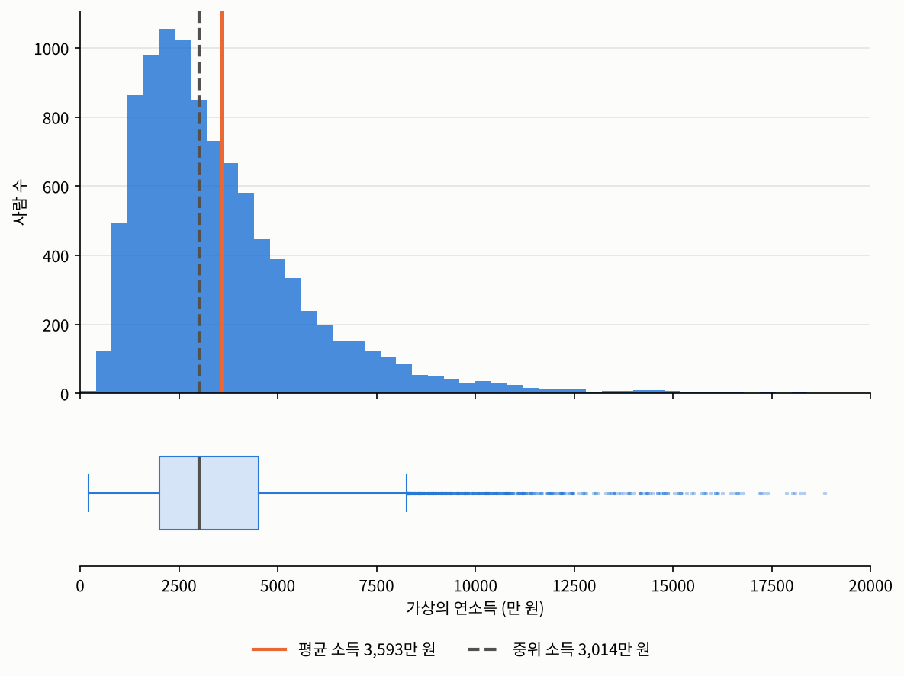

## 들어가며

[지난 글](01-scales.qmd)에서는 데이터의 스케일에 따라 의미 있는 계산이 달라진다는 것을 보았습니다. 이번 글에서는 그 계산들, 즉 데이터를 몇 개의 숫자로 요약하는 **통계량**들을 본격적으로 정리하고, 각 통계량을 어느 스케일에서 쓸 수 있는지 살펴보겠습니다.

## 통계량

먼저 통계량이라는 말부터 정확히 해 두겠습니다.

::: {.callout-note icon=false .callout-definition}
### 정의 2.2.1 (통계량)
표본 데이터 $x_1, \ldots, x_n$을 받아 하나의 값(또는 몇 개의 값)을 계산하는 미리 정해진 함수 $T$가 있을 때, 그 계산 결과
$$T(x_1, \ldots, x_n)$$
을 **통계량**(statistic)이라고 합니다.
:::

어렵게 생각할 것은 없습니다. 예를 들어 다음 두 함수를 생각해 보겠습니다.
$$T_1(x_1, \ldots, x_n) := \frac{x_1 + \cdots + x_n}{n}, \qquad T_2(x_1, \ldots, x_n) := \max_i x_i - \min_i x_i$$
$T_1$은 우리가 잘 아는 평균을 계산하는 함수이고, $T_2$는 가장 큰 값에서 가장 작은 값을 빼서 데이터가 얼마나 넓은 범위에 걸쳐 있는지를 계산하는 함수입니다. 표본을 이 함수들에 넣어 얻은 값이 각각 "표본 평균"과 "범위"라는 통계량입니다.

여기서 중요한 것은 $T$가 **데이터를 보기 전에 미리 정해진** 계산 규칙이라는 점입니다. 데이터 사이언스에서는 이 계산 규칙이 컴퓨터 위에서 하나의 알고리즘으로 구현되기 때문에, $T$를 **통계적 알고리즘**이라고 부르기도 합니다. [1.3](../01-foundations/03-analysis-process.qmd)에서 말했듯이, 통계학과 데이터 사이언스는 같은 개념을 다른 이름으로 부르는 경우가 많습니다.

(통계학에서는 계산된 값 $T(x_1, \ldots, x_n)$보다 함수 $T$ 자체, 또는 $T$에 확률변수를 넣은 것을 통계량이라고 부르는 경우가 많습니다. 이 구분이 왜 필요한지는 [수리적 데이터 분석과 통계적 추론](../../data-analysis-inference/01-mle/01-likelihood.qmd)의 통계량의 정의에서 자세히 다룹니다. 지금은 "데이터를 넣으면 요약값이 나오는 계산 규칙" 정도로 생각하셔도 충분합니다.)

기술 통계를 연구한다는 것은, 어떤 데이터가 주어졌을 때 **어떤 $T$로 요약하는 것이 알맞은가**를 연구하는 일이라고 할 수 있습니다. 우리는 기술 통계를 연구하는 사람이 아니라 사용하는 사람의 입장이므로, 이미 널리 쓰이는 대표적인 통계량들만 살펴보겠습니다.

## 중심 경향을 나타내는 통계량

[2장 소개 글](index.qmd)에서 말했듯이, 기술 통계에서 가장 먼저 요약하는 것은 데이터가 대체로 어디쯤 모여 있는지, 즉 **중심 경향**입니다. 예를 들어 한국 성인의 몸무게 데이터에는 30kg대부터 150kg 이상까지 아주 다양한 값이 있겠지만, 대부분은 그보다 훨씬 좁은 범위에 모여 있을 것입니다. 이 "대부분이 모여 있는 곳"을 하나의 숫자로 나타내는 방법이 여러 가지 있습니다.

::: {.callout-note icon=false .callout-definition}
### 정의 2.2.2 (표본 평균)
표본 $x_1, \ldots, x_n$의 **표본 평균**(sample mean)은 다음과 같습니다.
$$\bar{x} := \frac{1}{n}\sum_{i=1}^{n} x_i$$
:::

::: {.callout-note icon=false .callout-definition}
### 정의 2.2.3 (순서통계량과 표본 중앙값)
표본 $x_1, \ldots, x_n$을 작은 값부터 크기순으로 다시 늘어놓은 것을
$$x_{(1)} \le x_{(2)} \le \cdots \le x_{(n)}$$
으로 쓰고, $k$번째 값 $x_{(k)}$를 **$k$번째 순서통계량**(order statistic)이라고 합니다. 이때 표본의 **중앙값**(median)은 크기순으로 늘어놓았을 때 한가운데에 있는 값입니다.
$$\tilde{x} := \begin{cases} x_{((n+1)/2)} & n\text{이 홀수일 때} \\[4pt] \dfrac{1}{2}\left(x_{(n/2)} + x_{(n/2+1)}\right) & n\text{이 짝수일 때} \end{cases}$$
:::

데이터가 5개라면 크기순으로 3번째 값이, 6개라면 3번째와 4번째 값의 평균이 중앙값입니다. 순서통계량은 중앙값처럼 "순서상의 위치"로 정의되는 통계량들을 정확하게 쓰기 위한 도구입니다.

::: {.callout-note icon=false .callout-definition}
### 정의 2.2.4 (최빈값)
표본에서 **가장 많이 나타나는 값**을 **최빈값**(mode)이라고 합니다. 가장 많이 나타나는 값이 여러 개라면 최빈값도 여러 개일 수 있습니다.
:::

## 퍼진 정도를 나타내는 통계량

중심 경향만으로는 데이터를 충분히 요약할 수 없습니다. 평균이 똑같이 50인 두 반이라도, 한 반은 모든 학생이 45점에서 55점 사이에 있고, 다른 반은 0점과 100점이 반반일 수도 있으니까요. 그래서 중심에서 데이터가 얼마나 넓게 퍼져 있는지, 즉 **산포**(dispersion)도 함께 요약합니다.

::: {.callout-note icon=false .callout-definition}
### 정의 2.2.5 (분위수)
$0 < q < 1$일 때, 표본을 크기순으로 늘어놓았을 때 대략 전체의 $q$만큼이 그 값보다 작거나 같아지는 위치의 값을 **$q$-분위수**($q$-quantile)라고 합니다. 특히 $q = 0.25$, $0.5$, $0.75$인 분위수를 각각 **제1사분위수**($Q_1$), **제2사분위수**($Q_2$), **제3사분위수**($Q_3$)라고 합니다.
:::

중앙값은 데이터의 절반이 그보다 작은 값이니, 0.5-분위수, 즉 제2사분위수와 같습니다. $Q_1$은 하위 25%, $Q_3$는 상위 25%의 경계입니다. (데이터 개수가 유한하면 "정확히 $q$만큼"이 되는 위치가 없을 수 있어서, 두 값 사이를 어떻게 메울지에 따라 분위수를 계산하는 방법이 여러 가지 있습니다. 프로그램마다 결과가 아주 조금씩 다를 수 있다는 정도만 알아 두시면 됩니다.)

::: {.callout-note icon=false .callout-definition}
### 정의 2.2.6 (범위와 사분위 범위)
표본의 **범위**(range)는 $x_{(n)} - x_{(1)}$, 즉 가장 큰 값과 가장 작은 값의 차이입니다. **사분위 범위**(interquartile range, IQR)는 $Q_3 - Q_1$, 즉 가운데 50%의 데이터가 차지하는 폭입니다.
:::

::: {.callout-note icon=false .callout-definition}
### 정의 2.2.7 (표본 분산과 표본 표준편차)
표본 $x_1, \ldots, x_n$의 **표본 분산**(sample variance)과 **표본 표준편차**(sample standard deviation)는 다음과 같습니다.
$$s^2 := \frac{1}{n-1}\sum_{i=1}^{n} (x_i - \bar{x})^2, \qquad s := \sqrt{s^2}$$
:::

표본 분산은 각 데이터가 평균에서 얼마나 떨어져 있는지를 제곱해서 평균 낸 값입니다. 제곱을 하기 때문에 단위도 제곱이 되므로(예: cm²), 다시 제곱근을 씌워 원래 단위로 돌려놓은 것이 표준편차입니다.

그런데 평균을 낸다면서 왜 $n$이 아니라 $n-1$로 나눌까요? 우리가 정말로 알고 싶은 것은 보통 [1.4](../01-foundations/04-sampling-bias.qmd)에서 말한 **모집단**의 분산인데, 표본 평균 $\bar{x}$는 표본 데이터에 가장 잘 맞도록 계산된 값이라서, 표본 데이터는 모집단의 참 평균보다 $\bar{x}$에 조금 더 가깝게 모여 있습니다. 그래서 $n$으로 나누면 분산을 평균적으로 살짝 작게 어림하게 되고, $n-1$로 나누면 이 치우침이 정확히 사라집니다. 이 이야기는 추론 통계를 다루는 4장에서 다시 하겠습니다. 데이터를 요약하는 것만이 목적이라면 $n$으로 나눈 값을 써도 큰 문제는 없고, $n$이 크면 두 값의 차이는 거의 없습니다.

## 파이썬으로 계산해 보기

위의 통계량들을 넘파이로 계산해 보겠습니다. (넘파이 자체는 [2.4](04-numpy.qmd)에서 자세히 다루니, 지금은 결과만 보셔도 괜찮습니다.)

```python
import numpy as np

x = np.array([3, 7, 1, 9, 4, 7, 2])

print("정렬:", np.sort(x))
print("평균:", round(x.mean(), 3))
print("중앙값:", np.median(x))
values, counts = np.unique(x, return_counts=True)
print("최빈값:", values[counts == counts.max()])
print("범위:", x.max() - x.min())
print("Q1, Q3:", np.quantile(x, [0.25, 0.75]))
print("표준편차 (n으로 나눔):", round(x.std(), 3))
print("표준편차 (n-1로 나눔):", round(x.std(ddof=1), 3))
```

```
정렬: [1 2 3 4 7 7 9]
평균: 4.714
중앙값: 4.0
최빈값: [7]
범위: 8
Q1, Q3: [2.5 7. ]
표준편차 (n으로 나눔): 2.763
표준편차 (n-1로 나눔): 2.984
```

마지막 두 줄을 눈여겨보시기 바랍니다. 넘파이의 `std()`는 기본값이 $n$으로 나누는 방식이고, $n-1$로 나누려면 `ddof=1`을 따로 넣어 줘야 합니다. 반면 [2.6](06-pandas-seaborn.qmd)에서 다룰 판다스의 `std()`는 기본값이 $n-1$입니다. 같은 데이터인데 라이브러리에 따라 표준편차가 다르게 나오는 일이 생기니, 실무에서 꽤 자주 헷갈리는 부분입니다.

## 스케일에 따라 쓸 수 있는 통계량

이제 [2.1](01-scales.qmd)의 네 가지 스케일과 위의 통계량들을 연결해 보겠습니다.

### 명목 스케일: 세는 것이 전부입니다

명목 스케일에서는 값의 크기와 간격이 의미가 없으니, 평균은 의미가 없습니다. 지난 글의 혈액형 예처럼 엉뚱한 답이 나올 뿐이지요. 할 수 있는 것은 각 범주가 **몇 번 나왔는지 세는 것**입니다. 그래서 중심 경향을 굳이 하나 고른다면 가장 많이 나온 값, 즉 최빈값을 씁니다. 다만 이때의 최빈값은 데이터의 "중심"이라기보다 그저 "가장 머릿수가 많은 범주"일 뿐이라서, 중심 경향 자체를 크게 따지지 않는 경우도 많습니다.

예외가 하나 있습니다. 남성 $= 0$, 여성 $= 1$처럼 범주가 **두 개뿐인** 데이터를 $0$과 $1$로 적으면, 그 평균은 $1$의 비율, 즉 여성의 비율과 같아집니다. 남성의 비율은 $1$에서 여성의 비율을 뺀 값이므로 따로 적을 필요가 없습니다. 즉 데이터는 두 범주로 나뉘어 있지만, 변수 하나의 평균만으로 두 범주의 분포가 완전히 정해집니다. 다만 이때의 평균은 데이터의 "중심"이라기보다 **비율**로서 의미를 가진다는 점에 주의해야 합니다. 평균이 $0.4$라고 해서 "전형적인 성별이 $0.4$"라는 뜻이 아니라, 여성이 $40\%$라는 뜻이니까요.

참고로 이처럼 어떤 범주에 속하면 $1$, 아니면 $0$을 주는 변수를 **더미 변수**(dummy variable)라고 부르며, 회귀 분석과 머신러닝에서 범주형 데이터를 숫자로 다룰 때 아주 자주 씁니다. 범주가 $k$개일 때도 같은 방법을 쓰는데, 이때는 기준이 되는 범주 하나를 빼고 $k - 1$개의 더미 변수를 만듭니다. 나머지 $k - 1$개가 모두 $0$이면 기준 범주라는 것을 알 수 있으므로, 앞의 남성·여성 예처럼 하나는 따로 적을 필요가 없기 때문입니다. 이때도 각 더미 변수의 평균은 그 범주의 비율이 됩니다.

시각화할 때는 범주별 개수를 막대로 보여 주는 **막대그래프**(bar chart)나, 범주 사이의 비율을 보여 주는 **원그래프**(pie chart)를 씁니다.

### 순서 스케일: 줄을 세울 수 있습니다

순서 스케일에서도 간격이 일정하지 않으니, 평균은 여전히 조심해서 써야 합니다. 대신 명목 스케일과 달리 크기순으로 **줄을 세울 수 있으므로**, 중앙값과 분위수를 쓸 수 있습니다.

예를 들어 고객 9명에게 만족도(1: 매우 불만 ~ 5: 매우 만족)를 물었다고 해 보겠습니다.

```python
satisfaction = np.array([4, 5, 3, 4, 2, 5, 4, 1, 4])
print("정렬:", np.sort(satisfaction))
print("중앙값:", np.median(satisfaction))
print("Q1, Q3:", np.quantile(satisfaction, [0.25, 0.75]))
```

```
정렬: [1 2 3 4 4 4 4 5 5]
중앙값: 4.0
Q1, Q3: [3. 4.]
```

중앙값이 4("만족")라는 것은, 줄을 세웠을 때 가운데에 있는 5번째 고객이 "만족"이라고 답했다는 뜻입니다. 그러면 적어도 다섯 명, 즉 절반 이상의 고객이 "만족" 이상으로 답한 셈이니, 전반적으로 만족도가 높다고 말할 수 있습니다. 사분위수를 보면 가운데 절반의 고객이 3("보통")에서 4("만족") 사이에 있다는 것도 알 수 있습니다. 이처럼 순서 스케일에서는 중앙값을 기준으로 사분위수로 퍼진 정도를 따집니다. 평균을 기준으로 하는 표준편차는 평균 자체가 의미가 약하니 잘 쓰지 않습니다.

시각화로는 막대그래프와 함께, 사분위수를 그림으로 보여 주는 **박스 플롯**(box plot)을 쓸 수 있습니다. 박스 플롯은 1장에서 소개한 튜키가 고안한 그림으로, 나중에도 보시겠지만 중앙값을 비롯한 분위수, 이상치 등을 한 번에 비교하기 좋은 시각화 도구입니다.

### 등간·비율 스케일: 모든 도구를 쓸 수 있습니다

등간 스케일과 비율 스케일부터는 값의 간격이 일정하므로 평균과 표준편차를 포함한 위의 모든 통계량을 쓸 수 있습니다. 시각화 도구도 막대그래프, 박스 플롯에 더해 **히스토그램**(histogram), 산점도, 선 그래프 등 거의 모든 것을 쓸 수 있습니다.

그런데 도구가 많다는 것은, 그만큼 **어떤 도구를 쓸지 스스로 골라야 한다**는 뜻이기도 합니다. 앞의 두 스케일은 쓸 수 있는 도구가 처음부터 제한되어 있어서 고민할 것이 별로 없었지만, 여기서부터는 문제 상황에 따라 가장 알맞은 도구를 고르는 안목이 필요합니다. 물론 도구를 하나만 써야 하는 것은 아니고, 여러 개를 함께 쓰는 경우가 많습니다.

대표적인 예가 **소득**입니다. 소득 통계를 발표할 때는 보통 평균 소득과 중위 소득(소득의 중앙값)을 함께 발표합니다. 왜 그럴까요? 가상의 연소득 데이터 1만 명분을 만들어서 확인해 보겠습니다. 실제 소득 분포처럼 대부분의 사람은 비슷한 범위에 있고, 소수의 사람이 아주 높은 소득을 버는 모양이 되도록 만들었습니다.

```python
np.random.seed(1557)
income = np.random.lognormal(mean=8.0, sigma=0.6, size=10_000)   # 가상의 연소득 (만 원)

print(f"평균 소득  : {income.mean():,.0f}만 원")
print(f"중위 소득  : {np.median(income):,.0f}만 원")
print(f"평균보다 적게 버는 사람의 비율: {(income < income.mean()).mean():.1%}")
```

```
평균 소득  : 3,593만 원
중위 소득  : 3,014만 원
평균보다 적게 버는 사람의 비율: 61.2%
```

평균이 중앙값보다 훨씬 큽니다. 소수의 고소득자가 평균을 위로 끌어올렸기 때문입니다. 그 결과 전체의 60% 이상이 "평균"보다 적게 버는, 언뜻 이상해 보이는 상황이 됩니다. 이 데이터를 그림으로 그려 보면 이유가 분명해집니다.

{fig-alt="가상의 연소득 1만 명분을 그린 두 개의 그림. 위쪽 히스토그램은 왼쪽에 높은 봉우리가 있고 오른쪽으로 길게 꼬리가 늘어진 모양이다. 회색 점선으로 표시한 중위 소득이 주황색 실선으로 표시한 평균 소득보다 왼쪽에 있다. 아래쪽 박스 플롯은 같은 가로축 위에 그려져 있고, 상자는 왼쪽에 좁게 있으며 오른쪽 수염 너머로 수많은 점이 길게 흩어져 있다." width=80%}

위쪽 히스토그램을 보면, 대부분의 사람은 왼쪽 봉우리 근처에 모여 있고 오른쪽으로 꼬리가 길게 늘어져 있습니다. 이렇게 한쪽으로 꼬리가 긴 분포를 **치우친**(skewed) 분포라고 합니다. 평균은 이 긴 꼬리에 끌려 오른쪽으로 밀려나 있고, 중앙값은 사람들이 실제로 많이 모인 곳에 더 가깝습니다.

주의할 점은, 통계에서는 저런 그래프를 "오른쪽으로 치우쳤다(right-skewed)"고 합니다. 뭔가 눈에 보기에는 왼쪽에 대부분의 데이터가 위치한거 같아서 직관적이지 않을 수 있는데요, 통계에서는 분포가 얇아지는 꼬리 부분을 기준으로 치우침을 표현합니다. 그래서 이런 비직관성을 해소하기 위해서 위와 같은 그래프를 (꼬리를 기준으로) 오른쪽으로 치우쳤다는 표현 대신, 오른쪽으로 꼬리가 길다(right tailed)라고 구체적으로 풀어서 표현하기도 합니다.

히스토그램 아래의 그림은 조금 전에도 언급한 박스 플롯이라는 데이터를 분위수로 요약한 그림입니다. 위 박스 플롯은 같은 데이터를 기준으로 그려졌습니다. 가운데 상자의 왼쪽 끝이 $Q_1$, 오른쪽 끝이 $Q_3$, 상자 안의 세로선이 중앙값입니다. 상자 양옆으로 뻗은 선(수염)은 보통 상자 끝에서 사분위 범위의 1.5배 안쪽에 있는 가장 먼 데이터까지 그리고, 그보다 멀리 있는 데이터는 점으로 따로 찍습니다. 오른쪽에 길게 흩어진 점들이 바로 평균을 끌어올린 고소득자들입니다.

그래서 평균 소득은 "국민 전체가 버는 소득의 규모"를 가늠하기에는 좋지만, "보통 사람이 얼마를 버는가"를 나타내기에는 알맞지 않습니다. 그 질문에는 중위 소득이 더 정확한 답입니다. 이처럼 **같은 데이터라도 어떤 통계량을 고르느냐에 따라 전달되는 이야기가 달라집니다.** 어떤 통계량을 쓸지는 [1.3](../01-foundations/03-analysis-process.qmd)에서 말한 것처럼 우리가 던진 질문에 달려 있습니다.

## 정리

| 스케일 | 중심 경향 | 산포 | 대표적인 그림 |
|:--|:--|:--|:--|
| 명목 | 최빈값 (각 범주의 개수) | — | 막대그래프, 원그래프 |
| 순서 | 중앙값, 최빈값 | 분위수, 사분위 범위 | 막대그래프, 박스 플롯 |
| 등간·비율 | 평균, 중앙값, 최빈값 | 표준편차, 분위수, 범위 | 히스토그램, 박스 플롯, 산점도 등 |

- **통계량**은 데이터를 넣으면 요약값이 나오는, 미리 정해진 계산 규칙입니다.
- 중심 경향은 평균, 중앙값, 최빈값으로, 산포는 표준편차, 분위수, 범위로 요약합니다.
- 어떤 통계량을 쓸 수 있는지는 스케일이 정하고, 그중 무엇을 쓸지는 질문이 정합니다.
- 분포가 한쪽으로 치우쳐 있으면 평균과 중앙값이 크게 달라질 수 있습니다.

지금까지는 데이터 하나하나가 하나의 숫자인 경우만 다뤘습니다. 하지만 실제 데이터에는 나이, 성별, 구매액처럼 여러 변수가 함께 들어 있고, 우리가 정말 궁금한 것은 대개 **변수들 사이의 관계**입니다. 다음 글에서는 변수가 둘 이상인 데이터를 요약하는 방법을 살펴보겠습니다.

---

### 연결되는 개념
* $\leftarrow$ **이전 개념:** [2.1 데이터의 스케일](01-scales.qmd)
* $\rightarrow$ **다음 개념:** [2.3 다변량 데이터와 상관관계](03-correlation.qmd)
