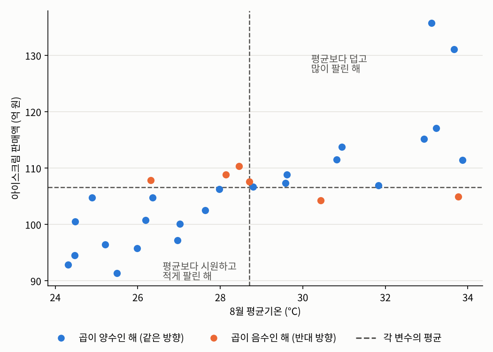
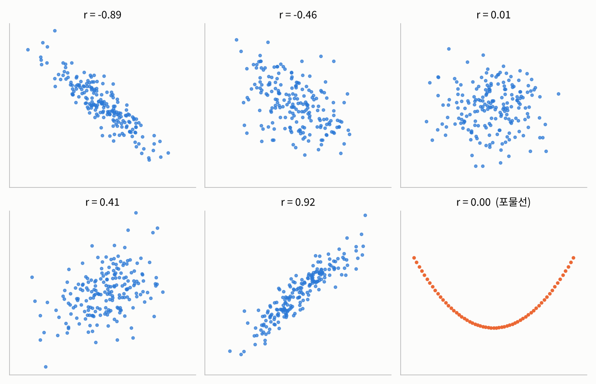

## 들어가며

[지난 글](02-summary-statistics.qmd)까지는 데이터 $x_1, \ldots, x_n$의 각 값이 하나의 숫자인 경우만 다뤘습니다. 하지만 실제 데이터는 대부분 그렇지 않습니다. 고객 만족도를 조사할 때도 만족도 하나만 묻기보다는 고객의 나이, 성별, 구매 금액 같은 정보를 함께 모으지요. 그리고 우리가 정말 알고 싶은 것은 대개 "나이에 따라 만족도가 달라지는가?"처럼 **변수들 사이의 관계**입니다. 이번 글에서는 이런 데이터를 요약하는 방법을 살펴보겠습니다.

## 다변량 데이터

::: {.callout-note icon=false .callout-definition}
### 정의 2.3.1 (다변량 데이터)
각 관측값이 $d$개의 숫자로 이루어진 데이터
$$\mathbf{x}_1, \ldots, \mathbf{x}_n, \qquad \mathbf{x}_i = (x_{i1}, x_{i2}, \ldots, x_{id})$$
를 **다변량 데이터**(multivariate data)라고 합니다. 특히 $d = 2$인 경우를 **이변량 데이터**(bivariate data)라고 하고, 보통 $(x_1, y_1), \ldots, (x_n, y_n)$으로 씁니다. 지금까지 다룬 $d = 1$인 데이터는 **단변량 데이터**(univariate data)라고 부릅니다.
:::

표로 생각하면 쉽습니다. 고객 한 명이 표의 한 행이고, 나이, 성별, 구매 금액이 각각 하나의 열입니다. 이때 각 열 하나하나는 [2.1](01-scales.qmd)의 스케일 중 하나를 따르는 단변량 데이터이고, 한 행에 담긴 여러 값을 하나로 묶은 것이 다변량 데이터의 관측값 $\mathbf{x}_i$입니다.

그렇다면 왜 서로 다른 값들을 굳이 묶어서 생각할까요? 그 값들이 **서로 관련이 있을 것**이라고 생각하기 때문입니다. 예를 들어 $x_k$를 $k$번째 해의 8월 평균기온, $y_k$를 같은 해 8월의 아이스크림 판매액이라고 해 보겠습니다. 날씨가 더울수록 아이스크림이 더 많이 팔릴 것 같기도 하고, 너무 더우면 사람들이 밖에 나가지 않아서 오히려 덜 팔릴 것 같기도 합니다. 어느 쪽이 맞는지는 모르지만, 둘 사이에 어떤 관련이 있으리라는 데에는 모두 동의하실 겁니다. 어느 쪽이 맞는지 판단하려면 이 관련성을 숫자로 정확하게 요약해야 하고, 그래서 두 값을 하나의 쌍으로 묶어서 다루는 것입니다.

## 공분산: 함께 움직이는 정도

가상의 데이터로 생각해 보겠습니다. 30년 동안의 8월 평균기온과 아이스크림 판매액을 만들었습니다.

```python
import numpy as np

np.random.seed(2026)
temp = np.random.uniform(24, 34, 30)              # 30년 동안의 8월 평균기온 (°C)
sales = 20 + 3 * temp + 6 * np.random.randn(30)   # 같은 해 8월 아이스크림 판매액 (억 원)

print(f"평균기온의 평균: {temp.mean():.1f}°C, 판매액의 평균: {sales.mean():.1f}억 원")
```

```
평균기온의 평균: 28.7°C, 판매액의 평균: 106.6억 원
```

이 데이터를 점으로 찍어 보면 다음과 같습니다. 가로축이 기온, 세로축이 판매액이고, 점 하나가 한 해입니다. 이런 그림을 **산점도**(scatter plot)라고 합니다. 회색 점선은 각각 기온의 평균과 판매액의 평균입니다.

{fig-alt="가로축이 8월 평균기온, 세로축이 아이스크림 판매액인 산점도. 기온의 평균과 판매액의 평균에 회색 점선이 그어져 그림을 네 칸으로 나눈다. 대부분의 점이 오른쪽 위 칸과 왼쪽 아래 칸에 있고 파란색으로 칠해져 있다. 왼쪽 위 칸과 오른쪽 아래 칸에 있는 몇 개의 점은 주황색이다." width=70%}

두 평균선이 그림을 네 칸으로 나눕니다. 오른쪽 위 칸은 "평균보다 덥고, 평균보다 많이 팔린 해", 왼쪽 아래 칸은 "평균보다 시원하고, 평균보다 적게 팔린 해"입니다. 대부분의 점이 이 두 칸에 있다는 것은, 기온과 판매액이 **같은 방향으로 움직이는** 경향이 있다는 뜻입니다.

이 관찰을 숫자로 옮겨 보겠습니다. $k$번째 해가 오른쪽 위 칸에 있다면 $x_k - \bar{x} > 0$이고 $y_k - \bar{y} > 0$이니, 두 값을 곱한 $(x_k - \bar{x})(y_k - \bar{y})$는 양수입니다. 왼쪽 아래 칸이라면 두 값이 모두 음수이니 곱은 역시 양수입니다. 반대로 왼쪽 위나 오른쪽 아래 칸에 있는 해(그림의 주황색 점)는, 한쪽은 평균보다 크고 다른 쪽은 평균보다 작으니 곱이 음수가 됩니다. 그러니 이 곱을 모든 해에 대해 평균 내면, 두 변수가 전체적으로 어느 방향으로 함께 움직이는지를 알 수 있습니다.

::: {.callout-note icon=false .callout-definition}
### 정의 2.3.2 (표본 공분산)
이변량 데이터 $(x_1, y_1), \ldots, (x_n, y_n)$의 **표본 공분산**(sample covariance)은 다음과 같습니다.
$$s_{xy} := \frac{1}{n-1}\sum_{i=1}^{n} (x_i - \bar{x})(y_i - \bar{y})$$
:::

$n-1$로 나누는 이유는 [2.2](02-summary-statistics.qmd)의 표본 분산과 같습니다. 실제로 $y$ 자리에 $x$를 넣으면 공분산은 $x$의 표본 분산이 됩니다. 공분산이 양수이면 두 변수가 같은 방향으로, 음수이면 반대 방향으로 움직이는 경향이 있다는 뜻입니다. 이렇게 함께 움직이는 경향을 **상관관계**(correlation)라고 하고, 같은 방향이면 양의 상관관계, 반대 방향이면 음의 상관관계라고 부릅니다.

## 상관계수: 단위를 없앤 공분산

그런데 공분산에는 한 가지 큰 약점이 있습니다. 값의 크기가 **단위에 따라 달라진다**는 것입니다. 위의 판매액을 억 원 대신 원 단위로 바꿔서 공분산을 다시 계산해 보겠습니다.

```python
cov_eok = np.cov(temp, sales)[0, 1]          # 판매액 단위: 억 원
cov_won = np.cov(temp, sales * 1e8)[0, 1]    # 판매액 단위: 원
print(f"공분산 (억 원): {cov_eok:.2f}")
print(f"공분산 (원)   : {cov_won:.3e}")
```

```
공분산 (억 원): 23.48
공분산 (원)   : 2.348e+09
```

데이터는 똑같은데 단위만 바꿨더니 공분산이 1억 배가 되었습니다. 이래서는 공분산이 크다고 관계가 강하다고 말할 수 없고, 서로 다른 데이터끼리 비교할 수도 없습니다. 기온과 판매액처럼 단위도 크기도 전혀 다른 두 변수를 곱하니, 값이 큰 쪽의 단위가 공분산의 크기를 좌우해 버리는 것이지요.

이 문제를 해결하는 방법은 간단합니다. 각 변수가 원래 얼마나 퍼져 있는지, 즉 표준편차로 나눠서 단위를 없애면 됩니다.

::: {.callout-note icon=false .callout-definition}
### 정의 2.3.3 (표본 상관계수)
이변량 데이터의 **표본 상관계수**(sample correlation coefficient)는 공분산을 두 변수의 표준편차로 나눈 값입니다.
$$r_{xy} := \frac{s_{xy}}{s_x \, s_y} = \frac{\sum_{i=1}^{n} (x_i - \bar{x})(y_i - \bar{y})}{\sqrt{\sum_{i=1}^{n} (x_i - \bar{x})^2}\,\sqrt{\sum_{i=1}^{n} (y_i - \bar{y})^2}}$$
이 값을 고안한 통계학자의 이름을 따서 **피어슨 상관계수**(Pearson correlation coefficient)라고도 합니다.
:::

분자와 분모의 단위가 서로 지워지기 때문에, 상관계수는 단위와 상관없는 순수한 숫자가 됩니다.

```python
print(f"상관계수 (억 원): {np.corrcoef(temp, sales)[0, 1]:.4f}")
print(f"상관계수 (원)   : {np.corrcoef(temp, sales * 1e8)[0, 1]:.4f}")
```

```
상관계수 (억 원): 0.7669
상관계수 (원)   : 0.7669
```

게다가 상관계수는 항상 $-1$과 $1$ 사이의 값을 가집니다.

::: {.callout-important icon=false .callout-satz}
### 정리 2.3.4 (상관계수의 범위)
분산이 0이 아닌 이변량 데이터의 표본 상관계수는 항상
$$-1 \le r_{xy} \le 1$$
을 만족합니다. 특히 $r_{xy} = 1$ 또는 $-1$인 것은, 모든 점 $(x_i, y_i)$가 기울기가 각각 양수 또는 음수인 한 직선 위에 있을 때뿐입니다.
:::

::: {.callout-tip collapse="false" icon=false .callout-beweis}
### 증명
$\mathbf{u} = (x_1 - \bar{x}, \ldots, x_n - \bar{x})$, $\mathbf{v} = (y_1 - \bar{y}, \ldots, y_n - \bar{y})$라는 두 벡터를 생각하면, 상관계수는
$$r_{xy} = \frac{\mathbf{u} \cdot \mathbf{v}}{\lVert \mathbf{u} \rVert \, \lVert \mathbf{v} \rVert}$$
로 쓸 수 있습니다. 코시-슈바르츠 부등식 $|\mathbf{u} \cdot \mathbf{v}| \le \lVert \mathbf{u} \rVert \, \lVert \mathbf{v} \rVert$에 의해 $|r_{xy}| \le 1$이고, 등호는 $\mathbf{v}$가 $\mathbf{u}$의 상수배일 때, 즉 모든 $i$에 대해 $y_i - \bar{y} = c\,(x_i - \bar{x})$일 때만 성립합니다. 코시-슈바르츠 부등식 자체는 [선형대수학](../../../math/linear-algebra/index.qmd)을 참고하시기 바랍니다.
:::

증명에서 보듯, 상관계수는 두 벡터 사이의 각도의 코사인과 같습니다. 두 변수가 완전히 같은 방향으로 움직이면 각도가 0이라 1, 완전히 반대로 움직이면 각도가 180도라 $-1$, 아무 관련이 없으면 직각에 가까워 0 근처가 되는 셈입니다. 위의 기온과 판매액 데이터는 상관계수가 약 0.77이니, 꽤 강한 양의 상관관계가 있다고 할 수 있습니다.

## 상관계수는 직선 관계만 봅니다

상관계수의 값에 따라 데이터가 어떤 모양인지 그려 보면 다음과 같습니다. 각 그림 위의 숫자는 그 데이터로 실제로 계산한 상관계수입니다.

{fig-alt="2행 3열로 배치된 여섯 개의 산점도. 첫 줄의 세 그림은 상관계수가 -0.89, -0.46, 0.01인 데이터로, -0.89는 점들이 오른쪽 아래로 내려가는 좁은 띠, -0.46은 같은 방향의 넓은 띠, 0.01은 둥글게 퍼진 구름 모양이다. 둘째 줄의 첫 두 그림은 상관계수가 0.41, 0.92인 데이터로 오른쪽 위로 올라가는 띠 모양이며 0.92 쪽이 훨씬 좁다. 마지막 그림은 점들이 U자 모양의 포물선 위에 정확히 놓여 있는데도 상관계수가 0이다." width=85%}

부호는 방향을, 절댓값은 점들이 **직선에** 얼마나 가깝게 모여 있는지를 나타냅니다. 절댓값이 1에 가까울수록 점들이 좁은 띠처럼 직선 주위에 모이고, 0에 가까울수록 둥글게 퍼집니다.

그런데 마지막 그림을 보시기 바랍니다. 점들이 $y = x^2$라는 포물선 위에 **정확히** 놓여 있어서, $x$를 알면 $y$를 완벽하게 알 수 있습니다. 그런데도 상관계수는 0입니다.

```python
x = np.linspace(-3, 3, 61)
y = x ** 2
print(f"상관계수: {np.corrcoef(x, y)[0, 1]:.4f}")
```

```
상관계수: 0.0000
```

왼쪽 절반에서는 $x$가 커질 때 $y$가 작아지고, 오른쪽 절반에서는 $x$가 커질 때 $y$도 커지니, 두 경향이 정확히 상쇄되어 버린 것입니다. 이처럼 공분산과 상관계수가 재는 것은 모든걸 아우르는 절대적인 상관관계가 아니라 **직선적 관계**(linear relationship)입니다. 그래서 상관계수가 0이라는 것은 "관계가 없다"가 아니라 "**직선** 관계가 없다"는 뜻일 뿐입니다. 관계가 아예 없을 수도 있고, 직선보다 복잡한 모양일 수도 있습니다.

확률론을 공부하신 분이라면, 두 확률변수가 독립이면 공분산이 0이지만, 공분산이 0이라고 해서 독립인 것은 아니라는 사실을 떠올리실 겁니다. 바로 이 이야기입니다. ([기초 확률론](../../../stats/prob-theory/index.qmd)에서 자세히 다룹니다.) [2장 소개 글](index.qmd)의 앤스컴 콰르텟에서 네 데이터의 모양이 전혀 달랐는데도 상관계수가 모두 약 0.82였던 것도 같은 이유입니다. 상관계수 하나로는 관계의 **모양**까지 알 수 없으니, 반드시 산점도를 함께 그려 봐야 합니다.

참고로 직선이 아닌 관계까지 잡아내는 방법도 있습니다. 이런 다양한 상관관계를 계량화하는 방법은 [수리적 데이터 분석과 통계적 추론](../../data-analysis-inference/index.qmd)에서 다룹니다.

## 상관관계는 인과관계가 아닙니다

상관계수를 다룰 때 가장 조심해야 할 점이 하나 더 있습니다. 바로 **상관관계는 인과관계가 아니라는 것**입니다. [1.3](../01-foundations/03-analysis-process.qmd)에서도 질문의 유형을 혼동하는 대표적인 실수로 이 이야기를 잠깐 했습니다.

두 변수 사이에 **인과관계**(causation)가 있다는 것은, 한쪽이 원인이 되어 다른 쪽이라는 결과를 만들어 낸다는 뜻입니다. 반면 상관관계는 그저 한쪽이 커질 때 다른 쪽도 커지는(또는 작아지는) 경향이 **관찰된다**는 뜻일 뿐입니다. 둘은 비슷해 보이지만 논리적으로는 아주 다른 이야기입니다.

위의 예를 조금 바꿔서, 아이스크림 판매액과 물놀이 안전사고 건수를 비교해 보겠습니다. 기온이 높으면 아이스크림이 많이 팔리고, 피서객도 늘어나 물놀이 사고도 늘어날 것입니다. 가상의 데이터에서, 사고 건수가 **오직 기온에만** 영향을 받도록 만들어 보겠습니다. 아이스크림 판매액은 사고 건수를 계산하는 데 전혀 쓰이지 않습니다.

```python
accidents = np.random.poisson(10 * np.exp(-2 + 0.12 * temp))   # 기온에만 영향을 받는 사고 건수

print(f"기온 - 사고 건수     : {np.corrcoef(temp, accidents)[0, 1]:.2f}")
print(f"판매액 - 사고 건수   : {np.corrcoef(sales, accidents)[0, 1]:.2f}")
```

```
기온 - 사고 건수     : 0.91
판매액 - 사고 건수   : 0.63
```

아이스크림 판매액과 사고 건수 사이에 뚜렷한 양의 상관관계가 나타났습니다. 하지만 이것을 "아이스크림이 많이 팔려서 사고가 늘었다"거나 "사고가 많아서 아이스크림이 팔렸다"고 해석할 수는 없습니다. 둘 다 **기온**이라는 공통의 원인 때문에 함께 움직였을 뿐입니다. 이처럼 두 변수에 동시에 영향을 주어 둘 사이에 가짜 상관관계를 만들어 내는 변수를 **교란 변수**(confounding variable)라고 합니다.

현실의 데이터에서는 교란 변수가 이렇게 분명하게 드러나지 않는 경우가 대부분입니다. 그런데 뉴스나 인터넷에서 접하는 통계 자료는 대개 상관관계만 보여 줍니다. 그런 자료를 인과관계처럼 읽고 "통계가 그렇다"며 자기 주장의 근거로 삼는 경우를 생각보다 자주 볼 수 있고요. 데이터 사이언스를 공부하는 우리는 이 차이를 늘 의식하고 있어야 합니다.

### 그렇다면 인과관계는 어떻게 알아낼까요?

인과관계를 밝히는 가장 확실한 방법은 **다른 모든 조건을 똑같이 두고, 원인으로 생각되는 것 하나만 바꿔 보는 것**입니다. 그래도 결과가 달라진다면, 그 차이는 바꾼 것 때문이라고 말할 수 있으니까요.

하지만 현실에서 모든 조건을 똑같이 맞추는 것은 거의 불가능합니다. 그래서 쓰는 방법이 **무작위 배정**(random assignment)입니다. 사람들을 무작위로 두 집단으로 나누어 한 집단에만 원인을 주면, 나이, 성별, 습관 같은 다른 조건들은 두 집단에 평균적으로 비슷하게 섞여 들어갑니다. [1.4](../01-foundations/04-sampling-bias.qmd)에서 본 큰 수의 법칙 덕분에, 집단이 클수록 두 집단은 원인을 받았는지만 빼고 평균적으로 거의 같아집니다. 이렇게 하면 교란 변수가 끼어들 틈이 사라집니다.

신약의 효과를 확인하는 **무작위 대조 시험**(randomized controlled trial)이 대표적인 예이고, 데이터 사이언스에서는 웹사이트의 두 가지 디자인 중 어느 쪽이 구매를 더 늘리는지 사용자를 무작위로 나눠 비교하는 **A/B 테스트**(A/B test)가 같은 원리입니다. 반대로 이렇게 실험을 할 수 없고 관찰된 데이터만 있을 때 인과관계를 추론하는 방법은 통계학의 **인과 추론**(causal inference)이라는 분야에서 다루고, 이 사이트에서는 [인과 추론](../../../biostat/causal-inference/index.qmd) 과목에서 다룰 예정입니다. 경제학 역시 사회 현상의 인과관계를 밝히는 데 오랫동안 공을 들여 온 분야로, 데이터 사이언스의 인과 추론과 많은 방법을 공유합니다.

## 정리

- 각 관측값이 여러 숫자로 이루어진 데이터를 **다변량 데이터**라고 하고, 우리가 궁금한 것은 대개 변수들 사이의 관계입니다.
- **공분산**은 두 변수가 함께 움직이는 방향을 알려 주지만, 크기가 단위에 따라 달라집니다.
- **상관계수**는 공분산을 표준편차로 나눠 단위를 없앤 값으로, 항상 $-1$과 $1$ 사이에 있습니다.
- 상관계수는 **직선 관계**만 잡아내므로, 상관계수가 0이라고 관계가 없는 것은 아닙니다. 반드시 산점도를 함께 봐야 합니다.
- **상관관계는 인과관계가 아닙니다.** 교란 변수가 가짜 상관관계를 만들 수 있고, 인과관계를 확인하려면 무작위 배정 같은 별도의 방법이 필요합니다.

여기까지 기술 통계의 기본 개념을 살펴보았습니다. 이 글들에서 계속 넘파이로 계산하고 그림을 보여 드렸는데, 다음 글부터는 그 도구들을 직접 다뤄 보겠습니다. 먼저 파이썬에서 수치 데이터를 다루는 가장 기본적인 도구인 넘파이부터 시작합니다.

---

### 연결되는 개념
* $\leftarrow$ **이전 개념:** [2.2 요약 통계량](02-summary-statistics.qmd)
* $\rightarrow$ **다음 개념:** [2.4 NumPy로 데이터 다루기](04-numpy.qmd)
