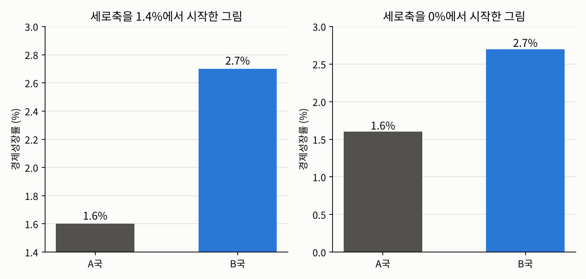
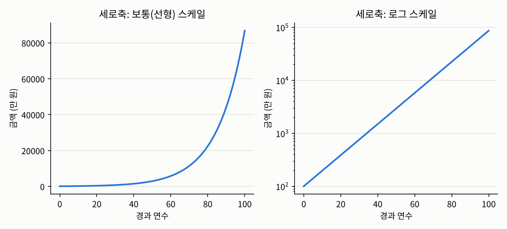
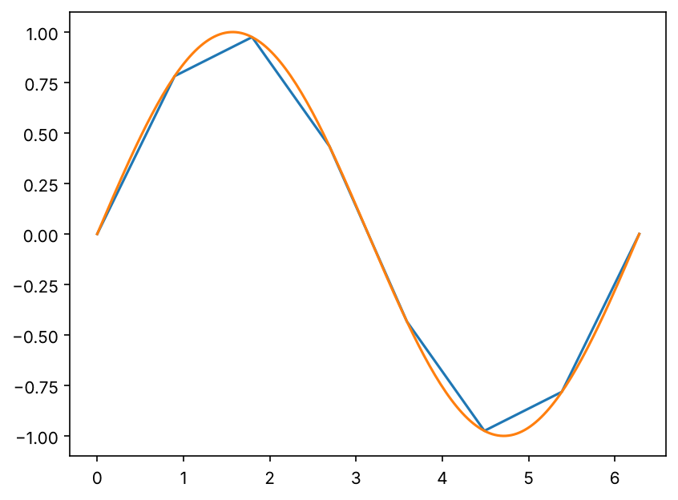
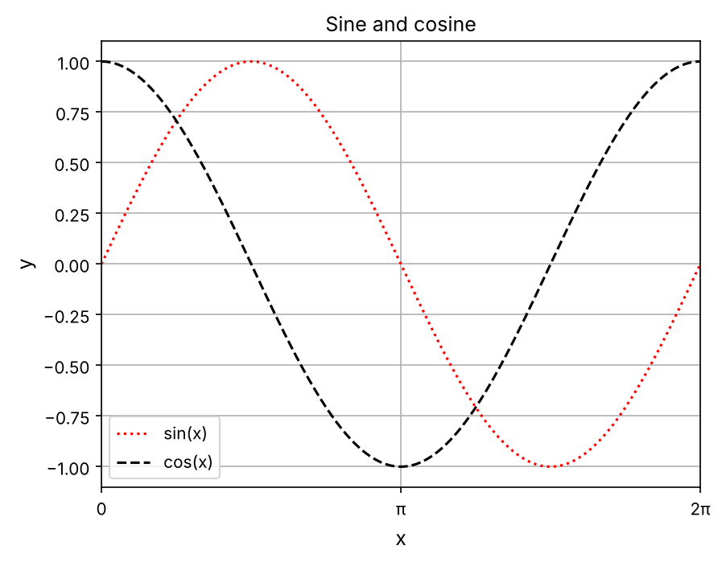
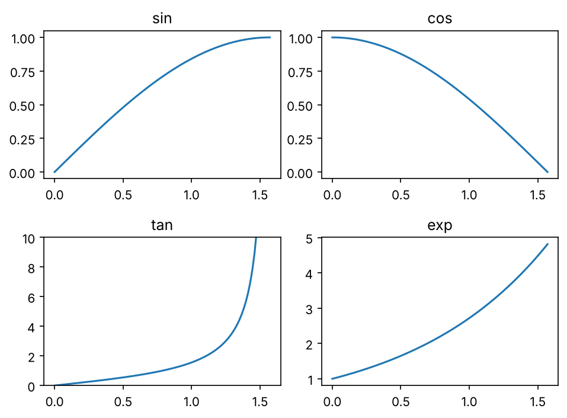
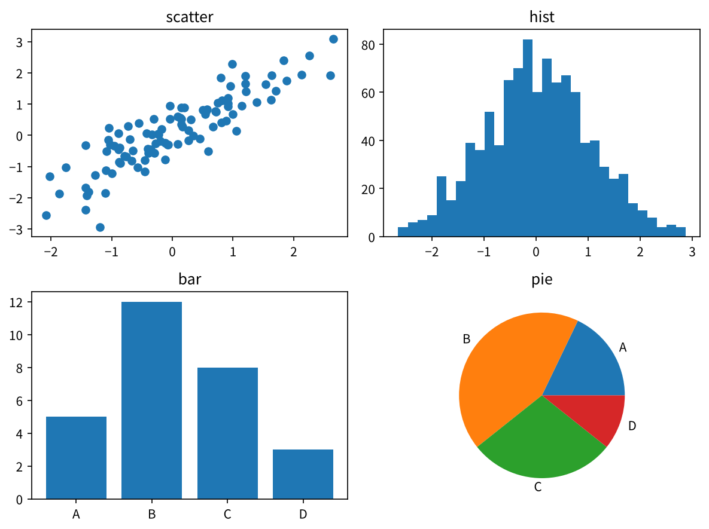

## 들어가며

[지난 글](04-numpy.qmd)에서는 넘파이로 데이터를 담고, 검사하고, 손질하는 방법을 살펴보았습니다. [2장 소개 글](index.qmd)의 앤스컴 콰르텟에서 보았듯이 숫자만으로는 데이터를 다 알 수 없으니, 이제 데이터를 그림으로 그려 볼 차례입니다. 그런데 그리는 법을 배우기 전에, 먼저 **어떤 그림이 좋은 그림인가**부터 생각해 보겠습니다.

## 데이터 시각화

**데이터 시각화**(data visualization)는 데이터를 눈으로 보기 좋게 정리해서 보여 주는 일입니다. 데이터 사이언스에서 시각화라고 하면 대부분 **플롯**(plot), 즉 가로축과 세로축으로 이루어진 좌표계 위에 점이나 선, 막대를 그린 그림을 말합니다. 앞의 글들에서 본 산점도, 히스토그램, 박스 플롯이 모두 플롯입니다. 가공된 데이터는 대부분 숫자이기 때문에, 좌표계를 기준으로 그 숫자들을 보여 주는 것이 가장 효과적인 경우가 많습니다.

물론 플롯만 있는 것은 아닙니다. 알고리즘의 흐름을 보여 주는 순서도나, 상태가 어떻게 바뀌는지 화살표로 보여 주는 그림처럼, 대상들 사이의 관계나 과정을 보여 주는 그림은 **다이어그램**(diagram)이라고 부릅니다. 이 글에서는 플롯을 중심으로 이야기하겠습니다.

### 좋은 그림의 조건

어떤 그림이 가장 효과적인지는 데이터와 질문에 따라 달라서, 정답이 정해져 있지 않습니다. 하지만 어떤 그림이 **바람직한지**에 대해서는 대체로 합의된 기준이 있습니다. 좋은 그림은 보통 다음과 같은 조건을 갖춥니다.

1. **누구나 명확하게 이해할 수 있어야 합니다.** 그림을 볼 사람이 누구인지 생각하고, 그 사람이 한눈에 알아볼 수 있게 그려야 합니다.
2. **독자를 오도하지 않고, 올바른 비교를 이끌어야 합니다.**
3. **일관성이 있어야 합니다.** 한 보고서 안의 그림들은 색, 모양, 배치 같은 규칙이 일관되어야 합니다. 예를 들어 앞 그림에서 파란색이 "올해"를 뜻했다면, 다음 그림에서도 그래야 합니다.
4. **축의 스케일은 꼭 필요할 때만 바꿔야 합니다.**
5. **데이터에 대한 실제 정보를 담아야 합니다.** 아무리 멋진 그림이라도 엉뚱한 데이터를 그렸거나, 우리가 답하려는 질문과 상관없는 것을 보여 준다면 의미가 없습니다.

1번과 5번은 당연한 이야기이니, 2번과 4번을 조금 더 살펴보겠습니다.

### 그림으로 오도하지 않기

다음 두 그림은 경제성장률이 각각 1.6%와 2.7%인 두 나라를 똑같은 데이터로 그린 것입니다.

{fig-alt="같은 데이터를 그린 두 개의 막대그래프. A국 1.6퍼센트, B국 2.7퍼센트. 왼쪽 그림은 세로축이 1.4퍼센트에서 시작해서 B국 막대가 A국 막대보다 여섯 배쯤 길어 보인다. 오른쪽 그림은 세로축이 0퍼센트에서 시작해서 B국 막대가 A국 막대의 두 배가 안 되는 길이로 보인다." width=85%}

왼쪽 그림만 보면 B국이 A국보다 몇 배는 더 성장한 것처럼 보입니다. 하지만 실제 차이는 2.7 ÷ 1.6, 약 1.7배입니다. 세로축을 0이 아니라 1.4%에서 시작했기 때문에 막대의 길이가 실제 값의 비율을 반영하지 못한 것입니다. 막대그래프를 보는 사람은 자연스럽게 **막대의 길이**를 비교하므로, 막대그래프의 세로축은 0에서 시작하는 것이 원칙입니다.

비슷한 방식으로 독자를 오도하는 경우가 또 있습니다. 예를 들어 연도별 값을 그리면서 2017년과 2018년 사이는 1년 간격으로, 2018년과 2020년 사이는 2년 간격으로 찍어 놓고 가로축에서는 둘을 같은 간격으로 그리면, 2년 동안의 변화가 1년 동안의 변화처럼 보여서 증가 속도가 실제보다 훨씬 가파르게 보입니다. 플롯은 좌표계 위에 그리는 그림이므로, 축의 눈금은 실제 간격을 그대로 반영해야 합니다.

이런 그림은 의도했든 아니든 독자를 속이는 것에 가깝습니다. 그리고 요즘은 이런 왜곡을 알아보는 사람이 많아서, 들키는 순간 그 분석 전체의 신뢰도가 떨어지게 됩니다. 다섯 가지 조건 가운데 신뢰도에 가장 치명적인 것이 바로 이 2번입니다.

### 스케일은 꼭 필요할 때만

4번 조건은 조금 의아하실 수도 있습니다. 값의 크기가 너무 많이 차이 나서 스케일을 바꾸지 않고는 제대로 볼 수 없는 경우도 많기 때문입니다.

예를 들어 100만 원을 연 7%의 복리로 100년 동안 맡겨 두면, 100년 뒤에는 약 8억 6,772만 원, 처음의 약 868배가 됩니다. 이 변화를 보통의 축 위에 그리면 처음 수십 년 동안의 변화는 바닥에 붙어서 거의 보이지 않습니다. 이럴 때는 세로축의 눈금을 10배씩 커지도록 바꾼 **로그 스케일**(log scale)이 유용합니다.

{fig-alt="100만 원을 연 7퍼센트 복리로 100년 동안 불린 금액을 그린 두 개의 그래프. 왼쪽은 보통의 세로축이라 처음 50년 정도는 거의 0에 붙어 있다가 마지막에 가파르게 솟는 곡선이다. 오른쪽은 세로축이 10의 2제곱부터 10의 5제곱까지 로그 스케일이라 같은 데이터가 곧은 직선으로 보인다." width=85%}

로그 스케일에서는 일정한 비율로 커지는 값이 직선으로 그려지기 때문에, 복리처럼 "해마다 7%씩" 커지는 변화를 한눈에 볼 수 있습니다. 그러니 4번 조건은 스케일을 절대 바꾸지 말라는 뜻이 아니라, **꼭 필요할 때만** 바꾸고, 바꿨다면 어느 축을 어떻게 바꿨는지 **분명하게 밝히라**는 뜻입니다. 로그 스케일이라는 표시 없이 오른쪽 그림만 보여 준다면, 독자는 금액이 일정하게 늘어난다고 오해할 것입니다.

결국 좋은 그림이란, 최대한 투명하고 정직하게, 누구나 알아볼 수 있도록, 우리의 질문에 답하는 그림입니다. 이제 이런 그림을 직접 그려 보겠습니다.

## 맷플롯립 시작하기

파이썬에서 그래프를 그릴 때 가장 기본이 되는 라이브러리는 **맷플롯립**(Matplotlib)입니다. 보통 넘파이와 함께 다음과 같이 불러옵니다.

```python
import numpy as np
import matplotlib.pyplot as plt
```

맷플롯립을 통째로 불러오지 않고 `pyplot`이라는 부분만 불러오는 데는 이유가 있습니다. 맷플롯립을 그림 그리기 도구가 가득한 큰 도서관이라고 한다면, `pyplot`은 필요한 책을 바로 찾아 주는 안내 데스크 같은 역할을 합니다. 대부분의 그림은 `pyplot`만으로 간단히 그릴 수 있습니다. 넘파이를 함께 불러오는 것은, 그릴 데이터를 보통 넘파이 배열로 준비하기 때문입니다.

::: {.callout-note}
### 그래프에 한글을 쓰려면
맷플롯립의 기본 글꼴에는 한글이 없어서, 제목이나 축 이름에 한글을 쓰면 글자가 네모로 깨져 나옵니다. 이럴 때는 그림을 그리기 전에 한글 글꼴을 지정해 주면 됩니다. 예를 들어 윈도우에서는 `plt.rcParams["font.family"] = "Malgun Gothic"`, 맥에서는 `"AppleGothic"`을 쓸 수 있습니다. 이 글의 예제는 이런 설정 없이도 돌아가도록 그래프 안의 글자를 영어로 적었습니다.
:::

## 선 그래프: `plot()`

`plt.plot()`은 가장 기본적인 그래프인 **선 그래프**(line plot)를 그립니다. 원리는 간단합니다. 가로축 좌표들과 세로축 좌표들을 배열로 넘겨주면, 그 점들을 찍고 **차례로 직선으로 이어** 줍니다. 그래서 함수의 그래프를 그릴 때는, 가로축 구간을 잘게 나눈 배열을 만들고 그 배열을 함수에 넣어 세로축 좌표를 만들면 됩니다.

```python
x_coarse = np.linspace(0, 2 * np.pi, 8)      # 점 8개
x_fine = np.linspace(0, 2 * np.pi, 200)      # 점 200개

plt.plot(x_coarse, np.sin(x_coarse))
plt.plot(x_fine, np.sin(x_fine))
```

{fig-alt="사인 함수를 두 번 그린 선 그래프. 점 8개로 그린 파란 선은 꺾은선처럼 각져 있고, 점 200개로 그린 주황 선은 매끄러운 사인 곡선이다." width=60%}

같은 사인 함수인데, 점 8개로 그린 파란 선은 각이 져 있고 점 200개로 그린 주황 선은 매끄럽습니다. `plot()`은 점과 점 사이를 직선으로 잇기 때문입니다. 곡선을 매끄럽게 그리고 싶다면 점을 더 잘게 나누면 됩니다. 한 번에 `plot()`을 여러 번 부르면 같은 그림 위에 겹쳐 그려지고, 색은 맷플롯립이 알아서 하나씩 바꿔 줍니다.

### 그래프 꾸미기

그림은 보는 사람이 쉽게 이해하는 것이 목적이므로, 색과 선 모양, 축 이름, 제목 같은 요소도 중요합니다. 선의 색과 모양은 `plot()`에 옵션으로 넘기고, 축과 제목은 별도의 함수로 정합니다.

```python
x = np.linspace(0, 2 * np.pi, 200)

plt.plot(x, np.sin(x), color="r", linestyle=":", label="sin(x)")
plt.plot(x, np.cos(x), "k--", label="cos(x)")     # 검은색(k) 파선(--)

plt.xlabel("x", fontsize=12)
plt.ylabel("y", fontsize=12)
plt.title("Sine and cosine")
plt.xticks([0, np.pi, 2 * np.pi], ["0", "π", "2π"])
plt.xlim(0, 2 * np.pi)
plt.legend()
plt.grid()
```

{fig-alt="0부터 2파이까지 사인과 코사인을 그린 그래프. 사인은 빨간 점선, 코사인은 검은 파선이다. 가로축 눈금은 0, π, 2π 세 개뿐이고, 격자와 범례가 표시되어 있으며 제목은 Sine and cosine이다." width=60%}

코드에 나온 옵션들을 정리하면 다음과 같습니다.

- **`color`**: 선의 색입니다. `"r"`(빨강), `"g"`(초록), `"b"`(파랑), `"c"`(청록), `"m"`(자홍), `"y"`(노랑), `"k"`(검정), `"w"`(흰색)처럼 한 글자로 쓰거나, `"red"`처럼 이름을 쓸 수 있습니다. 검정이 `"b"`가 아니라 `"k"`인 것은 파랑과 겹치지 않게 하려는 것입니다. 원하는 색을 정확히 지정하려면 `"#2a78d6"` 같은 16진수 색 코드나, 0과 1 사이의 숫자로 빨강·초록·파랑의 세기를 적은 `(1, 0, 0)` 같은 튜플을 넣을 수도 있습니다.
- **`linestyle`**: 선의 모양입니다. `"-"`(실선, 기본값), `"--"`(파선), `":"`(점선), `"-."`(일점쇄선)을 쓸 수 있습니다.
- **색과 모양을 한꺼번에**: `"k--"`처럼 색 글자와 선 모양 기호를 붙여서 세 번째 인자로 넘길 수도 있습니다. `"r:"`이면 빨간 점선입니다.
- **`label`과 `plt.legend()`**: 각 선에 이름을 붙이고, 그 이름들을 범례로 보여 줍니다.
- **`plt.xlabel()`, `plt.ylabel()`, `plt.title()`**: 축 이름과 제목입니다. `fontsize`로 글자 크기를 정할 수 있습니다.
- **`plt.xticks()`, `plt.yticks()`**: 눈금(tick)의 위치와 그 위치에 쓸 글자를 직접 정합니다. 맷플롯립은 보통 눈금을 알아서 정해 주지만, 위처럼 $\pi$의 배수 같은 특별한 위치에만 눈금을 두고 싶을 때 씁니다.
- **`plt.xlim()`, `plt.ylim()`**: 축에 보여 줄 범위입니다.
- **`plt.grid()`**: 격자를 켭니다.

## 맷플롯립이 그림을 그리는 구조

이 정도면 간단한 그래프는 충분히 그릴 수 있습니다. 나머지는 여러 그림을 그려 보며 익숙해지는 일인데, 그 전에 맷플롯립이 그림을 어떤 구조로 그리는지 알아 두면 큰 도움이 됩니다.

맷플롯립의 그림은 크게 두 단계로 이루어집니다.

- **`Figure`**: 그림 전체, 즉 **도화지**입니다.
- **`Axes`**: 도화지 위에 그래프 하나가 그려지는 **칸**입니다. 한 장의 도화지를 여러 칸으로 나눠 그래프를 여러 개 그릴 수 있듯이, 하나의 `Figure`에는 여러 개의 `Axes`가 들어갈 수 있습니다. 선, 축 이름, 제목 같은 정보는 모두 각 `Axes`에 저장됩니다.

이름이 비슷한 `Axes`와 `Axis`를 헷갈리지 않도록 주의하세요. `Axis`는 가로축이나 세로축 **하나**를 뜻하고, `Axes`는 가로축과 세로축, 그 위의 선과 제목까지 포함한 **그래프 한 칸**을 뜻합니다.

그런데 앞에서는 `Figure`나 `Axes`를 만든 적이 없는데도 그림이 그려졌습니다. `plt.plot()`을 그냥 부르면 맷플롯립이 `Figure`와 `Axes`를 하나씩 **알아서** 만들어 주기 때문입니다. 편리하지만, 그래프를 여러 개 그리거나 나중에 특정 그래프를 고치려고 하면 문제가 됩니다. 알아서 만들어진 도화지와 칸에는 이름이 없어서, 코드에서 다시 가리킬 방법이 마땅치 않기 때문입니다. 그래서 조금만 복잡한 그림을 그릴 때는 다음과 같이 `Figure`와 `Axes`를 직접 만들어 이름을 붙여 둡니다.

```python
fig, ax = plt.subplots(2, 2)      # 도화지 fig를 2행 2열, 총 4칸으로 나눕니다

x = np.linspace(0, np.pi / 2, 100)
ax[0, 0].plot(x, np.sin(x))
ax[0, 1].plot(x, np.cos(x))
ax[1, 0].plot(x, np.tan(x))
ax[1, 1].plot(x, np.exp(x))

ax[0, 0].set_title("sin")
ax[0, 1].set_title("cos")
ax[1, 0].set_title("tan")
ax[1, 1].set_title("exp")
ax[1, 0].set_ylim(0, 10)       # tan은 π/2 근처에서 너무 커지므로 범위를 잘라 줍니다
fig.tight_layout()
```

{fig-alt="2행 2열로 나뉜 네 개의 그래프. 왼쪽 위는 sin, 오른쪽 위는 cos, 왼쪽 아래는 tan, 오른쪽 아래는 exp 함수를 0부터 π/2까지 그렸고, 각 칸 위에 함수 이름이 제목으로 붙어 있다. tan 그래프는 세로축을 0부터 10까지로 잘라서, 오른쪽 끝에서 가파르게 치솟는 모양이 보인다." width=70%}

`plt.subplots(2, 2)`는 `Figure` 하나와, 그 안에 2행 2열로 배치된 `Axes` 네 개를 만들어 돌려줍니다. 이때 `ax`는 `Axes` 네 개를 담은 2차원 넘파이 배열이라서, `ax[0, 0]`처럼 행과 열 번호로 각 칸을 가리킬 수 있습니다. `plt.subplots()`처럼 숫자를 넣지 않으면 칸이 하나인 그림이 만들어집니다.

각 칸에 그릴 때는 `plt.plot()`이라는 **함수** 대신 `ax[0, 0].plot()`처럼 그 칸의 **메서드**를 부릅니다. 사용법은 똑같습니다. 다만 축 이름이나 제목처럼 칸을 설정하는 메서드는 이름 앞에 `set_`이 붙습니다. `plt.title()`은 `ax.set_title()`, `plt.xlabel()`은 `ax.set_xlabel()`, `plt.xlim()`은 `ax.set_xlim()`이 되는 식입니다. `ax[1, 0].set_ylim(0, 10)`은 탄젠트 그래프의 세로축 범위만 따로 정한 것입니다. 탄젠트는 $\pi/2$에서 무한대로 발산하기 때문에, 구간 끝의 점에서 $10^{16}$ 정도의 엄청나게 큰 값이 나옵니다. 범위를 정하지 않으면 맷플롯립이 그 값까지 모두 보이도록 축을 늘려서, 나머지 부분이 바닥에 납작하게 붙어 버립니다. 이처럼 칸마다 따로 설정할 수 있다는 것이 `Axes`를 직접 다루는 장점입니다. 마지막 줄의 `fig.tight_layout()`은 칸들의 제목과 눈금이 서로 겹치지 않도록 간격을 자동으로 맞춰 줍니다.

## 여러 가지 그래프

맷플롯립에는 선 그래프 말고도 여러 그래프가 준비되어 있습니다. 함수 이름만 다를 뿐 사용법은 `plot()`과 거의 같아서, 대표적인 네 가지를 한 번에 그려 보겠습니다.

```python
np.random.seed(1557)
fig, ax = plt.subplots(2, 2, figsize=(8, 6))

# 산점도: 두 변수의 관계
a = np.random.randn(100)
b = a + 0.5 * np.random.randn(100)
ax[0, 0].scatter(a, b)
ax[0, 0].set_title("scatter")

# 히스토그램: 한 변수의 분포 (bins = 막대 개수)
ax[0, 1].hist(np.random.randn(1000), bins=30)
ax[0, 1].set_title("hist")

# 막대그래프: 범주별 개수
ax[1, 0].bar(["A", "B", "C", "D"], [5, 12, 8, 3])
ax[1, 0].set_title("bar")

# 원그래프: 범주별 비율
ax[1, 1].pie([5, 12, 8, 3], labels=["A", "B", "C", "D"])
ax[1, 1].set_title("pie")

fig.tight_layout()
```

{fig-alt="2행 2열로 배치된 네 가지 그래프. 왼쪽 위 산점도는 점들이 오른쪽 위로 올라가는 띠 모양이다. 오른쪽 위 히스토그램은 가운데가 높은 종 모양이다. 왼쪽 아래 막대그래프는 A, B, C, D 네 막대 중 B가 가장 높다. 오른쪽 아래 원그래프는 같은 네 범주의 비율을 조각으로 나눠 보여 준다." width=80%}

- **산점도** `scatter(x, y)`: [2.3](03-correlation.qmd)에서 본 것처럼 두 변수의 관계를 점으로 보여 줍니다.
- **히스토그램** `hist(x, bins)`: 값의 범위를 `bins`개의 구간으로 나누고, 각 구간에 데이터가 몇 개 있는지 막대로 보여 줍니다. [2.2](02-summary-statistics.qmd)의 소득 그림이 이것입니다.
- **막대그래프** `bar(x, y)`: 범주 `x`별로 값 `y`를 막대로 보여 줍니다. [2.2](02-summary-statistics.qmd)에서 말했듯이 명목·순서 스케일 데이터의 개수를 보여 줄 때 씁니다.
- **원그래프** `pie(x, labels)`: `x`의 값들로 비율을 계산해서, 원을 그 비율대로 나눠 보여 줍니다. 다만 사람의 눈은 조각의 각도보다 막대의 길이를 훨씬 정확하게 비교하기 때문에, 범주가 많거나 비율이 비슷할 때는 막대그래프가 더 나은 경우가 많습니다.

이 밖에도 박스 플롯 `boxplot()`, 오차 막대 `errorbar()`, 채운 영역 `fill_between()` 등 많은 그래프가 있고, 3차원 그래프나 마우스로 움직일 수 있는 그래프도 그릴 수 있습니다. 더 다양한 그래프는 [수학적 프로그래밍](../../../math/math-programming/index.qmd)에서 다룹니다.

## 넘파이와 맷플롯립의 자리

여기까지 넘파이와 맷플롯립으로 데이터를 다루고 그려 보았습니다. 그런데 사실 실무에서 데이터 사이언티스트가 이 두 라이브러리를 **직접** 쓰는 일은 생각보다 많지 않습니다. 둘의 진짜 역할은 파이썬 데이터 생태계의 **바탕이자 표준**이라는 데 있습니다. 넘파이는 수치 데이터를 효율적으로 다루는 기본 구조를, 맷플롯립은 그림을 그리는 기본 구조를 제공하고, 실무에서 자주 쓰는 다른 라이브러리들은 대부분 이 둘 위에 지어져 있습니다. 그래서 그 라이브러리들을 제대로 쓰려면 넘파이와 맷플롯립의 원리를 알아 두는 것이 중요합니다.

## 정리

- 좋은 그림은 누구나 이해할 수 있고, **독자를 오도하지 않으며**, 일관되고, 스케일은 꼭 필요할 때만 바꾸며, 실제 데이터를 담습니다.
- 막대그래프의 세로축은 0에서 시작하고, 축의 간격은 실제 간격을 반영해야 합니다. 스케일을 바꿨다면 반드시 밝힙니다.
- `plt.plot()`은 점들을 직선으로 이어 선 그래프를 그리고, `color`, `linestyle`, `label`, `xlabel`, `title` 등으로 꾸밉니다.
- 맷플롯립의 그림은 도화지인 **`Figure`**와 그래프 한 칸인 **`Axes`**로 이루어지며, `fig, ax = plt.subplots()`로 직접 만들어 쓰는 것이 좋습니다.
- `scatter`, `hist`, `bar`, `pie` 등 다양한 그래프를 같은 방식으로 그릴 수 있습니다.

다음 글에서는 실무에서 가장 많이 쓰는 두 라이브러리, 표 형태의 데이터를 다루는 판다스와 통계적인 그림을 손쉽게 그려 주는 시본을 살펴보겠습니다.

---

### 연결되는 개념
* $\leftarrow$ **이전 개념:** [2.4 NumPy로 데이터 다루기](04-numpy.qmd)
* $\rightarrow$ **다음 개념:** [2.6 Pandas와 Seaborn](06-pandas-seaborn.qmd)
