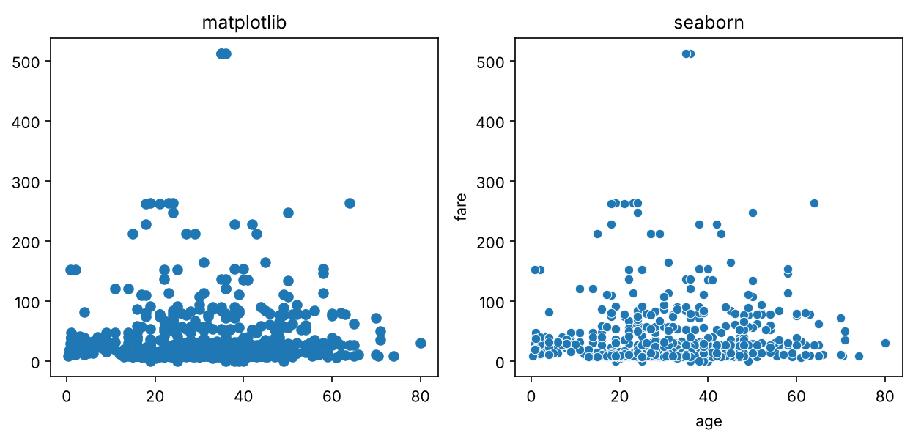
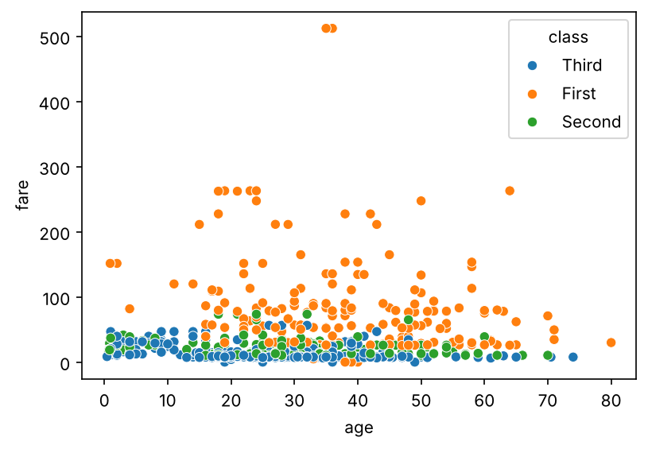
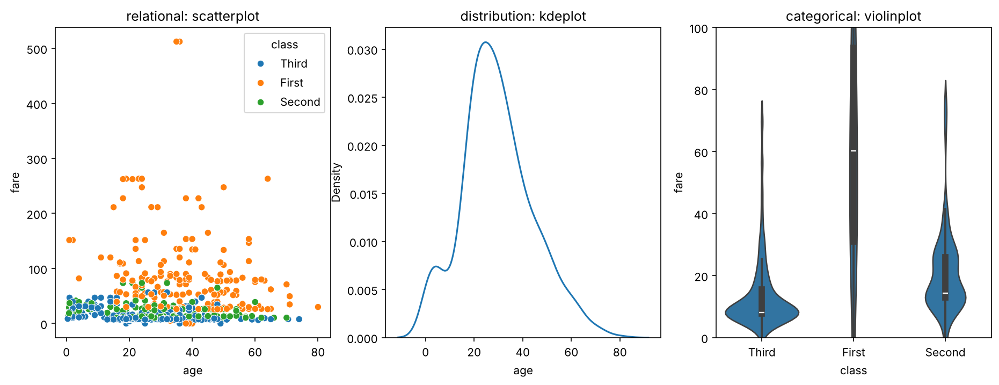
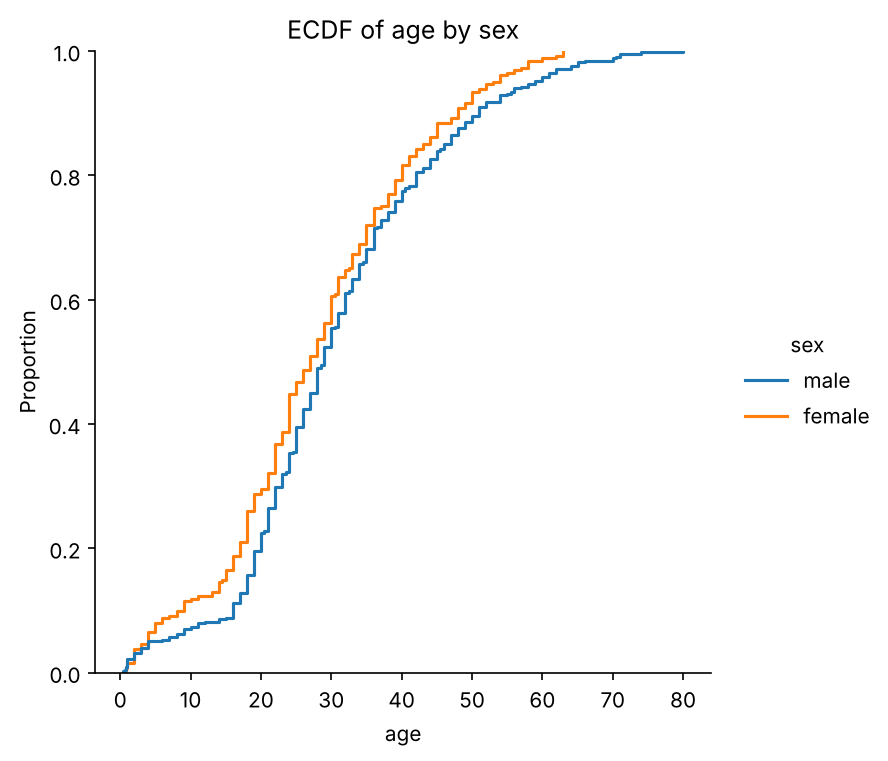
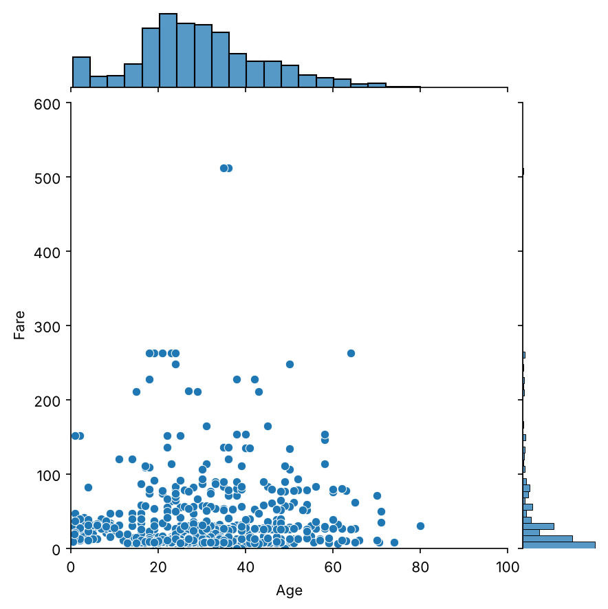
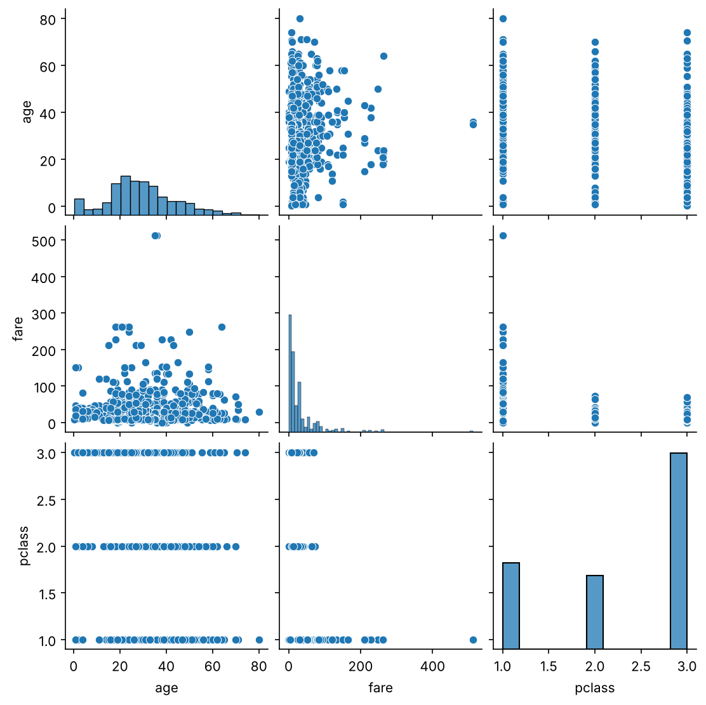

## 들어가며

[지난 글](05-matplotlib.qmd) 끝에서, 넘파이와 맷플롯립은 데이터 생태계의 바탕이지만 실무에서 직접 쓰는 일은 생각보다 적다고 했습니다. 이번 글에서는 데이터 사이언티스트라면 누구나 쓰는 두 라이브러리, 표 형태의 데이터를 다루는 **판다스**(Pandas)와 그 표를 손쉽게 그림으로 바꿔 주는 **시본**(Seaborn)을 살펴보겠습니다. 이 글은 [2.4](04-numpy.qmd)의 넘파이와 [2.5](05-matplotlib.qmd)의 맷플롯립을 안다는 전제에서 출발합니다.

## 판다스: 표를 다루는 도구

### 왜 넘파이만으로는 부족할까요?

판다스가 다루는 것은 **관계형 데이터**(relational data), 쉽게 말해 **표**입니다. 예를 들어 다음과 같은 표를 생각해 보겠습니다.

| | 이름 | 출생연도 | 좋아하는 숫자 |
|:--|:--|:--:|:--:|
| 학생 1 | 김찬호 | 1994 | 2400 |
| 학생 2 | 박종우 | 1993 | 1557 |

한 행에 담긴 (김찬호, 1994, 2400)은 종류가 서로 다른 값들이지만, 모두 "학생 1"이라는 한 대상에 대한 정보라는 공통점이 있습니다. 이렇게 한 행이 하나의 대상을 이루고, 각 열이 그 대상의 속성을 나타내는 데이터를 관계형 데이터라고 부릅니다. 이름은 수학의 **관계**(relation)라는 개념에서 왔습니다. 엑셀 파일(`.xlsx`), CSV 파일(`.csv`), TSV 파일(`.tsv`), 파케이 파일(`.parquet`) 등이 모두 이런 표를 담는 파일 형식입니다.

그럼 그냥 넘파이의 2차원 배열을 쓰면 되지 않을까요? 아쉽게도 그럴 수 없습니다. [2.4](04-numpy.qmd)에서 보았듯이 넘파이 배열은 **한 가지 종류의 값만** 담을 수 있어서, "김찬호" 같은 문자열과 1994 같은 숫자를 한 배열에 함께 담을 수 없습니다. 실제 데이터는 대부분 이렇게 문자와 숫자가 섞여 있기 때문에, 넘파이를 바탕으로 하면서 이 한계를 보완한 라이브러리가 판다스입니다. 판다스는 보통 다음과 같이 불러옵니다.

```python
import numpy as np
import pandas as pd
```

판다스는 표를 다음과 같은 구조로 생각합니다. 각 **행**이 하나의 대상(위의 학생 한 명)이고, 각 **열**이 대상들의 한 가지 속성(이름, 출생연도 등)입니다. 그래서 어떤 대상의 정보가 필요하면 행에서, 어떤 속성의 정보가 필요하면 열에서 찾습니다.

### 시리즈

판다스에서 가장 단순한 구조는 **시리즈**(Series)입니다. 시리즈는 열이 하나뿐인 표라고 생각하면 됩니다. 값들과 함께, 각 값이 누구의 것인지를 나타내는 **인덱스**(index)를 붙여서 만듭니다.

```python
names = ["김찬호", "박종우", "손인욱", "쥐앤장"]
years = [1994, 1993, 1994, 1995]

s = pd.Series(years, index=names)
print(s)
print()
print("김찬호의 출생연도:", s["김찬호"])
```

```
김찬호    1994
박종우    1993
손인욱    1994
쥐앤장    1995
dtype: int64

김찬호의 출생연도: 1994
```

인덱스로 값을 찾는 모습이 파이썬의 딕셔너리와 닮았지요. 실제로 시리즈는 딕셔너리로도 만들 수 있습니다. `pd.Series({"김찬호": 1994, "박종우": 1993, ...})`처럼 키를 인덱스로, 값을 값으로 넣으면 됩니다.

시리즈는 딕셔너리보다 훨씬 유연합니다. 인덱스가 문자열인데도 범위를 잘라 오는 **슬라이싱**(slicing)이 되고, [2.4](04-numpy.qmd)에서 본 **마스킹**도 그대로 됩니다.

```python
print(s["박종우":"손인욱"])     # 슬라이싱
print()
print(s[s >= 1994])             # 마스킹: 1994년 이후 출생만
```

```
박종우    1993
손인욱    1994
dtype: int64

김찬호    1994
손인욱    1994
쥐앤장    1995
dtype: int64
```

한 가지 주의할 점이 있습니다. 파이썬의 리스트나 넘파이 배열의 슬라이싱 `a[1:3]`은 끝 번호를 **포함하지 않지만**, 판다스에서 이름으로 하는 슬라이싱 `s["박종우":"손인욱"]`은 끝인 "손인욱"을 **포함합니다**.

### 데이터프레임

물론 실제로는 속성이 하나뿐인 표보다 여러 속성을 가진 표를 훨씬 많이 다룹니다. 판다스에서는 이런 표를 **데이터프레임**(DataFrame)이라고 부릅니다. 시리즈가 넘파이의 1차원 배열에 해당한다면 데이터프레임은 2차원 배열에 해당하고, 2차원 배열이 1차원 배열 여러 개로 이루어지듯 데이터프레임은 시리즈 여러 개를 나란히 붙인 것이라고 생각할 수 있습니다.

```python
df = pd.DataFrame({"year": years,
                   "number": [2400, 1557, 7, 42]},
                  index=names)
print(df)
```

```
     year  number
김찬호  1994    2400
박종우  1993    1557
손인욱  1994       7
쥐앤장  1995      42
```

딕셔너리의 키가 열 이름이 되고, 값이 그 열의 내용이 됩니다. 행의 이름(인덱스)과 열의 이름은 각각 `index`와 `columns` 속성에 들어 있습니다.

```python
print(df.index)
print(df.columns)
```

```
Index(['김찬호', '박종우', '손인욱', '쥐앤장'], dtype='str')
Index(['year', 'number'], dtype='str')
```

(판다스 버전에 따라 끝의 `dtype='str'`이 `dtype='object'`로 나올 수도 있습니다. 둘 다 문자열이 담겨 있다는 뜻입니다.)

열의 순서를 바꾸거나, 특정 행을 빼는 것도 간단합니다. 원하는 순서대로 열 이름을 리스트로 넣으면 그 순서로 열을 다시 고른 표가 나오고, `drop()`에 행 이름을 넣으면 그 행을 뺀 표가 나옵니다. 둘 다 원래의 `df`는 그대로 두고 **새 표를 돌려준다**는 점에 주의하세요. 결과를 계속 쓰려면 변수에 다시 담아야 합니다.

```python
print(df[["number", "year"]])     # 열 순서 바꾸기
print()
print(df.drop("쥐앤장"))           # 쥐앤장 행 빼기
```

```
     number  year
김찬호    2400  1994
박종우    1557  1993
손인욱       7  1994
쥐앤장      42  1995

     year  number
김찬호  1994    2400
박종우  1993    1557
손인욱  1994       7
```

### 데이터프레임에서 값 꺼내기

데이터프레임에서 값을 꺼내는 방법은 시리즈와 조금 다릅니다. 대괄호 `df[...]`에 이름을 하나 넣으면, 판다스는 그것을 **열 이름**으로 받아들입니다. 그래서 행 이름을 넣으면 오류가 납니다.

```python
print(df["김찬호"])
```

```
KeyError: '김찬호'
```

열 이름을 넣으면 그 열이 시리즈로 나옵니다. 여기에 다시 행 이름을 넣으면 하나의 값을 꺼낼 수 있습니다.

```python
print(df["year"])
print()
print(df["year"]["김찬호"])
```

```
김찬호    1994
박종우    1993
손인욱    1994
쥐앤장    1995
Name: year, dtype: int64

1994
```

하지만 매번 열부터 고르는 것은 번거롭습니다. 우리는 "김찬호 학생의 정보 전체"처럼 **행을 기준으로** 데이터를 꺼내고 싶을 때가 많은데, 이때는 `loc`과 `iloc`을 씁니다.

- **`loc`**: 행의 **이름**으로 찾습니다.
- **`iloc`**: 행의 **위치 번호**(0부터 시작)로 찾습니다. 이름의 `i`는 정수(integer)를 뜻합니다.

```python
print(df.loc["김찬호"])            # 이름으로 찾기
print()
print(df.iloc[1])                  # 1번(두 번째) 행
```

```
year      1994
number    2400
Name: 김찬호, dtype: int64

year      1993
number    1557
Name: 박종우, dtype: int64
```

행 하나를 꺼내면 시리즈가 나오고, 슬라이싱으로 여러 행을 꺼내면 데이터프레임이 나옵니다. `loc`과 `iloc`에 쉼표로 열까지 함께 지정하면 칸 하나를 꺼낼 수도 있습니다.

```python
print(df.loc["박종우":"손인욱"])
print()
print(df.loc["김찬호", "number"])   # 김찬호 행, number 열
print(df.iloc[0, 1])                # 0번 행, 1번 열
```

```
     year  number
박종우  1993    1557
손인욱  1994       7

2400
2400
```

### 판다스의 마스킹

[2.4](04-numpy.qmd)에서 보았듯이 마스킹은 위치를 직접 적는 대신 **조건**으로 데이터를 골라내는 방법입니다. "1994년 이후 출생자만", "한국인 환자의 데이터만"처럼 어떤 열의 값을 기준으로 행을 걸러 낼 때 씁니다.

마스킹은 두 단계로 이루어집니다. 먼저 조건을 써서 각 행이 조건을 만족하는지를 `True`/`False`로 담은 시리즈, 즉 **마스크**(mask)를 만듭니다. 그다음 그 마스크를 대괄호 안에 넣으면 `True`인 행만 골라집니다.

```python
mask = df["year"] > 1994
print(mask)
print()
print(df[mask])
```

```
김찬호    False
박종우    False
손인욱    False
쥐앤장     True
Name: year, dtype: bool

     year  number
쥐앤장  1995      42
```

1995년생인 쥐앤장만 `True`이고, 나머지는 `False`입니다. 마스크를 `df.loc[mask]`처럼 `loc`에 넣어도 결과는 같습니다.

조건을 여러 개 걸려면 마스크들을 `&`(그리고)나 `|`(또는)로 묶습니다. 이때 각 조건을 **괄호로 감싸야** 한다는 점에 주의하세요. 괄호가 없으면 연산 순서가 꼬여서 오류가 납니다.

```python
print(df[(df["year"] >= 1994) & (df["number"] < 100)])
```

```
     year  number
손인욱  1994       7
쥐앤장  1995      42
```

### 파일 불러오기

실제 데이터는 대부분 파일로 주어집니다. 판다스에서는 `pd.read_csv()`로 CSV 파일을 읽어 데이터프레임으로 만듭니다. 쉼표가 아닌 다른 기호로 열을 나눈 텍스트 파일도 `sep` 옵션으로 읽을 수 있는데, 예를 들어 `sep=r"\s+"`는 "공백이 하나 이상 있으면 거기서 나눈다"는 뜻입니다. [2.4](04-numpy.qmd)에서 만든 것과 같은 텍스트 파일을 읽어 보겠습니다.

```python
with open("data.txt", "w") as f:
    f.write("1 3 5\n7 9 11\n13 15 17\n")

print(pd.read_csv("data.txt", sep=r"\s+", header=None))
```

```
    0   1   2
0   1   3   5
1   7   9  11
2  13  15  17
```

`header=None`을 넣은 이유는, `read_csv`가 기본적으로 **파일의 첫 줄을 열 이름으로** 쓰기 때문입니다. 이 파일처럼 첫 줄부터 데이터인 경우에 `header=None`을 빼먹으면 첫 번째 행이 열 이름으로 들어가 데이터에서 사라져 버리니 조심해야 합니다.

`read_csv`는 인터넷 주소에서 파일을 바로 읽어 올 수도 있습니다. 시본을 만든 왁스컴(M. Waskom)이 공개해 둔 연습용 데이터 가운데, 1912년 타이타닉호 승객 891명의 정보를 담은 데이터를 불러와 보겠습니다.[^seaborn]

```python
url = "https://raw.githubusercontent.com/mwaskom/seaborn-data/master/titanic.csv"
titanic = pd.read_csv(url)

print(titanic.shape)
print(titanic.columns.tolist())
```

```
(891, 15)
['survived', 'pclass', 'sex', 'age', 'sibsp', 'parch', 'fare', 'embarked', 'class', 'who', 'adult_male', 'deck', 'embark_town', 'alive', 'alone']
```

891행 15열의 표입니다. 각 행이 승객 한 명이고, 생존 여부(`survived`), 객실 등급(`pclass`, `class`), 성별(`sex`), 나이(`age`), 운임(`fare`) 같은 열이 있습니다. 데이터가 크면 전체를 출력하기 어려우니, 보통은 `head()`로 앞의 몇 행만 봅니다. (뒤의 몇 행은 `tail()`로 봅니다.) 여기서는 열이 많아서 몇 개만 골라 보겠습니다.

```python
print(titanic[["survived", "pclass", "sex", "age", "fare", "class"]].head())
```

```
   survived  pclass     sex   age     fare  class
0         0       3    male  22.0   7.2500  Third
1         1       1  female  38.0  71.2833  First
2         1       3  female  26.0   7.9250  Third
3         1       1  female  35.0  53.1000  First
4         0       3    male  35.0   8.0500  Third
```

그리고 판다스의 가장 강력한 기능 가운데 하나가 `describe()`입니다. 숫자로 된 열마다 [2.2](02-summary-statistics.qmd)에서 다룬 요약 통계량을 한 번에 계산해 줍니다.

```python
print(titanic[["age", "fare"]].describe().round(2))
```

```
          age    fare
count  714.00  891.00
mean    29.70   32.20
std     14.53   49.69
min      0.42    0.00
25%     20.12    7.91
50%     28.00   14.45
75%     38.00   31.00
max     80.00  512.33
```

`count`는 값이 있는 행의 개수, `mean`은 평균, `std`는 표준편차, `min`과 `max`는 최솟값과 최댓값, `25%`, `50%`, `75%`는 사분위수입니다. 넘파이로 하나하나 계산하던 것이 한 줄로 끝납니다. 몇 가지 눈여겨볼 점도 바로 보입니다.

- 나이(`age`)의 `count`가 891이 아니라 714입니다. 177명의 나이가 **빠져 있다**는 뜻입니다.
- 운임(`fare`)은 평균(32.20)이 중앙값(14.45)보다 두 배 넘게 크고, 최댓값이 512.33입니다. [2.2](02-summary-statistics.qmd)의 소득처럼 **오른쪽으로 크게 치우친** 분포일 가능성이 높습니다.
- [2.2](02-summary-statistics.qmd)에서 말했듯이 판다스의 `std`는 넘파이와 달리 $n-1$로 나눈 값입니다.

이렇게 `describe()` 한 번으로 데이터 탐색의 첫걸음을 뗄 수 있습니다. 그다음은 그림으로 확인할 차례입니다.

## 시본: 표를 바로 그림으로

**시본**(Seaborn)은 맷플롯립을 바탕으로 만든 시각화 라이브러리입니다. 가장 큰 장점은 판다스의 데이터프레임을 받아서, 열 이름만 지정하면 그림을 그려 준다는 것입니다. 맷플롯립으로 그리려면 꽤 번거로운 통계적인 그림도 한두 줄로 그릴 수 있습니다. 보통 다음과 같이 불러옵니다.

```python
import matplotlib.pyplot as plt
import seaborn as sns
```

### 산점도로 시작하기

타이타닉 데이터에서 나이와 운임의 산점도를 맷플롯립과 시본으로 각각 그려서 비교해 보겠습니다.

```python
fig, ax = plt.subplots(1, 2, figsize=(10, 4))

ax[0].scatter(titanic["age"], titanic["fare"])
ax[0].set_title("matplotlib")

sns.scatterplot(data=titanic, x="age", y="fare", ax=ax[1])
ax[1].set_title("seaborn")
```

{fig-alt="타이타닉 승객의 나이와 운임을 그린 두 개의 산점도. 왼쪽은 맷플롯립으로 그려서 축 이름이 없고 점이 진하게 겹쳐 있다. 오른쪽은 시본으로 그려서 가로축에 age, 세로축에 fare라는 이름이 자동으로 붙어 있고 점마다 흰 테두리가 있어 겹친 점이 구분된다. 두 그림 모두 대부분의 점이 운임 100 아래에 몰려 있고 500 근처에 점 몇 개가 떨어져 있다." width=90%}

시본은 `data`에 데이터프레임을, `x`와 `y`에 열 이름을 넣기만 하면 됩니다. 축 이름도 열 이름으로 자동으로 붙여 주고, 점마다 테두리를 그려 겹친 점도 더 잘 구분됩니다. `ax=ax[1]`은 이 그림을 어느 `Axes`에 그릴지 정해 준 것으로, [2.5](05-matplotlib.qmd)에서 본 맷플롯립의 구조를 그대로 쓴다는 것을 알 수 있습니다.

여기에 세 번째 열을 **색**으로 더할 수도 있습니다. `hue` 옵션에 열 이름을 넣으면, 그 열의 값에 따라 점의 색을 바꾸고 범례까지 달아 줍니다.

```python
fig, ax = plt.subplots(figsize=(6, 4))
sns.scatterplot(data=titanic, x="age", y="fare", hue="class", ax=ax)
```

{fig-alt="타이타닉 승객의 나이와 운임 산점도를 객실 등급별로 색을 다르게 칠한 그림. 범례에 Third, First, Second 세 등급이 데이터에 처음 나온 순서대로 있다. 운임이 높은 점들은 대부분 First 색이고, 운임이 낮은 아래쪽에는 Second와 Third 색이 많이 섞여 있다." width=65%}

한 줄을 더했을 뿐인데, 운임이 높은 승객은 거의 다 1등석이라는 사실이 한눈에 보입니다.

### 시본의 세 가지 그래프 가족

시본의 그래프는 크게 세 가족으로 나뉩니다.

1. **관계형 그래프**: 두 변수의 관계를 보여 줍니다. 위의 산점도 `sns.scatterplot()`과, 맷플롯립의 `plot()`을 강화한 선 그래프 `sns.lineplot()`이 여기에 속합니다.
2. **분포형 그래프**: 한 변수의 값들이 어떻게 분포되어 있는지 보여 줍니다. 히스토그램 `sns.histplot()`, 히스토그램의 막대 끝을 매끄러운 곡선으로 이은 것 같은 **커널 밀도 추정** 그래프 `sns.kdeplot()`, 각 값 이하인 데이터의 비율을 그린 **경험적 누적분포함수** 그래프 `sns.ecdfplot()`, 데이터가 있는 위치마다 바닥에 짧은 선을 깔아 주는 `sns.rugplot()` 등이 있습니다.
3. **범주형 그래프**: 범주별로 값이 어떻게 다른지 보여 줍니다. 막대그래프 `sns.barplot()`, 박스 플롯 `sns.boxplot()`, 박스 플롯에 분포의 모양까지 더한 **바이올린 플롯** `sns.violinplot()` 등이 있습니다.

세 가족에서 하나씩 골라 나란히 그려 보겠습니다.

```python
fig, axes = plt.subplots(1, 3, figsize=(15, 5))

sns.scatterplot(data=titanic, x="age", y="fare", hue="class", ax=axes[0])
axes[0].set_title("relational: scatterplot")

sns.kdeplot(data=titanic, x="age", ax=axes[1])
axes[1].set_title("distribution: kdeplot")

sns.violinplot(data=titanic, x="class", y="fare", ax=axes[2])
axes[2].set_title("categorical: violinplot")
axes[2].set_ylim(0, 100)
```

{fig-alt="세 개의 그래프를 나란히 놓은 그림. 왼쪽은 객실 등급별로 색을 칠한 나이와 운임의 산점도이다. 가운데는 나이의 커널 밀도 추정 곡선으로, 20대 중반에서 가장 높고 0세 근처에 작은 봉우리가 있다. 오른쪽은 객실 등급별 운임의 바이올린 플롯으로, 가로축에 Third, First, Second 순서로 놓여 있고 세로축이 0부터 100까지이며 First는 넓게 퍼져 있고 Second와 Third는 낮은 운임에 좁게 몰려 있다." width=100%}

가운데 그림에서는 승객의 나이가 20대 중반에 가장 많이 몰려 있고, 어린아이들도 꽤 있었다는 것을 알 수 있습니다. 오른쪽 바이올린 플롯은 등급별 운임의 분포를 바이올린 모양으로 보여 주는데, 폭이 넓을수록 그 운임대의 승객이 많다는 뜻입니다. 2·3등석은 낮은 운임에 몰려 있는 반면 1등석은 운임이 훨씬 넓게 퍼져 있습니다. (운임이 아주 높은 1등석 승객이 있어서, 세로축을 100까지만 보이도록 잘랐습니다.)

### Axes 단위 그래프와 Figure 단위 그래프

지금까지 쓴 시본의 함수들은 모두 `ax=...`로 **어느 `Axes`에 그릴지** 직접 정해 주었습니다. 이런 함수들을 **Axes 단위**(axes-level) 그래프라고 합니다. 우리가 원하는 칸에 원하는 그림을 배치할 수 있다는 자유가 있습니다.

반대로 그런 자유를 조금 포기하는 대신 `Figure`와 `Axes`까지 **알아서 다 만들어 주는** 함수들도 있는데, 이를 **Figure 단위**(figure-level) 그래프라고 합니다. 위의 세 가족마다 하나씩 있어서, 관계형은 `sns.relplot()`, 분포형은 `sns.displot()`, 범주형은 `sns.catplot()`입니다. 이 함수들은 가족 안에서 기본으로 정해진 그래프를 그리고, `kind` 옵션으로 종류를 바꿀 수 있습니다. 예를 들어 `displot()`의 기본값은 히스토그램이고, `kind="ecdf"`로 바꾸면 경험적 누적분포함수를 그립니다.

```python
g = sns.displot(data=titanic, x="age", hue="sex", kind="ecdf")
g.ax.set_title("ECDF of age by sex")
```

{fig-alt="남성과 여성 승객 각각에 대해 나이의 경험적 누적분포함수를 그린 계단 모양의 두 곡선. 두 곡선 모두 0에서 시작해 나이가 많아질수록 1까지 올라간다. 여성 곡선이 대부분의 구간에서 남성 곡선보다 약간 위에 있다." width=60%}

Figure 단위 함수는 `fig, ax = plt.subplots()` 같은 준비 없이 바로 그림을 그려 주는 대신, 그림이 담긴 시본의 특별한 객체를 돌려줍니다. 위에서는 이것을 `g`라는 이름으로 받아 두었습니다. 이 객체의 자세한 구조까지 알 필요는 없고, 그 안에 `g.figure`라는 이름으로 `Figure`가(예전 버전에서는 `g.fig`), `g.ax`라는 이름으로 `Axes`가 들어 있다는 것만 알면 됩니다. (`Axes`가 여러 개라면 `g.axes`에 배열로 들어 있습니다.) 그래서 `g.ax.set_title()`처럼 맷플롯립에서 하던 대로 그림을 손볼 수 있습니다.

이 그림에서는 여성 승객의 곡선이 대부분의 구간에서 조금 위에 있습니다. 같은 나이까지 이미 더 많은 비율이 채워졌다는 뜻이니, 여성 승객이 평균적으로 조금 더 젊었다는 것을 알 수 있습니다.

Figure 단위 함수의 진가는 그림 여러 개를 한꺼번에 엮어 줄 때 드러납니다. 대표적인 것이 `sns.jointplot()`입니다.

```python
g = sns.jointplot(data=titanic, x="age", y="fare", xlim=(0, 100), ylim=(0, 600))
g.set_axis_labels("Age", "Fare")
```

{fig-alt="가운데에 나이와 운임의 산점도가 있고, 위쪽에는 나이의 히스토그램이, 오른쪽에는 운임의 히스토그램이 붙어 있는 그림. 운임 히스토그램은 아래쪽 낮은 운임에 막대가 몰려 있고 위로 길게 꼬리가 있다." width=60%}

가운데에는 두 변수의 산점도를, 위쪽에는 가로축 변수(나이)의 분포를, 오른쪽에는 세로축 변수(운임)의 분포를 함께 그려 줍니다. 두 변수의 관계와 각 변수의 분포를 한 장에서 볼 수 있는 것이지요. 오른쪽 히스토그램을 보면, `describe()`에서 짐작했던 대로 운임이 오른쪽(여기서는 위쪽)으로 크게 치우친 분포라는 것이 확인됩니다.

여러 변수를 한꺼번에 살펴볼 때는 `sns.pairplot()`이 유용합니다. 넣어 준 열들을 두 개씩 짝지어 가능한 모든 산점도를 그리고, 대각선 칸에는 각 열의 분포를 그려 줍니다.

```python
g = sns.pairplot(titanic[["age", "fare", "pclass"]])
```

{fig-alt="age, fare, pclass 세 열을 3행 3열로 짝지어 그린 그림. 대각선 세 칸에는 각 열의 히스토그램이 있고, 나머지 여섯 칸에는 두 열씩 짝지은 산점도가 있다. pclass가 들어간 산점도들은 점들이 1, 2, 3 세 줄로 늘어서 있다." width=75%}

`sns.pairplot(titanic)`처럼 데이터프레임 전체를 넣으면, 숫자로 된 모든 열의 모든 짝을 한 번에 그려 줍니다. 처음 보는 데이터의 전체 모습을 빠르게 훑어볼 때 아주 편리합니다. 다만 열이 많으면 그림이 매우 커지고 그리는 데도 시간이 오래 걸리니, 관심 있는 열만 골라서 쓰는 것이 좋습니다.

## 정리

- **판다스**는 문자와 숫자가 섞인 **표**를 다루는 라이브러리로, 열이 하나인 **시리즈**와 여러 열로 이루어진 **데이터프레임**을 제공합니다.
- `df["열"]`은 열을, `df.loc["행 이름"]`과 `df.iloc[행 번호]`는 행을 꺼냅니다. 조건으로 행을 고를 때는 **마스킹**을 쓰고, 조건이 여러 개면 괄호와 `&`, `|`로 묶습니다.
- `pd.read_csv()`로 파일을 읽고, `head()`와 `describe()`로 데이터를 빠르게 훑어볼 수 있습니다. `describe()`만으로도 결측치와 치우친 분포 같은 단서를 찾을 수 있습니다.
- **시본**은 데이터프레임의 열 이름만으로 그림을 그려 주며, 관계형, 분포형, 범주형의 세 가족과 Axes 단위·Figure 단위 함수로 나뉩니다.

2장에서는 데이터를 숫자로 요약하는 기술 통계와 그림으로 요약하는 시각화, 그리고 그것을 파이썬으로 해내는 도구들을 살펴보았습니다. 다음 장에서는 이런 작업을 할 때 코드를 어떻게 써야 남이 이해하고 다시 실행할 수 있는지, 즉 **재현 가능한 작업 환경**에 대한 이야기로 넘어가겠습니다.

---

### 연결되는 개념
* $\leftarrow$ **이전 개념:** [2.5 Matplotlib으로 그리기](05-matplotlib.qmd)
* $\rightarrow$ **다음 개념:** 추후 작성 예정

[^seaborn]: M. L. Waskom, "seaborn: statistical data visualization", *Journal of Open Source Software* 6(60), 2021, 3021. 연습용 데이터는 시본의 `sns.load_dataset("titanic")`으로도 불러올 수 있습니다.
