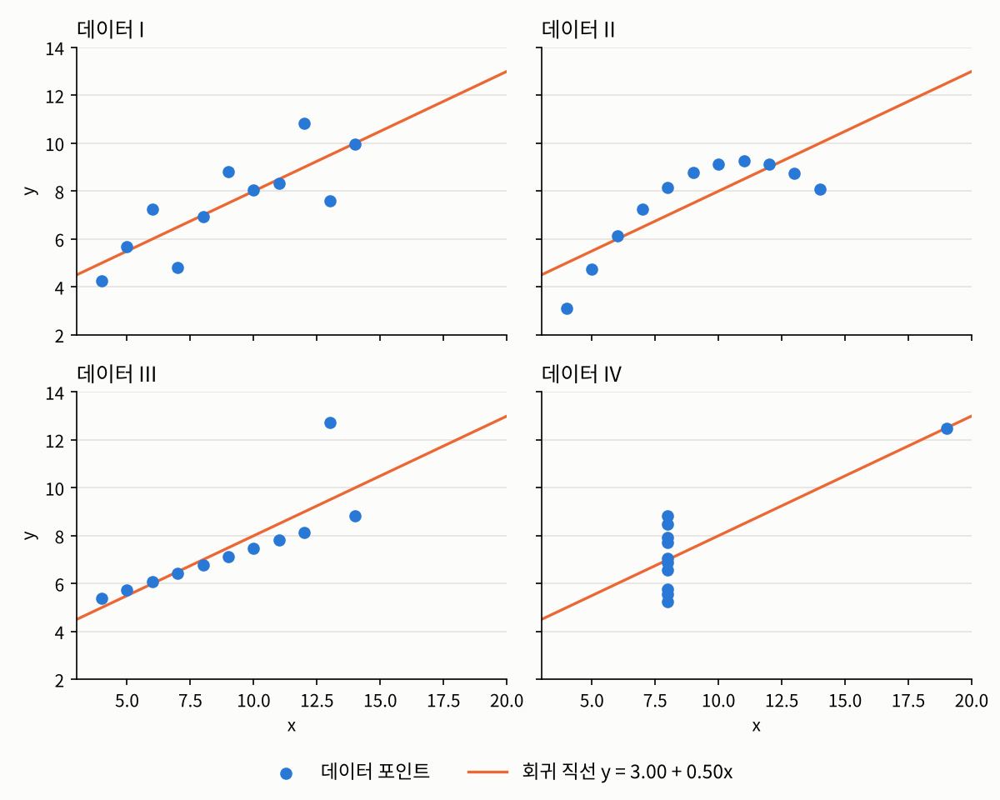

## 들어가며

[1.3](../01-foundations/03-analysis-process.qmd)에서 데이터 분석은 질문 설정, 데이터 탐색, 모델 구성, 결과 해석, 커뮤니케이션의 다섯 단계로 정리할 수 있다고 했습니다. 그리고 [1.4](../01-foundations/04-sampling-bias.qmd)에서는 그 모든 단계에 앞서 데이터가 어디서 어떻게 왔는지를 따져 봐야 한다는 이야기를 했습니다. 2장에서는 이제 본격적으로 손에 쥔 데이터를 들여다보는 단계, 즉 **데이터 탐색**을 다룹니다.

데이터 탐색은 요리를 시작하기 전에 재료의 상태를 확인하는 일과 비슷합니다. 데이터가 전체적으로 어떻게 생겼는지, 빠진 값이나 이상한 값은 없는지, 변수들 사이에 어떤 관계가 있어 보이는지를 미리 파악해 두는 것입니다. 다음 단계에서 어떤 모델을 고를지는 이 탐색 결과에 따라 정해지기 때문에, 실제 데이터 분석에서도 상당히 많은 시간이 이 단계에 쓰입니다.

데이터를 탐색하는 방법은 크게 두 가지입니다. 하나는 데이터를 **숫자로 요약**하는 것이고, 다른 하나는 **그림으로 요약**하는 것입니다. 앞의 것을 기술 통계, 뒤의 것을 데이터 시각화라고 부릅니다.

## 기술 통계: 데이터를 숫자로 요약하기

**기술 통계**(descriptive statistics)라는 이름을 처음 들으면, 무언가 대단한 계산 기술(技術, Technology)이 필요한 분야인가 싶으실 수도 있습니다. 하지만 여기서 '기술'은 기록하고 서술한다는 뜻의 기술(記述, Description)입니다. 영어 이름의 descriptive도 무언가를 묘사한다는 뜻이지요. 이름 그대로, 기술 통계는 주어진 데이터가 어떤 모습인지를 기록하고 서술하는 통계입니다.

우리가 뉴스에서 흔히 접하는 지지율, 실업률, 연평균 기온 같은 숫자들이 모두 기술 통계의 결과물입니다. 기술 통계는 주어진 데이터에서 우리가 궁금한 점에 답하는 데 필요한 수치를 계산해, 데이터를 요약하고 비교합니다. 이때 가장 핵심이 되는 수치는 보통 두 종류입니다.

- **중심 경향**(central tendency): 데이터가 대체로 어느 값 근처에 모여 있는가? 평균이나 중앙값이 대표적입니다.
- **산포**(dispersion): 데이터가 그 중심에서 얼마나 넓게 퍼져 있는가? 분산이나 범위가 대표적입니다.

다만 한 가지는 꼭 기억해 두셔야 합니다. **기술 통계는 어디까지나 요약일 뿐**입니다. 요약된 정보를 바탕으로 논리적인 결론을 끌어내는 것은 그다음 단계인 **추론 통계**(inferential statistics)의 몫이고, 이 과목에서는 4장에서 다룹니다. 그런데 추론 과정은 생각보다 복잡해서, 많은 경우 기술 통계의 숫자만 보고 성급하게 결론을 내리곤 합니다. [1.3](../01-foundations/03-analysis-process.qmd)에서 이야기한 "질문의 유형을 혼동하는 실수"나, [1.4](../01-foundations/04-sampling-bias.qmd)에서 본 "표본의 결과를 모집단에 그대로 옮기는 실수"가 대부분 여기서 일어납니다.

## 숫자만으로 충분할까요?

그렇다면 데이터를 요약하는 데에는 평균이나 분산 같은 숫자 몇 개면 충분할까요? 통계학자 앤스컴(F. J. Anscombe)이 1973년에 만든 유명한 예를 하나 보겠습니다.[^anscombe] 흔히 **앤스컴 콰르텟**(Anscombe's quartet)이라고 부르는, 점 11개짜리 데이터 네 묶음입니다. 각 데이터의 평균, 분산, 상관계수, 그리고 데이터를 가장 잘 따라가는 직선(최소제곱 회귀 직선, 나중에 다뤄지는데 지금은 대충 데이터들을 대표할 수 있는 하나의 직선 정도로 생각하시면 됩니다.)을 계산해 보겠습니다.

```python
import numpy as np

x = np.array([10, 8, 13, 9, 11, 14, 6, 4, 12, 7, 5])
x4 = np.array([8, 8, 8, 8, 8, 8, 8, 19, 8, 8, 8])
data = {
    "I":   (x,  np.array([8.04, 6.95, 7.58, 8.81, 8.33, 9.96, 7.24, 4.26, 10.84, 4.82, 5.68])),
    "II":  (x,  np.array([9.14, 8.14, 8.74, 8.77, 9.26, 8.10, 6.13, 3.10, 9.13, 7.26, 4.74])),
    "III": (x,  np.array([7.46, 6.77, 12.74, 7.11, 7.81, 8.84, 6.08, 5.39, 8.15, 6.42, 5.73])),
    "IV":  (x4, np.array([6.58, 5.76, 7.71, 8.84, 8.47, 7.04, 5.25, 12.50, 5.56, 7.91, 6.89])),
}

for name, (xs, ys) in data.items():
    slope, intercept = np.polyfit(xs, ys, 1)
    r = np.corrcoef(xs, ys)[0, 1]
    print(f"데이터 {name:<3}| 평균 ({xs.mean():.2f}, {ys.mean():.2f})  "
          f"분산 ({xs.var(ddof=1):.2f}, {ys.var(ddof=1):.2f})  "
          f"상관계수 {r:.3f}  직선 y = {intercept:.2f} + {slope:.2f}x")
```

```
데이터 I  | 평균 (9.00, 7.50)  분산 (11.00, 4.13)  상관계수 0.816  직선 y = 3.00 + 0.50x
데이터 II | 평균 (9.00, 7.50)  분산 (11.00, 4.13)  상관계수 0.816  직선 y = 3.00 + 0.50x
데이터 III| 평균 (9.00, 7.50)  분산 (11.00, 4.12)  상관계수 0.816  직선 y = 3.00 + 0.50x
데이터 IV | 평균 (9.00, 7.50)  분산 (11.00, 4.12)  상관계수 0.817  직선 y = 3.00 + 0.50x
```

아직 코드는 그리 자세히 보실 필요가 없구요, 가장 아래의 출력 결과만 보시면 됩니다. 네 데이터의 요약 수치가 소수 둘째 자리까지 거의 똑같습니다. 숫자만 보면 네 데이터는 사실상 같은 데이터라고 해도 될 것 같습니다. 그런데 이 네 데이터를 실제로 그려 보면 이야기가 완전히 달라집니다.

{fig-alt="앤스컴 콰르텟의 네 데이터를 2행 2열로 그린 산점도. 네 그림 모두 같은 주황색 회귀 직선 y = 3.00 + 0.50x가 그어져 있다. 데이터 I은 점들이 직선 주변에 고르게 흩어져 있다. 데이터 II는 점들이 위로 볼록한 곡선을 그린다. 데이터 III은 점들이 거의 완벽한 직선 위에 있는데 점 하나만 위쪽으로 크게 벗어나 있다. 데이터 IV는 점 10개가 x = 8에 세로로 몰려 있고 점 하나만 x = 19에 떨어져 있다." width=85%}

- **데이터 I**은 우리가 "직선 관계"라고 할 때 떠올리는 바로 그 모습입니다. 점들이 직선 주변에 적당히 흩어져 있습니다.
- **데이터 II**는 애초에 직선 관계가 아닙니다. 점들이 깔끔한 곡선을 그리고 있어서, 직선으로 요약하는 것 자체가 잘못된 선택입니다.
- **데이터 III**은 거의 완벽한 직선 관계인데, 점 하나가 크게 벗어나 있습니다. 이 점 하나가 직선의 기울기를 끌어올리고 상관계수를 끌어내렸습니다.
- **데이터 IV**는 점 10개가 모두 $x = 8$에 몰려 있습니다. $x$와 $y$ 사이의 관계를 만들어 내는 것은 오른쪽 끝에 떨어진 점 단 하나뿐입니다.

[1.3](../01-foundations/03-analysis-process.qmd)에서 데이터 탐색의 목표 가운데 하나로 "데이터셋에 문제가 없는지 확인한다"를 꼽았습니다. 데이터 III의 튀는 점이나 데이터 IV의 이상한 모양은 바로 그런 문제의 신호입니다. 그런데 이 신호들은 요약 수치에는 전혀 드러나지 않고, 그림을 그려야만 보입니다. 앤스컴이 이 예를 만든 이유도 여기에 있습니다. 그는 통계 분석을 할 때 계산만 할 것이 아니라 **반드시 그림도 함께 그려 봐야 한다**고 강조했습니다.[^anscombe]

## 데이터 시각화: 데이터를 그림으로 요약하기

이렇게 데이터를 그림으로 나타내 한눈에 파악할 수 있게 만드는 것을 **데이터 시각화**(data visualization)라고 합니다. 숫자 몇 개가 데이터의 특정한 측면만을 요약한다면, 그림은 데이터 전체가 이루는 모양과 관계를 한꺼번에 보여 줍니다. 위의 예처럼 데이터가 직선을 따르는지, 곡선을 그리는지, 어딘가 튀는 값이 있는지 같은 정보는 그림으로 보는 편이 훨씬 빠르고 정확합니다.

반대로 그림만으로는 부족한 경우도 있습니다. "두 그룹의 평균 차이가 정확히 얼마인가?"처럼 구체적인 값이 필요할 때는 숫자가 필요합니다. 그래서 데이터 탐색에서는 기술 통계와 시각화를 늘 함께 씁니다. 숫자로 요약하고, 그림으로 확인하고, 그림에서 이상한 점이 보이면 다시 숫자로 따져 보는 식입니다. 1.3에서 이야기한 "기대하고, 확인하고, 고치는" 과정이 여기서도 그대로 반복되는 셈입니다.

시각화는 탐색 단계에서만 쓰이는 것도 아닙니다. 분석 결과를 다른 사람에게 설명하는 커뮤니케이션 단계에서도 핵심적인 도구입니다. 같은 데이터라도 어떤 그림을 고르느냐에 따라 전달되는 메시지가 크게 달라지기 때문에, 좋은 시각화를 고르는 안목도 함께 기를 필요가 있습니다.

## 이 장의 흐름

2장은 크게 두 부분으로 나뉩니다. 앞부분에서는 기술 통계의 개념을, 뒷부분에서는 그것을 파이썬으로 실제로 계산하고 그리는 도구를 다룹니다.

- **2.1 데이터의 스케일**: 데이터를 요약하려면 먼저 그 데이터가 어떤 종류의 숫자인지 알아야 합니다. 혈액형을 1, 2, 3, 4로 적은 숫자와 키를 cm로 적은 숫자는 같은 숫자라도 할 수 있는 계산이 다릅니다. 데이터를 네 가지 스케일로 나누고, 스케일마다 어떤 계산이 의미가 있는지 살펴봅니다.
- **2.2 요약 통계량**: 스케일에 따라 데이터를 어떤 수치로 요약할 수 있는지, 평균, 중앙값, 분산 같은 통계량을 정리합니다.
- **2.3 다변량 데이터와 상관관계**: 변수가 둘 이상일 때 변수들 사이의 관계를 요약하는 방법과, "상관관계는 인과관계가 아니다"라는 말이 정확히 무슨 뜻인지 다룹니다.
- **2.4 NumPy로 데이터 다루기**: 파이썬에서 수치 데이터를 다루는 가장 기본적인 도구인 넘파이(NumPy)의 배열을 소개합니다.
- **2.5 Matplotlib으로 그리기**: 위의 앤스컴 콰르텟 같은 그림을 직접 그려 볼 수 있도록, 맷플롯립(Matplotlib)으로 그래프를 그리는 방법을 다룹니다.
- **2.6 Pandas와 Seaborn**: 표 형태의 데이터를 편리하게 다루는 판다스(Pandas)와, 통계적인 그림을 적은 코드로 그려 주는 시본(Seaborn)을 소개합니다.

이 과목에서는 기술 통계를 연구하는 사람이 아니라 **사용하는 사람**의 입장에서, 비교적 가벼운 이야기만 다룹니다. 기술 통계의 수학적인 디테일은 [데이터 사이언스의 통계적 기초](../../statistical-foundations/index.qmd)에서 다룰 예정입니다.

---

### 연결되는 개념
* $\leftarrow$ **이전 개념:** [1.4 데이터의 출처와 편향](../01-foundations/04-sampling-bias.qmd)
* $\rightarrow$ **다음 개념:** [2.1 데이터의 스케일](01-scales.qmd)

[^anscombe]: F. J. Anscombe, "Graphs in Statistical Analysis", *The American Statistician* 27(1), 1973, pp. 17–21.
