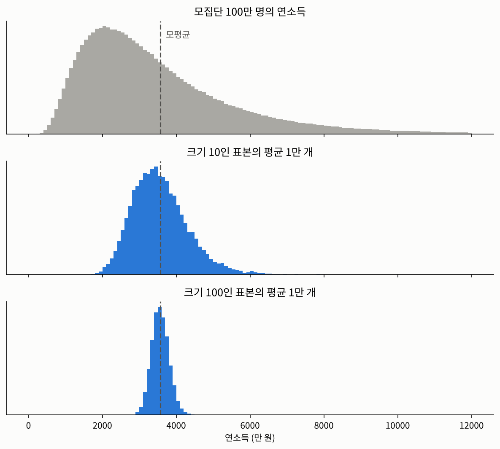

## 들어가며

[4장 소개 글](index.qmd)에서 추론 통계의 두 기둥이 추정과 검정이라고 했습니다. 이번 글에서는 그 첫 번째인 **추정**, 그중에서도 모집단의 값을 숫자 하나로 짐작하는 **점 추정**(point estimation)을 다룹니다. 먼저 추정이 무엇을 짐작하는 것인지 정확히 하고, 그다음 표본으로 계산한 값이 표본마다 얼마나 달라지는지를 시뮬레이션으로 확인해 보겠습니다.

## 무엇을 추정하나요?

추정은 손에 쥔 표본 데이터로 모집단의 정보를 얻어 내는 과정입니다. 예를 들어 국민의 평균 소득을 알고 싶어서 1,000명의 소득을 조사하는 것이 추정입니다.

이런 추정에는 대전제가 하나 있습니다. **정답이 하나로 정해져 있다**는 것입니다. 평균 소득의 예라면, 우리는 "전 국민의 평균 소득"이라는 값이 잘 정의된 하나의 값으로 존재한다고 전제합니다. 존재하지도 않는 것을 추정한다는 것은 말이 되지 않으니까요.

::: {.callout-note icon=false .callout-definition}
### 정의 4.1.1 (모수)
모집단의 특성을 나타내는, 하나로 정해져 있지만 우리가 알지 못하는 값을 **모수**(parameter)라고 합니다. 모수는 보통 그리스 문자로 쓰고, 일반적인 모수는 $\theta$, 모집단의 평균(**모평균**)은 $\mu$, 모집단의 표준편차는 $\sigma$로 나타냅니다.
:::

추정의 대상이 모수이기 때문에, 추정을 **모수 추정**(parameter estimation)이라고도 부릅니다. [1.3](../01-foundations/03-analysis-process.qmd)에서 데이터 사이언스의 "학습"을 통계학에서는 모수 추정이라고 부른다고 했던 것이 바로 이것입니다.

"추정"이라는 이름에서 알 수 있듯이, 모수는 표본으로 정확하게 구해 낼 수 없습니다. 소득처럼 연속적인 값이라면, 표본으로 계산한 값이 모수와 소수점 끝자리까지 정확히 일치하는 일은 사실상 일어나지 않습니다. 아무리 그럴듯한 추정값도 결국 **최대한 덜 틀린** 값일 뿐이지요. 그래서 추정에서는 모수를 짐작하는 것만큼이나, 그 짐작이 **얼마나 정확한지**를 함께 따지는 것이 중요합니다.

## 추정량: 모수를 짐작하는 공식

모평균 $\mu$를 짐작하려면, 표본의 값들을 모두 더해서 개수로 나누는, [2.2](../02-data-exploration/02-summary-statistics.qmd)의 표본 평균을 쓰는 것이 자연스럽습니다. 이렇게 표본으로 모수를 짐작하는 **공식**을 추정량이라고 합니다. 그런데 추정량을 정확하게 정의하려면, 확률론에서 통계로 넘어갈 때 필요한 생각의 전환이 조금 필요합니다.

[1.4](../01-foundations/04-sampling-bias.qmd)에서 표본이 i.i.d.라는 것을 정의했는데, i.i.d.는 원래 **확률 변수**(random variable)에 대한 말입니다. 확률 변수는 어떤 값이 나올지가 확률에 따라 정해지는, 아직 정해지지 않은 숫자라고 생각하면 됩니다. 수학에서 소문자 $x$가 "무엇인지는 몰라도 하나로 정해진 값"을 나타낸다면, 대문자 $X$는 "아직 정해지지 않았고, 확률에 따라 정해질 값"을 나타냅니다.

통계에서는 우리가 가진 데이터 $x_1, \dots, x_n$이 어떤 확률 변수 $X_1, \dots, X_n$이 **실현된 값**(realization)이라고 생각합니다. 여론조사로 말하면, $X_1, \dots, X_n$은 조사하기 **전**의 $n$명의 응답이고(아직 누가 뽑혀서 무엇이라고 답할지 모릅니다), $x_1, \dots, x_n$은 조사한 **뒤**에 실제로 확정된 응답입니다. 표본이 i.i.d.라는 것은, 데이터가 실현되기 전의 확률 변수 $X_1, \dots, X_n$이 서로 독립이고 같은 분포를 따랐다는 뜻입니다.

::: {.callout-note icon=false .callout-definition}
### 정의 4.1.2 (추정량과 추정값)
모수 $\theta$를 짐작하기 위해, 표본의 확률 변수 $X_1, \dots, X_n$으로 계산하는 공식 $\hat\theta = T(X_1, \dots, X_n)$을 $\theta$의 **추정량**(estimator)이라고 합니다. 그리고 실제로 얻은 데이터 $x_1, \dots, x_n$을 넣어 계산한 값 $T(x_1, \dots, x_n)$을 **추정값**(estimate)이라고 합니다.
:::

예를 들어 모평균 $\mu$의 추정량으로 쓰는 **표본 평균**은

$$
\bar X := \frac{1}{n} \sum_{i=1}^{n} X_i
$$

이고, 실제 데이터로 계산한 $\bar x = \frac{1}{n}\sum_{i=1}^n x_i$가 추정값입니다. 둘을 구분하는 이유는, 추정량 $\bar X$는 확률 변수들로 만든 것이라 **그 자체도 확률 변수**이기 때문입니다. 어떤 표본이 뽑히느냐에 따라 값이 달라지지요. 반면 추정값 $\bar x$는 이미 뽑힌 표본으로 계산한, 정해진 숫자 하나입니다. 같은 모수라도 추정량은 여러 가지로 만들 수 있는데(예를 들어 모평균을 표본 평균 대신 표본 중앙값으로 짐작할 수도 있습니다), 어떤 추정량이 더 좋은지는 [수리통계학](../../../stats/math-stats/index.qmd)에서 다룹니다.

## 가상의 나라에서 실험해 보기

이제 시뮬레이션으로 실험해 보겠습니다. [2.2](../02-data-exploration/02-summary-statistics.qmd)의 가상 연소득 데이터와 같은 방식으로, 이번에는 100만 명으로 이루어진 가상의 나라를 만들어 이것을 **모집단**으로 삼겠습니다. 현실에서는 모집단 전체를 알 수 없지만, 시뮬레이션에서는 정답인 모평균을 알고 있으니 추정이 얼마나 잘 맞는지 확인할 수 있습니다.

```python
import numpy as np

rng = np.random.default_rng(1557)
population = rng.lognormal(mean=8.0, sigma=0.6, size=1_000_000)   # 가상의 나라 100만 명의 연소득 (만 원)

mu = population.mean()
sigma = population.std()
print(f"모평균 μ        : {mu:,.1f}만 원")
print(f"모표준편차 σ    : {sigma:,.1f}만 원")
```

```
모평균 μ        : 3,570.7만 원
모표준편차 σ    : 2,352.9만 원
```

이 나라에서 100명을 무작위로 뽑아 표본 평균을 계산해 보겠습니다. `replace=False`는 같은 사람을 두 번 뽑지 않는다는 뜻입니다.

```python
sample = rng.choice(population, size=100, replace=False)
print(f"표본 평균 x̄ : {sample.mean():,.1f}만 원")
```

```
표본 평균 x̄ : 3,537.0만 원
```

모평균과 비슷하지만 같지는 않습니다. 이번에는 다른 100명을 다섯 번 더 뽑아 보겠습니다.

```python
for i in range(5):
    other = rng.choice(population, size=100, replace=False)
    print(f"{i + 1}번째 표본의 평균: {other.mean():,.1f}만 원")
```

```
1번째 표본의 평균: 3,412.3만 원
2번째 표본의 평균: 3,825.5만 원
3번째 표본의 평균: 3,784.4만 원
4번째 표본의 평균: 3,600.8만 원
5번째 표본의 평균: 3,392.5만 원
```

뽑을 때마다 표본 평균이 달라집니다. 추정량 $\bar X$가 확률 변수라는 것이 바로 이런 뜻입니다. 그리고 이 숫자들은 모평균 $\mu$의 위아래로 흩어져 있습니다.

### 표본을 잘못 뽑으면

추정이 얼마나 정확한지를 판가름하는 가장 큰 요소는 표본입니다. 전 국민의 소득을 조사하겠다면서 대학교 캠퍼스에 가서 마주치는 사람들에게 물어본다면, 대부분이 소득이 낮은 학생일 테니 표본 평균은 실제보다 훨씬 낮게 나올 것입니다. 이것은 [1.4](../01-foundations/04-sampling-bias.qmd)에서 본 **편향된 표본**이고, 아무리 많이 물어봐도 해결되지 않습니다. 그래서 추정은 모집단의 누구나 같은 확률로 뽑히도록 **무작위로** 뽑는 **단순 무작위 추출**(simple random sampling, SRS)에서 출발합니다. 위의 `rng.choice`가 바로 단순 무작위 추출입니다.

현실적으로는 단순 무작위 추출로 얻은 표본을 i.i.d.로 봐도 되는 경우가 많습니다. 다만 둘이 정확히 같은 것은 아닙니다. 위처럼 같은 사람을 두 번 뽑지 않으면 엄밀하게는 독립이 아니지만, 모집단이 표본보다 훨씬 크면 그 차이는 무시할 만합니다. 반대로 i.i.d.인 데이터가 꼭 이런 추출로만 얻어지는 것도 아닙니다. 이런 이야기는 표본 추출 이론(sampling theory)에서 자세히 다룹니다. 중요한 것은 **표본이 모집단을 잘 대표하도록 뽑혀야 한다**는 것이고, i.i.d.는 이것을 수학적으로 전제하기 위한 도구라고 생각하면 됩니다.

## 표집 분포

그런데 왜 굳이 표본을 뽑아야 할까요? 모집단 전체를 조사하는 **전수 조사**를 하면 되지 않을까요? 타당한 의문이지만, 현실성이 없는 경우가 대부분입니다. 선거 여론조사라면 모집단은 유권자 전체인데, 후보가 확정된 뒤 선거까지의 짧은 기간에 수천만 명을 모두 조사하기는 불가능합니다. 과학 실험에서는 아예 전수 조사가 원리적으로 불가능하기도 합니다. 10m 높이에서 야구공을 떨어뜨려 어디에 떨어지는지를 조사한다면, 모집단은 앞으로 일어날 수 있는 **무한히 많은 잠재적인 시행** 전체이기 때문입니다.

그렇다면 차선책으로, 모집단에서 표본을 **여러 번** 뽑아 볼 수 있다고 해 보겠습니다. 크기가 $n$인 표본을 $B$번 뽑아서 표본마다 평균을 구하면, 평균값 $B$개가 생깁니다. 위에서 다섯 번 해 본 것을 아주 많이 반복하는 것이지요. 이 값들이 어떻게 흩어져 있는지를 보면, 표본 평균이라는 추정량이 얼마나 믿을 만한지를 알 수 있습니다.

::: {.callout-note icon=false .callout-definition}
### 정의 4.1.3 (표집 분포)
같은 모집단에서 크기가 $n$인 표본을 뽑는 일을 반복할 때, 표본마다 계산한 통계량(추정량) $\hat\theta$의 값이 따르는 확률 분포를 $\hat\theta$의 **표집 분포**(sampling distribution)라고 합니다.
:::

여기서 헷갈리기 쉬운 점이 있습니다. 표집 분포는 **모평균이 가질 수 있는 값들의 분포가 아닙니다.** 모평균 $\mu$는 하나로 정해진 값이라 분포 같은 것이 없습니다. 표집 분포는 **표본 평균 $\bar X$가 표본에 따라 가질 수 있는 값들의 분포**입니다. 흩어지는 것은 모수가 아니라 추정량입니다.

가상의 나라에서 크기가 100인 표본을 1만 번 뽑아 표집 분포를 만들어 보겠습니다. 모집단이 표본보다 훨씬 크면 같은 사람이 두 번 뽑히는지 여부는 결과에 거의 영향을 주지 않으므로, 계산을 빠르게 하려고 여기서는 한꺼번에 뽑습니다.

```python
B = 10_000
for n in [10, 100]:
    samples = rng.choice(population, size=(B, n))   # 크기 n인 표본 B개를 한꺼번에
    means = samples.mean(axis=1)                    # 표본마다 평균
    print(f"n = {n:>3}: 표본 평균들의 평균 = {means.mean():,.1f}, 표준편차 = {means.std():,.1f}")
```

```
n =  10: 표본 평균들의 평균 = 3,567.6, 표준편차 = 753.7
n = 100: 표본 평균들의 평균 = 3,569.1, 표준편차 = 234.3
```

{fig-alt="세 개의 히스토그램이 위아래로 쌓여 있고 가로축은 연소득으로 같다. 맨 위는 모집단 100만 명의 소득 분포로, 왼쪽에 봉우리가 있고 오른쪽으로 꼬리가 길게 늘어진 모양이다. 가운데는 크기 10인 표본의 평균 1만 개의 분포로, 모평균 근처에 봉우리가 있고 꽤 넓게 퍼져 있으며 오른쪽으로 약간 기울어 있다. 맨 아래는 크기 100인 표본의 평균 1만 개의 분포로, 모평균을 중심으로 좁고 거의 좌우 대칭인 종 모양이다. 세 그림 모두 모평균 위치에 회색 점선이 그어져 있다." width=80%}

이 그림과 출력에서 세 가지를 볼 수 있습니다.

1. 표본 평균들은 **모평균을 중심으로** 흩어져 있습니다. 표본 평균들의 평균이 모평균과 거의 같습니다. 표본 평균이 평균적으로는 모평균을 맞힌다는 뜻입니다.
2. 표본이 클수록 표본 평균들이 **더 좁게** 모입니다. $n=10$일 때보다 $n=100$일 때 표준편차가 훨씬 작습니다. 표본이 클수록 추정이 정밀해진다는 뜻이고, 얼마나 정밀해지는지는 [4.3](03-standard-error-ci.qmd)에서 정확하게 계산해 보겠습니다.
3. 모집단의 분포는 오른쪽으로 크게 치우쳐 있는데, 표본 평균의 분포는 $n$이 커질수록 **좌우 대칭인 종 모양**에 가까워집니다. 모집단이 어떻게 생겼든, 표본이 충분히 크면 표본 평균의 분포가 정규분포에 가까워진다는 이 성질을 **중심극한정리**(central limit theorem)라고 합니다. 중심극한정리는 [기초 확률론](../../../stats/prob-theory/index.qmd)에서 다룹니다.

이렇게 표집 분포를 알면 추정이 얼마나 믿을 만한지를 판단할 수 있습니다. 그런데 문제가 있습니다. 표집 분포를 만들려면 모집단에서 **언제든 원하는 만큼 표본을 다시 뽑을 수 있어야** 합니다. 우리가 표본이라는 개념을 쓰는 이유가 애초에 모집단 전체를 조사하기 어렵기 때문이었는데, 표본을 1만 번 뽑는 것도 현실적이지 않기는 마찬가지입니다. 월식 때만 관찰되는 현상을 연구한다면, 한 번 관찰한 뒤에는 다음 월식까지 새 표본을 얻을 방법이 없습니다.

## 정리

- **모수**는 모집단의 특성을 나타내는, 하나로 정해져 있지만 알지 못하는 값입니다. 추정은 이 모수를 표본으로 짐작하는 것입니다.
- **추정량**은 표본의 확률 변수로 만든 공식이라 그 자체도 확률 변수이고, **추정값**은 실제 데이터로 계산한 정해진 숫자입니다.
- 추정은 표본이 모집단을 잘 대표하도록 **무작위로** 뽑혔다는 데서 출발합니다.
- **표집 분포**는 표본을 반복해서 뽑을 때 추정량이 따르는 분포입니다. 흩어지는 것은 모수가 아니라 추정량입니다. 표본 평균의 표집 분포는 모평균을 중심으로 하고, 표본이 클수록 좁아지며, 종 모양에 가까워집니다.

결국 우리는 돌고 돌아, **표본이 딱 하나** 주어진 상황으로 돌아오게 됩니다. 그리고 그 하나의 표본으로 표집 분포의 아이디어를 현실적으로 구현하는 방법이 있습니다. 다음 글에서 다룰 **부트스트랩**입니다.

---

### 연결되는 개념
* $\leftarrow$ **이전 개념:** [4 추론 통계와 통계적 검정](index.qmd)
* $\rightarrow$ **다음 개념:** [4.2 부트스트랩](02-bootstrap.qmd)
