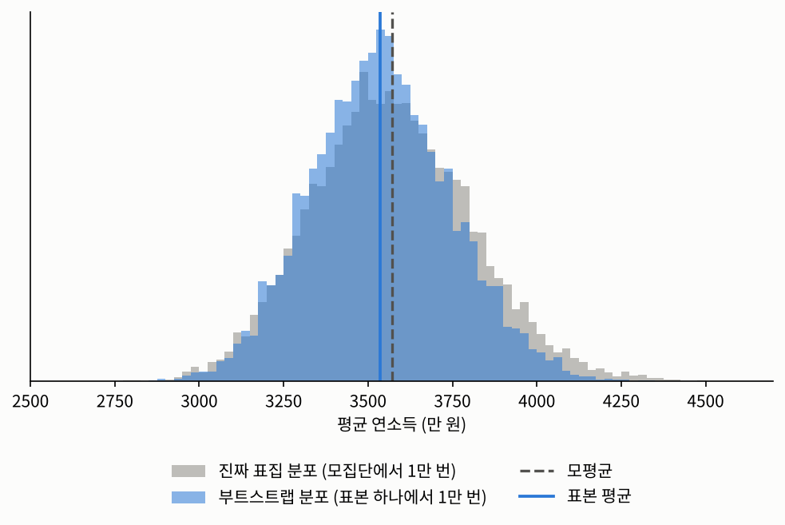
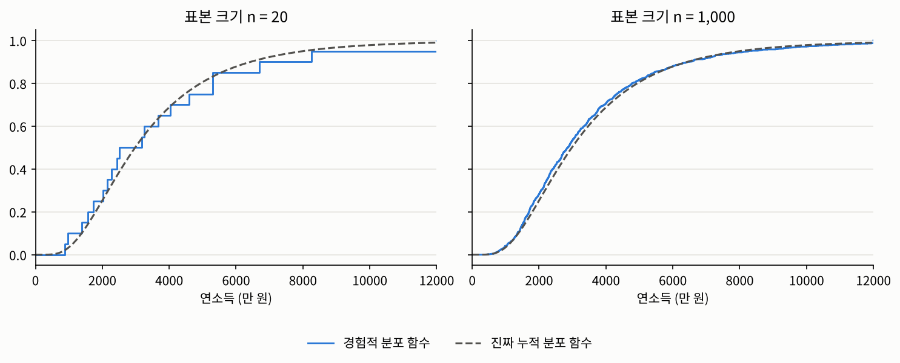

## 들어가며

[지난 글](01-point-estimation.qmd)에서는 모집단에서 표본을 여러 번 뽑을 수 있다면 추정량의 **표집 분포**를 만들 수 있고, 그것으로 추정이 얼마나 믿을 만한지 알 수 있다는 것을 보았습니다. 문제는 현실에서 우리 손에 있는 표본이 **딱 하나**라는 것이었습니다. 이번 글에서는 그 하나의 표본만으로 표집 분포의 아이디어를 현실적으로 구현하는 방법인 **부트스트랩**(bootstrap)을 다룹니다.

## 표본을 모집단처럼

표집 분포의 핵심은 모집단에서 표본을 여러 번 뽑아 보자는 것이었습니다. 하지만 모집단에서 계속 표본을 뽑는 것은 현실적이지 않습니다. 부트스트랩은 이 한계를 인정하고 이렇게 묻습니다.

> 우리한테 표본 $x_1, \dots, x_n$이 있잖아. 그러면 이걸 모집단이라고 생각하면 안 되나?

말 그대로입니다. 표본이 모집단을 잘 대표하도록 뽑혔다면, 그 표본은 모집단의 축소판이라고 볼 수 있습니다. 그러니 모집단 대신 **표본에서** 다시 표본을 뽑아 보자는 것입니다. 이렇게 표본에서 다시 표본을 뽑는 것을 **재표집**(resampling)이라고 하고, 재표집으로 얻은 표본 $x^*_1, \dots, x^*_n$을 **부트스트랩 표본**(bootstrap sample)이라고 합니다. 원래 표본과 구분하기 위해 별표 $*$를 붙여 씁니다.

부트스트랩이라는 이름은 "자기 신발 끈(bootstrap)을 잡아당겨 스스로를 들어 올린다"는 영어 표현에서 왔습니다. 도저히 불가능해 보이는 일을 주어진 것만으로 해낸다는 뜻인데, 새로운 데이터 없이 가진 표본만으로 표집 분포를 만들어 내는 이 방법에 잘 어울리는 이름입니다. 이 방법은 1979년에 브래들리 에프런(Bradley Efron)이 제안했습니다.[^efron]

### 복원 추출로 다시 뽑기

재표집에서는 원래 표본과 **같은 크기** $n$의 부트스트랩 표본을 뽑는데, 이때 **복원 추출**(sampling with replacement)을 합니다. 한 번 뽑은 데이터를 다시 넣고 다음 것을 뽑는다는 뜻이라, 같은 데이터가 여러 번 뽑힐 수도, 한 번도 안 뽑힐 수도 있습니다. 같은 크기로 뽑는데 복원 추출을 하지 않으면, 원래 표본의 순서만 바꾼 것이 되어 아무 의미가 없으니까요.

그리고 각 데이터 포인트가 뽑힐 확률은 **모두 같다**고 둡니다. 여기서 주의할 점이 있습니다. 같은 것은 "각 **값**이 뽑힐 확률"이 아니라, "각 **데이터 포인트**가 뽑힐 확률"입니다. 예를 들어 다음 표본을 보겠습니다.

| | $x_1$ | $x_2$ | $x_3$ | $x_4$ | $x_5$ | $x_6$ | $x_7$ | $x_8$ |
|:--|:--:|:--:|:--:|:--:|:--:|:--:|:--:|:--:|
| 값 | 1 | 4 | 4 | 3 | 2 | 2 | 5 | 4 |

이 표본에 나오는 값은 1, 2, 3, 4, 5 다섯 가지이지만, 1부터 5까지가 각각 $1/5$의 확률로 뽑힌다는 것이 아닙니다. 데이터 포인트 $x_1, \dots, x_8$이 각각 $1/8$의 확률로 뽑힌다는 것입니다. 그러면 값마다 뽑힐 확률은, 그 값을 가진 데이터 포인트의 수를 전체 크기로 나눈 것이 됩니다.

| 값 | 1 | 2 | 3 | 4 | 5 |
|:--|:--:|:--:|:--:|:--:|:--:|
| 데이터 포인트 | $x_1$ | $x_5, x_6$ | $x_4$ | $x_2, x_3, x_8$ | $x_7$ |
| 뽑힐 확률 | $1/8$ | $2/8$ | $1/8$ | $3/8$ | $1/8$ |

이렇게 해야 표본이 가진 확률적인 구조, 즉 "4가 가장 흔하고 1, 3, 5는 드물다"는 모양이 부트스트랩 표본에도 그대로 이어집니다. 넘파이에서는 `rng.choice`에 `replace=True`를 주면 됩니다.

```python
import numpy as np

rng = np.random.default_rng(1557)
x = np.array([1, 4, 4, 3, 2, 2, 5, 4])

for b in range(3):
    print(f"부트스트랩 표본 {b + 1}:", rng.choice(x, size=len(x), replace=True))
```

```
부트스트랩 표본 1: [3 4 4 5 5 2 4 2]
부트스트랩 표본 2: [2 3 3 2 4 2 4 4]
부트스트랩 표본 3: [5 4 5 4 4 4 4 4]
```

같은 값이 여러 번 나오기도 하고, 원래 표본에 있던 값이 빠지기도 합니다. 부트스트랩 표본을 아주 많이 뽑아서 값마다 나온 비율을 세어 보면, 위의 표와 같은 확률이 나옵니다.

```python
many = rng.choice(x, size=100_000, replace=True)
values, counts = np.unique(many, return_counts=True)
for v, c in zip(values, counts):
    print(f"값 {v}: {c / len(many):.3f}")
```

```
값 1: 0.124
값 2: 0.250
값 3: 0.128
값 4: 0.374
값 5: 0.124
```

$1/8 = 0.125$, $2/8 = 0.25$, $3/8 = 0.375$와 거의 같습니다.

## 부트스트랩 알고리즘

이제 부트스트랩으로 표집 분포를 흉내 내는 과정을 정리하겠습니다. 여기서는 평균을 예로 들지만, 다른 통계량도 계산하는 공식만 바꾸면 똑같이 할 수 있습니다.

::: {.callout-note icon=false}
### 알고리즘 4.2.1 (부트스트랩)
**입력:** 표본 $x_1, \dots, x_n$, 통계량을 계산하는 공식(추정량) $T$, 반복 횟수 $B$<br>
**출력:** 부트스트랩 통계량 $\hat\theta^*_1, \dots, \hat\theta^*_B$

1. $b = 1, \dots, B$에 대해 다음을 반복합니다.
    1. $x_1, \dots, x_n$에서 각 데이터 포인트를 같은 확률 $1/n$로 **복원 추출**해서, 크기가 $n$인 부트스트랩 표본 $x^*_1, \dots, x^*_n$을 만듭니다.
    2. 부트스트랩 표본으로 통계량 $\hat\theta^*_b = T(x^*_1, \dots, x^*_n)$을 계산합니다. 평균이라면 $\hat\theta^*_b = \frac{1}{n}\sum_{i=1}^n x^*_i$입니다.
2. $\hat\theta^*_1, \dots, \hat\theta^*_B$의 분포를, 추정량 $\hat\theta = T(X_1, \dots, X_n)$의 **표집 분포 대신** 씁니다. 이것을 **부트스트랩 분포**라고 합니다.
:::

[지난 글](01-point-estimation.qmd)의 가상의 나라로 해 보겠습니다. 지난 글과 같은 시드로 같은 모집단을 만들고, 같은 100명의 표본을 뽑습니다. 이번에는 모집단을 모른다고 치고, **이 표본 하나만** 가지고 부트스트랩을 합니다.

```python
rng = np.random.default_rng(1557)
population = rng.lognormal(mean=8.0, sigma=0.6, size=1_000_000)   # 지난 글과 같은 모집단
sample = rng.choice(population, size=100, replace=False)           # 지난 글과 같은 표본

B = 10_000
boot_samples = rng.choice(sample, size=(B, len(sample)), replace=True)   # 부트스트랩 표본 B개
boot_means = boot_samples.mean(axis=1)                                   # 부트스트랩 평균 B개

print(f"표본 평균 x̄              : {sample.mean():,.1f}")
print(f"부트스트랩 평균들의 평균 : {boot_means.mean():,.1f}")
print(f"부트스트랩 평균들의 표준편차: {boot_means.std():,.1f}")
```

```
표본 평균 x̄              : 3,537.0
부트스트랩 평균들의 평균 : 3,539.1
부트스트랩 평균들의 표준편차: 205.8
```

지난 글에서 모집단에서 직접 표본을 1만 번 뽑아 만든 진짜 표집 분포는 표준편차가 234.3이었습니다. 부트스트랩은 모집단을 전혀 보지 않고, 100명짜리 표본 하나만으로 그와 같은 규모의 값을 냈습니다. 정확히 같지 않은 것은, 부트스트랩이 **이 표본 하나가 보여 주는 퍼진 정도**를 바탕으로 하기 때문입니다. 이번 표본은 우연히 모집단보다 조금 덜 퍼져 있어서(표본 표준편차는 약 2,051만 원으로, 모표준편차 2,353만 원보다 작습니다), 부트스트랩도 흔들림을 조금 작게 짐작했습니다. 표본이 클수록 이런 차이는 줄어듭니다.

{fig-alt="두 개의 히스토그램이 같은 가로축 위에 겹쳐 그려져 있다. 회색 히스토그램은 모집단에서 직접 크기 100인 표본을 1만 번 뽑아 만든 진짜 표집 분포로, 모평균을 표시한 회색 점선을 중심으로 한다. 파란색 히스토그램은 표본 하나에서 부트스트랩 표본을 1만 번 뽑아 만든 부트스트랩 분포로, 표본 평균을 표시한 파란색 실선을 중심으로 한다. 두 히스토그램은 퍼진 정도와 모양이 비슷하지만, 파란색이 회색보다 약간 왼쪽으로 옮겨져 있다." width=80%}

그림을 보면 부트스트랩이 무엇을 잘하고 무엇을 못하는지 알 수 있습니다. 부트스트랩 분포는 진짜 표집 분포와 **퍼진 정도와 모양**이 비슷합니다. 하지만 **중심**은 모평균이 아니라 **표본 평균**에 있습니다. 부트스트랩 평균들의 평균이 표본 평균과 거의 같은 것도 그 때문입니다. 당연한 일입니다. 부트스트랩은 표본을 세상의 전부라고 여기고 그 안에서 다시 뽑는 것이니, 부트스트랩으로 짐작할 수 있는 것은 엄밀히 말하면 모집단이 아니라 **표본**의 성질입니다.

그래서 부트스트랩 평균들의 평균을 구한다고 해서 표본 평균보다 더 정확한 추정값이 나오는 것은 아닙니다. 모평균의 추정값은 그냥 표본 평균 $\bar x$를 쓰면 됩니다. 부트스트랩의 진짜 쓸모는 **추정값이 얼마나 흔들릴 수 있는지**, 즉 표집 분포의 **퍼진 정도와 모양**을 알려 주는 데 있습니다. 이것으로 [다음 글](03-standard-error-ci.qmd)의 표준 오차와 신뢰구간을 구합니다. (부트스트랩 통계량들의 평균과 원래 추정값의 차이 $\frac{1}{B}\sum_b \hat\theta^*_b - \hat\theta$는, 그 추정량이 평균적으로 모수를 얼마나 비껴가는지를 나타내는 **편향**(bias)을 짐작하는 데 쓰기도 합니다.)

### 공식이 없는 통계량에도

부트스트랩의 큰 장점은, 계산 공식만 바꾸면 **어떤 통계량에도** 똑같이 쓸 수 있다는 것입니다. 예를 들어 소득처럼 치우친 데이터에서는 [2.2](../02-data-exploration/02-summary-statistics.qmd)에서 본 것처럼 평균보다 중앙값이 더 자주 쓰입니다. 표본 평균이 얼마나 흔들리는지는 [다음 글](03-standard-error-ci.qmd)에서 볼 간단한 공식이 있지만, 표본 중앙값이 얼마나 흔들리는지는 그런 간단한 공식이 없습니다. 부트스트랩에서는 `mean`을 `median`으로 바꾸기만 하면 됩니다.

```python
boot_medians = np.median(boot_samples, axis=1)

print(f"표본 중앙값                  : {np.median(sample):,.1f}")
print(f"부트스트랩 중앙값들의 표준편차: {boot_medians.std():,.1f}")
print(f"(참고) 모집단의 중앙값        : {np.median(population):,.1f}")
```

```
표본 중앙값                  : 3,196.0
부트스트랩 중앙값들의 표준편차: 184.7
(참고) 모집단의 중앙값        : 2,983.6
```

## 왜 이게 될까요?

그런데 여기서 이상하다고 느낄 수 있습니다. 부트스트랩은 주어진 표본이 마치 세상의 전부인 것처럼 여기고 그 안에서 다시 뽑습니다. 그러니 부트스트랩으로 얻은 것은 엄밀히 말하면 **원래 표본에 대한** 정보입니다. 그런데 어떻게 그것을 모집단에 대한 이야기로 쓸 수 있을까요? 여기에는 이론적인 이유가 있습니다.

위에서 각 데이터 포인트가 같은 확률 $1/n$로 뽑히도록 복원 추출한다고 했는데, 이것은 다음과 같은 분포에서 숫자를 뽑는 것과 같습니다.

::: {.callout-note icon=false .callout-definition}
### 정의 4.2.2 (경험적 분포 함수)
표본 $x_1, \dots, x_n$에 대해

$$
\hat F_n(t) := \frac{1}{n} \sum_{i=1}^{n} \mathbf{1}\{x_i \le t\} = \frac{t \text{ 이하인 데이터 포인트의 수}}{n}
$$

을 **경험적 분포 함수**(empirical distribution function)라고 합니다. 각 데이터 포인트에 확률 $1/n$씩을 준 이산 분포의 누적 분포 함수입니다.
:::

[2.6](../02-data-exploration/06-pandas-seaborn.qmd)에서 시본으로 그려 본 경험적 누적분포함수(ECDF)가 바로 이것입니다. 부트스트랩의 복원 추출은 결국 모집단의 진짜 분포 $F$ 대신, 표본으로 만든 이 계단 모양의 분포 $\hat F_n$에서 숫자를 뽑는 것입니다. 그리고 표본이 클수록 $\hat F_n$이 진짜 $F$에 가까워진다는 것이 알려져 있습니다.

::: {.callout-important icon=false .callout-satz}
### 정리 4.2.3 (글리벤코–칸텔리 정리)
$X_1, X_2, \dots$가 누적 분포 함수 $F$를 따르는 i.i.d. 확률 변수이고 $\hat F_n$이 $X_1, \dots, X_n$의 경험적 분포 함수일 때,

$$
\sup_{t \in \mathbb{R}} \left| \hat F_n(t) - F(t) \right| \xrightarrow[n \to \infty]{} 0
$$

이 거의 확실하게 성립합니다.
:::

::: {.callout-tip collapse="false" icon=false .callout-beweis}
### 증명
[측도론적 확률론](../../../stats/measure-prob/index.qmd)을 참고하시기 바랍니다.
:::

말로 풀면, 표본이 커질수록 경험적 분포 함수와 진짜 누적 분포 함수의 **가장 크게 벌어진 차이**마저 0으로 줄어든다는 뜻입니다. "거의 확실하게"는 이런 일이 확률 1로 일어난다는, 즉 운이 아주 나쁜 예외적인 경우를 빼면 언제나 그렇다는 뜻입니다.

{fig-alt="두 개의 그림이 나란히 있다. 둘 다 회색 점선은 모집단의 진짜 누적 분포 함수이고, 파란색 계단은 표본으로 만든 경험적 분포 함수이다. 왼쪽의 표본 크기 20인 그림에서는 계단이 굵고 진짜 곡선에서 군데군데 꽤 벌어져 있다. 오른쪽의 표본 크기 1000인 그림에서는 계단이 촘촘해서 진짜 곡선과 거의 겹친다." width=90%}

그래서 표본이 충분히 크면, 표본에서 다시 뽑는 것이 모집단에서 다시 뽑는 것과 거의 같아지고, 부트스트랩 분포가 진짜 표집 분포를 잘 흉내 내게 됩니다. 실제로 부트스트랩이 잘 동작하려면 몇 가지 수학적인 조건이 더 필요하지만, 평균이나 중앙값처럼 이 과목에서 다루는 통계량에서는 대부분 만족된다고 봐도 됩니다. 다만 부트스트랩의 출발점은 결국 표본이라서, 표본이 i.i.d.가 아니거나 편향되어 있으면 부트스트랩도 그 편향을 그대로 물려받는다는 점은 기억해 두세요.

부트스트랩은 아이디어가 아주 간단하고, 어떤 통계량에도 쓸 수 있을 만큼 범용적입니다. 대신 계산이 많이 필요합니다. 위에서도 100명짜리 표본으로 1만 번, 모두 100만 개의 숫자를 뽑았지요. 그래서 이 방법은 컴퓨터가 충분히 발전하고 나서야 널리 쓰일 수 있었습니다. 컴퓨터의 발전과 함께 떠오른 데이터 사이언스와 잘 맞닿아 있는 방법인 셈입니다.

## 정리

- **부트스트랩**은 표본을 모집단처럼 여기고, 표본에서 같은 크기로 **복원 추출**해 만든 부트스트랩 표본으로 통계량을 반복 계산하는 방법입니다.
- 재표집에서는 각 **데이터 포인트**가 같은 확률 $1/n$로 뽑힙니다. 그래서 표본의 확률적 구조가 그대로 이어집니다.
- 부트스트랩 분포는 진짜 표집 분포와 **퍼진 정도와 모양**이 비슷하지만, 중심은 모수가 아니라 원래 추정값에 있습니다. 추정값 자체는 원래 표본으로 구하고, 부트스트랩으로는 그 추정값이 **얼마나 흔들리는지**를 봅니다.
- 복원 추출은 **경험적 분포 함수**에서 뽑는 것이고, **글리벤코–칸텔리 정리**에 따라 표본이 클수록 경험적 분포 함수는 진짜 분포에 가까워집니다.

다음 글에서는 부트스트랩 분포의 퍼진 정도로 **표준 오차**를, 부트스트랩 분포의 양 끝으로 **신뢰구간**을 구해 보겠습니다.

---

### 연결되는 개념
* $\leftarrow$ **이전 개념:** [4.1 점 추정과 표집 분포](01-point-estimation.qmd)
* $\rightarrow$ **다음 개념:** [4.3 표준 오차와 신뢰구간](03-standard-error-ci.qmd)

[^efron]: B. Efron, "Bootstrap Methods: Another Look at the Jackknife", *The Annals of Statistics* 7(1), 1979, pp. 1–26.
