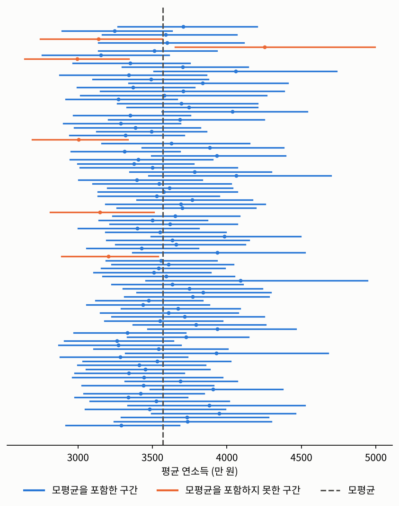

## 들어가며

[지난 글](02-bootstrap.qmd)에서는 표본 하나로 표집 분포를 흉내 내는 부트스트랩을 살펴보았습니다. 그리고 부트스트랩의 진짜 쓸모는 추정값 자체보다, 그 추정값이 **얼마나 흔들릴 수 있는지**를 알려 주는 데 있다고 했습니다. 이번 글에서는 이 "흔들림"을 숫자로 나타내는 두 가지 도구를 다룹니다. 추정량이 얼마나 퍼져 있는지를 나타내는 **표준 오차**와, 모수가 있을 만한 범위를 나타내는 **신뢰구간**입니다.

지난 글들과 같은 가상의 나라와 100명짜리 표본을 다시 만들어 두고 시작하겠습니다.

```python
import numpy as np

rng = np.random.default_rng(1557)
population = rng.lognormal(mean=8.0, sigma=0.6, size=1_000_000)   # 가상의 나라 100만 명의 연소득 (만 원)
sample = rng.choice(population, size=100, replace=False)           # 우리가 가진 표본 하나
n = len(sample)

boot_means = rng.choice(sample, size=(10_000, n), replace=True).mean(axis=1)   # 부트스트랩 평균 1만 개
```

## 표준 오차

추정은 어디까지나 짐작이라서 그 값이 정확하지 않습니다. 그래서 추정이 얼마나 **정밀한지**를 판단할 수 있어야 하는데, 이를 위한 가장 기본적인 도구가 표준 오차입니다.

::: {.callout-note icon=false .callout-definition}
### 정의 4.3.1 (표준 오차)
추정량 $\hat\theta$의 표집 분포의 표준편차를 $\hat\theta$의 **표준 오차**(standard error, SE)라고 합니다.

$$
\mathrm{SE}(\hat\theta) := \sqrt{\mathrm{Var}(\hat\theta)}
$$

특히 표본 평균 $\bar X$의 표준 오차를 **평균의 표준 오차**(standard error of the mean, SEM)라고 합니다.
:::

[4.1](01-point-estimation.qmd)에서 표본을 1만 번 뽑아 구한 "표본 평균들의 표준편차"가 바로 표본 평균의 표준 오차였던 셈입니다. 이름에 "오차"가 붙는 이유는, 이 값이 추정값이 모수에서 **보통 얼마나 벗어나는지**를 나타내기 때문입니다. 표준 오차가 작을수록 추정값이 모수 가까이에 모여 있을 가능성이 높습니다.

### 표본 평균의 표준 오차

표본 평균의 경우에는 표준 오차를 간단한 공식으로 구할 수 있습니다. 앞에서 추정량 $\bar X = \frac{1}{n}\sum_{i=1}^n X_i$가 확률 변수라고 했는데, 확률 변수들의 합은 다시 확률 변수이므로 그 분산을 계산할 수 있습니다.

::: {.callout-important icon=false .callout-satz}
### 정리 4.3.2 (표본 평균의 분산)
$X_1, \dots, X_n$이 평균이 $\mu$이고 분산이 $\sigma^2$인 분포를 따르는 i.i.d. 확률 변수라면

$$
\mathbb{E}[\bar X] = \mu, \qquad \mathrm{Var}(\bar X) = \frac{\sigma^2}{n}, \qquad \mathrm{SE}(\bar X) = \frac{\sigma}{\sqrt{n}}
$$

입니다.
:::

::: {.callout-tip collapse="false" icon=false .callout-beweis}
### 증명
기대값은 선형이므로 $\mathbb{E}[\bar X] = \frac{1}{n}\sum_{i=1}^n \mathbb{E}[X_i] = \frac{1}{n} \cdot n\mu = \mu$입니다. 분산은 상수배를 밖으로 꺼낼 때 제곱이 되고, 서로 **독립**인 확률 변수의 합의 분산은 각 분산의 합이므로

$$
\mathrm{Var}(\bar X) = \frac{1}{n^2} \mathrm{Var}\left(\sum_{i=1}^n X_i\right) = \frac{1}{n^2} \sum_{i=1}^n \mathrm{Var}(X_i) = \frac{1}{n^2} \cdot n\sigma^2 = \frac{\sigma^2}{n}
$$

입니다. 표준 오차는 이것의 제곱근입니다. $\blacksquare$
:::

첫 번째 식은 [4.1](01-point-estimation.qmd)의 시뮬레이션에서 본 것처럼, 표본 평균이 **평균적으로는 모평균을 맞힌다**는 뜻입니다. 세 번째 식은 표본 평균이 모평균 $\mu$를 중심으로, 보통 $\pm\,\sigma/\sqrt{n}$ 정도의 폭으로 흔들린다는 뜻입니다. 물론 "보통" 그렇다는 것이지, 이 범위를 벗어나는 표본이 나와도 전혀 이상한 일은 아닙니다. 가상의 나라에서 확인해 보면, 공식이 4.1의 시뮬레이션 결과(234.3)와 거의 같습니다.

```python
sigma = population.std()
print(f"공식 σ/√n : {sigma / np.sqrt(n):,.1f}")
```

```
공식 σ/√n : 235.3
```

이 공식에서 $\sigma$는 데이터의 분포가 정하는 값이라 우리가 바꿀 수 없지만, 분모의 $n$은 표본을 처음 뽑을 때 키울 수 있습니다. 그래서 표본이 클수록 추정이 정밀해집니다. 다만 $n$이 아니라 $\sqrt{n}$에 반비례하기 때문에, 표준 오차를 절반으로 줄이려면 표본이 **네 배** 필요합니다. [1.4](../01-foundations/04-sampling-bias.qmd)에서 "오차를 절반으로 줄이려면 데이터가 네 배 필요하다"고 했던 것이 바로 이 공식에서 나옵니다.

### σ를 모를 때

그런데 이 공식을 쓰려고 보면 문제가 있습니다. 우리는 모표준편차 $\sigma$를 **모릅니다.** $\sigma$를 알려면 모집단 전체를 알아야 하니까요. 해결 방법은 두 가지입니다.

첫째, 가장 간단한 방법은 $\sigma$ 자리에 표본으로 계산한 [2.2](../02-data-exploration/02-summary-statistics.qmd)의 **표본 표준편차** $s$를 넣는 것입니다.

$$
\widehat{\mathrm{SE}}(\bar X) = \frac{s}{\sqrt{n}}, \qquad s = \sqrt{\frac{1}{n-1}\sum_{i=1}^{n}(x_i - \bar x)^2}
$$

둘째, **부트스트랩**을 쓰는 것입니다. 표준 오차는 표집 분포의 표준편차이고, 부트스트랩 분포는 표집 분포를 흉내 낸 것이니, 부트스트랩 통계량들의 표준편차를 그대로 표준 오차의 추정값으로 쓰면 됩니다.

$$
\widehat{\mathrm{SE}}_{\text{boot}} = \sqrt{\frac{1}{B-1}\sum_{b=1}^{B}\left(\hat\theta^*_b - \bar{\theta}^*\right)^2}, \qquad \bar{\theta}^* = \frac{1}{B}\sum_{b=1}^B \hat\theta^*_b
$$

```python
print(f"s/√n              : {sample.std(ddof=1) / np.sqrt(n):,.1f}")
print(f"부트스트랩 표준 오차 : {boot_means.std(ddof=1):,.1f}")
```

```
s/√n              : 205.1
부트스트랩 표준 오차 : 205.8
```

두 방법이 거의 같은 값을 냅니다. 표본 평균은 공식이 있으니 첫 번째 방법이 간단하지만, 부트스트랩은 [지난 글](02-bootstrap.qmd)의 중앙값처럼 **공식이 없는 통계량**에도 똑같이 쓸 수 있다는 것이 장점입니다. 두 값 모두 참값 235.3보다 조금 작은 것은, 지난 글에서 말한 것처럼 이번 표본이 우연히 모집단보다 덜 퍼져 있었기 때문입니다. 추정값의 정밀도도 결국 추정한 것이라, 그 자체에도 오차가 있는 것이지요.

## 신뢰구간

표준 오차는 추정량이 **얼마나 퍼져 있는지**, 즉 산포도 그 자체에 초점을 둔 값입니다. 신뢰구간은 목적은 비슷하지만 초점이 조금 다릅니다. 모수가 **들어 있을 거라고 기대되는 범위**를 직접 만드는 데 초점을 둡니다. 고등학교 확률과 통계에서 배운 기억이 있으실 겁니다.

::: {.callout-note icon=false .callout-definition}
### 정의 4.3.3 (신뢰구간)
$0 < \alpha < 1$이라고 하겠습니다. 표본의 확률 변수 $X_1, \dots, X_n$으로 계산하는 두 통계량 $L = L(X_1, \dots, X_n)$과 $U = U(X_1, \dots, X_n)$이

$$
\mathbb{P}\big(L \le \theta \le U\big) \ge 1 - \alpha
$$

를 만족할 때, 구간 $I = [L, U]$를 $\theta$에 대한 **신뢰 수준**(confidence level) $1-\alpha$의 **신뢰구간**(confidence interval)이라고 합니다. 신뢰 수준을 백분율로 나타낸 것을 **신뢰도**라고도 합니다.
:::

정의에서 표기는 크게 신경 쓰지 않아도 됩니다. 핵심은 신뢰 수준이 $1-\alpha$인 신뢰구간이란, **모수를 포함할 확률이 $1-\alpha$ 이상인 구간**이라는 것입니다. 흔히 $\alpha = 0.05$로 두어 95% 신뢰구간을 씁니다.

### 확률이 붙어 있는 것은 구간입니다

신뢰구간은 아주 자주 잘못 해석되는 개념입니다. 여론조사 결과에 "A 후보 지지율 28~32%, 신뢰도 95%"라고 나오면, 많은 사람이 이것을 "A 후보의 지지율이 28~32%일 확률이 95%"라고 읽습니다. 하지만 이것은 틀린 해석입니다.

확률을 이야기하려면, 확률을 따지는 대상에 **무작위성**이 있어야 합니다. 그런데 정의의 $\mathbb{P}(L \le \theta \le U)$에서 모수 $\theta$는 하나로 정해진 상수일 뿐, 무작위로 움직이지 않습니다. 무작위성이 있는 것은 표본에 따라 달라지는 **구간** $[L, U]$입니다. "모수가 구간에 들어 있을 확률"이라고 말하는 순간, 우리는 구간은 가만히 있고 모수가 움직여서 구간에 들어가는 그림을 떠올리게 되는데, 실제로는 정반대입니다. 모수는 가만히 있고, 표본을 뽑을 때마다 **구간이 움직입니다.**

그래서 정확한 해석은 이렇습니다. **이런 방법으로 표본을 뽑아 구간을 만드는 일을 반복하면, 그렇게 만든 구간들 가운데 95% 정도가 진짜 모수를 포함한다.** 95%라는 확률은 구간을 만드는 **방법**에 붙어 있는 것입니다. 일단 표본을 뽑아서 28~32%라는 구체적인 구간을 얻고 나면, 그 구간이 진짜 지지율을 포함할 확률은 1 아니면 0입니다. 진짜 지지율은 그 안에 있거나, 밖에 있거나 둘 중 하나니까요. 우리가 모를 뿐입니다.

미묘한 말장난처럼 보일 수 있지만, 통계 자료를 해석할 때는 큰 차이를 만듭니다. 시뮬레이션으로 직접 확인해 보겠습니다. 가상의 나라에서 100명짜리 표본을 100번 새로 뽑고, 표본마다 아래에서 설명할 방법으로 95% 신뢰구간을 만들어서, 각 구간이 진짜 모평균을 포함하는지 그려 보았습니다.

{fig-alt="세로로 100개의 가로 선분이 쌓여 있는 그림. 각 선분은 서로 다른 표본으로 만든 95퍼센트 신뢰구간이고, 가운데의 점은 그 표본의 평균이다. 세로로 그은 회색 점선은 진짜 모평균이다. 대부분의 선분은 파란색으로, 회색 점선을 가로지른다. 몇 개의 선분은 주황색으로, 회색 점선에 닿지 않고 왼쪽이나 오른쪽으로 벗어나 있다." width=75%}

구간들은 표본마다 위치도 길이도 제각각입니다. 대부분은 진짜 모평균(회색 점선)을 포함하지만(파란색), 몇 개는 포함하지 못합니다(주황색). 이 그림에서는 100개 가운데 94개가 포함했고 6개가 포함하지 못했습니다. 그리고 그림 속의 어느 구간을 집어 들어도, 그 구간은 모평균을 포함하거나 포함하지 않거나 둘 중 하나입니다. 우리가 현실에서 가진 것은 이 가운데 **하나의 구간**뿐이고, 그것이 파란색인지 주황색인지는 알 수 없습니다. 다만 이 방법으로 만든 구간이 대부분 파란색이라는 것을 알기 때문에, 그 구간을 "믿을" 수 있는 것입니다. 이것이 "신뢰"구간이라는 이름의 뜻입니다.

## 부트스트랩으로 신뢰구간 만들기

그렇다면 신뢰구간은 어떻게 만들까요? 방법은 여러 가지인데, 부트스트랩을 쓰면 아주 간단합니다. 부트스트랩 분포가 표집 분포를 흉내 낸 것이니, 부트스트랩 통계량들을 크기순으로 정렬해서 **양 끝을 조금씩 잘라 내면** 됩니다.

::: {.callout-note icon=false}
### 알고리즘 4.3.4 (부트스트랩 백분위 신뢰구간)
**입력:** 표본 $x_1, \dots, x_n$, 추정량 $T$, 반복 횟수 $B$, 신뢰 수준 $1-\alpha$<br>
**출력:** $\theta$에 대한 신뢰구간 $[L, U]$

1. [알고리즘 4.2.1](02-bootstrap.qmd)로 부트스트랩 통계량 $\hat\theta^*_1, \dots, \hat\theta^*_B$를 구합니다.
2. 이것들을 작은 것부터 크기순으로 정렬합니다.
3. 아래에서 $\alpha/2$ 비율만큼 되는 위치의 값을 $L$로, 아래에서 $1-\alpha/2$ 비율만큼 되는 위치의 값을 $U$로 합니다. 즉 부트스트랩 통계량들의 $\alpha/2$ 분위수와 $1-\alpha/2$ 분위수를 구합니다.
:::

95% 신뢰구간이라면 $\alpha = 0.05$이니, 부트스트랩 통계량 1만 개를 정렬해서 아래쪽 2.5%(250번째)와 위쪽 2.5%(9,750번째)에 해당하는 값 사이를 구간으로 삼는 것입니다. 가운데 95%만 남기는 셈이지요. 넘파이의 `np.percentile`이나 `np.quantile`로 바로 구할 수 있습니다.

```python
low, high = np.percentile(boot_means, [2.5, 97.5])
print(f"모평균의 95% 부트스트랩 신뢰구간: [{low:,.1f}, {high:,.1f}]")
print(f"(참고) 진짜 모평균              : {population.mean():,.1f}")
```

```
모평균의 95% 부트스트랩 신뢰구간: [3,150.7, 3,958.2]
(참고) 진짜 모평균              : 3,570.7
```

이번 표본으로 만든 구간은 진짜 모평균을 포함했습니다. 물론 현실에서는 이것을 확인할 방법이 없고, 우리가 아는 것은 "이 방법으로 만든 구간은 대부분 모평균을 포함한다"는 것뿐입니다. 정말 그런지, 위의 그림처럼 표본을 새로 뽑아 구간을 만드는 일을 1,000번 반복해서 세어 보겠습니다.

```python
mu = population.mean()
reps, B = 1_000, 2_000
covered = 0
for _ in range(reps):
    s = rng.choice(population, size=n, replace=False)
    bm = rng.choice(s, size=(B, n), replace=True).mean(axis=1)
    lo, hi = np.percentile(bm, [2.5, 97.5])
    covered += (lo <= mu <= hi)
print(f"1,000개의 구간 중 모평균을 포함한 비율: {covered / reps:.1%}")
```

```
1,000개의 구간 중 모평균을 포함한 비율: 94.5%
```

1,000개 가운데 945개, 거의 95%가 모평균을 포함했습니다. (반복 횟수가 1,000번이라 이 비율 자체에도 대략 ±1.4%p 정도의 오차가 있으니, 94.5%와 95%의 차이는 우연으로 설명되는 수준입니다.) 이렇게 신뢰구간이 말하는 신뢰 수준이 실제로 지켜지는지를 시뮬레이션으로 확인하는 것도, [3장](../03-reproducible-workflow/index.qmd)에서 이야기한 "결과가 상식과 맞는지 확인하는 습관"의 하나입니다.

다만 부트스트랩 백분위 신뢰구간은 신뢰 수준 $1-\alpha$를 **정확하게** 보장하는 것이 아니라, 표본 크기 $n$과 반복 횟수 $B$가 충분히 클 때 **점점 가까워지도록** 보장합니다. 이런 구간을 **점근적**(asymptotic) $1-\alpha$ 신뢰구간이라고 합니다. 그래서 표본이 아주 작거나 데이터가 한쪽으로 심하게 치우쳐 있으면, 실제로 모수를 포함하는 비율이 $1-\alpha$보다 눈에 띄게 낮아질 수 있습니다.

같은 방법으로 다른 통계량의 신뢰구간도 만들 수 있습니다. [지난 글](02-bootstrap.qmd)의 중앙값이라면 `boot_means` 대신 부트스트랩 중앙값들로 같은 계산을 하면 됩니다.

### 정규 근사로 만드는 신뢰구간

신뢰구간을 만드는 또 다른 흔한 방법은 [4.1](01-point-estimation.qmd)에서 짧게 이야기한 **중심극한정리**를 쓰는 것입니다. 표본이 충분히 크면 표본 평균의 분포가 정규분포에 가까워지는데, 정규분포에서는 평균에서 표준편차의 1.96배 안쪽에 전체의 95%가 들어갑니다. 그래서 표본 평균은 약 95%의 확률로 $\mu \pm 1.96\,\mathrm{SE}$ 안에 들어오고, 이것을 뒤집으면 다음과 같은 95% 신뢰구간을 얻습니다.

$$
\left[\, \bar x - 1.96\,\widehat{\mathrm{SE}},\ \ \bar x + 1.96\,\widehat{\mathrm{SE}} \,\right]
$$

```python
se = sample.std(ddof=1) / np.sqrt(n)
print(f"정규 근사 95% 신뢰구간: [{sample.mean() - 1.96 * se:,.1f}, {sample.mean() + 1.96 * se:,.1f}]")
```

```
정규 근사 95% 신뢰구간: [3,134.9, 3,939.0]
```

부트스트랩 구간과 거의 같습니다. 이 공식은 [1.4](../01-foundations/04-sampling-bias.qmd)에서 미뤄 두었던 질문, 여론조사의 오차 한계가 왜 대략 $\pm 1/\sqrt{n}$인지에 대한 답이기도 합니다. 지지율처럼 비율 $p$를 추정할 때는 각 응답이 1(지지) 또는 0(지지하지 않음)이라서, 한 응답의 표준편차가 $\sigma = \sqrt{p(1-p)}$입니다. 이 값은 $p = 0.5$일 때 가장 커서 $0.5$이므로, 오차 한계 $1.96\,\sigma/\sqrt{n}$은 아무리 커도 $1.96 \times 0.5/\sqrt{n} = 0.98/\sqrt{n}$, 즉 대략 $1/\sqrt{n}$입니다. 응답자가 1,000명이면 $0.98/\sqrt{1000} \approx 0.031$, 뉴스에서 보는 "95% 신뢰수준에서 표본오차 ±3.1%p"가 바로 이것입니다. 1.96이라는 숫자가 어디서 나오는지, 그리고 표본이 작을 때는 어떻게 고쳐 쓰는지는 [기초 통계학](../../../stats/basic-stats/index.qmd)에서 다룹니다.

## 정리

- **표준 오차**는 추정량의 표집 분포의 표준편차로, 추정값이 모수에서 보통 얼마나 벗어나는지를 나타냅니다.
- 표본 평균의 표준 오차는 $\sigma/\sqrt{n}$입니다. 표본을 네 배로 늘려야 표준 오차가 절반이 됩니다. $\sigma$를 모르면 표본 표준편차 $s$를 넣거나, 부트스트랩 통계량들의 표준편차를 씁니다.
- 신뢰 수준 $1-\alpha$의 **신뢰구간**은 모수를 포함할 확률이 $1-\alpha$ 이상인 구간입니다. 확률이 붙어 있는 것은 모수가 아니라 **구간을 만드는 방법**입니다. 이미 만든 구간이 모수를 포함할 확률은 1 아니면 0입니다.
- **부트스트랩 백분위 신뢰구간**은 부트스트랩 통계량들의 $\alpha/2$ 분위수와 $1-\alpha/2$ 분위수 사이의 구간이고, 표본과 반복 횟수가 클 때 점근적으로 $1-\alpha$의 신뢰 수준을 가집니다. 중심극한정리를 쓰면 $\bar x \pm 1.96\,\widehat{\mathrm{SE}}$로 만들 수도 있습니다.

지금까지는 표본으로 모수를 **짐작하는** 이야기를 했습니다. 다음 글에서는 한 걸음 더 나아가, 짐작한 결과로 "이 약은 효과가 있다" 같은 **주장이 데이터로 뒷받침되는지**를 따지는 통계적 검정을 다룹니다.

---

### 연결되는 개념
* $\leftarrow$ **이전 개념:** [4.2 부트스트랩](02-bootstrap.qmd)
* $\rightarrow$ **다음 개념:** [4.4 통계적 검정과 p-값](04-hypothesis-testing.qmd)
