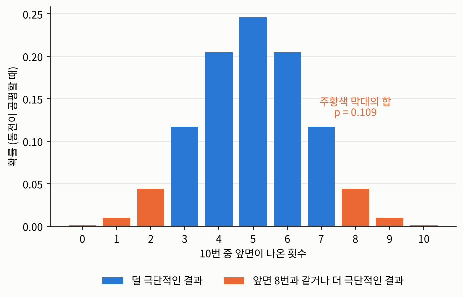

## 들어가며

[4.1](01-point-estimation.qmd)부터 [4.3](03-standard-error-ci.qmd)까지는 표본으로 모집단의 모수를 짐작하는 **추정**을 다뤘습니다. 그런데 이런 일반화도 결국은 통계량에 대한 일반화일 뿐입니다. 우리가 정말 알고 싶은 것은 대개 그 너머에 있습니다. "이 약은 효과가 있다", "새 웹사이트 디자인이 구매율을 높인다" 같은, 모집단에 대한 **의미 있는 주장**이지요. 이번 글에서는 이런 주장이 데이터로 뒷받침되는지를 따지는 **통계적 검정**(statistical test)의 기본 논리를 다룹니다.

## 가설과 검정

통계적 검정에서 이끌어 내고 싶은 주장을 **가설**(hypothesis)이라고 합니다. 처음에는 "이 다이어트 약은 효과가 있다"처럼 일상의 말로 된 주장이지만, 검정하려면 이것을 모수에 대한 수학적인 명제로 바꿔야 합니다. 예를 들어 "약을 먹은 사람들의 평균 체중 변화 $\mu_1$이 먹지 않은 사람들의 평균 체중 변화 $\mu_0$보다 작다", 즉 $\mu_1 < \mu_0$처럼 쓰는 것입니다.

그런데 가설을 데이터로 "증명"한다는 것은 수학의 증명과는 다릅니다. 수학의 증명은 논리만으로 명제가 참임을 보이지만, 우리 손에 있는 것은 무작위로 뽑힌 표본에서 나온 숫자들입니다. 표본은 우연에 따라 흔들리니, 데이터가 가설과 맞아 보이더라도 그것이 우연일 가능성을 완전히 없앨 수는 없습니다. 그래서 통계적 검정은 가설을 증명하는 것이 아니라, 가설을 뒷받침하는 **증거를 모으는** 과정이라고 이해하는 것이 정확합니다.

### 귀류법을 닮은 논리

증거를 모으는 방식은 수학의 **귀류법**(proof by contradiction)과 닮았습니다. 귀류법에서는 보이고 싶은 명제가 틀렸다고 가정하고, 거기서 모순을 이끌어 내어 원래 명제가 참임을 보입니다. 출발점이 "내 생각이 틀렸다"인 것이지요. 통계적 검정도 똑같이, 먼저 **우리 주장이 틀렸다**고 가정하고 시작합니다.

::: {.callout-note icon=false .callout-definition}
### 정의 4.4.1 (귀무가설과 대립가설)
통계적 검정에서 기본으로 가정하고 출발하는, 보통 "효과가 없다", "차이가 없다"는 내용의 가설을 **귀무가설**(null hypothesis)이라고 하고 $H_0$으로 씁니다. 그리고 실제로 데이터로 뒷받침하고 싶은 가설, 즉 귀무가설과 반대되는 가설을 **대립가설**(alternative hypothesis)이라고 하고 $H_1$로 씁니다.
:::

다이어트 약이라면 $H_0$은 "약은 효과가 없다($\mu_1 = \mu_0$)", $H_1$은 "약은 효과가 있다($\mu_1 \neq \mu_0$)"입니다. "귀무"(歸無)는 무(無)로 돌아간다는 뜻입니다. 일단 가정은 하지만, 사실은 틀려서 없던 일이 되기를 바라는 가설이라는 것이지요.

통계적 검정은 귀무가설이 참이라고 가정한 다음, 그 가정 아래에서 우리가 본 데이터가 **얼마나 일어나기 어려운 일인지**를 따집니다. 너무 일어나기 어려운 일이 일어났다면, 애초에 가정이 틀렸다고 보고 귀무가설을 **기각**(reject)합니다. 귀류법에서 모순을 이끌어 낸 것에 해당합니다. 그렇지 않다면 귀무가설을 **기각하지 못합니다**(fail to reject). 그래서 검정의 결과는 이 두 가지뿐입니다. 대립가설을 "증명"했다거나 "채택"했다고 말하기보다, 귀무가설을 기각했다고 말하는 것이 정확한 표현입니다.

여기서 꼭 기억해야 할 점이 있습니다. 귀무가설을 기각하지 **못했다**고 해서, 귀무가설이 참이라는 증거가 생긴 것은 아닙니다. 귀류법에서 모순을 이끌어 내지 못했다고 원래 명제가 틀린 것이 아닌 것과 같습니다. "약의 효과를 보여 주는 증거를 찾지 못했다"는 것이지, "약은 효과가 없다는 것이 밝혀졌다"는 것이 아닙니다. 표본이 너무 작아서 효과가 있어도 보지 못했을 수도 있으니까요. 증거가 없다는 것은 없다는 증거가 아닙니다.

## p-값

그렇다면 "귀무가설 아래에서 얼마나 일어나기 어려운 일인지"는 어떻게 숫자로 나타낼까요? 가장 자주 쓰는 증거가 **p-값**(p-value)입니다.

::: {.callout-note icon=false .callout-definition}
### 정의 4.4.2 (p-값)
귀무가설 $H_0$이 참이라고 가정할 때, 실제로 관찰한 결과와 **같거나 그보다 더 극단적인** 결과가 나올 확률을 **p-값**(p-value)이라고 합니다.
:::

### 동전은 공평할까요?

예를 들어 동전 하나가 공평한지 확인하고 싶다고 해 보겠습니다. 귀무가설은 "동전이 공평하다", 즉 앞면이 나올 확률이 정확히 $1/2$이라는 것입니다. 그런데 이 동전을 10번 던졌더니 **10번 모두 앞면**이 나왔습니다.

귀무가설이 참이라면, 10번 모두 앞면이 나올 확률은 $1/2$를 10번 곱한 $1/1024 \approx 0.00098$입니다. 그런데 p-값은 관찰한 결과 **하나**의 확률이 아니라, 그것과 **같거나 더 극단적인** 결과 전체의 확률입니다. 동전이 공평하지 않다는 것은 앞면 쪽으로 치우쳐 있을 수도, 뒷면 쪽으로 치우쳐 있을 수도 있다는 뜻이니, "10번 모두 앞면"만큼 극단적인 결과에는 "10번 모두 뒷면"도 들어갑니다. 그래서 이 경우의 p-값은

$$
p = \mathbb{P}(\text{앞면 10번}) + \mathbb{P}(\text{앞면 0번}) = \frac{1}{1024} + \frac{1}{1024} = \frac{2}{1024} \approx 0.002
$$

입니다. 이렇게 양쪽 방향의 극단을 모두 세는 검정을 **양측 검정**(two-sided test), 한쪽 방향만 세는 검정을 **단측 검정**(one-sided test)이라고 합니다. 대립가설이 "치우쳐 있다"이면 양측, "앞면 쪽으로 치우쳐 있다"이면 단측입니다.

10번 중 8번이 앞면이었다면 어떨까요? 이때 "같거나 더 극단적인" 결과는 앞면이 8, 9, 10번이거나, 반대쪽으로 0, 1, 2번인 경우입니다. 앞면이 나온 횟수는 이항분포를 따르니, 확률을 직접 더해 보겠습니다.

```python
from math import comb

def two_sided_p(heads, n=10):
    """공평한 동전을 n번 던질 때, 앞면 횟수가 heads만큼 또는 그보다 극단적일 확률."""
    k = max(heads, n - heads)   # 가운데(n/2)에서 더 먼 쪽
    extreme = sum(comb(n, j) for j in range(n + 1) if j >= k or j <= n - k)
    return extreme / 2 ** n

for heads in [10, 9, 8, 7, 6]:
    print(f"앞면 {heads:>2}번: p = {two_sided_p(heads):.4f}")
```

```
앞면 10번: p = 0.0020
앞면  9번: p = 0.0215
앞면  8번: p = 0.1094
앞면  7번: p = 0.3438
앞면  6번: p = 0.7539
```

{fig-alt="공평한 동전을 10번 던질 때 앞면이 나오는 횟수 0부터 10까지의 확률을 나타낸 막대그래프. 가운데인 5번에서 가장 높고 양쪽 끝으로 갈수록 낮아진다. 앞면이 0, 1, 2번과 8, 9, 10번인 양 끝의 여섯 개 막대가 주황색으로 칠해져 있고, 나머지 가운데 막대들은 파란색이다. 주황색 막대의 확률을 모두 더한 값이 앞면 8번을 관찰했을 때의 p-값 0.109라고 적혀 있다." width=70%}

앞면이 10번이면 p-값이 약 0.002로 아주 작습니다. 동전이 정말 공평하다면 1,000번에 2번꼴로나 일어날 법한 드문 일이 일어난 것입니다. 이렇게 드문 일이 일어났다면, 상식적으로 "동전이 공평하다"는 가정이 맞을 리가 없다고 생각하게 됩니다. 그래서 귀무가설을 기각하고, 동전이 공평하지 않다는 쪽의 손을 들어 줍니다. 반면 앞면이 8번이면 p-값이 약 0.11입니다. 공평한 동전이라도 10번에 1번꼴로는 일어나는 일이니, 이것만으로는 동전이 공평하지 않다고 말할 증거가 되기 어렵습니다.

### 유의수준

그렇다면 p-값이 얼마나 작아야 "충분히 작다"고 할까요? 이 기준은 데이터를 보기 **전에** 미리 정해 둡니다.

::: {.callout-note icon=false .callout-definition}
### 정의 4.4.3 (유의수준)
p-값이 이 값보다 작으면 귀무가설을 기각하기로 미리 정해 두는 기준값 $\alpha$를 **유의수준**(significance level)이라고 합니다. p-값이 유의수준보다 작아서 귀무가설을 기각할 때, 그 결과가 **통계적으로 유의하다**(statistically significant)고 합니다.
:::

유의수준에는 분명한 뜻이 있습니다. 귀무가설이 정말 참인데도, 표본이 우연히 극단적으로 나와서 귀무가설을 기각해 버리는 잘못을 저지를 확률이 바로 $\alpha$입니다. 이런 잘못을 **제1종 오류**(type I error)라고 합니다. 유의수준을 0.05로 정한다는 것은, 효과가 전혀 없는 상황에서도 20번에 1번꼴로는 "효과가 있다"는 잘못된 결론을 내리는 것을 감수하겠다는 뜻입니다.

이 기준을 몇으로 할지는 원칙적으로는 문제의 맥락에 따라, 잘못된 결론이 얼마나 큰 대가를 치르게 하는지를 생각해서 정해야 합니다. 하지만 관습적으로는 0.05나 0.01을 많이 씁니다. 0.05라는 숫자는 20세기 초에 통계학자 로널드 피셔(Ronald Fisher)가 편의상 제안한 것이 굳어진 것으로, 수학적으로 특별한 근거가 있는 값은 아닙니다. 위의 동전이라면 앞면 10번(p ≈ 0.002)은 유의수준 0.05에서도 0.01에서도 유의하고, 앞면 8번(p ≈ 0.11)은 어느 쪽에서도 유의하지 않습니다.

## 공식이 없을 때: 순열 검정

동전은 이항분포라는 공식이 있어서 p-값을 정확히 계산할 수 있었습니다. 공식이 없는 문제에서는 어떻게 할까요? [4.2](02-bootstrap.qmd)의 부트스트랩처럼, 컴퓨터로 **다시 뽑아 보는** 방법이 있습니다.

다이어트 약의 예로 돌아가 보겠습니다. 사람들을 무작위로 두 그룹으로 나눠서, 한 그룹은 약을 먹고(처치 그룹) 다른 그룹은 먹지 않은 채(대조 그룹) 3개월 뒤의 체중 변화를 쟀다고 해 보겠습니다. 여기서는 가상의 데이터로, 약이 실제로 평균 0.5kg을 더 빼 주고, 사람마다의 체중 변화는 표준편차 4kg 정도로 제각각이라고 만들었습니다. 먼저 그룹마다 30명인 경우입니다.

```python
import numpy as np

rng = np.random.default_rng(1557)

def make_trial(n):
    """그룹마다 n명인 가상의 임상시험. 약은 평균 0.5kg을 더 빼 준다."""
    control = rng.normal(loc=0.0, scale=4.0, size=n)      # 대조 그룹의 체중 변화 (kg)
    treatment = rng.normal(loc=-0.5, scale=4.0, size=n)   # 처치 그룹의 체중 변화 (kg)
    return control, treatment

control, treatment = make_trial(30)
observed = treatment.mean() - control.mean()
print(f"관찰한 평균 차이 (처치 - 대조): {observed:.2f} kg")
```

```
관찰한 평균 차이 (처치 - 대조): -1.50 kg
```

귀무가설은 "약은 효과가 없다"입니다. 이 가설이 참이라면, 누가 약을 먹었는지는 체중 변화와 아무 상관이 없습니다. 그렇다면 "처치"와 "대조"라는 이름표를 사람들 사이에서 **무작위로 뒤섞어도** 차이는 비슷한 크기로 나와야 합니다. 그래서 이름표를 수없이 뒤섞어 보면서 평균 차이를 계산하면, **귀무가설이 참일 때 나올 수 있는 차이들의 분포**를 만들 수 있습니다. 그 분포에서 관찰한 차이와 같거나 더 극단적인 값이 나온 비율이 곧 p-값입니다. 이 방법을 **순열 검정**(permutation test)이라고 합니다.

```python
def permutation_p(control, treatment, reps=10_000):
    """두 그룹 평균 차이에 대한 양측 순열 검정의 p-값."""
    observed = treatment.mean() - control.mean()
    pooled = np.concatenate([control, treatment])
    n_t = len(treatment)
    count = 0
    for _ in range(reps):
        shuffled = rng.permutation(pooled)                       # 이름표를 무작위로 뒤섞기
        diff = shuffled[:n_t].mean() - shuffled[n_t:].mean()
        count += abs(diff) >= abs(observed)                      # 같거나 더 극단적인가?
    return count / reps

print(f"그룹당 30명: p = {permutation_p(control, treatment):.3f}")
```

```
그룹당 30명: p = 0.147
```

이번 표본에서는 관찰한 차이가 1.5kg으로, 진짜 효과인 0.5kg보다 오히려 컸습니다. 그런데도 p-값은 약 0.15로, 유의수준 0.05에서 유의하지 않습니다. 사람마다의 체중 변화가 표준편차 4kg 정도로 제각각이라, 30명씩으로는 이 정도 차이가 약 없이도 우연히 꽤 자주 나오기 때문입니다.

## 통계적으로 유의하다는 것의 의미

이번에는 그룹마다 5,000명씩, 훨씬 큰 시험을 해 보겠습니다. 약의 진짜 효과는 똑같이 0.5kg입니다.

```python
control_big, treatment_big = make_trial(5_000)
print(f"관찰한 평균 차이: {treatment_big.mean() - control_big.mean():.2f} kg")
print(f"그룹당 5,000명: p = {permutation_p(control_big, treatment_big):.4f}")
```

```
관찰한 평균 차이: -0.44 kg
그룹당 5,000명: p = 0.0000
```

약의 효과는 같은데, 표본이 크니 p-값이 아주 작아졌습니다. 1만 번 뒤섞는 동안 관찰한 차이만큼 극단적인 차이가 한 번도 나오지 않았다는 뜻입니다. [4.3](03-standard-error-ci.qmd)에서 본 것처럼 표본이 클수록 표준 오차가 작아져서, 작은 차이도 우연과 구분할 수 있게 되기 때문입니다. 이 결과는 p-값에 대해 두 가지를 알려 줍니다.

첫째, **p-값은 표본 크기에 크게 좌우됩니다.** 그룹당 30명일 때는 진짜 효과가 있었는데도 유의하지 않을 수 있습니다. 위에서 말한 "증거가 없는 것은 없다는 증거가 아니다"가 바로 이 경우입니다. 반대로 표본이 아주 크면, 실제로는 별 의미 없는 아주 작은 차이도 p-값이 매우 작게 나와서 통계적으로 유의해집니다.

둘째, **통계적으로 유의하다는 것은 효과가 크다는 뜻이 아닙니다.** 그룹당 5,000명의 결과는 "0.5kg이 빠진 것은 우연이 아니라 약의 효과다"라는 것을 꽤 확실하게 보여 줍니다. 그런데 비싼 돈을 주고 3개월 동안 약을 먹었는데 0.5kg이 빠졌다면, 그것을 쓸모 있는 다이어트 약이라고 할 수 있을까요? 그렇지 않겠지요. 통계적 유의성은 "데이터로 보아 차이가 있다"는 것까지만 말해 주고, 그 차이가 **실제로 얼마나 중요한지**는 말해 주지 않습니다. 그래서 p-값과 함께 효과의 **크기**(여기서는 0.5kg)와 그 [신뢰구간](03-standard-error-ci.qmd)을 보고, 그것이 맥락에서 의미 있는 크기인지를 따로 판단해야 합니다. 미국통계학회도 2016년의 성명에서 p-값만으로 결론을 내리지 말고 맥락과 효과의 크기를 함께 보라고 강조했습니다.[^asa]

## p-해킹: 여러 번 던지면 언젠가는 맞는다

[3장](../03-reproducible-workflow/index.qmd)에서 재현성 위기의 원인으로 **p-해킹**을 이야기했습니다. 원하는 결과가 나올 때까지 데이터를 이리저리 나누거나 분석 방법을 바꿔 가며 계산을 반복해서, 우연히 p-값이 기준보다 작은 결과를 얻어 내는 것이었지요. 이제 이것이 왜 문제인지 정확히 말할 수 있습니다.

유의수준을 0.05로 정하면, 효과가 전혀 없을 때도 검정 한 번에 5%의 확률로 "유의한" 결과가 나옵니다. 그런데 효과가 없는 비교를 20번 하면, 그중 **적어도 한 번** 유의한 결과가 나올 확률은

$$
1 - 0.95^{20} \approx 0.64
$$

입니다. 몸무게, 혈압, 콜레스테롤, 수면 시간…처럼 측정한 변수를 20개쯤 놓고 하나씩 검정해 보면, 약이 아무 효과가 없어도 열에 여섯은 "유의한" 결과를 하나쯤 찾아낼 수 있다는 뜻입니다. 그리고 그 하나만 보고하면, 그럴듯한 논문이 하나 만들어집니다. 시뮬레이션으로 확인해 보겠습니다. 약이 **아무 효과도 없는** 가상의 연구를 1,000번 하는데, 연구마다 그룹당 50명에게서 서로 관련 없는 변수 20개를 재서 하나씩 검정합니다. 계산을 빠르게 하려고, 여기서는 순열 검정 대신 [4.3](03-standard-error-ci.qmd)의 정규 근사로 p-값을 구했습니다.

```python
from math import erf, sqrt

def normal_approx_p(a, b):
    """두 그룹 평균 차이에 대한, 정규 근사를 이용한 양측 검정의 p-값."""
    se = sqrt(a.var(ddof=1) / len(a) + b.var(ddof=1) / len(b))
    z = abs(a.mean() - b.mean()) / se
    return 1 - erf(z / sqrt(2))   # 표준정규분포에서 |Z| >= z일 확률

studies, n_outcomes, n = 1_000, 20, 50
found_something = 0
for _ in range(studies):
    p_values = [normal_approx_p(rng.normal(size=n), rng.normal(size=n)) for _ in range(n_outcomes)]
    found_something += min(p_values) < 0.05
print(f"효과가 없는데도 '유의한' 결과를 하나 이상 찾은 연구의 비율: {found_something / studies:.1%}")
```

```
효과가 없는데도 '유의한' 결과를 하나 이상 찾은 연구의 비율: 67.8%
```

이론값 64%보다 조금 높게 나왔는데, 그룹당 50명 정도에서는 정규 근사가 p-값을 실제보다 약간 작게 계산하는 경향이 있어서 검정 한 번에 유의하게 나올 확률이 5%보다 조금 커지기 때문입니다. (표본이 작을 때 이것을 바로잡는 방법인 t-검정은 [기초 통계학](../../../stats/basic-stats/index.qmd)에서 다룹니다.) 어느 쪽이든 결론은 같습니다. 효과가 전혀 없는 약으로도, 비교를 여러 번 하면 연구의 절반 이상에서 "유의한" 결과가 나옵니다. 이런 결과는 우연의 산물이라 다른 사람이 다시 실험하면 재현되지 않습니다. 그래서 요즘에는 무엇을 어떻게 검정할지를 실험 **전에** 미리 등록해 두게 하거나(사전 등록), 여러 번 검정할 때는 그 횟수만큼 기준을 엄격하게 고쳐 쓰는 방법을 씁니다. 그리고 [3장](../03-reproducible-workflow/index.qmd)에서 다룬 것처럼 분석의 모든 과정을 코드와 버전 기록으로 남겨 두면, 어떤 비교를 몇 번 했는지 숨길 수 없게 됩니다.

## 정리

- 통계적 검정은 가설을 증명하는 것이 아니라 **증거를 모으는** 과정입니다. 귀류법처럼 **귀무가설**이 참이라고 가정하고 출발해서, 데이터가 그 가정과 맞지 않으면 귀무가설을 **기각**합니다. 기각하지 못했다고 귀무가설이 참이라는 뜻은 아닙니다.
- **p-값**은 귀무가설이 참일 때 관찰한 결과와 같거나 더 극단적인 결과가 나올 확률입니다. 미리 정한 **유의수준** $\alpha$보다 작으면 통계적으로 유의하다고 합니다. $\alpha$는 귀무가설이 참인데도 기각하는 잘못을 저지를 확률입니다.
- 공식이 없을 때는 **순열 검정**처럼 이름표를 뒤섞어 귀무가설 아래의 분포를 직접 만들 수 있습니다.
- p-값은 표본 크기에 크게 좌우되고, **통계적 유의성은 효과의 크기나 실질적인 의미를 보장하지 않습니다.** 효과의 크기와 신뢰구간을 함께 보고 맥락 속에서 해석해야 합니다.
- 비교를 여러 번 하면 효과가 없어도 언젠가는 유의한 결과가 나옵니다. 이것을 골라서 보고하는 것이 **p-해킹**입니다.

이 장에서는 추론 통계의 아이디어를 수학을 최대한 덜어 내고 간단하게 살펴보았습니다. 검정은 추정과 신뢰구간을 모두 이해한 다음 단계라서, 처음에는 그 논리가 반직관적으로 느껴질 수 있습니다. 그래도 자꾸 보다 보면 정이 들고, 연습 문제를 풀다 보면 점점 익숙해집니다. 여러 가지 검정 방법과 그 이론은 [기초 통계학](../../../stats/basic-stats/index.qmd)과 [수리통계학](../../../stats/math-stats/index.qmd)에서 더 자세히 다룹니다.

---

### 연결되는 개념
* $\leftarrow$ **이전 개념:** [4.3 표준 오차와 신뢰구간](03-standard-error-ci.qmd)
* $\rightarrow$ **다음 개념:** 추후 작성 예정

[^asa]: R. L. Wasserstein, N. A. Lazar, "The ASA Statement on p-Values: Context, Process, and Purpose", *The American Statistician* 70(2), 2016, pp. 129–133.
