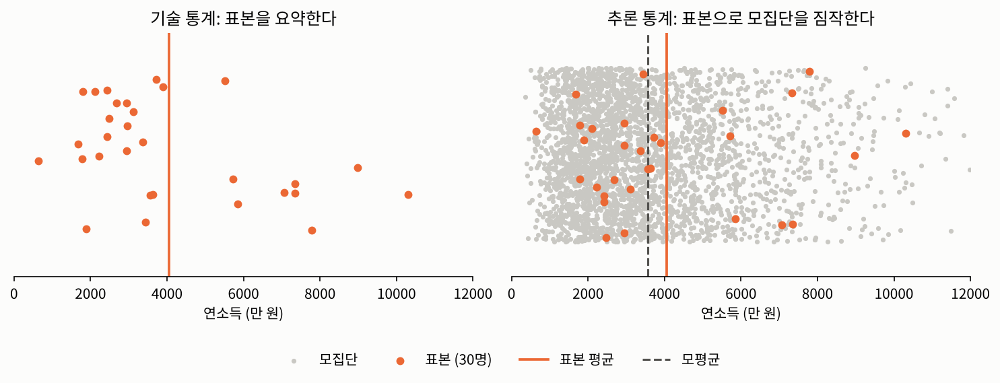

## 들어가며

[2장](../02-data-exploration/index.qmd)에서는 주어진 데이터의 구조와 모양, 경향을 파악하는 **기술 통계**(descriptive statistics)를 다뤘습니다. 평균, 분산, 상관계수 같은 통계량으로 데이터를 숫자로 요약하고, 히스토그램이나 산점도로 그림으로 요약했지요. 그리고 [3장](../03-reproducible-workflow/index.qmd)에서는 잠시 통계에서 벗어나, 그런 분석을 다른 사람도 그대로 따라 할 수 있게 해 주는 도구들을 살펴보았습니다.

4장에서는 다시 통계로 돌아와서, 기술 통계를 넘어 데이터를 토대로 **무언가를 이끌어 내는** 이야기를 합니다. 이것을 **추론 통계**(inferential statistics)라고 합니다. 추론 통계의 방법은 아주 다양해서 이 장에서 모두 다룰 수는 없습니다. 여기서는 수학을 최대한 덜어 내고, 지금 당장 데이터로 어느 정도의 추론을 해 볼 수 있을 만큼의 핵심 아이디어를 다룹니다. 더 본격적인 이야기는 [기초 통계학](../../../stats/basic-stats/index.qmd)과 [수리통계학](../../../stats/math-stats/index.qmd)에서 이어집니다.

## 통계는 과학인데, 결론은 과학이 아닐 때

기술 통계로 정리한 숫자와 그림은 사람들이 흔히 "통계"라고 부르는 것의 대부분을 차지합니다. 뉴스에 나오는 정당 지지율, 범죄율, 평균 소득 같은 것들이지요. 그런데 사람들이 이런 통계를 보고 내리는 결론은, [2.3](../02-data-exploration/03-correlation.qmd)에서 본 것처럼 상관관계를 인과관계로 읽거나 자기 생각을 뒷받침하는 쪽으로 숫자를 비틀어 해석한 것인 경우가 많습니다. 통계 자체는 사실이지만, 그 통계를 보고 내린 결론은 전혀 과학적이지 않은 경우가 생기는 것입니다.

문제는 대부분 **일반화**에서 생깁니다. 지지율이나 범죄율 같은 숫자는 기본적으로 **가지고 있는 데이터**, 예를 들어 설문에 응답한 일부 사람들에 대해 계산한 값일 뿐입니다. [1.4](../01-foundations/04-sampling-bias.qmd)의 말로 하면, 모집단의 일부인 표본으로 계산한 값입니다. 그런데 우리가 이런 숫자를 보고 내리는 결론은 거의 언제나 표본이 아니라 **모집단**에 대한 것입니다. "응답자 1,000명 가운데 30%가 A 후보를 지지했다"는 표본에 대한 사실이지만, "A 후보의 지지율은 30%다"는 전체 유권자에 대한 주장입니다.

이렇게 표본의 정보로 모집단의 성질을 일반화하는 과정을 통계학에서는 **추론**(inference)이라고 합니다. 통계를 해석할 때 생기는 문제는, 이 일반화가 그 통계를 받아들이는 사람의 **직관에만** 맡겨진다는 데 있습니다. 표본이 보여 주는 정보가 모집단을 설명하기에 얼마나 적절한지, 그 숫자가 우연히 그렇게 나온 것은 아닌지 같은 가장 중요한 질문이 사실상 건너뛰어지는 것이지요.

추론 통계는 바로 이 지점에서 출발합니다. 기술 통계로 데이터를 1차로 이해한 다음, 직관을 넘어서, 아니 직관을 최대한 배제하고, 데이터로부터 의미 있는 명제나 데이터를 더 일반적으로 설명하는 무언가를 이끌어 내는 통계학의 분과입니다.

{fig-alt="두 개의 그림이 나란히 있다. 왼쪽 기술 통계 그림에는 주황색 점 서른 개만 있고, 이 점들의 평균을 표시한 선이 그어져 있다. 오른쪽 추론 통계 그림에는 회색 점 수천 개로 이루어진 모집단이 넓게 퍼져 있고, 그 가운데 무작위로 고른 같은 주황색 점 서른 개가 강조되어 있으며, 표본으로 구한 평균과 모집단의 평균을 각각 주황색 실선과 회색 점선으로 표시했다." width=90%}

왼쪽의 기술 통계는 손에 쥔 표본 자체를 요약하는 데서 끝납니다. 반면 오른쪽의 추론 통계는 그 표본이 훨씬 큰 모집단에서 뽑혀 나왔다는 것을 의식하고, 표본을 바탕으로 우리가 볼 수 없는 회색 모집단에 대해 이야기하려고 합니다. 이렇게 놓고 보면 사람들이 흔히 저지르는 실수가 보입니다. 주황색 점들로 구한 숫자를 그대로 회색 전체의 숫자로 읽어 버리고, "주황색 점 서른 개로 왜 회색 전체를 설명할 수 있는가?"라는 질문은 건너뛰는 것입니다. 두 평균선이 정확히 겹치지 않는다는 것도 눈여겨보세요. 표본으로 구한 숫자는 모집단의 숫자와 같지 않습니다. 추론 통계는 이 둘이 **얼마나 다를 수 있는지**를 따지는 학문이라고도 할 수 있습니다.

## 추정과 검정

추론 통계에서 다루는 추론은 크게 두 가지입니다.

- **추정**(estimation)은 표본의 통계량으로 모집단의 정보를 짐작하는 것입니다. 예를 들어 1,000명에게 흡연 여부를 물어서 전체 국민의 흡연율을 짐작하는 것이 추정입니다.
- **검정**(test)은 이렇게 얻은 결과를 가지고, 우리가 보이고 싶은 주장이 데이터로 얼마나 뒷받침되는지를 따지는 것입니다. 예를 들어 "새로 나온 금연 프로그램이 흡연율을 낮춘다"는 주장이 우연히 그렇게 보인 것인지, 정말 효과가 있다고 말할 만한지를 판단하는 것이 검정입니다.

추정은 다시, 모집단의 값을 숫자 하나로 짐작하는 **점 추정**(point estimation)과, 그 값이 들어 있을 만한 범위를 짐작하는 **구간 추정**(interval estimation)으로 나뉩니다. 그리고 두 경우 모두, 짐작한 값이 **얼마나 믿을 만한지**를 함께 따져야 합니다. 추정은 어디까지나 짐작이기 때문입니다.

## 이 장의 흐름

- **4.1 점 추정과 표집 분포**: 모수와 추정량이 무엇인지 정의하고, 표본을 여러 번 뽑을 수 있다면 통계량이 어떻게 흩어지는지, 즉 표집 분포를 시뮬레이션으로 살펴봅니다.
- **4.2 부트스트랩**: 현실에서는 표본이 하나뿐이라는 문제를, 표본을 모집단처럼 여기고 다시 뽑는 부트스트랩으로 해결합니다.
- **4.3 표준 오차와 신뢰구간**: 추정이 얼마나 정밀한지를 나타내는 표준 오차와, 모수가 있을 만한 범위를 나타내는 신뢰구간을 다루고, 신뢰구간을 바르게 해석하는 법을 살펴봅니다.
- **4.4 통계적 검정과 p-값**: 귀무가설과 대립가설, p-값, 유의수준을 소개하고, 통계적 유의성과 실질적인 의미가 어떻게 다른지, 그리고 [3장](../03-reproducible-workflow/index.qmd)에서 이야기한 p-해킹이 왜 문제인지를 시뮬레이션으로 확인합니다.

이 장의 예제는 [2.2](../02-data-exploration/02-summary-statistics.qmd)에서 만든 것과 같은 방식의 **가상의 연소득 데이터**를 주로 씁니다. 다만 이번에는 100만 명으로 이루어진 가상의 나라 전체를 모집단으로 만들어 두고 시작합니다. 현실에서는 모집단의 참값을 알 수 없지만, 시뮬레이션에서는 정답을 알고 있으니 추정이 얼마나 잘 맞는지를 직접 확인할 수 있기 때문입니다.

---

### 연결되는 개념
* $\leftarrow$ **이전 개념:** [3.10 단위 테스트](../03-reproducible-workflow/10-unit-tests.qmd)
* $\rightarrow$ **다음 개념:** [4.1 점 추정과 표집 분포](01-point-estimation.qmd)
