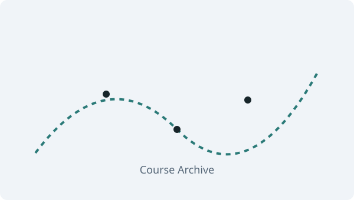

## 추천 아티클

::: {#featured-articles}
:::

::: {.home-more}
[일반 아티클 전체 보기 →](articles/index.qmd)
:::

## 기초부터 시작하기

각 분야의 기초 과목입니다. 과목을 선택하면 첫 번째 개념 노트로 이동합니다.

### 수학 (Mathematics) {.home-category}

::: {.subject-grid}
::: {.subject-card}
#### [해석학](math/analysis/00intro.qmd)

:::
::: {.subject-card}
#### [선형대수학](math/linear-algebra/00intro.qmd)

:::
::: {.subject-card}
#### [이산수학](math/discrete-math/00intro.qmd)

:::
::: {.subject-card}
#### [수학적 프로그래밍 (Python)](math/math-programming/00intro.qmd)

:::
::: {.subject-card}
#### [LaTeX](math/latex/00intro.qmd)

:::
:::

::: {.home-more}
[수학 전체 과목 보기 →](math/index.qmd)
:::

### 확률과 통계 (Probability & Statistics) {.home-category}

::: {.subject-grid}
::: {.subject-card}
#### [기초 확률론](stats/prob-theory/00intro.qmd)

:::
::: {.subject-card}
#### [기초 통계학](stats/basic-stats/00intro.qmd)

:::
::: {.subject-card}
#### [통계적 프로그래밍](stats/stat-programming/00intro.qmd)

:::
:::

::: {.home-more}
[확률과 통계 전체 과목 보기 →](stats/index.qmd)
:::

### 컴퓨터 공학 (Computer Science) {.home-category}

::: {.subject-grid}
::: {.subject-card}
#### [컴퓨터 과학 원론](cs/cs-intro/00intro.qmd)

:::
::: {.subject-card}
#### [C언어](cs/c-programming/00intro.qmd)

:::
:::

::: {.home-more}
[컴퓨터 공학 전체 과목 보기 →](cs/index.qmd)
:::

### 데이터 사이언스·AI (Data Science & AI) {.home-category}

::: {.subject-grid}
::: {.subject-card}
#### [데이터 사이언스 개론](ds-ai/ds-intro/00intro.qmd)

:::
::: {.subject-card}
#### [데이터 사이언스와 사회](ds-ai/ds-society/00intro.qmd)

:::
::: {.subject-card}
#### [고등학교 인공지능 수학](ds-ai/ai-math-intro/00intro.qmd)

:::
:::

::: {.home-more}
[데이터 사이언스·AI 전체 과목 보기 →](ds-ai/index.qmd)
:::

### 경영/경제 (Business & Economics) {.home-category}

::: {.subject-grid}
::: {.subject-card}
#### [경영학 원론](biz-econ/biz-intro/00intro.qmd)

:::
::: {.subject-card}
#### [경제학 원론](biz-econ/econ-intro/00intro.qmd)

:::
:::

::: {.home-more}
[경영/경제 전체 과목 보기 →](biz-econ/index.qmd)
:::

### 의학통계·바이오메트리 (Biostatistics & Biometry) {.home-category}

::: {.subject-grid}
::: {.subject-card}
#### [의학통계학 개론](biostat/biostat-intro/00intro.qmd)

:::
::: {.subject-card}
#### [역학 연구방법론](biostat/epidemiology/00intro.qmd)

:::
:::

::: {.home-more}
[의학통계·바이오메트리 전체 과목 보기 →](biostat/index.qmd)
:::
