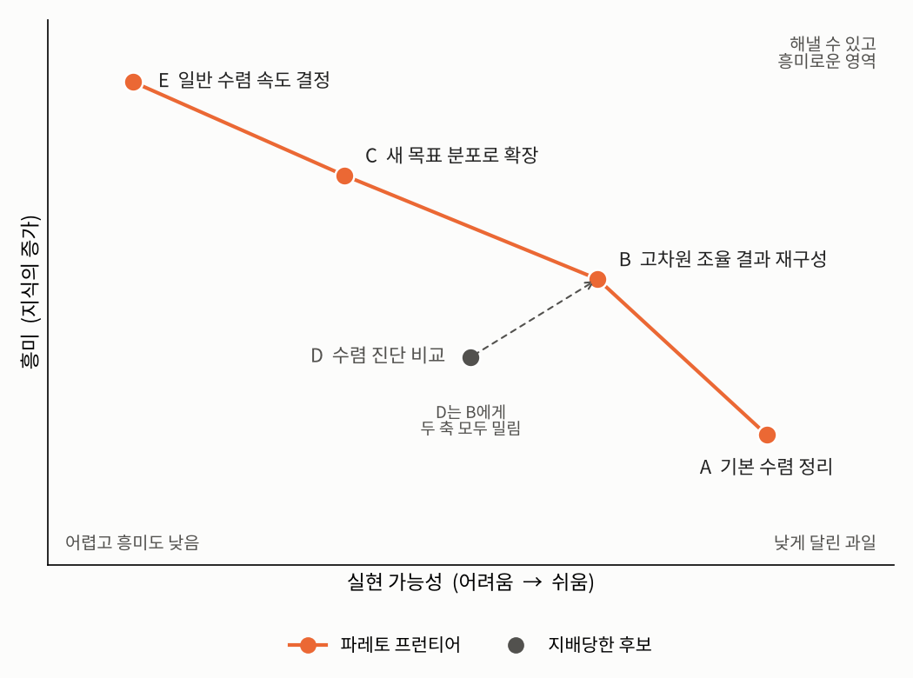
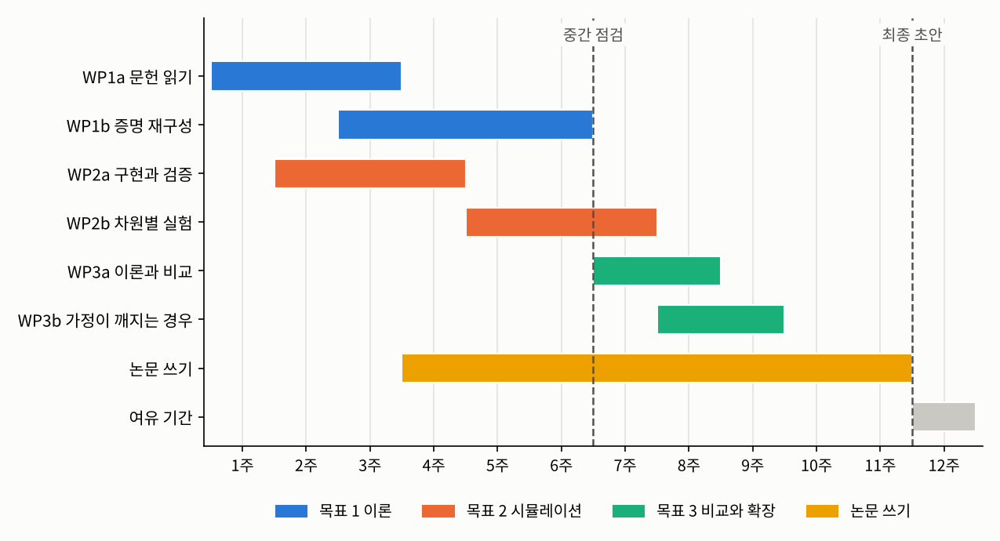

## 들어가며

[지난 장](../01-papers-in-context/index.qmd)에서 학위 논문은 "답할 가치가 있는 질문을 찾아냈고, 그 질문에 답했다"는 것을 증명하는 문서라는 것을 보았습니다. 이번 글은 그 앞부분, 즉 **질문을 찾는 일**을 다룹니다.

질문을 찾는 과정은 대개 막연한 관심에서 시작합니다. "MCMC가 재미있어 보인다", "확률 미분방정식을 더 공부해 보고 싶다" 같은 것들입니다. 이 관심이 몇 달 안에 끝낼 수 있는 구체적인 연구 질문이 되고, 그 질문이 지도교수와 합의한 계획서가 되기까지 몇 단계를 거쳐야 합니다. 이번 글에서는 하나의 예를 따라가며 그 단계를 차례로 밟아 보겠습니다.

예시의 주인공은 학사 논문을 준비하는 박종우 씨입니다. 박종우 씨는 [1.2절](../01-papers-in-context/02-who-writes-papers.qmd)에서 본 메트로폴리스 알고리즘에 관심이 생겨, 이 알고리즘으로 졸업 논문을 쓰고 싶어 합니다.

## 좋은 문제의 두 축

박종우 씨가 지도교수와 처음 만나 떠올린 후보는 여러 개였습니다.

- **A.** 메트로폴리스 알고리즘이 목표 분포로 수렴한다는 기본 정리를 강의 수준에서 증명하고 예제로 확인하기
- **B.** 랜덤 워크 메트로폴리스 알고리즘에서 제안 분포의 폭을 차원에 따라 어떻게 정해야 하는지에 대한 알려진 결과를 재구성하고 시뮬레이션으로 확인하기
- **C.** 아무도 다루지 않은 특수한 목표 분포에 대해 B의 결과가 성립하는지 새로 증명하기
- **D.** MCMC의 수렴 진단 방법을 전부 모아 비교하기
- **E.** 일반적인 상태 공간에서 메트로폴리스 알고리즘의 정확한 수렴 속도를 완전히 결정하기

이 가운데 무엇을 골라야 할까요? 이스라엘 바이츠만 연구소의 생물물리학자 우리 알론(Uri Alon)은 「How To Choose a Good Scientific Problem」이라는 짧은 글에서, 연구 문제를 **두 개의 축**으로 비교해 보자고 제안합니다.[^alon]

- **실현 가능성**(feasibility): 문제가 얼마나 어렵거나 쉬운지입니다. 예상되는 소요 기간으로 잴 수 있고, 연구자의 실력과 쓸 수 있는 도구에 따라 달라집니다. 알론은 여기에 뼈 있는 말을 덧붙입니다. 종이 위에서 쉬워 보이는 문제는 실제로 해 보면 어렵고, 종이 위에서 어려워 보이는 문제는 실제로는 거의 불가능하다는 것입니다.
- **흥미**(interest): 그 연구로 얻게 될 지식의 증가분입니다. 이미 알려진 해안에서 얼마나 멀리 나아가는지로 생각할 수 있습니다.

알론은 이 평면에서 많은 연구가 쉽지만 그다지 흥미롭지 않은 **"낮게 달린 과일"**(low-hanging fruit)이고, 안타깝게도 어렵기만 하고 흥미는 낮은 연구도 많다고 지적합니다. 우리가 바라는 것은 대개 오른쪽 위, 즉 **해낼 수 있으면서 흥미로운** 문제입니다.[^alon]

### 파레토 프런티어

알론의 글에서 수학을 공부하는 사람에게 특히 반가운 부분은, 이 선택을 최적화 이론의 **파레토 프런티어**(Pareto front)로 설명한다는 점입니다.[^alon] 문제 A가 문제 B보다 두 축 모두에서 낫다면, B는 고려할 이유가 없으니 지워도 됩니다. 이렇게 지우고 나면 "두 축 모두에서 더 나은 문제가 없는" 문제들만 남는데, 이것이 파레토 프런티어입니다.

박종우 씨의 다섯 후보를 이 평면에 놓아 보면 다음과 같습니다. 위치는 박종우 씨와 지도교수가 상의해서 매긴 주관적인 점수일 뿐입니다.

{fig-alt="흥미와 실현 가능성으로 본 연구 문제 후보들. 가로축은 실현 가능성으로 오른쪽일수록 쉽고, 세로축은 흥미로 위쪽일수록 지식의 증가가 큽니다. 후보 A, B, C, E는 다른 후보에게 두 축 모두에서 밀리지 않아 파레토 프런티어를 이루고 주황색 선으로 이어져 있습니다. 후보 D는 B보다 두 축 모두에서 낮아 회색으로 표시되어 있습니다." width=70%}

D(수렴 진단 방법 비교)는 B보다 쉽지도 않고 흥미롭지도 않아서 바로 지울 수 있습니다. 남은 A, B, C, E 가운데 무엇을 고를지는 **두 축에 얼마나 가중치를 두느냐**에 달려 있습니다.

알론은 이 가중치가 연구자의 단계에 따라 달라져야 한다고 말합니다. 대학원에 막 들어온 학생에게는 빨리 성과를 내며 자신감을 얻을 수 있는 **쉬운 문제**, 즉 프런티어의 오른쪽 아래가 맞습니다. 두 번째 문제부터는 흥미 쪽으로 올라갈 수 있습니다. 시간이 한정된 박사후연구원에게는 오른쪽 위의 문제가 필요하고, 막 연구실을 연 교수는 10년 이상 매달리며 학생들에게 작은 문제로 나누어 줄 수 있는 **큰 도전 과제**를 고를 수도 있습니다.[^alon] 최적의 문제는 연구자의 생애 단계를 따라 파레토 프런티어 위를 움직이는 셈입니다.

석 달 안에 끝내야 하는 학사 논문이라면 가중치는 실현 가능성 쪽에 크게 실립니다. 박종우 씨와 지도교수는 E는 학사 논문의 범위를 훌쩍 넘고, C는 증명이 막히면 남는 것이 없을 위험이 크다고 보았습니다. A는 안전하지만 강의 내용을 넘어서는 부분이 적습니다. 그래서 **B를 중심에 두고, 시간이 남으면 C의 가장 쉬운 경우를 맛보는** 쪽으로 정했습니다.

### 서두르지 않기

알론이 강조하는 또 한 가지는 **처음 떠오른 문제를 바로 고르지 말라**는 것입니다. 그의 연구실에서는 새로 온 학생이나 박사후연구원이 석 달이 지나기 전에는 문제를 확정하지 않는다는 규칙을 둔다고 합니다. 몇 달이면 될 것 같은 연구도 실제로는 몇 년이 걸리기 일쑤라서, 문제를 고르는 데 쓴 일주일이 나중의 몇 달을 아껴 준다는 것입니다.[^alon]

학사 논문에 석 달을 쓸 수는 없겠지만, 원리는 같습니다. 주제를 정하기 전에 관련 논문 몇 편의 초록과 서론을 읽어 보고, 지도교수와 두세 번 이야기를 나누어 보는 정도의 시간은 들일 가치가 있습니다. 이때 문헌을 효율적으로 훑어보는 방법은 [다음 글](02-finding-and-reading.qmd)에서 다룹니다.

## 관심사를 연구 질문으로 좁히기

후보 B를 골랐지만, "제안 분포의 폭을 차원에 따라 어떻게 정해야 하는지에 대한 결과를 재구성한다"는 아직 주제일 뿐 질문은 아닙니다. 주제를 질문으로 바꾸는 데 유용한 도구가 있습니다. 웨인 부스(Wayne C. Booth), 그레고리 콜롬(Gregory G. Colomb), 조지프 윌리엄스(Joseph M. Williams)의 연구 방법 안내서 *The Craft of Research*에 나오는 **세 문장 공식**입니다. 이 공식은 연구의 **주제**, **개념적 질문**, **개념적 의의**를 차례로 적게 합니다.[^booth]

::: {.callout-note icon=false}
### 세 문장 공식
1. **주제**: I am studying ___ (나는 ___을 연구한다)
2. **질문**: because I want to find out ___ (왜냐하면 ___을 알고 싶기 때문이다)
3. **의의**: in order to help my reader understand ___ (독자가 ___을 이해하도록 돕기 위해서다)
:::

박종우 씨가 이 공식을 채워 본 결과는 이렇습니다.

> 1. I am studying the random walk Metropolis algorithm on high-dimensional targets,
> 2. because I want to find out how the proposal step size should shrink as the dimension grows,
> 3. in order to help my reader understand why practitioners tune the algorithm to an acceptance rate of about 0.234.

세 문장을 쓰고 나니 무엇을 해야 하는지가 훨씬 분명해졌습니다. 2번 문장은 그대로 연구 질문이 됩니다. "차원 $d$가 커질 때 제안 분포의 폭은 어떤 속도로 줄여야 하는가?" 3번 문장은 이 질문이 왜 중요한지, 즉 서론에서 독자를 설득할 이유가 됩니다. 실제로 이 질문에는 로버츠(Roberts), 겔만(Gelman), 길크스(Gilks)의 1997년 논문이라는 고전적인 답이 있습니다. 목표 분포가 서로 독립인 같은 성분들로 이루어진 경우, 차원이 커지는 극한에서 제안 분포의 분산을 $d$에 반비례하게 줄이는 것이 맞고, 그때 최적의 채택률이 약 0.234라는 결과입니다.[^rgg] 박종우 씨의 논문은 이 결과를 재구성하고 확인하는 것이 중심이 됩니다.

이 공식을 쓸 때 기억할 점이 몇 가지 있습니다.

- **2번이 "무엇을"이 아니라 "어떻게, 왜, 언제"를 묻게 하세요.** "메트로폴리스 알고리즘에 대해 알고 싶다"는 질문이 아닙니다. "어떤 조건에서", "얼마나 빨리" 같은 말이 들어가야 답할 수 있는 질문이 됩니다.
- **3번이 막히면 질문을 다시 보세요.** 의의를 쓸 수 없다면, 그 질문의 답이 왜 중요한지 아직 모른다는 뜻입니다. 1.1절에서 본 심사자의 두 번째 질문 "좋은 질문인가?"에 답하지 못하는 셈입니다.
- **여러 번 반복해도 됩니다.** 세 문장을 쓰고, 지도교수와 이야기하고, 다시 쓰는 과정을 몇 번 거치면 질문이 점점 날카로워집니다.

여기에 한 단계를 더해 볼 수도 있습니다. 2번의 질문에 대해 **지금 예상하는 답**을 "나는 ___라고 예상한다"는 문장으로 적어 보는 것입니다. 수학에서는 이것이 증명하려는 정리의 첫 초안이 되고, 시뮬레이션 연구에서는 검증할 가설이 됩니다.

## 연구 계획서의 구성

질문이 정해지면 이를 **연구 계획서**(research proposal)로 정리합니다. 학교나 지도교수에 따라 형식은 다르지만, 학위 논문의 계획서는 대개 참고문헌을 빼고 몇 쪽 안팎의 짧은 문서이고, 다음 네 질문에 간결하면서도 구체적으로 답해야 합니다.

1. 풀려는 **문제**는 무엇인가?
2. 그것이 **왜 문제인가**?
3. **어떻게** 풀 것인가?
4. 어떤 **결과와 기여**를 기대하는가?

이 네 질문을 담는 흔한 구성은 다음과 같습니다.

| 절 | 담을 내용 | 박종우 씨의 경우 |
|---|---|---|
| 서론 | 문제 영역의 맥락, 가장 중요한 선행 연구 몇 편 | MCMC와 메트로폴리스 알고리즘, 고차원에서의 조율 문제, 로버츠·겔만·길크스(1997)와 후속 연구 |
| 문제 정의 | 무엇이 알려지지 않았거나 부족한지, 그것이 왜 중요한지 | 0.234 규칙은 널리 쓰이지만, 그 근거가 되는 극한 정리의 가정과 증명 구조는 학부 수준에서 잘 정리되어 있지 않음 |
| 연구 목표 | 답하려는 연구 질문(또는 풀려는 문제, 검증할 가설) | 세 문장 공식의 2번 문장 |
| 기대 결과 | 연구가 끝나면 무엇이 새로 알려지거나 만들어지는지, 누구에게 도움이 되는지 | 극한 정리의 자기완결적인 증명 정리, 여러 차원에서의 시뮬레이션 확인, 가정이 깨지는 경우의 관찰 |
| 방법 | 목표를 위해 할 일과 방법, 목표를 달성했는지 확인하는 방법, 쓸 도구 | 문헌 정리와 증명 재구성, 파이썬 시뮬레이션, 이론값과 시뮬레이션 비교 |
| 작업 계획 | 작업 패키지와 마일스톤, 대략적인 일정 | 아래에서 자세히 |
| 참고문헌 | 서론과 문제 정의에서 언급한 문헌 | |

수학 논문의 계획서에서 특히 신경 쓸 곳은 **"목표를 달성했는지 어떻게 확인할 것인가"**입니다. 실험 연구라면 정확도나 성능 같은 지표가 있겠지만, 수학에서는 "증명이 완성되었다"가 기준입니다. 그런데 증명은 완성될지 미리 알 수 없습니다. 그래서 계획서에 **중간 목표**를 함께 적어 두는 것이 좋습니다. "일반적인 경우의 증명이 막히면, 가우스 목표 분포라는 특수한 경우로 범위를 좁힌다"처럼 말입니다. 박종우 씨가 후보 C를 "시간이 남으면" 해 볼 일로 미뤄 둔 것도 같은 생각입니다.

## 목표를 작업으로 쪼개기

계획서의 마지막 부분인 작업 계획을 세우려면, 연구 질문에서 출발해 할 일을 점점 작은 단위로 쪼개야 합니다.

1. **연구 질문**을 정합니다.
2. 질문에 답하기 위해 이루어야 할 **목표**(objective)를 몇 개로 나눕니다.
3. 각 목표를 이루기 위해 해야 할 **작업 패키지**(work package)를 정합니다.
4. 작업 패키지 사이의 **의존 관계**를 찾습니다. 무엇이 끝나야 무엇을 시작할 수 있는지, 무엇은 동시에 할 수 있는지입니다.
5. 중간 점검 시점인 **마일스톤**(milestone)과 그때 내놓을 **결과물**(deliverable)을 정합니다. 첫 초안, 최종 초안 같은 것들입니다.
6. 이것을 시간 축 위에 놓아 **일정**을 만듭니다.

박종우 씨의 경우 목표와 작업 패키지는 다음과 같이 나눌 수 있습니다.

- **목표 1. 이론 이해와 재구성**
  - WP1a: 로버츠·겔만·길크스(1997)와 그 배경이 되는 문헌 읽기
  - WP1b: 극한 정리의 증명을 강의 수준의 기호로 재구성하고 정리하기
- **목표 2. 시뮬레이션**
  - WP2a: 랜덤 워크 메트로폴리스 알고리즘 구현과 간단한 경우에서의 검증
  - WP2b: 여러 차원과 제안 분포 폭에서 실험하고 효율 측정하기
- **목표 3. 비교와 확장**
  - WP3a: 이론값과 시뮬레이션 결과 비교하기
  - WP3b: 가정이 깨지는 목표 분포(예: 성분마다 크기가 다른 분포)에서 관찰하기

의존 관계도 적어 둡니다. WP1b는 WP1a를 어느 정도 읽은 뒤에 시작할 수 있고, WP2b는 WP2a의 구현이 끝나야 시작할 수 있습니다. 반면 목표 1과 목표 2는 **동시에 진행할 수 있습니다**. 증명이 막히는 날에는 코드를 짜고, 코드가 막히는 날에는 증명을 읽을 수 있다는 뜻이기도 합니다. WP3a는 WP1b와 WP2b가 모두 끝나야 가능합니다.

### 간트 차트

이렇게 정한 작업 패키지를 시간 축 위에 막대로 그린 것이 **간트 차트**(Gantt chart)입니다. 박종우 씨의 12주 계획을 간트 차트로 그리면 다음과 같습니다.

{fig-alt="박종우 씨의 12주 학사 논문 간트 차트. 세로축에는 작업 패키지 WP1a부터 WP3b, 그리고 논문 쓰기와 여유 기간이 위에서 아래로 놓여 있고, 가로축은 1주부터 12주까지입니다. 이론 쪽 작업(WP1a, WP1b)은 파란색, 시뮬레이션 쪽 작업(WP2a, WP2b)은 주황색, 비교와 확장(WP3a, WP3b)은 청록색, 논문 쓰기는 노란색 막대입니다. WP1a는 1~3주, WP1b는 3~6주, WP2a는 2~4주, WP2b는 5~7주, WP3a는 7~8주, WP3b는 8~9주에 놓여 있고, 논문 쓰기는 4주부터 11주까지 이어집니다. 마지막 12주는 회색 여유 기간이며, 6주 끝의 중간 점검과 11주 끝의 최종 초안이 회색 점선으로 표시되어 있습니다." width=85%}

이 차트에서 눈여겨볼 점이 몇 가지 있습니다.

- **목표 1과 목표 2의 막대가 겹쳐 있습니다.** 앞에서 찾은 "동시에 할 수 있는 일"을 실제로 겹쳐 놓은 것입니다.
- **논문 쓰기가 4주차부터 시작합니다.** 연구가 다 끝난 뒤에 쓰기 시작하면 늦습니다. 배경과 선행 연구 절은 문헌을 읽는 동안 이미 쓸 수 있고, 증명을 재구성하는 과정 자체가 본문의 초고가 됩니다. 쓰기를 어떻게 여러 번 반복하며 다듬는지는 3장에서 다룹니다.
- **마지막 주가 비어 있습니다.** 이것이 **여유 기간**(buffer)입니다.

### 일정은 늘 늦어진다

일정을 세울 때 가장 흔한 실수는 모든 일이 계획대로 된다고 가정하는 것입니다. 인지과학자 더글러스 호프스태터는 『괴델, 에셔, 바흐』에서 이를 재귀적인 농담으로 표현했습니다. 일은 언제나 예상보다 오래 걸리고, **이 법칙을 감안해도 그렇다**는 것입니다. 이른바 호프스태터의 법칙입니다.[^hofstadter]

그래서 일정에는 반드시 여유를 넣어야 합니다. 특히 다음과 같은 일은 예상보다 오래 걸리기 쉽습니다.

- **코드 작성과 디버깅**: "구현만 하면 된다"고 생각한 일이 가장 자주 늦어집니다.
- **증명의 빈칸 메우기**: 논문에서 "쉽게 확인할 수 있다"고 넘어간 한 줄을 채우는 데 일주일이 걸리기도 합니다.
- **데이터 정리**: 실제 데이터를 쓴다면 정리에만 예상의 몇 배가 걸립니다.
- **지도교수의 피드백 기다리기**: 내 일정이 아니라 다른 사람의 일정에 달린 일입니다. 다른 수업이나 일처럼, 논문 말고도 해야 할 일이 있다는 것도 함께 감안해야 합니다.

일정을 고쳐야 하는 일이 생겨도 실패가 아닙니다. 여유를 넣어 두었다면 그 안에서 흡수할 수 있습니다. 그리고 **어떤 일정이든 없는 것보다는 낫습니다.** 일정이 있어야 지금 제때 가고 있는지 판단할 수 있기 때문입니다. 6주차 중간 점검에서 증명 재구성이 반도 안 끝났다면, 그때 후보 C를 과감히 빼거나 범위를 좁히는 결정을 내릴 수 있습니다.

## 정리

- 연구 문제는 **흥미**와 **실현 가능성**의 두 축으로 비교할 수 있습니다. 두 축 모두에서 밀리는 문제를 지우면 **파레토 프런티어**가 남고, 그 위에서 무엇을 고를지는 연구자의 단계에 따라 정해집니다. 기간이 짧은 학사 논문에서는 실현 가능성에 무게가 실립니다.
- 처음 떠오른 문제를 바로 고르지 말고, 문헌을 훑어보고 지도교수와 이야기할 시간을 들이세요.
- **세 문장 공식**(주제, 질문, 의의)은 막연한 관심을 답할 수 있는 연구 질문으로 좁혀 줍니다. 질문 문장은 연구 목표가 되고, 의의 문장은 서론의 동기가 됩니다.
- 연구 계획서는 문제가 무엇이고, 왜 문제이며, 어떻게 풀고, 무엇을 기대하는지에 답합니다. 수학 논문에서는 증명이 막힐 때를 대비한 **중간 목표**를 함께 적어 두는 것이 좋습니다.
- 연구 질문을 목표, 작업 패키지, 의존 관계, 마일스톤으로 쪼개 **간트 차트**로 그리고, 반드시 **여유 기간**을 넣으세요.

계획서의 서론과 문제 정의를 쓰려면, 그리고 애초에 좋은 문제를 고르려면, 그 분야에 무엇이 이미 알려져 있는지 알아야 합니다. 다음 글에서는 수학 문헌을 찾고, 수십 편의 논문을 효율적으로 읽어 내는 방법을 다루겠습니다.

---

### 연결되는 개념
* $\leftarrow$ **이전 개념:** [2 연구 준비](index.qmd)
* $\rightarrow$ **다음 개념:** [2.2 문헌 찾고 읽기](02-finding-and-reading.qmd)

[^alon]: U. Alon, "How To Choose a Good Scientific Problem", *Molecular Cell* 35(6), 2009, pp. 726–728. doi:10.1016/j.molcel.2009.09.013. 그림은 이 글의 흥미–실현 가능성 도식을 바탕으로 새로 그렸습니다.

[^booth]: W. C. Booth, G. G. Colomb, J. M. Williams, *The Craft of Research*, 3판, University of Chicago Press, 2008, 3장. 이 공식을 소개한 공개 자료로는 브랜다이스 대학 글쓰기 프로그램의 "Articulating Your Research"가 있습니다.

[^rgg]: G. O. Roberts, A. Gelman, W. R. Gilks, "Weak convergence and optimal scaling of random walk Metropolis algorithms", *The Annals of Applied Probability* 7(1), 1997, pp. 110–120.

[^hofstadter]: D. R. Hofstadter, *Gödel, Escher, Bach: An Eternal Golden Braid*, Basic Books, 1979.
