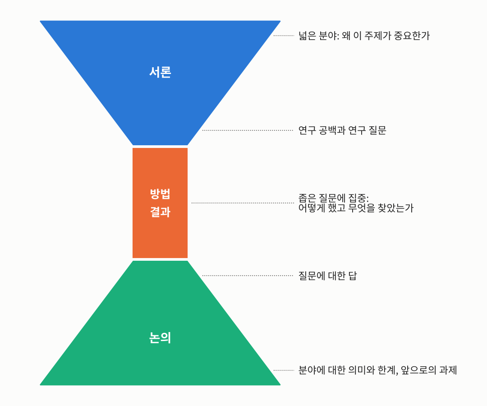

## 들어가며

학술 논문은 놀라울 만큼 비슷한 모양을 하고 있습니다. 분야와 저널에 따라 이름과 순서가 조금씩 다르지만, 대부분의 논문은 다음과 같은 절로 이루어집니다.

1. **초록**(abstract)
2. **서론**(introduction)
3. **선행 연구**(related work)
4. **방법**(methods)
5. **결과**(results)
6. **논의와 결론**(discussion and conclusion)

이 모양은 우연이 아닙니다. 독자가 논문을 읽으며 차례로 품게 되는 질문들, 즉 "무슨 이야기인가?", "왜 중요한가?", "어떻게 했는가?", "무엇을 찾았는가?", "그래서 무엇이 달라지는가?"에 하나씩 답하도록 다듬어진 결과입니다. 이번 글에서는 각 절이 어떤 질문에 답하는지 살펴보고, 논문 전체와 문단 하나하나를 어떤 모양으로 짜야 하는지 정리하겠습니다. 수학 논문은 이 틀에서 조금 벗어나는데, 그 이야기는 [다음 글](02-math-papers.qmd)에서 따로 다룹니다.

이번 글에서는 신경과학자 브렛 멘시(Brett Mensh)와 콘라트 코르딩(Konrad Kording)이 쓴 「Ten simple rules for structuring papers」를 자주 참고합니다.[^mk] 독자가 정보를 받아들이는 방식에서 출발해 논문 구조를 설명하는 짧은 글로, 분야를 가리지 않고 널리 읽힙니다.

## 독자는 논문을 어떻게 읽는가

논문을 쓰기 전에 먼저 기억해야 할 사실이 있습니다. **독자는 논문을 처음부터 끝까지 차례로 읽지 않습니다.** [2.2절](../02-research-preparation/02-finding-and-reading.qmd)에서 본 케샤브의 읽기 방법을 떠올려 보세요. 독자는 제목과 초록을 보고, 서론과 결론을 훑고, 그림을 들여다보고, 그다음에야 필요한 부분을 골라 읽습니다. 멘시와 코르딩도 많은 독자가 방법 절을 건너뛴다고 지적합니다.[^mk]

그래서 좋은 논문은 **여러 입구**를 갖고 있습니다.

- **제목**만 읽어도 핵심 기여가 무엇인지 알 수 있어야 합니다. 멘시와 코르딩은 논문 하나는 **하나의 중심 기여**에 집중하고, 그것을 제목에 담으라고 권합니다. 제목은 논문에서 가장 많이 읽히는 부분이기 때문입니다.[^mk]
- **초록**만 읽어도 논문 전체의 이야기를 알 수 있어야 합니다.
- **본문**은 그림과 표를 보지 않고도 읽혀야 합니다.
- **그림과 표, 그리고 캡션**만 봐도 무엇을 했고 무엇을 찾았는지 짐작할 수 있어야 합니다.

이 원칙들은 3.3절에서 논문의 뼈대 초안을 만들 때 그대로 점검 기준이 됩니다.

## 각 절이 하는 일

| 절 | 독자의 질문 | 담을 것 |
|---|---|---|
| 제목 | 무슨 이야기인가? | 중심 기여 하나 |
| 초록 | 전체 이야기는 무엇인가? | 맥락, 연구 공백, 접근, 핵심 결과, 의의를 한 문단에 |
| 서론 | 왜 이 연구가 필요한가? | 배경과 동기, 무엇이 알려지지 않았는지, 연구 질문, 이 논문의 기여 |
| 선행 연구 | 무엇이 이미 되어 있고, 무엇 위에 쌓는가? | 기존 접근을 아이디어별로 분류하고 이 연구와의 관계 |
| 방법 | 어떻게 했는가? | 모형, 알고리즘, 실험 설계, 데이터, 구현. 다른 사람이 재현할 수 있을 만큼 |
| 결과 | 무엇을 찾았는가? | 주장과 그 근거를 논리적인 순서로 |
| 논의와 결론 | 그래서 무엇이 달라지는가? | 주요 발견 요약, 한계, 다른 연구와의 관계, 앞으로의 과제 |

몇 가지를 덧붙이면 다음과 같습니다.

**초록은 마지막에 씁니다.** 초록은 논문 전체의 요약이므로, 논문이 완성되기 전에는 제대로 쓸 수 없습니다. 대개 한 문단이고, 저널마다 단어 수 제한이 있습니다.

**서론은 점점 좁혀 갑니다.** 멘시와 코르딩은 서론의 문단들이 넓은 분야에서 시작해 구체적인 연구 공백으로 **점점 좁혀 가야** 한다고 말합니다. 각 문단은 독자를 맥락 안에 세우고, 무엇이 알려져 있는지 정리한 뒤, **무엇이 알려지지 않았는지**로 끝납니다. 서론의 끝에서는 결과를 짧게 미리 보여 줍니다. 반대로 피해야 할 것은 그 분야 전체를 훑는 장황한 문헌 소개입니다.[^mk]

**선행 연구는 서론에 녹이거나 따로 둡니다.** 짧은 논문에서는 서론 안에 녹이고, 학위 논문처럼 긴 글에서는 따로 장을 두는 경우가 많습니다. 어느 쪽이든 [1.1절](../01-papers-in-context/01-theses.qmd)에서 본 것처럼 **논문별이 아니라 아이디어별로** 정리합니다.

**방법은 재현할 수 있을 만큼 씁니다.** 다른 연구자가 이 절만 보고 같은 실험이나 시뮬레이션을 다시 할 수 있어야 합니다. 시뮬레이션이라면 알고리즘, 매개변수, 반복 횟수, 난수 시드, 소프트웨어 버전까지 적어 두는 것이 좋습니다.

**논의는 서론에 답합니다.** 멘시와 코르딩은 논의 절을 주요 발견의 요약으로 시작하고, 이어서 연구의 강점과 약점을 다른 문헌과 연결해 논의한 뒤, 이 연구가 분야를 어떻게 한 걸음 나아가게 하는지로 마무리하라고 권합니다.[^mk] 서론에서 제시한 연구 공백이 어떻게 채워졌는지가 논의의 중심입니다. 결론에는 **새로운 내용을 넣지 않습니다.** 본문에서 다루지 않은 결과를 결론에서 처음 꺼내면 독자는 그 근거를 찾을 수 없습니다.

학위 논문도 기본 구조는 같습니다. 다만 각 부분이 장 단위로 커지고, 배경 지식을 설명하는 장이 따로 들어가는 경우가 많습니다. [1.1절](../01-papers-in-context/01-theses.qmd)에서 본 것처럼 학사 논문의 독자는 그 주제를 잘 모를 수도 있기 때문입니다.

## 전체의 모양: 넓게, 좁게, 다시 넓게

논문 전체를 옆에서 보면 **모래시계** 모양입니다. 서론은 넓은 분야에서 시작해 구체적인 연구 질문으로 좁혀 들어가고, 방법과 결과는 그 좁은 질문에 집중하며, 논의는 다시 넓어져 이 결과가 분야 전체에 어떤 의미가 있는지로 나아갑니다.

{fig-alt="논문 전체의 모래시계 구조. 맨 위 서론은 넓은 분야에서 시작해 아래로 갈수록 좁아지며 연구 질문에 이르는 파란 역삼각형이고, 가운데 방법과 결과는 좁은 폭을 유지하는 주황색 직사각형이며, 맨 아래 논의는 다시 넓어지며 분야 전체의 의미로 나아가는 청록색 삼각형입니다. 오른쪽에는 위에서부터 넓은 분야, 연구 공백과 연구 질문, 좁은 질문에 집중, 질문에 대한 답, 분야에 대한 의미와 한계라는 설명이 붙어 있습니다." width=60%}

초록은 이 모래시계 전체를 한 문단에 축약한 것입니다. 멘시와 코르딩은 초록도 **넓게–좁게–넓게**로 쓰라고 권합니다. 분야를 소개하며 시작해, 구체적인 연구 공백으로 좁히고, "Here we …"로 이 논문의 접근을 밝힌 뒤, 핵심 결과를 요약하고, 처음 던진 질문에 답하며 다시 넓게 마무리합니다. 특히 독자가 연구 공백을 이해하기 전에 결과부터 내밀지 말라고 강조합니다.[^mk]

박종우 씨의 학사 논문 초록 초안을 이 순서로 써 보면 다음과 같습니다. 각 문장 앞의 괄호는 설명을 위해 붙인 것입니다.

> (분야) Markov chain Monte Carlo methods are a standard tool for sampling from complex probability distributions. (좁히기) The efficiency of the random walk Metropolis algorithm depends strongly on the scale of its proposal distribution, and this dependence becomes critical in high dimensions. (공백) Although the rule of tuning the acceptance rate to about 0.234 is widely used, the limit theorem behind it is rarely presented in a self-contained form accessible to students. (접근) Here we reconstruct the weak convergence result of Roberts, Gelman and Gilks in full detail and test its predictions by simulation. (결과) We fill in the arguments omitted in the original proof and show how the optimal scaling emerges from the limiting diffusion. (의의) Our exposition clarifies which assumptions the 0.234 rule relies on and where it may fail in practice.

## 문단의 모양: 맥락, 내용, 결론

모래시계 모양은 논문 전체에만 해당하는 것이 아닙니다. 멘시와 코르딩은 같은 원리를 **문단 하나하나**에도 적용하라고 말합니다. 이른바 **맥락–내용–결론**(context–content–conclusion) 구조입니다.[^mk]

- **맥락**: 문단의 첫 문장, 즉 **토픽 문장**(topic sentence)이 이 문단이 무엇에 관한 것인지 알려 줍니다.
- **내용**: 이어지는 문장들이 새로운 정보를 전합니다.
- **결론**: 마지막 문장이 이 문단에서 가져가야 할 요점을 정리합니다.

이 구조는 독자가 무의식적으로 던지는 두 질문, "이걸 왜 지금 나한테 말하지?"와 "그래서 뭐?"에 답해 줍니다. 그리고 연구 일지처럼 **한 일을 시간 순서대로** 나열하는 대신, 논리적인 순서로 내용을 배치하게 해 줍니다.[^mk] 토픽 문장을 어떻게 쓰는지, 문단 안의 문장들을 어떻게 매끄럽게 잇는지는 4장에서 자세히 다룹니다.

## 결과 절의 문단: 질문, 한 일, 찾은 것

결과 절은 논문의 핵심이고, 맥락–내용–결론 구조가 가장 분명하게 드러나는 곳입니다. 멘시와 코르딩은 결과 절의 각 소절이나 문단이 **질문으로 시작해, 근거를 제시하고, 답으로 끝나야** 한다고 말합니다.[^mk] 실제로 쓸 때는 다음 세 단계로 생각하면 편합니다.

1. **무엇을 물었는가?**
2. **그것을 알아내기 위해 무엇을 했는가?**
3. **무엇을 찾았는가?**

박종우 씨가 시뮬레이션 결과 절에 쓸 문단으로 예를 들어 보겠습니다. 아직 시뮬레이션을 돌리기 전이라, 마지막 문장은 **예상하는 결과**를 적어 둔 초안입니다. 3.3절에서 보겠지만, 결과가 나오기 전에 이렇게 예상을 문장으로 써 두는 것은 좋은 습관입니다.

먼저 흔히 볼 수 있는 아쉬운 버전입니다.

> We ran the random walk Metropolis algorithm on standard Gaussian targets in several dimensions with different proposal scales. Figure 2 shows the result of this experiment.

무엇을 알고 싶었는지도, 무엇을 찾았는지도 문장에 없습니다. 독자는 그림 2를 들여다보며 결론을 스스로 추측해야 합니다. 이번에는 세 단계를 갖춘 버전입니다.

> We next asked whether the 0.234 rule is already useful in moderate dimensions. To this end, we ran the random walk Metropolis algorithm on standard Gaussian targets in dimensions 5, 20 and 100, varied the proposal scale, and measured efficiency by the effective sample size per iteration. We expect the efficiency to peak at acceptance rates close to 0.234 in all three dimensions (Figure 2).

이 문단은 세 가지 원칙을 지키고 있습니다.

- **방법 절을 읽지 않아도 이해됩니다.** 무엇을 했는지 큰 그림이 문장 안에 있습니다. 세부 사항, 예를 들어 반복 횟수나 유효 표본 크기의 계산 방법은 방법 절에 있습니다.
- **그림을 보지 않아도 결론을 알 수 있습니다.** 찾은 것이 문장으로 적혀 있습니다.
- **그림은 근거를 가리키는 역할을 합니다.** 문장 끝의 "(Figure 2)"는 "세부가 궁금하거나 이 주장을 믿기 어렵다면 여기를 보라"는 안내입니다.

같은 원리를 결과 절 전체에 적용하면, 결과 절은 **근거가 붙은 주장들의 논리적인 연쇄**가 됩니다. 멘시와 코르딩은 각 소절의 제목을 그 소절의 결론을 담은 **평서문**으로 쓰고, 그림의 제목도 결론을 말하도록 쓰라고 권합니다.[^mk] "Simulation results"보다 "The 0.234 rule holds already in moderate dimensions"가 훨씬 많은 것을 말해 줍니다.

## 정리

- 논문의 각 절은 독자의 질문 하나에 답합니다. 제목은 "무슨 이야기인가", 초록은 "전체 이야기", 서론은 "왜 필요한가", 선행 연구는 "무엇 위에 쌓는가", 방법은 "어떻게 했는가", 결과는 "무엇을 찾았는가", 논의는 "그래서 무엇이 달라지는가"입니다.
- 독자는 논문을 차례로 읽지 않습니다. 제목, 초록, 본문, 그림과 캡션이 **각각 따로 읽혀도** 이야기가 전달되어야 합니다.
- 논문 전체는 **넓게–좁게–넓게**의 모래시계 모양이고, 초록은 그것을 한 문단에 축약합니다. 문단은 **맥락–내용–결론**으로 짭니다.
- 결과 절의 문단은 **질문–한 일–찾은 것**의 순서로 쓰고, 그림은 근거를 가리키는 데 씁니다. 소절 제목과 그림 제목은 결론을 말하는 문장으로 씁니다.

이 틀은 실험이나 시뮬레이션이 중심인 논문에 가장 잘 맞습니다. 그런데 정리와 증명으로 이루어진 수학 논문에는 "방법"이나 "결과" 절이 따로 없는 경우가 많습니다. 다음 글에서는 수학 논문이 이 틀을 어떻게 바꾸어 쓰는지 살펴보겠습니다.

---

### 연결되는 개념
* $\leftarrow$ **이전 개념:** [3 논문의 구조와 쓰는 과정](index.qmd)
* $\rightarrow$ **다음 개념:** [3.2 수학 논문의 구조](02-math-papers.qmd)

[^mk]: B. Mensh, K. Kording, "Ten simple rules for structuring papers", *PLOS Computational Biology* 13(9), 2017, e1005619. doi:10.1371/journal.pcbi.1005619
