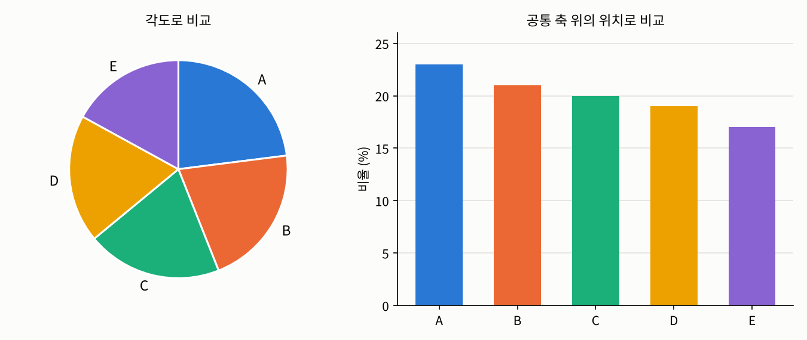
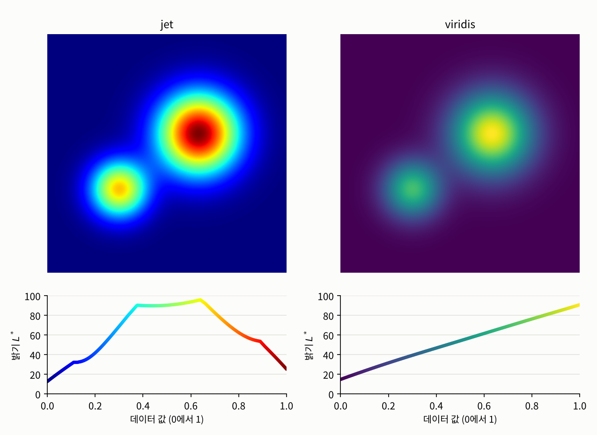

## 들어가며

좋은 그림이란 무엇일까요? "보기 좋은 그림"이라고 답하고 싶지만, 논문의 그림에서 중요한 것은 아름다움보다 **정확하게 읽히는 것**입니다. 독자가 그림을 보고 저자가 의도한 메시지를, 저자가 의도한 만큼 정확하게 읽어 낼 수 있어야 합니다.

이번 글에서는 그 목표를 위한 원리를 네 가지 측면에서 살펴봅니다. 먼저 연구 과정 전체에서 그림이 어떤 역할을 하는지 보고, 이어서 데이터의 종류, 사람의 눈이 시각적 표현을 읽는 정확도, 그리고 색을 고르는 법을 차례로 다룹니다.

## 연구 과정 속의 그림

### 탐색용 그림과 전달용 그림

연구는 대략 세 단계를 거칩니다. 데이터를 얻고 정리하는 단계, 데이터를 분석하고 모형을 세우는 단계, 그리고 그 결과를 논문으로 전하는 단계입니다. 그림은 뒤의 두 단계에서 서로 다른 역할을 합니다.

- **탐색용 그림**(exploratory figure)은 분석 단계에서 **나 자신**을 위해 그리는 그림입니다. 데이터에 어떤 패턴이 있는지, 시뮬레이션이 제대로 돌아가는지, 어떤 모형이 맞을지 빠르게 확인하기 위한 것입니다. 빨리 여러 개를 그려 보는 것이 중요하고, 모양은 크게 신경 쓰지 않아도 됩니다.
- **전달용 그림**(explanatory figure)은 논문 단계에서 **독자**를 위해 그리는 그림입니다. 독자에게 특정한 메시지를 전하고, 그 메시지의 근거를 보여 주기 위한 것입니다. 무엇을 보여 주고 무엇을 뺄지, 독자의 눈이 어디로 가야 하는지를 하나하나 정해야 합니다.

가장 흔한 실수는 탐색용 그림을 그대로 논문에 싣는 것입니다. 탐색용 그림은 "무엇이 있는지 찾는" 그림이라 정보는 많지만 메시지가 없습니다. 논문에 실을 그림은 **"무엇을 말하고 싶은가"**에서 거꾸로 출발해 다시 그려야 합니다.

### 글과 함께 기획하기

전달용 그림은 논문을 쓰는 과정과 함께 기획합니다. [3.3절](../03-structure-and-process/03-writing-is-iterating.qmd)의 뼈대 초안에서 본 것처럼, 결과 절의 토픽 문장마다 **그 주장을 뒷받침하려면 어떤 근거가 필요한가**를 적고, 그 근거를 보여 줄 그림을 정합니다. 이 단계에서는 다음과 같은 방법이 도움이 됩니다.

- **손으로 스케치하기**: 데이터가 없어도, 예상되는 결과를 종이에 그려 보면 축에 무엇을 놓을지, 몇 개의 패널이 필요한지 감이 잡힙니다.
- **예시 갤러리 둘러보기**: matplotlib이나 seaborn 같은 라이브러리의 공식 갤러리에는 수백 가지 그래프의 예와 코드가 있습니다. 내 데이터에 맞는 표현을 찾는 데 좋은 출발점입니다.
- **AI의 도움 받기**: 그래프 라이브러리의 세부 옵션을 찾거나, 스케치를 코드로 옮기는 데 AI가 유용합니다. 다만 결과 그림이 데이터를 정확하게 보여 주는지는 직접 확인해야 합니다. 이에 대해서는 6장에서 다시 다룹니다.

이때 지켜야 할 균형도 있습니다. 모든 측정값과 모든 경우를 다 보여 주고 싶겠지만, 논문에는 지면 제한이 있고 독자의 주의도 한정되어 있습니다. 본문에는 대표적인 경우와 요약을 보여 주고, 개별 결과는 부록에 모아 두는 것이 좋은 절충입니다.

### 스크립트로 재현 가능하게

논문에 들어가는 그림은 **전부 스크립트로** 만드는 것이 좋습니다. 데이터 처리부터 그림 저장까지 코드로 남겨 두면 다음과 같은 이점이 있습니다.

- 지도교수가 "축 범위를 바꿔 보자"고 할 때, 다시 그리는 데 몇 초면 됩니다.
- 데이터가 바뀌거나 시뮬레이션을 다시 돌려도 그림을 그대로 다시 만들 수 있습니다.
- 나중에 그림이 어떻게 만들어졌는지 확인할 수 있습니다. 이것은 연구의 재현 가능성 그 자체입니다.

여기에 한 가지 요령을 더하면, **그림에 들어갈 처리된 데이터를 따로 저장**해 두는 것입니다. 시뮬레이션에 몇 시간이 걸린다면, 그림을 다듬을 때마다 시뮬레이션을 다시 돌릴 수는 없습니다. 시뮬레이션 결과를 파일로 저장하고, 그림 스크립트는 그 파일을 읽어 그리도록 나눠 두면, 그림의 색이나 글꼴을 바꾸는 일이 가벼워집니다. 같은 데이터로 발표용 그림을 따로 만들 때도 편합니다. [5.2절](02-making-plots.qmd)에서 박종우 씨의 시뮬레이션도 이렇게 나누어 처리합니다.

## 데이터의 종류

어떤 시각적 표현을 쓸지는 먼저 **데이터가 어떤 종류인지**에 달려 있습니다. 가장 널리 쓰이는 분류는 심리학자 스탠리 스미스 스티븐스(Stanley Smith Stevens)가 1946년 *Science*에 발표한 **측정 척도**(scales of measurement)입니다.[^stevens] 이 분류가 모든 경우에 딱 맞는 것은 아니고 다른 제안들도 있지만, 데이터의 개념적인 성질을 의식하는 데는 충분히 유용합니다.

| 척도 | 성질 | 예 |
|---|---|---|
| **명목**(nominal) | 같은지 다른지만 의미 있음 | 알고리즘의 이름, 출생 국가, 설문 응답자의 전공 |
| **순서**(ordinal) | 순서는 있지만 간격은 의미 없음 | 설문의 "매우 동의함~전혀 동의하지 않음", 대회의 순위(기록 자체가 아니라) |
| **구간**(interval) | 차이는 의미 있지만 비율은 의미 없음 | 섭씨 온도(20°C는 10°C의 "두 배 더운" 것이 아님), 날짜 |
| **비**(ratio) | 비율도 의미 있음, 진짜 0이 있음 | 길이, 시간, 질량, 절대 온도, 채택률, 유효 표본 크기 |

여기에 구조가 없는 **텍스트** 데이터를 따로 둘 수도 있습니다. 설문의 자유 응답이나 논문의 초록 같은 것들로, 정량적으로 다루기가 가장 어려워 그 자체로 하나의 연구 분야를 이룹니다.

이 구분이 시각화에서 중요한 이유는 각 척도마다 **허용되는 표현이 다르기** 때문입니다. 명목 데이터에 크기 순서가 있는 색(옅은 파랑에서 짙은 파랑으로)을 쓰면, 독자는 존재하지 않는 순서를 읽게 됩니다. 반대로 비율 데이터를 막대그래프로 그리면서 세로축을 0이 아닌 곳에서 시작하면, 막대 길이의 비가 실제 값의 비를 왜곡합니다.

## 시각적 인코딩과 그 정확도

그래프를 그린다는 것은 데이터의 값을 **시각적 속성**으로 옮기는 일입니다. 위치, 길이, 각도, 면적, 색의 밝기와 채도 같은 것들입니다. 이것을 **시각적 인코딩**(visual encoding)이라고 합니다. 그렇다면 사람의 눈은 이 속성들을 얼마나 정확하게 읽어 낼까요?

벨 연구소의 통계학자 윌리엄 클리블랜드(William S. Cleveland)와 로버트 맥길(Robert McGill)은 1984년 *Journal of the American Statistical Association*에 발표한 논문에서 이 질문을 실험으로 다루었습니다.[^cm] 그들은 그래프를 읽을 때 사람이 하는 기본적인 지각 과제들을 정리하고, 정확도에 따라 다음과 같은 순위를 제시했습니다.

::: {.callout-note icon=false}
### 클리블랜드와 맥길의 정확도 순위 (정확한 것부터)
1. 공통 축 위의 위치
2. 정렬되지 않은 같은 축 위의 위치
3. 길이, 방향, 각도
4. 면적
5. 부피, 곡률
6. 음영, 색의 채도
:::

이 순위는 이후 여러 연구에서 다시 확인되었습니다. 예를 들어 제프리 히어(Jeffrey Heer)와 마이클 보스톡(Michael Bostock)은 2010년 크라우드소싱으로 이 실험을 재현해 비슷한 결과를 얻었습니다.[^hb]

이 순위가 실제로 어떤 차이를 만드는지 직접 확인해 보겠습니다. 아래 두 그림은 다섯 범주 A부터 E까지의 같은 비율(23%, 21%, 20%, 19%, 17%)을 각각 원그래프와 막대그래프로 그린 것입니다.

{fig-alt="같은 다섯 비율을 원그래프와 막대그래프로 나란히 그린 그림. 왼쪽 원그래프에서는 A부터 E까지 다섯 조각의 크기가 거의 같아 보여 순서를 판단하기 어렵습니다. 오른쪽 막대그래프에서는 A가 23, B가 21, C가 20, D가 19, E가 17로 막대 높이가 차례로 낮아지는 것이 한눈에 보입니다." width=90%}

원그래프에서 B, C, D 가운데 어느 것이 가장 큰지 판단해 보세요. 각도와 면적으로 비교해야 하므로 거의 불가능합니다. 막대그래프에서는 공통 축 위의 위치로 비교하므로 순서가 한눈에 보입니다. 원그래프가 늘 나쁜 것은 아니지만, **값을 정확하게 비교해야 한다면** 위치나 길이를 쓰는 표현이 낫습니다.

이 순위에서 얻을 수 있는 실용적인 원칙은 다음과 같습니다.

- **가장 중요한 비교는 공통 축 위의 위치로** 보여 줍니다. 두 조건을 비교하는 것이 그림의 핵심이라면, 두 조건을 같은 축 위에 놓습니다.
- **색과 면적은 보조적인 정보에** 씁니다. 색의 채도나 원의 크기로 정확한 값을 읽게 하는 것은 독자에게 어려운 일을 시키는 것입니다.
- **3차원 효과를 피합니다.** 입체 막대그래프나 입체 원그래프는 부피와 원근 때문에 값을 읽기 더 어렵게 만들 뿐, 정보를 더하지 않습니다.

## 색

색은 그림에서 가장 눈에 띄는 요소이자, 가장 잘못 쓰이기 쉬운 요소입니다. 색을 쓰는 목적과 데이터의 종류에 따라 원칙이 달라집니다.

### 강조

색의 가장 효과적인 쓰임은 **강조**입니다. 대부분을 회색으로 두고 독자가 봐야 할 한두 개만 색을 입히면, 그 부분이 즉시 눈에 들어옵니다. 범례 대신 해당 선이나 점 옆에 직접 이름을 적는 **직접 라벨링**과 함께 쓰면 더 효과적입니다.

### 데이터 종류에 맞는 색

- **명목 데이터**: 순서가 느껴지지 않는, **분명히 구별되는 색**이 필요합니다. 채도와 밝기가 비슷하고 색상만 다른 색들이 좋고, 대부분 그래프 라이브러리의 기본 색이 이런 원리로 만들어져 있습니다. 범주가 많아질수록 색상만으로는 구별이 어려워지므로, 가능하면 **여섯 개 안팎**으로 줄이는 것이 좋습니다. 그보다 많은 범주를 보여 줘야 한다면 주석을 달거나, 하위 집단별로 그림을 나누는 것을 생각해 봅니다.
- **순서 데이터**: 색에도 **직관적인 순서**가 있어야 합니다. 옅은 색에서 짙은 색으로 가는 단계적인 색이 자연스럽습니다.
- **구간·비율 데이터**: 연속적인 **색상표**(colormap)를 씁니다. 이때 데이터가 한쪽 방향인지(예: 0에서 1) 양쪽 방향인지(예: −1에서 1)에 따라 다릅니다. 한쪽 방향이면 밝기가 한 방향으로 변하는 **순차형**(sequential) 색상표를, 0을 중심으로 양쪽으로 갈리는 데이터라면 가운데가 옅고 양 끝이 서로 다른 색으로 짙어지는 **발산형**(diverging) 색상표를 씁니다.

### 무지개 색상표의 문제

연속 데이터에 가장 흔히 쓰이면서도 가장 문제가 많은 것이 **무지개 색상표**입니다. 오랫동안 MATLAB과 matplotlib의 기본 색상표였던 `jet`이 대표적입니다. 시각화 연구자 데이비드 볼랜드(David Borland)와 러셀 테일러(Russell M. Taylor II)는 2007년 「Rainbow Color Map (Still) Considered Harmful」이라는 글에서 그 문제를 정리했습니다.[^rainbow] 핵심 문제는 **색의 밝기가 데이터 값을 따라 고르게 변하지 않는다**는 것입니다.

이것을 직접 확인해 보겠습니다. 아래 그림의 위쪽은 같은 2차원 함수를 `jet`과 `viridis`로 그린 것이고, 아래쪽은 각 색상표에서 데이터 값(0에서 1)에 따라 색의 지각적 밝기($L^*$)가 어떻게 변하는지 계산한 것입니다.

{fig-alt="같은 2차원 함수를 jet 색상표와 viridis 색상표로 그린 그림과, 각 색상표의 밝기 변화를 비교한 그림. 위 왼쪽 jet 그림에서는 큰 봉우리 주변에 노란색과 하늘색의 밝은 고리가 생겨 경계처럼 보이고, 위 오른쪽 viridis 그림에서는 값이 커질수록 고르게 밝아집니다. 아래 왼쪽 그래프에서 jet의 밝기 L*는 데이터 값 0에서 약 13으로 시작해 0.4 부근에서 약 90에 이르고 0.64 부근에서 최대 약 96까지 오른 뒤 다시 떨어져 1에서 약 25로 끝나 오르내리고, 아래 오른쪽 그래프에서 viridis의 밝기는 약 15에서 약 91까지 거의 직선으로 증가합니다." width=90%}

`jet`의 밝기는 데이터 값이 0에서 0.4 부근까지 커지는 동안 급격히 밝아지고, 0.64 부근에서 가장 밝았다가 그 뒤로는 다시 어두워집니다. 값이 1일 때의 밝기는 값이 0.2일 때보다도 낮습니다. 그래서 위 왼쪽 그림에서는 봉우리의 중간 높이에 있는 하늘색과 노란색 고리가 가장 밝게 보이고, 실제로 값이 가장 큰 봉우리의 꼭대기는 오히려 어두운 빨간색으로 보입니다. 사람의 눈은 밝기의 변화를 경계로 읽기 때문에, 데이터에 없는 **가짜 경계**가 생기고 진짜 최댓값은 묻힙니다. 반면 `viridis`는 밝기가 데이터 값을 따라 거의 일정하게 증가하도록 설계된 **지각적으로 균일한**(perceptually uniform) 색상표입니다. 그래서 값이 클수록 밝다는 직관이 그대로 맞습니다. matplotlib은 2017년의 2.0판부터 기본 색상표를 `jet`에서 `viridis`로 바꾸었습니다.

무지개 색상표를 써도 괜찮은 경우는 각도나 시각처럼 끝과 처음이 이어지는 **순환형 데이터** 정도입니다. 이때도 순환형으로 설계된 색상표를 쓰는 것이 좋습니다. matplotlib에 내장된 색상표 목록이나 `colorcet` 같은 패키지에서 지각적으로 균일한 색상표를 찾을 수 있습니다.

### 색각 이상

색을 고를 때 잊기 쉬운 독자가 있습니다. 색각 이상이 있는 독자입니다. 가장 흔한 적록 색각 이상은 대규모 인구 조사에 따르면 유럽계 남성의 약 8%, 여성의 약 0.4%에게 나타나고, 중국인과 일본인 남성에서는 4~6.5% 정도입니다.[^birch] 강의실에 남학생이 스무 명 있다면, 그중 한두 명은 빨강과 초록을 구별하기 어려울 수 있다는 뜻입니다.

그래서 다음을 지키는 것이 좋습니다.

- **빨강과 초록만으로 구별하지 않습니다.** 두 계열을 구별해야 한다면 파랑과 주황처럼 밝기나 색상이 확연히 다른 조합을 씁니다.
- **색 말고 다른 단서도 함께 씁니다.** 선의 종류(실선, 점선), 마커의 모양, 직접 라벨링을 함께 쓰면 색을 구별하지 못해도 그림을 읽을 수 있습니다. 흑백으로 인쇄했을 때도 읽히는지 확인해 보면 좋은 점검이 됩니다.
- **지각적으로 균일한 색상표를 씁니다.** `viridis` 계열은 흔한 색각 이상에서도 순서가 유지되도록 설계되었습니다.

## 정리

- 그림은 분석 단계의 **탐색용**과 논문 단계의 **전달용**이 다릅니다. 전달용 그림은 "무엇을 말하고 싶은가"에서 출발해, 글과 함께 기획하고, 스크립트로 재현 가능하게 만들고, 처리된 데이터를 따로 저장해 둡니다.
- 데이터는 **명목, 순서, 구간, 비** 척도로 나눌 수 있고, 척도마다 허용되는 시각적 표현이 다릅니다.
- 사람의 눈은 **공통 축 위의 위치**를 가장 정확하게 읽고, 길이, 각도, 면적, 색의 채도 순으로 덜 정확하게 읽습니다. 가장 중요한 비교는 위치로 보여 주고, 3차원 효과는 피합니다.
- 색은 강조에 가장 효과적입니다. 명목 데이터에는 구별되는 색을, 순서 데이터에는 순서 있는 색을, 연속 데이터에는 순차형이나 발산형 색상표를 씁니다. **무지개 색상표는 밝기가 고르지 않아** 가짜 경계를 만들므로, `viridis` 같은 지각적으로 균일한 색상표를 씁니다.
- 유럽계 남성의 약 8%에게 적록 색각 이상이 있습니다. 빨강과 초록만으로 구별하지 말고, 선 종류와 마커, 직접 라벨링을 함께 씁니다.

다음 글에서는 이 원리들을 실제 데이터에 적용해 봅니다. 박종우 씨의 시뮬레이션을 돌리고, 그 결과로 기본 설정의 그래프를 논문에 실을 그림으로 다듬어 가겠습니다.

---

### 연결되는 개념
* $\leftarrow$ **이전 개념:** [5 그림과 시각화](index.qmd)
* $\rightarrow$ **다음 개념:** [5.2 그래프 고르고 다듬기](02-making-plots.qmd)

[^stevens]: S. S. Stevens, "On the Theory of Scales of Measurement", *Science* 103(2684), 1946, pp. 677–680.

[^cm]: W. S. Cleveland, R. McGill, "Graphical Perception: Theory, Experimentation, and Application to the Development of Graphical Methods", *Journal of the American Statistical Association* 79(387), 1984, pp. 531–554.

[^hb]: J. Heer, M. Bostock, "Crowdsourcing Graphical Perception: Using Mechanical Turk to Assess Visualization Design", *Proceedings of the SIGCHI Conference on Human Factors in Computing Systems (CHI 2010)*, 2010, pp. 203–212.

[^rainbow]: D. Borland, R. M. Taylor II, "Rainbow Color Map (Still) Considered Harmful", *IEEE Computer Graphics and Applications* 27(2), 2007, pp. 14–17.

[^birch]: J. Birch, "Worldwide prevalence of red-green color deficiency", *Journal of the Optical Society of America A* 29(3), 2012, pp. 313–320. doi:10.1364/JOSAA.29.000313
