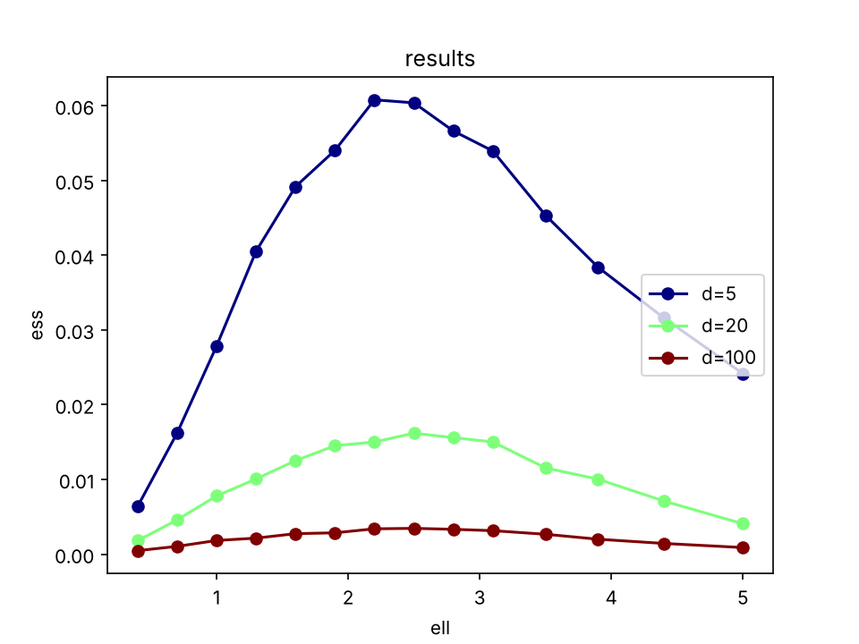
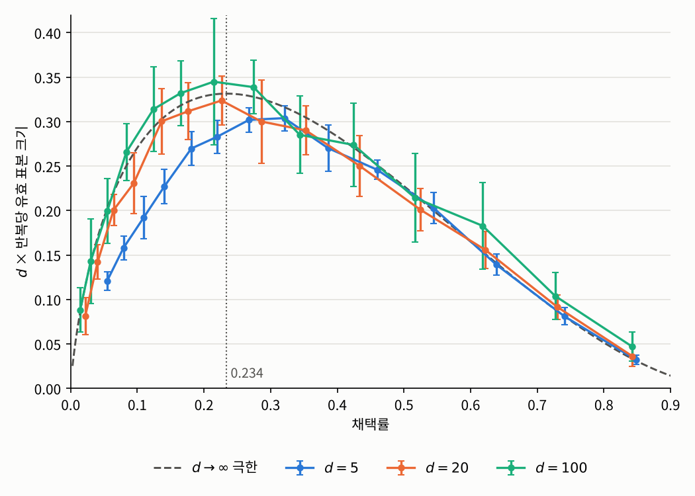

## 들어가며

[지난 글](01-principles.qmd)에서 좋은 그림의 원리를 살펴보았습니다. 이번 글에서는 그 원리를 실제 데이터에 적용합니다. 먼저 자주 쓰는 그래프 유형과, 그래프를 그리기 전에 데이터를 요약하는 통계적 변환을 정리합니다. 그런 다음 이 과목에서 계속 따라온 박종우 씨의 시뮬레이션을 **실제로 돌려 보고**, 그 결과를 기본 설정의 그래프에서 논문에 실을 그림으로 다듬어 가겠습니다. 마지막으로 그림을 어떤 형식으로 내보내고, 캡션에 무엇을 쓸지 다룹니다.

## 기본 그래프 유형

대부분의 논문 그림은 몇 가지 기본 그래프의 조합입니다.

| 그래프 | 보여 주는 것 | 언제 쓰는가 |
|---|---|---|
| 산점도(scatter plot) | 두 변수의 관계 | 개별 관측값의 관계를 보여 줄 때. 색, 크기, 마커, 오차 막대로 다른 변수를 더할 수 있음 |
| 선 그래프(line plot) | 두 변수의 관계 | 한 변수가 다른 변수에 따라 연속적으로 변한다는 것을 강조할 때 (시간, 반복 횟수, 매개변수) |
| 막대그래프(bar chart) | 범주별 값 | 범주형 변수에 따른 연속형 값. 쌓거나 묶어서, 가로로 놓을 수도 있음 |
| 히스토그램(histogram) | 하나의 분포 | 표본의 분포. 막대그래프와 비슷해 보이지만 가로축이 구간으로 나눈 연속 변수 |
| 박스 플롯, 바이올린 플롯, 오차 막대 | 분포의 요약 | 여러 분포를 나란히 비교할 때. 각각이 하나의 분포를 작게 요약함 |
| 히트맵, 등고선 | 2차원 함수나 분포 | 두 변수에 따라 정해지는 값. 색상표 선택이 중요함 |

수학 논문에서 특히 자주 쓰이는 것은 **선 그래프**입니다. 수렴 속도를 보여 주는 오차 대 반복 횟수, 매개변수에 따른 성능, 이론값과 시뮬레이션의 비교 같은 그림들입니다. 이런 그림에서는 축을 **로그 스케일**로 그리는 경우가 많습니다. 오차가 $n^{-1/2}$처럼 거듭제곱으로 줄어든다면, 양쪽 축을 로그로 그렸을 때 기울기 $-1/2$인 직선이 되어 수렴 속도를 한눈에 읽을 수 있습니다.

## 그리기 전에: 통계적 변환

원자료를 그대로 그리는 경우는 드뭅니다. 대개는 먼저 **요약**합니다. 가장 기본적인 요약 방식은 **split-apply-combine**이라는 패턴입니다.[^vanderplas]

1. **나누기**(split): 데이터를 어떤 열의 값에 따라 집단으로 나눕니다.
2. **적용하기**(apply): 각 집단에 함수를 적용합니다. 평균, 표준편차, 개수 같은 것입니다.
3. **합치기**(combine): 결과를 다시 하나의 표로 모읍니다.

히스토그램도 이 패턴의 한 예입니다. 값을 구간으로 나누고(split), 구간마다 개수를 세고(apply), 그 결과를 하나의 표로 합친(combine) 것입니다. 이 밖에 회귀선을 그리거나 밀도를 추정하는 것도 그리기 전에 하는 통계적 변환입니다.

## 사례: 랜덤 워크 메트로폴리스의 효율

이제 박종우 씨의 시뮬레이션을 실제로 돌려 보겠습니다. [3.1절](../03-structure-and-process/01-anatomy.qmd)에서 박종우 씨는 결과 절의 문단 초안에 다음과 같이 **예상**을 적어 두었습니다.

> We expect the efficiency to peak at acceptance rates close to 0.234 in all three dimensions (Figure 2).

이 예상이 맞는지 확인하는 것이 이번 시뮬레이션의 목표입니다.

### 시뮬레이션

설정은 다음과 같습니다. 목표 분포는 $d$차원 표준 정규분포이고, 차원은 $d = 5, 20, 100$입니다. 제안 분포는 현재 상태에 분산 $\ell^2/d$인 정규 잡음을 더하는 랜덤 워크이고, 척도 $\ell$을 0.4부터 5.0까지 14가지로 바꿔 가며 각각 독립적으로 10번씩, 한 번에 50,000번 반복합니다. 효율은 첫 번째 좌표의 **반복당 유효 표본 크기**(effective sample size per iteration)로 잽니다. 유효 표본 크기는 자기상관을 가이어(Geyer)의 초기 양수열(initial positive sequence) 방법으로 더해 추정합니다.[^geyer] 체인은 목표 분포에서 뽑은 점에서 시작하므로 번인은 따로 두지 않습니다.

[5.1절](01-principles.qmd)에서 말한 대로, 시뮬레이션과 그림을 나누어 시뮬레이션 결과를 `results.json` 파일로 저장해 둡니다.

::: {.callout-note collapse="true" icon=false}
### 시뮬레이션 코드 (`simulate.py`)
```python
import json
import numpy as np

def ess_initial_positive(x):
    """Effective sample size via Geyer's initial positive sequence (first coordinate)."""
    n = len(x)
    x = x - x.mean()
    f = np.fft.rfft(x, n=2 * n)
    acf = np.fft.irfft(f * np.conj(f))[:n]
    acf /= acf[0]
    s = 0.0
    for k in range(0, n - 1, 2):
        pair = acf[k] + acf[k + 1]
        if pair <= 0:
            break
        s += pair
    tau = 2 * s - 1
    return n / tau

def run(d, ells, n_iter, reps, rng):
    n_chains = len(ells) * reps
    ell = np.repeat(ells, reps)            # scale of each chain
    sigma = ell / np.sqrt(d)
    x = rng.standard_normal((n_chains, d))  # start in stationarity
    logp = -0.5 * np.sum(x**2, axis=1)
    acc = np.zeros(n_chains)
    trace = np.empty((n_iter, n_chains))
    for t in range(n_iter):
        y = x + sigma[:, None] * rng.standard_normal((n_chains, d))
        logq = -0.5 * np.sum(y**2, axis=1)
        accept = np.log(rng.random(n_chains)) < logq - logp
        x[accept] = y[accept]; logp[accept] = logq[accept]
        acc += accept
        trace[t] = x[:, 0]
    acc_rate = acc / n_iter
    ess = np.array([ess_initial_positive(trace[:, j]) for j in range(n_chains)]) / n_iter
    return ell, acc_rate, ess

rng = np.random.default_rng(1557)
ells = np.array([0.4, 0.7, 1.0, 1.3, 1.6, 1.9, 2.2, 2.5, 2.8, 3.1, 3.5, 3.9, 4.4, 5.0])
reps, n_iter = 10, 50000
out = {}
for d in [5, 20, 100]:
    ell, a, e = run(d, ells, n_iter, reps, rng)
    out[d] = {"ell": ell.tolist(), "acc": a.tolist(), "ess": e.tolist()}
    A = a.reshape(len(ells), reps).mean(1); E = e.reshape(len(ells), reps)
    best = np.argmax(E.mean(1))
    print(f"d={d:3d}  best ell={ells[best]:.1f}  acc={A[best]:.3f}  ess/iter={E.mean(1)[best]:.4f}")
json.dump(out, open("results.json", "w"))
```
:::

```
d=  5  best ell=2.2  acc=0.321  ess/iter=0.0608
d= 20  best ell=2.5  acc=0.226  ess/iter=0.0162
d=100  best ell=2.5  acc=0.214  ess/iter=0.0034
```

세 차원 모두 반복당 유효 표본 크기가 가장 큰 채택률은 0.21에서 0.32 사이였습니다. 다만 숫자만 봐서는 그 봉우리가 얼마나 뾰족한지, 차원에 따라 어떻게 다른지 알 수 없습니다. 그림이 필요합니다.

### 요약하기

그림을 그리기 전에, 같은 $(d, \ell)$에서 돌린 10번의 결과를 split-apply-combine으로 요약합니다. pandas의 `groupby`가 이 일을 합니다. 여기서 반복당 유효 표본 크기에 차원 $d$를 곱한 값을 효율로 씁니다. 이론에 따르면 반복당 유효 표본 크기는 대략 $1/d$에 비례해 줄어들기 때문에, $d$를 곱해야 서로 다른 차원을 같은 축 위에서 비교할 수 있습니다.

```python
import json
import pandas as pd

res = json.load(open("results.json"))
rows = [{"d": int(d), "ell": l, "acc": a, "ess": e}
        for d, r in res.items() for l, a, e in zip(r["ell"], r["acc"], r["ess"])]
df = pd.DataFrame(rows)
df["eff"] = df["d"] * df["ess"]          # d × ESS per iteration

summary = (df.groupby(["d", "ell"])        # split
             .agg(acc=("acc", "mean"),     # apply
                  eff=("eff", "mean"),
                  eff_sd=("eff", "std"))
             .reset_index())               # combine
summary.to_csv("summary.csv", index=False)
print(len(df), "rows")
print(summary[summary["ell"].between(1.9, 2.8)].round(3).to_string(index=False))
```

```
420 rows
  d  ell   acc   eff  eff_sd
  5  1.9 0.386 0.270   0.026
  5  2.2 0.321 0.304   0.014
  5  2.5 0.268 0.302   0.014
  5  2.8 0.220 0.283   0.019
 20  1.9 0.353 0.290   0.028
 20  2.2 0.286 0.300   0.047
 20  2.5 0.226 0.324   0.028
 20  2.8 0.176 0.312   0.032
100  1.9 0.344 0.285   0.044
100  2.2 0.274 0.339   0.030
100  2.5 0.214 0.345   0.071
100  2.8 0.165 0.332   0.037
```

### 첫 번째 그림: 기본 설정 그대로

먼저 아무 고민 없이 기본 설정으로 그려 보겠습니다. 탐색 단계에서 흔히 그리는 그림입니다. 이번에는 $d$를 곱하지 않은 반복당 유효 표본 크기를 척도 $\ell$에 대해 그리고, 색은 예전에 흔히 쓰던 `jet` 색상표에서 골랐습니다.

```python
import pandas as pd
import matplotlib.pyplot as plt

summary = pd.read_csv("summary.csv")
fig, ax = plt.subplots()
for c, d in zip(plt.cm.jet([0.0, 0.5, 1.0]), [5, 20, 100]):
    s = summary[summary["d"] == d]
    ax.plot(s["ell"], s["eff"] / d, "o-", color=c, label=f"d={d}")
ax.set_xlabel("ell"); ax.set_ylabel("ess"); ax.set_title("results")
ax.legend(loc="center right")
fig.savefig("rwm-before.png", dpi=150)
```

{fig-alt="기본 설정으로 그린 시뮬레이션 결과. 제목은 results, 가로축 이름은 ell, 세로축 이름은 ess입니다. d=5는 짙은 남색, d=20은 연두색, d=100은 짙은 빨간색 선입니다. d=5의 곡선은 ell 2.2 부근에서 약 0.06의 봉우리를 이루지만, d=20은 약 0.016, d=100은 약 0.003으로 아래에 눌려 있어 모양을 알아보기 어렵고, 오른쪽 가운데 범례가 d=5 곡선의 일부를 가립니다." width=70%}

이 그림에는 무엇이 문제일까요? 하나씩 짚어 보겠습니다.

- **축 이름이 의미 없습니다.** "ell"과 "ess"는 코드 속 변수 이름입니다. 독자는 이것이 무엇인지, 단위가 무엇인지 모릅니다.
- **제목 "results"는 아무것도 말하지 않습니다.** [3.1절](../03-structure-and-process/01-anatomy.qmd)에서 본 것처럼 그림의 제목이나 캡션은 결론을 말해야 합니다.
- **차원을 비교할 수 없습니다.** $d = 20$과 $d = 100$의 곡선이 바닥에 눌려 있어서, 봉우리가 어디에 있는지 보이지 않습니다. 반복당 유효 표본 크기가 $1/d$에 비례해 줄어드는 것은 당연한 일이고, 이 그림이 보여 주고 싶은 것은 그것이 아닙니다.
- **가로축이 질문과 맞지 않습니다.** 박종우 씨의 질문은 "어떤 **채택률**에서 효율이 가장 좋은가"인데, 가로축은 척도 $\ell$입니다. 독자는 머릿속에서 $\ell$을 채택률로 바꿔야 합니다.
- **기준이 없습니다.** 0.234라는 이론값도, $d \to \infty$의 극한도 그림에 없어서, 결과가 이론과 맞는지 판단할 수 없습니다.
- **불확실성이 보이지 않습니다.** 10번 돌린 결과의 평균만 있고, 그 편차는 없습니다. 봉우리 근처의 차이가 의미 있는 차이인지 알 수 없습니다.
- **색이 고르지 않습니다.** `jet`에서 고른 연두색은 흰 배경에서 잘 보이지 않고, 세 색의 밝기가 제각각입니다.
- **범례가 데이터를 가립니다.**

### 두 번째 그림: 질문에 맞게 다듬기

이제 이 문제들을 하나씩 고쳐 보겠습니다.

1. 가로축을 **채택률**로, 세로축을 $d$를 곱한 **효율**로 바꿔, 세 차원을 같은 축 위에서 비교할 수 있게 합니다. [5.1절](01-principles.qmd)의 원칙대로, 가장 중요한 비교를 공통 축 위의 위치로 보여 주는 것입니다.
2. 10번 돌린 결과의 표준편차를 **오차 막대**로 그립니다.
3. 로버츠, 겔만, 길크스의 **$d \to \infty$ 극한 곡선**을 회색 점선으로, **0.234**를 회색 점선 세로줄로 더해 기준을 보여 줍니다. 이 극한에서 채택률은 $2\Phi(-\ell/2)$이고, 효율은 $\ell^2 \Phi(-\ell/2)/2$입니다.[^limit]
4. 축 이름을 한국어 문장으로 쓰고, 색은 사이트의 고정 색 순서를 씁니다.
5. 범례는 데이터를 가리지 않게 그림 아래로 보냅니다.

```python
import numpy as np
import pandas as pd
import matplotlib.pyplot as plt
from scipy.stats import norm

plt.rcParams.update({"font.family": "Noto Sans CJK KR",
                     "axes.spines.top": False, "axes.spines.right": False,
                     "figure.facecolor": "#fcfcfb", "axes.facecolor": "#fcfcfb",
                     "savefig.facecolor": "#fcfcfb"})
BLUE, ORANGE, TEAL, GREY = "#2a78d6", "#eb6834", "#1baf7a", "#52514e"
summary = pd.read_csv("summary.csv")

# limit d -> infinity (Roberts, Gelman and Gilks 1997)
l = np.linspace(0.05, 6, 400)
acc_lim = 2 * norm.cdf(-l / 2)
eff_lim = l**2 * norm.cdf(-l / 2) / 2

fig, ax = plt.subplots(figsize=(7, 5))
ax.yaxis.grid(True, color="#e3e2de", lw=0.8); ax.set_axisbelow(True)
for c, d in zip([BLUE, ORANGE, TEAL], [5, 20, 100]):
    s = summary[summary["d"] == d]
    ax.errorbar(s["acc"], s["eff"], yerr=s["eff_sd"], color=c, marker="o", ms=4,
                lw=1.6, capsize=2.5, label=f"$d = {d}$")
ax.plot(acc_lim, eff_lim, color=GREY, ls="--", lw=1.4, label="$d \\to \\infty$ 극한")
ax.axvline(0.234, color=GREY, ls=":", lw=1)
ax.text(0.240, 0.012, "0.234", color=GREY, fontsize=9.5)
ax.set_xlim(0, 0.9); ax.set_ylim(0, 0.42)
ax.set_xlabel("채택률")
ax.set_ylabel("$d$ × 반복당 유효 표본 크기")
ax.legend(loc="upper center", bbox_to_anchor=(0.5, -0.16), ncol=4, frameon=False)
fig.tight_layout()
fig.savefig("rwm-after.png", dpi=150)
fig.savefig("rwm-after.pdf")
```

{fig-alt="다듬은 시뮬레이션 결과. 가로축은 채택률 0에서 0.9, 세로축은 d 곱하기 반복당 유효 표본 크기 0에서 0.42입니다. d=5는 파랑, d=20은 주황, d=100은 청록 선이고 각 점에 오차 막대가 있습니다. 회색 점선 곡선은 d가 무한대로 갈 때의 극한으로, 채택률 0.234에서 약 0.33의 최댓값을 가지며, 0.234에는 회색 점선 세로줄이 있습니다. d=20과 d=100은 채택률 0.21에서 0.23 부근에서 약 0.32에서 0.35의 봉우리를 이루며 극한 곡선을 따라가고, d=5는 채택률이 낮은 쪽에서 극한 곡선보다 아래에 있다가 0.27에서 0.32 부근에서 약 0.30의 봉우리를 이룹니다. 채택률이 0.4를 넘는 쪽에서는 세 곡선과 극한 곡선이 거의 겹칩니다. 범례는 그림 아래에 있습니다." width=75%}

같은 데이터인데 이제는 그림이 무언가를 **말합니다.**

- $d = 20$과 $d = 100$의 효율은 극한 곡선을 잘 따라가고, 채택률 0.21에서 0.23 부근에서 가장 큽니다.
- $d = 5$는 채택률이 낮은 쪽에서 극한보다 효율이 떨어지고, 봉우리도 0.27에서 0.32 부근으로 조금 오른쪽에 있습니다. 차원이 낮으면 극한 근사가 덜 맞는다는 것입니다.
- 세 차원 모두 봉우리가 **넓고 평평합니다.** 오차 막대를 보면, 채택률 0.2에서 0.3 사이에서는 효율의 차이가 실행마다의 편차와 비슷한 크기입니다. 0.234를 정확히 맞추는 것보다 그 근처 어딘가에 있는 것이 중요하다는 뜻입니다.

### 토픽 문장 고치기

결과가 나왔으니 예상을 실제 결과로 바꿀 차례입니다. [3.3절](../03-structure-and-process/03-writing-is-iterating.qmd)의 뼈대 초안에서 소절 4.2의 토픽 문장은 "차원 20에서 이미 0.234 근처에서 봉우리"였는데, 이것은 결과와 맞았습니다. 반면 위에서 본 3.1절의 문단은 "세 차원 모두"라고 예상했지만, $d = 5$에서는 봉우리가 조금 오른쪽에 있었고, 세 차원 모두 봉우리가 평평했습니다. 문단의 토픽 문장은 이 결과를 정확하게 말해야 합니다.

> In all three dimensions, the efficiency is close to its maximum for acceptance rates between about 0.2 and 0.3, consistent with the limiting value 0.234 (Figure 2). For $d = 20$ and $d = 100$ the curves follow the limit closely, whereas for $d = 5$ the maximum shifts to slightly higher acceptance rates.

[4.3절](../04-clear-sentences/03-concision.qmd)에서 본 것처럼, 이것은 시뮬레이션 결과이므로 "prove"가 아니라 "are consistent with" 같은 표현을 씁니다. 예상과 다른 결과가 나왔다고 해서 실패한 것이 아닙니다. 오히려 "차원이 낮을 때는 극한 근사가 덜 맞는다"는 관찰은 박종우 씨의 논의 절에 쓸 좋은 재료가 됩니다.

## 다듬기 점검표

위의 사례에서 고친 것들을 일반적인 점검표로 정리하면 다음과 같습니다.

- **축**: 축 이름은 변수 이름이 아니라 **무엇인지와 단위**를 말하는가? 눈금은 읽기 쉬운 간격인가? 거듭제곱 관계라면 로그 스케일이 나은가?
- **비교**: 가장 중요한 비교가 **공통 축 위의 위치**로 보이는가? 서로 다른 크기의 값을 비교한다면 정규화가 필요한가?
- **기준**: 이론값, 기준선, 대조군처럼 결과를 판단할 **기준**이 그림 안에 있는가?
- **불확실성**: 반복 실행이나 표본에서 나온 값이라면 **오차 막대나 구간**이 있는가? 그것이 무엇을 뜻하는지(표준편차인지, 표준오차인지, 신뢰구간인지) 캡션에 있는가?
- **색과 라벨**: 색은 데이터 종류에 맞고, 색각 이상이 있어도 읽히는가? 범례가 데이터를 가리지 않는가? 가능하면 **직접 라벨링**을 했는가?
- **여러 패널**: 하나의 그림에 너무 많은 것을 넣고 있지 않은가? 같은 축을 공유하는 **작은 그림 여러 개**(small multiples)로 나누는 것이 나은가?
- **글자 크기**: 논문에 실렸을 때의 크기에서 글자가 본문 글자와 비슷한 크기로 읽히는가?

## 내보내기

### 벡터와 래스터

그림 파일 형식은 크게 두 종류입니다.

- **벡터**(vector) 형식(PDF, SVG, EPS)은 그림을 선과 도형과 글자의 목록으로 저장합니다. 아무리 확대해도 깨지지 않고, 글자도 선명합니다. **선 그래프, 막대그래프처럼 요소가 많지 않은 그림**에는 벡터 형식이 가장 좋습니다. LaTeX 논문에서는 대개 PDF로 저장해 `\includegraphics`로 넣습니다.
- **래스터**(raster) 형식(PNG, JPEG, TIFF)은 그림을 픽셀의 격자로 저장합니다. 확대하면 계단이 보이므로, 인쇄용이라면 해상도를 충분히(대개 300 dpi 이상) 주어야 합니다. **사진, 히트맵, 수십만 개의 점이 찍힌 산점도**처럼 벡터로 저장하면 파일이 지나치게 커지는 그림에 씁니다. 이 블로그의 그림은 웹용이라 PNG로 저장합니다.

두 가지를 섞을 수도 있습니다. matplotlib에서는 점이 아주 많은 산점도 같은 요소에만 `rasterized=True`를 주면, 그 요소는 픽셀로, 축과 글자는 벡터로 저장된 PDF를 만들 수 있습니다.

### 크기와 글꼴

그림을 논문에 넣을 때 흔한 실수는 큰 그림을 그려 놓고 LaTeX에서 줄여 넣는 것입니다. 그러면 그림 속 글자가 본문보다 훨씬 작아집니다. 처음부터 **논문에 들어갈 실제 크기**로 그리는 것이 좋습니다.

```python
# 본문 폭이 약 15 cm인 문서에 한 단 너비로 넣을 그림
plt.rcParams.update({
    "font.size": 9,               # 본문보다 약간 작게
    "mathtext.fontset": "cm",     # 수식 글꼴을 LaTeX의 Computer Modern과 비슷하게
})
fig, ax = plt.subplots(figsize=(15 / 2.54, 9 / 2.54))   # 인치 단위
...
fig.savefig("figure2.pdf", bbox_inches="tight")
```

수식 글꼴까지 본문과 똑같이 맞추고 싶다면 `text.usetex`를 켜서 LaTeX으로 글자를 조판할 수도 있습니다. 다만 이 방법은 컴퓨터에 LaTeX이 설치되어 있어야 하고 그림을 그리는 속도가 느려집니다.

## 캡션 쓰기

마지막은 **캡션**입니다. 캡션은 독자가 본문을 읽지 않고 그림만 볼 때 유일하게 기댈 수 있는 설명입니다. 캡션에는 최소한 다음이 들어가야 합니다.

- **무엇을 보여 주는가**: 어떤 데이터, 혹은 데이터의 어떤 부분인가?
- **그림의 약속**: 점과 오차 막대가 무엇을 뜻하는가? 점선은 무엇인가? 표본 크기는 얼마인가?
- **여러 패널이라면 각 패널이 무엇인가**

여기에 더해, 그림에서 **가져가야 할 메시지**를 한 문장으로 쓸지는 분야와 저널의 관례, 그리고 취향에 따라 다릅니다. [3.3절](../03-structure-and-process/03-writing-is-iterating.qmd)의 뼈대 초안처럼 메시지를 쓰면, 그림과 캡션만 보는 독자도 결론을 가져갈 수 있습니다. 박종우 씨의 그림 2 캡션은 이렇게 쓸 수 있습니다.

> **Figure 2: Efficiency of random walk Metropolis against acceptance rate.** Effective sample size per iteration of the first coordinate, multiplied by the dimension $d$, for standard Gaussian targets with $d = 5$, 20 and 100. Points show means over 10 independent runs of 50,000 iterations each; error bars show one standard deviation. The dashed curve is the limit $d \to \infty$, and the dotted line marks the acceptance rate 0.234. In all three dimensions the efficiency is close to its maximum for acceptance rates between about 0.2 and 0.3.

## 도구에 대하여

이 글에서는 파이썬의 matplotlib을 썼습니다. 그 밖에 자주 쓰이는 도구는 다음과 같습니다.

| 도구 | 특징 |
|---|---|
| matplotlib | 파이썬의 기본 그래프 라이브러리. 거의 모든 것을 할 수 있지만, 세부 설정을 찾는 데 시간이 걸릴 수 있음 |
| seaborn | matplotlib 위에 만든 통계 그래프 라이브러리. 복잡한 통계 그래프를 짧은 코드로 그릴 수 있고, 필요하면 matplotlib으로 내려가 고칠 수 있음 |
| Plotly | 상호작용하는 그래프에 강함. 정해진 틀을 벗어난 세부 조정은 번거로울 수 있음 |
| ggplot2 (R) | "그래픽 문법"(grammar of graphics)에 바탕을 둔 R의 대표 라이브러리 |

matplotlib을 처음 쓴다면 matplotlib과 seaborn의 조합으로 시작하는 것이 무난합니다. 그리고 [지난 글](01-principles.qmd)에서 말했듯, 원하는 그림을 코드로 옮기는 일에는 AI의 도움을 받을 수 있습니다. 다만 위의 사례에서 보았듯 좋은 그림을 만드는 핵심은 코드가 아니라 **"이 그림이 무엇을 말해야 하는가"를 정하는 일**이고, 그것은 저자의 몫입니다. 더 깊이 공부하고 싶다면 에드워드 터프티(Edward Tufte)의 *The Visual Display of Quantitative Information*을 권합니다.[^tufte]

## 정리

- 자주 쓰는 그래프는 산점도, 선 그래프, 막대그래프, 히스토그램, 박스 플롯과 오차 막대, 히트맵입니다. 수렴 속도처럼 거듭제곱 관계는 로그 스케일로 그립니다.
- 그리기 전에 **split-apply-combine**으로 데이터를 요약합니다.
- 기본 설정의 그래프를 논문용 그림으로 다듬을 때는 축을 **질문에 맞게** 고르고, 비교할 값을 **정규화**하고, 이론값 같은 **기준**과 **오차 막대**를 더하고, 축 이름과 색과 범례를 고칩니다. 그러면 그림이 메시지를 말하기 시작합니다.
- 결과가 나오면 뼈대 초안의 **예상을 실제 결과로** 바꿉니다. 예상과 다른 결과도 논의의 좋은 재료가 됩니다.
- 요소가 적은 그림은 **벡터**(PDF)로, 요소가 아주 많은 그림은 **래스터**(PNG, 300 dpi 이상)로 저장하고, 처음부터 논문에 들어갈 **실제 크기**로 그립니다.
- **캡션**에는 무엇을 보여 주는지, 그림의 약속(점, 오차 막대, 선의 뜻, 표본 크기), 각 패널의 내용을 쓰고, 가능하면 가져갈 메시지를 한 문장으로 덧붙입니다.

이것으로 5장을 마칩니다. 이 글의 시뮬레이션 코드와 그림 코드를 짜는 데에도 요즘은 AI가 큰 도움이 됩니다. 마지막 장에서는 코드에서 증명까지, AI가 연구의 거의 모든 단계에 들어온 지금 우리가 AI를 어떻게 책임 있게 써야 하는지 다루겠습니다.

---

### 연결되는 개념
* $\leftarrow$ **이전 개념:** [5.1 좋은 그림의 원리](01-principles.qmd)
* $\rightarrow$ **다음 개념:** [6 AI 시대의 연구](../06-research-in-the-ai-era/index.qmd)

[^vanderplas]: J. VanderPlas, *Python Data Science Handbook*, 2판, O'Reilly, 2022, 3장 "Aggregation and Grouping". 온라인판: https://jakevdp.github.io/PythonDataScienceHandbook/

[^geyer]: C. J. Geyer, "Practical Markov Chain Monte Carlo", *Statistical Science* 7(4), 1992, pp. 473–483.

[^limit]: 로버츠, 겔만, 길크스(1997)에 따르면 시간을 $d$배로 늘린 첫 번째 좌표는 속도 $h(\ell) = 2\ell^2\Phi(-\ell/2)$인 랑주뱅 확산으로 수렴하고, 채택률은 $2\Phi(-\ell/2)$로 수렴합니다. 목표가 표준 정규분포이면 이 확산은 평균 회귀 속도가 $h/2$인 오른슈타인–울렌벡 과정이므로, 적분 자기상관 시간이 $4/h$이고 반복당 유효 표본 크기는 약 $h(\ell)/(4d)$가 됩니다. 여기에 $d$를 곱한 $\ell^2\Phi(-\ell/2)/2$가 극한 곡선입니다. G. O. Roberts, A. Gelman, W. R. Gilks, "Weak convergence and optimal scaling of random walk Metropolis algorithms", *The Annals of Applied Probability* 7(1), 1997, pp. 110–120.

[^tufte]: E. R. Tufte, *The Visual Display of Quantitative Information*, Graphics Press, 1983.
