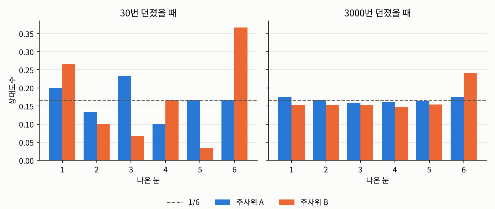

## 들어가며

[장 소개 글](index.qmd)에서 기초 통계학은 "데이터는 우연에 의해 만들어진다"는 전제에서 출발한다고 말씀드렸습니다. 이번 글에서는 이 전제가 구체적으로 무슨 뜻인지 풀어 보겠습니다.

먼저 같은 실험을 해도 데이터가 매번 달라지는 모습을 직접 확인하고, 그런 우연이 데이터에 끼어드는 이유들을 살펴봅니다. 그다음 이 상황을 말로 정확하게 적기 위한 기본 언어인 **데이터 생성 과정**, **확률변수**, **실현값**을 소개하고, 마지막으로 규칙이 어떻게 데이터 속에서 모습을 드러내는지 시뮬레이션으로 확인하겠습니다.

## 같은 주사위, 다른 결과

박종우가 평범한 주사위 하나를 10번 던져서 나온 눈을 적었습니다. 잠시 쉬었다가, 같은 주사위를 같은 방식으로 다시 10번 던졌습니다. 컴퓨터로 이 상황을 흉내 내 보겠습니다.

```python
import numpy as np

rng = np.random.default_rng(1557)
faces = np.arange(1, 7)

# 박종우가 같은 주사위를 10번씩 두 번 던짐
first = rng.choice(faces, size=10)
second = rng.choice(faces, size=10)
print("첫 번째 10번:", first)
print("두 번째 10번:", second)
```

```
첫 번째 10번: [3 6 2 6 5 5 3 5 5 3]
두 번째 10번: [3 4 2 4 2 2 5 1 5 3]
```

주사위도, 던진 사람도, 던진 횟수도 같은데 두 데이터는 꽤 다릅니다. 첫 번째에는 5가 네 번이나 나왔고 1과 4는 한 번도 나오지 않았습니다. 두 번째에는 2가 세 번 나왔고 6은 한 번도 나오지 않았습니다.

당연한 이야기처럼 들리지만, 이 단순한 관찰이 통계학 전체의 출발점입니다. 만약 박종우가 첫 번째 데이터만 보고 "이 주사위는 5가 잘 나오는 주사위다"라고 결론을 내린다면 어떨까요? 두 번째 데이터를 본 사람은 "아니다, 2가 잘 나온다"고 할 것입니다. 둘 다 같은 주사위를 보고 한 말입니다.

데이터가 우연에 의해 만들어진다는 것은 바로 이런 뜻입니다. 눈앞의 데이터는 **유일한 정답이 아니라, 나올 수 있었던 여러 결과 중 하나**입니다. 그래서 데이터 하나만 보고 바로 결론을 내리면, 우연이 만든 무늬를 규칙으로 착각하기 쉽습니다.

## 데이터에 우연이 끼어드는 이유

주사위는 우연이 끼어든다는 것이 너무 분명한 예라서, 다른 데이터는 사정이 다를 거라고 생각하실 수도 있습니다. 하지만 우리가 다루는 거의 모든 데이터에는 어떤 형태로든 우연이 섞여 있습니다. 대표적인 경우를 몇 가지 들어 보겠습니다.

- **누가 뽑혔는가.** 여론조사에서 1000명을 골라 물어봤다면, 그 결과는 하필 그 1000명이 뽑혔기 때문에 나온 결과입니다. 다른 1000명이 뽑혔다면 지지율은 조금 달랐을 것입니다.
- **측정할 때마다 생기는 오차.** 같은 사람의 키를 아침저녁으로, 혹은 다른 사람이 재면 몇 밀리미터씩 차이가 납니다. 체중계, 온도계, 실험 장비도 마찬가지입니다.
- **너무 복잡해서 다 알 수 없는 원인.** 동전 던지기는 사실 물리 법칙을 따르는 운동이라서, 던지는 순간의 힘과 회전을 완벽하게 안다면 결과를 계산할 수 있습니다. 실제로 사람이 던진 동전도 던지기 전에 위를 향하던 면이 조금 더 자주 나온다는 연구도 있습니다.[^coin] 하지만 그 모든 조건을 매번 알 수는 없으니, 우리는 결과를 사실상 우연으로 다룹니다. 내일 어떤 손님이 가게에 올지, 어떤 환자가 약에 잘 반응할지도 비슷합니다.
- **본래부터 우연인 현상.** 방사성 원자가 언제 붕괴할지처럼, 현재의 물리학이 본질적으로 확률적이라고 설명하는 현상도 있습니다.

이유가 무엇이든 통계학의 입장은 같습니다. 원인을 하나하나 다 추적할 수 없다면, 그 결과를 **확률적인 규칙을 따르는 우연**으로 보고 다루자는 것입니다.

## 데이터 생성 과정

이제 이 상황을 조금 더 정확한 말로 적어 보겠습니다.

::: {.callout-note icon=false .callout-definition}
### 정의 1.1.1 (데이터 생성 과정)
관찰하기 전에는 결과를 확실히 알 수 없지만, 어떤 결과가 얼마나 잘 나오는지는 정해져 있는 과정을 **확률 실험**(random experiment)이라고 합니다. 우리가 보는 데이터를 만들어 낸 확률 실험과 그 안의 확률적인 규칙을 통틀어 **데이터 생성 과정**(data generating process)이라고 부릅니다.
:::

주사위의 경우 확률 실험은 "주사위를 한 번 던지는 것"이고, 확률적인 규칙은 "각 눈이 $1/6$의 확률로 나온다"는 것입니다. 여론조사의 경우 확률 실험은 "유권자 중 한 명을 무작위로 골라 지지 후보를 묻는 것"이고, 규칙은 "전체 유권자 중 A 후보 지지자의 비율"이 정합니다.

중요한 것은 **규칙은 정해져 있지만, 우리는 그 규칙을 모른다**는 점입니다. 주사위가 공정한지, A 후보의 실제 지지율이 몇 퍼센트인지는 데이터를 보기 전에는 알 수 없습니다. 우리가 볼 수 있는 것은 그 규칙이 한 번 작동해서 남긴 결과, 즉 데이터뿐입니다.

이제 실험 결과를 숫자로 다루기 위한 도구가 하나 필요합니다.

::: {.callout-note icon=false .callout-definition}
### 정의 1.1.2 (확률변수와 실현값)
확률 실험의 각 결과에 하나의 수를 대응시킨 것을 **확률변수**(random variable)라고 하고, 보통 $X$, $Y$처럼 대문자로 씁니다. 실험을 실제로 한 번 해서 확률변수가 갖게 된 구체적인 값을 그 확률변수의 **실현값**(realisation)이라고 하고, $x$, $y$처럼 소문자로 씁니다.
:::

주사위를 던져 나올 눈을 $X$라고 하면, $X$는 던지기 전에는 $1$부터 $6$ 중 어떤 값이 될지 모르는 양입니다. 실제로 던져서 3이 나왔다면 $x = 3$이 $X$의 실현값입니다. 이때 "$X$가 3이 될 확률"을 다음과 같이 씁니다.

$$\mathbb{P}(X = 3) = \frac{1}{6}$$

데이터가 여러 개라면 확률변수도 여러 개를 생각합니다. 박종우의 첫 번째 데이터는 확률변수 $X_1, \dots, X_{10}$의 실현값

$$x_1 = 3,\; x_2 = 6,\; x_3 = 2,\; \dots,\; x_{10} = 3$$

이고, 두 번째 데이터는 **같은 규칙을 따르는** 확률변수들이 다시 한번 실현된 다른 결과입니다.

정리하면, 통계학에서 데이터 $x_1, \dots, x_n$은 확률변수 $X_1, \dots, X_n$의 실현값으로 봅니다. 앞으로 이 과목에서는 이미 손에 들어온 데이터를 소문자로, 그 데이터를 만들어 낸 확률변수를 대문자로 쓰겠습니다. 다만 "아직 수집하지 않은 데이터가 이렇게 나올 확률은 얼마인가"처럼 두 관점을 오가며 이야기해야 할 때도 있어서, 문맥에 따라 둘이 조금 섞여 쓰일 수 있다는 점은 미리 말씀드립니다.

확률변수를 측도론의 언어로 엄밀하게 정의하는 방법은 [측도론적 확률론](../../measure-prob/index.qmd)에서 다룹니다. 이 과목에서는 "실험 결과를 수로 바꾼 것"이라는 직관이면 충분합니다.

## 규칙은 데이터가 쌓일 때 드러납니다

데이터가 매번 달라진다면, 데이터로 규칙을 알아내는 것은 애초에 불가능한 일일까요? 다행히 그렇지 않습니다. 장 소개 글에서 본 그랜트의 사망표처럼, 데이터를 많이 모으면 우연이 만든 무늬는 서로 상쇄되고 규칙이 모습을 드러냅니다.

이번에는 겉보기에 똑같은 주사위 두 개, A와 B가 있다고 해 보겠습니다. 사실 A는 공정한 주사위이고, B는 6이 나올 확률이 $0.25$, 나머지 눈이 나올 확률이 각각 $0.15$인 조작된 주사위입니다. 물론 우리는 이 사실을 모르고, 던져 본 결과만 볼 수 있습니다. 각 주사위를 30번씩, 그리고 3000번씩 던져서 각 눈이 나온 비율(상대도수)을 비교해 보겠습니다.

```python
import numpy as np

rng = np.random.default_rng(1557)
faces = np.arange(1, 7)
p_A = np.full(6, 1/6)                                   # 주사위 A
p_B = np.array([0.15, 0.15, 0.15, 0.15, 0.15, 0.25])    # 주사위 B

for n in [30, 3000]:
    a = rng.choice(faces, size=n, p=p_A)
    b = rng.choice(faces, size=n, p=p_B)
    fa = np.array([(a == k).mean() for k in faces])
    fb = np.array([(b == k).mean() for k in faces])
    print(f"n = {n}")
    print("  주사위 A:", np.round(fa, 3))
    print("  주사위 B:", np.round(fb, 3))
```

```
n = 30
  주사위 A: [0.2   0.133 0.233 0.1   0.167 0.167]
  주사위 B: [0.267 0.1   0.067 0.167 0.033 0.367]
n = 3000
  주사위 A: [0.175 0.167 0.16  0.16  0.164 0.174]
  주사위 B: [0.153 0.153 0.152 0.147 0.154 0.241]
```

{fig-alt="주사위 A(파랑)와 B(주황)를 30번, 3000번 던졌을 때 각 눈의 상대도수를 나란히 그린 막대그래프. 30번일 때는 두 주사위 모두 막대 높이가 들쭉날쭉해서, 주사위 B의 6이 0.367로 가장 높지만 공정한 주사위 A의 3도 0.233으로 튀어 있다. 3000번일 때는 주사위 A의 막대가 모두 1/6을 나타내는 회색 점선 근처에 모이고, 주사위 B는 6만 0.241로 높고 나머지는 0.15 근처에 모인다." width=90%}

30번 던졌을 때를 먼저 보겠습니다. 주사위 B에서 6이 $0.367$로 가장 많이 나왔으니 B가 수상해 보입니다. 하지만 공정한 주사위 A에서도 3이 $0.233$, 1이 $0.2$로 꽤 튀었고, 반대로 B에서는 5가 $0.033$, 즉 30번 중 단 한 번밖에 나오지 않았습니다. 이 정도의 들쭉날쭉함 속에서는 B의 6이 정말로 잘 나오는 것인지, 그냥 이번에 우연히 많이 나온 것인지 자신 있게 말하기 어렵습니다.

3000번 던졌을 때는 그림이 완전히 달라집니다. 주사위 A의 상대도수는 모두 $0.16$에서 $0.175$ 사이, 즉 $1/6 \approx 0.167$ 근처에 모였습니다. 주사위 B는 6만 $0.241$로 뚜렷하게 높고, 나머지 눈은 모두 $0.15$ 근처입니다. 우리가 미리 정해 둔 실제 규칙과 거의 같은 모습입니다.

이 실험에서 두 가지를 읽을 수 있습니다.

1. **데이터가 적을 때는 우연이 규칙을 가립니다.** 30번의 결과만으로는 진짜 규칙과 우연이 만든 무늬를 구분하기 어렵습니다.
2. **데이터가 많아지면 상대도수가 규칙, 즉 확률에 다가갑니다.** 그래서 데이터로 데이터 생성 과정을 짐작하는 일이 가능해집니다.

두 번째 사실은 확률론에서 **큰 수의 법칙**(law of large numbers)이라는 정리로 정확하게 표현되며, 이 과목에서는 5장에서 다시 만나게 됩니다. 그리고 첫 번째 사실, 즉 "데이터가 유한할 때 우리가 얼마나 확신할 수 있는가"를 따지는 것이 바로 추론 통계의 몫입니다. 예를 들어 30번만 던진 데이터를 보고 "B는 6이 잘 나오는 주사위다"라고 말해도 될지, 말한다면 얼마나 자신 있게 말할 수 있을지는 8장의 가설 검정에서 다룰 질문입니다.

## 정리

이번 글에서는 통계학의 출발점이 되는 관점을 정리했습니다.

- 같은 실험을 반복해도 데이터는 매번 다르게 나옵니다. 데이터는 유일한 정답이 아니라 나올 수 있었던 여러 결과 중 하나입니다.
- 데이터를 만들어 낸 확률 실험과 그 규칙을 **데이터 생성 과정**이라고 합니다. 규칙은 정해져 있지만 우리는 그것을 모릅니다.
- 데이터 $x_1, \dots, x_n$은 확률변수 $X_1, \dots, X_n$의 **실현값**으로 봅니다.
- 데이터가 적으면 우연이 규칙을 가리지만, 데이터가 쌓이면 상대도수가 확률에 다가가면서 규칙이 드러납니다.

그런데 지금까지는 주사위처럼 규칙이 "각 눈이 나올 확률" 여섯 개로 깔끔하게 정해지는 경우만 보았습니다. 사람들의 소득이나 키처럼 우리가 실제로 궁금해하는 대상에서는 "규칙"이 무엇일까요? 그리고 그 규칙을 수학적으로 어떻게 적을 수 있을까요? 다음 글에서는 모집단과 표본이라는 익숙한 개념을 출발점으로 이 질문에 답해 보겠습니다.

---

### 연결되는 개념
* $\leftarrow$ **이전 개념:** [1 통계란 무엇인가](index.qmd)
* $\rightarrow$ **다음 개념:** [1.2 모집단, 표본, 확률 모형](02-population-sample-model.qmd)

[^coin]: P. Diaconis, S. Holmes & R. Montgomery, "Dynamical Bias in the Coin Toss", *SIAM Review* 49(2), 2007, pp. 211–235.
