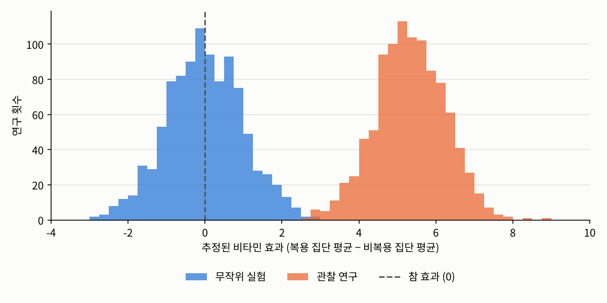

## 들어가며

[지난 글](02-population-sample-model.qmd)에서는 표본 $X_1, \dots, X_n$이 모집단에서 무작위로 뽑힌 i.i.d. 표본이라고 가정하고, 모집단을 하나의 확률분포로 보았습니다. 이 가정 덕분에 표본으로 모집단을 이야기할 수 있게 되었습니다.

그런데 이 가정은 공짜가 아닙니다. 데이터가 **실제로 그렇게 모였을 때에만** 성립합니다. 이번 글에서는 데이터가 모이는 과정을 살펴보겠습니다. 먼저 역사상 가장 유명한 여론조사 실패 사례로 표본을 뽑는 방법과 편향을 살펴보고, 그다음 데이터를 "지켜봐서" 얻는 경우와 "개입해서" 얻는 경우가 어떻게 다른지, 그 차이가 왜 중요한지를 시뮬레이션으로 확인하겠습니다.

## 240만 명에게 물어본 여론조사

1936년 미국 대통령 선거를 앞두고, 당시 인기 있던 잡지 『리터러리 다이제스트』(The Literary Digest)는 엄청난 규모의 여론조사를 벌였습니다. 전화번호부, 자동차 등록 명부, 잡지 구독자 명단 등에서 모은 약 1000만 명에게 모의 투표 엽서를 보냈고, 그중 약 240만 장이 돌아왔습니다.[^lohr] 지금 기준으로도 어마어마한 표본 크기입니다.

엽서를 집계한 결과는 공화당 후보 앨프 랜던(Alf Landon)이 약 55%, 현직 대통령 프랭클린 루스벨트(Franklin D. Roosevelt)가 약 41%였습니다. 잡지는 랜던의 승리를 예측했습니다.

실제 선거 결과는 정반대였습니다. 루스벨트가 약 61%를 얻어 압승했고, 랜던은 48개 주 가운데 단 두 개 주에서만 이겼습니다. 240만 명에게 물어보고도 승자조차 맞히지 못한 것입니다.

무엇이 잘못되었을까요? 이후의 분석들은 크게 두 가지를 지적합니다.[^squire]

- **누구에게 물었는가.** 1936년은 대공황 한복판이었습니다. 전화와 자동차를 가진 사람, 잡지를 구독하는 사람은 평균보다 형편이 나은 사람들이었고, 이들은 상대적으로 랜던을 더 지지했을 가능성이 높습니다. 즉 처음부터 엽서를 받을 사람의 명단이 전체 유권자를 대표하지 못했습니다.
- **누가 대답했는가.** 1000만 명 중 대답한 사람은 4분의 1이 안 됩니다. 일부러 엽서를 써서 돌려보낸 사람들은 그렇지 않은 사람들과 성향이 달랐을 수 있고, 특히 현 정부에 불만이 큰 사람들이 더 적극적으로 응답했을 가능성이 지적됩니다.

이 사례가 주는 교훈은 분명합니다. **표본이 크다고 좋은 표본이 되는 것은 아닙니다.** 엉뚱한 곳에서 뽑은 240만 명은 잘 뽑은 수천 명보다 못할 수 있습니다. 데이터를 아무리 많이 모아도, 모으는 방식이 한쪽으로 치우쳐 있으면 결과는 그 치우친 쪽으로 더 확실하게 굳어질 뿐입니다.

## 무작위 추출

그렇다면 "잘 뽑는다"는 것은 무엇일까요? 지난 글에서 본 것처럼, 핵심은 모집단의 모든 구성원이 **똑같은 기회**로 뽑히게 만드는 것입니다.

::: {.callout-note icon=false .callout-definition}
### 정의 1.3.1 (단순 무작위 추출)
크기 $N$인 모집단에서 $n$명을 뽑을 때, 가능한 모든 $n$명의 조합이 뽑힐 확률이 같도록 뽑는 방법을 **단순 무작위 추출**(simple random sampling)이라고 합니다. 이때 뽑을 대상을 고르는 명단을 **표본 추출 틀**(sampling frame)이라고 합니다.
:::

단순 무작위 추출에서는 누가 뽑힐지를 조사하는 사람이 정하지도, 응답자가 스스로 정하지도 않고 오직 우연이 정합니다. 이렇게 하면 표본이 우연히 한쪽으로 쏠릴 수는 있어도, **체계적으로** 한쪽으로 쏠리지는 않습니다. 그리고 우연히 쏠리는 정도가 얼마나 되는지는 확률로 계산할 수 있습니다. 바로 이것이 추론 통계가 작동하는 바탕입니다. 지난 글에서 본 것처럼, 모집단이 표본보다 충분히 크면 단순 무작위 추출로 얻은 표본은 i.i.d. 표본으로 볼 수 있습니다.

다이제스트의 문제를 이 정의로 다시 보면, 표본 추출 틀 자체가 모집단과 달랐고(전화·자동차 소유자 명단), 그 틀 안에서도 실제로 표본에 들어간 사람은 우연이 아니라 응답자 스스로가 정했습니다.

실제 조사에서는 단순 무작위 추출을 조금 변형해서 쓰기도 합니다. 예를 들어 모집단을 지역이나 연령대별로 먼저 나눈 뒤, 각 집단에서 그 비율만큼 무작위로 뽑는 **층화 추출**(stratified sampling)이 대표적입니다. 이런 방법들을 체계적으로 다루는 분야를 **표본 추출 이론**(sampling theory)이라고 합니다. 이 과목에서는 깊이 들어가지 않고, 표본이 무작위로 잘 뽑혔다고 가정하고 진행하겠습니다.

## 편향의 여러 얼굴

::: {.callout-note icon=false .callout-definition}
### 정의 1.3.2 (편향된 표본)
데이터를 모으는 과정 때문에 표본이 모집단을 체계적으로 잘못 대표할 때, 그 표본이 **편향되었다**(biased)고 합니다.
:::

"우연히" 잘못 대표하는 것과 "체계적으로" 잘못 대표하는 것의 차이가 중요합니다. 무작위로 뽑은 표본도 운이 나쁘면 모집단과 조금 다를 수 있지만, 같은 방법으로 다시 뽑으면 다른 방향으로 어긋나고, 평균적으로는 모집단에 맞춰집니다. 편향된 표본은 몇 번을 다시 뽑아도 **같은 방향으로** 어긋납니다.

편향은 여러 모습으로 나타납니다. 자주 만나는 것들을 정리해 보겠습니다.

- **선택 편향**(selection bias): 표본 추출 틀이나 뽑는 방식 때문에 특정 집단이 더 많이 혹은 더 적게 뽑히는 경우입니다. 다이제스트의 전화·자동차 명단이 대표적입니다.
- **무응답 편향**(nonresponse bias): 뽑힌 사람 중 응답하는 사람과 응답하지 않는 사람의 성향이 다른 경우입니다. 다이제스트에서 엽서를 돌려보낸 4분의 1이 여기에 해당합니다.
- **자발적 응답 편향**(voluntary response bias): 응답자가 스스로 참여를 결정하는 경우입니다. 인터넷 투표나 상품 후기에는 강한 의견을 가진 사람이 훨씬 더 많이 참여합니다.
- **생존자 편향**(survivorship bias): 어떤 과정을 "살아남은" 대상만 관찰하게 되는 경우입니다. 제2차 세계대전 당시 통계학자 에이브러햄 왈드(Abraham Wald)가 돌아온 폭격기의 피탄 자료를 분석할 때, 정말 위험한 부위는 돌아온 비행기에서 총알 자국이 **없는** 부위일 수 있다는 점, 그 부위에 맞은 비행기는 돌아오지 못했을 것이라는 점을 고려한 일화가 유명합니다.[^wald]

이 편향들의 공통점은 **데이터만 들여다봐서는 잘 보이지 않는다**는 것입니다. 데이터는 자신이 어떻게 모였는지 말해 주지 않습니다. 그래서 통계 분석은 항상 "이 데이터가 어디서, 어떻게 왔는가"를 묻는 데서 시작해야 합니다.

## 관찰 연구와 실험

지금까지는 "모집단의 지지율이 얼마인가"처럼 모집단의 상태를 알고 싶은 경우를 이야기했습니다. 그런데 통계가 답하려는 질문 중에는 "이 약이 효과가 있는가?", "비타민을 먹으면 더 건강해지는가?"처럼 **원인과 결과**를 묻는 질문도 많습니다. 이런 질문에서는 데이터를 모으는 방식이 훨씬 더 중요해집니다.

::: {.callout-note icon=false .callout-definition}
### 정의 1.3.3 (관찰 연구와 실험)
연구자가 대상에 아무것도 개입하지 않고 있는 그대로를 기록해서 데이터를 얻는 연구를 **관찰 연구**(observational study)라고 합니다. 반면 연구자가 대상에게 어떤 처치(treatment)를 줄지를 직접 정하고 그 결과를 기록하는 연구를 **실험**(experiment)이라고 합니다.
:::

비타민 예로 생각해 보겠습니다. 사람들에게 평소 비타민을 먹는지 묻고 건강 상태를 조사하는 것은 관찰 연구입니다. 반면 연구자가 참가자를 두 집단으로 나누어 한쪽에는 비타민을, 다른 쪽에는 겉보기에 똑같은 가짜 약을 주고 일정 기간 뒤 건강 상태를 비교하는 것은 실험입니다.

관찰 연구가 훨씬 쉽고 값싸게 데이터를 얻을 수 있습니다. 그런데 원인과 결과를 알고 싶을 때는 관찰 연구에 함정이 있습니다.

## 교란 변수: 함께 움직이는 숨은 원인

관찰 연구에서 비타민을 먹는 사람들이 먹지 않는 사람들보다 더 건강하게 나왔다고 해 보겠습니다. 비타민이 효과가 있다는 뜻일까요?

꼭 그렇지는 않습니다. 비타민을 스스로 챙겨 먹는 사람들은 애초에 건강에 관심이 많은 사람들일 가능성이 높습니다. 그런 사람들은 운동도 더 하고, 식단도 더 신경 쓰고, 담배도 덜 피울 것입니다. 그렇다면 두 집단의 건강 차이는 비타민 때문이 아니라 **건강에 대한 관심** 때문일 수 있습니다. 건강에 대한 관심이 비타민 복용과 건강 상태 **둘 다**에 영향을 주고 있는 것이지요.

::: {.callout-note icon=false .callout-definition}
### 정의 1.3.4 (교란 변수)
우리가 원인이라고 생각하는 변수와 결과 변수 모두에 영향을 주어서, 둘 사이의 관계를 실제와 다르게 보이게 만드는 제3의 변수를 **교란 변수**(confounding variable)라고 합니다.
:::

교란 변수가 얼마나 결과를 왜곡할 수 있는지 시뮬레이션으로 확인해 보겠습니다. 가상의 세계에서 사람마다 "건강에 대한 관심"이 있고, 이 관심이 클수록 건강 점수가 높다고 하겠습니다. 그리고 **비타민은 건강 점수에 아무 효과가 없다**고 정해 두겠습니다. 즉 참 효과는 정확히 0입니다.

이 세계에서 200명을 대상으로 두 가지 방식의 연구를 해 보겠습니다.

- **관찰 연구:** 사람들이 스스로 비타민 복용 여부를 정합니다. 건강에 관심이 많을수록 비타민을 먹을 가능성이 높습니다.
- **무작위 실험:** 연구자가 동전을 던져 비타민을 줄 사람을 정합니다.

두 경우 모두 "비타민을 먹은 집단의 평균 건강 점수 − 먹지 않은 집단의 평균 건강 점수"를 비타민의 효과로 추정합니다.

```python
import numpy as np

rng = np.random.default_rng(1557)

def one_study(n, randomized):
    h = rng.normal(0, 1, size=n)                  # 건강에 대한 관심 (관찰되지 않음)
    if randomized:
        v = rng.random(n) < 0.5                   # 동전을 던져 복용 여부 배정
    else:
        v = rng.random(n) < 1 / (1 + np.exp(-1.5 * h))  # 관심이 클수록 스스로 복용
    y = 70 + 5 * h + rng.normal(0, 5, size=n)     # 건강 점수: 비타민 효과는 0
    return y[v].mean() - y[~v].mean()

print(f"관찰 연구 1회 : {one_study(200, randomized=False):+.2f}")
print(f"무작위 실험 1회: {one_study(200, randomized=True):+.2f}")

obs = np.array([one_study(200, False) for _ in range(1000)])
rct = np.array([one_study(200, True) for _ in range(1000)])
print(f"관찰 연구 1000회 평균 : {obs.mean():+.2f}")
print(f"무작위 실험 1000회 평균: {rct.mean():+.2f}")
```

```
관찰 연구 1회 : +3.56
무작위 실험 1회: +0.81
관찰 연구 1000회 평균 : +5.33
무작위 실험 1000회 평균: -0.01
```

코드에서 건강 점수 `y`를 만드는 줄에는 비타민 복용 여부 `v`가 전혀 들어 있지 않습니다. 그런데도 관찰 연구 한 번은 비타민이 건강 점수를 3.56점 올린다는 결과를 내놓았습니다. 무작위 실험 한 번은 0.81점으로, 0은 아니지만 훨씬 가깝습니다.

한 번의 결과만으로는 우연일 수도 있으니, 같은 연구를 1000번씩 반복해 보았습니다. 그 결과를 히스토그램으로 그리면 다음과 같습니다.

{fig-alt="같은 연구를 1000번 반복했을 때 추정된 비타민 효과의 분포를 그린 히스토그램. 무작위 실험(파랑)의 추정값은 참 효과 0을 나타내는 회색 점선을 중심으로 대략 -3에서 3 사이에 퍼져 있고, 관찰 연구(주황)의 추정값은 0에서 멀리 떨어진 5 근처를 중심으로 대략 3에서 8 사이에 퍼져 있다. 두 분포는 거의 겹치지 않는다." width=80%}

차이가 분명합니다. 무작위 실험의 추정값은 연구마다 들쭉날쭉하지만 **참값 0을 중심으로** 퍼져 있고, 1000번의 평균은 $-0.01$입니다. 반면 관찰 연구의 추정값은 연구마다 들쭉날쭉할 뿐 아니라 **전체가 통째로 5 근처로 밀려나** 있습니다. 1000번을 반복해도, 표본을 늘려도 이 어긋남은 사라지지 않습니다. 앞에서 본 편향과 같은 모습입니다.

여기서 두 종류의 오차를 구분해 볼 수 있습니다. 무작위 실험의 추정값이 0 주변에서 흔들리는 것은 **우연에 의한 오차**이고, 이것은 표본을 늘리면 줄어들며 얼마나 흔들리는지를 확률로 계산할 수도 있습니다. 관찰 연구의 추정값이 5 근처로 밀려난 것은 **체계적인 오차**, 즉 편향이고, 이것은 데이터를 아무리 많이 모아도 줄어들지 않습니다. 앞으로 이 과목에서 다룰 추론 통계의 도구들은 대부분 첫 번째 오차를 다루는 도구입니다. 두 번째 오차는 데이터를 모으는 단계에서 막아야 합니다.

## 무작위 배정이 하는 일

무작위 실험은 왜 교란 변수의 영향을 받지 않았을까요? 동전을 던져 복용 여부를 정했기 때문에, 건강에 관심이 많은 사람과 적은 사람이 **두 집단에 고르게 섞였기** 때문입니다. 두 집단은 비타민을 먹었느냐 아니냐만 다르고, 나머지 모든 면에서 평균적으로 비슷해집니다. 그러니 두 집단의 차이가 있다면 그것은 비타민 때문이거나 우연 때문이고, 우연의 크기는 확률로 따져 볼 수 있습니다.

무작위 배정의 진짜 힘은 **우리가 모르는 교란 변수까지** 고르게 섞어 준다는 데 있습니다. 위 시뮬레이션에서는 우리가 "건강에 대한 관심"이라는 교란 변수를 알고 있었지만, 현실에서는 어떤 교란 변수가 숨어 있는지 다 알 수 없습니다. 무작위 배정은 그런 것까지 한꺼번에 처리해 줍니다.

실험을 설계할 때 무작위화가 왜 필요한지를 체계적으로 정리한 사람이 1장 소개 글에서 이름이 나왔던 로널드 피셔입니다. 그는 1935년 『실험 계획법』(The Design of Experiments)에서, 홍차에 우유를 먼저 넣었는지 나중에 넣었는지 맛으로 구별할 수 있다고 주장한 한 여성의 이야기를 예로 들어 실험을 어떻게 설계하고 결과를 어떻게 판단해야 하는지를 설명했습니다.[^fisher] 이 "홍차 맛보기" 이야기는 8장 가설 검정에서 다시 만나게 됩니다.

## 실험을 할 수 없을 때

그렇다면 원인을 알고 싶을 때는 늘 무작위 실험을 하면 될까요? 안타깝게도 그럴 수 없는 경우가 많습니다. 흡연이 폐암을 일으키는지 알고 싶다고 해서, 사람들을 무작위로 나누어 한쪽에 수십 년간 담배를 피우게 할 수는 없습니다. 실험이 윤리적으로 불가능하거나, 너무 비싸거나, 현실적으로 할 수 없는 경우에는 관찰 연구에 기댈 수밖에 없습니다.

실제로 흡연과 폐암의 관계는 1950년대 영국의 리처드 돌(Richard Doll)과 브래드퍼드 힐(Austin Bradford Hill) 등이 수행한 관찰 연구들로부터 밝혀지기 시작했습니다.[^doll] 이런 연구들은 교란 변수의 가능성을 하나씩 따져 보고, 여러 연구에서 같은 결과가 반복되는지 확인하는 등의 방식으로 관찰 연구의 약점을 보완했습니다.

관찰 데이터로부터 원인과 결과를 이끌어 내는 방법을 체계적으로 연구하는 분야를 **인과 추론**(causal inference)이라고 합니다. 이 과목에서는 깊이 들어가지 않지만, 4장에서 상관관계와 인과관계의 차이, 그리고 교란 변수가 만드는 대표적인 착시인 심슨의 역설을 다시 살펴보겠습니다.

## 정리

이번 글에서는 데이터가 모이는 과정을 살펴보았습니다.

- 표본이 크다고 좋은 표본은 아닙니다. 240만 명의 응답도 모으는 방식이 치우치면 틀린 결론을 냅니다.
- **단순 무작위 추출**은 우연이 표본을 정하게 해서 체계적인 쏠림을 막습니다. 이것이 i.i.d. 가정의 바탕입니다.
- 데이터를 모으는 과정 때문에 표본이 체계적으로 어긋나는 것을 **편향**이라고 하며, 선택 편향, 무응답 편향, 자발적 응답 편향, 생존자 편향 등이 있습니다.
- 원인과 결과를 알고 싶을 때, **관찰 연구**는 **교란 변수** 때문에 잘못된 결론을 낼 수 있습니다. **무작위 배정**을 하는 실험은 알려지지 않은 교란 변수까지 고르게 섞어 줍니다.
- 우연에 의한 오차는 데이터를 늘리면 줄어들고 확률로 다룰 수 있지만, 편향은 데이터를 늘려도 사라지지 않습니다.

이제 데이터를 어떻게 바라보고, 데이터가 어디서 오는지까지 정리했습니다. 남은 질문은 "그 데이터로 무엇을 할 것인가"입니다. 다음 글에서는 통계학이 데이터를 가지고 하는 일을 기술 통계와 추론 통계로 나누어 정리하고, 이 과목 전체의 지도를 그려 보겠습니다.

---

### 연결되는 개념
* $\leftarrow$ **이전 개념:** [1.2 모집단, 표본, 확률 모형](02-population-sample-model.qmd)
* $\rightarrow$ **다음 개념:** [1.4 기술 통계와 추론 통계](04-descriptive-and-inferential.qmd)

[^lohr]: S. L. Lohr & J. M. Brick, "Roosevelt Predicted to Win: Revisiting the 1936 Literary Digest Poll", *Statistics, Politics and Policy* 8(1), 2017, pp. 65–84.

[^squire]: P. Squire, "Why the 1936 Literary Digest Poll Failed", *Public Opinion Quarterly* 52(1), 1988, pp. 125–133. 표본 추출 틀과 무응답 중 무엇이 더 큰 원인이었는지에 대해서는 이후에도 논의가 이어졌습니다. D. Lusinchi, "'President' Landon and the 1936 Literary Digest Poll: Were Automobile and Telephone Owners to Blame?", *Social Science History* 36(1), 2012.

[^wald]: 왈드의 실제 분석 내용과 이 일화의 관계에 대해서는 다음을 참고할 수 있습니다. M. Mangel & F. J. Samaniego, "Abraham Wald's Work on Aircraft Survivability", *Journal of the American Statistical Association* 79(386), 1984, pp. 259–267.

[^fisher]: R. A. Fisher, *The Design of Experiments*, Oliver and Boyd, 1935, 2장.

[^doll]: R. Doll & A. B. Hill, "Smoking and Carcinoma of the Lung: Preliminary Report", *British Medical Journal* 2(4682), 1950, pp. 739–748.
