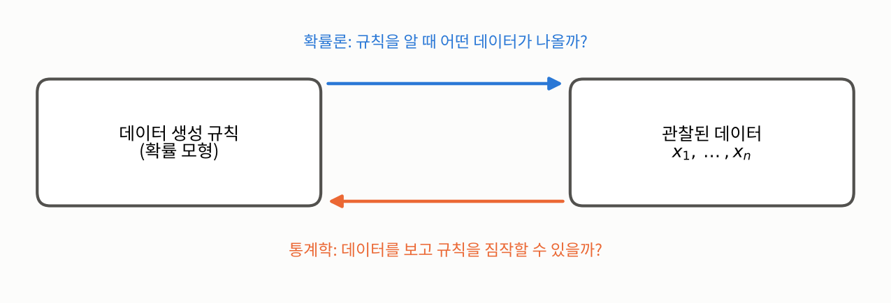

## 들어가며

지금까지 1장에서는 데이터를 확률적인 규칙이 만든 결과로 보고([1.1](01-randomness-and-data.qmd)), 그 규칙을 모집단의 분포와 통계적 모형으로 적었으며([1.2](02-population-sample-model.qmd)), 데이터가 실제로 어떻게 모이고 어디서 어긋날 수 있는지 살펴보았습니다([1.3](03-data-collection.qmd)).

이제 남은 질문은 "그 데이터로 무엇을 하는가"입니다. 이번 글에서는 먼저 확률론과 통계학의 관계를 한 장의 그림으로 정리하고, 통계학이 데이터로 하는 일을 **기술 통계**와 **추론 통계**로 나누어 보겠습니다. 그다음 추론 통계가 다루는 다섯 가지 과제와 두 가지 큰 방법론을 미리 둘러보면서, 이 과목 전체의 지도를 그려 보겠습니다.

## 확률론과 통계학: 같은 다리, 반대 방향

확률론과 통계학은 늘 붙어 다니지만, 묻는 질문의 방향이 서로 반대입니다.

{fig-alt="왼쪽 상자에 '데이터 생성 규칙(확률 모형)', 오른쪽 상자에 '관찰된 데이터 x1, …, xn'이 적혀 있다. 위쪽의 파란 화살표는 왼쪽에서 오른쪽을 향하며 '확률론: 규칙을 알 때 어떤 데이터가 나올까?'라고 적혀 있고, 아래쪽의 주황 화살표는 오른쪽에서 왼쪽을 향하며 '통계학: 데이터를 보고 규칙을 짐작할 수 있을까?'라고 적혀 있다." width=85%}

**확률론**은 규칙에서 출발합니다. "공정한 주사위를 3000번 던지면 6이 몇 번쯤 나올까?", "지지율이 40%인 후보에 대해 1000명에게 물으면 몇 명쯤 지지한다고 답할까?"처럼, 데이터 생성 과정을 **안다고 가정하고** 어떤 데이터가 나올지를 묻습니다.

**통계학**은 데이터에서 출발합니다. "3000번 던졌더니 6이 723번 나왔는데, 이 주사위는 공정한가?", "1000명 중 400명이 지지한다고 했는데, 실제 지지율은 얼마일까?"처럼, 데이터를 **보고** 그것을 만든 규칙을 거꾸로 짐작합니다.

통계학이 확률론을 필요로 하는 이유도 여기에 있습니다. 데이터에서 규칙을 짐작하려면, "만약 규칙이 이렇다면 이런 데이터가 얼마나 잘 나올까?"를 계산할 수 있어야 합니다. 그 계산이 확률론의 몫입니다. 통계학은 확률론이 놓은 다리를 반대 방향으로 건너는 학문이라고 할 수 있습니다.

## 기술 통계와 추론 통계

통계학이 데이터로 하는 일은 크게 두 가지로 나뉩니다.

::: {.callout-note icon=false .callout-definition}
### 정의 1.4.1 (기술 통계와 추론 통계)
손에 쥔 데이터를 표, 그래프, 몇 개의 요약된 숫자로 정리해서 데이터 자체의 특징을 드러내는 일을 **기술 통계**(descriptive statistics)라고 합니다. 데이터를 확률적인 규칙이 만든 결과로 보고, 확률론을 이용해 그 규칙, 즉 모집단에 대한 결론을 그 불확실성과 함께 이끌어 내는 일을 **추론 통계**(inferential statistics)라고 합니다.
:::

예를 들어 김찬호가 자기 반 학생 30명의 수학 점수를 모았다고 해 보겠습니다.

- 30명의 평균이 72점이고, 대부분 60점에서 85점 사이에 몰려 있으며, 90점을 넘은 학생은 두 명뿐이라는 것을 정리하는 것은 **기술 통계**입니다. 이것은 **이 반 30명**에 대한 사실이고, 우연이나 불확실성이 끼어들 자리가 없습니다. 계산만 맞게 하면 됩니다.
- 이 30명이 전국 고등학생 중 무작위로 뽑힌 표본이라고 보고, "전국 고등학생의 평균 점수는 70점에서 74점 사이일 가능성이 높다"고 말하는 것은 **추론 통계**입니다. 이것은 **데이터에 없는 대상**에 대한 이야기이고, 그래서 이 결론이 얼마나 믿을 만한지도 함께 말해야 합니다.

기술 통계는 추론 통계의 첫걸음이기도 합니다. 데이터의 모양을 먼저 보지 않고 바로 모형을 세우면, 1.2의 끝에서 말한 것처럼 현실과 동떨어진 모형을 고르기 쉽습니다. 또 기술 통계에서 계산하는 표본 평균, 표본 분산 같은 숫자들은 추론 통계에서 모수를 짐작하는 도구로 그대로 다시 쓰입니다.

## 추론 통계의 다섯 가지 과제

추론 통계가 하는 일은 다시 다섯 가지 과제로 나눌 수 있습니다. 1.2에서처럼 데이터 $x_1, \dots, x_n$이 모수적 모형 $\{P_\vartheta : \vartheta \in \Theta\}$를 따르는 i.i.d. 표본의 실현값이고, 모수 $\vartheta$를 모르는 상황을 생각하겠습니다.

### 1. 점 추정

모수 $\vartheta$의 값으로 가장 그럴듯한 숫자 **하나**를 데이터로부터 정하는 일을 **점 추정**(point estimation)이라고 합니다. 모수 공간 $\Theta$에서 한 점을 고른다는 뜻에서 붙은 이름입니다.

대한민국 국민의 평균 소득을 알고 싶을 때, 표본으로 뽑은 1만 명의 소득을 모두 더해 1만으로 나누는 것이 가장 자연스러운 방법일 겁니다. 이때 "표본의 값을 모두 더해 표본 크기로 나눈다"는 **계산 방법** 자체를 **추정량**(estimator)이라고 하고, 실제 데이터에 그 방법을 적용해서 얻은 **숫자**를 **추정치**(estimate)라고 합니다. 추정량은 데이터를 넣으면 숫자가 나오는 레시피이고, 추정치는 그 레시피로 만든 요리인 셈입니다.

좋은 추정량이라면 다음과 같은 성질을 갖기를 바랄 것입니다.

- 참값 $\vartheta$에 **가까운** 값을 내놓아야 합니다.
- 표본이 바뀔 때마다 결과가 **너무 크게 흔들리지 않아야** 합니다.
- 데이터가 많아질수록 참값에 **점점 더 가까워져야** 합니다.

이 성질들을 어떻게 정확하게 정의하고, 이를 만족하는 추정량을 어떻게 만드는지가 6장의 주제입니다.

### 2. 구간 추정

점 추정치는 사실상 언제나 조금씩 틀립니다. 1만 명의 평균 소득이 5천만 명의 평균 소득과 원 단위까지 정확히 같을 가능성은 거의 없으니까요. 그래서 숫자 하나 대신 **구간**을 내놓되, 그 구간이 참값을 포함할 가능성이 높다는 것을 함께 보장하는 방법이 **구간 추정**(interval estimation)입니다. "평균 소득은 95%의 신뢰도로 3200만 원에서 3400만 원 사이" 같은 표현이 여기에 해당합니다.

좋은 구간 추정이라면 약속한 확률만큼 실제로 참값을 포함해야 하고, 그 약속을 지키는 범위에서 구간이 되도록 좁아야 하며, 데이터가 많아질수록 구간이 짧아져야 합니다. 7장에서 다룹니다.

### 3. 가설 검정

때로는 모수의 값 자체보다 **모수에 대한 특정한 주장이 맞는지**가 더 궁금합니다.

대통령 선거를 예로 들어 보겠습니다. 우리나라 공직선거법에 따르면 후보자가 유효투표의 15% 이상을 얻으면 선거비용 전액을, 10% 이상 15% 미만을 얻으면 절반을 돌려받고, 10%에 못 미치면 돌려받지 못합니다.[^election] 그러니 어떤 후보 진영에게 가장 중요한 질문은 "득표율이 정확히 몇 퍼센트인가"보다 "득표율이 10%를 넘는가"일 수 있습니다.

여론조사에서 이 후보의 지지율이 10.1%로 나왔다고 해 보겠습니다. 그러면 실제 득표율도 10%를 넘는다고 말할 수 있을까요? 1.1에서 본 것처럼 표본에는 늘 우연이 섞여 있으니, 10.1%라는 숫자만으로는 확실히 말할 수 없습니다. 실제 지지율이 9.5%인데 우연히 10.1%가 나왔을 수도 있으니까요. 이렇게 데이터를 근거로 모수에 대한 가설을 받아들일지 기각할지를 판단하는 일을 **가설 검정**(hypothesis testing)이라고 합니다.

가설 검정은 표본만 보고 결정하기 때문에 언제든 틀릴 수 있습니다. 그래서 좋은 검정은 틀릴 가능성을 확률로 통제하고, 데이터가 많아질수록 옳은 결정을 더 자주 내려야 합니다. 8장에서 다룹니다.

### 4. 모델 선택

지금까지는 데이터가 따르는 분포의 모양, 즉 통계적 모형은 이미 정해져 있다고 가정했습니다. 하지만 같은 데이터에도 여러 모형을 생각해 볼 수 있습니다. 소득 데이터에 정규 분포를 쓸지, 오른쪽으로 꼬리가 긴 다른 분포를 쓸지 정해야 하고, 설명 변수를 몇 개나 넣을지도 정해야 합니다. 이렇게 경쟁하는 여러 모형 중 데이터를 가장 잘 설명하는 것을 고르는 일을 **모델 선택**(model choice)이라고 합니다.

### 5. 예측

마지막으로, 모수가 아니라 **아직 관찰되지 않은 새 데이터**를 짐작하는 일이 **예측**(prediction)입니다. 지금까지의 과제들이 데이터를 만든 규칙을 알아내는 데 초점을 맞췄다면, 예측은 그 규칙으로 앞으로 나올 데이터를 내다봅니다. 내일의 판매량, 다음 달의 환자 수 같은 것들입니다. 모델 선택과 예측은 10장에서 다룹니다.

## 두 가지 길: 우도와 베이즈

이 다섯 가지 과제를 푸는 방법은 다양하지만, 그 대부분은 두 가지 큰 원리 중 하나에서 출발합니다. 둘 다 아주 일반적인 원리라서, 우리가 이미 아는 분포뿐 아니라 처음 보는 모형에도 같은 방식으로 적용할 수 있다는 것이 강점입니다.[^held]

**우도 기반 추론**(likelihood-based inference)은 "모수가 $\vartheta$라면 지금 우리가 본 데이터가 나올 확률은 얼마인가?"를 그 모수가 얼마나 그럴듯한지의 척도로 삼습니다. 예를 들어 이산형 데이터라면

$$L(\vartheta) = \mathbb{P}\big(X_1^{(\vartheta)} = x_1, \dots, X_n^{(\vartheta)} = x_n\big)$$

를 모수 $\vartheta$의 함수로 보고, 이를 **우도 함수**(likelihood function)라고 부릅니다. 지금 데이터를 가장 잘 만들어 낼 수 있는 모수를 고르면 점 추정이 되고, 충분히 그럴듯한 모수들을 모으면 구간 추정이 되며, 두 모수의 그럴듯함을 비교하면 가설 검정이 됩니다. 6~8장의 대부분이 이 원리 위에 서 있습니다.

**베이즈 추론**(Bayesian inference)은 모수 자체도 확률로 다룹니다. 데이터를 보기 전에 모수에 대해 가진 믿음을 **사전분포**(prior distribution)라는 확률분포로 적고, 데이터를 본 뒤 베이즈 정리로 이 믿음을 갱신해 **사후분포**(posterior distribution)를 얻습니다. 말로 쓰면 다음과 같습니다.

$$\text{사후분포} \;\propto\; \text{우도} \times \text{사전분포}$$

여기서 $\propto$는 "비례한다"는 뜻입니다. 베이즈 추론에서는 사후분포가 모든 추론의 바탕이 되며, 9장에서 다룹니다.

두 방법은 같은 문제에 다른 철학으로 접근하지만, 서로 경쟁만 하는 관계는 아닙니다. 두 방법 모두 우도를 중심에 두고 있고, 데이터가 많아지면 비슷한 답을 내놓는 경우도 많습니다. 이 과목에서는 둘을 모두 다루면서 각자의 장단점을 비교해 보겠습니다.

## 이 과목의 지도

이제 기초 통계학 전체의 흐름을 정리할 수 있습니다.

- **2~4장, 기술 통계:** 데이터의 종류를 구분하고, 표와 그래프로 분포를 보고(2장), 몇 개의 숫자로 요약하고(3장), 두 변수 사이의 관계를 살펴봅니다(4장).
- **5장, 데이터에서 모형으로:** 기술 통계의 상대도수와 히스토그램이 확률과 분포로 이어지는 과정을 정리하고, 큰 수의 법칙과 중심극한정리, 표집 분포를 통해 추론 통계로 넘어갈 준비를 합니다.
- **6~9장, 추론 통계:** 점 추정(6장), 구간 추정(7장), 가설 검정(8장)을 우도 기반 추론을 중심으로 다루고, 같은 문제를 베이즈 추론으로 다시 봅니다(9장).
- **10장, 모델 선택과 예측:** 여러 모형 중 하나를 고르는 방법과, 새 데이터를 예측하고 그 예측을 평가하는 방법을 다룹니다.

## 정리

이번 글에서는 통계학이 데이터로 하는 일을 정리했습니다.

- **확률론**은 규칙에서 데이터를, **통계학**은 데이터에서 규칙을 향합니다.
- **기술 통계**는 손에 쥔 데이터를 정리하고, **추론 통계**는 데이터를 넘어 모집단에 대한 결론을 불확실성과 함께 이끌어 냅니다.
- 추론 통계의 다섯 가지 과제는 **점 추정, 구간 추정, 가설 검정, 모델 선택, 예측**입니다.
- 이 과제들을 푸는 두 가지 큰 원리는 **우도 기반 추론**과 **베이즈 추론**입니다.

1장에서는 통계학이 무엇을 하는 학문인지, 그리고 데이터를 어떤 눈으로 볼 것인지를 정리했습니다. 다음 장부터는 실제 데이터를 손에 들고 기술 통계를 시작합니다. 그 첫걸음은 데이터에 어떤 종류가 있는지 구분하고, 데이터가 어떻게 퍼져 있는지 그림으로 보는 것입니다.

---

### 연결되는 개념
* $\leftarrow$ **이전 개념:** [1.3 데이터는 어떻게 모이는가](03-data-collection.qmd)
* $\rightarrow$ **다음 개념:** [2 데이터의 종류와 분포 보기](../02-data-and-distributions/index.qmd)

[^election]: 「공직선거법」 제122조의2(선거비용의 보전 등). 당선되거나 선거 도중 사망한 후보자도 전액을 돌려받습니다.

[^held]: 우도 기반 추론과 베이즈 추론을 하나의 흐름으로 함께 다루는 교재로 다음을 참고할 수 있습니다. L. Held & D. Sabanés Bové, *Likelihood and Bayesian Inference: With Applications in Biology and Medicine*, 2nd ed., Springer, 2020.
