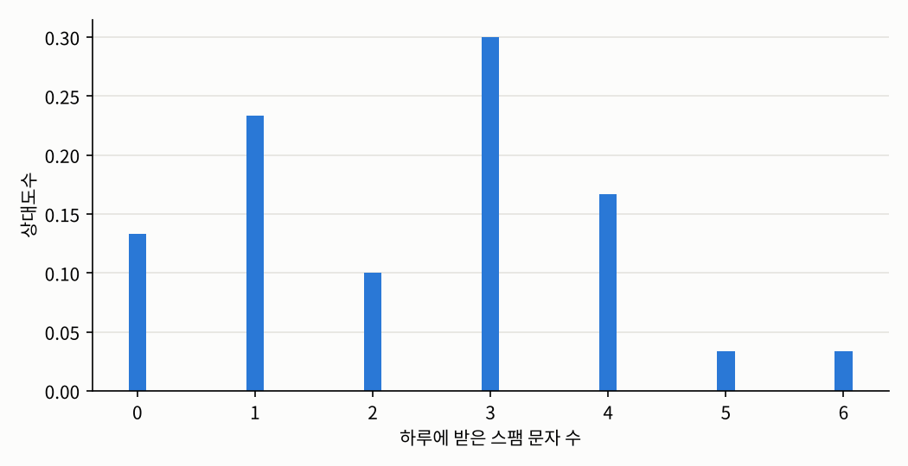
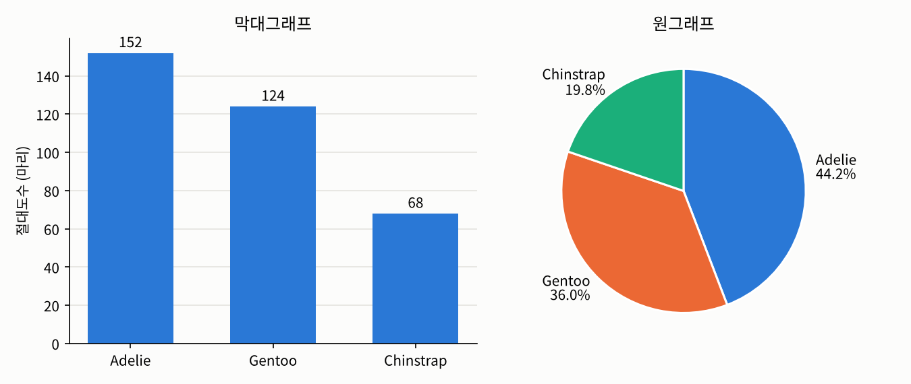
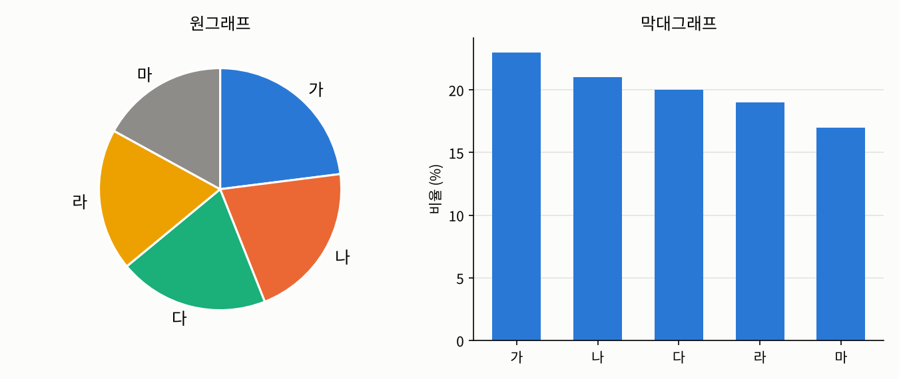

## 들어가며

[지난 글](01-variables-and-scales.qmd)에서는 변수의 종류와 척도를 구분했습니다. 이번 글에서는 어떤 척도의 데이터에든 쓸 수 있는 가장 기본적인 정리 방법, 즉 **각 값이 몇 번 나왔는지 세는 것**을 다룹니다.

세는 것은 너무 쉬워서 따로 배울 것이 없어 보입니다. 하지만 이것을 정확한 기호로 적어 두면, 앞으로 나올 거의 모든 기술 통계 도구와 5장의 확률이 이 정의 위에 서게 됩니다. 먼저 작은 예제로 도수를 정의하고, 그다음 도수분포를 표와 그래프로 나타내는 방법과 그때 주의할 점을 살펴보겠습니다.

## 김찬호의 스팸 문자

김찬호가 30일 동안 하루에 받은 스팸 문자 수를 기록했습니다. 실제 기록 대신 컴퓨터로 만든 가상의 데이터를 쓰겠습니다.

```python
import numpy as np

rng = np.random.default_rng(1557)
spam = rng.poisson(2.5, size=30)          # 김찬호가 30일 동안 하루에 받은 스팸 문자 수
print("데이터:", spam)

values, counts = np.unique(spam, return_counts=True)
print("값      :", values)
print("절대도수:", counts)
print("상대도수:", np.round(counts / spam.size, 3))
print("누적상대도수:", np.round(np.cumsum(counts) / spam.size, 3))
```

```
데이터: [6 1 3 2 1 3 4 0 4 1 1 5 2 0 1 3 0 3 4 4 0 3 3 2 3 1 4 3 3 1]
값      : [0 1 2 3 4 5 6]
절대도수: [4 7 3 9 5 1 1]
상대도수: [0.133 0.233 0.1   0.3   0.167 0.033 0.033]
누적상대도수: [0.133 0.367 0.467 0.767 0.933 0.967 1.   ]
```

(`rng.poisson`은 데이터를 만드는 데만 썼습니다. 이 분포가 무엇인지는 5장에서 다룹니다.)

30개의 숫자를 그대로 보면 잘 들어오지 않지만, 값별로 세어 놓으니 바로 보입니다. 30일 중 3개를 받은 날이 9일로 가장 많고, 하나도 받지 않은 날도 4일 있으며, 5개 이상 받은 날은 이틀뿐입니다. 이 "세기"를 정확히 정의해 보겠습니다.

## 지시함수로 세기

어떤 값이 특정 조건을 만족하는지를 0과 1로 표시하는 함수가 있으면 세는 일을 간단한 덧셈으로 적을 수 있습니다.

::: {.callout-note icon=false .callout-definition}
### 정의 2.2.1 (지시함수)
집합 $\Omega$의 부분집합 $B$에 대해, 함수

$$\mathbf{1}_B : \Omega \to \{0, 1\}, \qquad \mathbf{1}_B(\omega) := \begin{cases} 1 & \omega \in B \\ 0 & \omega \notin B \end{cases}$$

를 $B$의 **지시함수**(indicator function)라고 합니다.
:::

지시함수는 "조건을 만족하면 1점, 아니면 0점"을 매기는 채점표라고 생각하면 됩니다. 그러면 조건을 만족하는 데이터의 개수는 점수를 모두 더한 값입니다. 예를 들어 위 데이터에서 3이 나온 날의 수는 $\sum_{i=1}^{30} \mathbf{1}_{\{3\}}(x_i) = 9$입니다.

::: {.callout-note icon=false .callout-definition}
### 정의 2.2.2 (절대도수와 상대도수)
일변량 데이터 $x = (x_1, \dots, x_n)$에 나타나는 서로 다른 값들을 $a_1, \dots, a_m$ ($m \le n$)이라고 합시다. 각 $j = 1, \dots, m$에 대해

$$h_j = h(a_j) := \sum_{i=1}^{n} \mathbf{1}_{\{a_j\}}(x_i)$$

를 $a_j$의 **절대도수**(absolute frequency),

$$f_j = f(a_j) := \frac{h(a_j)}{n} = \frac{1}{n}\sum_{i=1}^{n} \mathbf{1}_{\{a_j\}}(x_i)$$

를 $a_j$의 **상대도수**(relative frequency)라고 합니다. $h_1, \dots, h_m$과 $f_1, \dots, f_m$을 각각 데이터의 **절대도수분포**와 **상대도수분포**라고 합니다.
:::

데이터에 한 번도 나오지 않은 값 $b$에 대해서도 $h(b) = f(b) := 0$으로 정해 두면 편리합니다. 예를 들어 스팸 문자를 7개 받은 날은 없었으니 $h(7) = 0$입니다.

절대도수는 "몇 번", 상대도수는 "전체 중 몇 퍼센트"입니다. 둘 사이에는 당연해 보이는 관계가 있습니다.

::: {.callout-important icon=false .callout-satz}
### 정리 2.2.3 (도수의 합)
정의 2.2.2의 기호에서 다음이 성립합니다.

$$\sum_{j=1}^{m} h_j = n, \qquad \sum_{j=1}^{m} f_j = 1$$
:::

::: {.callout-tip collapse="true" icon=false .callout-beweis}
### 증명
각 $x_i$는 $a_1, \dots, a_m$ 중 정확히 하나와 같으므로, 고정된 $i$에 대해 $\sum_{j=1}^{m} \mathbf{1}_{\{a_j\}}(x_i) = 1$입니다. 따라서 합의 순서를 바꾸면

$$\sum_{j=1}^{m} h_j = \sum_{j=1}^{m} \sum_{i=1}^{n} \mathbf{1}_{\{a_j\}}(x_i) = \sum_{i=1}^{n} \sum_{j=1}^{m} \mathbf{1}_{\{a_j\}}(x_i) = \sum_{i=1}^{n} 1 = n$$

이고, 양변을 $n$으로 나누면 두 번째 식을 얻습니다. $\square$
:::

모든 날은 어떤 값 하나에 반드시 속하고, 두 값에 동시에 속하지는 않으니 전부 세면 $n$이 된다는 뜻입니다. 상대도수의 합이 1이라는 성질은 5장에서 확률의 합이 1이라는 성질로 그대로 이어집니다. [1.2](../01-what-is-statistics/02-population-sample-model.qmd)에서 모집단의 상대도수가 곧 무작위로 뽑은 한 명의 확률분포였던 것을 떠올려 보면, 상대도수분포는 데이터에 대한 일종의 "확률분포"라고 볼 수 있습니다.

## 도수분포표

도수를 표로 정리한 것을 **도수분포표**(frequency table)라고 합니다. 스팸 데이터의 도수분포표는 다음과 같습니다. 마지막 두 열은 잠시 뒤에 설명하겠습니다.

| 스팸 문자 수 $a_j$ | 0 | 1 | 2 | 3 | 4 | 5 | 6 | 합 |
|:---|:---:|:---:|:---:|:---:|:---:|:---:|:---:|:---:|
| 절대도수 $h_j$ | 4 | 7 | 3 | 9 | 5 | 1 | 1 | 30 |
| 상대도수 $f_j$ | 0.133 | 0.233 | 0.100 | 0.300 | 0.167 | 0.033 | 0.033 | 1 |
| 누적도수 $H_j$ | 4 | 11 | 14 | 23 | 28 | 29 | 30 | |
| 누적상대도수 $F_j$ | 0.133 | 0.367 | 0.467 | 0.767 | 0.933 | 0.967 | 1.000 | |

도수분포표는 데이터가 **몇 가지 안 되는 값**만 가질 때 특히 유용합니다. 값의 종류가 수백 가지라면 표가 원래 데이터만큼 길어져 정리한 의미가 없어집니다. 그런 경우의 처리 방법은 다음 글에서 다룹니다.

## 막대그래프

도수분포를 그림으로 그리는 가장 기본적인 방법은 **막대그래프**(bar chart)입니다. 가로축에 값을, 세로축에 절대도수나 상대도수를 두고 각 값 위에 도수에 비례하는 높이의 막대를 세웁니다. 스팸 데이터처럼 이산형 수치 데이터라면 막대를 가늘게 그려서 값이 띄엄띄엄 떨어져 있다는 것을 드러내기도 합니다.

{fig-alt="가로축은 하루에 받은 스팸 문자 수 0부터 6, 세로축은 상대도수인 막대그래프. 막대 높이는 0이 0.133, 1이 0.233, 2가 0.1, 3이 0.3으로 가장 높고, 4가 0.167, 5와 6이 각각 0.033이다." width=70%}

범주형 데이터도 같은 방식으로 그립니다. 펭귄 데이터의 종별 도수를 세어 보겠습니다.

```python
import seaborn as sns

penguins = sns.load_dataset("penguins")
counts = penguins["species"].value_counts()
print(counts)
print((counts / counts.sum()).round(3))
```

```
species
Adelie       152
Gentoo       124
Chinstrap     68
Name: count, dtype: int64
species
Adelie       0.442
Gentoo       0.360
Chinstrap    0.198
Name: count, dtype: float64
```

{fig-alt="펭귄 종별 도수를 막대그래프와 원그래프로 나란히 그린 그림. 막대그래프에서 Adelie 152, Gentoo 124, Chinstrap 68마리이고, 원그래프에서는 Adelie 44.2%, Gentoo 36.0%, Chinstrap 19.8%이다." width=90%}

범주형 막대그래프에서는 막대를 어떤 순서로 놓을지 정해야 합니다. 명목 척도라면 정해진 순서가 없으니 위 그림처럼 **도수가 큰 순서**로 놓는 것이 읽기 편합니다. 순서 척도라면 "매우 불만, 불만, 보통, 만족, 매우 만족"처럼 **원래 순서**를 지켜야 합니다. 그 순서 자체가 정보이기 때문입니다.

## 원그래프는 왜 자주 비판받을까요?

위 그림의 오른쪽처럼 원을 상대도수에 비례하는 부채꼴로 나눈 것이 **원그래프**(pie chart)입니다. 전체를 100%로 놓고 각 부분이 차지하는 몫을 보여 주기에 직관적이라서, 선거 결과나 예산 구성처럼 "전체 중 얼마"가 중요한 자료에 자주 쓰입니다.

그런데 통계학자들 사이에서 원그래프는 평판이 좋지 않습니다. 다음 그림을 보겠습니다. 다섯 범주의 비율이 23%, 21%, 20%, 19%, 17%인 가상의 데이터입니다.

{fig-alt="비율이 23, 21, 20, 19, 17퍼센트인 다섯 범주 가부터 마를 원그래프와 막대그래프로 나란히 그린 그림. 원그래프에서는 다섯 조각의 크기가 거의 같아 보여 순서를 알기 어렵지만, 막대그래프에서는 가에서 마로 갈수록 막대가 조금씩 낮아지는 것이 분명히 보인다." width=90%}

원그래프만 보고 "나"와 "다" 중 어느 쪽이 큰지, 다섯 조각의 순서가 어떻게 되는지 말하기는 쉽지 않습니다. 같은 데이터를 막대그래프로 그리면 한눈에 보입니다. 사람의 눈은 **같은 기준선에서 시작하는 길이**는 꽤 정확하게 비교하지만, **각도나 넓이**의 차이는 잘 비교하지 못한다는 것이 실험으로 알려져 있습니다.[^cleveland] 막대그래프는 길이로, 원그래프는 각도와 넓이로 정보를 전달하니 비교에서는 막대그래프가 유리할 수밖에 없습니다. 원그래프를 3차원으로 기울여 그리면 앞쪽 조각이 실제보다 커 보이는 왜곡까지 더해집니다.

그래서 원그래프는 범주가 두세 개 정도로 적고, 각 범주가 전체에서 차지하는 몫을 대략 보여 주는 것이 목적일 때에만 쓰는 것이 좋습니다. 범주끼리 크기를 비교하는 것이 목적이라면 막대그래프가 낫습니다.

## 상대도수만 보고할 때의 함정

절대도수와 상대도수 중 무엇을 보여 줄지도 선택해야 합니다. 상대도수는 크기가 다른 데이터끼리 비교할 때 편리합니다. 펭귄 344마리의 종 비율과 다른 지역 펭귄 1000마리의 종 비율을 나란히 놓고 비교할 수 있으니까요.

대신 상대도수만 보여 주면 **데이터가 몇 개였는지**라는 정보가 사라집니다. [과목 소개 글](../index.qmd)의 식당 별점을 떠올려 보면, "만족한 손님 100%"는 다섯 명 중 다섯 명일 수도, 2000명 중 2000명일 수도 있습니다. 같은 100%라도 믿을 만한 정도는 전혀 다릅니다. 그래서 상대도수를 보고할 때는 표본 크기 $n$을 함께 적는 것이 좋습니다. 이 "믿을 만한 정도"를 정확히 따지는 것이 7장의 구간 추정입니다.

## 누적도수

순서 척도 이상의 데이터라면 "몇 이하인 날이 며칠인가"를 물을 수 있습니다. 위 도수분포표의 마지막 두 열이 이 질문에 대한 답입니다.

::: {.callout-note icon=false .callout-definition}
### 정의 2.2.4 (누적도수)
순서 척도 이상인 데이터에서 서로 다른 값을 $a_1 < a_2 < \cdots < a_m$으로 크기순으로 놓을 때,

$$H_j = H(a_j) := \sum_{l=1}^{j} h(a_l), \qquad F_j = F(a_j) := \frac{H(a_j)}{n} = \sum_{l=1}^{j} f(a_l)$$

를 각각 $a_j$의 **누적도수**(cumulative frequency)와 **누적상대도수**(cumulative relative frequency)라고 합니다.
:::

누적도수는 $a_j$ **이하**인 데이터가 몇 개인지를 셉니다. 스팸 데이터에서 $F(3) = 0.767$이므로 "30일 중 76.7%의 날은 스팸 문자를 3개 이하로 받았다"고 말할 수 있고, 거꾸로 "4개 이상 받은 날은 23.3%"라는 것도 바로 알 수 있습니다.

명목 척도에는 누적도수를 쓸 수 없습니다. "Gentoo 이하인 펭귄"이라는 말에는 뜻이 없으니까요. 누적은 **순서가 있어야** 할 수 있는 일입니다.

누적상대도수는 데이터에 나온 값 $a_1, \dots, a_m$에서만 정의했습니다. 그런데 "2.5개 이하"나 "−1개 이하"처럼 아무 실수 $t$에 대해서도 "$t$ 이하인 데이터의 비율"을 물을 수 있습니다. 이렇게 누적상대도수를 실수 전체로 넓힌 것이 2.4에서 다룰 **경험적 분포함수**입니다.

## 정리

이번 글에서는 데이터를 세어서 분포를 보는 방법을 다루었습니다.

- **지시함수**를 이용해 각 값의 **절대도수**와 **상대도수**를 정의했습니다. 절대도수의 합은 $n$, 상대도수의 합은 1입니다.
- 도수를 표로 정리한 것이 **도수분포표**, 그림으로 나타낸 것이 **막대그래프**입니다. 명목 척도는 도수순으로, 순서 척도는 원래 순서대로 막대를 놓습니다.
- **원그래프**는 각도와 넓이로 정보를 전달해 범주 간 비교에 약하므로, 비교가 목적이라면 막대그래프가 낫습니다.
- 상대도수만 보고하면 표본 크기 정보가 사라지므로 $n$을 함께 적는 것이 좋습니다.
- 순서 척도 이상의 데이터에서는 **누적도수**로 "몇 이하"의 비율을 볼 수 있습니다.

그런데 도수분포표와 막대그래프는 값의 종류가 적을 때만 잘 작동합니다. 펭귄의 몸무게처럼 거의 모든 값이 서로 다른 연속형 데이터는 어떻게 세어야 할까요? 다음 글에서는 값을 구간으로 묶어 세는 **히스토그램**을 다루겠습니다.

---

### 연결되는 개념
* $\leftarrow$ **이전 개념:** [2.1 변수와 척도](01-variables-and-scales.qmd)
* $\rightarrow$ **다음 개념:** [2.3 히스토그램과 분포의 모양](03-histograms.qmd)

[^cleveland]: W. S. Cleveland & R. McGill, "Graphical Perception: Theory, Experimentation, and Application to the Development of Graphical Methods", *Journal of the American Statistical Association* 79(387), 1984, pp. 531–554.
