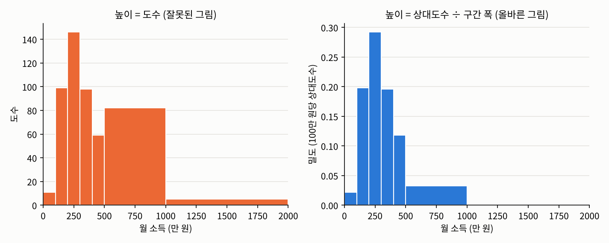
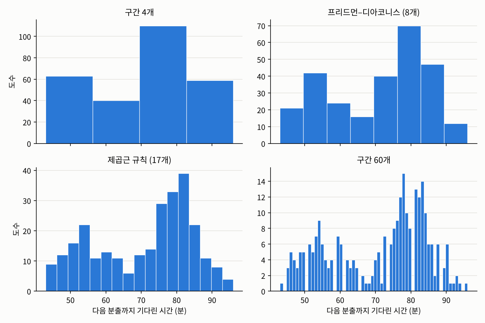
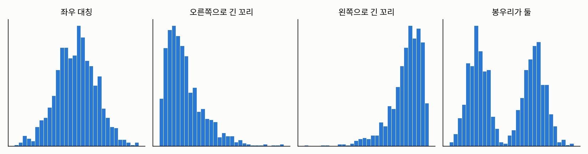
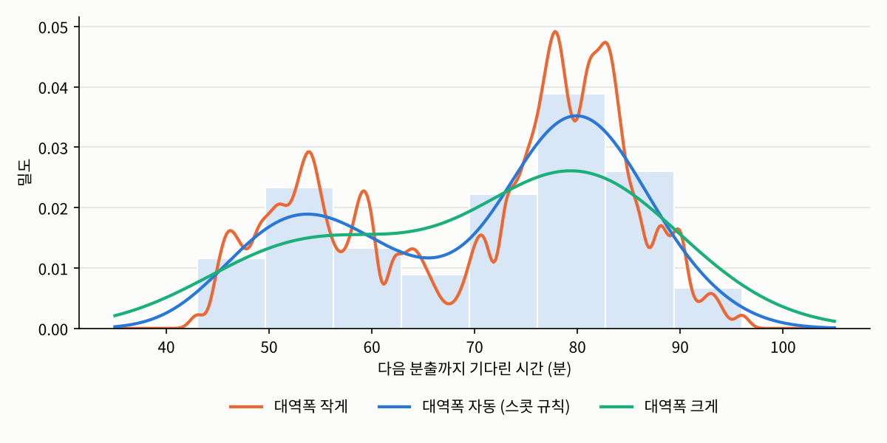

## 들어가며

[지난 글](02-frequency-tables.qmd)에서는 각 값이 몇 번 나왔는지 세어 도수분포표와 막대그래프를 만들었습니다. 이 방법은 스팸 문자 수처럼 값의 종류가 몇 가지 안 될 때 잘 작동합니다.

그런데 연속형 데이터에서는 문제가 생깁니다. 이번 글에서는 값을 **구간으로 묶어서** 세는 히스토그램을 정의하고, 막대의 높이를 정하는 올바른 방법, 구간의 개수를 정하는 방법, 히스토그램에서 읽어 낼 수 있는 분포의 여러 모양을 차례로 살펴봅니다. 마지막으로 히스토그램을 매끄러운 곡선으로 바꾼 커널 밀도 추정을 소개하겠습니다.

## 값마다 세면 생기는 문제

미국 옐로스톤 국립공원의 올드페이스풀(Old Faithful) 간헐천은 비교적 규칙적으로 물을 뿜어 올리는 것으로 유명합니다. 이 간헐천의 분출 272번에 대해 분출이 이어진 시간과 다음 분출까지 기다린 시간을 기록한 데이터가 있습니다.[^faithful] 시본에서는 `geyser`라는 이름으로 불러올 수 있고, 그중 다음 분출까지 기다린 시간(분)을 보겠습니다.

대기 시간은 43분부터 96분까지 분 단위로 기록되어 있고, 272개 값 중 서로 다른 값이 51가지입니다. 값마다 막대를 세우면 막대가 51개이고 대부분 높이가 몇 안 되는, 들쭉날쭉한 그림이 나옵니다. 키나 몸무게처럼 더 정밀하게 잰 데이터라면 거의 모든 값이 한 번씩만 나와서 모든 막대의 높이가 1인, 아무 정보도 없는 그림이 됩니다.

해결 방법은 간단합니다. 값을 하나하나 세는 대신, **수직선을 몇 개의 구간으로 나누고 각 구간에 들어간 데이터를 셉니다.**

## 계급과 히스토그램

::: {.callout-note icon=false .callout-definition}
### 정의 2.3.1 (계급과 히스토그램)
수치형 데이터 $x_1, \dots, x_n$이 모두 들어가는 구간을 경계점 $c_0 < c_1 < \cdots < c_k$로 나눈 $k$개의 구간

$$[c_0, c_1),\; [c_1, c_2),\; \dots,\; [c_{k-1}, c_k)$$

을 **계급**(class 또는 bin)이라고 합니다. $j$번째 계급의 폭을 $\Delta_j := c_j - c_{j-1}$, 그 계급에 속한 데이터의 상대도수를

$$f_j := \frac{1}{n}\sum_{i=1}^{n} \mathbf{1}_{[c_{j-1}, c_j)}(x_i)$$

라고 할 때, 각 계급 위에 높이가 $f_j / \Delta_j$인 직사각형을 그린 그림을 **히스토그램**(histogram)이라고 합니다.
:::

여기서는 각 계급이 **왼쪽 끝은 포함하고 오른쪽 끝은 포함하지 않도록** 정했습니다. 경계에 걸린 값이 두 계급에 중복으로 세어지거나 아무 데도 세어지지 않는 일을 막기 위해서입니다. (마지막 계급은 가장 큰 값이 빠지지 않도록 오른쪽 끝을 포함시키기도 합니다.)

정의에서 가장 중요한 부분은 **높이를 $f_j / \Delta_j$로 정한 것**입니다. 그러면 $j$번째 직사각형의 넓이는

$$\text{높이} \times \text{폭} = \frac{f_j}{\Delta_j} \times \Delta_j = f_j$$

가 됩니다. 즉 히스토그램에서는 **높이가 아니라 넓이가 상대도수**를 나타냅니다. 그리고 정리 2.2.3과 같은 이유로 넓이를 모두 더하면 1이 됩니다. 이렇게 넓이로 비율을 나타낸 높이 $f_j / \Delta_j$를 **밀도**(density)라고 부릅니다.

모든 계급의 폭이 같다면 높이는 상대도수에 비례하므로, 세로축에 그냥 도수를 적어도 모양은 똑같습니다. 실제로 많은 히스토그램이 그렇게 그려집니다. 문제는 계급의 폭이 서로 다를 때입니다.

## 높이가 아니라 넓이입니다

가상의 월 소득 데이터 500개로 확인해 보겠습니다. 소득은 대부분 사람이 비슷한 범위에 몰려 있고 소수가 아주 높은 값을 갖기 때문에, 높은 소득 쪽은 계급을 넓게 잡는 일이 흔합니다. 아래에서는 500만 원까지는 100만 원 간격으로, 그 위로는 500만~1000만 원, 1000만~2000만 원으로 넓게 묶었습니다.

```python
import numpy as np

rng = np.random.default_rng(1557)
income = np.round(rng.lognormal(mean=np.log(300), sigma=0.55, size=500))  # 가상의 월 소득 (만 원)

edges = np.array([0, 100, 200, 300, 400, 500, 1000, 2000])
counts, _ = np.histogram(income, bins=edges)
widths = np.diff(edges)
print("구간 폭 (만 원)      :", widths)
print("도수                 :", counts)
print("100만 원당 상대도수  :", np.round(counts / counts.sum() / (widths / 100), 4))
```

```
구간 폭 (만 원)      : [ 100  100  100  100  100  500 1000]
도수                 : [ 11  99 146  98  59  82   5]
100만 원당 상대도수  : [0.022  0.198  0.292  0.196  0.118  0.0328 0.001 ]
```

{fig-alt="같은 소득 데이터를 폭이 다른 계급으로 그린 두 히스토그램. 왼쪽은 높이를 도수로 그려서 500만에서 1000만 원 구간의 막대가 높이 82로 넓고 크게 그려져 있어 그 구간에 사람이 많아 보인다. 오른쪽은 높이를 상대도수를 구간 폭으로 나눈 밀도로 그려서 500만 원 이후 막대가 낮게 깔려 있고, 200만에서 300만 원 구간이 가장 높다." width=95%}

500만~1000만 원 계급에는 82명이 들어 있습니다. 왼쪽 그림처럼 높이를 도수로 그리면, 이 계급의 막대는 높이 82에 폭이 다른 막대의 다섯 배나 되어서 그림에서 가장 넓은 면적을 차지합니다. 눈은 자연스럽게 넓이를 보기 때문에, 마치 500만~1000만 원 구간에 사람이 가장 많이 몰려 있는 것처럼 보입니다.

하지만 82명은 폭 500만 원에 걸쳐 흩어져 있습니다. 100만 원당으로 나누면 16.4명꼴로, 400만~500만 원 구간의 59명보다 훨씬 적습니다. 오른쪽 그림처럼 밀도로 그리면 이 사실이 그대로 드러나고, 소득 분포가 200만~300만 원 근처에 몰려 있고 오른쪽으로 길게 꼬리를 끄는 모양이라는 것도 정확히 보입니다.

그래서 계급의 폭이 다를 때는 반드시 **밀도**로 높이를 정해야 합니다. 폭이 같다면 도수로 그려도 되지만, 그때도 "넓이가 비율"이라는 원리는 그대로입니다.

## 계급은 몇 개로 나눌까요?

계급의 폭을 모두 같게 하더라도, 몇 개로 나눌지는 정해야 합니다. 간헐천 대기 시간을 서로 다른 개수의 계급으로 그려 보겠습니다.

{fig-alt="간헐천 대기 시간 272개를 계급 4개, 8개, 17개, 60개로 그린 네 개의 히스토그램. 계급 4개일 때는 봉우리 구조가 잘 보이지 않는다. 8개와 17개일 때는 50분대 중반과 80분 근처에 봉우리가 둘 있는 모양이 분명하다. 60개일 때는 막대가 들쭉날쭉하고 빈 칸이 많아 전체 모양이 오히려 흐려진다." width=95%}

계급이 4개뿐이면 너무 뭉뚱그려서 봉우리가 둘이라는 구조가 잘 보이지 않습니다. 반대로 60개로 쪼개면 계급마다 데이터가 몇 개밖에 없어서 우연한 들쭉날쭉함이 모양을 덮어 버립니다. 계급이 너무 적으면 정보를 잃고, 너무 많으면 우연이 만든 잡음까지 보이는 셈입니다. [1.1](../01-what-is-statistics/01-randomness-and-data.qmd)에서 데이터가 적으면 우연이 규칙을 가린다고 했던 것과 같은 이야기입니다.

정답은 없지만, 출발점으로 쓸 수 있는 경험 규칙들이 있습니다. $n$이 데이터의 개수일 때,

- **제곱근 규칙:** 계급 수를 $\lceil \sqrt{n}\, \rceil$ 정도로 잡습니다.
- **스터지스 규칙**(Sturges' rule): 계급 수를 $\lceil \log_2 n + 1 \rceil$로 잡습니다.[^sturges]
- **프리드먼–디아코니스 규칙**(Freedman–Diaconis rule): 계급 폭을 $2 \cdot \mathrm{IQR} \cdot n^{-1/3}$로 잡습니다. 여기서 IQR은 데이터의 가운데 50%가 차지하는 폭으로, 2.5에서 정의합니다.[^fd]

여기서 $\lceil \cdot \rceil$은 올림을 뜻합니다. 간헐천 데이터에 적용해 보겠습니다.

```python
import numpy as np
import seaborn as sns

waiting = sns.load_dataset("geyser")["waiting"].to_numpy()
n = waiting.size
print("n =", n)
print("제곱근 규칙        :", int(np.ceil(np.sqrt(n))))
print("스터지스 규칙      :", int(np.ceil(np.log2(n) + 1)))
q1, q3 = np.quantile(waiting, [0.25, 0.75])
h = 2 * (q3 - q1) / n ** (1 / 3)
print(f"프리드먼–디아코니스: 폭 {h:.2f}분, 구간", int(np.ceil((waiting.max() - waiting.min()) / h)), "개")
```

```
n = 272
제곱근 규칙        : 17
스터지스 규칙      : 10
프리드먼–디아코니스: 폭 7.41분, 구간 8 개
```

세 규칙이 8개에서 17개 사이를 제안하고, 위 그림에서 보았듯이 이 범위에서는 모두 봉우리가 둘인 구조가 잘 드러납니다. 스터지스 규칙은 데이터가 종 모양에 가깝다는 가정에서 나온 것이라 데이터가 많거나 모양이 복잡하면 계급이 너무 적게 나오는 경향이 있고, 프리드먼–디아코니스 규칙은 이상치에 덜 흔들리는 IQR을 써서 비교적 안정적입니다. 넘파이와 맷플롯립(matplotlib)에서는 `bins="sqrt"`, `bins="sturges"`, `bins="fd"`처럼 이름으로 지정할 수 있습니다.

어떤 규칙을 쓰든, 계급 수를 몇 가지로 바꿔 가며 그려 보고 **모양이 크게 바뀌지 않는지** 확인하는 습관이 가장 중요합니다. 계급을 조금 바꿨을 뿐인데 사라지는 봉우리라면 우연이 만든 것일 가능성이 높습니다.

## 분포의 모양

히스토그램을 그리는 가장 큰 목적은 분포의 **모양**을 보는 것입니다. 자주 만나는 모양에는 이름이 붙어 있습니다.

{fig-alt="가상의 데이터로 그린 네 가지 분포 모양의 히스토그램. 첫째는 가운데가 높고 양쪽이 대칭으로 낮아지는 종 모양, 둘째는 왼쪽에 봉우리가 있고 오른쪽으로 꼬리가 길게 늘어진 모양, 셋째는 오른쪽에 봉우리가 있고 왼쪽으로 꼬리가 늘어진 모양, 넷째는 봉우리가 두 개인 모양이다." width=100%}

- **좌우 대칭**(symmetric): 가운데를 중심으로 양쪽이 거울처럼 비슷합니다. 같은 종, 같은 성별인 동물의 키나 몸길이, 측정 오차 등이 이런 모양에 가깝습니다.
- **오른쪽으로 긴 꼬리**(right-skewed): 대부분의 값이 작은 쪽에 몰려 있고, 큰 쪽으로 드물게 아주 큰 값이 있습니다. 소득, 집값, 병원 대기 시간처럼 0 아래로는 내려갈 수 없지만 위로는 제한이 없는 양에서 흔합니다. 앞의 소득 데이터가 그 예입니다. 양의 방향으로 치우쳤다고 해서 **양의 왜도**(positive skew)를 가진다고도 합니다.
- **왼쪽으로 긴 꼬리**(left-skewed): 반대로 대부분이 큰 쪽에 몰려 있고, 작은 쪽으로 꼬리가 늘어집니다. 아주 쉬운 시험의 점수가 대표적입니다. 대부분 만점 근처이고 몇 명만 낮은 점수를 받습니다.
- **봉우리가 여럿**(multimodal): 봉우리가 둘 이상입니다. 성질이 다른 두 무리가 한 데이터에 섞여 있을 때 자주 나타납니다.

간헐천 대기 시간은 봉우리가 둘인 대표적인 예입니다. 실제로 이 데이터에는 각 분출이 짧았는지 길었는지(`kind`)가 함께 기록되어 있는데, 짧은 분출 100번의 평균 대기 시간은 약 55분, 긴 분출 172번의 평균 대기 시간은 약 80분입니다. 두 봉우리가 서로 다른 두 무리에서 온 것입니다. 이런 데이터에서 전체 평균 약 71분을 "대표값"이라고 말하면, 실제로는 거의 일어나지 않는 대기 시간을 대표값으로 내세우는 셈이 됩니다. 히스토그램을 먼저 보지 않고 평균부터 계산하면 이런 함정에 빠지기 쉽습니다.

모양을 숫자로 나타내는 방법(왜도와 첨도)은 3장에서 다룹니다.

## 히스토그램을 매끄럽게: 커널 밀도 추정

히스토그램은 계급을 어디서 끊느냐에 따라 모양이 바뀌고, 막대 경계에서 갑자기 높이가 뛰는 계단 모양이라는 약점이 있습니다. 이를 보완하는 방법이 **커널 밀도 추정**(kernel density estimation)입니다.[^kde]

아이디어는 이렇습니다. 히스토그램은 각 데이터를 "자기가 속한 계급"이라는 고정된 칸에 넣어 쌓습니다. 커널 밀도 추정은 칸을 미리 정하지 않고, **각 데이터 위치에 작은 언덕을 하나씩 쌓은 뒤 모두 더합니다.** 데이터가 많이 모인 곳에서는 언덕이 겹쳐 높아지고, 데이터가 드문 곳은 낮아집니다.

::: {.callout-note icon=false .callout-definition}
### 정의 2.3.2 (커널 밀도 추정)
수치형 데이터 $x_1, \dots, x_n$과 양수 $h > 0$에 대해

$$\hat{f}_h(t) := \frac{1}{nh} \sum_{i=1}^{n} K\!\left( \frac{t - x_i}{h} \right), \qquad K(u) := \frac{1}{\sqrt{2\pi}} e^{-u^2/2}$$

를 **커널 밀도 추정량**이라고 합니다. 함수 $K$를 **커널**(kernel), $h$를 **대역폭**(bandwidth)이라고 합니다.
:::

여기서 커널 $K$는 0을 중심으로 좌우 대칭인 종 모양 언덕이고, 아래 넓이가 1입니다. ($K$는 5장에서 다룰 표준정규분포의 밀도함수인데, 지금은 "넓이가 1인 종 모양 언덕"이라고만 생각하면 충분합니다.) $K((t - x_i)/h)/h$는 이 언덕을 $x_i$ 위치로 옮기고 폭을 $h$배로 넓힌 것이고, 넓이는 여전히 1입니다. 이것을 $n$개 모두 더해 $n$으로 나누었으니, $\hat{f}_h$ 아래의 전체 넓이는 히스토그램과 마찬가지로 1입니다.

히스토그램에서 계급의 개수가 중요했던 것처럼, 커널 밀도 추정에서는 대역폭 $h$가 중요합니다. 간헐천 데이터로 세 가지 대역폭을 비교해 보겠습니다. 사이파이(SciPy)의 `gaussian_kde`는 데이터의 표준편차에 곱할 배율로 대역폭을 정하고, 기본값으로는 스콧 규칙(Scott's rule)이라는 경험 규칙을 씁니다.

```python
import numpy as np
import seaborn as sns
from scipy.stats import gaussian_kde

waiting = sns.load_dataset("geyser")["waiting"].to_numpy()
for bw in [0.05, "scott", 0.6]:
    kde = gaussian_kde(waiting, bw_method=bw)
    h = kde.factor * waiting.std(ddof=1)        # 실제 대역폭 (분)
    print(f"bw_method={bw!s:>5}: 대역폭 h = {h:.2f}분, f(55) = {kde(55)[0]:.4f}, f(80) = {kde(80)[0]:.4f}")
```

```
bw_method= 0.05: 대역폭 h = 0.68분, f(55) = 0.0227, f(80) = 0.0349
bw_method=scott: 대역폭 h = 4.43분, f(55) = 0.0187, f(80) = 0.0352
bw_method=  0.6: 대역폭 h = 8.16분, f(55) = 0.0153, f(80) = 0.0261
```

{fig-alt="간헐천 대기 시간의 히스토그램 위에 대역폭이 다른 세 커널 밀도 추정 곡선을 겹쳐 그린 그림. 대역폭이 작은 주황 곡선은 뾰족한 봉우리가 여러 개 있는 울퉁불퉁한 모양이다. 자동으로 정한 파란 곡선은 55분 근처와 80분 근처에 봉우리가 하나씩 있는 매끄러운 모양이다. 대역폭이 큰 초록 곡선은 너무 평평해져서 55분 쪽 봉우리가 거의 사라졌다." width=85%}

대역폭이 너무 작으면(주황, 약 0.7분) 언덕 하나하나가 좁고 뾰족해서 곡선이 데이터의 우연한 들쭉날쭉함까지 그대로 따라갑니다. 너무 크면(초록, 약 8분) 언덕이 넓게 퍼져서 두 봉우리가 뭉개지고, 55분 쪽 봉우리는 거의 사라집니다. 스콧 규칙으로 정한 대역폭(파랑, 약 4.4분)에서는 두 봉우리가 매끄럽게 드러납니다. 히스토그램의 계급 수와 똑같은 균형 문제입니다.

커널 밀도 추정 곡선은 이름 그대로 무언가의 "추정"입니다. 무엇을 추정하는지는 5장에서 확률밀도함수를 정의하면 분명해집니다. 지금은 히스토그램의 매끄러운 버전으로 이해해 두시면 충분합니다.

## 정리

이번 글에서는 연속형 데이터의 분포를 보는 방법을 다루었습니다.

- 값의 종류가 많은 데이터는 수직선을 **계급**으로 나누어 세고, 이를 **히스토그램**으로 그립니다.
- 히스토그램에서는 **넓이가 상대도수**를 나타내도록 높이를 $f_j / \Delta_j$, 즉 **밀도**로 정합니다. 계급 폭이 다르면 반드시 밀도로 그려야 합니다.
- 계급 수는 제곱근 규칙, 스터지스 규칙, 프리드먼–디아코니스 규칙 등을 출발점으로 정하고, 여러 개로 바꿔 그려 모양이 안정적인지 확인합니다.
- 히스토그램에서 **대칭, 오른쪽/왼쪽으로 긴 꼬리, 봉우리의 수** 같은 분포의 모양을 읽을 수 있습니다. 봉우리가 둘이면 성질이 다른 무리가 섞여 있을 가능성을 의심해 봅니다.
- **커널 밀도 추정**은 각 데이터 위에 언덕을 쌓아 히스토그램을 매끄럽게 만든 것이며, 대역폭이 계급 수와 같은 역할을 합니다.

히스토그램과 커널 밀도 추정은 분포의 모양을 보기에 좋지만, 둘 다 계급이나 대역폭을 **우리가 정해야** 하고, 그 선택에 따라 그림이 달라집니다. 데이터를 하나도 버리지 않고, 아무것도 정하지 않고 분포 전체를 그대로 담는 방법은 없을까요? 다음 글에서는 2.2의 누적상대도수를 실수 전체로 넓힌 **경험적 분포함수**를 다루겠습니다.

---

### 연결되는 개념
* $\leftarrow$ **이전 개념:** [2.2 도수분포표와 막대그래프](02-frequency-tables.qmd)
* $\rightarrow$ **다음 개념:** [2.4 경험적 분포함수](04-ecdf.qmd)

[^faithful]: 이 데이터는 R의 기본 데이터셋 `faithful`과 같은 자료로, R 문서는 그 출처를 W. Härdle, *Smoothing Techniques: With Implementation in S*, Springer, 1991로 밝히고 있습니다. 같은 간헐천의 더 완전한 기록은 A. Azzalini & A. W. Bowman, "A Look at Some Data on the Old Faithful Geyser", *Applied Statistics* 39(3), 1990, pp. 357–365에서 분석되었습니다.

[^sturges]: H. A. Sturges, "The Choice of a Class Interval", *Journal of the American Statistical Association* 21(153), 1926, pp. 65–66.

[^fd]: D. Freedman & P. Diaconis, "On the Histogram as a Density Estimator: $L_2$ Theory", *Zeitschrift für Wahrscheinlichkeitstheorie und verwandte Gebiete* 57(4), 1981, pp. 453–476.

[^kde]: 커널 밀도 추정의 출발점이 된 논문은 M. Rosenblatt, "Remarks on Some Nonparametric Estimates of a Density Function", *The Annals of Mathematical Statistics* 27(3), 1956, pp. 832–837과 E. Parzen, "On Estimation of a Probability Density Function and Mode", *The Annals of Mathematical Statistics* 33(3), 1962, pp. 1065–1076입니다.
