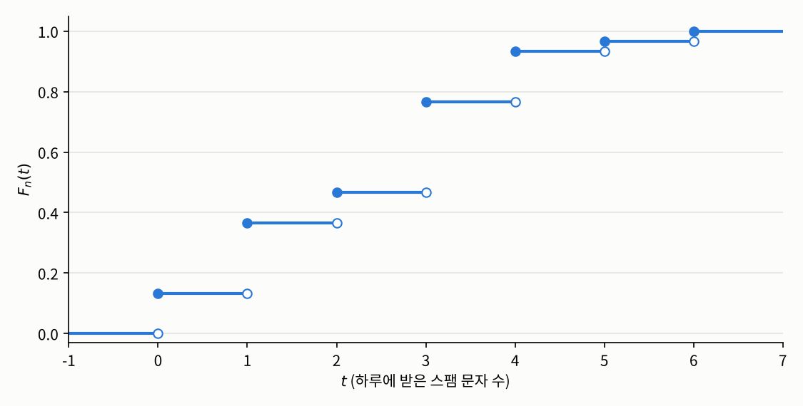
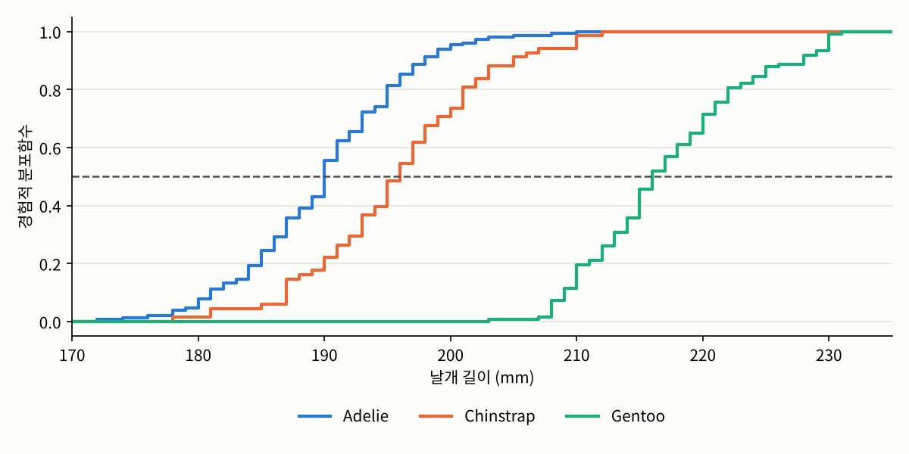
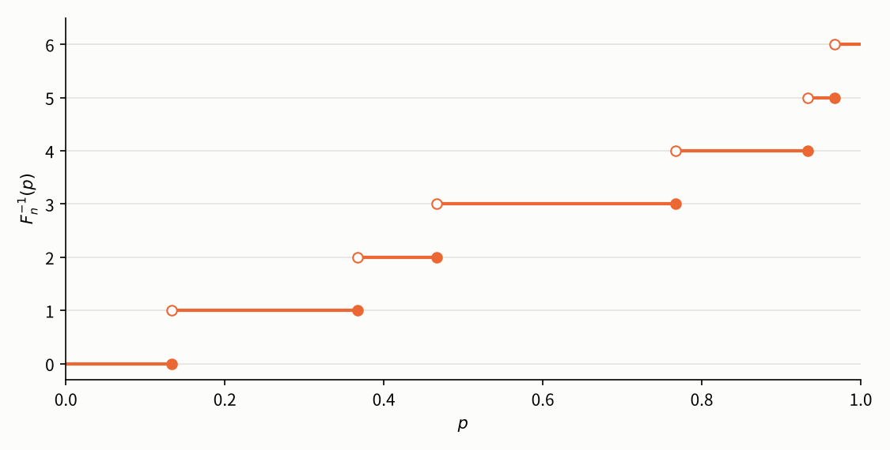

## 들어가며

[지난 글](03-histograms.qmd)의 히스토그램과 커널 밀도 추정은 분포의 모양을 보기에 좋지만, 계급이나 대역폭을 우리가 정해야 하고 그 선택에 따라 그림이 달라진다는 약점이 있었습니다. 또 같은 계급에 들어간 값들은 하나로 뭉뚱그려지니 정보도 조금씩 잃습니다.

이번 글에서는 **아무것도 정하지 않고, 데이터를 하나도 버리지 않으면서** 분포 전체를 담는 방법을 다룹니다. [2.2](02-frequency-tables.qmd)에서 본 누적상대도수를 실수 전체로 넓힌 **경험적 분포함수**입니다. 먼저 이 함수를 정의하고 성질을 살펴본 뒤, 이 함수를 거꾸로 읽는 **경험적 분위수 함수**를 정의하겠습니다. 경험적 분위수 함수는 다음 글의 분위수와 박스 플롯의 바탕이 됩니다.

## "t 이하인 데이터의 비율"

2.2에서 김찬호의 스팸 문자 데이터에 대해, 각 값 $a_j$ 이하인 날의 비율인 누적상대도수를 계산했습니다. 예를 들어 3개 이하를 받은 날의 비율은 $F(3) = 0.767$이었습니다.

이 질문은 데이터에 나온 값이 아니어도 얼마든지 물을 수 있습니다. "2.9개 이하인 날의 비율"은 2개 이하인 날의 비율과 같고, "−1개 이하인 날의 비율"은 0입니다. 이렇게 모든 실수 $t$에 대해 "$t$ 이하인 데이터의 비율"을 대응시키면 하나의 함수가 됩니다.

::: {.callout-note icon=false .callout-definition}
### 정의 2.4.1 (경험적 분포함수)
수치형 데이터 $x = (x_1, \dots, x_n)$에 대해 함수

$$F_n : \mathbb{R} \to [0, 1], \qquad F_n(t) := \frac{1}{n} \sum_{i=1}^{n} \mathbf{1}_{(-\infty, t]}(x_i)$$

를 데이터 $x$의 **경험적 분포함수**(empirical distribution function)라고 합니다.
:::

정의를 말로 읽으면 "$x_i \le t$이면 1점, 아니면 0점을 매겨 평균을 낸 것", 즉 **$t$ 이하인 데이터의 비율**입니다. 아래 첨자 $n$은 이 함수가 데이터 $n$개로 만들어졌다는 것을 표시합니다. 이름에 붙은 "경험적"(empirical)은 이론적으로 주어진 분포가 아니라 실제로 관찰한 데이터에서 계산했다는 뜻입니다.

스팸 데이터로 몇 개의 $t$에서 값을 계산해 보겠습니다.

```python
import numpy as np

rng = np.random.default_rng(1557)
spam = rng.poisson(2.5, size=30)          # 김찬호가 30일 동안 하루에 받은 스팸 문자 수

def ecdf(data, t):
    """경험적 분포함수 F_n(t): t 이하인 데이터의 비율"""
    return np.mean(data <= t)

for t in [-1, 0, 0.5, 2, 2.9, 3, 6, 10]:
    print(f"F_n({t:>4}) = {ecdf(spam, t):.3f}")
```

```
F_n(  -1) = 0.000
F_n(   0) = 0.133
F_n( 0.5) = 0.133
F_n(   2) = 0.467
F_n( 2.9) = 0.467
F_n(   3) = 0.767
F_n(   6) = 1.000
F_n(  10) = 1.000
```

$t$가 0에서 0.5로 움직이는 동안에는 값이 변하지 않다가, $t$가 3에 닿는 순간 0.467에서 0.767로 뛰어오릅니다. 데이터에 3이 9번 있었으니 $9/30 = 0.3$만큼 뛴 것입니다. 그래프로 그리면 다음과 같습니다.

{fig-alt="스팸 문자 데이터의 경험적 분포함수 그래프. 0보다 작은 곳에서는 0이고, 0, 1, 2, 3, 4, 5, 6에서 각각 위로 뛰어오르는 계단 모양이다. 각 계단의 왼쪽 끝은 색칠된 점, 오른쪽 끝은 빈 점으로 표시되어 있고, 가장 큰 계단은 3에서 0.467에서 0.767로 뛰는 부분이며, 6 이후로는 1이다." width=80%}

계단 모양입니다. 각 계단의 왼쪽 끝에 찍힌 색칠된 점은 "이 점에서의 함숫값은 위쪽 값"이라는 뜻이고, 오른쪽 끝의 빈 점은 "이 점은 포함되지 않는다"는 뜻입니다. 이 모양을 정리로 적어 보겠습니다.

## 경험적 분포함수의 성질

::: {.callout-important icon=false .callout-satz}
### 정리 2.4.2 (경험적 분포함수의 성질)
데이터 $x_1, \dots, x_n$에 나타나는 서로 다른 값을 $a_1 < \cdots < a_m$이라 하고, 그 상대도수를 $f(a_1), \dots, f(a_m)$이라 합시다. 그러면 경험적 분포함수 $F_n$은 다음 성질을 가집니다.

1. **단조 증가:** $s \le t$이면 $F_n(s) \le F_n(t)$입니다.
2. **오른쪽 연속인 계단 함수:** $F_n$은 각 구간 $[a_j, a_{j+1})$에서 상수이고, 정확히 $a_1, \dots, a_m$에서만 불연속이며, $a_j$에서의 뛰어오르는 높이는 $f(a_j)$입니다. 또 모든 $t$에서 $\lim_{s \downarrow t} F_n(s) = F_n(t)$입니다.
3. **양 끝:** $t < x_{(1)}$이면 $F_n(t) = 0$이고, $t \ge x_{(n)}$이면 $F_n(t) = 1$입니다.
:::

::: {.callout-tip collapse="true" icon=false .callout-beweis}
### 증명
1. $s \le t$이면 $(-\infty, s] \subseteq (-\infty, t]$이므로 모든 $i$에 대해 $\mathbf{1}_{(-\infty, s]}(x_i) \le \mathbf{1}_{(-\infty, t]}(x_i)$입니다. 양변을 $i$에 대해 더하고 $n$으로 나누면 됩니다.

2. 편의상 $a_0 := -\infty$, $a_{m+1} := \infty$로 둡니다. $t \in [a_j, a_{j+1})$이면 $x_i \le t$인 것과 $x_i \le a_j$인 것이 같습니다. 데이터에는 $a_j$와 $a_{j+1}$ 사이의 값이 없기 때문입니다. 따라서 이 구간에서

$$F_n(t) = \frac{1}{n} \#\{i : x_i \le a_j\} = \sum_{l=1}^{j} f(a_l)$$

로 상수입니다. 그러므로 $F_n$은 $a_j$ 바로 왼쪽에서 $\sum_{l=1}^{j-1} f(a_l)$, $a_j$ 자신과 그 오른쪽에서 $\sum_{l=1}^{j} f(a_l)$이고, 그 차이 $f(a_j) > 0$만큼 뛰어오릅니다. 각 구간이 왼쪽 끝을 포함하므로 오른쪽 연속입니다.

3. $t < x_{(1)}$이면 $t$ 이하인 데이터가 없고, $t \ge x_{(n)}$이면 모든 데이터가 $t$ 이하입니다. $\square$
:::

정리를 쉬운 말로 다시 읽어 보겠습니다. 경험적 분포함수는 맨 왼쪽에서 0으로 시작해서, 데이터가 있는 자리를 지날 때마다 **그 자리에 있는 데이터의 비율만큼** 계단을 올라가고, 마지막 데이터를 지나면 1에 도달합니다. 데이터가 없는 곳에서는 평평합니다. 그래서 그래프만 보고도 원래 데이터의 도수분포를 완전히 되살릴 수 있습니다. 어디서 몇 칸 뛰었는지를 읽으면 되니까요. 히스토그램과 달리 **정보를 하나도 잃지 않는** 그림입니다.

2.2의 누적상대도수 $F(a_j)$는 이 함수를 데이터 값 $a_j$에서만 본 것입니다. 실제로 증명의 식에서 $F_n(a_j) = \sum_{l=1}^{j} f(a_l) = F(a_j)$임을 확인할 수 있습니다.

## 여러 집단을 한 그림에서 비교하기

연속형 데이터에서는 거의 모든 값이 한 번씩만 나오므로, 경험적 분포함수는 데이터마다 $1/n$씩 올라가는 아주 촘촘한 계단이 됩니다. 펭귄 세 종의 날개 길이에 대한 경험적 분포함수를 한 그림에 그려 보겠습니다.

{fig-alt="펭귄 세 종의 날개 길이에 대한 경험적 분포함수를 겹쳐 그린 그림. Adelie(파랑)는 약 172mm에서 올라가기 시작해 210mm 근처에서 1에 도달하고, Chinstrap(주황)은 그보다 조금 오른쪽에 있으며, Gentoo(초록)는 약 203mm에서 시작해 231mm에서 1에 도달하여 다른 두 종보다 훨씬 오른쪽에 있다. 높이 0.5의 회색 점선은 Adelie와 약 190mm, Chinstrap과 약 196mm, Gentoo와 약 216mm에서 만난다." width=85%}

이 그림에서 여러 가지를 읽을 수 있습니다.

- **곡선이 오른쪽에 있을수록 값이 큽니다.** 젠투펭귄(Gentoo)의 곡선이 다른 두 종보다 한참 오른쪽에 있으니, 젠투펭귄의 날개가 대체로 더 깁니다.
- **높이 0.5에서 읽으면 가운데 값을 알 수 있습니다.** 회색 점선과 각 곡선이 만나는 곳의 $t$는 "데이터의 절반이 이 값 이하"인 값으로, 아델리펭귄(Adelie)은 약 190mm, 턱끈펭귄(Chinstrap)은 약 196mm, 젠투펭귄은 약 216mm입니다. 이 값이 다음 글에서 정의할 **중앙값**입니다.
- **세로로 읽으면 비율을 알 수 있습니다.** $t = 200$에서 각 곡선의 높이를 읽으면, 날개 길이가 200mm 이하인 비율이 아델리펭귄은 약 95%, 턱끈펭귄은 약 74%, 젠투펭귄은 0%입니다.
- **가파른 곳에 데이터가 몰려 있습니다.** 곡선이 짧은 구간에서 빠르게 올라간다는 것은 그 구간에 데이터가 많다는 뜻입니다. 히스토그램에서 막대가 높은 곳이 경험적 분포함수에서는 기울기가 가파른 곳으로 나타납니다.

반면 봉우리가 몇 개인지 같은 **모양**은 히스토그램보다 경험적 분포함수에서 알아보기 어렵습니다. 그래서 두 그림은 서로를 대신하기보다, 함께 보는 것이 좋습니다.

## 거꾸로 읽기: 경험적 분위수 함수

위에서 "높이 0.5인 곳의 $t$"를 읽은 것처럼, 경험적 분포함수를 **거꾸로** 읽고 싶을 때가 많습니다. "데이터의 25%가 이 값 이하가 되는 값은 무엇인가?" 같은 질문입니다. 보통 이런 일은 역함수가 해 줍니다.

그런데 $F_n$은 계단 함수라서 보통의 역함수가 없습니다. 평평한 구간에서는 여러 $t$가 같은 값을 가지니 일대일이 아니고, 계단이 뛰어오르는 곳에서는 건너뛴 값들이 있으니 모든 값을 갖지도 않습니다. 스팸 데이터에서 $F_n(t) = 0.5$인 $t$는 아예 없습니다. 0.467에서 0.767로 한 번에 뛰어올랐기 때문입니다.

그래서 "정확히 $p$가 되는 곳" 대신 **"처음으로 $p$ 이상이 되는 곳"**을 찾기로 합니다.

::: {.callout-note icon=false .callout-definition}
### 정의 2.4.3 (경험적 분위수 함수)
경험적 분포함수 $F_n$에 대해

$$F_n^{-1} : (0, 1] \to \mathbb{R}, \qquad F_n^{-1}(p) := \min\{ t \in \mathbb{R} : F_n(t) \ge p \}$$

를 **경험적 분위수 함수**(empirical quantile function)라고 합니다.
:::

말로 하면, $F_n^{-1}(p)$는 **경험적 분포함수가 처음으로 $p$ 이상이 되는 가장 작은 $t$**입니다. $F_n$이 오른쪽 연속인 계단 함수이고 마지막에는 1에 도달하므로(정리 2.4.2), 이런 $t$들의 집합은 어떤 데이터 값에서 시작하는 반직선이고 최솟값이 항상 존재합니다. 이렇게 역함수가 없는 함수에 대해 "처음으로 넘어서는 곳"으로 정의한 역함수 대용품을 **일반화된 역함수**(generalized inverse)라고 부릅니다.

정의는 추상적으로 보이지만, 실제로 계산하면 아주 간단한 답이 나옵니다.

::: {.callout-important icon=false .callout-satz}
### 정리 2.4.4 (경험적 분위수 함수와 순서통계량)
$p \in (0, 1]$에 대해

$$F_n^{-1}(p) = x_{(\lceil np \rceil)}$$

입니다. 여기서 $\lceil np \rceil$은 $np$ 이상인 가장 작은 정수입니다.
:::

::: {.callout-tip collapse="true" icon=false .callout-beweis}
### 증명
$F_n(t) \ge p$는 "$t$ 이하인 데이터가 $np$개 이상"이라는 뜻이고, 데이터의 개수는 정수이므로 "$t$ 이하인 데이터가 $\lceil np \rceil$개 이상"과 같습니다. $k := \lceil np \rceil$이라 하면 $1 \le k \le n$이고, $t$ 이하인 데이터가 $k$개 이상이라는 것은 $k$번째로 작은 값이 $t$ 이하, 즉 $x_{(k)} \le t$라는 것과 같습니다. 따라서

$$\{ t : F_n(t) \ge p \} = [x_{(k)}, \infty)$$

이고, 이 집합의 최솟값은 $x_{(k)}$입니다. $\square$
:::

결국 경험적 분위수 함수는 "데이터를 줄 세웠을 때 앞에서 $np$번째쯤(정확히는 올림한 자리)에 서 있는 값"입니다. 코드로 확인해 보겠습니다.

```python
import numpy as np

rng = np.random.default_rng(1557)
spam = rng.poisson(2.5, size=30)
x_sorted = np.sort(spam)
n = spam.size

def quantile_function(p):
    """F_n^{-1}(p) = min{t : F_n(t) >= p} = x_(ceil(np))"""
    k = int(np.ceil(n * p))
    return x_sorted[k - 1]          # 파이썬은 0부터 세므로 k-1번째

for p in [0.1, 0.25, 11/30, 0.4, 0.5, 0.9, 1.0]:
    print(f"F_n^(-1)({p:.3f}) = {quantile_function(p)}")
```

```
F_n^(-1)(0.100) = 0
F_n^(-1)(0.250) = 1
F_n^(-1)(0.367) = 1
F_n^(-1)(0.400) = 2
F_n^(-1)(0.500) = 3
F_n^(-1)(0.900) = 4
F_n^(-1)(1.000) = 6
```

예를 들어 $p = 0.5$이면 $\lceil 30 \times 0.5 \rceil = 15$이므로 15번째로 작은 값인 3입니다. 경험적 분포함수가 0.5가 되는 곳은 없었지만, **처음으로 0.5를 넘어서는 곳**은 $t = 3$입니다. 그래프로 그리면 다음과 같습니다.

{fig-alt="스팸 문자 데이터의 경험적 분위수 함수 그래프. 가로축은 p, 세로축은 F_n^{-1}(p)이다. p가 0에서 0.133까지는 0, 0.367까지는 1, 0.467까지는 2, 0.767까지는 3, 0.933까지는 4, 0.967까지는 5, 그 이후로는 6인 계단 모양이다. 각 계단의 오른쪽 끝이 색칠된 점이고 왼쪽 끝이 빈 점이다." width=80%}

경험적 분포함수의 그래프를 대각선에 대해 뒤집은 모양입니다. 경험적 분포함수에서 평평했던 부분은 여기서 뛰어오르는 부분이 되고, 뛰어올랐던 부분은 평평한 부분이 됩니다. 정의에서 바로 따라 나오는 성질로, 경험적 분위수 함수도 **단조 증가**하고, 이번에는 각 계단의 오른쪽 끝을 포함하는 **왼쪽 연속**인 계단 함수입니다.

## 기호 $F^{-1}$에 대한 주의

수학에서 $F^{-1}$이라는 기호는 문맥에 따라 세 가지 다른 뜻으로 쓰입니다.

1. **보통의 역함수**: $F$가 일대일 대응일 때의 역함수입니다.
2. **일반화된 역함수**: 이 글의 $F_n^{-1}(p) = \min\{t : F_n(t) \ge p\}$처럼, 역함수가 없을 때 "처음으로 넘어서는 곳"으로 정의한 것입니다.
3. **역상**(preimage): 집합 $B$에 대해 $F^{-1}(B) := \{t : F(t) \in B\}$, 즉 함숫값이 $B$에 들어가는 점들의 집합입니다.

세 번째 뜻으로 경험적 분포함수를 보면 재미있는 사실이 하나 보입니다. $F_n^{-1}(\{p\})$, 즉 $F_n(t) = p$를 정확히 만족하는 $t$들의 집합은 둘 중 하나입니다. 계단이 $p$를 건너뛰었다면 **공집합**이고, 어떤 계단의 높이가 정확히 $p$라면 그 계단이 차지하는 **구간**입니다. 스팸 데이터에서 $F_n^{-1}(\{0.5\}) = \varnothing$이고, $F_n^{-1}(\{11/30\}) = [1, 2)$입니다.

두 번째 경우, 즉 $F_n(t) = p$인 $t$가 한 구간을 이루는 경우에는 "데이터의 $100p\%$가 이 값 이하"라고 말할 수 있는 값이 하나가 아니라 여러 개라는 뜻입니다. 이 미묘한 점이 다음 글에서 분위수를 정의할 때 소프트웨어마다 값이 달라지는 이유가 됩니다. 이 과목에서는 혼동을 피하기 위해, 특별한 말이 없으면 $F_n^{-1}(p)$는 두 번째 뜻(일반화된 역함수)으로만 쓰겠습니다.

## 경험적 분포함수가 앞으로 할 일

경험적 분포함수는 이 장에서 가장 수학적인 도구이지만, 그만큼 앞으로 여러 번 다시 등장합니다.

- 5장에서는 모집단 분포의 **누적분포함수** $F(t) = \mathbb{P}(X \le t)$를 정의합니다. 경험적 분포함수는 그 표본 버전이고, 데이터가 많아질수록 모집단의 누적분포함수에 다가갑니다. 이 사실을 정확히 적은 정리가 **글리벤코–칸텔리 정리**(Glivenko–Cantelli theorem)이며, "통계학의 기본 정리"라고 불리기도 합니다.
- 7장의 **부트스트랩**은 모집단 분포를 모를 때 그 자리에 경험적 분포함수를 대신 넣어 추론하는 방법입니다.
- 두 집단의 경험적 분포함수가 가장 멀리 떨어진 거리로 두 분포가 같은지 판단하는 콜모고로프–스미르노프 검정(Kolmogorov–Smirnov test)이라는 방법도 있습니다. 이는 [비모수 통계](../../nonparametric-stats/index.qmd)에서 다룹니다.

## 정리

이번 글에서는 데이터를 줄 세워 분포 전체를 담는 방법을 다루었습니다.

- **경험적 분포함수** $F_n(t)$는 "$t$ 이하인 데이터의 비율"로, 모든 실수에서 정의된 누적상대도수입니다.
- $F_n$은 0에서 시작해 데이터 값마다 그 상대도수만큼 뛰어올라 1에 도달하는 **단조 증가, 오른쪽 연속인 계단 함수**이며, 정보를 하나도 잃지 않습니다.
- 여러 집단의 경험적 분포함수를 겹쳐 그리면 위치, 가운데 값, 특정 값 이하의 비율을 한눈에 비교할 수 있습니다.
- 계단 함수에는 보통의 역함수가 없으므로, **경험적 분위수 함수** $F_n^{-1}(p) = \min\{t : F_n(t) \ge p\}$를 일반화된 역함수로 정의합니다. 이 값은 순서통계량 $x_{(\lceil np \rceil)}$입니다.

경험적 분위수 함수로 "데이터의 $100p\%$가 이 값 이하"인 값을 구할 수 있게 되었습니다. 그런데 위에서 보았듯이 그런 값이 여러 개일 때가 있습니다. 그중 무엇을 골라야 할까요? 다음 글에서는 이 질문에서 출발해 **분위수**를 정의하고, 분위수 다섯 개로 분포를 요약하는 **박스 플롯**을 그려 보겠습니다.

---

### 연결되는 개념
* $\leftarrow$ **이전 개념:** [2.3 히스토그램과 분포의 모양](03-histograms.qmd)
* $\rightarrow$ **다음 개념:** [2.5 분위수와 박스 플롯](05-quantiles-boxplots.qmd)
