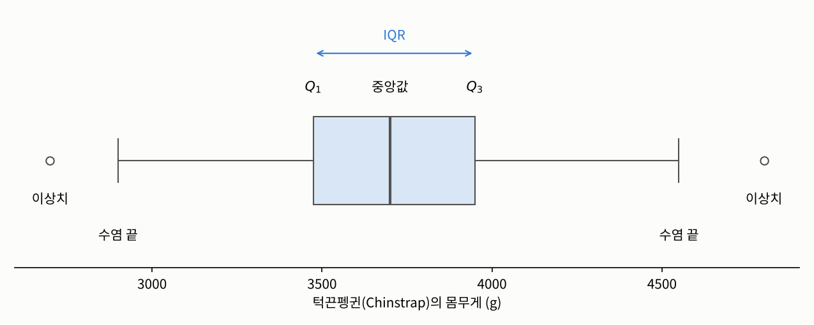
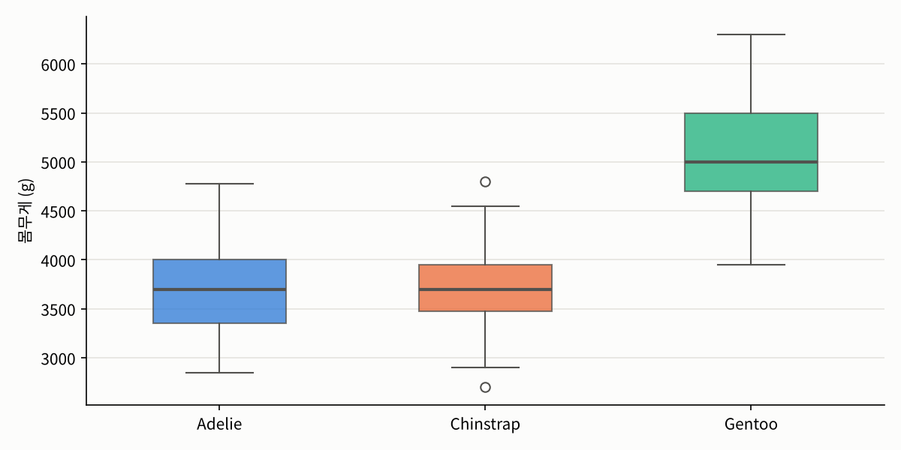

## 들어가며

[지난 글](04-ecdf.qmd)에서는 경험적 분포함수를 거꾸로 읽는 경험적 분위수 함수 $F_n^{-1}(p) = x_{(\lceil np \rceil)}$를 정의했습니다. 그리고 "데이터의 $100p\%$가 이 값 이하"라고 말할 수 있는 값이 여러 개일 때가 있다는 것도 보았습니다.

이번 글에서는 이 문제를 정면으로 다룹니다. 먼저 **분위수**를 정의하고 그것이 하나로 정해지지 않는 경우를 정확히 정리한 뒤, 하나로 정하는 관례와 소프트웨어마다 값이 다른 이유를 살펴봅니다. 그다음 가장 중요한 분위수인 **사분위수**와 **중앙값**으로 분포를 다섯 개의 숫자로 요약하고, 이를 그림으로 나타낸 **박스 플롯**으로 여러 집단을 비교해 보겠습니다.

## 가운데 값이 둘일 때

박종우, 김찬호, 손인욱, 장지환 네 사람이 한 달 동안 읽은 책의 수가 각각 9, 2, 5, 3권이라고 해 보겠습니다. 줄 세우면 $2, 3, 5, 9$입니다. 이 네 사람이 읽은 책 수의 "가운데 값"은 무엇일까요?

가운데 값을 "절반이 그 값 이하이고 절반이 그 값 이상인 값"이라고 생각하면, 3도 그렇고 5도 그렇습니다. 사실 3과 5 사이의 어떤 수, 예를 들어 4나 3.7도 이 조건을 만족합니다. 두 사람은 그 값 이하이고 두 사람은 그 값 이상이니까요. 데이터가 짝수 개일 때는 이렇게 가운데 값이 하나로 정해지지 않을 수 있습니다. 이 현상을 일반적인 비율 $p$에 대해 정리해 보겠습니다.

## 분위수와 분위수 구간

::: {.callout-note icon=false .callout-definition}
### 정의 2.5.1 (경험적 분위수)
순서 척도 이상인 데이터 $x_1, \dots, x_n$과 $p \in (0, 1)$에 대해, 다음 두 조건을 모두 만족하는 값 $t$를 데이터의 **경험적 $p$-분위수**(empirical $p$-quantile)라고 합니다.

- 데이터의 적어도 $100p\%$가 $t$ 이하입니다. 즉 $\#\{i : x_i \le t\} \ge np$입니다.
- 데이터의 적어도 $100(1-p)\%$가 $t$ 이상입니다. 즉 $\#\{i : x_i \ge t\} \ge n(1-p)$입니다.

$100p$를 붙여 **$100p$ 백분위수**(percentile)라고도 부릅니다.
:::

두 조건이 함께 있다는 점이 중요합니다. 첫 번째 조건만 있으면 아주 큰 값도 모두 $p$-분위수가 되어 버리고, 두 번째 조건만 있으면 아주 작은 값도 모두 $p$-분위수가 됩니다. 두 조건이 양쪽에서 조여서, 분위수는 데이터를 대략 $p : (1-p)$로 나누는 자리에 놓이게 됩니다.

이 조건을 만족하는 값이 정확히 어디에 있는지는 다음과 같이 정리됩니다.

::: {.callout-important icon=false .callout-satz}
### 정리 2.5.2 (분위수 구간)
$p \in (0, 1)$에 대해 경험적 $p$-분위수 전체의 집합은 다음과 같습니다.

- $np$가 정수가 아니면, 경험적 $p$-분위수는 $x_{(\lceil np \rceil)}$ 하나뿐입니다.
- $np$가 정수이면, 경험적 $p$-분위수 전체의 집합은 구간 $[x_{(np)},\, x_{(np+1)}]$입니다.

두 번째 경우의 구간을 **분위수 구간**이라고 합니다. $x_{(np)} = x_{(np+1)}$이면 이 구간도 한 점이므로, 분위수가 하나로 정해지지 않는 것은 $np$가 정수이면서 $x_{(np)} < x_{(np+1)}$인 경우뿐입니다.
:::

::: {.callout-tip collapse="true" icon=false .callout-beweis}
### 증명
$k := \lceil np \rceil$이라 하겠습니다.

첫 번째 조건 $\#\{i : x_i \le t\} \ge np$는, 개수가 정수이므로 $\#\{i : x_i \le t\} \ge k$와 같고, 이는 $x_{(k)} \le t$와 같습니다(정리 2.4.4의 증명과 같은 논리입니다).

두 번째 조건 $\#\{i : x_i \ge t\} \ge n - np$도 정수 조건이므로 $\#\{i : x_i \ge t\} \ge \lceil n - np \rceil = n - \lfloor np \rfloor$와 같습니다. $t$ 이상인 값이 $n - \lfloor np \rfloor$개 이상이라는 것은 큰 쪽에서 $n - \lfloor np \rfloor$번째 값, 즉 $x_{(\lfloor np \rfloor + 1)}$이 $t$ 이상이라는 것과 같습니다.

따라서 $p$-분위수 전체의 집합은 $[x_{(\lceil np \rceil)},\, x_{(\lfloor np \rfloor + 1)}]$입니다. $np$가 정수가 아니면 $\lfloor np \rfloor + 1 = \lceil np \rceil$이므로 이 구간은 한 점 $x_{(\lceil np \rceil)}$이고, $np$가 정수이면 $[x_{(np)}, x_{(np+1)}]$입니다. $\square$
:::

책 데이터에 적용해 보겠습니다. $n = 4$입니다.

- $p = 0.5$: $np = 2$가 정수이므로 중앙값 전체는 $[x_{(2)}, x_{(3)}] = [3, 5]$입니다. 위에서 직관적으로 본 그대로입니다.
- $p = 0.25$: $np = 1$이므로 $[x_{(1)}, x_{(2)}] = [2, 3]$입니다.
- $p = 0.3$: $np = 1.2$가 정수가 아니므로 $x_{(2)} = 3$ 하나뿐입니다.

김찬호의 스팸 데이터($n = 30$)에서는 $p = 0.25$일 때 $np = 7.5$이므로 25% 분위수는 $x_{(8)} = 1$ 하나이고, $p = 0.5$일 때는 $np = 15$가 정수지만 $x_{(15)} = x_{(16)} = 3$이므로 중앙값도 3 하나로 정해집니다.

지난 글과의 관계도 짚어 두겠습니다. 분위수 구간의 왼쪽 끝 $x_{(\lceil np \rceil)}$은 바로 경험적 분위수 함수 $F_n^{-1}(p)$입니다. 즉 경험적 분위수 함수는 가능한 $p$-분위수 중 **가장 작은 것**을 고르는 규칙입니다.

## 하나로 정하기: 관례와 소프트웨어

분위수가 구간으로 주어지면 실제로 쓰기 불편하니, 보통은 그 구간에서 값 하나를 고르는 관례를 정합니다. 대표적인 두 가지는 다음과 같습니다.

- **왼쪽 끝**을 고릅니다. 즉 $F_n^{-1}(p) = x_{(\lceil np \rceil)}$를 씁니다.
- **가운데**를 고릅니다. 즉 분위수 구간이 $[x_{(np)}, x_{(np+1)}]$이면 $\frac{1}{2}\big(x_{(np)} + x_{(np+1)}\big)$을 씁니다.

그런데 통계 소프트웨어마다 쓰는 관례가 다르고, 그 종류도 두세 가지가 아닙니다. 통계 패키지들이 쓰는 표본 분위수의 정의를 정리한 한 논문은 널리 쓰이는 정의만 아홉 가지를 꼽았습니다.[^hyndman] 넘파이의 `np.quantile`도 `method` 인자로 이 정의들을 고를 수 있게 해 둡니다. 책 데이터로 세 가지를 비교해 보겠습니다.

```python
import numpy as np

books = np.array([9, 2, 5, 3])   # 네 사람이 한 달 동안 읽은 책의 수
ps = [0.25, 0.5, 0.75]
print("왼쪽 끝 (inverted_cdf)         :", np.quantile(books, ps, method="inverted_cdf"))
print("가운데 (averaged_inverted_cdf) :", np.quantile(books, ps, method="averaged_inverted_cdf"))
print("넘파이 기본값 (linear)         :", np.quantile(books, ps))
```

```
왼쪽 끝 (inverted_cdf)         : [2 3 5]
가운데 (averaged_inverted_cdf) : [2.5 4.  7. ]
넘파이 기본값 (linear)         : [2.75 4.   6.  ]
```

같은 데이터의 같은 분위수인데 세 방법이 모두 다른 값을 내놓습니다. 처음 두 줄은 정리 2.5.2의 분위수 구간 $[2, 3]$, $[3, 5]$, $[5, 9]$에서 각각 왼쪽 끝과 가운데를 고른 것입니다.

세 번째 줄의 넘파이 기본값은 생각이 조금 다릅니다. 이 방법은 순서통계량들을 직선으로 이어 "부드러운" 분위수 함수를 만든 뒤 그 위에서 값을 읽습니다. 그래서 정의 2.5.1을 만족하지 않는 값이 나오기도 합니다. 예를 들어 위 책 데이터의 30% 분위수는 정리 2.5.2에 따라 3 하나뿐이지만, `np.quantile(books, 0.3)`은 2.9를 돌려줍니다. 틀렸다기보다는 분위수를 다른 방식으로 정의한 것입니다. 판다스, 맷플롯립, R의 `quantile` 기본값도 이 방식을 씁니다.

이 차이는 데이터가 적을 때 두드러지고, 데이터가 많아지면 이웃한 순서통계량들이 서로 가까워지므로 거의 사라집니다. 그래도 논문이나 보고서에 분위수를 적을 때는 **어떤 정의를 썼는지** 밝혀 두는 것이 좋고, 다른 소프트웨어로 계산한 결과와 조금 다르더라도 놀랄 필요는 없습니다.

## 사분위수와 중앙값

여러 분위수 중에서 특히 자주 쓰는 것들에는 이름이 붙어 있습니다.

::: {.callout-note icon=false .callout-definition}
### 정의 2.5.3 (사분위수, 중앙값, 사분위 범위)
수치형 데이터에 대해

- 25% 분위수를 **제1사분위수**(first quartile) $Q_1$,
- 50% 분위수를 **중앙값**(median) 또는 제2사분위수 $Q_2$,
- 75% 분위수를 **제3사분위수**(third quartile) $Q_3$

라고 하고, 분위수가 하나로 정해지지 않을 때는 **분위수 구간의 가운데**를 씁니다. 또 가장 작은 값 $x_{(1)}$을 제0사분위수, 가장 큰 값 $x_{(n)}$을 제4사분위수로 봅니다. 그리고

$$\mathrm{IQR} := Q_3 - Q_1$$

을 **사분위 범위**(interquartile range)라고 합니다.
:::

이 관례에 따르면 중앙값은 익숙한 공식과 일치합니다. $n$이 홀수이면 $n/2$가 정수가 아니므로 중앙값은 $x_{((n+1)/2)}$ 하나이고, $n$이 짝수이면 분위수 구간 $[x_{(n/2)}, x_{(n/2+1)}]$의 가운데인 $\frac{1}{2}\big(x_{(n/2)} + x_{(n/2+1)}\big)$입니다. 책 데이터의 중앙값은 $(3 + 5)/2 = 4$권입니다.

사분위수는 데이터를 대략 네 등분합니다. 제1사분위수 아래에 약 25%, 제1사분위수와 중앙값 사이에 약 25%, 이런 식입니다. 그래서 사분위 범위는 **가운데 50%의 데이터가 차지하는 폭**이고, 데이터가 얼마나 퍼져 있는지를 나타내는 숫자로 쓰입니다. 양 끝의 극단적인 값에 영향을 받지 않는다는 것이 장점인데, 이 점은 3장에서 다른 퍼짐의 척도들과 함께 다시 다룹니다.

**순서 척도의 분위수.** 분위수는 순서만 있으면 정의할 수 있으므로 순서 척도 데이터에도 쓸 수 있습니다. 다만 순서 척도에서는 두 값의 "가운데"를 계산할 수 없습니다. 예를 들어 여섯 사람의 만족도 응답이 "불만, 보통, 보통, 만족, 만족, 매우 만족"이면 중앙값의 분위수 구간은 "보통"부터 "만족"까지인데, 그 가운데라는 값은 없습니다. 이럴 때는 보통 분위수 구간의 **왼쪽 끝**, 즉 가장 작은 분위수를 고릅니다. 이 예에서 중앙값은 "보통"입니다.

## 다섯 수치 요약과 박스 플롯

$x_{(1)}$, $Q_1$, 중앙값, $Q_3$, $x_{(n)}$의 다섯 숫자를 **다섯 수치 요약**(five-number summary)이라고 합니다. 데이터의 위치(중앙값), 가운데 절반의 범위($Q_1$부터 $Q_3$까지), 전체 범위($x_{(1)}$부터 $x_{(n)}$까지)를 한꺼번에 보여 주는 간결한 요약입니다.

이 요약을 그림으로 나타낸 것이 존 튜키가 고안한 **박스 플롯**(box plot)입니다.[^tukey] 다만 실제 박스 플롯은 최솟값과 최댓값을 그대로 쓰는 대신, 다른 값들과 동떨어진 값을 따로 표시하는 규칙을 하나 더 씁니다.

::: {.callout-note icon=false}
### 알고리즘 2.5.4 (박스 플롯 그리기)
**입력:** 수치형 데이터 $x_1, \dots, x_n$<br>
**출력:** 박스 플롯

1. 사분위수 $Q_1$, 중앙값, $Q_3$과 사분위 범위 $\mathrm{IQR} = Q_3 - Q_1$을 계산합니다.
2. $Q_1$부터 $Q_3$까지 **박스**를 그리고, 중앙값 위치에 박스를 가로지르는 선을 긋습니다.
3. **울타리**(fence)를 $Q_1 - 1.5 \cdot \mathrm{IQR}$과 $Q_3 + 1.5 \cdot \mathrm{IQR}$로 정합니다.
4. 박스의 양쪽에서 **울타리 안에 있는 가장 바깥쪽 데이터**까지 선을 그립니다. 이 선을 **수염**(whisker)이라고 합니다.
5. 울타리 밖에 있는 데이터는 점으로 하나씩 따로 표시하고, **이상치**(outlier)라고 부릅니다.
:::

수염이 박스에서 뻗어 나온 모양 때문에 영어로는 box-and-whisker plot이라고도 부릅니다. 펭귄 데이터의 턱끈펭귄(Chinstrap) 68마리의 몸무게로 직접 계산해 보겠습니다.

```python
import numpy as np
import seaborn as sns

penguins = sns.load_dataset("penguins").dropna(subset=["body_mass_g"])
x = penguins.loc[penguins["species"] == "Chinstrap", "body_mass_g"].to_numpy()

q0, q1, q2, q3, q4 = np.quantile(x, [0, 0.25, 0.5, 0.75, 1], method="averaged_inverted_cdf")
iqr = q3 - q1
lower, upper = q1 - 1.5 * iqr, q3 + 1.5 * iqr
print("다섯 수치 요약 :", q0, q1, q2, q3, q4)
print("IQR            :", iqr)
print("울타리         :", lower, upper)
print("수염 끝        :", x[x >= lower].min(), x[x <= upper].max())
print("이상치         :", np.sort(x[(x < lower) | (x > upper)]))
```

```
다섯 수치 요약 : 2700.0 3475.0 3700.0 3950.0 4800.0
IQR            : 475.0
울타리         : 2762.5 4662.5
수염 끝        : 2900.0 4550.0
이상치         : [2700. 4800.]
```

{fig-alt="턱끈펭귄 68마리의 몸무게로 그린 가로 방향 박스 플롯. 박스는 Q1인 3475g부터 Q3인 3950g까지이고 그 폭이 IQR로 표시되어 있다. 중앙값 3700g에 세로선이 있다. 수염은 왼쪽으로 2900g, 오른쪽으로 4550g까지 뻗어 있고, 그 바깥의 2700g과 4800g은 빈 동그라미로 그려진 이상치이다." width=90%}

박스는 3475g부터 3950g까지이고, 그 안의 3700g에 중앙값 선이 있습니다. 울타리는 2762.5g과 4662.5g이므로, 그 안에서 가장 가벼운 2900g과 가장 무거운 4550g까지 수염이 뻗고, 바깥에 있는 2700g과 4800g은 이상치로 따로 표시됩니다.

**왜 1.5배일까요?** 이 숫자는 튜키가 실용적으로 정한 것이지 어떤 법칙에서 나온 것은 아닙니다. 다만 데이터가 5장에서 다룰 정규분포처럼 좌우 대칭인 종 모양이라면, 울타리 밖으로 나가는 값은 약 0.7%에 불과합니다. 그래서 그런 데이터에서 이상치가 많이 보인다면, 꼬리가 길거나 무언가 특이한 일이 있다는 신호로 읽을 수 있습니다.

**이상치는 오류가 아닙니다.** 박스 플롯의 이상치는 "다른 값들과 동떨어져 있으니 한번 들여다보라"는 표시일 뿐입니다. 입력 실수일 수도 있지만, 유난히 크거나 작은 진짜 개체일 수도 있습니다. 4800g짜리 턱끈펭귄은 그냥 덩치 큰 턱끈펭귄일 가능성이 높습니다. 이상치를 확인 없이 지워 버리면 데이터가 실제보다 깔끔해 보이는 대신 중요한 정보를 잃을 수 있습니다.

## 박스 플롯으로 여러 집단 비교하기

박스 플롯이 가장 빛나는 순간은 여러 집단을 나란히 놓고 비교할 때입니다. 펭귄 세 종의 몸무게를 나란히 그려 보겠습니다.

{fig-alt="펭귄 세 종의 몸무게를 나란히 그린 박스 플롯. Adelie(파랑)는 박스가 3350g부터 4000g, 중앙값 3700g이다. Chinstrap(주황)은 박스가 3475g부터 3950g으로 조금 더 좁고 중앙값은 똑같이 3700g이며, 2700g과 4800g에 이상치가 하나씩 있다. Gentoo(초록)는 박스가 4700g부터 5500g, 중앙값 5000g으로 다른 두 종보다 훨씬 위에 있다." width=80%}

세 종의 다섯 수치 요약(단위 g)은 다음과 같습니다.

| 종 | 최솟값 | $Q_1$ | 중앙값 | $Q_3$ | 최댓값 | IQR |
|:---|---:|---:|---:|---:|---:|---:|
| Adelie | 2850 | 3350 | 3700 | 4000 | 4775 | 650 |
| Chinstrap | 2700 | 3475 | 3700 | 3950 | 4800 | 475 |
| Gentoo | 3950 | 4700 | 5000 | 5500 | 6300 | 800 |

그림과 표에서 여러 가지를 바로 읽을 수 있습니다.

- 젠투펭귄은 다른 두 종보다 확실히 무겁습니다. 젠투펭귄의 $Q_1$(4700g)이 아델리펭귄의 $Q_3$(4000g)보다 큽니다. 즉 젠투펭귄의 4분의 3은 아델리펭귄의 4분의 3보다 무겁습니다.
- 아델리펭귄과 턱끈펭귄은 중앙값이 3700g으로 같지만, 턱끈펭귄의 박스가 더 좁습니다. 가운데 절반의 몸무게가 더 비슷비슷하다는 뜻입니다.
- 젠투펭귄은 박스도 수염도 가장 길어서, 몸무게가 가장 넓게 퍼져 있습니다.

344개의 숫자가 세 개의 박스로 요약된 덕분에 이런 비교가 한눈에 됩니다.

## 박스 플롯이 숨기는 것

박스 플롯은 간결한 만큼 많은 것을 숨깁니다. 대표적인 예가 [2.3](03-histograms.qmd)의 간헐천 대기 시간입니다. 이 데이터의 다섯 수치 요약은 43, 58, 76, 82, 96분입니다. 박스 플롯으로 그리면 중앙값이 박스 위쪽에 치우친 평범한 박스 하나가 나오고, **봉우리가 둘**이라는 가장 중요한 특징은 전혀 드러나지 않습니다.

그래서 박스 플롯은 분포의 모양을 이미 히스토그램 등으로 확인한 뒤 여러 집단을 비교할 때 쓰는 것이 좋습니다. 박스 플롯을 변형해 이런 약점을 보완한 여러 그림도 제안되어 있습니다.[^mcgill]

마지막으로 소프트웨어에 관한 주의를 하나 덧붙이겠습니다. 맷플롯립이나 시본의 박스 플롯 함수는 기본적으로 넘파이 기본값(`linear`) 방식의 사분위수를 씁니다. 이 글의 그림은 정의 2.5.3에 맞춰 분위수 구간의 가운데로 사분위수를 계산해 그렸습니다. 턱끈펭귄의 $Q_1$이 넘파이 기본값으로는 3487.5g, 이 글의 정의로는 3475g인 것처럼, 데이터가 적을 때는 같은 데이터로 그린 박스 플롯의 박스 크기가 도구에 따라 조금 다를 수 있습니다.

## 정리

이번 글에서는 데이터를 줄 세워 몇 개의 숫자로 분포를 요약하는 방법을 다루었습니다.

- 경험적 **$p$-분위수**는 데이터의 적어도 $100p\%$가 그 값 이하이고 적어도 $100(1-p)\%$가 그 값 이상인 값입니다.
- $np$가 정수가 아니면 분위수는 $x_{(\lceil np \rceil)}$ 하나이고, 정수이면 **분위수 구간** $[x_{(np)}, x_{(np+1)}]$ 전체가 분위수입니다. 구간에서 값을 고르는 관례가 여러 가지라서 소프트웨어마다 분위수 값이 다를 수 있습니다.
- **사분위수** $Q_1, Q_2, Q_3$와 **사분위 범위** $\mathrm{IQR}$은 분포의 위치와 가운데 절반의 폭을 나타냅니다. 이 과목에서는 분위수 구간의 가운데를 사분위수로 씁니다.
- **다섯 수치 요약**을 그림으로 나타낸 **박스 플롯**은 여러 집단을 비교하기에 좋지만, 봉우리가 여럿인 것 같은 분포의 모양은 숨깁니다. 박스 플롯의 **이상치**는 오류가 아니라 들여다볼 대상입니다.

2장에서는 데이터의 종류를 구분하고, 세거나 줄 세우는 방법으로 분포 전체를 표와 그림으로 보았습니다. 이 과정에서 중앙값과 사분위 범위라는 숫자도 이미 만났습니다. 3장에서는 이렇게 분포를 **몇 개의 숫자로 요약하는 방법**을 본격적으로 다룹니다. 평균과 중앙값은 언제 다르고 무엇이 더 나은지, 퍼진 정도와 모양은 어떤 숫자로 나타내는지 살펴보겠습니다.

---

### 연결되는 개념
* $\leftarrow$ **이전 개념:** [2.4 경험적 분포함수](04-ecdf.qmd)
* $\rightarrow$ **다음 개념:** [3 데이터를 숫자로 요약하기](../03-summary-statistics/index.qmd)

[^hyndman]: R. J. Hyndman & Y. Fan, "Sample Quantiles in Statistical Packages", *The American Statistician* 50(4), 1996, pp. 361–365.

[^tukey]: J. W. Tukey, *Exploratory Data Analysis*, Addison-Wesley, 1977.

[^mcgill]: R. McGill, J. W. Tukey & W. A. Larsen, "Variations of Box Plots", *The American Statistician* 32(1), 1978, pp. 12–16.
