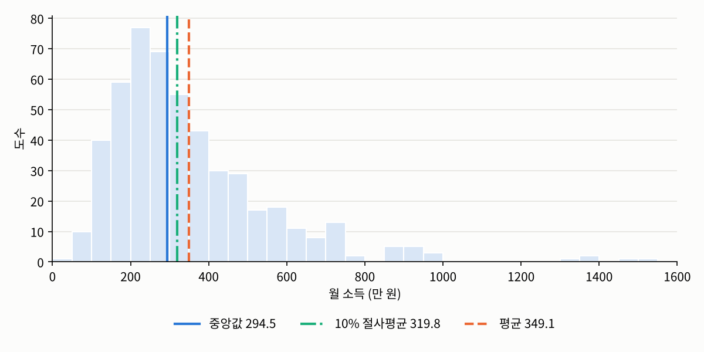

## 들어가며

[장 소개 글](index.qmd)에서 분포를 요약할 때 가장 먼저 묻는 질문은 "가운데가 어디인가?"라고 했습니다. 이번 글에서는 이 질문에 답하는 숫자들을 다룹니다.

먼저 데이터로 계산한 숫자를 부르는 이름인 **통계량**을 정해 두고, 가장 익숙한 **평균**부터 시작해 **중앙값**과 **최빈값**을 차례로 살펴봅니다. 세 값이 각각 어떤 의미에서 "가운데"인지를 정리한 뒤, 평균과 중앙값이 크게 다른 데이터에서 무엇을 읽을 수 있는지 확인하고, 상황에 따라 쓰는 여러 가지 다른 평균도 소개하겠습니다.

## 숫자 하나로 말해야 한다면

김찬호가 친구에게 "요즘 스팸 문자를 하루에 몇 개나 받아?"라는 질문을 받았다고 해 보겠습니다. [2.2](../02-data-and-distributions/02-frequency-tables.qmd)의 30일치 기록을 모두 읊을 수는 없으니, 숫자 하나로 답해야 합니다. 어떤 숫자가 좋을까요?

- 30일 동안 받은 스팸을 모두 더해 30으로 나눈 값, 즉 **평균**은 2.4개쯤입니다.
- 받은 개수를 줄 세웠을 때 가운데 오는 값, 즉 **중앙값**은 3개입니다.
- 가장 많은 날에 받은 개수, 즉 **최빈값**도 3개입니다.

셋 다 "하루에 보통 몇 개"에 대한 그럴듯한 답이지만, 값이 조금씩 다릅니다. 각각이 다른 의미의 "가운데"이기 때문입니다. 이 차이를 정확히 하기 위해 먼저 용어 하나를 정해 두겠습니다.

::: {.callout-note icon=false .callout-definition}
### 정의 3.1.1 (통계량)
데이터 $x = (x_1, \dots, x_n)$으로부터 정해진 규칙에 따라 계산한 값 $T(x)$를 **통계량**(statistic)이라고 합니다.
:::

평균, 중앙값, 최빈값, 그리고 2장의 사분위수와 사분위 범위는 모두 통계량입니다. 통계량은 **모수를 몰라도 데이터만 있으면 계산할 수 있는 값**이라는 점이 중요합니다. 지금은 데이터를 요약하는 숫자로 쓰지만, 5장에서 데이터를 확률변수 $X_1, \dots, X_n$의 실현값으로 다시 보면 통계량 $T(X_1, \dots, X_n)$도 확률변수가 됩니다. 그때 통계량은 모수를 짐작하는 도구, 즉 추정량이 됩니다.

## 평균

::: {.callout-note icon=false .callout-definition}
### 정의 3.1.2 (산술평균)
수치형 데이터 $x_1, \dots, x_n$에 대해

$$\bar{x} := \frac{1}{n} \sum_{i=1}^{n} x_i$$

를 데이터의 **산술평균**(arithmetic mean) 또는 간단히 **평균**이라고 합니다.
:::

데이터가 도수분포표로 정리되어 있으면, 원래 데이터를 되살리지 않고도 평균을 계산할 수 있습니다.

::: {.callout-important icon=false .callout-satz}
### 정리 3.1.3 (도수분포로 계산한 평균)
데이터에 나타나는 서로 다른 값이 $a_1, \dots, a_m$이고 그 상대도수가 $f(a_1), \dots, f(a_m)$이면

$$\bar{x} = \sum_{j=1}^{m} a_j \, f(a_j)$$

입니다.
:::

::: {.callout-tip collapse="true" icon=false .callout-beweis}
### 증명
값이 $a_j$인 데이터는 정확히 $h(a_j)$개이므로, 데이터를 값별로 묶어 더하면

$$\sum_{i=1}^{n} x_i = \sum_{j=1}^{m} a_j \, h(a_j)$$

입니다. 양변을 $n$으로 나누면 $f(a_j) = h(a_j)/n$이므로 원하는 식을 얻습니다. $\square$
:::

평균은 **각 값에 그 값이 차지하는 비율을 곱해 더한 것**입니다. [1.2](../01-what-is-statistics/02-population-sample-model.qmd)에서 모집단의 평균이 확률로 가중한 평균, 즉 기대값과 같았던 것과 똑같은 구조입니다. 스팸 데이터로 확인해 보겠습니다.

```python
import numpy as np

rng = np.random.default_rng(1557)
spam = rng.poisson(2.5, size=30)
values, counts = np.unique(spam, return_counts=True)
f = counts / spam.size

print("평균 (데이터로)     :", round(spam.mean(), 3))
print("평균 (도수분포표로) :", round(np.sum(values * f), 3))
print("중앙값              :", np.median(spam))
print("최빈값              :", values[counts == counts.max()])
```

```
평균 (데이터로)     : 2.367
평균 (도수분포표로) : 2.367
중앙값              : 3.0
최빈값              : [3]
```

## 평균은 무게중심입니다

평균에는 물리적으로 아주 분명한 의미가 있습니다. 수직선을 가벼운 막대로 보고, 각 데이터 위치에 같은 무게의 추를 하나씩 올려놓았다고 생각해 보세요. 이 막대를 손가락 하나로 받쳐 균형을 잡으려면 어디를 받쳐야 할까요? 바로 평균의 위치입니다. 다음 정리가 이것을 정확히 말해 줍니다.

::: {.callout-important icon=false .callout-satz}
### 정리 3.1.4 (평균의 성질)
수치형 데이터 $x_1, \dots, x_n$의 평균 $\bar{x}$에 대해 다음이 성립합니다.

1. **편차의 합은 0입니다:** $\displaystyle \sum_{i=1}^{n} (x_i - \bar{x}) = 0$.
2. **제곱 거리의 합을 가장 작게 만듭니다:** 모든 실수 $c$에 대해
$$\sum_{i=1}^{n} (x_i - c)^2 = \sum_{i=1}^{n} (x_i - \bar{x})^2 + n(\bar{x} - c)^2 \;\ge\; \sum_{i=1}^{n} (x_i - \bar{x})^2$$
이고, 등호는 $c = \bar{x}$일 때만 성립합니다.
3. **단위를 바꾸면 그대로 따라 바뀝니다:** 실수 $a, b$에 대해 $y_i := a + b x_i$이면 $\bar{y} = a + b\bar{x}$입니다.
:::

::: {.callout-tip collapse="true" icon=false .callout-beweis}
### 증명
1. $\sum_{i}(x_i - \bar{x}) = \sum_i x_i - n\bar{x} = n\bar{x} - n\bar{x} = 0$입니다.

2. $x_i - c = (x_i - \bar{x}) + (\bar{x} - c)$로 쪼개어 제곱하면

$$\sum_i (x_i - c)^2 = \sum_i (x_i - \bar{x})^2 + 2(\bar{x} - c)\sum_i (x_i - \bar{x}) + n(\bar{x} - c)^2$$

이고, 1에 의해 가운데 항이 0입니다. 마지막 항은 0 이상이고 $c = \bar{x}$일 때만 0입니다.

3. $\bar{y} = \frac{1}{n}\sum_i (a + b x_i) = a + b \cdot \frac{1}{n}\sum_i x_i = a + b\bar{x}$입니다. $\square$
:::

첫 번째 성질이 무게중심 이야기입니다. 각 데이터가 평균에서 떨어진 정도 $x_i - \bar{x}$를 **편차**(deviation)라고 하는데, 평균보다 큰 값들의 편차와 작은 값들의 편차가 정확히 상쇄되어 합이 0이 됩니다. 균형이 맞는다는 뜻입니다.

두 번째 성질은 평균의 또 다른 얼굴입니다. "모든 데이터와의 **제곱 거리의 합**이 가장 작은 점"을 찾으면 그것이 평균입니다. 이 성질은 3.2의 분산, 4장의 최소제곱 직선, 그리고 그 뒤의 회귀 분석으로 계속 이어지는 아주 중요한 성질입니다.

세 번째 성질은 실용적입니다. 몸무게의 평균을 그램으로 계산한 뒤 킬로그램으로 바꾸고 싶다면, 데이터를 모두 바꿔 다시 계산할 필요 없이 평균만 1000으로 나누면 됩니다. 섭씨 온도의 평균을 화씨로 바꿀 때도 $F = 32 + 1.8C$를 평균에 그대로 적용하면 됩니다.

## 중앙값은 절대 거리의 중심입니다

중앙값은 [2.5](../02-data-and-distributions/05-quantiles-boxplots.qmd)에서 50% 분위수로 정의했습니다. 줄 세운 데이터의 가운데 값이고, 데이터가 짝수 개이면 가운데 두 값의 평균입니다. 이 장에서는 $\tilde{x}$로 쓰겠습니다.

평균이 제곱 거리의 합을 가장 작게 만드는 값이라면, 중앙값은 **절대 거리**의 합을 가장 작게 만드는 값입니다.

::: {.callout-important icon=false .callout-satz}
### 정리 3.1.5 (중앙값과 절대 거리)
수치형 데이터 $x_1, \dots, x_n$에 대해 함수

$$g(c) := \sum_{i=1}^{n} |x_i - c|$$

는 경험적 중앙값(2.5의 정의 2.5.1에서 $p = 1/2$인 분위수)에서 최솟값을 가집니다. 특히 $n$이 짝수이면 분위수 구간 $[x_{(n/2)}, x_{(n/2+1)}]$ 위의 모든 점에서 같은 최솟값을 가집니다.
:::

::: {.callout-tip collapse="true" icon=false .callout-beweis}
### 증명
$g$는 데이터 값마다 꺾이는 꺾은선 함수입니다. $c$가 어떤 데이터 값과도 같지 않을 때, $c$를 오른쪽으로 아주 조금 움직이면 $c$보다 작은 데이터와의 거리는 늘고 큰 데이터와의 거리는 줄어드므로, $g$의 기울기는

$$\#\{i : x_i < c\} - \#\{i : x_i > c\}$$

입니다. 이 기울기는 $c$보다 작은 데이터가 절반보다 적으면 음수, 절반보다 많으면 양수입니다. 따라서 $g$는 $c$보다 작은 값과 큰 값의 개수가 균형을 이루는 곳, 즉 중앙값에서 최소가 됩니다. $n$이 짝수이면 $x_{(n/2)}$와 $x_{(n/2+1)}$ 사이에서 기울기가 정확히 0이어서, 그 구간 전체에서 $g$가 같은 최솟값을 가집니다. $\square$
:::

2.5에서 데이터가 짝수 개일 때 중앙값이 하나로 정해지지 않고 구간이 되는 것을 보았는데, 그 구간이 바로 절대 거리의 합이 똑같이 가장 작은 점들의 모임이었던 셈입니다.

정리 3.1.4와 3.1.5를 나란히 놓으면 평균과 중앙값의 차이가 분명해집니다. 제곱 거리는 멀리 떨어진 값을 훨씬 크게 벌줍니다. 10만큼 떨어진 값은 1만큼 떨어진 값보다 절대 거리로는 10배, 제곱 거리로는 100배 무겁습니다. 그래서 평균은 멀리 떨어진 값 쪽으로 강하게 끌려가고, 중앙값은 그렇지 않습니다. 이 차이는 3.4에서 다시 자세히 다룹니다.

## 최빈값

::: {.callout-note icon=false .callout-definition}
### 정의 3.1.6 (최빈값)
데이터에서 가장 자주 나타나는 값, 즉 절대도수가 가장 큰 값을 **최빈값**(mode)이라고 합니다. 가장 큰 도수를 갖는 값이 여럿이면 그 값들이 모두 최빈값입니다.
:::

최빈값은 세기만 하면 구할 수 있으므로 **모든 척도**에서 쓸 수 있는 유일한 대표값입니다. 펭귄 데이터에서 종의 최빈값은 Adelie입니다. 종의 평균이나 중앙값은 정의할 수 없습니다.

대신 연속형 데이터에서는 최빈값이 그다지 쓸모가 없습니다. 거의 모든 값이 한 번씩만 나오니 최빈값이 의미 없이 많아지거나, 우연히 몇 번 겹친 값이 최빈값이 되기 때문입니다. 간헐천 대기 시간에서 가장 자주 나온 값은 78분(15번)이지만, [2.3](../02-data-and-distributions/03-histograms.qmd)의 히스토그램에서 본 분포의 특징은 55분 근처와 80분 근처의 두 봉우리였습니다. 연속형 데이터에서는 개별 값의 최빈값 대신 히스토그램이나 커널 밀도 추정의 **봉우리 위치**를 최빈값처럼 읽는 경우가 많습니다. 봉우리가 둘이면 최빈값도 둘이라고 보는 것이 자연스럽고, 그래서 2.3에서 봉우리가 여럿인 분포를 multimodal이라고 불렀습니다.

## 척도에 따라 쓸 수 있는 대표값

[2.1](../02-data-and-distributions/01-variables-and-scales.qmd)의 척도와 연결해 정리하면 다음과 같습니다.

| 척도 | 최빈값 | 중앙값 | 평균 |
|:---|:---:|:---:|:---:|
| 명목 | ○ | | |
| 순서 | ○ | ○ | |
| 등간, 비율 | ○ | ○ | ○ |

중앙값은 줄을 세울 수 있어야 하므로 순서 척도부터, 평균은 값을 더할 수 있어야 하므로 등간 척도부터 의미가 있습니다. 2.1에서 이야기했던 리커트 척도 점수의 평균이 조심해서 써야 하는 이유도 여기에 있습니다.

## 평균과 중앙값이 다를 때

스팸 데이터에서는 평균(2.4)과 중앙값(3)이 조금 달랐습니다. 이 차이가 크게 벌어지는 대표적인 경우가 소득입니다. [2.3](../02-data-and-distributions/03-histograms.qmd)에서 만든 가상의 월 소득 데이터 500개로 확인해 보겠습니다.

```python
import numpy as np
from scipy import stats

rng = np.random.default_rng(1557)
income = np.round(rng.lognormal(mean=np.log(300), sigma=0.55, size=500))  # 2.3의 가상 월 소득 (만 원)

print(f"평균              : {income.mean():.1f}")
print(f"중앙값            : {np.median(income):.1f}")
print(f"10% 절사평균      : {stats.trim_mean(income, 0.1):.1f}")
print(f"평균보다 적게 버는 사람의 비율: {np.mean(income < income.mean()):.3f}")
```

```
평균              : 349.1
중앙값            : 294.5
10% 절사평균      : 319.8
평균보다 적게 버는 사람의 비율: 0.622
```

{fig-alt="가상의 월 소득 500개의 히스토그램. 200만에서 300만 원 근처에 가장 많이 몰려 있고 오른쪽으로 1500만 원까지 꼬리가 길게 늘어져 있다. 세로선 세 개가 그려져 있는데, 왼쪽부터 중앙값 294.5(파란 실선), 10퍼센트 절사평균 319.8(초록 점쇄선), 평균 349.1(주황 점선)이다." width=85%}

평균은 349.1만 원이지만, 중앙값은 294.5만 원으로 50만 원 넘게 낮습니다. 그리고 평균보다 적게 버는 사람이 62.2%나 됩니다. "평균 소득"이라는 말에서 흔히 "보통 사람의 소득"을 떠올리지만, 이 데이터에서 평균은 보통 사람보다 꽤 위에 있는 셈입니다.

이유는 정리 3.1.4에 있습니다. 평균은 무게중심이므로, 오른쪽 꼬리의 소수 고소득자들이 시소의 한쪽 끝에 앉은 무거운 사람처럼 평균을 오른쪽으로 끌어당깁니다. 중앙값은 "몇 명이 더 많은가"만 보기 때문에 그 사람들이 얼마나 많이 버는지에는 관심이 없습니다. 그래서 일반적으로

- 오른쪽으로 꼬리가 긴 분포에서는 **평균 > 중앙값**,
- 왼쪽으로 꼬리가 긴 분포에서는 **평균 < 중앙값**,
- 좌우 대칭인 분포에서는 **평균 ≈ 중앙값**

인 경우가 많습니다. (항상 그런 것은 아니지만, 분포의 치우침을 짐작하는 간단한 단서로 쓸 수 있습니다.) 소득처럼 꼬리가 긴 데이터에서 "보통 사람"을 대표하는 값으로 중앙값이 자주 쓰이는 이유입니다. 우리나라에서도 기초생활보장 같은 복지 제도의 기준으로 평균 소득이 아니라 **중위소득**을 씁니다.

그렇다고 평균이 쓸모없는 것은 아닙니다. 평균에 $n$을 곱하면 **총합**이 됩니다. 전체 소득세 수입이나 전체 소비 규모처럼 총량이 중요한 질문에서는 평균이 필요한 숫자이고, 중앙값으로는 그 계산을 할 수 없습니다. 두 값은 서로 다른 질문에 답하는 숫자입니다.

봉우리가 둘인 간헐천 대기 시간은 또 다른 경우입니다. 평균은 약 70.9분, 중앙값은 76분인데, 2.3에서 보았듯이 두 값 모두 두 봉우리 사이의 골짜기 근처에 있습니다. 이런 데이터에서는 어떤 대표값도 분포를 제대로 대표하지 못하고, 두 무리를 나누어 각각 요약하는 것이 낫습니다.

## 절사평균: 양 끝을 잘라 낸 평균

평균과 중앙값 사이의 타협안도 있습니다.

::: {.callout-note icon=false .callout-definition}
### 정의 3.1.7 (절사평균)
$0 \le \alpha < 1/2$에 대해 $k := \lfloor n\alpha \rfloor$이라 할 때, 줄 세운 데이터에서 가장 작은 값 $k$개와 가장 큰 값 $k$개를 버리고 남은 값들의 평균

$$\bar{x}_\alpha := \frac{1}{n - 2k} \sum_{i=k+1}^{n-k} x_{(i)}$$

를 **$\alpha$ 절사평균**(trimmed mean)이라고 합니다. 흔히 $100\alpha\%$ 절사평균이라고 부릅니다.
:::

$\alpha = 0$이면 아무것도 버리지 않으니 보통의 평균이고, $\alpha$를 $1/2$ 가까이 키우면 가운데 한두 개만 남으니 중앙값에 가까워집니다. 그 사이의 $\alpha$는 평균처럼 많은 데이터를 쓰면서도 극단적인 값의 영향은 덜 받는 중간 지점을 제공합니다. 위 소득 데이터의 10% 절사평균 319.8만 원은 실제로 평균과 중앙값 사이에 있습니다.

심사위원 여러 명이 점수를 매기는 종목에서 가장 높은 점수와 가장 낮은 점수를 빼고 평균을 내는 방식이 쓰이는 것도 같은 생각입니다. 한 심사위원이 지나치게 후하거나 박하게 채점하더라도 결과가 크게 흔들리지 않게 하려는 것입니다.

## 다른 평균들

"평균"이라는 말은 산술평균만 가리키지 않습니다. 데이터가 무엇을 뜻하느냐에 따라 더 자연스러운 평균이 따로 있습니다.

::: {.callout-note icon=false .callout-definition}
### 정의 3.1.8 (가중평균, 기하평균, 조화평균)
수치형 데이터 $x_1, \dots, x_n$에 대해

- 음이 아닌 가중치 $w_1, \dots, w_n$ (합이 양수)이 주어지면 $\displaystyle \bar{x}_w := \frac{\sum_{i} w_i x_i}{\sum_{i} w_i}$를 **가중평균**(weighted mean),
- 모든 $x_i > 0$일 때 $\displaystyle \bar{x}_G := \Big(\prod_{i=1}^{n} x_i\Big)^{1/n}$을 **기하평균**(geometric mean),
- 모든 $x_i > 0$일 때 $\displaystyle \bar{x}_H := \frac{n}{\sum_{i=1}^{n} 1/x_i}$을 **조화평균**(harmonic mean)

이라고 합니다.
:::

각각이 언제 필요한지 예로 보겠습니다.

**가중평균: 학점 평균.** 박종우가 3학점 과목에서 A+(4.5), 2학점 과목에서 B0(3.0), 1학점 과목에서 C+(2.5)를 받았습니다. 세 성적의 단순 평균은 $(4.5 + 3.0 + 2.5)/3 \approx 3.33$이지만, 학점 평균은 학점 수를 가중치로 한

$$\frac{3 \cdot 4.5 + 2 \cdot 3.0 + 1 \cdot 2.5}{3 + 2 + 1} = \frac{22}{6} \approx 3.67$$

입니다. 비중이 큰 과목을 잘 봤으니 평균이 올라갔습니다. 정리 3.1.3도 사실 상대도수를 가중치로 한 가중평균입니다.

**기하평균: 수익률.** 어떤 투자가 첫해에 50% 오르고 다음 해에 50% 내렸습니다. 수익률의 산술평균은 $(+50\% - 50\%)/2 = 0\%$이니 "평균적으로 본전"처럼 보입니다. 하지만 100만 원은 첫해 뒤 150만 원, 다음 해 뒤 75만 원이 되어 25%를 잃었습니다. 수익률은 **곱해서** 쌓이기 때문에, 성장 배율 1.5와 0.5의 기하평균 $\sqrt{1.5 \times 0.5} \approx 0.866$이 올바른 "연평균 배율"이고, 연평균 수익률은 약 $-13.4\%$입니다. 실제로 $0.866^2 \approx 0.75$입니다.

**조화평균: 평균 속력.** 120km 떨어진 곳에 갈 때는 시속 60km로, 돌아올 때는 시속 40km로 운전했습니다. 평균 속력은 시속 50km일까요? 갈 때 2시간, 올 때 3시간이 걸렸으니 240km를 5시간에 달린 셈이고, 평균 속력은 시속 48km입니다. 이것이 60과 40의 조화평균 $2 / (1/60 + 1/40) = 48$입니다. 같은 **거리**를 서로 다른 속력으로 달렸을 때는 조화평균이 맞는 평균입니다.

세 예의 공통점은 "무엇을 더하는 것이 의미가 있는가"입니다. 학점은 학점 수만큼, 수익률은 곱으로, 속력은 걸린 시간으로 쌓입니다. 평균을 계산하기 전에 데이터가 어떻게 합쳐지는지를 먼저 생각해야 합니다.

## 정리

이번 글에서는 분포의 가운데를 나타내는 숫자들을 다루었습니다.

- 데이터로 계산한 값을 **통계량**이라고 합니다. 통계량은 5장 이후 모수를 짐작하는 도구가 됩니다.
- **평균**은 편차의 합이 0인 무게중심이자, 제곱 거리의 합을 가장 작게 만드는 값입니다. 단위를 바꾸면 평균도 그대로 따라 바뀝니다.
- **중앙값**은 절대 거리의 합을 가장 작게 만드는 값으로, 멀리 떨어진 값에 덜 끌려갑니다. **최빈값**은 모든 척도에서 쓸 수 있습니다.
- 꼬리가 긴 분포에서는 평균과 중앙값이 크게 다르며, 각각 총량과 "보통"이라는 다른 질문에 답합니다. **절사평균**은 그 중간입니다.
- 데이터가 합쳐지는 방식에 따라 **가중평균, 기하평균, 조화평균**이 더 자연스러울 때가 있습니다.

그런데 가운데가 같아도 데이터가 퍼진 정도는 전혀 다를 수 있습니다. 다음 글에서는 그 퍼진 정도를 숫자로 나타내는 방법을 다루겠습니다.

---

### 연결되는 개념
* $\leftarrow$ **이전 개념:** [3 데이터를 숫자로 요약하기](index.qmd)
* $\rightarrow$ **다음 개념:** [3.2 퍼진 정도](02-spread.qmd)
