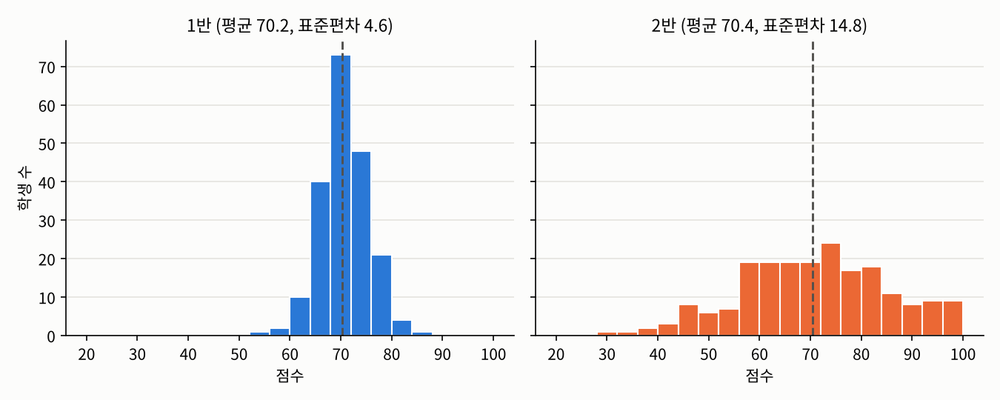

## 들어가며

[지난 글](01-center.qmd)에서는 분포의 가운데를 나타내는 평균, 중앙값, 최빈값을 다루었습니다. 이번 글에서는 두 번째 질문, **데이터가 얼마나 퍼져 있는가**를 다룹니다.

먼저 가운데만으로는 부족한 예를 보고, 가장 단순한 범위에서 출발해 가장 널리 쓰이는 **분산**과 **표준편차**를 정의합니다. 분산을 $n$이 아니라 $n-1$로 나누는 이유를 직관적으로 살펴본 뒤, 평균 절대편차와 **MAD** 같은 다른 퍼짐의 척도, 그리고 단위가 다른 데이터의 퍼짐을 비교하는 **변동계수**를 소개하겠습니다.

## 평균이 같은 두 반

두 반의 수학 시험 점수가 있습니다. 실제 점수 대신 가상의 데이터를 만들겠습니다(100점 만점이라 100을 넘는 값은 100으로 맞췄습니다).

```python
import numpy as np

rng = np.random.default_rng(1557)
class_a = np.round(rng.normal(70, 5, size=200))    # 가상의 1반 점수
class_b = np.round(rng.normal(70, 15, size=200))   # 가상의 2반 점수
class_b = np.clip(class_b, 0, 100)
for name, x in [("1반", class_a), ("2반", class_b)]:
    print(f"{name}: 평균 {x.mean():.1f}, 표준편차 {x.std(ddof=1):.1f}, 최저 {x.min():.0f}, 최고 {x.max():.0f}")
```

```
1반: 평균 70.2, 표준편차 4.6, 최저 53, 최고 84
2반: 평균 70.4, 표준편차 14.8, 최저 29, 최고 100
```

{fig-alt="평균이 약 70점으로 같은 두 반의 점수 히스토그램. 1반(파랑)은 점수가 60점에서 80점 사이에 좁게 몰려 있고, 2반(주황)은 30점부터 100점까지 넓게 퍼져 있다. 두 그림 모두 평균 위치에 회색 점선이 있다." width=90%}

평균만 보면 두 반은 똑같습니다. 하지만 1반은 거의 모든 학생이 60점에서 80점 사이에 있고, 2반은 30점대부터 만점까지 넓게 흩어져 있습니다. 1반 선생님은 수업 속도를 하나로 맞춰도 되겠지만, 2반 선생님은 보충 수업과 심화 수업을 따로 고민해야 할 겁니다. 이 차이를 숫자로 나타내는 것이 **퍼짐의 척도**입니다. 위 출력의 "표준편차"가 그중 하나인데, 이것이 무엇인지 차근차근 정의해 보겠습니다.

## 범위와 사분위 범위

가장 단순한 방법은 가장 큰 값과 가장 작은 값의 차이를 보는 것입니다.

::: {.callout-note icon=false .callout-definition}
### 정의 3.2.1 (범위)
수치형 데이터에 대해 $R := x_{(n)} - x_{(1)}$을 **범위**(range)라고 합니다.
:::

위 두 반의 범위는 각각 31점과 71점입니다. 계산이 쉽고 뜻도 분명하지만, 범위는 **가장 극단적인 두 값만** 보기 때문에 그 사이의 데이터가 어떻게 퍼져 있는지는 전혀 반영하지 못하고, 극단값 하나에 크게 흔들립니다. 1반에 시험 날 아파서 10점을 받은 학생이 한 명만 있었어도 범위는 두 배 넘게 커집니다.

[2.5](../02-data-and-distributions/05-quantiles-boxplots.qmd)의 **사분위 범위** $\mathrm{IQR} = Q_3 - Q_1$은 이 문제를 피하기 위해 양 끝의 25%씩을 버리고 가운데 50%의 폭만 봅니다. 극단값에 흔들리지 않는다는 장점이 있지만, 이번에는 양 끝의 데이터를 전혀 보지 않는다는 단점이 있습니다.

## 편차에서 분산으로

모든 데이터를 다 쓰면서 퍼진 정도를 재고 싶다면, 각 데이터가 가운데에서 얼마나 떨어져 있는지, 즉 **편차** $x_i - \bar{x}$를 모아 평균을 내는 것이 자연스러운 생각입니다.

그런데 [정리 3.1.4](01-center.qmd)에 따르면 편차의 합은 항상 0입니다. 양수와 음수가 정확히 상쇄되니, 편차를 그냥 평균 내면 어떤 데이터든 0이 나옵니다. 그래서 부호를 없애야 하는데, 방법은 두 가지입니다. 절댓값을 씌우거나, 제곱하는 것입니다. 제곱하는 쪽이 계산과 이론에서 훨씬 다루기 편해서 가장 널리 쓰입니다.

::: {.callout-note icon=false .callout-definition}
### 정의 3.2.2 (표본 분산과 표본 표준편차)
수치형 데이터 $x_1, \dots, x_n$ ($n \ge 2$)에 대해

$$s^2 := \frac{1}{n-1} \sum_{i=1}^{n} (x_i - \bar{x})^2$$

을 **표본 분산**(sample variance)이라고 하고, 그 제곱근

$$s := \sqrt{s^2} = \sqrt{\frac{1}{n-1} \sum_{i=1}^{n} (x_i - \bar{x})^2}$$

을 **표본 표준편차**(sample standard deviation)라고 합니다.
:::

분산은 편차를 제곱했기 때문에 단위도 제곱이 됩니다. 몸무게가 g 단위라면 분산은 g² 단위라서 해석하기 어렵습니다. 그래서 제곱근을 씌워 원래 단위로 되돌린 표준편차를 더 자주 보고합니다. 표준편차는 대략 "데이터가 평균에서 **보통 이 정도** 떨어져 있다"는 크기로 읽을 수 있습니다. 1반 학생들은 평균에서 보통 5점 안팎, 2반 학생들은 15점 안팎 떨어져 있는 셈입니다.

## 왜 $n$이 아니라 $n-1$로 나눌까요?

정의를 보고 가장 먼저 드는 의문은 이것일 겁니다. "평균"을 내는 것이라면 $n$으로 나눠야 할 텐데, 왜 $n-1$일까요?

정확한 답은 6장에서 추정량의 **불편성**을 정의한 뒤에 드릴 수 있지만, 직관은 지금도 설명할 수 있습니다. 우리가 정말 알고 싶은 것은 대개 이 데이터 자체의 퍼짐이 아니라, 데이터를 만들어 낸 **모집단**의 퍼짐입니다. 모집단의 퍼짐은 데이터가 모집단의 평균 $\mu$에서 얼마나 떨어져 있는지로 재야 합니다. 그런데 우리는 $\mu$를 모르기 때문에 그 자리에 표본 평균 $\bar{x}$를 씁니다.

여기서 [정리 3.1.4](01-center.qmd)의 두 번째 성질이 문제를 일으킵니다. 표본 평균 $\bar{x}$는 **바로 이 데이터와의 제곱 거리의 합을 가장 작게 만드는 점**이므로, 어떤 $\mu$에 대해서도

$$\sum_{i=1}^{n} (x_i - \bar{x})^2 \;\le\; \sum_{i=1}^{n} (x_i - \mu)^2$$

입니다. 즉 $\bar{x}$로 잰 제곱 편차의 합은 진짜 중심 $\mu$로 잰 것보다 **항상 작거나 같습니다.** 이것을 그대로 $n$으로 나누면 모집단의 퍼짐을 체계적으로 작게 짐작하게 됩니다. $n$ 대신 조금 작은 $n-1$로 나누면 결과가 조금 커져서 이 과소평가를 보정해 주고, 6장에서 보겠지만 평균적으로는 정확히 보정됩니다.

또 다른 설명으로 **자유도**(degrees of freedom)라는 말을 씁니다. 편차 $n$개는 합이 0이어야 한다는 제약이 하나 있으므로, $n-1$개를 알면 마지막 하나는 저절로 정해집니다. 자유롭게 움직일 수 있는 편차는 $n-1$개뿐이라는 뜻입니다.

데이터가 많으면 $n$과 $n-1$의 차이는 무시할 만하지만, 데이터가 적을 때는 차이가 납니다. 실용적으로 주의할 점이 하나 있습니다. **넘파이의 `np.std`와 `np.var`는 기본값으로 $n$으로 나눕니다.** $n-1$로 나누려면 위 코드처럼 `ddof=1`을 지정해야 합니다. 반면 판다스의 `.std()`와 `.var()`는 기본값이 $n-1$입니다. 같은 데이터로 계산한 표준편차가 도구에 따라 조금 다르다면 이것부터 확인해 보세요.

## 손으로 계산해 보기

분산을 손으로 계산할 때는 다음 공식이 편리합니다.

::: {.callout-important icon=false .callout-satz}
### 정리 3.2.3 (분산의 성질)
1. **계산 공식:** $\displaystyle \sum_{i=1}^{n} (x_i - \bar{x})^2 = \sum_{i=1}^{n} x_i^2 - n\bar{x}^2$.
2. **단위 변환:** 실수 $a, b$에 대해 $y_i := a + b x_i$이면 $s_y^2 = b^2 s_x^2$이고 $s_y = |b|\, s_x$입니다.
:::

::: {.callout-tip collapse="true" icon=false .callout-beweis}
### 증명
1. $(x_i - \bar{x})^2 = x_i^2 - 2\bar{x}x_i + \bar{x}^2$을 더하면 $\sum_i x_i^2 - 2\bar{x} \cdot n\bar{x} + n\bar{x}^2 = \sum_i x_i^2 - n\bar{x}^2$입니다.

2. 정리 3.1.4에서 $\bar{y} = a + b\bar{x}$이므로 $y_i - \bar{y} = b(x_i - \bar{x})$입니다. 제곱해서 더하고 $n-1$로 나누면 $s_y^2 = b^2 s_x^2$이고, 제곱근을 씌우면 됩니다. $\square$
:::

두 번째 성질은 직관적입니다. 모든 데이터에 같은 값 $a$를 더하면 분포가 통째로 옮겨질 뿐 퍼진 정도는 그대로이고, 모든 데이터에 $b$를 곱하면 퍼진 정도도 $|b|$배가 됩니다. 몸무게의 표준편차를 g에서 kg으로 바꾸려면 1000으로 나누기만 하면 됩니다.

작은 예로 계산해 보겠습니다. 데이터가 $2, 3, 7, 8, 10$이면 평균은 $\bar{x} = 30/5 = 6$이고, 편차는 $-4, -3, 1, 2, 4$입니다. 편차의 합이 0인 것을 확인할 수 있습니다. 편차를 제곱해 더하면 $16 + 9 + 1 + 4 + 16 = 46$이고, 계산 공식으로도 $\sum x_i^2 - n\bar{x}^2 = (4 + 9 + 49 + 64 + 100) - 5 \cdot 36 = 226 - 180 = 46$으로 같습니다. 따라서 $s^2 = 46/4 = 11.5$이고 $s \approx 3.391$입니다.

## 다른 퍼짐의 척도들

분산 외에도 퍼진 정도를 재는 방법은 여러 가지입니다. 편차의 부호를 없애는 방법으로 제곱 대신 절댓값을 쓸 수도 있고, 평균 대신 중앙값을 기준으로 삼을 수도 있습니다.

::: {.callout-note icon=false .callout-definition}
### 정의 3.2.4 (평균 절대편차와 MAD)
수치형 데이터의 평균을 $\bar{x}$, 중앙값을 $\tilde{x}$라 할 때,

- $\displaystyle \delta := \frac{1}{n} \sum_{i=1}^{n} |x_i - \bar{x}|$를 **평균 절대편차**(mean absolute deviation),
- $\displaystyle \delta_{\mathrm{med}} := \frac{1}{n} \sum_{i=1}^{n} |x_i - \tilde{x}|$를 **중앙값 기준 평균 절대편차**,
- $\mathrm{MAD} := \operatorname{median}\big(|x_1 - \tilde{x}|, \dots, |x_n - \tilde{x}|\big)$를 **중앙값 절대편차**(median absolute deviation, **MAD**)

라고 합니다.
:::

MAD는 이름이 조금 헷갈리는데, "중앙값에서 떨어진 거리들의 중앙값"입니다. 중앙값을 두 번 쓰기 때문에 3.4에서 보겠지만 극단값에 아주 강합니다. 앞의 작은 데이터로 모두 계산해 보겠습니다.

```python
import numpy as np

x = np.array([2, 3, 7, 8, 10])
n = x.size
xbar = x.mean()
med = np.median(x)
q1, q3 = np.quantile(x, [0.25, 0.75], method="averaged_inverted_cdf")

print("범위                    :", x.max() - x.min())
print("IQR                     :", q3 - q1)
print("표본 분산 s^2           :", np.sum((x - xbar) ** 2) / (n - 1))
print("계산 공식으로           :", (np.sum(x ** 2) - n * xbar ** 2) / (n - 1))
print("표본 표준편차 s         :", round(np.std(x, ddof=1), 3))
print("평균 절대편차           :", np.mean(np.abs(x - xbar)))
print("중앙값 기준 평균 절대편차:", np.mean(np.abs(x - med)))
print("MAD                     :", np.median(np.abs(x - med)))
```

```
범위                    : 8
IQR                     : 5.0
표본 분산 s^2           : 11.5
계산 공식으로           : 11.5
표본 표준편차 s         : 3.391
평균 절대편차           : 2.8
중앙값 기준 평균 절대편차: 2.6
MAD                     : 3.0
```

중앙값이 7이므로 중앙값에서의 거리는 $5, 4, 0, 1, 3$이고, 그 평균이 2.6, 그 중앙값이 MAD = 3입니다. [정리 3.1.5](01-center.qmd)에 따르면 중앙값은 절대 거리의 합을 가장 작게 만드는 점이므로, 중앙값 기준 평균 절대편차(2.6)는 평균 기준 평균 절대편차(2.8)보다 항상 작거나 같습니다.

**MAD와 표준편차.** 여러 척도가 서로 다른 값을 내놓으니 직접 비교하기 어렵습니다. 그래서 MAD에 상수를 곱해 표준편차와 같은 크기로 맞춰 쓰는 경우가 많습니다. 5장에서 다룰 정규분포처럼 좌우 대칭인 종 모양 데이터라면 $1.4826 \times \mathrm{MAD}$가 표준편차와 비슷해집니다.

```python
import numpy as np

rng = np.random.default_rng(1557)
z = rng.normal(loc=50, scale=10, size=1000)       # 표준편차가 10인 종 모양 데이터
mad = np.median(np.abs(z - np.median(z)))
print(f"표본 표준편차     : {z.std(ddof=1):.2f}")
print(f"MAD               : {mad:.2f}")
print(f"1.4826 × MAD      : {1.4826 * mad:.2f}")
```

```
표본 표준편차     : 9.66
MAD               : 6.63
1.4826 × MAD      : 9.83
```

상수 1.4826이 어디서 왔는지는 5장에서 정규분포의 분위수를 배우면 알 수 있습니다. 지금은 "종 모양 데이터에서 MAD를 표준편차의 단위로 바꿔 주는 환산 계수" 정도로 기억해 두시면 됩니다. 3.4에서 이 값을 이용해 이상치를 찾는 방법을 다룹니다.

## 변동계수: 단위가 다른 퍼짐 비교하기

펭귄의 몸무게와 날개 길이 중 어느 쪽이 개체마다 더 들쭉날쭉할까요? 몸무게의 표준편차는 수백 g이고 날개 길이의 표준편차는 몇 mm이니, 숫자만 보면 몸무게가 훨씬 퍼져 있는 것 같습니다. 하지만 g과 mm는 단위가 달라서 표준편차를 직접 비교하는 것은 의미가 없습니다. 몸무게를 kg으로 바꾸기만 해도 표준편차는 1000분의 1이 됩니다.

같은 단위라도 문제가 있습니다. 몸무게가 평균 5000g인 젠투펭귄과 평균 3700g인 아델리펭귄에서 표준편차 500g은 같은 무게의 퍼짐이 아닙니다. 덩치가 큰 동물은 퍼짐도 커지기 마련이니까요.

::: {.callout-note icon=false .callout-definition}
### 정의 3.2.5 (변동계수)
양수인 비율 척도 데이터에 대해

$$\mathrm{CV} := \frac{s}{\bar{x}}$$

를 **변동계수**(coefficient of variation)라고 합니다.
:::

변동계수는 표준편차를 평균으로 나눈 것이므로 단위가 없고, "표준편차가 평균의 몇 퍼센트인가"로 읽습니다. 펭귄 데이터로 계산해 보겠습니다.

```python
import numpy as np
import seaborn as sns

penguins = sns.load_dataset("penguins").dropna(subset=["body_mass_g", "flipper_length_mm"])
for col in ["body_mass_g", "flipper_length_mm"]:
    print(col)
    for species, d in penguins.groupby("species"):
        x = d[col].to_numpy()
        m, s = x.mean(), x.std(ddof=1)
        print(f"  {species:9s}: 평균 {m:7.1f}, 표준편차 {s:6.1f}, 변동계수 {s / m:.3f}")
```

```
body_mass_g
  Adelie   : 평균  3700.7, 표준편차  458.6, 변동계수 0.124
  Chinstrap: 평균  3733.1, 표준편차  384.3, 변동계수 0.103
  Gentoo   : 평균  5076.0, 표준편차  504.1, 변동계수 0.099
flipper_length_mm
  Adelie   : 평균   190.0, 표준편차    6.5, 변동계수 0.034
  Chinstrap: 평균   195.8, 표준편차    7.1, 변동계수 0.036
  Gentoo   : 평균   217.2, 표준편차    6.5, 변동계수 0.030
```

두 가지를 읽을 수 있습니다. 첫째, 세 종 모두 몸무게의 변동계수(약 10~12%)가 날개 길이의 변동계수(약 3%)보다 훨씬 큽니다. 날개 길이는 개체마다 꽤 비슷하지만, 몸무게는 상대적으로 훨씬 들쭉날쭉하다는 뜻입니다. 먹이를 얼마나 먹었는지에 따라 몸무게는 쉽게 변해도 뼈대인 날개 길이는 잘 변하지 않는다고 생각하면 그럴듯합니다.

둘째, 몸무게의 표준편차는 젠투펭귄이 504.1g으로 가장 크지만, 변동계수는 0.099로 오히려 가장 작습니다. 절대적인 퍼짐은 크지만, 덩치에 비하면 가장 고른 셈입니다.

변동계수는 **비율 척도**에서만 의미가 있습니다. 섭씨 온도처럼 0이 임의로 정한 기준점인 데이터에서는, 기준점을 바꾸면(섭씨를 화씨로 바꾸면) 평균이 달라져 변동계수도 제멋대로 바뀌기 때문입니다. [2.1](../02-data-and-distributions/01-variables-and-scales.qmd)의 척도 구분이 여기서도 쓰입니다.

## 정리

이번 글에서는 데이터가 퍼진 정도를 나타내는 숫자들을 다루었습니다.

- 평균이 같아도 퍼진 정도는 전혀 다를 수 있습니다. **범위**는 단순하지만 극단값 두 개만 보고, **사분위 범위**는 가운데 절반만 봅니다.
- 편차의 합은 항상 0이므로 제곱해서 평균을 낸 것이 **분산**, 그 제곱근이 원래 단위의 **표준편차**입니다.
- 표본 분산은 $n-1$로 나눕니다. 표본 평균은 데이터와의 제곱 거리를 가장 작게 만드는 점이라 모집단의 퍼짐을 과소평가하게 되는데, 이를 보정하기 위해서입니다. 넘파이와 판다스의 기본값이 다르다는 점에 주의합니다.
- **평균 절대편차**와 **MAD**는 제곱 대신 절댓값을, 평균 대신 중앙값을 쓰는 퍼짐의 척도입니다. 종 모양 데이터에서는 $1.4826 \times \mathrm{MAD}$가 표준편차와 비슷합니다.
- **변동계수**는 표준편차를 평균으로 나눈 값으로, 단위나 규모가 다른 데이터의 퍼짐을 비교할 때 씁니다. 비율 척도에서만 의미가 있습니다.

지금까지 가운데와 퍼짐을 숫자로 나타냈습니다. 그런데 [2.3](../02-data-and-distributions/03-histograms.qmd)에서 본 것처럼, 분포는 한쪽으로 치우치거나 꼬리가 두꺼울 수도 있습니다. 다음 글에서는 평균과 표준편차를 이용해 데이터를 표준화하는 방법과, 분포의 모양을 숫자로 나타내는 왜도와 첨도를 다루겠습니다.

---

### 연결되는 개념
* $\leftarrow$ **이전 개념:** [3.1 중심의 위치](01-center.qmd)
* $\rightarrow$ **다음 개념:** [3.3 모양과 표준화](03-shape-and-standardization.qmd)
