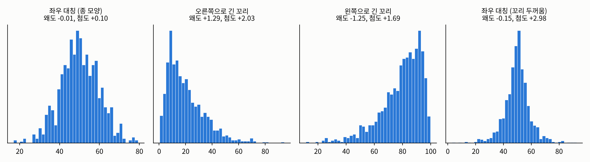

## 들어가며

[지난 두 글](01-center.qmd)에서 분포의 가운데와 퍼진 정도를 숫자로 나타냈습니다. 이번 글에서는 이 두 숫자를 함께 써서 할 수 있는 일 두 가지를 다룹니다.

먼저 평균과 표준편차를 "자"로 삼아 각 데이터가 얼마나 특별한 값인지를 재는 **z-점수**를 정의합니다. 그다음 같은 아이디어를 확장해, 분포가 한쪽으로 치우친 정도를 나타내는 **왜도**와 꼬리가 두꺼운 정도를 나타내는 **첨도**를 살펴보겠습니다.

## 85점과 90점 중 어느 쪽이 더 잘 본 걸까요?

박종우가 수학 시험에서 85점, 영어 시험에서 90점을 받았습니다. 어느 과목을 더 잘 봤을까요? 점수만 보면 영어지만, 반 전체의 성적을 함께 보면 이야기가 달라집니다.

- 수학: 반 평균 70점, 표준편차 10점
- 영어: 반 평균 85점, 표준편차 4점

수학 85점은 평균보다 15점 높은데, 수학 점수는 보통 10점 안팎으로 퍼져 있으니 평균에서 표준편차 1.5개만큼 위에 있습니다. 영어 90점은 평균보다 5점 높고, 영어 점수는 보통 4점 안팎으로 퍼져 있으니 표준편차 1.25개만큼 위에 있습니다. 반 안에서의 상대적인 위치로 보면 수학을 더 잘 본 셈입니다.

여기서 한 일은 "평균에서 얼마나 떨어졌는가"를 "그 데이터의 보통 퍼짐"을 단위로 다시 잰 것입니다. 이것을 정의로 적어 보겠습니다.

## z-점수

::: {.callout-note icon=false .callout-definition}
### 정의 3.3.1 (z-점수와 표준화)
수치형 데이터 $x_1, \dots, x_n$의 평균을 $\bar{x}$, 표본 표준편차를 $s > 0$이라 할 때,

$$z_i := \frac{x_i - \bar{x}}{s}$$

를 $x_i$의 **z-점수**(z-score) 또는 **표준점수**(standard score)라고 합니다. 데이터 전체를 z-점수로 바꾸는 일을 **표준화**(standardization)라고 합니다.
:::

z-점수는 "평균에서 표준편차 몇 개만큼 떨어져 있는가"를 나타냅니다. 양수이면 평균보다 크고, 음수이면 평균보다 작으며, 절댓값이 클수록 드문 값입니다. 박종우의 수학 점수의 z-점수는 1.5, 영어 점수의 z-점수는 1.25입니다.

z-점수는 원래 단위가 사라진다는 점이 중요합니다. 점수든 몸무게든 소득이든, 표준화하고 나면 모두 같은 "표준편차 단위"의 숫자가 됩니다. 실제로 다음이 성립합니다.

::: {.callout-important icon=false .callout-satz}
### 정리 3.3.2 (표준화된 데이터)
z-점수 $z_1, \dots, z_n$의 평균은 0이고 표본 표준편차는 1입니다.
:::

::: {.callout-tip collapse="true" icon=false .callout-beweis}
### 증명
$z_i = a + b x_i$ (단, $a = -\bar{x}/s$, $b = 1/s$)로 쓸 수 있습니다. [정리 3.1.4](01-center.qmd)에 의해 $\bar{z} = a + b\bar{x} = -\bar{x}/s + \bar{x}/s = 0$이고, [정리 3.2.3](02-spread.qmd)에 의해 $s_z = |b|\, s = s/s = 1$입니다. $\square$
:::

표준화는 앞으로 여러 곳에서 다시 나옵니다. 4장의 상관계수는 두 변수를 각각 표준화한 뒤 곱해서 평균 낸 것이고, 5장 이후에는 확률변수를 표준화해서 표준정규분포와 비교하는 일을 자주 하게 됩니다. 3.4에서는 z-점수를 이용해 이상치를 찾아보겠습니다.

## 치우침을 숫자로: 왜도

이제 z-점수를 이용해 분포의 모양을 숫자로 나타내 보겠습니다. [2.3](../02-data-and-distributions/03-histograms.qmd)에서 분포가 오른쪽이나 왼쪽으로 긴 꼬리를 가질 수 있다는 것을 보았습니다. 이 치우침을 어떻게 잴 수 있을까요?

z-점수를 그냥 평균 내면 정리 3.3.2에 따라 항상 0이고, 제곱해서 평균 내면 거의 1이니 둘 다 모양에 대해 아무것도 말해 주지 않습니다. 그런데 **세제곱**하면 이야기가 달라집니다. 세제곱은 부호를 그대로 살리면서 큰 값을 훨씬 크게 키웁니다. 오른쪽 꼬리에 평균보다 훨씬 큰 값들이 있다면, 그 값들의 z-점수를 세제곱한 큰 양수가 합을 지배해서 결과가 양수가 됩니다. 왼쪽 꼬리가 길면 반대로 음수가 됩니다. 좌우 대칭이면 양쪽이 상쇄되어 0 근처가 됩니다.

이를 정확하게 쓰기 위해, 데이터의 **$k$차 중심적률**(central moment)

$$m_k := \frac{1}{n} \sum_{i=1}^{n} (x_i - \bar{x})^k$$

를 정의해 두겠습니다. $m_1 = 0$이고, $m_2$는 $n$으로 나눈 분산입니다.

::: {.callout-note icon=false .callout-definition}
### 정의 3.3.3 (표본 왜도)
수치형 데이터에 대해

$$g_1 := \frac{m_3}{m_2^{3/2}} = \frac{\frac{1}{n}\sum_{i}(x_i - \bar{x})^3}{\Big(\frac{1}{n}\sum_{i}(x_i - \bar{x})^2\Big)^{3/2}}$$

을 **표본 왜도**(sample skewness)라고 합니다.
:::

분모 $m_2^{3/2}$는 표준편차의 세제곱에 해당하므로, 왜도는 결국 z-점수를 세제곱해서 평균 낸 값입니다(여기서는 표준편차를 $n$으로 나눈 것으로 계산합니다). 단위가 없고, 데이터에 일차 변환 $a + bx_i$ ($b > 0$)를 해도 바뀌지 않습니다.

- $g_1 > 0$: 오른쪽으로 꼬리가 깁니다(양의 왜도).
- $g_1 < 0$: 왼쪽으로 꼬리가 깁니다(음의 왜도).
- $g_1 \approx 0$: 대체로 좌우 대칭입니다.

## 꼬리의 두께를 숫자로: 첨도

같은 원리로 **네제곱**을 하면 부호는 사라지고, 큰 값의 영향은 더욱 커집니다. 그래서 네제곱한 z-점수의 평균은 평균에서 **아주 멀리 떨어진 값이 얼마나 있는가**, 즉 꼬리가 얼마나 두꺼운가에 민감합니다.

::: {.callout-note icon=false .callout-definition}
### 정의 3.3.4 (표본 첨도)
수치형 데이터에 대해

$$g_2 := \frac{m_4}{m_2^{2}} - 3$$

을 **표본 첨도**(sample kurtosis), 더 정확히는 **초과 첨도**(excess kurtosis)라고 합니다.
:::

3을 빼는 이유는 5장에서 다룰 정규분포를 기준점으로 삼기 위해서입니다. 정규분포를 따르는 데이터라면 $m_4 / m_2^2$가 약 3이 되므로, 초과 첨도는 0 근처가 됩니다.

- $g_2 > 0$: 정규분포보다 꼬리가 두껍습니다. 평균에서 아주 멀리 떨어진 값이 상대적으로 자주 나옵니다.
- $g_2 < 0$: 정규분포보다 꼬리가 얇습니다.

첨도(尖度)라는 이름은 "뾰족한 정도"라는 뜻이라, 첨도를 봉우리가 뾰족한 정도로 설명하는 책도 많습니다. 하지만 네제곱의 평균은 봉우리 근처, 즉 z-점수가 작은 값들에서는 거의 영향을 받지 않고 꼬리의 큰 값들이 사실상 전부를 결정합니다. 그래서 첨도는 봉우리의 모양보다 **꼬리의 두께**를 나타내는 숫자로 이해하는 것이 정확하다는 지적이 있습니다.[^westfall]

## 여러 모양의 데이터로 확인하기

2.3의 분포 모양들과 비슷한 가상의 데이터에 꼬리가 두꺼운 대칭 분포를 하나 더해, 왜도와 첨도를 계산해 보겠습니다.

```python
import numpy as np
from scipy import stats

rng = np.random.default_rng(1557)
data = {
    "좌우 대칭 (종 모양)"   : rng.normal(50, 10, 1000),
    "오른쪽으로 긴 꼬리"    : rng.gamma(2, 10, 1000),
    "왼쪽으로 긴 꼬리"      : 100 - rng.gamma(2, 10, 1000),
    "좌우 대칭 (꼬리 두꺼움)": rng.laplace(50, 10 / np.sqrt(2), 1000),
}

def skewness(x):
    d = x - x.mean()
    return np.mean(d ** 3) / np.mean(d ** 2) ** 1.5

def excess_kurtosis(x):
    d = x - x.mean()
    return np.mean(d ** 4) / np.mean(d ** 2) ** 2 - 3

for name, x in data.items():
    print(f"{name:14s}  왜도 {skewness(x):+.2f}  첨도 {excess_kurtosis(x):+.2f}  "
          f"평균-중앙값 {x.mean() - np.median(x):+.2f}")

x = data["오른쪽으로 긴 꼬리"]
print("scipy 확인:", round(stats.skew(x), 2), round(stats.kurtosis(x), 2))
```

```
좌우 대칭 (종 모양)    왜도 -0.01  첨도 +0.10  평균-중앙값 +0.35
오른쪽으로 긴 꼬리      왜도 +1.29  첨도 +2.03  평균-중앙값 +3.47
왼쪽으로 긴 꼬리       왜도 -1.25  첨도 +1.69  평균-중앙값 -3.47
좌우 대칭 (꼬리 두꺼움)  왜도 -0.15  첨도 +2.98  평균-중앙값 -0.32
scipy 확인: 1.29 2.03
```

{fig-alt="가상 데이터 네 개의 히스토그램과 각각의 왜도, 첨도. 첫째는 종 모양으로 왜도 -0.01, 첨도 +0.10이다. 둘째는 오른쪽으로 꼬리가 긴 모양으로 왜도 +1.29, 첨도 +2.03이다. 셋째는 왼쪽으로 꼬리가 긴 모양으로 왜도 -1.25, 첨도 +1.69이다. 넷째는 좌우 대칭이지만 가운데가 뾰족하고 양쪽 꼬리가 멀리까지 늘어진 모양으로 왜도 -0.15, 첨도 +2.98이다." width=100%}

예상대로 오른쪽 꼬리가 긴 데이터는 왜도가 양수, 왼쪽 꼬리가 긴 데이터는 음수이고, 두 대칭 데이터는 0 근처입니다. 마지막 열을 보면 [3.1](01-center.qmd)에서 말한 대로 왜도의 부호와 "평균 − 중앙값"의 부호도 일치합니다.

네 번째 데이터는 첫 번째처럼 좌우 대칭이지만, 첨도가 약 3으로 훨씬 큽니다. 그림에서 보면 가운데가 더 뾰족하게 몰려 있으면서도, 양쪽 꼬리는 10 근처와 80 너머까지 멀리 뻗어 있습니다. 이런 데이터에서는 평균에서 표준편차 3~4개만큼 떨어진 값이 종 모양 데이터보다 훨씬 자주 나옵니다. 금융 수익률처럼 "평소에는 잠잠하다가 가끔 아주 크게 움직이는" 데이터가 이런 모양을 보이는 것으로 알려져 있고, 이런 데이터에 정규분포를 그대로 가정하면 극단적인 사건의 위험을 과소평가하게 됩니다.

## 숫자가 그림을 대신할 수는 없습니다

왜도와 첨도는 편리하지만 몇 가지를 조심해야 합니다.

**실제 데이터에서.** 2.3의 소득 데이터는 왜도 1.95, 첨도 5.92로 오른쪽 꼬리가 길고 두껍습니다. 히스토그램에서 본 모양 그대로입니다. 그런데 봉우리가 둘이었던 간헐천 대기 시간은 왜도 −0.42, 첨도 −1.14입니다. 약간 왼쪽으로 치우치고 꼬리가 얇다는 뜻인데, 이 숫자만으로는 **봉우리가 둘**이라는 가장 중요한 특징을 전혀 알 수 없습니다. 봉우리 두 개가 양쪽에 떨어져 있으면 가운데가 비고 극단값이 적어 첨도가 음수가 되기는 하지만, 첨도가 음수라고 해서 봉우리가 둘이라는 뜻은 아닙니다.

**극단값에 민감합니다.** 세제곱과 네제곱을 쓰기 때문에, 왜도와 첨도는 평균이나 표준편차보다도 훨씬 더 극단값 몇 개에 좌우됩니다. 데이터가 수십 개 정도라면 값 하나만 바뀌어도 크게 달라질 수 있으니, 작은 데이터의 왜도와 첨도는 큰 의미를 두지 않는 것이 좋습니다. 이 민감함에 대해서는 다음 글에서 더 이야기합니다.

**소프트웨어마다 정의가 조금 다릅니다.** 위의 정의는 사이파이의 `stats.skew`와 `stats.kurtosis`의 기본값과 같습니다. 반면 판다스의 `.skew()`와 `.kurt()`는 데이터가 적을 때의 치우침을 보정한 조금 다른 공식을 씁니다. 소득 데이터의 첨도가 사이파이로는 5.92, 판다스로는 5.99인 식입니다. 데이터가 많으면 차이는 작습니다.

결국 왜도와 첨도는 히스토그램을 본 뒤에, 본 것을 숫자로 확인하거나 여러 데이터를 비교할 때 쓰는 것이 좋습니다. 그림 없이 숫자만 보고 분포의 모양을 판단하는 것은 위험합니다.

## 정리

이번 글에서는 평균과 표준편차를 바탕으로 한 두 가지 도구를 다루었습니다.

- **z-점수** $z_i = (x_i - \bar{x})/s$는 각 데이터가 평균에서 표준편차 몇 개만큼 떨어져 있는지를 나타냅니다. 표준화된 데이터는 평균 0, 표준편차 1이며, 단위가 다른 값을 비교할 수 있게 해 줍니다.
- **왜도**는 z-점수를 세제곱해 평균 낸 값으로, 양수이면 오른쪽, 음수이면 왼쪽으로 꼬리가 깁니다.
- **첨도**는 z-점수를 네제곱해 평균 낸 값에서 3을 뺀 것으로, 정규분포에 비해 꼬리가 얼마나 두꺼운지를 나타냅니다.
- 왜도와 첨도는 극단값에 민감하고 봉우리의 개수 같은 특징을 놓치므로, 반드시 그림과 함께 봐야 합니다.

지금까지 다룬 숫자들 중 평균, 표준편차, 왜도, 첨도는 모두 극단값에 민감했고, 중앙값, 사분위 범위, MAD는 그렇지 않았습니다. 이 차이는 얼마나 크고, 어떻게 비교할 수 있을까요? 다음 글에서는 입력 실수 하나로 이 차이를 직접 확인하고, 통계량이 이상치에 얼마나 강한지를 재는 기준을 소개하겠습니다.

---

### 연결되는 개념
* $\leftarrow$ **이전 개념:** [3.2 퍼진 정도](02-spread.qmd)
* $\rightarrow$ **다음 개념:** [3.4 이상치에 흔들리지 않는 통계량](04-robustness.qmd)

[^westfall]: P. H. Westfall, "Kurtosis as Peakedness, 1905–2014. R.I.P.", *The American Statistician* 68(3), 2014, pp. 191–195.
