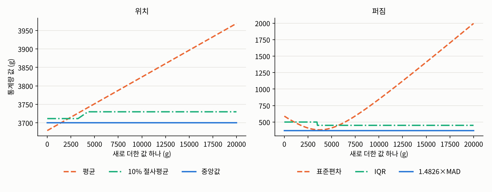

## 들어가며

3장에서 지금까지 다룬 숫자들 중 평균, 표준편차, 왜도, 첨도는 동떨어진 값에 민감하고, 중앙값, 사분위 범위, MAD는 그렇지 않다는 이야기를 여러 번 했습니다. 이번 글에서는 이 차이를 직접 확인하고 비교하는 방법을 다룹니다.

먼저 입력 실수 하나가 여러 통계량을 어떻게 바꾸는지 보고, 값 하나를 움직여 가며 통계량의 반응을 그린 **민감도 곡선**과, 통계량이 버틸 수 있는 오염의 한계를 나타내는 **붕괴점**을 소개합니다. 그다음 이상치를 찾을 때 이 차이가 왜 중요한지, 그리고 극단값에 강한 통계량을 쓰는 데 어떤 대가가 따르는지 살펴보겠습니다.

## 0 하나를 더 쳤을 뿐인데

[2.5](../02-data-and-distributions/05-quantiles-boxplots.qmd)에서 본 턱끈펭귄 68마리의 몸무게 데이터를 누군가 입력하다가, 3700g인 펭귄 한 마리를 37000g으로 잘못 입력했다고 해 보겠습니다. 0 하나를 더 친 흔한 실수입니다. 여러 통계량이 어떻게 바뀌는지 보겠습니다.

```python
import numpy as np
import seaborn as sns
from scipy import stats

penguins = sns.load_dataset("penguins").dropna(subset=["body_mass_g"])
x = penguins.loc[penguins["species"] == "Chinstrap", "body_mass_g"].to_numpy()

x_typo = x.copy()
i = np.flatnonzero(x_typo == 3700)[0]
x_typo[i] = 37000                        # 3700을 37000으로 잘못 입력

def summary(d):
    q1, med, q3 = np.quantile(d, [0.25, 0.5, 0.75], method="averaged_inverted_cdf")
    mad = np.median(np.abs(d - med))
    return [d.mean(), stats.trim_mean(d, 0.1), med, d.std(ddof=1), q3 - q1, 1.4826 * mad]

names = ["평균", "10% 절사평균", "중앙값", "표준편차", "IQR", "1.4826×MAD"]
for name, a, b in zip(names, summary(x), summary(x_typo)):
    print(f"{name:12s}: {a:8.1f} → {b:8.1f}")
```

```
평균          :   3733.1 →   4222.8
10% 절사평균    :   3719.6 →   3730.4
중앙값         :   3700.0 →   3700.0
표준편차        :    384.3 →   4052.4
IQR         :    475.0 →    500.0
1.4826×MAD  :    370.6 →    370.6
```

68개 중 단 하나가 틀렸을 뿐인데, 평균은 3733g에서 4223g으로 약 490g 뛰었습니다. 턱끈펭귄의 "평균적인 몸무게"가 갑자기 젠투펭귄 쪽으로 다가간 셈입니다. 표준편차는 384g에서 4052g으로 **10배 넘게** 커졌습니다. 이 숫자만 보면 턱끈펭귄의 몸무게가 엄청나게 들쭉날쭉한 것처럼 보입니다.

반면 중앙값과 MAD는 전혀 바뀌지 않았고, 10% 절사평균과 IQR은 조금만 바뀌었습니다. 오타 하나가 어떤 숫자에는 재앙이고 어떤 숫자에는 아무 일도 아닙니다.

## 민감도 곡선

값 하나가 통계량에 미치는 영향을 더 체계적으로 보기 위해, 턱끈펭귄 68마리의 데이터에 **새 값 하나**를 더하고 그 값을 0g부터 20000g까지 움직여 가며 각 통계량이 어떻게 변하는지 그려 보겠습니다. 이런 그림을 **민감도 곡선**(sensitivity curve)이라고 합니다.

{fig-alt="턱끈펭귄 몸무게 68개에 새 값 하나를 더하고 그 값을 0에서 20000g까지 움직일 때 통계량의 변화를 그린 두 그래프. 왼쪽 위치 그래프에서 평균(주황 점선)은 새 값에 비례해 약 3680에서 3970까지 직선으로 계속 올라가고, 10퍼센트 절사평균(초록 점쇄선)은 약 3710에서 3730 사이에서 조금 오르다 평평해지며, 중앙값(파란 실선)은 3700에서 전혀 움직이지 않는다. 오른쪽 퍼짐 그래프에서 표준편차는 새 값이 3700 근처일 때 가장 작고 멀어질수록 계속 커져 20000g에서 약 2000에 이르고, IQR은 450에서 500 사이에서 거의 평평하며, 1.4826×MAD는 약 371에서 평평하다." width=95%}

그림에서 통계량들은 세 무리로 나뉩니다.

- **평균과 표준편차**는 새 값이 멀어질수록 끝없이 커집니다. 새 값이 20000g이 아니라 2000000g이었다면 평균과 표준편차도 그에 맞춰 얼마든지 커졌을 것입니다. 값 하나가 통계량을 원하는 만큼 멀리 끌고 갈 수 있다는 뜻입니다.
- **10% 절사평균과 IQR**은 새 값이 데이터 근처에 있을 때는 조금 반응하지만, 일정 거리를 넘어가면 평평해집니다. 새 값이 아주 커지면 어차피 잘려 나가는 양 끝 10%나 25%에 들어가 버리기 때문입니다.
- **중앙값과 MAD**는 거의 움직이지 않습니다. 새 값이 아무리 커져도 "가운데 줄에 서 있는 값"은 기껏해야 한 칸 옆으로 밀릴 뿐입니다.

[3.1](01-center.qmd)에서 평균은 제곱 거리, 중앙값은 절대 거리를 최소로 만드는 값이라고 했던 것이 여기서 그대로 드러납니다. 제곱 거리는 멀리 떨어진 값 하나에 엄청난 무게를 실어 주고, 평균은 그 무게에 끌려갈 수밖에 없습니다.

## 붕괴점

민감도 곡선은 값 **하나**의 영향을 봅니다. 한 걸음 더 나아가, 데이터의 **얼마만큼**이 오염되어야 통계량이 완전히 망가지는지를 물을 수도 있습니다.

::: {.callout-note icon=false .callout-definition}
### 정의 3.4.1 (붕괴점)
데이터 중 일부를 마음대로 바꿨을 때 통계량의 값을 얼마든지 크게(또는 작게) 만들 수 있게 되는 **가장 작은 비율**을 그 통계량의 **붕괴점**(breakdown point)이라고 합니다.
:::

붕괴점은 "통계량이 버틸 수 있는 오염의 한계"입니다.[^hampel] 정확한 정의는 조금 더 복잡하지만, 직관적으로는 이 정도로 충분합니다. 지금까지 다룬 통계량의 붕괴점을 대략 정리하면 다음과 같습니다.

| 통계량 | 붕괴점 | 이유 |
|:---|:---:|:---|
| 평균, 표준편차, 범위 | $1/n$ | 값 하나만 바꿔도 얼마든지 커집니다 |
| $\alpha$ 절사평균 | 약 $\alpha$ | 양 끝 $\alpha$만큼은 잘려 나가므로 그보다 많이 오염되어야 합니다 |
| 사분위 범위 | 약 25% | 양 끝 25%까지는 버텨 냅니다 |
| 중앙값, MAD | 약 50% | 절반 가까이를 바꿔야 가운데 값이 움직입니다 |

평균의 붕괴점 $1/n$은 데이터가 많아질수록 0에 가까워집니다. 데이터가 백만 개라도 값 하나면 충분하다는 뜻입니다. 반면 중앙값은 절반 가까이가 엉망이어도 버팁니다. 붕괴점은 50%보다 클 수 없는데, 데이터의 절반 넘게가 오염되면 어느 쪽이 "진짜" 데이터인지 구분할 방법 자체가 없기 때문입니다. 그런 의미에서 중앙값과 MAD는 가장 로버스트한 통계량입니다.

[3.3](03-shape-and-standardization.qmd)의 왜도와 첨도도 평균과 표준편차로 만든 값이라 붕괴점이 $1/n$이고, 세제곱과 네제곱을 쓰는 만큼 값 하나에 대한 반응은 더 극단적입니다.

이렇게 극단값이나 오염에 크게 흔들리지 않는 성질을 **로버스트함**(robustness)이라고 하고, 이를 체계적으로 연구하는 분야를 **로버스트 통계**(robust statistics)라고 합니다.[^huber]

## 이상치를 찾을 때의 함정

이상치를 찾는 가장 단순한 방법은 [3.3](03-shape-and-standardization.qmd)의 z-점수를 계산해서 절댓값이 너무 큰 값, 예를 들어 3보다 큰 값을 의심하는 것입니다. 그런데 이 방법에는 함정이 있습니다. 오타가 섞인 턱끈펭귄 데이터로 확인해 보겠습니다. 오타 37000g과 함께, 2.5의 박스 플롯에서 원래부터 이상치로 표시되었던 4800g과 2700g의 z-점수를 보겠습니다.

```python
import numpy as np
import seaborn as sns

penguins = sns.load_dataset("penguins").dropna(subset=["body_mass_g"])
x = penguins.loc[penguins["species"] == "Chinstrap", "body_mass_g"].to_numpy()
x_typo = x.copy()
x_typo[np.flatnonzero(x_typo == 3700)[0]] = 37000

z = (x_typo - x_typo.mean()) / x_typo.std(ddof=1)
med = np.median(x_typo)
robust_z = (x_typo - med) / (1.4826 * np.median(np.abs(x_typo - med)))

for v in [37000, 4800, 2700]:
    k = np.flatnonzero(x_typo == v)[0]
    print(f"{v:6.0f} g: z-점수 {z[k]:+6.2f}, 로버스트 z-점수 {robust_z[k]:+7.2f}")
```

```
 37000 g: z-점수  +8.09, 로버스트 z-점수  +89.84
  4800 g: z-점수  +0.14, 로버스트 z-점수   +2.97
  2700 g: z-점수  -0.38, 로버스트 z-점수   -2.70
```

보통의 z-점수로 보면 37000g은 +8.09로 이상치로 잡히지만, 4800g과 2700g은 z-점수가 0.14와 −0.38로 **완벽하게 평범한 값**처럼 보입니다. 오타 하나가 표준편차를 10배로 부풀려 놓았기 때문에, 그 표준편차로 잰 다른 값들의 거리가 모두 작아져 버린 것입니다. 이렇게 큰 이상치가 다른 이상치를 가려 버리는 현상을 **가려짐 효과**(masking effect)라고 합니다.

해결책은 z-점수의 평균과 표준편차를 로버스트한 통계량으로 바꾸는 것입니다.

::: {.callout-note icon=false .callout-definition}
### 정의 3.4.2 (로버스트 z-점수)
수치형 데이터의 중앙값을 $\tilde{x}$, 중앙값 절대편차를 $\mathrm{MAD}$라 할 때

$$z_i^{\mathrm{rob}} := \frac{x_i - \tilde{x}}{1.4826 \cdot \mathrm{MAD}}$$

를 $x_i$의 **로버스트 z-점수**(robust z-score)라고 합니다.
:::

[3.2](02-spread.qmd)에서 본 것처럼 종 모양 데이터에서는 $1.4826 \cdot \mathrm{MAD}$가 표준편차와 비슷하므로, 데이터가 깨끗하면 로버스트 z-점수는 보통의 z-점수와 비슷합니다. 하지만 이상치가 섞여도 중앙값과 MAD는 흔들리지 않으므로, 이상치가 다른 이상치를 가리지 못합니다. 위 결과에서 로버스트 z-점수는 37000g을 +89.84로 확실히 잡아내고, 4800g과 2700g도 약 ±3으로 다른 값들보다 눈에 띄게 떨어져 있음을 보여 줍니다.

물론 2.5에서 말했듯이, 이상치로 표시된 값은 오류라는 뜻이 아니라 **들여다볼 대상**이라는 뜻입니다. 37000g은 들여다보면 오타라는 것이 분명하니 고치면 되지만, 4800g짜리 턱끈펭귄은 그냥 덩치가 큰 개체일 가능성이 높으니 함부로 지우면 안 됩니다.

## 로버스트함에도 대가가 있습니다

그렇다면 항상 중앙값과 MAD를 쓰면 될까요? 그렇지는 않습니다. 로버스트함에는 대가가 따릅니다.

중앙값은 데이터의 **순서**만 쓰고 값의 크기는 거의 버립니다. 가운데 줄에 누가 서 있는지만 보고, 양쪽의 값이 얼마나 큰지는 보지 않습니다. 데이터가 깨끗하고 좌우 대칭인 종 모양이라면, 이렇게 버린 정보 때문에 중앙값은 평균보다 **덜 정확한** 추정값이 됩니다. 정규분포를 따르는 데이터가 많을 때, 표본 중앙값이 흔들리는 정도(분산)는 표본 평균의 약 $\pi/2 \approx 1.57$배입니다. 같은 정확도를 얻으려면 중앙값을 쓸 때 데이터가 약 57% 더 필요하다는 뜻입니다.

"추정값이 흔들리는 정도"라는 말은 데이터를 확률변수로 볼 때 비로소 정확한 의미를 갖는데, 이는 5장의 표집 분포와 6장의 점 추정에서 정식으로 다룹니다. 지금은 **로버스트함과 효율 사이에 줄다리기가 있다**는 것만 기억해 두면 충분합니다. 데이터가 깨끗하면 평균이 낫고, 더러울수록 중앙값이 낫습니다. 절사평균은 그 사이에서 균형을 잡는 한 가지 방법입니다.

## 그래서 무엇을 보고할까요?

정해진 답은 없지만, 실용적인 기준을 정리하면 다음과 같습니다.

- **먼저 그림을 봅니다.** 히스토그램이나 박스 플롯으로 분포의 모양과 이상치를 확인하는 것이 어떤 숫자를 고르는 것보다 먼저입니다.
- **좌우 대칭에 가깝고 이상치가 없으면** 평균과 표준편차를 보고합니다. 효율이 좋고, 이후의 추론 방법들이 대부분 이 두 숫자를 바탕으로 합니다.
- **한쪽으로 크게 치우쳤거나 이상치가 있으면** 중앙값과 사분위 범위를 보고합니다. 소득, 집값, 대기 시간 같은 데이터가 여기에 해당합니다.
- **애매하면 둘 다 보고합니다.** 평균과 중앙값이 크게 다르다는 것 자체가 분포의 모양에 대한 중요한 정보입니다.
- **이상치는 지우기 전에 이유를 찾습니다.** 오타나 측정 오류가 분명하면 고치거나 빼고, 그 사실을 밝힙니다. 이유를 모르면 이상치를 포함한 결과와 뺀 결과를 둘 다 보여 주는 것도 방법입니다.

## 정리

이번 글에서는 통계량이 극단값에 얼마나 흔들리는지를 다루었습니다.

- 입력 실수 하나로 평균은 크게 움직이고 표준편차는 10배 넘게 커졌지만, 중앙값과 MAD는 그대로였습니다.
- **민감도 곡선**에서 평균과 표준편차는 값 하나에 끝없이 끌려가고, 절사평균과 IQR은 한계가 있으며, 중앙값과 MAD는 거의 움직이지 않습니다.
- **붕괴점**은 통계량을 망가뜨리는 데 필요한 오염의 최소 비율로, 평균은 $1/n$, 중앙값과 MAD는 약 50%입니다.
- 보통의 z-점수로 이상치를 찾으면 큰 이상치가 다른 이상치를 가리는 **가려짐 효과**가 생기므로, 중앙값과 MAD로 만든 **로버스트 z-점수**가 더 안전합니다.
- 로버스트한 통계량은 깨끗한 데이터에서 효율이 떨어지는 대가를 치릅니다. 그림을 먼저 보고, 데이터에 맞는 숫자를 고르는 것이 가장 중요합니다.

3장에서는 변수 하나의 분포를 숫자로 요약했습니다. 그런데 실제로 우리가 궁금한 것은 "부리가 긴 펭귄이 몸무게도 더 나갈까?"처럼 **두 변수 사이의 관계**인 경우가 많습니다. 4장에서는 두 변수를 함께 보는 표와 그림, 그리고 그 관계를 숫자로 나타내는 상관계수를 다루겠습니다.

---

### 연결되는 개념
* $\leftarrow$ **이전 개념:** [3.3 모양과 표준화](03-shape-and-standardization.qmd)
* $\rightarrow$ **다음 개념:** [4 두 변수 사이의 관계](../04-two-variables/index.qmd)

[^hampel]: 붕괴점의 개념은 F. R. Hampel, "A General Qualitative Definition of Robustness", *The Annals of Mathematical Statistics* 42(6), 1971, pp. 1887–1896에서 정식화되었습니다.

[^huber]: 로버스트 통계의 출발점이 된 논문으로 P. J. Huber, "Robust Estimation of a Location Parameter", *The Annals of Mathematical Statistics* 35(1), 1964, pp. 73–101을, 교재로 P. J. Huber & E. M. Ronchetti, *Robust Statistics*, 2nd ed., Wiley, 2009를 참고할 수 있습니다.
