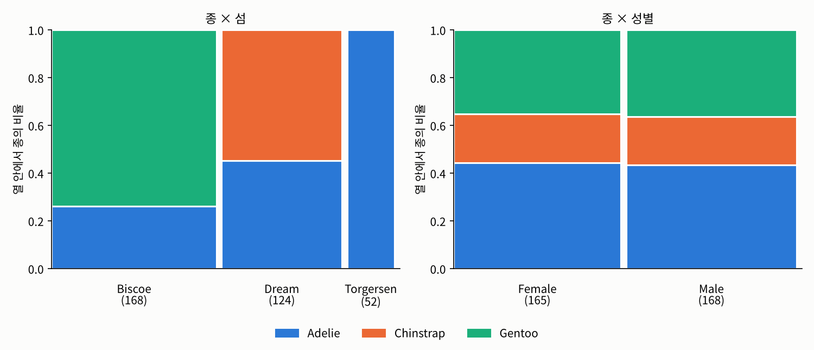

## 들어가며

[장 소개 글](index.qmd)에서 두 변수의 관계를 보는 도구는 변수의 종류에 따라 다르다고 했습니다. 이번 글에서는 두 변수가 모두 **범주형**인 경우를 다룹니다.

[2.2](../02-data-and-distributions/02-frequency-tables.qmd)에서 변수 하나의 값을 세어 도수분포표를 만들었던 것처럼, 이번에는 두 변수의 값의 **조합**을 세어 **분할표**를 만듭니다. 그다음 분할표를 가장자리와 안쪽에서 읽는 방법인 **주변도수**와 **조건부 상대도수**를 정의하고, 이를 그림으로 나타낸 **모자이크 플롯**을 그립니다. 마지막으로 "두 변수가 아무 관계가 없다면 분할표가 어떻게 생겼어야 하는가"를 계산해 보겠습니다.

## 어느 섬에 어떤 펭귄이 살까요?

펭귄 데이터에는 각 펭귄의 종과 함께 조사된 섬이 기록되어 있습니다. 종과 섬의 조합마다 펭귄이 몇 마리인지 세어 보겠습니다.

```python
import pandas as pd
import seaborn as sns

penguins = sns.load_dataset("penguins")
table = pd.crosstab(penguins["species"], penguins["island"], margins=True, margins_name="합")
print(table)
```

```
island     Biscoe  Dream  Torgersen    합
species
Adelie         44     56         52  152
Chinstrap       0     68          0   68
Gentoo        124      0          0  124
합             168    124         52  344
```

표 하나에 많은 정보가 담겨 있습니다. 아델리펭귄(Adelie)은 세 섬 모두에서 발견되었지만, 턱끈펭귄(Chinstrap)은 Dream 섬에서만, 젠투펭귄(Gentoo)은 Biscoe 섬에서만 발견되었습니다. Torgersen 섬에는 아델리펭귄만 있습니다. 섬을 알면 종에 대해 꽤 많은 것을 알 수 있다는 뜻이고, 이것이 두 변수 사이에 **관계가 있다**는 말의 의미입니다.

## 분할표

이 표를 정확히 정의해 보겠습니다.

::: {.callout-note icon=false .callout-definition}
### 정의 4.1.1 (분할표)
두 변수를 함께 기록한 크기 $n$인 이변량 데이터 $(x_1, y_1), \dots, (x_n, y_n)$에서, $x$가 가질 수 있는 값을 $a_1, \dots, a_k$, $y$가 가질 수 있는 값을 $b_1, \dots, b_m$이라 합시다. 각 조합 $(a_i, b_j)$에 대해

$$h_{ij} := \sum_{r=1}^{n} \mathbf{1}_{\{(a_i, b_j)\}}\big((x_r, y_r)\big)$$

를 조합 $(a_i, b_j)$의 **절대도수**라고 하고, $f_{ij} := h_{ij} / n$을 **상대도수**라고 합니다. $h_{ij}$를 $i$행 $j$열에 놓은 $k \times m$ 표를 **분할표**(contingency table)라고 합니다.
:::

[2.2](../02-data-and-distributions/02-frequency-tables.qmd)의 도수 정의와 똑같은 구조입니다. 다만 값 하나 대신 **값의 쌍**이 특정 조합과 같은지를 지시함수로 세었을 뿐입니다. 위 표에서 $x$는 종, $y$는 섬이고, 예를 들어 (Adelie, Dream)의 절대도수는 56입니다.

"분할"(contingency)이라는 말은 원래 "서로 의존하는 관계"라는 뜻으로, 이 표가 처음부터 두 변수 사이의 관계를 보려는 목적으로 만들어졌다는 것을 보여 줍니다. 변수가 셋 이상이면 3차원 이상의 분할표도 생각할 수 있습니다. 예를 들어 종, 섬, 성별을 함께 세면 $3 \times 3 \times 2$ 분할표가 됩니다.

## 표의 가장자리: 주변도수

위 표의 마지막 열과 마지막 행에는 "합"이 있습니다. 이것도 이름이 있습니다.

::: {.callout-note icon=false .callout-definition}
### 정의 4.1.2 (주변도수)
분할표에서 행별 합과 열별 합

$$h_{i\cdot} := \sum_{j=1}^{m} h_{ij}, \qquad h_{\cdot j} := \sum_{i=1}^{k} h_{ij}$$

를 각각 $a_i$와 $b_j$의 **주변도수**(marginal frequency)라고 합니다. 상대도수에 대해서도 같은 방식으로 $f_{i\cdot}$, $f_{\cdot j}$를 정의합니다.
:::

점 $\cdot$은 "그 자리의 첨자에 대해 모두 더했다"는 표시입니다. 표의 가장자리(margin)에 적히기 때문에 "주변"이라는 이름이 붙었습니다.

주변도수는 사실 **변수 하나만 따로 본 도수분포**입니다. 행 합 152, 68, 124는 섬을 무시하고 종만 센 도수분포이고, [2.2](../02-data-and-distributions/02-frequency-tables.qmd)에서 셌던 종별 도수와 같습니다. 열 합 168, 124, 52는 종을 무시하고 섬만 센 도수분포입니다. 그리고 행 합을 모두 더해도, 열 합을 모두 더해도 오른쪽 아래의 $n = 344$가 됩니다.

여기서 중요한 사실이 하나 있습니다. **주변도수만으로는 분할표를 되살릴 수 없습니다.** 종별 마릿수와 섬별 마릿수를 알아도, 어느 섬에 어느 종이 사는지는 알 수 없습니다. 두 변수의 관계에 대한 정보는 분할표의 **안쪽**에만 들어 있습니다.

## 표의 안쪽: 조건부 상대도수

분할표의 안쪽을 읽는 방법은 "한 변수의 값을 고정했을 때 다른 변수가 어떻게 분포하는가"를 보는 것입니다.

::: {.callout-note icon=false .callout-definition}
### 정의 4.1.3 (조건부 상대도수)
$x = a_i$라는 조건 아래에서 $y$의 **조건부 상대도수**(conditional relative frequency)를

$$f_Y(b_j \mid a_i) := \frac{h_{ij}}{h_{i\cdot}}, \qquad j = 1, \dots, m$$

으로, $y = b_j$라는 조건 아래에서 $x$의 조건부 상대도수를

$$f_X(a_i \mid b_j) := \frac{h_{ij}}{h_{\cdot j}}, \qquad i = 1, \dots, k$$

로 정의합니다.
:::

말로 하면, $f_X(a_i \mid b_j)$는 "$y$가 $b_j$인 관측 단위들만 모았을 때, 그중 $x$가 $a_i$인 것의 비율"입니다. 섬별로 종의 조건부 상대도수를 계산해 보겠습니다. 판다스에서는 `normalize="columns"`로 각 열을 그 열의 합으로 나눌 수 있습니다.

```python
import pandas as pd
import seaborn as sns

penguins = sns.load_dataset("penguins")
# 섬이 주어졌을 때 종의 조건부 상대도수 (열마다 합이 1)
print(pd.crosstab(penguins["species"], penguins["island"], normalize="columns").round(3))
```

```
island     Biscoe  Dream  Torgersen
species
Adelie      0.262  0.452        1.0
Chinstrap   0.000  0.548        0.0
Gentoo      0.738  0.000        0.0
```

Biscoe 섬에서 조사된 펭귄의 73.8%는 젠투펭귄이고, Dream 섬에서는 54.8%가 턱끈펭귄이며, Torgersen 섬은 100% 아델리펭귄입니다. 섬마다 종의 분포가 전혀 다릅니다.

**어느 쪽을 조건으로 두느냐에 따라 답하는 질문이 다릅니다.** "Biscoe 섬 펭귄 중 젠투펭귄의 비율"은 $124/168 \approx 0.738$이지만, "젠투펭귄 중 Biscoe 섬에 사는 비율"은 $124/124 = 1$입니다. 같은 칸 $h_{ij}$를 행 합으로 나누느냐 열 합으로 나누느냐의 차이입니다. 두 비율을 혼동하는 것은 아주 흔한 실수인데, 5장에서 조건부 확률을 다룰 때 이 문제를 다시 만나게 됩니다.

## 모자이크 플롯

조건부 상대도수를 그림으로 나타내는 방법이 **모자이크 플롯**(mosaic plot)입니다. 정사각형을 먼저 한 변수(여기서는 섬이나 성별)의 주변 상대도수에 비례하는 폭으로 세로로 자르고, 각 조각을 그 안에서의 다른 변수(종)의 조건부 상대도수에 비례하는 높이로 다시 가로로 자릅니다. 그러면 각 직사각형의 넓이는 그 조합의 상대도수 $f_{ij}$가 됩니다.

{fig-alt="두 개의 모자이크 플롯. 왼쪽 종×섬에서는 폭이 섬별 마릿수(Biscoe 168, Dream 124, Torgersen 52)에 비례하는 세 기둥이 있고, Biscoe 기둥은 아래 약 26퍼센트가 Adelie(파랑), 위 약 74퍼센트가 Gentoo(초록)이며, Dream 기둥은 아래 약 45퍼센트가 Adelie, 위 약 55퍼센트가 Chinstrap(주황), Torgersen 기둥은 전체가 Adelie로 칠해져 있어 기둥마다 색의 경계 높이가 크게 다르다. 오른쪽 종×성별에서는 Female(165)과 Male(168) 두 기둥이 있고, 두 기둥 모두 아래 약 44퍼센트가 Adelie, 그 위 약 20퍼센트가 Chinstrap, 맨 위 약 36퍼센트가 Gentoo로 색의 경계가 거의 같은 높이에 있다." width=95%}

두 그림을 비교하면 차이가 분명합니다. 왼쪽 종×섬 그림에서는 기둥마다 색의 경계 높이가 제각각입니다. 섬마다 종의 분포가 다르다는 뜻입니다. 오른쪽 종×성별 그림에서는 암컷 기둥과 수컷 기둥의 색 경계가 거의 같은 높이에 있습니다. 암컷이든 수컷이든 종의 분포가 비슷하다는 뜻이고, 이 데이터에서 종과 성별 사이에는 이렇다 할 관계가 없어 보입니다. 성별을 알아도 종에 대해 새로 알게 되는 것이 거의 없으니까요.

## 관계가 없다면 표는 어떻게 생겨야 할까요?

오른쪽 그림처럼 "조건부 분포가 조건과 상관없이 모두 같다"는 상황을 조금 더 정확히 생각해 보겠습니다. 이 상황을 두 변수가 **관계가 없다**, 또는 (데이터 수준에서) **독립**이라고 부를 수 있을 것입니다. 그렇다면 분할표의 각 칸에는 몇이 들어 있어야 할까요?

::: {.callout-important icon=false .callout-satz}
### 정리 4.1.4 (관계가 없을 때의 분할표)
분할표의 모든 행에서 $y$의 조건부 상대도수가 같다고 합시다. 즉 각 $j$에 대해 $f_Y(b_j \mid a_1) = \cdots = f_Y(b_j \mid a_k)$라 합시다. 그러면 이 공통의 값은 $y$의 주변 상대도수 $f_{\cdot j} = h_{\cdot j}/n$과 같고,

$$h_{ij} = \frac{h_{i\cdot} \, h_{\cdot j}}{n} \qquad (i = 1, \dots, k,\; j = 1, \dots, m)$$

이 성립합니다.
:::

::: {.callout-tip collapse="true" icon=false .callout-beweis}
### 증명
각 $j$에 대해 공통의 값을 $c_j$라 하면, 모든 $i$에 대해 $h_{ij} = c_j \, h_{i\cdot}$입니다. 이를 $i$에 대해 더하면

$$h_{\cdot j} = \sum_{i=1}^{k} h_{ij} = c_j \sum_{i=1}^{k} h_{i\cdot} = c_j \, n$$

이므로 $c_j = h_{\cdot j}/n$입니다. 이것을 $h_{ij} = c_j h_{i\cdot}$에 넣으면 원하는 식을 얻습니다. $\square$
:::

정리의 의미는 이렇습니다. 조건부 분포가 모두 같다면, 그 공통의 분포는 결국 전체를 합친 분포, 즉 주변분포일 수밖에 없습니다. 그러니 각 칸은 "행의 총 마릿수 × 그 열이 전체에서 차지하는 비율"이 됩니다. 예를 들어 펭귄 344마리 중 섬 Biscoe의 비율이 $168/344$이라면, 종과 섬이 관계가 없을 때 아델리펭귄 152마리 중 Biscoe에 있어야 할 마릿수는 $152 \times 168/344 \approx 74.2$마리입니다.

이렇게 **주변도수만으로 계산한, 관계가 없을 때 기대되는 칸의 값**에 이름을 붙여 두겠습니다.

::: {.callout-note icon=false .callout-definition}
### 정의 4.1.5 (독립일 때의 기대도수)
분할표의 각 칸에 대해

$$\tilde{h}_{ij} := \frac{h_{i\cdot} \, h_{\cdot j}}{n}$$

를 두 변수가 관계없을 때의 **기대도수**(expected frequency)라고 합니다.
:::

실제 분할표 $h_{ij}$와 기대도수 $\tilde{h}_{ij}$를 비교하면, 두 변수가 관계없다는 그림에서 실제 데이터가 얼마나 벗어나 있는지 볼 수 있습니다. 종×섬과 종×성별에 대해 계산해 보겠습니다. 성별이 기록되지 않은 펭귄 11마리는 종×성별 표에서 뺐습니다.

```python
import pandas as pd
import seaborn as sns

def expected_table(observed):
    """독립일 때의 기대도수: (행 합) × (열 합) / n"""
    row = observed.sum(axis=1).to_numpy()[:, None]
    col = observed.sum(axis=0).to_numpy()[None, :]
    return pd.DataFrame(row * col / observed.to_numpy().sum(),
                        index=observed.index, columns=observed.columns)

penguins = sns.load_dataset("penguins")
island = pd.crosstab(penguins["species"], penguins["island"])
print("[종 × 섬] 독립일 때의 기대도수")
print(expected_table(island).round(1))

sexed = penguins.dropna(subset=["sex"])           # 성별이 기록된 333마리
sex = pd.crosstab(sexed["species"], sexed["sex"])
print("\n[종 × 성별] 관찰도수")
print(sex)
print("[종 × 성별] 독립일 때의 기대도수")
print(expected_table(sex).round(1))
```

```
[종 × 섬] 독립일 때의 기대도수
island     Biscoe  Dream  Torgersen
species
Adelie       74.2   54.8       23.0
Chinstrap    33.2   24.5       10.3
Gentoo       60.6   44.7       18.7

[종 × 성별] 관찰도수
sex        Female  Male
species
Adelie         73    73
Chinstrap      34    34
Gentoo         58    61
[종 × 성별] 독립일 때의 기대도수
sex        Female  Male
species
Adelie       72.3  73.7
Chinstrap    33.7  34.3
Gentoo       59.0  60.0
```

종×섬에서는 관찰도수와 기대도수가 크게 어긋납니다. 관계가 없었다면 Biscoe 섬에 턱끈펭귄이 약 33마리 있어야 했지만 실제로는 0마리이고, 젠투펭귄은 약 61마리여야 했지만 실제로는 124마리입니다. 반면 종×성별에서는 모든 칸에서 관찰도수와 기대도수의 차이가 한두 마리 이내입니다.

그렇다면 종×성별의 이 작은 차이는 "관계가 조금 있다"는 뜻일까요, 아니면 그냥 우연일까요? [1.1](../01-what-is-statistics/01-randomness-and-data.qmd)에서 본 것처럼 데이터에는 늘 우연이 섞여 있으니, 정말로 관계가 없는 모집단에서 뽑은 표본이라도 관찰도수가 기대도수와 정확히 같을 리는 없습니다. 차이가 얼마나 커야 "우연이라고 보기 어렵다"고 말할 수 있는지는 기술 통계만으로는 답할 수 없는 질문이고, 8장에서 다룰 **카이제곱 독립성 검정**이 바로 이 질문에 답합니다. 이 검정은 각 칸의 차이 $h_{ij} - \tilde{h}_{ij}$를 모아 하나의 숫자로 만드는데, 그 출발점이 이번 글의 기대도수입니다.

## 정리

이번 글에서는 두 범주형 변수의 관계를 보는 방법을 다루었습니다.

- 두 변수의 값의 조합을 센 표가 **분할표**입니다. 2.2의 도수를 값의 쌍으로 넓힌 것입니다.
- 분할표의 가장자리인 **주변도수**는 각 변수 하나만의 도수분포이며, 주변도수만으로는 두 변수의 관계를 알 수 없습니다.
- 한 변수의 값을 고정했을 때 다른 변수의 분포인 **조건부 상대도수**로 관계를 읽습니다. 어느 쪽을 조건으로 두느냐에 따라 답하는 질문이 다릅니다. **모자이크 플롯**은 조건부 상대도수를 그림으로 보여 줍니다.
- 조건부 분포가 모두 같다면 각 칸은 $\tilde{h}_{ij} = h_{i\cdot} h_{\cdot j} / n$이어야 합니다. 이 **기대도수**와 실제 도수의 차이가 관계의 크기를 보여 주며, 그 차이가 우연인지는 8장에서 검정합니다.

이번 글의 도구는 범주형 변수를 위한 것이었습니다. 날개 길이와 몸무게처럼 두 변수가 모두 수치형이라면, 값의 조합이 거의 모두 다르니 분할표를 만들 수 없습니다. 다음 글에서는 수치형 두 변수의 관계를 그림과 숫자로 보는 산점도와 상관계수를 다루겠습니다.

---

### 연결되는 개념
* $\leftarrow$ **이전 개념:** [4 두 변수 사이의 관계](index.qmd)
* $\rightarrow$ **다음 개념:** [4.2 산점도와 상관계수](02-correlation.qmd)
