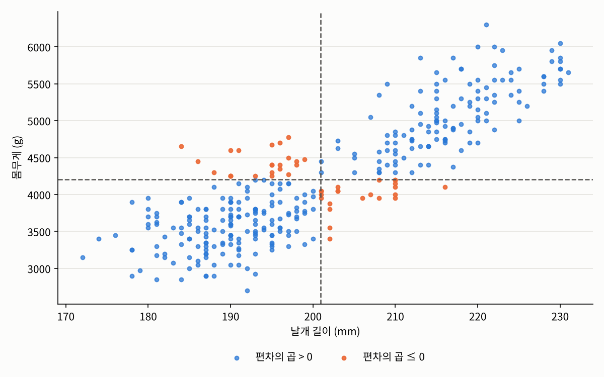
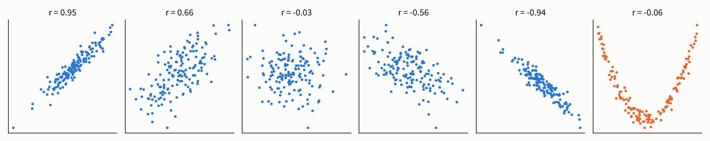
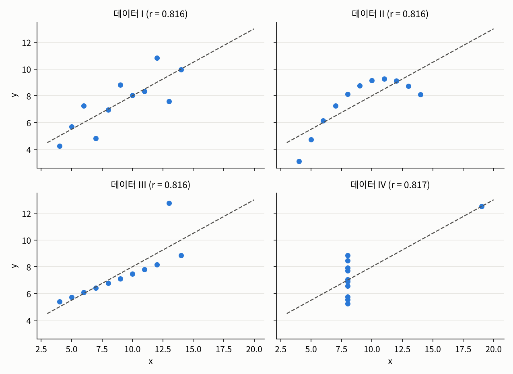

## 들어가며

[지난 글](01-contingency-tables.qmd)에서는 두 범주형 변수의 관계를 분할표로 보았습니다. 이번 글에서는 두 변수가 모두 **수치형**인 경우를 다룹니다.

먼저 두 변수를 한 그림에 나타내는 **산점도**를 그리고, 산점도에서 보이는 "함께 움직이는 경향"을 숫자로 바꾸는 과정을 따라가 **공분산**과 **상관계수**를 정의합니다. 상관계수의 성질을 증명한 뒤, 상관계수 하나만 믿으면 어떤 함정에 빠지는지 유명한 예로 확인하겠습니다.

## 산점도

날개가 긴 펭귄은 몸무게도 더 나갈까요? 이 질문에 답하는 가장 직접적인 방법은 각 펭귄을 (날개 길이, 몸무게)라는 점 하나로 보고 평면에 찍어 보는 것입니다. 이런 그림을 **산점도**(scatter plot)라고 합니다.

{fig-alt="펭귄 342마리의 날개 길이(가로축)와 몸무게(세로축)를 찍은 산점도. 점들이 왼쪽 아래에서 오른쪽 위로 비스듬히 뻗은 띠 모양으로 모여 있다. 날개 길이의 평균과 몸무게의 평균에 회색 점선이 그어져 그림이 네 칸으로 나뉘어 있고, 오른쪽 위 칸과 왼쪽 아래 칸의 점들은 파랑, 나머지 두 칸의 점들은 주황으로 칠해져 있다. 대부분의 점이 파랑이다." width=85%}

점들이 왼쪽 아래에서 오른쪽 위로 뻗은 띠 모양을 이룹니다. 날개가 긴 펭귄일수록 대체로 무겁다는 뜻입니다. 이렇게 한 변수가 클 때 다른 변수도 큰 경향을 **양의 관계**, 한 변수가 클 때 다른 변수가 작은 경향을 **음의 관계**라고 합니다.

## 편차의 곱으로 함께 움직임 재기

산점도에서 보이는 경향을 숫자로 바꿔 보겠습니다. 위 그림에서 회색 점선은 날개 길이의 평균 $\bar{x}$와 몸무게의 평균 $\bar{y}$입니다. 이 두 선이 평면을 네 칸으로 나눕니다.

- **오른쪽 위**: 날개도 평균보다 길고 몸무게도 평균보다 무겁습니다. 두 편차 $x_i - \bar{x}$와 $y_i - \bar{y}$가 모두 양수이니 곱은 **양수**입니다.
- **왼쪽 아래**: 둘 다 평균보다 작습니다. 두 편차가 모두 음수이니 곱은 역시 **양수**입니다.
- **왼쪽 위와 오른쪽 아래**: 한쪽은 평균보다 크고 다른 쪽은 작습니다. 곱은 **음수**입니다.

양의 관계가 있다면 대부분의 점이 오른쪽 위와 왼쪽 아래에 있을 것이고, 편차의 곱을 모두 더하면 큰 양수가 됩니다. 음의 관계라면 큰 음수가 되고, 관계가 없다면 네 칸에 점이 고르게 흩어져 양수와 음수가 상쇄될 것입니다. 실제로 위 그림에서 편차의 곱이 양수인 점(파랑)은 342개 중 297개입니다.

이 아이디어를 그대로 정의로 옮긴 것이 공분산입니다.

::: {.callout-note icon=false .callout-definition}
### 정의 4.2.1 (표본 공분산)
수치형 이변량 데이터 $(x_1, y_1), \dots, (x_n, y_n)$에 대해

$$s_{xy} := \frac{1}{n-1} \sum_{i=1}^{n} (x_i - \bar{x})(y_i - \bar{y})$$

를 **표본 공분산**(sample covariance)이라고 합니다.
:::

$y$ 자리에 $x$를 넣으면 $s_{xx} = s_x^2$, 즉 [3.2](../03-summary-statistics/02-spread.qmd)의 표본 분산이 됩니다. 공분산은 분산을 두 변수로 넓힌 것이고, $n-1$로 나누는 이유도 분산과 같습니다.

## 공분산의 문제: 단위

공분산의 부호는 관계의 방향을 알려 주지만, 크기는 해석하기 어렵습니다. 직접 계산해 보겠습니다.

```python
import numpy as np
import seaborn as sns

penguins = sns.load_dataset("penguins").dropna(subset=["flipper_length_mm", "body_mass_g"])
x = penguins["flipper_length_mm"].to_numpy()
y = penguins["body_mass_g"].to_numpy()
n = x.size

s_xy = np.sum((x - x.mean()) * (y - y.mean())) / (n - 1)
r = s_xy / (x.std(ddof=1) * y.std(ddof=1))
print(f"n = {n}")
print(f"공분산 (mm·g)       : {s_xy:.1f}")
print(f"공분산 (cm·kg)      : {np.sum((x/10 - (x/10).mean()) * (y/1000 - (y/1000).mean())) / (n - 1):.4f}")
print(f"상관계수            : {r:.4f}")
print(f"np.corrcoef로 확인  : {np.corrcoef(x, y)[0, 1]:.4f}")
```

```
n = 342
공분산 (mm·g)       : 9824.4
공분산 (cm·kg)      : 0.9824
상관계수            : 0.8712
np.corrcoef로 확인  : 0.8712
```

같은 데이터인데, 날개를 mm, 몸무게를 g으로 재면 공분산은 9824.4이고, cm와 kg으로 재면 0.9824입니다. 단위를 바꿨을 뿐인데 10000배 차이가 납니다. 공분산의 단위가 "mm·g"처럼 두 단위의 곱이기 때문입니다. 그래서 공분산의 크기만 보고는 관계가 강한지 약한지 판단할 수 없습니다.

해결책은 [3.3](../03-summary-statistics/03-shape-and-standardization.qmd)에서 본 표준화입니다. 각 변수를 표준편차로 나누어 단위를 없애면 됩니다.

## 피어슨 상관계수

::: {.callout-note icon=false .callout-definition}
### 정의 4.2.2 (피어슨 상관계수)
수치형 이변량 데이터에서 $s_x, s_y > 0$일 때

$$r := \frac{s_{xy}}{s_x \, s_y} = \frac{\sum_{i=1}^{n} (x_i - \bar{x})(y_i - \bar{y})}{\sqrt{\sum_{i=1}^{n} (x_i - \bar{x})^2} \sqrt{\sum_{i=1}^{n} (y_i - \bar{y})^2}}$$

을 **피어슨 상관계수**(Pearson correlation coefficient) 또는 간단히 **상관계수**라고 합니다. $r > 0$이면 **양의 상관**, $r < 0$이면 **음의 상관**이 있다고 합니다.
:::

z-점수 $z_i^{(x)} = (x_i - \bar{x})/s_x$, $z_i^{(y)} = (y_i - \bar{y})/s_y$를 쓰면 $r = \frac{1}{n-1}\sum_i z_i^{(x)} z_i^{(y)}$입니다. 상관계수는 **두 변수를 표준화한 뒤 구한 공분산**인 셈입니다. 위 펭귄 데이터의 상관계수는 0.8712이고, 단위를 어떻게 바꿔도 이 값은 같습니다. 이것이 다음 정리의 세 번째 성질입니다.

::: {.callout-important icon=false .callout-satz}
### 정리 4.2.3 (상관계수의 성질)
1. $-1 \le r \le 1$입니다.
2. $r = 1$인 것은 어떤 $a$와 $b > 0$에 대해 모든 $i$에서 $y_i = a + b x_i$인 것과 같고, $r = -1$인 것은 어떤 $a$와 $b < 0$에 대해 그런 것과 같습니다.
3. $u_i := a + b x_i$, $v_i := c + d y_i$ ($b, d \ne 0$)라 하면, $(u_i, v_i)$의 상관계수는 $bd > 0$일 때 $r$, $bd < 0$일 때 $-r$입니다.
:::

::: {.callout-tip collapse="true" icon=false .callout-beweis}
### 증명
$p_i := x_i - \bar{x}$, $q_i := y_i - \bar{y}$로 두면 $r = \sum p_i q_i \big/ \sqrt{\sum p_i^2 \sum q_i^2}$입니다.

1, 2. 모든 실수 $t$에 대해

$$0 \le \sum_{i=1}^{n} (q_i - t p_i)^2 = \sum q_i^2 - 2t \sum p_i q_i + t^2 \sum p_i^2$$

입니다. 이 $t$에 대한 이차식이 음수가 되지 않으려면 판별식이 0 이하여야 하므로 $\big(\sum p_i q_i\big)^2 \le \sum p_i^2 \sum q_i^2$이고, 이는 $r^2 \le 1$과 같습니다. (이것은 코시–슈바르츠 부등식입니다.) 등호가 성립하는 것은 이차식이 0이 되는 $t$가 있을 때, 즉 모든 $i$에서 $q_i = t p_i$인 $t$가 있을 때입니다. 이는 $y_i = (\bar{y} - t\bar{x}) + t x_i$라는 뜻이고, 이때 $r = t \sum p_i^2 / (|t| \sum p_i^2)$이므로 $r$의 부호는 $t$의 부호와 같습니다.

3. [정리 3.1.4](../03-summary-statistics/01-center.qmd)에 의해 $u_i - \bar{u} = b\,p_i$, $v_i - \bar{v} = d\,q_i$이므로

$$r_{uv} = \frac{bd \sum p_i q_i}{|b|\,|d| \sqrt{\sum p_i^2 \sum q_i^2}} = \frac{bd}{|bd|}\, r$$

입니다. $\square$
:::

세 성질을 쉬운 말로 정리하면 이렇습니다. 상관계수는 항상 $-1$과 $1$ 사이에 있고, 양 끝인 $\pm 1$은 **모든 점이 정확히 한 직선 위에 있을 때**만 나옵니다. 그리고 단위를 바꾸거나 기준점을 옮겨도 값이 변하지 않습니다(방향을 뒤집으면 부호만 바뀝니다). 그래서 상관계수는 단위가 다른 여러 변수 쌍의 관계를 같은 잣대로 비교할 수 있게 해 줍니다.

## 상관계수 읽기

상관계수의 크기에 대한 감을 잡기 위해, 상관계수가 서로 다른 가상의 데이터를 그려 보겠습니다.

{fig-alt="가상 데이터 여섯 개의 산점도와 각각의 상관계수. 왼쪽부터 r = 0.95인 데이터는 점들이 오른쪽 위로 향하는 좁은 띠를 이루고, r = 0.66은 같은 방향의 넓은 띠, r = -0.03은 방향 없이 둥글게 흩어진 구름, r = -0.56은 오른쪽 아래로 향하는 넓은 띠, r = -0.94는 오른쪽 아래로 향하는 좁은 띠이다. 마지막 주황색 데이터는 점들이 U자 모양의 곡선을 뚜렷하게 그리지만 상관계수는 -0.06이다." width=100%}

$|r|$이 1에 가까울수록 점들이 직선 주위에 좁게 모이고, 0에 가까울수록 방향 없이 흩어집니다. 흔히 쓰는 대략적인 기준으로 $|r|$이 0.8 근처이면 꽤 강한 직선 관계, 0.3 근처이면 약한 직선 관계라고 말하기도 합니다. 다만 이런 기준은 분야마다 다릅니다. 물리 실험에서 0.8은 낮은 편일 수 있고, 사회과학 설문에서 0.3은 의미 있는 관계일 수 있습니다.

펭귄 데이터의 수치형 변수 네 개 사이의 상관계수를 한꺼번에 계산하면 다음과 같습니다. 이런 표를 **상관행렬**(correlation matrix)이라고 합니다.

```python
import pandas as pd
import seaborn as sns

pd.set_option("display.width", 120)
pd.set_option("display.max_columns", None)
penguins = sns.load_dataset("penguins")
cols = ["bill_length_mm", "bill_depth_mm", "flipper_length_mm", "body_mass_g"]
print(penguins[cols].corr().round(3))
```

```
                   bill_length_mm  bill_depth_mm  flipper_length_mm  body_mass_g
bill_length_mm              1.000         -0.235              0.656        0.595
bill_depth_mm              -0.235          1.000             -0.584       -0.472
flipper_length_mm           0.656         -0.584              1.000        0.871
body_mass_g                 0.595         -0.472              0.871        1.000
```

대각선은 변수와 자기 자신의 상관계수이니 모두 1이고, 표는 대각선을 기준으로 대칭입니다. 날개 길이와 몸무게(0.871)가 가장 강한 양의 상관을 보입니다. 그런데 부리 깊이는 다른 세 변수와 모두 **음의 상관**을 보입니다. 부리가 깊은 펭귄일수록 부리가 짧고 날개가 짧고 가볍다는 뜻일까요? 이 수상한 결과는 4.4에서 다시 들여다보겠습니다.

## 상관계수는 직선만 봅니다

위 그림의 마지막 데이터를 다시 보세요. 점들이 U자 곡선을 아주 뚜렷하게 그리고 있으니, 두 변수 사이에는 분명히 강한 관계가 있습니다. $x$를 알면 $y$를 꽤 정확하게 맞힐 수 있으니까요. 그런데 상관계수는 $-0.06$으로 거의 0입니다.

정리 4.2.3이 이유를 말해 줍니다. 상관계수는 점들이 **직선**에 얼마나 가까운지를 재는 숫자입니다. U자 모양에서는 왼쪽 절반의 음의 경향과 오른쪽 절반의 양의 경향이 상쇄되어, 직선으로 요약할 수 있는 관계가 거의 남지 않습니다. 그래서 **상관계수가 0이라는 것은 "직선 관계가 없다"는 뜻이지 "관계가 없다"는 뜻이 아닙니다.**

## 앤스콤 콰르텟

상관계수만 믿으면 안 된다는 것을 보여 주는 가장 유명한 예가 통계학자 프랜시스 앤스콤(Francis Anscombe)이 1973년에 만든 네 개의 데이터, **앤스콤 콰르텟**(Anscombe's quartet)입니다.[^anscombe] 시본에 들어 있으니 바로 확인해 보겠습니다.

```python
import seaborn as sns

anscombe = sns.load_dataset("anscombe")
for name, d in anscombe.groupby("dataset"):
    print(f"{name:>3}: x 평균 {d.x.mean():.2f}, y 평균 {d.y.mean():.2f}, "
          f"x 표준편차 {d.x.std():.2f}, y 표준편차 {d.y.std():.2f}, 상관계수 {d.x.corr(d.y):.3f}")
```

```
  I: x 평균 9.00, y 평균 7.50, x 표준편차 3.32, y 표준편차 2.03, 상관계수 0.816
 II: x 평균 9.00, y 평균 7.50, x 표준편차 3.32, y 표준편차 2.03, 상관계수 0.816
III: x 평균 9.00, y 평균 7.50, x 표준편차 3.32, y 표준편차 2.03, 상관계수 0.816
 IV: x 평균 9.00, y 평균 7.50, x 표준편차 3.32, y 표준편차 2.03, 상관계수 0.817
```

네 데이터의 평균, 표준편차, 상관계수가 소수점 둘째 자리까지 거의 똑같습니다. 숫자만 보면 네 데이터는 사실상 같은 데이터입니다. 그런데 그림을 그리면 이야기가 완전히 달라집니다.

{fig-alt="앤스콤 콰르텟의 네 산점도. 데이터 I은 점들이 직선 주위에 고르게 흩어진 평범한 모양이다. 데이터 II는 점들이 위로 볼록한 매끄러운 곡선 위에 정확히 놓여 있다. 데이터 III은 점 하나를 빼면 모든 점이 한 직선 위에 정확히 놓여 있고, 그 하나만 위로 크게 벗어나 있다. 데이터 IV는 x가 8인 곳에 점들이 세로로 모여 있고, x가 19인 곳에 점 하나만 동떨어져 있다. 네 그림 모두 같은 회색 점선 직선이 그려져 있다." width=85%}

- **데이터 I**은 직선 관계에 잡음이 섞인 평범한 데이터로, 상관계수가 의도한 대로 작동하는 경우입니다.
- **데이터 II**는 완벽한 곡선 관계입니다. 직선이 아니라 곡선으로 요약해야 합니다.
- **데이터 III**은 점 하나만 빼면 완벽한 직선입니다. 그 점 하나가 상관계수를 1에서 0.816으로 끌어내렸습니다.
- **데이터 IV**는 점 하나를 빼면 $x$가 모두 같아서 관계를 말할 수조차 없습니다. 동떨어진 점 하나가 상관계수 0.817을 혼자서 만들어 냈습니다.

III과 IV는 [3.4](../03-summary-statistics/04-robustness.qmd)의 이야기와 같습니다. 상관계수는 평균과 표준편차로 만든 숫자이므로, 동떨어진 점 하나에 크게 흔들립니다. 앤스콤의 메시지는 분명합니다. **숫자를 계산하기 전에, 반드시 그림을 그려 보라.**

## 정리

이번 글에서는 두 수치형 변수의 관계를 보는 방법을 다루었습니다.

- **산점도**는 두 변수를 평면 위의 점으로 나타내 관계의 방향과 모양을 보여 줍니다.
- 두 편차의 곱을 평균 낸 **공분산**은 관계의 방향을 알려 주지만, 크기가 단위에 따라 달라집니다.
- 두 변수를 표준화한 공분산인 **피어슨 상관계수** $r$은 $-1$과 $1$ 사이에 있고, $\pm 1$은 모든 점이 한 직선 위에 있을 때만 나오며, 단위에 영향을 받지 않습니다.
- 상관계수는 **직선 관계의 강도**만 잽니다. 강한 곡선 관계도 상관계수가 0일 수 있고, 동떨어진 점 하나가 상관계수를 크게 바꿀 수 있습니다. **앤스콤 콰르텟**처럼 숫자가 같아도 전혀 다른 데이터가 있으니 그림이 먼저입니다.

상관계수가 동떨어진 점에 약하고 직선 관계만 본다는 약점은, 3장에서 평균 대신 중앙값을 썼던 것처럼 값 대신 **순위**를 쓰면 상당 부분 해결됩니다. 다음 글에서는 순위로 관계를 재는 방법을 다루겠습니다.

---

### 연결되는 개념
* $\leftarrow$ **이전 개념:** [4.1 분할표와 조건부 상대도수](01-contingency-tables.qmd)
* $\rightarrow$ **다음 개념:** [4.3 순위 상관](03-rank-correlation.qmd)

[^anscombe]: F. J. Anscombe, "Graphs in Statistical Analysis", *The American Statistician* 27(1), 1973, pp. 17–21.
