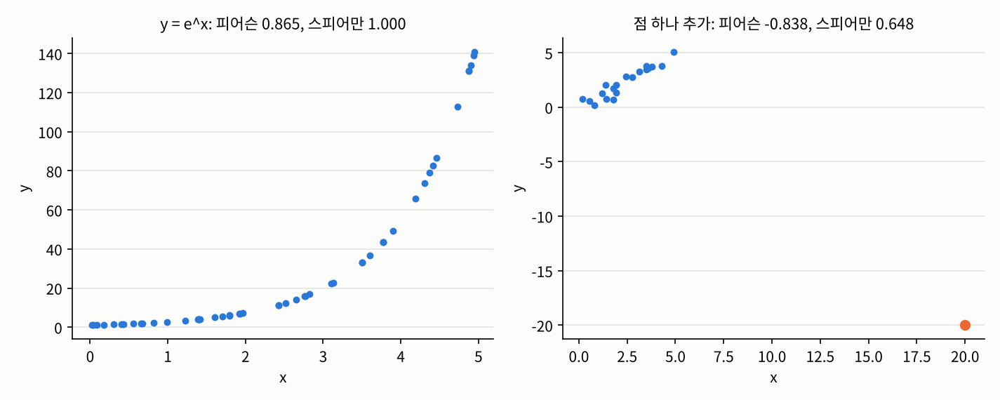

## 들어가며

[지난 글](02-correlation.qmd)의 피어슨 상관계수에는 세 가지 약점이 있었습니다. 값의 차이를 계산해야 하므로 **수치형** 데이터에만 쓸 수 있고, **직선** 관계만 재며, 동떨어진 점 하나에 크게 **흔들립니다.**

[3장](../03-summary-statistics/index.qmd)에서 평균의 약점을 중앙값이 보완했던 것처럼, 이 약점들은 값 대신 **순위**를 쓰면 상당 부분 해결됩니다. 이번 글에서는 먼저 순위를 정의하고, 순위로 계산하는 두 가지 상관계수인 **스피어만 상관계수**와 **켄달 타우**를 소개한 뒤, 이들이 피어슨 상관계수와 어떻게 다른지 비교하겠습니다.

## 순위

다섯 명의 주당 공부 시간과 시험 점수가 다음과 같다고 해 보겠습니다.

| 이름 | 박종우 | 김찬호 | 손인욱 | 장지환 | 정상길 |
|:---|:---:|:---:|:---:|:---:|:---:|
| 공부 시간 (시간) | 2 | 5 | 5 | 8 | 12 |
| 시험 점수 | 55 | 70 | 62 | 80 | 79 |

공부 시간을 작은 순서로 줄 세우면 박종우가 1등, 장지환이 4등, 정상길이 5등입니다. 그런데 김찬호와 손인욱은 둘 다 5시간이라 2등과 3등을 누가 차지할지 정할 수 없습니다. 이럴 때는 두 사람이 나눠 가질 자리 2와 3의 평균인 2.5를 둘 다에게 줍니다.

::: {.callout-note icon=false .callout-definition}
### 정의 4.3.1 (순위와 평균 순위)
순서 척도 이상인 데이터 $x_1, \dots, x_n$에서, $x_i$가 순서통계량 $x_{(1)} \le \cdots \le x_{(n)}$ 중 몇 번째 자리에 오는지를 $x_i$의 **순위**(rank) $R(x_i)$라고 합니다. 같은 값이 여러 개 있어 순위가 하나로 정해지지 않을 때는, 그 값들이 차지하는 자리 번호의 평균을 모두에게 순위로 줍니다. 이를 **평균 순위**(average rank)라고 합니다.
:::

같은 값이 여럿 있는 것을 **동순위**(tie)라고 부릅니다. 동순위가 있든 없든 순위의 합은 항상 $1 + 2 + \cdots + n = n(n+1)/2$이므로, 순위의 평균은 언제나 $(n+1)/2$입니다. 평균 순위를 쓰는 이유도 이 성질을 지키기 위해서입니다.

순위는 순서만 있으면 정할 수 있으므로 **순서 척도** 데이터에도 쓸 수 있습니다. 그리고 원래 값이 얼마나 큰지는 버리고 몇 번째인지만 남기므로, 아무리 큰 값도 순위로는 그냥 "$n$등"일 뿐입니다. 이것이 순위 상관이 동떨어진 값에 강한 이유입니다.

## 스피어만 상관계수

순위를 매겼으면 가장 자연스러운 방법은 원래 값 대신 순위를 피어슨 상관계수 공식에 넣는 것입니다.

::: {.callout-note icon=false .callout-definition}
### 정의 4.3.2 (스피어만 상관계수)
이변량 데이터 $(x_1, y_1), \dots, (x_n, y_n)$에서 $x$값들의 순위 $R(x_i)$와 $y$값들의 순위 $R(y_i)$로 계산한 피어슨 상관계수

$$r_S := r\big( (R(x_1), R(y_1)), \dots, (R(x_n), R(y_n)) \big)$$

를 **스피어만 순위 상관계수**(Spearman's rank correlation coefficient)라고 합니다.
:::

심리학자 찰스 스피어만(Charles Spearman)이 1904년에 제안한 방법입니다.[^spearman] 순위로 계산한 피어슨 상관계수이므로, [정리 4.2.3](02-correlation.qmd)의 성질이 그대로 성립합니다. 특히 $-1 \le r_S \le 1$입니다.

동순위가 없을 때는 계산이 더 간단해집니다.

::: {.callout-important icon=false .callout-satz}
### 정리 4.3.3 (동순위가 없을 때의 스피어만 상관계수)
동순위가 없으면, 순위의 차이 $d_i := R(x_i) - R(y_i)$에 대해

$$r_S = 1 - \frac{6 \sum_{i=1}^{n} d_i^2}{n(n^2 - 1)}$$

입니다.
:::

::: {.callout-tip collapse="true" icon=false .callout-beweis}
### 증명
동순위가 없으면 $R(x_i)$들과 $R(y_i)$들은 각각 $1, \dots, n$을 한 번씩 늘어놓은 것입니다. 간단히 $R_i := R(x_i)$, $S_i := R(y_i)$라 쓰겠습니다. 둘 다 평균이 $(n+1)/2$이고, $\sum k^2 = n(n+1)(2n+1)/6$을 쓰면

$$\sum_{i}\Big(R_i - \tfrac{n+1}{2}\Big)^2 = \frac{n(n+1)(2n+1)}{6} - n\Big(\frac{n+1}{2}\Big)^2 = \frac{n(n^2-1)}{12}$$

입니다. $S_i$도 같습니다. 한편 $\sum d_i^2 = \sum R_i^2 + \sum S_i^2 - 2\sum R_i S_i$이고 $\sum R_i^2 = \sum S_i^2$이므로

$$\sum_{i}\Big(R_i - \tfrac{n+1}{2}\Big)\Big(S_i - \tfrac{n+1}{2}\Big) = \sum R_i S_i - n\Big(\frac{n+1}{2}\Big)^2 = \frac{n(n^2-1)}{12} - \frac{1}{2}\sum d_i^2$$

입니다. 이를 정의 4.2.2에 넣으면

$$r_S = \frac{\frac{n(n^2-1)}{12} - \frac{1}{2}\sum d_i^2}{\frac{n(n^2-1)}{12}} = 1 - \frac{6\sum d_i^2}{n(n^2-1)}$$

입니다. $\square$
:::

이 식은 의미가 분명합니다. 두 변수의 순위가 완전히 같으면 모든 $d_i = 0$이니 $r_S = 1$이고, 순위가 많이 어긋날수록 $\sum d_i^2$이 커져 $r_S$가 작아집니다. 다만 동순위가 있을 때는 이 식이 정확하지 않으므로, 정의 4.3.2대로 순위의 피어슨 상관계수를 계산해야 합니다.

## 켄달 타우: 짝을 지어 비교하기

순위로 관계를 재는 또 다른 방법은 관측 단위를 **둘씩 짝지어** 비교하는 것입니다. 박종우와 장지환을 비교하면, 장지환이 공부도 더 오래 했고 점수도 더 높습니다. 두 변수의 순서가 같은 방향이니 이 짝은 **일치**(concordant)합니다. 장지환과 정상길을 비교하면, 정상길이 공부는 더 오래 했지만 점수는 더 낮습니다. 순서가 반대 방향이니 이 짝은 **불일치**(discordant)합니다.

::: {.callout-note icon=false .callout-definition}
### 정의 4.3.4 (켄달 타우)
이변량 데이터에서 가능한 모든 짝 $\{i, j\}$ ($i < j$) 중 $(x_i - x_j)(y_i - y_j) > 0$인 **일치하는 짝**의 수를 $C$, $(x_i - x_j)(y_i - y_j) < 0$인 **불일치하는 짝**의 수를 $D$라 할 때

$$\tau := \frac{C - D}{n(n-1)/2}$$

를 **켄달 타우**(Kendall's tau)라고 합니다.
:::

통계학자 모리스 켄달(Maurice Kendall)이 1938년에 제안한 방법입니다.[^kendall] 분모 $n(n-1)/2$는 가능한 짝의 총수이므로, 켄달 타우는 "일치하는 짝의 비율 − 불일치하는 짝의 비율"이라고 읽을 수 있습니다. 모든 짝이 일치하면 1, 모든 짝이 불일치하면 −1입니다.

다섯 명의 데이터에는 짝이 $5 \times 4 / 2 = 10$개 있습니다. 직접 세어 보면 일치하는 짝이 8개, 불일치하는 짝이 1개(장지환과 정상길)이고, 김찬호와 손인욱은 공부 시간이 같아서 어느 쪽에도 들어가지 않습니다. 그래서 $\tau = (8 - 1)/10 = 0.7$입니다. 사이파이의 `kendalltau`는 동순위가 있을 때 분모를 조금 보정한 공식(타우-b)을 쓰기 때문에 아래에서는 0.738이 나옵니다.

```python
import numpy as np
from scipy import stats

hours = np.array([2, 5, 5, 8, 12])        # 주당 공부 시간
score = np.array([55, 70, 62, 80, 79])    # 시험 점수

print("공부 시간의 순위:", stats.rankdata(hours))
print("시험 점수의 순위:", stats.rankdata(score))
print(f"피어슨 상관계수  : {stats.pearsonr(hours, score)[0]:.3f}")
print(f"스피어만 상관계수: {stats.spearmanr(hours, score)[0]:.3f}")
print(f"순위의 피어슨    : {stats.pearsonr(stats.rankdata(hours), stats.rankdata(score))[0]:.3f}")
print(f"켄달 타우        : {stats.kendalltau(hours, score)[0]:.3f}")
```

```
공부 시간의 순위: [1.  2.5 2.5 4.  5. ]
시험 점수의 순위: [1. 3. 2. 5. 4.]
피어슨 상관계수  : 0.879
스피어만 상관계수: 0.872
순위의 피어슨    : 0.872
켄달 타우        : 0.738
```

`rankdata`가 평균 순위 2.5를 준 것과, 스피어만 상관계수가 정의대로 "순위의 피어슨 상관계수"와 같다는 것을 확인할 수 있습니다. 세 상관계수 모두 강한 양의 관계를 가리키지만, 켄달 타우는 같은 데이터에서도 스피어만 상관계수보다 0에 가까운 값을 내는 경향이 있습니다. 둘은 관계를 재는 방식이 달라서 크기를 직접 비교할 수는 없습니다.

## 순위 상관은 무엇을 재나요?

피어슨 상관계수가 **직선 관계**의 강도를 잰다면, 순위 상관은 **단조 관계**(monotonic relationship), 즉 "한 변수가 클수록 다른 변수도 (얼마나 크든 상관없이) 큰가"를 잽니다. 가상의 데이터로 두 가지 상황을 비교해 보겠습니다.

```python
import numpy as np
from scipy import stats

rng = np.random.default_rng(1557)
x = rng.uniform(0, 5, size=50)
y = np.exp(x)                                   # 단조 증가하지만 직선은 아닌 관계
print(f"y = e^x       : 피어슨 {stats.pearsonr(x, y)[0]:.3f}, 스피어만 {stats.spearmanr(x, y)[0]:.3f}")

x2, y2 = x[:20].copy(), x[:20] + rng.normal(0, 0.5, size=20)   # 직선 관계 20개
print(f"이상치 전     : 피어슨 {stats.pearsonr(x2, y2)[0]:.3f}, 스피어만 {stats.spearmanr(x2, y2)[0]:.3f}")
x2[0], y2[0] = 20, -20                                          # 동떨어진 점 하나
print(f"이상치 하나 후: 피어슨 {stats.pearsonr(x2, y2)[0]:.3f}, 스피어만 {stats.spearmanr(x2, y2)[0]:.3f}")
```

```
y = e^x       : 피어슨 0.865, 스피어만 1.000
이상치 전     : 피어슨 0.947, 스피어만 0.934
이상치 하나 후: 피어슨 -0.838, 스피어만 0.648
```

{fig-alt="두 산점도. 왼쪽은 y = e^x인 50개의 점으로, x가 커질수록 y가 점점 가파르게 커지는 곡선 위에 정확히 놓여 있고 피어슨 상관계수는 0.865, 스피어만 상관계수는 1.000이다. 오른쪽은 x가 0에서 5 사이인 19개의 점이 오른쪽 위로 향하는 직선 주위에 모여 있고, x가 20, y가 -20인 주황색 점 하나만 오른쪽 아래에 멀리 떨어져 있다. 피어슨 상관계수는 -0.838, 스피어만 상관계수는 0.648이다." width=95%}

**단조 관계.** $y = e^x$에서는 $x$가 클수록 $y$가 예외 없이 큽니다. 두 변수의 순위가 완전히 같으니 스피어만 상관계수는 정확히 1입니다. 하지만 관계가 직선이 아니라 점점 가팔라지는 곡선이라서, 피어슨 상관계수는 0.865에 머뭅니다.

**동떨어진 점.** 오른쪽 그림의 19개 점은 뚜렷한 양의 관계를 보입니다. 그런데 동떨어진 점 하나가 추가되자 피어슨 상관계수는 0.947에서 $-0.838$로 **부호까지 뒤집혔습니다.** 점 하나가 나머지 19개를 이긴 것입니다. 스피어만 상관계수도 0.934에서 0.648로 떨어졌지만 여전히 양의 관계를 가리킵니다. 순위로는 그 점이 "$x$로 1등, $y$로 꼴찌"일 뿐, 얼마나 멀리 떨어져 있는지는 반영되지 않기 때문입니다.

펭귄의 날개 길이와 몸무게에 대해 계산하면 피어슨 상관계수는 0.871, 스피어만 상관계수는 0.840, 켄달 타우는 0.660입니다. 관계가 직선에 가깝고 동떨어진 점이 거의 없는 데이터에서는 피어슨과 스피어만이 비슷한 값을 냅니다.

## 어떤 상관계수를 쓸까요?

- 두 변수가 수치형이고, 산점도에서 관계가 **직선에 가까우며** 동떨어진 점이 없다면 **피어슨 상관계수**가 가장 많은 정보를 씁니다.
- 한쪽이라도 **순서 척도**이거나, 관계가 직선은 아니지만 **한 방향**으로 움직이거나, **동떨어진 점**이 걱정된다면 **스피어만 상관계수**나 **켄달 타우**가 더 안전합니다.
- 어느 쪽이든 **먼저 산점도를 그립니다.** U자 관계처럼 방향이 바뀌는 관계는 순위 상관으로도 잡히지 않습니다.

## 정리

이번 글에서는 순위로 두 변수의 관계를 재는 방법을 다루었습니다.

- **순위**는 줄 세웠을 때의 자리 번호이고, 동순위에는 자리 번호의 평균인 **평균 순위**를 줍니다.
- **스피어만 상관계수**는 순위로 계산한 피어슨 상관계수이고, 동순위가 없으면 $1 - 6\sum d_i^2 / (n(n^2-1))$로 계산할 수 있습니다.
- **켄달 타우**는 짝을 지어 두 변수의 순서가 일치하는 짝과 불일치하는 짝의 비율 차이를 잽니다.
- 순위 상관은 직선이 아니라 **단조 관계**를 재고, 순서 척도에도 쓸 수 있으며, 동떨어진 점에 훨씬 덜 흔들립니다.

지금까지 두 변수가 함께 움직이는 정도를 재는 여러 방법을 보았습니다. 그런데 두 변수가 함께 움직인다는 것은 정확히 무엇을 뜻할까요? 한쪽이 다른 쪽의 원인이라는 뜻일까요? 다음 글에서는 상관과 인과의 차이, 그리고 데이터를 합치느냐 나누느냐에 따라 관계가 뒤집히는 심슨의 역설을 다루겠습니다.

---

### 연결되는 개념
* $\leftarrow$ **이전 개념:** [4.2 산점도와 상관계수](02-correlation.qmd)
* $\rightarrow$ **다음 개념:** [4.4 상관과 인과, 심슨의 역설](04-correlation-causation.qmd)

[^spearman]: C. Spearman, "The Proof and Measurement of Association between Two Things", *The American Journal of Psychology* 15(1), 1904, pp. 72–101.

[^kendall]: M. G. Kendall, "A New Measure of Rank Correlation", *Biometrika* 30(1/2), 1938, pp. 81–93.
