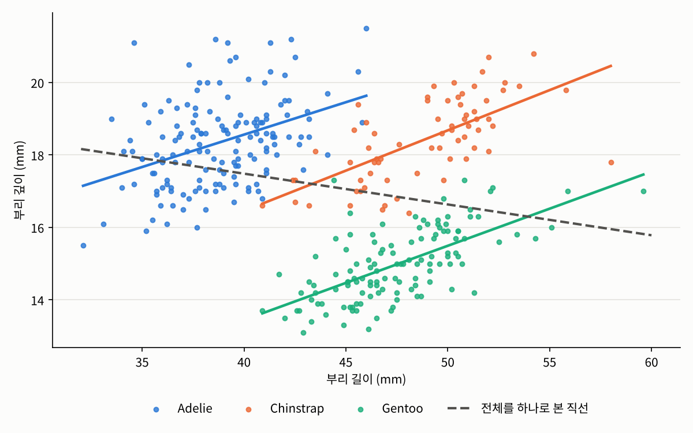

## 들어가며

[지난 두 글](02-correlation.qmd)에서는 두 변수가 함께 움직이는 정도를 상관계수로 쟀습니다. 이번 글에서는 한 걸음 물러서서, 그 숫자를 어떻게 **해석**해야 하는지를 다룹니다.

먼저 "상관관계는 인과관계가 아니다"라는 유명한 말이 정확히 무슨 뜻인지, 상관이 생기는 여러 이유를 나누어 정리합니다. 그다음 그 극단적인 경우로, 데이터를 하나로 합쳐서 보느냐 집단별로 나누어 보느냐에 따라 관계의 **방향**이 정반대로 뒤집히는 **심슨의 역설**을 수치형 데이터와 분할표 데이터에서 각각 살펴보겠습니다.

## 상관관계는 인과관계가 아닙니다

두 변수 $X$와 $Y$ 사이에 강한 상관이 있다고 해 보겠습니다. 이때 가장 먼저 떠오르는 해석은 "$X$가 $Y$를 일으킨다"는 것입니다. 하지만 같은 상관은 전혀 다른 여러 이유로도 생길 수 있습니다.

**1. 숨은 공통 원인(교란 변수).** [1.3](../01-what-is-statistics/03-data-collection.qmd)의 비타민 시뮬레이션에서, 비타민은 건강에 아무 효과가 없었지만 비타민을 먹는 사람이 더 건강하게 나왔습니다. "건강에 대한 관심"이라는 교란 변수가 비타민 복용과 건강 둘 다에 영향을 주었기 때문입니다. 아이스크림 판매량과 물놀이 사고 건수가 함께 오르내리는 것도, 아이스크림이 사고를 일으켜서가 아니라 **더운 날씨**가 둘 다를 늘리기 때문입니다.

**2. 방향이 반대인 인과(역인과).** 운동을 적게 하는 노인일수록 건강이 나쁘다는 상관이 있다면, 운동 부족이 건강을 해친 것일 수도 있지만 **건강이 나빠서 운동을 못 하는 것**일 수도 있습니다. 상관계수는 방향을 알려 주지 않습니다. $X$와 $Y$의 상관계수는 $Y$와 $X$의 상관계수와 똑같으니까요.

**3. 우연.** 변수가 아주 많으면, 아무 관계없는 변수 쌍 중에서도 우연히 상관이 높게 나오는 쌍이 반드시 생깁니다. 어떤 나라의 연도별 치즈 소비량과 어떤 직업의 연도별 종사자 수처럼, 둘 다 해마다 꾸준히 늘기만 한 두 변수는 아무 관계가 없어도 상관계수가 높게 나옵니다. 많은 변수 쌍을 뒤져 상관이 높은 것만 골라 보고하는 것이 왜 위험한지는 8장의 다중 검정에서 다시 다룹니다.

**4. 진짜 인과.** 물론 상관이 실제로 인과를 반영하는 경우도 있습니다. 문제는 **상관계수 숫자만으로는 이 네 가지를 구분할 수 없다**는 것입니다. 구분하려면 데이터가 어떻게 모였는지, 어떤 변수가 빠져 있는지를 따져 봐야 합니다. 1.3에서 본 것처럼, 연구자가 원인을 무작위로 배정한 실험이라면 1번과 2번의 가능성을 막을 수 있습니다.

## 펭귄의 부리: 합치면 뒤집힙니다

[4.2](02-correlation.qmd)의 상관행렬에서 부리 깊이가 다른 변수들과 모두 음의 상관을 보인다는 수상한 결과가 있었습니다. 그중 부리 길이와 부리 깊이의 관계를 자세히 보겠습니다.

```python
import numpy as np
import seaborn as sns

penguins = sns.load_dataset("penguins").dropna(subset=["bill_length_mm", "bill_depth_mm"])
x, y = penguins["bill_length_mm"], penguins["bill_depth_mm"]
print(f"전체 ({len(penguins)}마리) : 상관계수 {x.corr(y):+.3f}")
for species, d in penguins.groupby("species"):
    print(f"{species:9s} ({len(d):3d}마리): 상관계수 {d.bill_length_mm.corr(d.bill_depth_mm):+.3f}")
```

```
전체 (342마리) : 상관계수 -0.235
Adelie    (151마리): 상관계수 +0.391
Chinstrap ( 68마리): 상관계수 +0.654
Gentoo    (123마리): 상관계수 +0.643
```

펭귄 전체를 하나로 보면 부리가 길수록 부리가 **얕은** 음의 상관($-0.235$)이 있습니다. 그런데 종별로 나누어 보면 세 종 모두에서 부리가 길수록 부리가 **깊은** 양의 상관이 있습니다. 세 종 모두에서 양수인데, 합치니 음수가 된 것입니다. 그림을 보면 이유가 분명해집니다.

{fig-alt="펭귄의 부리 길이(가로축)와 부리 깊이(세로축) 산점도. 아델리펭귄(파랑)은 왼쪽 위, 턱끈펭귄(주황)은 오른쪽 위, 젠투펭귄(초록)은 오른쪽 아래에 무리 지어 있다. 각 종의 점들에 맞춘 세 직선은 모두 오른쪽 위로 올라가는 양의 기울기를 갖지만, 세 종을 하나로 합쳐 맞춘 회색 점선 직선은 오른쪽 아래로 내려가는 음의 기울기를 갖는다." width=85%}

각 종의 점들은 저마다 오른쪽 위로 올라가는 무리를 이룹니다. 그런데 세 무리의 **위치**가 다릅니다. 아델리펭귄은 부리가 짧고 깊은 왼쪽 위에, 젠투펭귄은 부리가 길고 얕은 오른쪽 아래에 있습니다. 세 무리를 하나로 합쳐 직선을 그으면, 무리 안의 경향이 아니라 **무리와 무리 사이의 배치**를 따라 오른쪽 아래로 내려가는 직선이 됩니다. 실제로 종별 평균을 보면 아델리펭귄의 부리는 평균 38.8mm 길이에 18.3mm 깊이, 젠투펭귄은 47.5mm 길이에 15.0mm 깊이입니다.

여기서 종은 부리 길이와 부리 깊이 **둘 다**에 영향을 주는 변수, 즉 교란 변수입니다. 4.2의 상관행렬에서 부리 깊이와 몸무게의 상관이 $-0.472$였던 것도 같은 이유입니다. 종별로 나누어 계산하면 이 상관계수는 아델리펭귄 0.576, 턱끈펭귄 0.604, 젠투펭귄 0.719로 모두 양수가 됩니다. 같은 종 안에서는 부리가 깊은 펭귄이 대체로 더 무겁지만, 덩치 큰 젠투펭귄의 부리가 유난히 얕아서 전체로 보면 음의 상관이 나타난 것입니다.

이렇게 **집단별로는 성립하는 관계가 집단을 합치면 사라지거나 반대 방향이 되는 현상**을 **심슨의 역설**(Simpson's paradox)이라고 합니다. 통계학자 에드워드 심슨(Edward H. Simpson)의 1951년 논문에서 이름을 따왔지만, 그보다 앞서 칼 피어슨과 우드니 율(Udny Yule)도 비슷한 현상을 지적한 바 있습니다.[^simpson]

## 신장 결석 치료: 분할표에서의 역설

심슨의 역설은 분할표에서도 일어납니다. 1986년 영국에서 신장 결석 치료법들의 성공률을 비교한 연구가 있습니다.[^charig] 그중 개복 수술(아래 표의 A)과 피부를 작게 절개해 내시경으로 결석을 꺼내는 경피적 신쇄석술(B)의 성공 횟수를 결석 크기별로 정리하면 다음과 같습니다.[^julious]

```python
import pandas as pd

# 신장 결석 치료 성공 횟수 / 환자 수
data = pd.DataFrame({
    "결석 크기": ["작은 결석", "작은 결석", "큰 결석", "큰 결석"],
    "치료법":    ["A", "B", "A", "B"],
    "성공":      [81, 234, 192, 55],
    "환자":      [87, 270, 263, 80],
})
by_size = data.assign(성공률=(data["성공"] / data["환자"]).round(3))
print(by_size.to_string(index=False))

total = data.groupby("치료법")[["성공", "환자"]].sum()
total["성공률"] = (total["성공"] / total["환자"]).round(3)
print(total)
```

```
결석 크기 치료법  성공  환자   성공률
작은 결석   A  81  87 0.931
작은 결석   B 234 270 0.867
 큰 결석   A 192 263 0.730
 큰 결석   B  55  80 0.688
      성공   환자    성공률
치료법
A    273  350  0.780
B    289  350  0.826
```

결석 크기별로 보면 **작은 결석에서도, 큰 결석에서도 A의 성공률이 더 높습니다**(93.1% 대 86.7%, 73.0% 대 68.8%). 그런데 결석 크기를 무시하고 합치면 **B의 성공률이 더 높습니다**(78.0% 대 82.6%). 어느 쪽이 더 나은 치료법일까요?

비밀은 **누가 어떤 치료를 받았는가**에 있습니다. A를 받은 350명 중 263명(75%)은 치료가 어려운 큰 결석 환자였고, B를 받은 350명 중 270명(77%)은 치료가 쉬운 작은 결석 환자였습니다. A는 어려운 환자를 많이 맡았기 때문에, 크기별로는 더 잘했는데도 전체 성공률이 낮게 나온 것입니다. 여기서 결석 크기는 **어떤 치료를 받을지**와 **치료가 성공할지** 둘 다에 영향을 주는 교란 변수입니다. 원래 연구는 두 치료법을 서로 다른 시기의 환자들에게 쓴 기록을 비교한 것으로, 환자를 무작위로 배정한 실험이 아니었습니다.

[4.1](01-contingency-tables.qmd)의 언어로 말하면, 이 데이터는 치료법 × 결석 크기 × 성공 여부의 3차원 분할표입니다. 결석 크기를 무시하고 합친 2차원 분할표는 결석 크기라는 정보를 잃어버려서, 교란 변수의 효과가 치료법의 효과인 것처럼 보이게 만들었습니다.

## 그러면 언제 나누고 언제 합쳐야 할까요?

두 예에서는 집단별로 나누어 본 결과가 더 그럴듯했습니다. 종이 다른 펭귄은 애초에 다른 체형을 가졌고, 결석 크기는 치료 결과에 큰 영향을 주니까요. 그렇다면 항상 나누어 보면 될까요?

꼭 그렇지는 않습니다. 나누는 기준이 되는 변수가 **원인보다 먼저 정해진** 교란 변수라면(결석 크기는 치료법을 고르기 전에 이미 정해져 있습니다) 나누어 보는 것이 맞습니다. 하지만 그 변수가 **원인의 결과로 생긴** 변수라면, 그 변수로 나누는 것이 오히려 진짜 효과를 가릴 수 있습니다. 예를 들어 어떤 약이 혈압을 낮춰서 심장병을 예방한다면, "혈압이 같은 사람들끼리" 나누어 비교하면 약의 효과가 사라져 보일 것입니다. 약이 효과를 내는 바로 그 경로를 막아 버렸기 때문입니다.

결국 **어느 쪽이 맞는지는 데이터만으로는 정할 수 없고, 변수들 사이의 인과 구조에 대한 지식이 필요합니다.** 이것을 체계적으로 다루는 분야가 [1.3](../01-what-is-statistics/03-data-collection.qmd)에서 소개한 **인과 추론**입니다. 이 과목에서 기억해 둘 교훈은 다음 세 가지입니다.

- 상관이 보이면 "이 둘에 함께 영향을 줄 수 있는 다른 변수는 없는가?"를 먼저 묻습니다.
- 데이터에 집단을 나누는 변수(종, 성별, 지역, 시기 등)가 있다면, **합친 결과와 나눈 결과를 둘 다** 봅니다. 둘이 크게 다르다면 그 변수가 교란 변수일 가능성이 높습니다.
- 원인을 무작위로 배정한 실험은 교란 변수와 원인의 연결을 끊어 주므로, 인과에 대한 가장 확실한 근거가 됩니다.

## 정리

이번 글에서는 두 변수의 관계를 해석할 때의 함정을 다루었습니다.

- 상관관계는 **교란 변수**, **역인과**, **우연**, 그리고 **진짜 인과** 중 어느 것으로도 생길 수 있고, 상관계수만으로는 이를 구분할 수 없습니다.
- 집단별로 성립하는 관계가 집단을 합치면 사라지거나 뒤집히는 현상을 **심슨의 역설**이라고 합니다. 펭귄의 부리 길이와 깊이는 종별로는 양의 상관, 합치면 음의 상관을 보였습니다.
- 신장 결석 치료에서는 크기별로는 A가, 합치면 B가 더 나아 보였습니다. 결석 크기가 치료법 선택과 치료 결과 둘 다에 영향을 준 교란 변수였기 때문입니다.
- 나누어 볼지 합쳐 볼지는 인과 구조에 대한 지식으로 정해야 하며, 무작위 실험은 교란 변수의 영향을 끊는 가장 확실한 방법입니다.

지금까지 두 변수의 관계를 재고 해석했습니다. 마지막으로, 그 관계를 실제로 **쓰는** 방법을 보겠습니다. 날개 길이를 알면 몸무게를 얼마로 예측해야 할까요? 다음 글에서는 산점도의 점들을 가장 잘 요약하는 직선을 구해 보겠습니다.

---

### 연결되는 개념
* $\leftarrow$ **이전 개념:** [4.3 순위 상관](03-rank-correlation.qmd)
* $\rightarrow$ **다음 개념:** [4.5 최소제곱 직선](05-least-squares.qmd)

[^simpson]: E. H. Simpson, "The Interpretation of Interaction in Contingency Tables", *Journal of the Royal Statistical Society: Series B* 13(2), 1951, pp. 238–241. 그보다 앞선 지적으로는 G. U. Yule, "Notes on the Theory of Association of Attributes in Statistics", *Biometrika* 2(2), 1903, pp. 121–134가 있습니다.

[^charig]: C. R. Charig, D. R. Webb, S. R. Payne & J. E. Wickham, "Comparison of Treatment of Renal Calculi by Open Surgery, Percutaneous Nephrolithotomy, and Extracorporeal Shockwave Lithotripsy", *British Medical Journal* 292(6524), 1986, pp. 879–882.

[^julious]: 이 데이터를 심슨의 역설의 예로 소개한 글은 S. A. Julious & M. A. Mullee, "Confounding and Simpson's Paradox", *BMJ* 309(6967), 1994, pp. 1480–1481입니다. 결석 크기는 지름 2cm를 기준으로 나누었습니다.
