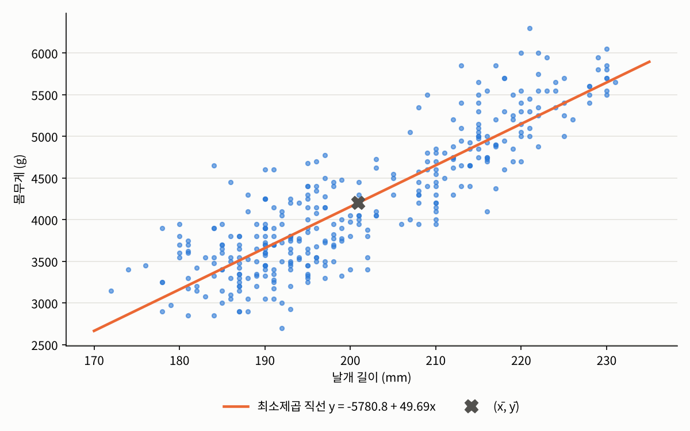
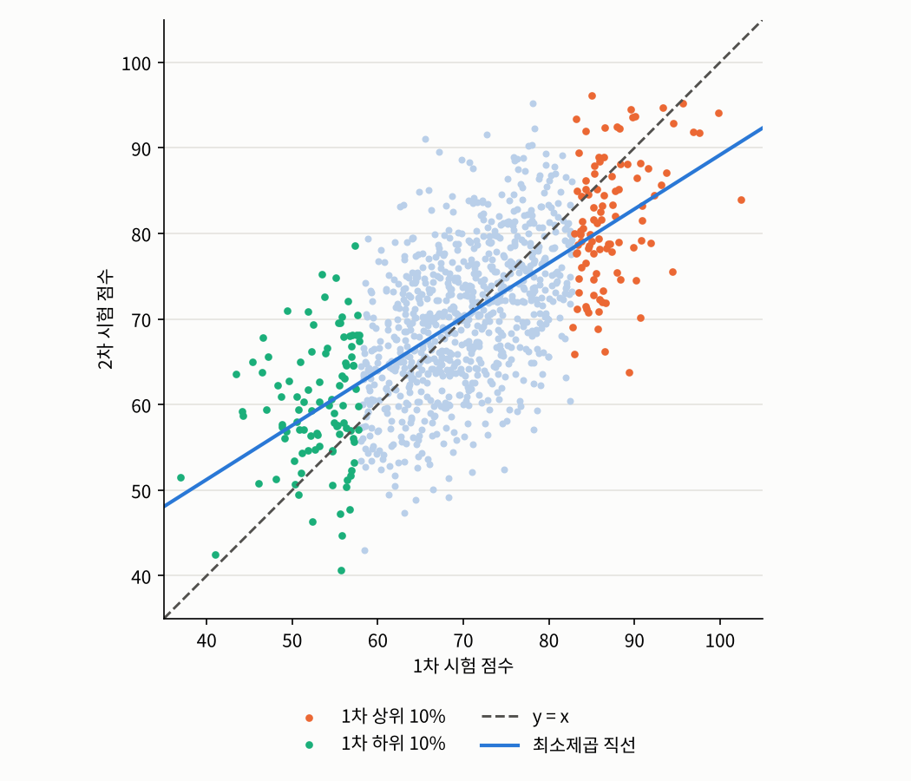

## 들어가며

[4.2](02-correlation.qmd)에서 펭귄의 날개 길이와 몸무게 사이에 상관계수 0.871의 강한 양의 관계가 있다는 것을 보았습니다. 이번 글에서는 이 관계를 **쓰는** 방법을 다룹니다. 날개 길이가 200mm인 펭귄을 새로 발견했다면, 몸무게를 얼마로 짐작해야 할까요?

산점도의 점들이 직선 주위에 모여 있으니, 그 점들을 가장 잘 대표하는 직선을 하나 그어서 읽으면 될 것입니다. 이번 글에서는 "가장 잘 대표한다"는 말을 정확히 정의해 **최소제곱 직선**을 구하고, 그 직선이 데이터를 얼마나 잘 설명하는지를 나타내는 **결정계수**를 살펴본 뒤, 이 직선에 숨어 있는 흥미로운 현상인 **평균으로의 회귀**를 다루겠습니다. 이번 글은 [기초 선형 모델](../../linear-models/index.qmd)의 회귀 분석으로 가는 맛보기입니다.

## 가장 잘 맞는 직선이란

직선 $y = a + bx$를 하나 정하면, 각 펭귄의 날개 길이 $x_i$에서 직선이 예측하는 몸무게는 $a + bx_i$입니다. 실제 몸무게 $y_i$와의 차이

$$e_i := y_i - (a + b x_i)$$

를 **잔차**(residual)라고 합니다. 산점도에서 각 점과 직선 사이의 **세로 거리**입니다. 좋은 직선이라면 잔차들이 전체적으로 작아야 할 것입니다.

[3.2](../03-summary-statistics/02-spread.qmd)에서 편차를 다룰 때와 같은 문제가 있습니다. 잔차에는 양수도 있고 음수도 있어서 그냥 더하면 상쇄됩니다. 그래서 여기서도 **제곱해서 더합니다.**

::: {.callout-note icon=false .callout-definition}
### 정의 4.5.1 (최소제곱 직선)
수치형 이변량 데이터 $(x_1, y_1), \dots, (x_n, y_n)$에 대해

$$Q(a, b) := \sum_{i=1}^{n} \big( y_i - a - b x_i \big)^2$$

를 가장 작게 만드는 $(\hat{a}, \hat{b})$로 정해지는 직선 $y = \hat{a} + \hat{b}x$를 **최소제곱 직선**(least squares line)이라고 합니다.
:::

이 방법을 **최소제곱법**(method of least squares)이라고 부르며, 19세기 초 르장드르와 가우스가 천문 관측 자료를 다루며 발전시킨 것으로 알려져 있습니다. [정리 3.1.4](../03-summary-statistics/01-center.qmd)에서 평균이 "제곱 거리의 합을 가장 작게 만드는 점"이었던 것을 떠올려 보면, 최소제곱 직선은 평균의 아이디어를 점에서 직선으로 넓힌 것입니다.

## 기울기와 절편 구하기

다행히 최소제곱 직선은 깔끔한 공식으로 구할 수 있습니다.

::: {.callout-important icon=false .callout-satz}
### 정리 4.5.2 (최소제곱 직선의 공식)
$s_x > 0$이면 최소제곱 직선의 기울기와 절편은

$$\hat{b} = \frac{s_{xy}}{s_x^2} = r \, \frac{s_y}{s_x}, \qquad \hat{a} = \bar{y} - \hat{b}\,\bar{x}$$

입니다. 여기서 $s_{xy}$는 표본 공분산, $r$은 상관계수, $s_x, s_y$는 표본 표준편차입니다.
:::

::: {.callout-tip collapse="true" icon=false .callout-beweis}
### 증명
먼저 $b$를 고정하고 $a$만 움직여 보겠습니다. $w_i := y_i - b x_i$라 두면 $Q(a, b) = \sum (w_i - a)^2$이고, 정리 3.1.4에 의해 이는 $a = \bar{w} = \bar{y} - b\bar{x}$일 때 가장 작습니다. 이 $a$를 대입하면

$$Q(\bar{y} - b\bar{x}, b) = \sum_{i=1}^{n} \big( (y_i - \bar{y}) - b(x_i - \bar{x}) \big)^2 = (n-1)\big( s_y^2 - 2b\, s_{xy} + b^2 s_x^2 \big)$$

입니다. 이는 $b$에 대한 아래로 볼록한 이차식이므로, 꼭짓점 $b = s_{xy}/s_x^2$에서 가장 작습니다. 마지막으로 $r = s_{xy}/(s_x s_y)$이므로 $s_{xy}/s_x^2 = r\, s_y / s_x$입니다. $\square$
:::

공식에서 바로 읽을 수 있는 사실들이 있습니다.

- 절편의 식 $\hat{a} = \bar{y} - \hat{b}\bar{x}$를 다시 쓰면 $\bar{y} = \hat{a} + \hat{b}\bar{x}$입니다. 최소제곱 직선은 항상 **두 평균의 점 $(\bar{x}, \bar{y})$를 지납니다.**
- 기울기의 부호는 상관계수의 부호와 같습니다. 양의 상관이면 오른쪽 위로, 음의 상관이면 오른쪽 아래로 기웁니다.
- 잔차의 합은 항상 0입니다. 증명에서 $a = \bar{w}$로 정했으니 $\sum (w_i - \bar{w}) = 0$이고, 이것이 바로 잔차의 합입니다.

## 날개 길이로 몸무게 예측하기

펭귄 데이터로 직접 계산해 보겠습니다.

```python
import numpy as np
import seaborn as sns

penguins = sns.load_dataset("penguins").dropna(subset=["flipper_length_mm", "body_mass_g"])
x = penguins["flipper_length_mm"].to_numpy()
y = penguins["body_mass_g"].to_numpy()

r = np.corrcoef(x, y)[0, 1]
b = r * y.std(ddof=1) / x.std(ddof=1)          # 기울기
a = y.mean() - b * x.mean()                    # 절편
residuals = y - (a + b * x)

print(f"기울기 b = {b:.2f} g/mm, 절편 a = {a:.1f} g")
print(f"np.polyfit로 확인  : {np.polyfit(x, y, deg=1).round(2)}")
print(f"잔차의 합          : {residuals.sum():.6f}")
print(f"날개 200mm의 예측값: {a + b * 200:.1f} g")
print(f"r^2                : {r ** 2:.3f}")
print(f"1 - 잔차 제곱합/전체 제곱합: {1 - np.sum(residuals ** 2) / np.sum((y - y.mean()) ** 2):.3f}")
```

```
기울기 b = 49.69 g/mm, 절편 a = -5780.8 g
np.polyfit로 확인  : [   49.69 -5780.83]
잔차의 합          : -0.000000
날개 200mm의 예측값: 4156.3 g
r^2                : 0.759
1 - 잔차 제곱합/전체 제곱합: 0.759
```

(잔차의 합이 $-0.000000$으로 나온 것은 컴퓨터의 소수 계산에서 생기는 아주 작은 오차 때문이고, 이론적으로는 정확히 0입니다.)

{fig-alt="펭귄의 날개 길이와 몸무게 산점도 위에 주황색 최소제곱 직선 y = -5780.8 + 49.69x가 그려져 있다. 직선은 점들의 띠 한가운데를 지나 왼쪽 아래에서 오른쪽 위로 올라가며, 두 평균의 점을 나타내는 회색 X 표시를 지난다." width=85%}

최소제곱 직선은 $\text{몸무게} \approx -5780.8 + 49.69 \times \text{날개 길이}$입니다. 날개 길이가 200mm인 펭귄의 몸무게는 약 4156g으로 예측됩니다.

**기울기**는 "날개 길이가 1mm 긴 펭귄은 **평균적으로** 몸무게가 약 49.7g 더 나간다"고 읽습니다. 여기서 "평균적으로"가 중요합니다. 이 데이터에서 관찰한 경향일 뿐, 어떤 펭귄의 날개를 1mm 늘이면 몸무게가 49.7g 늘어난다는 인과적인 뜻이 아닙니다. [4.4](04-correlation-causation.qmd)의 교훈이 여기서도 그대로 적용됩니다. 실제로 이 데이터에는 종이 섞여 있어서, 이 기울기의 상당 부분은 "젠투펭귄은 날개도 길고 몸도 무겁다"는 종 사이의 차이를 반영합니다.

**절편** $-5780.8$g은 "날개 길이가 0mm인 펭귄의 몸무게"인데, 그런 펭귄은 없고 몸무게가 음수일 수도 없습니다. 데이터의 날개 길이는 172mm에서 231mm 사이에만 있으므로, 그 범위를 한참 벗어난 곳에서 직선을 읽으면 엉뚱한 답이 나옵니다. 데이터 범위 밖에서 예측하는 것을 **외삽**(extrapolation)이라고 하며, 늘 조심해야 합니다.

## 직선은 얼마나 잘 맞을까요? 결정계수

직선이 데이터를 얼마나 잘 설명하는지 숫자로 나타내 보겠습니다. 날개 길이를 모른다면 몸무게를 예측하는 가장 좋은 방법은 평균 $\bar{y}$를 말하는 것이고, 그때의 오차는 $\sum (y_i - \bar{y})^2$입니다. 날개 길이를 알고 직선을 쓰면 오차가 잔차 제곱합 $\sum e_i^2$로 줄어듭니다. 줄어든 비율을 보면 직선이 얼마나 도움이 되었는지 알 수 있습니다.

::: {.callout-note icon=false .callout-definition}
### 정의 4.5.3 (결정계수)
최소제곱 직선의 잔차 $e_1, \dots, e_n$에 대해

$$R^2 := 1 - \frac{\sum_{i=1}^{n} e_i^2}{\sum_{i=1}^{n} (y_i - \bar{y})^2}$$

을 **결정계수**(coefficient of determination)라고 합니다.
:::

결정계수는 "$y$의 전체 변동 중 직선으로 설명되는 부분의 비율"로 읽습니다. 그리고 직선 하나만 쓰는 경우에는 놀랍도록 간단한 관계가 있습니다.

::: {.callout-important icon=false .callout-satz}
### 정리 4.5.4 (결정계수와 상관계수)
최소제곱 직선의 결정계수는 상관계수의 제곱과 같습니다. 즉 $R^2 = r^2$입니다.
:::

::: {.callout-tip collapse="true" icon=false .callout-beweis}
### 증명
정리 4.5.2의 증명에서 $b = \hat{b} = s_{xy}/s_x^2$를 대입하면

$$\sum e_i^2 = (n-1)\Big( s_y^2 - \frac{s_{xy}^2}{s_x^2} \Big) = (n-1)\, s_y^2 \,(1 - r^2)$$

입니다. $\sum (y_i - \bar{y})^2 = (n-1) s_y^2$이므로 $R^2 = 1 - (1 - r^2) = r^2$입니다. $\square$
:::

펭귄 데이터에서 $r = 0.871$이므로 $R^2 = 0.759$이고, 위 코드에서 두 방법으로 계산한 값이 같은 것을 확인할 수 있습니다. 몸무게의 변동 중 약 76%가 날개 길이와의 직선 관계로 설명된다는 뜻입니다. 이 정리는 상관계수의 크기에 대한 또 다른 감각도 줍니다. $r = 0.5$이면 $R^2 = 0.25$로, 변동의 4분의 1만 설명됩니다. 상관계수 0.5는 생각보다 약한 관계입니다.

## 평균으로의 회귀

최소제곱 직선을 표준화된 형태로 쓰면 흥미로운 사실이 드러납니다. 정리 4.5.2의 직선 $\hat{y} = \bar{y} + r\,\frac{s_y}{s_x}(x - \bar{x})$를 정리하면

$$\frac{\hat{y} - \bar{y}}{s_y} = r \cdot \frac{x - \bar{x}}{s_x}$$

입니다. 즉 **예측값의 z-점수는 $x$의 z-점수에 $r$을 곱한 것**입니다. 완벽한 직선 관계($|r| = 1$)가 아니라면 $|r| < 1$이므로, 평균에서 표준편차 2개만큼 떨어진 $x$에 대해 직선은 $y$를 평균에서 표준편차 $2|r|$개만큼만, 즉 **평균에 더 가깝게** 예측합니다.

이 현상을 처음 체계적으로 보고한 사람은 19세기 영국의 프랜시스 골턴(Francis Galton)입니다. 그는 부모와 자녀의 키를 조사해, 키가 아주 큰 부모의 자녀는 평균보다 크기는 하지만 부모만큼 크지는 않고, 키가 아주 작은 부모의 자녀는 부모만큼 작지는 않다는 것을 발견했습니다.[^galton] 골턴은 이것을 평균으로 "되돌아간다"는 뜻에서 **평균으로의 회귀**(regression toward the mean)라고 불렀고, 오늘날 직선을 맞추는 일을 **회귀**(regression)라고 부르는 이름이 여기서 나왔습니다.

평균으로의 회귀는 키에만 있는 일이 아닙니다. 가상의 시험 데이터로 확인해 보겠습니다. 학생마다 실제 실력이 있고, 시험 점수는 실력에 그날의 운이 더해져 정해진다고 하겠습니다. 같은 학생들이 두 번 시험을 봅니다.

```python
import numpy as np

rng = np.random.default_rng(1557)
n = 1000
ability = rng.normal(70, 8, size=n)              # 학생마다의 실제 실력 (관찰되지 않음)
test1 = ability + rng.normal(0, 6, size=n)       # 1차 시험 = 실력 + 그날의 운
test2 = ability + rng.normal(0, 6, size=n)       # 2차 시험 = 실력 + 다른 날의 운

top = test1 >= np.quantile(test1, 0.9)           # 1차 시험 상위 10%
bottom = test1 <= np.quantile(test1, 0.1)        # 1차 시험 하위 10%
print(f"두 시험의 상관계수: {np.corrcoef(test1, test2)[0, 1]:.3f}")
print(f"상위 10%: 1차 평균 {test1[top].mean():.1f} → 2차 평균 {test2[top].mean():.1f}")
print(f"하위 10%: 1차 평균 {test1[bottom].mean():.1f} → 2차 평균 {test2[bottom].mean():.1f}")
print(f"전체    : 1차 평균 {test1.mean():.1f} → 2차 평균 {test2.mean():.1f}")
```

```
두 시험의 상관계수: 0.644
상위 10%: 1차 평균 87.3 → 2차 평균 81.5
하위 10%: 1차 평균 53.0 → 2차 평균 60.0
전체    : 1차 평균 70.1 → 2차 평균 70.2
```

{fig-alt="1000명의 1차 시험 점수(가로축)와 2차 시험 점수(세로축) 산점도. 1차 상위 10퍼센트는 주황, 하위 10퍼센트는 초록, 나머지는 옅은 파랑으로 칠해져 있다. 회색 점선 y = x와 파란 최소제곱 직선이 함께 그려져 있는데, 최소제곱 직선이 y = x보다 완만해서 오른쪽에서는 y = x 아래에, 왼쪽에서는 y = x 위에 있다. 주황 점들은 대부분 y = x보다 아래에, 초록 점들은 대부분 위에 있다." width=75%}

두 시험 모두 전체 평균은 약 70점으로 같고, 실력도 바뀌지 않았습니다. 그런데 1차 시험의 상위 10%는 2차 시험에서 평균 87.3점에서 81.5점으로 **떨어졌고**, 하위 10%는 53.0점에서 60.0점으로 **올랐습니다.**

이유는 운에 있습니다. 1차 시험에서 상위 10%에 든 학생들은 실력도 좋았겠지만, 평균적으로 **그날 운도 좋았던** 학생들입니다. 2차 시험에서는 운이 새로 정해지니, 좋았던 운이 평범하게 돌아오면서 점수가 평균 쪽으로 내려옵니다. 하위 10%는 반대입니다. 그림에서 최소제곱 직선이 $y = x$보다 완만한 것이 바로 이 현상입니다.

평균으로의 회귀를 모르면 엉뚱한 결론을 내리기 쉽습니다. 성적이 가장 나빴던 학생들에게 특별 보충 수업을 했더니 다음 시험에서 점수가 올랐다면, 그것이 보충 수업의 효과인지 그냥 평균으로의 회귀인지 구분해야 합니다. 위 시뮬레이션에서는 아무것도 하지 않았는데도 하위 10%의 점수가 7점이나 올랐습니다. 이것을 구분하려면 [1.3](../01-what-is-statistics/03-data-collection.qmd)에서 본 것처럼 보충 수업을 받지 않은 비교 집단이 필요합니다.

## 다음 단계

이번 글의 최소제곱 직선은 회귀 분석의 가장 단순한 형태입니다. [기초 선형 모델](../../linear-models/index.qmd)에서는 이를 여러 가지 방향으로 확장합니다. 설명 변수를 여러 개 쓰고(예: 날개 길이와 종을 함께 써서 몸무게 예측하기), 잔차를 확률적으로 모형화하고, 기울기가 정말 0이 아닌지를 추론 통계의 방법으로 판단합니다. 마지막 질문은 이 과목의 6~8장에서 배울 도구들이 필요합니다.

## 정리

이번 글에서는 두 변수의 관계를 직선으로 요약하는 방법을 다루었습니다.

- **최소제곱 직선**은 잔차의 제곱합을 가장 작게 만드는 직선입니다. 기울기는 $\hat{b} = s_{xy}/s_x^2 = r\, s_y/s_x$, 절편은 $\hat{a} = \bar{y} - \hat{b}\bar{x}$이며, 직선은 항상 $(\bar{x}, \bar{y})$를 지납니다.
- 기울기는 평균적인 경향을 나타낼 뿐 인과를 뜻하지 않으며, 데이터 범위 밖에서 직선을 읽는 **외삽**은 조심해야 합니다.
- **결정계수** $R^2$는 $y$의 변동 중 직선으로 설명되는 비율이고, 최소제곱 직선에서는 $R^2 = r^2$입니다.
- 예측값의 z-점수는 $x$의 z-점수에 $r$을 곱한 것이므로, 극단적인 값은 다음에 평균 쪽으로 돌아오는 경향이 있습니다. 이 **평균으로의 회귀**를 처치의 효과로 착각하지 않도록 주의해야 합니다.

2장부터 4장까지 기술 통계를 마쳤습니다. 우리는 손에 쥔 데이터를 표와 그림과 숫자로 정리하는 방법을 익혔습니다. 그런데 처음부터 하던 이야기를 다시 떠올려 보면, 이 데이터는 우연이 만든 결과 중 하나였습니다. 표본 평균, 상관계수, 회귀 직선의 기울기 모두 다른 표본을 뽑았다면 조금씩 달랐을 것입니다. 그 "조금씩 다름"을 다루려면 확률의 언어가 필요합니다. 5장에서는 지금까지의 상대도수와 히스토그램을 확률과 확률분포로 이어, 추론 통계로 넘어갈 다리를 놓겠습니다.

---

### 연결되는 개념
* $\leftarrow$ **이전 개념:** [4.4 상관과 인과, 심슨의 역설](04-correlation-causation.qmd)
* $\rightarrow$ **다음 개념:** 5 데이터에서 확률 모형으로 (추후 작성 예정)

[^galton]: F. Galton, "Regression Towards Mediocrity in Hereditary Stature", *The Journal of the Anthropological Institute of Great Britain and Ireland* 15, 1886, pp. 246–263.
